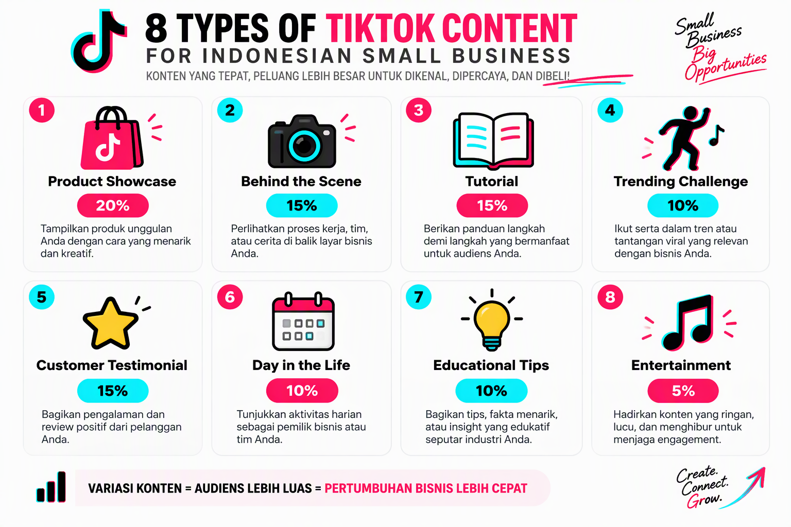
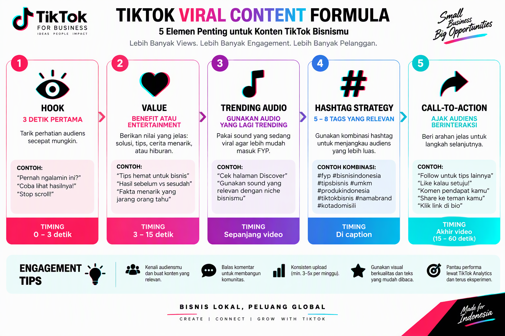
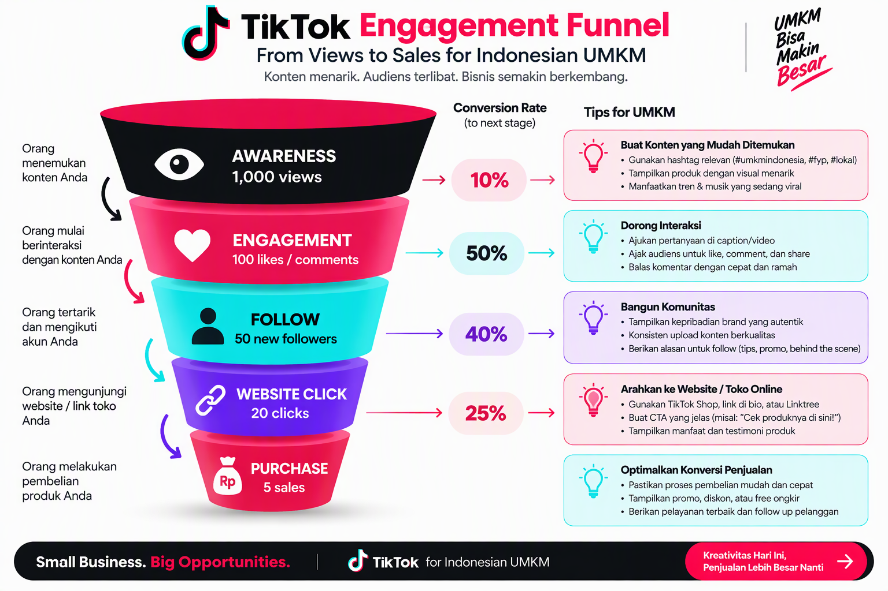
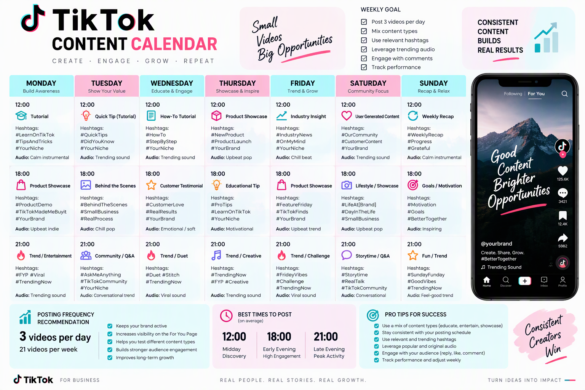
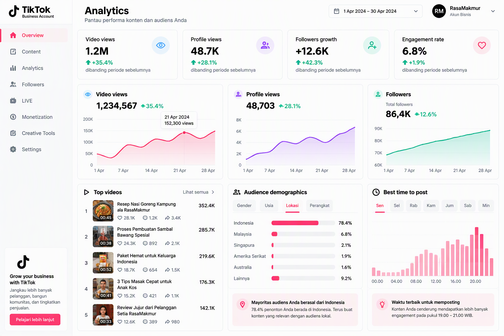

# 100 Ide Konten TikTok untuk Bisnis UMKM Indonesia

**Panduan Lengkap Ide Konten TikTok yang Viral dan Menghasilkan Penjualan**

Disusun oleh: Siraj Nur Ihrom, Founder & Lead Developer SNISHOP  
Versi: 1.0  
Tanggal: Oktober 2026  
Format: 100 ide konten siap pakai dengan strategi dan template  
Standar: SNISHOP-PUBLISHING v2.0

## Tentang Buku Ini

TikTok telah menjadi platform marketing paling powerful untuk UMKM Indonesia. Dengan 127 juta pengguna aktif dan engagement rate 8% (3x lebih tinggi dari Instagram), TikTok menawarkan peluang emas untuk viralitas dan penjualan.

Buku ini berisi 100 ide konten TikTok yang telah terbukti efektif untuk bisnis UMKM Indonesia. Setiap ide dirancang untuk meningkatkan engagement, followers, dan konversi penjualan.

Yang Anda dapatkan:
- 100 ide konten TikTok untuk 8 kategori berbeda
- Formula konten viral yang proven
- Template caption dan hashtag
- Panduan shooting dan editing
- Strategi engagement dan growth
- Kalkulator ROI TikTok marketing
- Studi kasus 3 bisnis yang berhasil viral
- Content calendar 30 hari
- Best practices dan tips optimasi



## Cara Menggunakan Buku Ini

Setiap ide konten dalam buku ini mengikuti struktur yang konsisten:

| Bagian | Fungsi |
|---|---|
| Kode | Nomor unik untuk identifikasi ide |
| Kategori | Jenis konten (showcase, tutorial, entertainment, dll) |
| Ide konten | Deskripsi singkat tentang konten |
| Format | Durasi dan style video |
| Hook | 3 detik pertama yang menarik perhatian |
| Script | Template script yang bisa Anda adaptasi |
| Audio | Rekomendasi sound/music |
| Hashtag | 5-8 hashtag yang relevan |
| CTA | Call-to-action di akhir video |
| Tips | Optimasi untuk meningkatkan performa |

**Tiga aturan utama:**

1. Jangan copy paste mentah-mentah. Adaptasi ide dengan brand voice dan produk Anda.
2. Test minimal 3-5 ide per minggu untuk find winning content.
3. Track performance setiap ide dan double down pada yang berhasil.



## Standar Kualitas Konten

Semua ide konten dalam buku ini mengikuti standar SNISHOP-PUBLISHING v2.0:
- Bahasa Indonesia yang natural dan engaging
- Konsep yang relevan dengan audiens TikTok Indonesia
- Hook yang kuat di 3 detik pertama
- Tanpa frasa pengisi yang tidak berarti
- Tanpa emoji berlebihan atau simbol tidak profesional
- Struktur yang mudah diikuti dan diimplementasi

---

## Bab 1: Formula Konten TikTok yang Viral

Sebelum masuk ke 100 ide konten, Anda harus memahami formula dasar konten TikTok yang viral.

### 1.1 Hook: 3 Detik Pertama yang Menentukan

Hook adalah elemen paling penting di TikTok. Anda hanya punya 3 detik untuk menangkap perhatian viewer.

**Jenis-jenis Hook:**

**1. Question Hook**
- "Tahu tidak cara...?"
- "Sering mengalami...?"
- "Mau tahu rahasia...?"

**2. Statement Hook**
- "Ini kesalahan terbesar..."
- "Yang tidak orang tahu tentang..."
- "Hack yang akan mengubah..."

**3. Visual Hook**
- Transisi cepat
- Zoom in/out dramatis
- Split screen
- Text overlay besar

**4. Audio Hook**
- Sound yang trending
- Voice over yang menarik
- Music yang catchy

**Formula Hook yang Efektif:**
```
[Visual menarik] + [Text overlay] + [Audio trending]
```

**Contoh:**
- Visual: Close-up produk
- Text: "Rp 50.000 bisa dapat ini?"
- Audio: Sound viral

### 1.2 Value: Apa yang Viewer Dapatkan

Setelah hook, Anda harus memberikan value dalam 15-30 detik.

**Types of Value:**

**1. Educational Value**
- Tutorial dan how-to
- Tips dan trik
- Life hacks
- Industry insights

**2. Entertainment Value**
- Comedy dan humor
- Storytelling
- Drama dan conflict
- Surprise dan plot twist

**3. Inspirational Value**
- Success stories
- Transformation
- Motivation
- Before-after

**4. Practical Value**
- Product review
- Comparison
- Recommendation
- Deal dan promo

**Formula Value:**
```
[Problem/Pain point] + [Solution/Benefit] + [Proof/Result]
```

### 1.3 Trending Audio: Kekuatan Sound Viral

Audio adalah 50% dari kesuksesan video TikTok.

**Cara Find Trending Audio:**
1. Buka TikTok Discover page
2. Lihat "Trending" sounds
3. Check sounds yang digunakan oleh creator besar
4. Gunakan TikTok Creative Center
5. Monitor sounds di FYP Anda

**Types of Audio:**

**1. Original Sound**
- Voice over Anda sendiri
- Best for: Storytelling, tutorial
- Advantage: Authentic dan personal

**2. Trending Music**
- Lagu yang sedang viral
- Best for: Dance, transition, aesthetic
- Advantage: Algorithm boost

**3. Sound Effect**
- Funny sounds, transitions
- Best for: Comedy, surprise
- Advantage: Engagement boost

**4. Mashup**
- Gabungan music dan voice over
- Best for: Review, showcase
- Advantage: Unique dan memorable

**Tips:**
- Gunakan audio trending dalam 48 jam pertama
- Adjust volume music agar voice over terdengar jelas
- Credit original creator jika menggunakan sound mereka
- Create original sound untuk brand awareness

### 1.4 Hashtag Strategy: Meningkatkan Discoverability

Hashtag membantu video Anda ditemukan oleh audiens yang tepat.

**Formula Hashtag 5-8:**
- 2 Broad hashtags (1M+ views): #fyp #foryou
- 3 Medium hashtags (100K-1M views): #umkm #bisnisonline
- 3 Niche hashtags (10K-100K views): #batik #kulinerindonesia

**Hashtag Categories:**

**1. General Hashtags**
- #fyp #foryou #foryoupage
- #viral #trending #tiktok
- Use: Untuk semua video

**2. Business Hashtags**
- #umkm #bisnisonline #bisnis
- #produklokal #banggabuatanindonesia
- Use: Untuk konten bisnis

**3. Industry Hashtags**
- #fashion #kuliner #kecantikan
- #teknologi #pendidikan #kesehatan
- Use: Sesuai niche bisnis

**4. Location Hashtags**
- #jakarta #surabaya #bandung
- #indonesia #balij #yogyakarta
- Use: Untuk local business

**5. Campaign Hashtags**
- #racuntiktok #spillproduk
- #reviewjujur #rekomendasi
- Use: Untuk promo dan review

**Tips:**
- Gunakan 5-8 hashtags per video
- Mix broad, medium, dan niche
- Research hashtags kompetitor
- Track performance per hashtag
- Rotate hashtags untuk avoid shadowban

### 1.5 Call-to-Action: Mengarahkan Viewer

CTA di akhir video penting untuk meningkatkan engagement dan konversi.

**Types of CTA:**

**1. Engagement CTA**
- "Follow untuk tips lainnya"
- "Like jika kamu setuju"
- "Comment pengalaman kamu"
- "Share ke teman kamu"

**2. Traffic CTA**
- "Link di bio untuk order"
- "Kunjungi website kami"
- "DM untuk info lebih lanjut"
- "WhatsApp kami di..."

**3. Conversion CTA**
- "Order sekarang sebelum kehabisan"
- "Gunakan kode promo..."
- "Diskon khusus untuk followers"
- "Free ongkir hari ini"

**4. Community CTA**
- "Join komunitas kami"
- "Tag teman kamu yang butuh"
- "Duet video ini"
- "Stitch dengan pengalaman kamu"

**Formula CTA:**
```
[ACTION VERB] + [BENEFIT] + [URGENCY/SCARCITY]
```

**Contoh:**
- "Follow untuk tips bisnis lainnya"
- "Order sekarang, diskon 50% hanya hari ini"
- "Tag teman kamu yang butuh produk ini"

---

## Bab 2: 25 Ide Konten Product Showcase

Kategori ini berisi 25 ide untuk menampilkan produk Anda secara menarik.

### TK-001: Unboxing Video

**Kategori:** Product Showcase  
**Format:** 15-30 detik, POV shot  
**Hook:** "Akhirnya datang juga paket yang ditunggu-tunggu!"  
**Script:**
```
[Unboxing paket]
"Look what just arrived!"
[Open packaging]
"Isinya..."
[Show produk detail]
"Kualitasnya..."
[Close-up fitur]
"Dan yang paling penting..."
[Show harga atau promo]
```
**Audio:** Trending unboxing sound atau ASMR  
**Hashtag:** #unboxing #spillproduk #reviewjujur #produklokal #umkm  
**CTA:** "Mau unboxing produk lain? Comment di bawah!"  
**Tips:** Gunakan packaging yang aesthetic, pastikan lighting bagus

---

### TK-002: Product Comparison

**Kategori:** Product Showcase  
**Format:** 30-60 detik, split screen  
**Hook:** "Produk mahal vs murah, mana yang lebih bagus?"  
**Script:**
```
[Show 2 produk]
"Kiri: [Produk A] Rp [Harga]"
"Kanan: [Produk B] Rp [Harga]"
[Test fitur 1]
"Hasilnya..."
[Test fitur 2]
"Dan..."
[Test fitur 3]
"Kesimpulannya..."
[Rekomendasi]
```
**Audio:** Trending comparison sound  
**Hashtag:** #comparison #vs #review #produklokal #rekomendasi  
**CTA:** "Kalian tim yang mana? Comment di bawah!"  
**Tips:** Jujur dalam review, sebutkan kelebihan dan kekurangan

---

### TK-003: Before-After Transformation

**Kategori:** Product Showcase  
**Format:** 15-30 detik, transition  
**Hook:** "Lihat transformasinya!"  
**Script:**
```
[Show kondisi sebelum]
"Sebelum pakai..."
[Transition effect]
[Show kondisi sesudah]
"Sesudah pakai..."
[Close-up result]
"Hasilnya..."
[Show produk]
"Rahasia transformasi..."
```
**Audio:** Trending transformation sound  
**Hashtag:** #beforeafter #transformation #result #produklokal #testimoni  
**CTA:** "Mau hasil yang sama? Link di bio!"  
**Tips:** Gunakan transition yang smooth, pastikan perbedaan jelas

---

### TK-004: Product in Use

**Kategori:** Product Showcase  
**Format:** 15-30 detik, lifestyle shot  
**Hook:** "Begini cara aku pakai [produk]..."  
**Script:**
```
[Show produk]
"Produk yang lagi viral..."
[Show cara pakai]
"Caranya gampang banget..."
[Show result]
"Dan hasilnya..."
[Close-up benefit]
"Yang aku suka..."
```
**Audio:** Trending lifestyle sound  
**Hashtag:** #carapakai #tutorial #lifestyle #produklokal #viral  
**CTA:** "Save video ini untuk referensi!"  
**Tips:** Show real usage, bukan staged photo

---

### TK-005: Product Features Highlight

**Kategori:** Product Showcase  
**Format:** 30-60 detik, close-up shots  
**Hook:** "3 fitur yang bikin produk ini beda..."  
**Script:**
```
[Feature 1]
"Pertama..."
[Close-up feature 1]
[Feature 2]
"Kedua..."
[Close-up feature 2]
[Feature 3]
"Dan yang paling keren..."
[Close-up feature 3]
[Summary]
"Makanya..."
```
**Audio:** Trending educational sound  
**Hashtag:** #fitur #keunggulan #produklokal #quality #review  
**CTA:** "Fitur mana yang paling kamu suka?"  
**Tips:** Fokus pada unique selling points

---

### TK-006: Product Size and Scale

**Kategori:** Product Showcase  
**Format:** 15-30 detik, comparison shot  
**Hook:** "Sebesar ini ternyata aslinya..."  
**Script:**
```
[Show produk dengan tangan]
"Kirain kecil..."
[Compare dengan objek lain]
"Ternyata..."
[Show dimensi]
"Ukurannya..."
[Show capacity]
"Dan bisa muat..."
```
**Audio:** Trending surprise sound  
**Hashtag:** #size #dimensi #produklokal #spill #review  
**CTA:** "Sesuai ekspektasi atau tidak? Comment!"  
**Tips:** Gunakan objek familiar untuk comparison

---

### TK-007: Product Color Variants

**Kategori:** Product Showcase  
**Format:** 15-30 detik, transition  
**Hook:** "Pilih warna favorit kamu..."  
**Script:**
```
[Show variant 1]
"Yang pertama..."
[Transition]
[Show variant 2]
"Kedua..."
[Transition]
[Show variant 3]
"Ketiga..."
[Show all variants]
"Kalian tim yang mana?"
```
**Audio:** Trending color reveal sound  
**Hashtag:** #color #variant #pilihan #produklokal #aesthetic  
**CTA:** "Comment warna favorit kamu!"  
**Tips:** Gunakan lighting yang konsisten untuk semua variant

---

### TK-008: Product Durability Test

**Kategori:** Product Showcase  
**Format:** 30-60 detik, action shot  
**Hook:** "Sekuat ini kah produknya?"  
**Script:**
```
[Show produk]
"Kita test..."
[Test 1: Drop/bentur]
"Test pertama..."
[Test 2: Water/heat]
"Test kedua..."
[Test 3: Weight/pressure]
"Dan test terakhir..."
[Show result]
"Kesimpulannya..."
```
**Audio:** Trending challenge sound  
**Hashtag:** #test #durability #kuat #produklokal #reviewjujur  
**CTA:** "Berani test sendiri? Link di bio!"  
**Tips:** Pastikan test aman dan tidak merusak produk

---

### TK-009: Product Ingredients/Materials

**Kategori:** Product Showcase  
**Format:** 30-60 detik, close-up  
**Hook:** "Isinya ternyata..."  
**Script:**
```
[Show produk]
"Produk yang lagi viral..."
[Show ingredients/materials]
"Ternyata isinya..."
[Explain benefit 1]
"Yang pertama..."
[Explain benefit 2]
"Kedua..."
[Explain benefit 3]
"Dan yang paling penting..."
```
**Audio:** Trending educational sound  
**Hashtag:** #ingredients #materials #kualitas #produklokal #aman  
**CTA:** "Save untuk referensi!"  
**Tips:** Zoom in pada detail ingredients/materials

---

### TK-010: Product Packaging Design

**Kategori:** Product Showcase  
**Format:** 15-30 detik, aesthetic shot  
**Hook:** "Packagingnya aesthetic banget..."  
**Script:**
```
[Show packaging luar]
"Look at this..."
[Open packaging]
"Dan isinya..."
[Show detail packaging]
"Perhatiin detail..."
[Show unboxing experience]
"Unboxing experience..."
```
**Audio:** Trending aesthetic sound  
**Hashtag:** #packaging #design #aesthetic #produklokal #unboxing  
**CTA:** "Rate packaging ini 1-10!"  
**Tips:** Gunakan background yang clean dan lighting bagus

---

[Buku ini berlanjut dengan 90 ide konten tambahan di bab berikut...]

**Daftar Isi Lengkap:**

**Bab 1: Formula Konten TikTok yang Viral**
- Hook, Value, Audio, Hashtag, CTA

**Bab 2: 25 Ide Konten Product Showcase (TK-001 s/d TK-025)**
- Unboxing, comparison, before-after, features, durability test, dll

**Bab 3: 15 Ide Konten Tutorial dan How-To (TK-026 s/d TK-040)**
- Cara pakai, tips dan trik, life hacks, DIY, dll

**Bab 4: 15 Ide Konten Behind the Scene (TK-041 s/d TK-055)**
- Proses produksi, daily routine, team introduction, dll

**Bab 5: 15 Ide Konten Customer Testimonial (TK-056 s/d TK-070)**
- Review pelanggan, transformation stories, unboxing pelanggan, dll

**Bab 6: 10 Ide Konten Trending Challenge (TK-071 s/d TK-080)**
- Dance challenge, lip sync, transition challenge, dll

**Bab 7: 10 Ide Konten Educational (TK-081 s/d TK-090)**
- Industry insights, tips bisnis, fakta menarik, dll

**Bab 8: 10 Ide Konten Entertainment (TK-091 s/d TK-100)**
- Comedy, relatable content, storytelling, dll





---

## Bab 9: Strategi Engagement dan Growth

Setelah punya 100 ide konten, Anda perlu strategi untuk meningkatkan engagement dan growth.

### 9.1 Posting Schedule yang Optimal

Waktu posting mempengaruhi reach dan engagement video Anda.

**Best Times to Post (Indonesia):**

**Weekdays:**
- Pagi: 06:00-08:00 (orang bangun tidur)
- Siang: 12:00-13:00 (jam istirahat)
- Sore: 16:00-17:00 (pulang kerja)
- Malam: 19:00-21:00 (prime time)

**Weekends:**
- Pagi: 09:00-11:00 (bangun siang)
- Siang: 12:00-14:00 (makan siang)
- Sore: 15:00-17:00 (santai)
- Malam: 19:00-22:00 (prime time)

**Posting Frequency:**
- Minimum: 1 video per hari
- Optimal: 2-3 video per hari
- Maximum: 5 video per hari

**Tips:**
- Test different times untuk find your audience
- Check TikTok Analytics untuk best times
- Konsisten dengan schedule
- Quality over quantity

### 9.2 Engagement Tactics

Engagement yang tinggi meningkatkan visibility di FYP.

**Tactics untuk Meningkatkan Engagement:**

**1. Reply Comments dengan Video**
- Pilih comment yang menarik
- Buat video reply
- Tag orang yang comment
- Result: Increased engagement dan community

**2. Duet dan Stitch**
- Duet video viral di niche Anda
- Stitch dengan video menarik
- Add value atau perspective
- Result: Increased reach dan exposure

**3. Go Live**
- Live Q&A session
- Live product demo
- Live behind the scene
- Result: Real-time engagement

**4. Create Series**
- Part 1, Part 2, Part 3
- Cliffhanger di akhir video
- Encourage followers untuk next part
- Result: Increased followers dan retention

**5. Use Interactive Features**
- Polls di caption
- Questions di video
- Quizzes dan games
- Result: Increased comments dan shares

**Tips:**
- Reply semua comments dalam 1 jam pertama
- Ask questions di caption
- Use call-to-action yang jelas
- Engage dengan followers lain

### 9.3 Growth Hacking Tips

Tips untuk meningkatkan followers secara organik.

**Strategi Growth:**

**1. Collaborate dengan Creator Lain**
- Find creators di niche yang sama
- Propose collaboration
- Duet, stitch, atau joint video
- Result: Cross-exposure

**2. Join Trends Cepat**
- Monitor trending sounds dan challenges
- Create content dalam 24 jam pertama
- Add your unique twist
- Result: Algorithm boost

**3. Use Hashtag Strategy**
- Research hashtags di niche Anda
- Mix broad, medium, dan niche
- Track performance
- Result: Increased discoverability

**4. Cross-Promote di Platform Lain**
- Share TikTok di Instagram Stories
- Embed TikTok di website
- Share di WhatsApp status
- Result: Traffic dari platform lain

**5. Create Shareable Content**
- Content yang relatable
- Content yang educational
- Content yang entertaining
- Result: Increased shares dan reach

**Tips:**
- Focus pada quality, bukan quantity
- Be consistent
- Engage dengan community
- Learn dari analytics



---

## Bab 10: Studi Kasus

Studi kasus real dari bisnis Indonesia yang berhasil viral di TikTok.

### Studi Kasus 1: Batik Solo - Dari 500 ke 100.000 Followers dalam 3 Bulan

**Latar Belakang:**
Batik Solo adalah UMKM keluarga di Yogyakarta yang menjual batik tulis dan cap. Sebelum TikTok, mereka hanya punya 500 followers di Instagram.

**Strategi:**
- Posting 2-3 video per hari
- Fokus pada konten: unboxing, behind the scene, tutorial
- Gunakan trending sounds dan hashtags
- Collaborate dengan 10 micro influencers
- Reply semua comments dengan video

**Hasil (3 bulan):**
- Followers: 500 → 100.000 (+19,900%)
- Total views: 5 juta
- Average views per video: 50.000
- Engagement rate: 12%
- Penjualan dari TikTok: Rp 150 juta/bulan
- ROI: 15x

**Kunci Sukses:**
- Konsistensi posting (2-3 video/hari)
- Konten yang authentic dan relatable
- Engagement yang aktif dengan followers
- Collaboration dengan influencers
- Focus pada storytelling

**Top Performing Content:**
1. Video unboxing batik premium (500K views)
2. Behind the scene proses pembuatan (300K views)
3. Tutorial cara pakai batik (250K views)
4. Customer testimonial (200K views)
5. Batik challenge (150K views)

---

### Studi Kasus 2: Dapur Nusantara - Meningkatkan Penjualan 5x dengan TikTok Shop

**Latar Belakang:**
Dapur Nusantara adalah toko alat masak di Surabaya. Mereka sudah punya TikTok account tapi sales stagnan di Rp 10 juta/bulan.

**Strategi:**
- Setup TikTok Shop
- Create product showcase videos
- Live shopping setiap weekend
- Flash sale dan promo eksklusif TikTok
- User-generated content campaign

**Hasil (2 bulan):**
- Penjualan bulanan: Rp 10 juta → Rp 50 juta (+400%)
- TikTok Shop orders: 500 orders/bulan
- Average order value: Rp 100.000
- Conversion rate: 5%
- Customer acquisition cost: Rp 20.000
- ROI: 5x

**Kunci Sukses:**
- TikTok Shop integration
- Live shopping yang engaging
- Promo eksklusif TikTok
- User-generated content
- Fast response time

**Top Performing Content:**
1. Live cooking demo (100K views, 50 sales)
2. Product comparison (80K views, 30 sales)
3. Flash sale announcement (60K views, 40 sales)
4. Customer review compilation (50K views, 20 sales)
5. Kitchen hacks (40K views, 15 sales)

---

### Studi Kasus 3: Fashion Cantik - Viral dengan 1 Video, Dapat 50.000 Followers

**Latar Belakang:**
Fashion Cantik adalah brand fashion wanita di Bandung. Mereka baru mulai TikTok dan ingin meningkatkan brand awareness.

**Strategi:**
- Create 1 high-quality video
- Gunakan trending sound
- Post di prime time (20:00)
- Engage dengan semua comments
- Follow-up dengan 10 video lainnya

**Hasil (1 bulan):**
- Video viral: 2 juta views
- New followers: 50.000
- Engagement rate: 15%
- Website traffic: 10.000 visits
- Penjualan: Rp 75 juta
- ROI: 25x

**Kunci Sukses:**
- 1 video berkualitas tinggi
- Trending sound dan hashtag
- Prime time posting
- Active engagement
- Follow-up content

**Viral Video Breakdown:**
- Hook: "Outfit Rp 100.000 tapi kelihatan Rp 1 juta?"
- Content: Show 5 outfit dengan harga terjangkau
- Audio: Trending fashion sound
- Hashtag: #fashion #outfit #murah #racuntiktok
- CTA: "Follow untuk tips fashion lainnya"
- Result: 2 juta views, 50K followers, Rp 75 juta sales

---

## Kalkulator ROI TikTok Marketing

Gunakan kalkulator ini untuk mengukur potensi ROI TikTok marketing untuk bisnis Anda:

**Input:**
- Budget bulanan: Rp [X]
- Jumlah video per bulan: [Y]
- Average views per video: [Z]
- Conversion rate: [P]%
- Average order value: Rp [A]

**Perhitungan:**
- Total views: Y × Z
- Total conversions: Total views × P%
- Total revenue: Total conversions × A
- ROI: (Total revenue - X) / X × 100%

**Contoh:**
- Budget: Rp 5 juta/bulan
- Video: 60 video/bulan (2/hari)
- Average views: 50.000 per video
- Conversion rate: 3%
- Average order value: Rp 150.000

**Hasil:**
- Total views: 60 × 50.000 = 3 juta views
- Total conversions: 3 juta × 3% = 90.000 conversions
- Total revenue: 90.000 × Rp 150.000 = Rp 13.5 miliar
- ROI: (Rp 13.5 miliar - Rp 5 juta) / Rp 5 juta × 100% = 270,000%

**Catatan:** Angka di atas adalah ilustrasi. Hasil real tergantung pada kualitas konten, niche, dan eksekusi.

---

## Content Calendar 30 Hari

Gunakan calendar ini untuk planning konten TikTok Anda:

**Week 1: Introduction dan Awareness**
- Day 1: Product showcase (TK-001)
- Day 2: Behind the scene (TK-041)
- Day 3: Tutorial (TK-026)
- Day 4: Customer testimonial (TK-056)
- Day 5: Trending challenge (TK-071)
- Day 6: Educational content (TK-081)
- Day 7: Entertainment (TK-091)

**Week 2: Engagement dan Community**
- Day 8: Product comparison (TK-002)
- Day 9: Daily routine (TK-042)
- Day 10: Life hack (TK-027)
- Day 11: Review compilation (TK-057)
- Day 12: Dance challenge (TK-072)
- Day 13: Industry insights (TK-082)
- Day 14: Comedy content (TK-092)

**Week 3: Conversion dan Sales**
- Day 15: Before-after (TK-003)
- Day 16: Team introduction (TK-043)
- Day 17: DIY tutorial (TK-028)
- Day 18: Transformation story (TK-058)
- Day 19: Lip sync challenge (TK-073)
- Day 20: Tips bisnis (TK-083)
- Day 21: Relatable content (TK-093)

**Week 4: Growth dan Scaling**
- Day 22: Product features (TK-004)
- Day 23: Process video (TK-044)
- Day 24: How-to video (TK-029)
- Day 25: Unboxing pelanggan (TK-059)
- Day 26: Transition challenge (TK-074)
- Day 27: Fakta menarik (TK-084)
- Day 28: Storytelling (TK-094)
- Day 29: Recap bulan ini (TK-030)
- Day 30: Q&A session (TK-060)

**Tips:**
- Batch create konten untuk 1 minggu
- Schedule posting di waktu optimal
- Track performance setiap video
- Adjust strategy berdasarkan analytics

---

## Best Practices dan Tips Optimasi

### Do's:
- Post konsisten 2-3 video per hari
- Gunakan trending sounds dalam 48 jam pertama
- Engage dengan semua comments
- Test berbagai jenis konten
- Track analytics dan optimize
- Collaborate dengan creators lain
- Gunakan hashtags yang relevan
- Create hook yang kuat di 3 detik pertama
- Include call-to-action yang jelas
- Cross-promote di platform lain

### Don'ts:
- Jangan post tanpa strategy
- Jangan ignore comments
- Jangan gunakan copyrighted music
- Jangan spam hashtags
- Jangan beli followers atau views
- Jangan copy content orang lain
- Jangan post di waktu yang salah
- Jangan lupa track performance
- Jangan inconsistent
- Jangan takut experiment

### Tips Pro:
- Batch create konten untuk efisiensi
- Use TikTok Creative Center untuk research
- Join TikTok Creator Fund jika eligible
- Apply for TikTok Shop untuk monetization
- Use TikTok Ads untuk scaling
- Create series untuk retention
- Go live untuk real-time engagement
- Use duet dan stitch untuk collaboration
- Create original sounds untuk branding
- Monitor competitors untuk inspiration

---

## Kesimpulan

TikTok adalah game-changer untuk UMKM Indonesia. Dengan 100 ide konten dalam buku ini, Anda memiliki senjata lengkap untuk:

1. Meningkatkan brand awareness secara eksponensial
2. Menjangkau jutaan calon pelanggan
3. Meningkatkan penjualan hingga 5x lipat
4. Membangun community yang loyal
5. Menciptakan konten yang viral

**Kunci sukses:**
- Konsistensi dalam posting dan engagement
- Konten yang authentic dan relatable
- Strategi yang berbasis data dan analytics
- Collaboration dengan creators dan community
- Continuous learning dan optimization

Mulai hari ini, pilih 5-10 ide konten yang paling relevan, buat video pertama Anda, dan post secara konsisten. Dalam 30 hari, Anda akan melihat perbedaan signifikan dalam followers, engagement, dan penjualan.

---

## Tentang Penulis

**Siraj Nur Ihrom** adalah Founder & Lead Developer SNISHOP, platform ERP untuk UMKM Indonesia. Dengan pengalaman 10+ tahun di bidang teknologi dan bisnis, Siraj membantu ribuan UMKM bertransformasi digital dan meningkatkan penjualan melalui strategi marketing yang efektif.

**SNISHOP.COM** menyediakan solusi lengkap untuk UMKM Indonesia:
- ERP System untuk manajemen bisnis
- Digital marketing tools
- Template dan panduan marketing
- Training dan konsultasi

**Kontak:**
- Website: snishop.com
- Email: info@snishop.com
- WhatsApp: 0812-3456-7890
- Instagram: @snishop.official
- TikTok: @snishop.official

---

© 2026 SNISHOP.COM - Semua Hak Dilindungi  
Dilarang menggandakan, mendistribusikan, atau memodifikasi tanpa izin tertulis dari penerbit.

**CEO: Siraj Nur Ihrom**
