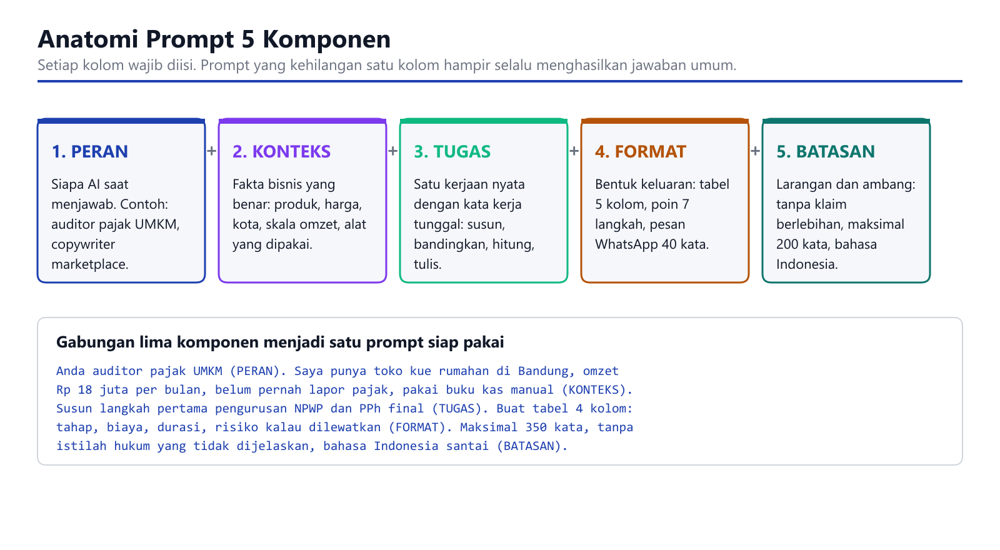
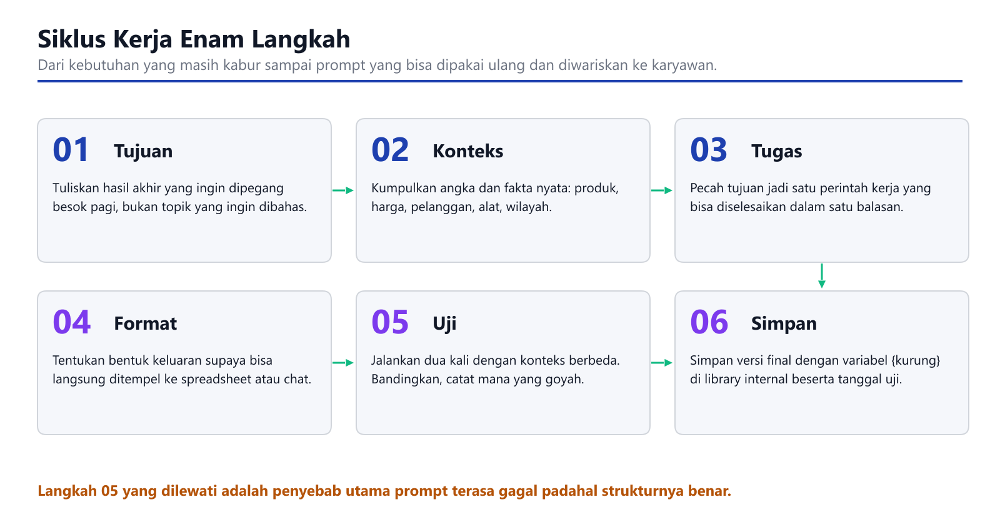

# 150 Prompt AI untuk Bisnis dan UMKM Indonesia

**Edisi Premium dengan Contoh Output AI**

Disusun oleh: Siraj Nur Ihrom, Founder SNISHOP
Edisi Premium, Oktober 2026
Format: 150 prompt lengkap dengan contoh output dari ChatGPT dan Gemini
Pendamping: Berkas Excel 150 baris prompt siap saring dan kolom pelacakan pemakaian

## Tentang Edisi Premium

Edisi Premium berisi semua 150 prompt dari edisi Basic, ditambah contoh output nyata dari ChatGPT dan Gemini untuk setiap bagian. Anda bisa melihat langsung bagaimana AI menjawab prompt ini, sehingga Anda tahu apa yang diharapkan sebelum mencobanya sendiri.

Yang Anda dapatkan di edisi Premium:
- Semua 150 prompt dengan teks lengkap
- Contoh output ChatGPT untuk 3-5 prompt kunci per bagian
- Contoh output Gemini untuk prompt yang sama
- Perbandingan kualitas antara kedua alat
- Catatan kapan harus pakai ChatGPT vs Gemini
- Berkas Excel pendamping dengan 150 baris prompt

## Cara Menggunakan Buku Ini

Setiap prompt memakai format yang sama. Anda tidak perlu membaca berurutan. Buka bab yang kasusnya sedang Anda hadapi, ambil kode prompt, lalu isi bagian di dalam kurung kurawal dengan data bisnis Anda sendiri.

Struktur tiap entri:

| Bagian | Fungsi |
|---|---|
| Kode | Nomor tetap, dipakai juga di berkas Excel pendamping |
| Kapan pakai | Kondisi nyata yang membuat prompt ini relevan |
| Isi prompt | Teks yang Anda salin utuh ke alat AI pilihan Anda |
| Variabel | Data yang wajib Anda ganti sebelum mengirim |
| Hasil yang diharapkan | Bentuk keluaran yang bisa Anda periksa |
| Contoh output | Hasil nyata dari ChatGPT dan Gemini (hanya di edisi Premium) |

Tiga aturan yang membuat library ini bekerja:

1. Jangan mengirim prompt dengan kurung kurawal yang masih utuh. Prompt seperti itu hanya akan menghasilkan jawaban generik.
2. Ganti konteks setiap kali kondisi bisnis berubah. Harga, kota, dan skala omzet adalah bahan bakar utama jawaban AI.
3. Simpan versi yang terbukti menghasilkan di berkas Excel pendamping, kolom Catatan. Catat tanggal dan alat yang dipakai.

## Standar Kualitas

Semua prompt dalam buku ini mengikuti standar anti-AI-slop:
- Tidak menggunakan em-dash atau en-dash
- Tidak ada asterisk markers di luar code block
- Tidak ada emoji atau icon AI
- Bahasa Indonesia yang natural dan profesional
- Contoh konkret dengan angka dan data
- Struktur yang jelas dan mudah diikuti

---

# 150 Prompt AI untuk Bisnis dan UMKM Indonesia

Disusun oleh: Siraj Nur Ihrom, Founder SNISHOP
Edisi: Oktober 2026
Format: Panduan hybrid (tutorial langkah demi langkah, modul latihan, dan referensi cepat)
Pendamping: Berkas Excel 150 baris prompt siap saring dan kolom pelacakan pemakaian

## Daftar Isi

Bagian I, Fondasi

1. Kenapa prompt Anda menghasilkan jawaban yang terasa kosong
2. Anatomi prompt lima komponen
3. Memilih alat: ChatGPT, Claude, Gemini, dan Copilot untuk pekerjaan bisnis
4. Variabel, aturan penamaan, dan cara menyimpan prompt di library internal
5. Latihan fondasi

Bagian II, Library Prompt per Kasus Bisnis

6. Riset pasar dan kompetitor (P-001 sampai P-015)
7. Produk dan pengembangan (P-016 sampai P-030)
8. Harga, penawaran, dan promo (P-031 sampai P-045)
9. Copywriting iklan dan halaman penjualan (P-046 sampai P-060)
10. Konten media sosial dan video pendek (P-061 sampai P-075)
11. Penjualan, tindak lanjut, dan negosiasi (P-076 sampai P-090)
12. Layanan pelanggan dan komunitas (P-091 sampai P-105)
13. Pembukuan, arus kas, dan pajak UMKM (P-106 sampai P-120)
14. Operasional, stok, dan sumber daya manusia (P-121 sampai P-135)
15. Analisis data dan laporan pemilik (P-136 sampai P-150)

Lampiran

A. Tabel ringkasan 150 prompt dalam satu halaman per bab
B. Templat prompt kosong untuk kasus Anda sendiri
C. Daftar variabel baku
D. Checklist mutu sebelum prompt dipakai di depan pelanggan

## Cara Memakai Buku Ini

Setiap prompt di sini memakai format yang sama. Anda tidak perlu membaca berurutan. Buka bab yang kasusnya sedang Anda hadapi, ambil kode prompt, lalu isi bagian di dalam kurung kurawal dengan data bisnis Anda sendiri.

Struktur tiap entri:

| Bagian | Fungsi |
|---|---|
| Kode | Nomor tetap, dipakai juga di berkas Excel pendamping |
| Kapan pakai | Kondisi nyata yang membuat prompt ini relevan |
| Isi prompt | Teks yang Anda salin utuh ke alat AI pilihan Anda |
| Variabel | Data yang wajib Anda ganti sebelum mengirim |
| Hasil yang diharapkan | Bentuk keluaran yang bisa Anda periksa |

Tiga aturan yang membuat library ini bekerja:

1. Jangan mengirim prompt dengan kurung kurawal yang masih utuh. Prompt seperti itu hanya akan menghasilkan jawaban generik.
2. Ganti konteks setiap kali kondisi bisnis berubah. Harga, kota, dan skala omzet adalah bahan bakar utama jawaban AI.
3. Simpan versi yang terbukti menghasilkan di berkas Excel pendamping, kolom Catatan. Catat tanggal dan alat yang dipakai.

## Tentang Penulis

Buku ini disusun dari pekerjaan nyata membangun dan mengoperasikan ekosistem SNISHOP: snishop.com sebagai etalase, erp.snishop.com untuk pengelolaan pesanan dan pelanggan, app.snishop.com untuk modul aplikasi, serta usahakan.digital untuk konten edukasi. Sebagian besar prompt di sini diuji pada pekerjaan harian seperti menyusun penawaran grosir, menghitung harga pokok produksi, menulis balasan komplain, dan menyiapkan laporan pemilik mingguan.

Bagian I, Fondasi
## 1. Kenapa prompt Anda menghasilkan jawaban yang terasa kosong

Ada satu pola yang berulang pada pemilik usaha yang baru memakai AI. Mereka menulis permintaan seperti ini:

> Buatkan strategi marketing untuk toko kue saya.

Jawaban yang datang selalu terlihat rapi. Ada sembilan poin, ada istilah brand awareness, ada saran membuat konten reels, dan semuanya benar secara teori. Masalahnya, jawaban itu juga benar untuk toko kue di Bandung, bengkel motor di Makassar, dan konveksi di Sukabumi. Anda tidak membeli kebenaran umum. Anda membeli keputusan yang bisa dieksekusi besok pagi.

Penyebabnya hampir selalu tiga hal.

Pertama, tidak ada angka. AI tidak bisa menimbang pilihan kalau tidak tahu omzet Anda, harga jual Anda, dan berapa besar margin yang tersisa. Saran diskon 20 persen terasa murah untuk produk dengan margin 60 persen dan terasa bunuh diri untuk produk dengan margin 12 persen.

Kedua, tidak ada batasan. Tanpa batasan, AI memilih keluaran yang paling aman secara umum, yaitu paragraf panjang. Padahal Anda mungkin hanya butuh pesan WhatsApp 40 kata untuk mengirim ke 30 pelanggan lama.

Ketiga, tidak ada bentuk keluaran. Kata seperti tabel, daftar, atau draf pesan adalah bagian dari instruksi, bukan hiasan. Kalau Anda tidak menyebutnya, AI menebak, dan tebakannya jarang sama dengan yang Anda butuhkan.

Latih kebiasaan berikut sebelum membuka alat AI mana pun. Tulis dulu di kertas hasil akhir yang Anda mau, misalnya satu tabel berisi lima varian harga beserta marginnya. Setelah bentuknya jelas, baru susun prompt. Prompt hanyalah cara Anda menyampaikan hasil akhir itu ke mesin.

## 2. Anatomi prompt lima komponen

Semua prompt di buku ini disusun dari lima komponen. Kalau hasilnya mengecewakan, biasanya satu komponen hilang atau diisi terlalu tipis.



Penjelasan tiap komponen.

| Komponen | Pertanyaan yang dijawab | Contoh isi untuk UMKM |
|---|---|---|
| Peran | Siapa yang harus menjawab | Akuntan manajemen untuk usaha kuliner, penulis iklan direct response, supervisor gudang |
| Konteks | Fakta apa yang benar | Produk, harga jual, modal, kota, jumlah pelanggan, alat yang dipakai, musim |
| Tugas | Kerja apa yang dikerjakan | Hitung, bandingkan, susun jadwal, tulis draf, buat daftar pertanyaan |
| Format | Bentuk keluaran | Tabel 5 kolom, urutan 7 langkah, pesan 40 kata, skrip 30 detik |
| Batasan | Apa yang dilarang | Tanpa klaim berlebihan, maksimal 200 kata, bahasa Indonesia santai, hindari istilah teknis |

Komponen peran sering dianggap hiasan. Sebenarnya peran bekerja karena ia mempersempit gaya dan prioritas. Auditor pajak akan mendahulukan kepatuhan dan risiko. Penulis iklan akan mendahulukan daya tarik dan alasan membeli. Tugas yang sama menghasilkan keluaran yang sangat berbeda tergantung peran yang Anda pasang.

Komponen konteks adalah yang paling mahal. Konteks yang baik berisi angka milik Anda sendiri. Bandingkan dua kalimat berikut.

Konteks lemah: toko saya jualan batik dan ingin naikkan penjualan.

Konteks kuat: toko saya menjual kemeja batik tulis lengan panjang, harga jual Rp 385.000, modal produksi Rp 210.000 per potong, stok siap kirim 64 potong, pelanggan utama pria usia 30 sampai 45 tahun di Surabaya, penjualan 90 persen lewat WhatsApp dan marketplace Shopee, rata-rata 22 pesanan per bulan.

Kalimat kedua memungkinkan AI menghitung titik impas biaya iklan, membandingkan strategi diskon dengan bundel, dan memberi batas aman yang bisa Anda pegang. Kalimat pertama hanya menghasilkan daftar saran yang bisa Anda tulis sendiri.

## 3. Memilih alat untuk pekerjaan bisnis

Empat alat di bawah ini yang paling sering dipakai pelaku usaha di Indonesia. Karakternya berbeda, dan pekerjaan tertentu lebih cocok ke satu alat daripada alat lain.

| Alat | Kuat untuk | Kurang kuat untuk | Kebiasaan pakai yang disarankan |
|---|---|---|---|
| ChatGPT | Perencanaan harian, copywriting pendek, brainstorming nama dan penawaran | Verifikasi angka panjang tanpa Anda cek ulang | Kirim satu tugas per sesi, simpan sesi per kasus |
| Claude | Dokumen panjang, merapikan standar operasional, menganalisis laporan yang Anda tempel | Tugas sangat pendek dan cepat | Tempel dokumen utuh, minta tabel ringkasan |
| Gemini | Riset yang butuh data terkini, terhubung ke Sheets dan Docs | Nuansa bahasa Indonesia yang sangat lokal | Minta sumber, lalu cek sendiri angkanya |
| Copilot | Ringkasan email dan dokumen kantor, pekerjaan di dalam Microsoft 365 | Perencanaan strategis yang dalam | Pakai untuk pekerjaan administratif berulang |

Satu hal yang berlaku di semua alat: jangan menaruh data pribadi pelanggan ke dalam prompt. Nama pelanggan, nomor telepon, alamat lengkap, dan nomor rekening tidak perlu dikirim. Ganti dengan label seperti Pelanggan A atau Pelanggan B. Aturan ini ada di bab layanan pelanggan dan perlu Anda jadikan standar perusahaan, bukan hanya saran.

## 4. Variabel, aturan penamaan, dan penyimpanan

Semua prompt di buku ini memakai variabel di dalam kurung kurawal. Variabel adalah bagian yang Anda ganti.

Aturan penamaan yang dipakai konsisten di seluruh buku dan di berkas Excel pendamping.

| Variabel | Isi | Contoh |
|---|---|---|
| {nama_usaha} | Nama merek atau toko | Dapur Raisa |
| {produk} | Produk atau layanan utama | Nasi karamel ayam crispy |
| {harga_jual} | Harga per unit ke pembeli akhir | Rp 28.000 |
| {modal_unit} | Biaya untuk memproduksi satu unit | Rp 15.400 |
| {omzet_bulanan} | Rata-rata penjualan per bulan | Rp 42.000.000 |
| {kota} | Lokasi usaha dan pengiriman utama | Semarang |
| {kanal} | Tempat penjualan terjadi | WhatsApp, Shopee, TikTok Shop, GoFood |
| {jumlah_pelanggan} | Basis pelanggan aktif | 320 |
| {target} | Sasaran yang ingin dicapai | Naik 25 persen dalam 3 bulan |
| {musim} | Momen yang sedang dihadapi | Ramadhan, tahun ajaran baru, 12.12 |

Cara menyimpan supaya library ini bertambah kuat, bukan menumpuk.

1. Salin prompt yang sudah Anda isi ke berkas Excel pendamping, bukan ke catatan chat. Chat akan hilang, berkas akan diwariskan.
2. Isi kolom Tanggal Uji dan Alat setiap kali mencoba. Setelah tiga puluh baris, Anda akan melihat pola alat mana yang paling cocok untuk kasus Anda.
3. Kalau satu prompt menghasilkan keluaran bagus, tambahkan konteks yang membuat bagus itu ke dalam prompt. Prompt Anda harus ikut menajam, tidak tetap statis.
4. Pisahkan prompt per departemen. Bagian keuangan dan bagian iklan memakai konteks yang berbeda dan tidak perlu saling menimpa.

## 5. Latihan fondasi

Kerjakan tiga latihan ini sebelum masuk ke library. Semuanya memakai data asli usaha Anda.

Latihan 1, menulis konteks.

Tulis satu paragraf konteks usaha Anda dengan minimal enam angka: harga jual, modal per unit, omzet bulanan, jumlah pelanggan aktif, rata-rata pesanan per bulan, dan kota. Target 60 sampai 90 kata. Simpan paragraf ini. Anda akan menempelnya ke puluhan prompt di bab berikutnya.

Latihan 2, mengubah keinginan jadi tugas.

Ambil satu keinginan kabur, misalnya ingin tambah pelanggan. Ubah menjadi tugas yang bisa dijawab dalam satu balasan, misalnya menyusun daftar 12 kanal akuisisi pelanggan yang biayanya di bawah Rp 500.000 per bulan untuk usaha katering rumahan, diurutkan dari yang paling cepat menghasilkan.

Latihan 3, mengunci format.

Untuk tugas pada latihan 2, tentukan bentuk keluaran: tabel 5 kolom berisi kanal, estimasi biaya, waktu sampai penjualan pertama, risiko, dan langkah pertama. Perhatikan bahwa dengan format ini Anda bisa langsung memindahkan hasilnya ke spreadsheet tanpa menulis ulang.

Setelah tiga latihan ini selesai, Anda sudah punya bagian konteks, tugas, dan format. Dua komponen sisanya, yaitu peran dan batasan, tinggal dipilih per kasus.



Gunakan matriks berikut untuk menilai cepat apakah sebuah prompt layak dikirim. Kalau posisi Anda ada di kuadran kiri, tambahkan konteks. Kalau ada di kuadran bawah, pertajam tugasnya.


Bagian II, Library Prompt per Kasus Bisnis
## 6. Riset pasar dan kompetitor

Bab ini untuk keputusan yang harus diambil sebelum keluar uang: masuk pasar mana, melawan siapa, dan dengan posisi apa. Semua prompt di sini mengasumsikan Anda punya data mentah dari lapangan, misalnya daftar harga kompetitor yang Anda catat manual dari halaman penjualannya, atau tangkapan ulasan yang Anda salin sendiri. AI bertugas menata dan menimbang, bukan mengarang data.

### P-001. Memetakan kompetitor dalam tiga lapis

Kapan pakai: Anda baru tahu dua atau tiga nama pesaing dan ingin melihat medan secara utuh.

> Anda analis pasar untuk UMKM Indonesia. Usaha saya: {produk} dengan harga jual {harga_jual}, dikirim dari {kota}, penjualan utama lewat {kanal}. Susun peta kompetitor tiga lapis: lapis satu pesaing langsung yang menjual produk serupa ke pembeli yang sama, lapis dua pesaing tidak langsung yang menyelesaikan kebutuhan yang sama dengan cara berbeda, lapis tiga ancaman pendatang yang bisa masuk dalam 12 bulan. Untuk tiap lapis sebutkan 5 nama tipe usahanya, ciri harga mereka, kekuatan yang membuat mereka menang, dan celah yang biasanya mereka abaikan. Sajikan sebagai tabel per lapis dengan kolom: tipe kompetitor, ciri harga, kekuatan, celah, dan cara saya memanfaatkan celah itu. Jangan menyebut nama merek spesifik kalau Anda tidak punya datanya, cukup tipe usahanya.

Variabel: {produk}, {harga_jual}, {kota}, {kanal}

Hasil yang diharapkan: tiga tabel berisi 15 tipe kompetitor beserta celah yang bisa Anda garap.

### P-002. Membedah penawaran kompetitor dari data halaman penjualannya

Kapan pakai: Anda sudah menyalin isi halaman penjualan satu kompetitor dan ingin tahu logika di baliknya.

> Anda penulis iklan direct response. Berikut saya tempel teks halaman penjualan kompetitor saya apa adanya: [tempel teks]. Bedah tulisannya menjadi enam bagian: janji utama, alasan percaya, bukti yang dipakai, penanganan keberatan, desakan, dan penawaran. Untuk tiap bagian tulis apa yang mereka lakukan, apakah kuat atau lemah, dan apa yang hilang. Lalu tutup dengan daftar lima keberatan pembeli yang belum mereka jawab sama sekali. Gunakan bahasa Indonesia. Jangan menambah asumsi tentang produk mereka di luar teks yang saya tempel.

Variabel: teks halaman penjualan yang Anda salin

Hasil yang diharapkan: bedahan enam bagian plus daftar celah pesan yang bisa Anda pakai.

### P-003. Menyusun tabel perbandingan harga yang jujur

Kapan pakai: Anda ingin menaikkan atau menurunkan harga dan butuh dasar pembanding.

> Anda ahli penetapan harga untuk ritel kecil. Ini data harga yang saya catat sendiri dari {jumlah_kompetitor} penjual {produk} di {kanal}: [tempel daftar harga]. Hitung rentang terendah sampai tertinggi, rata-rata, dan median. Lalu tempatkan posisi harga saya {harga_jual} di antara mereka dan jelaskan tiga skenario: saya di bawah median, saya di median, saya di atas median. Untuk tiap skenario tulis siapa pembeli yang cocok, apa yang harus saya buktikan ke pembeli itu, dan risiko terbesarnya. Sajikan sebagai tabel 4 kolom: skenario, pembeli yang cocok, bukti yang harus disiapkan, risiko utama.

Variabel: {jumlah_kompetitor}, daftar harga hasil pencatatan Anda, {harga_jual}, {kanal}

Hasil yang diharapkan: satu tabel tiga skenario harga beserta konsekuensinya.

### P-004. Mengolah ulasan pelanggan kompetitor jadi daftar peluang

Kapan pakai: Anda punya banyak salinan ulasan bintang satu sampai tiga dari penjual lain.

> Anda peneliti konsumen. Berikut ulasan pelanggan yang saya kumpulkan sendiri dari halaman penjual kompetitor: [tempel ulasan]. Kelompokkan keluhan menjadi maksimal 7 tema. Untuk tiap tema hitung berapa ulasan yang menyentuhnya, tulis kalimat keluhan paling khas dalam bentuk yang sudah saya samarkan tanpa menyebut nama pembeli, lalu usulkan satu perubahan konkret pada usaha {produk} saya yang bisa menutup tema itu beserta biaya relatifnya rendah, sedang, atau tinggi. Urutkan tabel dari tema yang paling sering muncul. Bahasa Indonesia, tanpa istilah riset yang tidak dijelaskan.

Variabel: kumpulan ulasan mentah, {produk}

Hasil yang diharapkan: tabel tema keluhan, frekuensi, dan perbaikan yang bisa dieksekusi.

### P-005. Menguji asumsi sebelum menghabiskan uang iklan

Kapan pakai: Anda yakin produk akan laku dan ingin bukti penolakan lebih dulu.

> Anda penasihat strategi yang bertugas membantah saya. Keyakinan saya tentang usaha {produk} saya: [tulis 3 sampai 5 keyakinan]. Untuk tiap keyakinan, tulis tiga alasan keyakinan itu bisa salah, satu uji murah yang biayanya di bawah Rp 500.000 dan bisa selesai dalam 7 hari, serta angka apa yang membuat keyakinan itu gugur. Sajikan sebagai tabel 4 kolom: keyakinan, alasan bisa salah, uji murah, angka gugur. Akhiri dengan urutan pengerjaan uji dari yang paling menentukan.

Variabel: {produk}, daftar keyakinan Anda

Hasil yang diharapkan: daftar uji murah berurutan beserta kriteria gagal.

### P-006. Memecah pasar jadi segmen yang bisa dikirim pesan berbeda

Kapan pakai: satu pesan promosi Anda terasa hambar untuk semua orang.

> Anda spesialis segmentasi pasar untuk usaha kecil dengan anggaran terbatas. Usaha saya menjual {produk} seharga {harga_jual} di {kota} lewat {kanal}. Bagi pasar saya menjadi 4 segmen berdasarkan alasan membeli, bukan berdasarkan usia dan jenis kelamin saja. Untuk tiap segmen tulis: situasi hidup mereka, pemicu yang membuat mereka mencari produk seperti saya, kalimat pembuka pesan yang cocok, keberatan nomor satu mereka, dan bukti yang paling mereka percaya. Sajikan sebagai tabel. Batasi tiap sel maksimal 25 kata supaya bisa langsung saya pakai.

Variabel: {produk}, {harga_jual}, {kota}, {kanal}

Hasil yang diharapkan: empat segmen dengan kalimat pembuka dan bukti yang berbeda.

### P-007. Menilai kejenuhan sebuah ceruk

Kapan pakai: Anda ingin menambah produk baru dan curiga pasarnya sudah penuh.

> Anda penganalisis kelayakan usaha. Saya mempertimbangkan menjual {produk_baru} di {kota} dengan perkiraan harga {harga_jual}. Nilai kejenuhan ceruk ini dengan enam tanda: jumlah penjual yang Anda perkirakan, sebaran harga, ketergantungan pada diskon, umur produk, ketersediaan pasokan, dan kekuatan merek yang sudah ada. Untuk tiap tanda beri penilaian longgar, sedang, atau padat beserta alasannya, lalu simpulkan apakah saya sebaiknya masuk, masuk dengan posisi berbeda, atau tidak masuk. Sajikan sebagai tabel 4 kolom: tanda, penilaian, alasan, akibatnya untuk saya. Akhiri dengan tiga posisi berbeda yang masih terbuka kalau saya tetap ingin masuk.

Variabel: {produk_baru}, {kota}, {harga_jual}

Hasil yang diharapkan: penilaian enam tanda dan kesimpulan masuk atau tidak masuk.

### P-008. Menyusun daftar pertanyaan wawancara pelanggan

Kapan pakai: Anda akan menghubungi 10 pembeli dan tidak ingin bertanya hal yang salah.

> Anda peneliti kualitatif. Saya akan mewawancarai 10 pembeli {produk} saya. Susun 12 pertanyaan wawancara yang semuanya tentang perilaku mereka di masa lalu, bukan tentang niat mereka di masa depan. Hindari pertanyaan apakah kamu suka, apakah kamu akan beli lagi, dan apa yang kamu inginkan. Untuk tiap pertanyaan tulis apa yang ingin saya ketahui darinya dan tanda bahaya jawaban yang membuat saya harus curiga data saya bias. Sajikan sebagai tabel 3 kolom: pertanyaan, tujuan, tanda bahaya. Urutkan dari pertanyaan pembuka yang paling nyaman dijawab lewat telepon. Batas tiap pertanyaan 20 kata.

Variabel: {produk}

Hasil yang diharapkan: panduan wawancara 12 pertanyaan siap pakai lewat telepon atau chat.

### P-009. Mengolah hasil wawancara jadi pola

Kapan pakai: catatan wawancara sudah menumpuk dan belum menjadi keputusan.

> Anda analis riset konsumen. Berikut catatan hasil wawancara saya dengan pembeli, sudah saya samarkan namanya: [tempel catatan]. Ekstrak 6 pola yang muncul di lebih dari separuh responden. Untuk tiap pola tulis berapa responden yang mendukung, kutipan pendek yang mewakili, dan keputusan usaha apa yang logis diambil dari pola itu. Lalu sebutkan tiga hal yang hanya muncul pada satu responden dan harus saya perlakukan sebagai anomali, bukan arahan. Sajikan sebagai dua tabel terpisah: pola kuat dan anomali. Bahasa Indonesia, tanpa jargon riset.

Variabel: catatan wawancara yang sudah disamarkan

Hasil yang diharapkan: enam pola siap jadi keputusan dan tiga anomali yang diabaikan dulu.

### P-010. Membandingkan dua kanal penjualan secara adil

Kapan pakai: Anda harus memilih membesarkan marketplace atau kanal sendiri.

> Anda analis kanal penjualan. Usaha saya {nama_usaha} menjual {produk} dengan {harga_jual} dan {modal_unit} modal per unit. Data kanal saya: [tempel angka biaya admin, ongkos, retur, dan jumlah pesanan per kanal]. Bandingkan kanal-kanal tersebut pada lima dimensi: biaya efektif per pesanan, kendali atas hubungan pelanggan, kecepatan kas masuk, kerentanan terhadap perubahan aturan kanal, dan potensi pertumbuhan. Hitung margin per pesanan untuk tiap kanal kalau datanya tersedia, tunjukkan rumusnya, dan tandai angka yang Anda perkirakan karena datanya tidak saya berikan. Sajikan sebagai tabel perbandingan dan satu rekomendasi urutan prioritas.

Variabel: {nama_usaha}, {produk}, {harga_jual}, {modal_unit}, angka per kanal

Hasil yang diharapkan: tabel lima dimensi, margin per pesanan, dan prioritas kanal.

### P-011. Membaca tren musiman dari data penjualan sendiri

Kapan pakai: Anda punya catatan penjualan 12 bulan dan bingung pola mana yang nyata.

> Anda analis data ritel. Berikut penjualan bulanan saya untuk {produk} selama 12 bulan terakhir dalam format bulan dan nilai: [tempel data]. Identifikasi tiga pola musiman yang paling kuat, tiga bulan paling lemah, dan apakah ada tren naik yang murni pertumbuhan bukan musim. Untuk tiap temuan tulis bukti angkanya dan satu tindakan yang sebaiknya saya siapkan 6 minggu sebelum bulan itu tiba. Kalau datanya terlalu sedikit untuk menarik kesimpulan, katakan langsung dan jelaskan data tambahan apa yang saya butuhkan. Jangan memaksakan pola.

Variabel: {produk}, data penjualan 12 bulan

Hasil yang diharapkan: temuan musiman berbasis angka beserta tindakan persiapan.

### P-012. Menyusun profil pembeli ideal yang bisa dipakai tim

Kapan pakai: karyawan baru Anda salah sasaran saat menghubungi calon pembeli.

> Anda manajer penjualan. Susun profil pembeli ideal untuk {produk} saya dalam format satu halaman yang bisa dipakai karyawan. Isi: situasi yang membuat mereka mencari solusi, tiga kriteria mereka memilih penjual, tiga hal yang membuat mereka membatalkan, harga psikologis yang nyaman untuk mereka, kanal yang paling mereka percaya, dan kalimat penutup yang efektif untuk mereka. Akhiri dengan daftar 8 pertanyaan penyaring yang harus diajukan karyawan sebelum melanjutkan penawaran. Sajikan sebagai daftar bernomor, tiap poin maksimal 25 kata, bahasa Indonesia yang bisa dibaca orang tanpa latar belakang pemasaran.

Variabel: {produk}

Hasil yang diharapkan: satu halaman profil pembeli plus daftar pertanyaan penyaring.

### P-013. Menilai kekuatan merek sendiri dibanding pesaing terdekat

Kapan pakai: Anda merasa produk lebih bagus tapi kalah penjualan.

> Anda konsultan merek untuk usaha kecil. Merek saya {nama_usaha} menjual {produk}. Pesaing terdekat saya: [tulis nama atau ciri pesaing]. Bandingkan kami pada tujuh titik sentuh: halaman penjualan, foto produk, ulasan, kecepatan balas chat, kemasan, layanan purnajual, dan harga. Untuk tiap titik beri skor 1 sampai 5 untuk kami dan untuk mereka, lalu tulis satu perbaikan yang hasilnya paling besar dengan usaha paling kecil. Sajikan sebagai tabel 5 kolom: titik sentuh, skor kami, skor mereka, selisih, perbaikan prioritas. Akhiri dengan urutan pengerjaan 30 hari.

Variabel: {nama_usaha}, {produk}, data pesaing

Hasil yang diharapkan: tabel skor tujuh titik sentuh dan rencana perbaikan 30 hari.

### P-014. Mencari celah produk dari kombinasi yang belum ada

Kapan pakai: pasar terasa penuh tapi Anda yakin ada kombinasi yang belum dijual.

> Anda perancang penawaran. Produk saya {produk} dengan {harga_jual}. Daftar isi yang saya jual sekarang: [tulis isi produk atau layanan]. Daftar kebutuhan pembeli yang sering saya dengar: [tulis 5 sampai 8 kebutuhan]. Cari kombinasi isi produk yang menutup kebutuhan tersebut tapi belum tersedia di pasar {kanal}. Hasilkan 6 ide penawaran, masing-masing dengan isi, untuk siapa, harga yang masuk akal berdasarkan {harga_jual}, dan alasan pembeli beralih dari pilihan yang ada. Sajikan sebagai tabel 5 kolom. Tandai ide yang paling berisiko dari sisi stok.

Variabel: {produk}, {harga_jual}, isi produk, daftar kebutuhan, {kanal}

Hasil yang diharapkan: enam penawaran baru dengan harga dan alasan pembeli beralih.

### P-015. Membuat ringkasan riset satu halaman untuk keputusan

Kapan pakai: riset sudah menumpuk dan Anda butuh satu halaman untuk memutuskan.

> Anda kepala strategi. Berikut catatan riset saya tentang {produk} di {kota}: [tempel ringkasan riset]. Susun memo satu halaman berisi: kesimpulan utama tiga kalimat, angka paling penting beserta sumbernya, tiga peluang yang bisa jalan bulan ini, tiga risiko yang bisa menggagalkan, dan satu keputusan yang saya harus ambil minggu ini beserta alternatifnya. Tulis untuk pembaca pemilik usaha, bukan untuk investor. Maksimal 400 kata, tanpa pembuka basa-basi, tanpa kalimat penutup yang mengulang isi.

Variabel: {produk}, {kota}, catatan riset

Hasil yang diharapkan: memo satu halaman yang berakhir pada satu keputusan.

### Ringkasan cepat bab ini

| Kode | Judul | Bentuk keluaran |
|---|---|---|
| P-001 | Peta kompetitor tiga lapis | Tiga tabel |
| P-002 | Bedah halaman penjualan pesaing | Enam bagian plus celah |
| P-003 | Tabel perbandingan harga | Tabel tiga skenario |
| P-004 | Ulasan pesaing jadi peluang | Tabel tema dan perbaikan |
| P-005 | Uji asumsi murah | Tabel uji dan kriteria gagal |
| P-006 | Segmentasi berbasis alasan beli | Tabel empat segmen |
| P-007 | Kejenuhan ceruk | Penilaian enam tanda |
| P-008 | Pertanyaan wawancara pelanggan | Tabel 12 pertanyaan |
| P-009 | Pola hasil wawancara | Dua tabel |
| P-010 | Bandingkan kanal penjualan | Tabel dan rekomendasi |
| P-011 | Tren musiman sendiri | Temuan dan tindakan |
| P-012 | Profil pembeli ideal | Satu halaman plus penyaring |
| P-013 | Skor merek vs pesaing | Tabel tujuh titik sentuh |
| P-014 | Celah kombinasi produk | Tabel enam ide |
| P-015 | Memo riset satu halaman | Memo 400 kata |

### Latihan bab ini

1. Jalankan P-003 dengan data harga yang Anda catat sendiri hari ini. Catat posisi Anda terhadap median.
2. Jalankan P-004 memakai minimal 15 ulasan. Kalau belum punya, kumpulkan dulu 15, karena hasilnya tidak berguna di bawah jumlah itu.
3. Ambil hasil P-006, lalu jalankan P-012 untuk satu segmen saja. Bandingkan apakah keduanya menunjuk orang yang sama.

### Kesalahan umum di bab ini

Meminta AI menyebut nama pesaing dan angkanya tanpa Anda beri data. AI akan mengarang nama yang terdengar masuk akal. Selalu tempel data hasil pencatatan Anda sendiri, dan perlukan angka yang AI perkirakan sebagai tanda tanya, bukan sebagai fakta.
## 7. Produk dan pengembangan

Bab ini mengubah masukan pelanggan menjadi keputusan produk: apa yang ditambah, apa yang dihentikan, dan apa yang dikemas ulang. Fokusnya pada usaha yang modalnya terbatas, sehingga tiap penambahan produk harus dibayar dengan pengurangan sesuatu yang lain.

### P-016. Mengurutkan ide produk dengan skor yang bisa dipertahankan

Kapan pakai: Anda punya banyak ide dan hanya modal untuk satu.

> Anda manajer produk untuk usaha kecil. Ini daftar ide produk saya untuk {nama_usaha}: [tulis 5 sampai 10 ide]. Nilai tiap ide pada empat kriteria dengan bobot: potensi pendapatan 40 persen, kecepatan jadi 25 persen, kesesuaian dengan kemampuan produksi saya saat ini 20 persen, dan risiko stok 15 persen. Untuk kriteria kemampuan produksi, anggap saya punya [tulis alat, tenaga, dan jam kerja yang tersedia]. Hitung skor 0 sampai 100, tunjukkan perhitungan untuk dua ide teratas, lalu urutkan. Akhiri dengan satu ide yang sebaiknya saya hentikan total dan alasannya. Sajikan sebagai tabel dan jangan memberi semua ide skor tinggi.

Variabel: {nama_usaha}, daftar ide, kapasitas produksi

Hasil yang diharapkan: peringkat ide dengan skor dan satu penghentian yang disarankan.

### P-017. Menyusun spesifikasi produk yang bisa dipegang tukang atau vendor

Kapan pakai: hasil produksi selalu berbeda dari yang Anda bayangkan.

> Anda insinyur manufaktur sekaligus pembuat standar operasional. Saya ingin memproduksi {produk} dengan target harga jual {harga_jual} dan modal produksi maksimal {modal_unit}. Tulis lembar spesifikasi yang bisa saya serahkan ke vendor atau tukang tanpa penjelasan lisan. Isi: dimensi atau takaran, bahan dan substitusi yang boleh, toleransi yang masih diterima, kriteria lulus dan gagal per unit, cara pemeriksaan sebelum kirim, dan catatan pengemasan. Untuk tiap kriteria tulis cara mengukur memakai alat yang ada di rumah atau workshop biasa. Sajikan sebagai tabel per bagian, bahasa Indonesia, tanpa istilah teknis tanpa penjelasan.

Variabel: {produk}, {harga_jual}, {modal_unit}

Hasil yang diharapkan: lembar spesifikasi dengan cara uji yang bisa dilakukan sendiri.

### P-018. Menghitung harga pokok produksi dari resep atau bill of material

Kapan pakai: Anda merasa marginnya tipis tapi tidak tahu bocor di mana.

> Anda akuntan biaya untuk usaha kuliner dan kerajinan. Berikut daftar bahan atau komponen {produk} beserta jumlah pemakaian dan harga belinya: [tempel daftar]. Hitung biaya bahan per unit, lalu tambahkan estimasi biaya tenaga kerja untuk [tulis menit kerja dan upah per jam], biaya kemasan, dan alokasi overhead [tulis biaya sewa, listrik, dan gas per bulan dibagi perkiraan {jumlah_produksi} unit per bulan]. Sajikan sebagai tabel per komponen dengan kolom: komponen, jumlah, harga satuan, biaya per unit, dan cara menekan tanpa menurunkan mutu. Tunjukkan rumusnya. Tandai komponen yang menyumbang lebih dari 20 persen total biaya. Kalau saya belum memberi angka, jangan mengarang, tanyakan angka yang kurang.

Variabel: {produk}, daftar bahan, jam kerja, upah, overhead, {jumlah_produksi}

Hasil yang diharapkan: rincian biaya per unit dan daftar penekan biaya prioritas.

### P-019. Merancang uji rasa atau uji pakai yang sah

Kapan pakai: teman dan keluarga bilang bagus, tapi orang asing tidak membeli.

> Anda perancang uji konsumen. Saya akan menguji {produk} dengan 12 orang yang bukan keluarga saya. Susun protokol uji satu halaman: kriteria peserta, urutan penyajian atau pemakaian, cara menyamarkan merek supaya tidak ada bias, skala penilaian yang dipakai beserta definisi tiap angka, tiga pertanyaan wajib setelah uji, dan ambang keputusan. Untuk ambang, tulis angka konkret misalnya minimal 8 dari 12 memberi skor 4 atau lebih pada dimensi tertentu. Sajikan sebagai daftar bernomor, lalu satu tabel lembar penilaian yang bisa saya cetak. Bahasa Indonesia, maksimal 450 kata.

Variabel: {produk}

Hasil yang diharapkan: protokol uji dan lembar penilaian siap cetak dengan ambang keputusan.

### P-020. Menentukan varian mana yang dihentikan

Kapan pakai: katalog Anda terlalu lebar dan stok mati menumpuk.

> Anda analis kategori ritel. Ini data varian {produk} saya: [tempel daftar varian beserta jumlah terjual per bulan, margin, dan sisa stok]. Hitung kontribusi tiap varian terhadap total penjualan dan total laba. Identifikasi varian yang masuk kategori: laku dan untung, laku tapi tipis, tidak laku tapi untung besar, tidak laku dan rugi. Untuk tiap kategori tulis tindakan yang benar, misalnya naikkan harga, kecilkan kemasan, gabungkan dengan varian lain, atau hentikan, beserta cara memberitahu pelanggan tanpa membuat mereka merasa kehilangan. Sajikan sebagai tabel per varian. Tunjukkan perhitungan untuk dua varian terburuk.

Variabel: {produk}, data varian

Hasil yang diharapkan: klasifikasi varian beserta tindakan dan cara komunikasi ke pembeli.

### P-021. Menyusun rencana pengembangan 90 hari yang realistis

Kapan pakai: Anda ingin berkembang tapi selalu berhenti di tengah jalan.

> Anda penasihat operasional usaha kecil. Kapasitas saya per minggu: [tulis jam yang benar-benar tersedia dan siapa yang membantu]. Target 90 hari saya untuk {produk}: {target}. Susun rencana 12 minggu dengan aturan: maksimal dua pekerjaan besar per minggu, tiap minggu punya satu hasil yang bisa dilihat, dan ada satu minggu penyangga untuk hal yang meleset. Sajikan sebagai tabel 4 kolom: minggu, pekerjaan, hasil yang terlihat, dan tanda saya harus berhenti atau ganti arah. Akhiri dengan tiga godaan yang paling mungkin membuat saya menyimpang dari rencana ini.

Variabel: kapasitas mingguan, {produk}, {target}

Hasil yang diharapkan: tabel 12 minggu dengan hasil yang terlihat dan penanda berhenti.

### P-022. Menulis kebutuhan untuk developer atau freelancer

Kapan pakai: Anda butuh aplikasi, sistem, atau situs tapi hasil kerja selalu melenceng.

> Anda analis bisnis yang menulis dokumen kebutuhan untuk pengembang lepas. Saya ingin membuat [tulis yang ingin dibuat, misalnya aplikasi kasir untuk satu toko dengan dua karyawan]. Tulis dokumen kebutuhan dengan bagian: tujuan dalam satu kalimat, daftar pengguna beserta hak aksesnya, alur utama langkah demi langkah, daftar layar beserta isinya, aturan bisnis yang tidak boleh dilanggar, data yang harus disimpan beserta formatnya, kasus tepi yang harus ditangani seperti sinyal putus dan input salah, kriteria penerimaan yang bisa diuji, dan di luar lingkaran versi pertama. Sajikan sebagai daftar bernomor. Untuk tiap kriteria penerimaan tulis kondisi dan hasil yang diharapkan. Jangan menyebut teknologi atau bahasa pemrograman.

Variabel: deskripsi sistem yang ingin dibuat

Hasil yang diharapkan: dokumen kebutuhan yang bisa langsung dihargai pengembang.

### P-023. Menilai penawaran harga dari jasa pembuatan aplikasi

Kapan pakai: Anda menerima penawaran dan tidak tahu mana yang wajar.

> Anda pengawas proyek teknologi untuk pembeli non-teknis. Ini penawaran yang saya terima untuk membuat [tulis yang ingin dibuat]: [tempel rincian penawaran beserta harga dan jangka waktu]. Bantu saya memeriksa enam hal: apakah lingkernya cukup jelas untuk dihargai, apakah ada pekerjaan yang dihitung dua kali, apakah jangka waktu masuk akal untuk isinya, apa yang tidak tercakup tapi pasti saya butuhkan, pertanyaan apa yang harus saya ajukan sebelum tanda tangan, dan tiga klausul yang harus ada di perjanjian. Sajikan sebagai tabel: temuan, bukti dari penawaran, dan pertanyaan untuk vendor. Kalau ada bagian yang tidak bisa dinilai karena datanya kurang, sebutkan datanya.

Variabel: rincian penawaran dari vendor

Hasil yang diharapkan: daftar temuan dan pertanyaan sebelum menandatangani.

### P-024. Menyusun standar operasional satu pekerjaan berulang

Kapan pakai: hanya Anda yang bisa mengerjakan sesuatu dan itu menghambat.

> Anda penyusun standar operasional untuk usaha kecil. Pekerjaan yang perlu saya bakukan: [tulis pekerjaan beserta cara Anda melakukannya sekarang]. Tulis standar operasional yang bisa dijalankan karyawan baru tanpa bertanya, dengan bagian: tujuan pekerjaan, pemicu dikerjakan, langkah bernomor beserta hasil tiap langkah, titik yang paling sering salah beserta cara mencegahnya, batas waktu tiap langkah, siapa yang memeriksa, dan apa yang dilakukan kalau terjadi penyimpangan. Sertakan daftar periksa satu layar yang bisa dicetak. Jangan memakai kata yang Anda definisikan sendiri tanpa penjelasan.

Variabel: deskripsi pekerjaan dan cara Anda mengerjakannya

Hasil yang diharapkan: standar operasional lengkap dengan daftar periksa cetak.

### P-025. Mencari penyebab produk banyak dikembalikan

Kapan pakai: tingkat retur naik dan Anda tidak tahu sumbernya.

> Anda analis mutu. Data retur saya untuk {produk} selama [tulis jumlah bulan]: [tempel jumlah unit, alasan yang tercatat, dan tanggal]. Pisahkan penyebab menjadi empat kelompok: ketidaksesuaian ekspektasi dari halaman penjualan, kerusakan saat pengiriman, mutu produksi, dan kesalahan pembeli sendiri. Untuk tiap kelompok tulis bukti dari data saya, perkiraan kontribusi dalam persen, dan satu perbaikan yang bisa diuji dalam dua minggu beserta cara mengukur keberhasilannya. Kalau data saya tidak cukup untuk memisahkan kelompok, jelaskan data tambahan apa yang harus saya catat mulai besok. Sajikan sebagai tabel.

Variabel: {produk}, data retur

Hasil yang diharapkan: pengelompokan penyebab, kontribusi, dan perbaikan terukur.

### P-026. Merancang kemasan yang melindungi dan menjual

Kapan pakai: barang sampai dalam kondisi kurang bagus, atau terlihat biasa saja saat dibuka.

> Anda perancang kemasan untuk usaha pengiriman. Produk saya {produk}, berat sekitar [tulis berat], rapuh pada bagian [tulis bagian], dikirim lewat [tulis jasa kirim], dan harga jual {harga_jual}. Susun rancangan kemasan tiga lapis: pelindung produk, penahan benturan, dan pembungkus luar. Untuk tiap lapis tulis bahan, ketebalan atau ukuran, perkiraan biaya per unit, dan cara melipat atau merakitnya. Lalu usulkan tiga elemen pada kemasan luar yang membuat pembeli ingin memotret dan mengunggah, tanpa menambah biaya lebih dari Rp 1.500 per unit. Akhiri dengan daftar lima pengujian sederhana yang harus saya lakukan sebelum kirim massal.

Variabel: {produk}, berat, jasa kirim, {harga_jual}

Hasil yang diharapkan: rancangan tiga lapis dengan biaya dan uji sebelum produksi.

### P-027. Menguji kelayakan produk sebelum produksi massal

Kapan pakai: vendor meminta pemesanan minimum yang besar dan Anda ragu.

> Anda penasihat risiko usaha kecil. Saya ditawari {produk} dengan pemesanan minimum [tulis jumlah] dan harga pokok [tulis harga]. Rencana jual saya {harga_jual} lewat {kanal} dengan rata-rata [tulis jumlah] terjual per bulan. Hitung berapa bulan stok itu habis pada tiga kecepatan jual, tentukan berapa kas yang tertahan, dan tunjukkan titik di mana pemesanan minimum itu merugikan saya. Lalu rancang tiga cara mengurangi risiko sebelum menyetujui: pemesanan bertahap, uji pasar lewat pre-order, dan negosiasi syarat retur atau tukar. Untuk tiap cara tulis apa yang saya minta ke vendor dengan kalimat yang bisa langsung saya kirim lewat chat.

Variabel: {produk}, jumlah minimum, harga pokok, {harga_jual}, {kanal}, kecepatan jual

Hasil yang diharapkan: hitungan bulan habis, kas tertahan, dan tiga cara penurunan risiko.

### P-028. Menyusun daftar periksa peluncuran produk baru

Kapan pakai: peluncuran sebelumnya berantakan karena hal kecil terlewat.

> Anda manajer peluncuran. Saya akan meluncurkan {produk} pada [tulis tanggal] lewat {kanal}. Susun daftar periksa dari 30 hari sebelum sampai 14 hari sesudah, dibagi menjadi enam kelompok: stok dan pasokan, harga dan margin, materi penjualan, layanan pelanggan, pengiriman, dan pengukuran hasil. Tiap butir ditulis sebagai tindakan yang selesai atau belum, bukan sebagai topik. Untuk kelompok layanan pelanggan, sertakan daftar pertanyaan yang harus sudah ada jawabannya sebelum produk tayang. Sajikan sebagai tabel per kelompok dengan kolom: kelompok, butir, penanggung jawab, tenggat, status.

Variabel: {produk}, tanggal rilis, {kanal}

Hasil yang diharapkan: daftar periksa harian dengan penanggung jawab dan status.

### P-029. Meminta umpan balik yang jujur dari pembeli lama

Kapan pakai: pelanggan diam dan Anda tidak tahu apakah mereka puas atau hanya malas komplain.

> Anda penulis pesan pelanggan. Saya ingin mengirim pesan ke {jumlah_pelanggan} pembeli lama {produk} untuk meminta umpan balik yang benar-benar jujur, bukan basa-basi. Tulis pesan WhatsApp maksimal 90 kata dengan tiga pertanyaan tertutup yang bisa dijawab dengan angka dan satu pertanyaan terbuka. Jangan memakai kalimat yang memancing jawaban positif seperti kami berharap Anda puas. Sertakan insentif yang tidak terasa seperti suap, misalnya akses lebih dulu ke varian baru. Lalu tulis dua versi tindak lanjut: untuk yang menjawab dan untuk yang diam setelah 5 hari.

Variabel: {jumlah_pelanggan}, {produk}

Hasil yang diharapkan: tiga pesan siap kirim, yaitu pesan utama dan dua tindak lanjut.

### P-030. Memutuskan membuat sendiri atau membeli jadi

Kapan pakai: Anda bisa mengerjakan sendiri, tapi ada jasa yang menawarkan lebih murah.

> Anda analis make or buy untuk usaha kecil. Kebutuhan saya: [tulis yang dibutuhkan]. Opsi membuat sendiri: modal awal [tulis], biaya bulanan [tulis], waktu pengerjaan [tulis], dan siapa yang harus saya sediakan. Opsi membeli jasa: harga [tulis], apa yang termasuk, dan apa yang tidak. Hitung total biaya kepemilikan 12 bulan untuk kedua opsi, tunjukkan rumusnya, lalu bandingkan pada tiga dimensi selain biaya: kecepatan, kendali atas mutu, dan ketergantungan pada satu orang. Akhiri dengan rekomendasi dan dua kondisi yang akan mengubah rekomendasi itu.

Variabel: kebutuhan, biaya membuat, biaya membeli

Hasil yang diharapkan: perbandingan biaya 12 bulan plus rekomendasi bersyarat.

### Ringkasan cepat bab ini

| Kode | Judul | Bentuk keluaran |
|---|---|---|
| P-016 | Skor urutan ide produk | Tabel peringkat |
| P-017 | Spesifikasi untuk vendor | Lembar spesifikasi |
| P-018 | Hitung harga pokok produksi | Tabel biaya per unit |
| P-019 | Protokol uji konsumen | Protokol dan lembar nilai |
| P-020 | Varian yang dihentikan | Klasifikasi varian |
| P-021 | Rencana 90 hari | Tabel 12 minggu |
| P-022 | Dokumen kebutuhan sistem | Dokumen sembilan bagian |
| P-023 | Nilai penawaran vendor | Tabel temuan dan pertanyaan |
| P-024 | Standar operasional | Standar dan daftar periksa |
| P-025 | Penyebab retur | Tabel pengelompokan |
| P-026 | Rancangan kemasan | Tiga lapis dengan biaya |
| P-027 | Kelayakan sebelum massal | Hitungan dan tiga cara |
| P-028 | Daftar periksa peluncuran | Tabel 30 hari |
| P-029 | Minta umpan balik jujur | Tiga pesan siap kirim |
| P-030 | Buat sendiri atau beli | Perbandingan 12 bulan |

### Latihan bab ini

1. Jalankan P-018 untuk produk terlaris Anda. Kalau hasilnya membuat Anda terkejut, jalankan lagi untuk produk nomor dua.
2. Ambil ide teratas dari P-016, lalu jalankan P-027 untuk menguji apakah pemesanan minimumnya bisa Anda tanggung.
3. Tulis satu standar operasional memakai P-024 untuk pekerjaan yang paling sering Anda ulang tiap hari, lalu serahkan ke karyawan dan minta ia menjalankannya tanpa bertanya.

### Kesalahan umum di bab ini

Melompat ke desain produk sebelum angka biaya pokoknya jelas. Urutan yang benar adalah P-018 lebih dulu, baru P-017, baru P-026. Banyak usaha kecil punya produk yang bagus dan tetap rugi karena tidak pernah menghitung overhead ke dalam harga per unit.
## 8. Harga, penawaran, dan promo

Harga adalah keputusan yang paling cepat mengubah laba dan paling lambat disadari pemilik usaha. Bab ini berisi prompt untuk menghitung batas aman sebelum memberi diskon, merancang penawaran yang tidak merusak harga normal, dan menyusun promo musiman yang tetap menyisakan margin.

### P-031. Menghitung titik impas sebelum menambah biaya iklan

Kapan pakai: Anda ingin beriklan tapi tidak tahu batas biaya per pesanan yang masih aman.

> Anda akuntan manajemen untuk usaha kecil. Data saya: harga jual {harga_jual}, biaya variabel per unit {modal_unit}, biaya tetap bulanan [tulis rincian sewa, gaji, dan langganan], dan rata-rata [tulis jumlah] pesanan per bulan. Hitung margin kontribusi per unit, titik impas dalam unit dan dalam rupiah, lalu tentukan biaya iklan maksimal per pesanan yang masih menyisakan laba [tulis persen] dari margin kontribusi. Tunjukkan tiap langkah perhitungan. Setelah itu sajikan tabel tiga skenario: biaya per pesanan di bawah batas, tepat di batas, dan 30 persen di atas batas, beserta akibatnya untuk laba bulanan. Jangan memperkirakan angka yang tidak saya berikan.

Variabel: {harga_jual}, {modal_unit}, biaya tetap, jumlah pesanan, target laba

Hasil yang diharapkan: titik impas, batas biaya iklan, dan tiga skenario akibat.

### P-032. Menentukan harga jual dari nilai, bukan dari biaya

Kapan pakai: produk Anda jelas menghasilkan penghematan atau keuntungan bagi pembeli.

> Anda penasihat penetapan harga berbasis nilai. Produk saya {produk} dengan {harga_jual} saat ini dan {modal_unit} biaya. Bagi pembeli, produk ini menghasilkan [tulis manfaat yang bisa diukur, misalnya menghemat 6 jam kerja per minggu atau menurunkan biaya bahan 15 persen]. Susun tiga tingkat harga: masuk, wajar, dan tinggi. Untuk tiap tingkat tulis bukti yang harus ada di halaman penjualan supaya harga itu diterima, kalimat penjelasan harga, dan tipe pembeli yang cocok. Lalu hitung pada tingkat wajar berapa kali lipat manfaat pembeli dibanding harga yang ia bayar. Sajikan sebagai tabel dan akhiri dengan rekomendasi satu tingkat beserta alasan memilihnya.

Variabel: {produk}, {harga_jual}, {modal_unit}, manfaat terukur

Hasil yang diharapkan: tiga tingkat harga dengan bukti pendukung dan rasio manfaat.

### P-033. Menguji apakah diskon akan merusak margin

Kapan pakai: marketplace atau tim penjualan meminta diskon besar.

> Anda analis margin. Saya diminta memberi diskon [tulis persen] untuk {produk} dengan {harga_jual} dan {modal_unit}. Hitung harga setelah diskon, margin sebelum dan sesudah, dan berapa tambahan unit yang harus terjual supaya laba total tidak turun. Tunjukkan rumusnya. Lalu sajikan tabel empat kolom: tingkat diskon 5, 10, 20, dan 30 persen, dengan kolom harga baru, laba per unit, unit tambahan yang dibutuhkan, dan penilaian aman, berisiko, atau merugikan. Akhiri dengan dua alternatif selain diskon yang mempertahankan nilai, misalnya bonus biaya kirim atau hadiah kecil, beserta hitungan biayanya.

Variabel: {produk}, {harga_jual}, {modal_unit}, tingkat diskon

Hasil yang diharapkan: tabel empat tingkat diskon dan dua alternatif non-diskon.

### P-034. Merancang bundel yang menaikkan nilai pesanan

Kapan pakai: rata-rata belanja pelanggan terlalu kecil dan ongkos kirim memakan laba.

> Anda perancang penawaran. Katalog saya: [tempel daftar produk beserta harga dan margin]. Rata-rata nilai pesanan saya sekarang [tulis nilai] dan biaya penanganan per pesanan [tulis nilai]. Susun tiga bundel yang menaikkan nilai pesanan minimal 40 persen tanpa memberi diskon total lebih dari [tulis persen]. Untuk tiap bundel tulis isi, harga bundel, harga kalau dibeli terpisah, margin bundel, alasan pembeli merasa untung, dan kalimat penawaran satu baris. Utamakan bundel yang menghabiskan stok yang perputarannya lambat. Sajikan sebagai tabel dan tunjukkan perhitungan margin.

Variabel: katalog, rata-rata nilai pesanan, biaya penanganan, batas diskon

Hasil yang diharapkan: tiga bundel dengan margin dan kalimat penawaran.

### P-035. Menyusun tingkatan harga untuk pelanggan grosir dan reseller

Kapan pakai: permintaan beli dalam jumlah besar datang dan Anda belum punya aturan.

> Anda manajer saluran penjualan. Saya menjual {produk} dengan {harga_jual} ke pembeli akhir dan {modal_unit} biaya. Susun skema tingkatan untuk empat kelompok: pembeli eceran, reseller, grosir, dan distributor. Untuk tiap tingkat tentukan jumlah pembelian minimum, harga per unit, syarat pembayaran, hak wilayah, dan larangan yang menjaga harga eceran saya tidak rusak. Hitung margin saya per tingkat dan tunjukkan bahwa tiap tingkat tetap menguntungkan. Lalu tulis tiga aturan yang membuat reseller tidak saling membanting harga, beserta sanksi yang proporsional. Sajikan sebagai tabel plus daftar aturan.

Variabel: {produk}, {harga_jual}, {modal_unit}

Hasil yang diharapkan: skema empat tingkat dengan margin dan aturan pengendalian harga.

### P-036. Menetapkan ongkos kirim dan strategi gratis kirim

Kapan pakai: ongkos kirim membuat calon pembeli berhenti di halaman pembayaran.

> Anda analis logistik ritel. Data saya: rata-rata berat paket [tulis gram], tarif jasa kirim ke kota saya [tulis tarif], rata-rata nilai pesanan [tulis nilai], dan margin [tulis persen]. Bandingkan empat kebijakan: ongkos kirim dibayar pembeli, subsidi sebagian, gratis kirim di atas ambang tertentu, dan gratis kirim selalu dengan harga dinaikkan. Untuk tiap kebijakan hitung perkiraan dampaknya pada nilai pesanan rata-rata, jumlah pesanan, dan laba per pesanan, dengan asumsi yang Anda nyatakan terang-terangan. Rekomendasikan satu kebijakan beserta ambang angkanya dan tulis kalimat pengumumannya untuk halaman produk.

Variabel: berat, tarif kirim, nilai pesanan, margin

Hasil yang diharapkan: perbandingan empat kebijakan dan satu rekomendasi dengan ambang.

### P-037. Menegosiasikan harga beli dari pemasok

Kapan pakai: Anda ingin naikkan volume dan butuh harga masuk yang lebih baik.

> Anda manajer pengadaan. Saya akan membeli {produk} dari pemasok dengan harga sekarang [tulis harga] untuk [tulis jumlah] unit. Target saya turun [tulis persen] tanpa menurunkan mutu. Susun naskah negosiasi lewat chat WhatsApp yang sopan dan tidak mengancam, berisi: pembuka yang menunjukkan kesetiaan, permintaan konkret, tiga imbalan yang bisa saya tawarkan selain volume, misalnya pembayaran lebih cepat atau pengambilan sekaligus, dan satu batas yang saya pegang kalau ia menolak. Lalu tulis dua balasan yang mungkin datang dari pemasok beserta jawaban saya. Hindari kalimat yang terdengar seperti ancaman pindah.

Variabel: {produk}, harga sekarang, jumlah, target penurunan

Hasil yang diharapkan: naskah negosiasi dan dua cabang tanggapan.

### P-038. Menyusun kalender promo 12 bulan

Kapan pakai: promo Anda terjadi karena panik, bukan karena rencana.

> Anda perencana promosi untuk UMKM Indonesia. Usaha saya {nama_usaha} menjual {produk} dengan {harga_jual} di {kota} lewat {kanal}. Susun kalender promo 12 bulan yang memanfaatkan momen lokal: tahun baru Imlek, Ramadhan dan Lebaran, tahun ajaran baru, hari belanja online kembar, Natal dan tahun baru, serta momen spesifik daerah saya kalau relevan. Untuk tiap bulan tulis: momen, tema promo, mekanik yang menjaga nilai, target nilai penjualan, dan persiapan yang harus dimulai enam minggu sebelumnya beserta biayanya. Sajikan sebagai tabel 12 baris. Tandai bulan yang sebaiknya tidak promo sama sekali dan jelaskan alasannya.

Variabel: {nama_usaha}, {produk}, {harga_jual}, {kota}, {kanal}

Hasil yang diharapkan: tabel kalender 12 bulan dengan mekanik dan persiapan.

### P-039. Merancang promo yang tidak menurunkan harga

Kapan pakai: Anda ingin mendorong pembelian tanpa membuka preseden harga murah.

> Anda perancang penawaran. Produk saya {produk} dengan {harga_jual}. Susun tujuh mekanik promo yang tidak mengubah harga inti, misalnya hadiah pendamping, perpanjangan garansi, layanan pasang, akses komunitas, atau prioritas antrean produksi. Untuk tiap mekanik tulis biaya nyata bagi saya per pesanan, nilai yang dirasakan pembeli, tipe pembeli yang paling bereaksi, dan kalimat pengumuman maksimal 15 kata. Urutkan dari yang paling murah bagi saya. Sajikan sebagai tabel dan akhiri dengan dua mekanik yang paling tidak disarankan untuk usaha dengan margin tipis.

Variabel: {produk}, {harga_jual}

Hasil yang diharapkan: tujuh mekanik dengan biaya nyata dan nilai yang dirasakan.

### P-040. Menghitung harga untuk pesanan khusus

Kapan pakai: pelanggan minta produk custom dan Anda tidak berani menyebut angka.

> Anda penaksir harga untuk pekerjaan kustom. Permintaan masuk: [tulis permintaan beserta jumlah, ukuran, bahan, dan tenggat]. Data saya: biaya bahan {modal_unit}, upah kerja [tulis upah per jam], waktu pengerjaan [tulis jam], biaya setup [tulis], dan margin yang saya inginkan [tulis persen]. Susun tabel penawaran biaya per komponen, lalu tunjukkan total harga, harga per unit, dan margin yang tersisa. Setelah itu tulis tiga asumsi yang paling membuat taksiran ini meleset beserta cara mengamankannya di kalimat penawaran, misalnya uang muka atau batas jumlah revisi. Sertakan masa berlaku penawaran.

Variabel: permintaan, {modal_unit}, upah, jam, setup, target margin

Hasil yang diharapkan: tabel penawaran, total harga, dan tiga pengaman asumsi.

### P-041. Menentukan harga langganan bulanan

Kapan pakai: Anda ingin pendapatan yang berulang, bukan transaksi sekali.

> Anda perancang model langganan. Layanan saya [tulis layanan], biaya penyediaan per pelanggan per bulan [tulis], harga sekali beli {harga_jual}. Susun tiga paket langganan dengan perbedaan yang jelas pada volume, kecepatan respons, dan akses orang. Untuk tiap paket tulis harga bulanan, harga tahunan dengan potongan wajar, perkiraan laba per pelanggan per tahun, dan alasan pelanggan tidak membatalkan. Lalu tentukan tingkat berhenti bulanan maksimal yang masih membuat model ini sehat dan tunjukkan perhitungannya. Akhiri dengan dua hal yang tidak boleh masuk paket murah supaya Anda tidak rugi melayani.

Variabel: layanan, biaya bulanan, {harga_jual}

Hasil yang diharapkan: tiga paket dengan laba tahunan dan batas tingkat berhenti.

### P-042. Menaikkan harga tanpa kehilangan pelanggan lama

Kapan pakai: biaya naik dan harga Anda belum berubah sejak lama.

> Anda penasihat komunikasi harga. Saya akan menaikkan harga {produk} dari {harga_jual} menjadi [tulis harga baru] karena [tulis penyebab kenaikan]. {jumlah_pelanggan} pelanggan lama saya beli lewat {kanal}. Susun rencana tiga bagian: pengumuman untuk pelanggan lama yang berisi alasan, tanggal berlaku, dan satu pilihan untuk mereka; halaman penjualan baru yang menjelaskan nilai pada harga baru; dan jawaban untuk tiga penolakan yang paling mungkin, yaitu mahal, saya bisa dapat lebih murah di tempat lain, dan saya pindah penjual. Tulis tiap bagian sebagai pesan siap kirim, bahasa Indonesia, tanpa nada minta maaf berlebihan.

Variabel: {produk}, {harga_jual}, harga baru, penyebab, {jumlah_pelanggan}, {kanal}

Hasil yang diharapkan: tiga paket komunikasi beserta penanganan penolakan.

### P-043. Menyusun syarat pembayaran yang menjaga arus kas

Kapan pakai: pelanggan minta tempo dan kas Anda menipis.

> Anda manajer piutang usaha kecil. Rata-rata nilai pesanan saya [tulis], biaya operasional bulanan [tulis], dan kas tersedia [tulis]. Susun kebijakan pembayaran untuk tiga kelompok: pembeli baru, pelanggan lama yang lancar, dan pelanggan dengan riwayat telat. Untuk tiap kelompok tulis uang muka, tempo, batas kredit, denda atau penundaan pengiriman, dan siapa yang boleh menyetujui penyimpangan. Lalu tulis tiga kalimat penolakan sopan untuk permintaan tempo yang melanggar kebijakan, dan satu pesan pengingat jatuh tempo yang tidak merusak hubungan. Sajikan sebagai tabel kebijakan plus daftar pesan.

Variabel: nilai pesanan, biaya bulanan, kas tersedia

Hasil yang diharapkan: kebijakan tiga kelompok beserta pesan penagihan.

### P-044. Membandingkan dua penawaran pemasok secara sistematis

Kapan pakai: dua pemasok sama-sama menarik dengan syarat berbeda.

> Anda analis pengadaan. Pemasok A: [tulis harga, jumlah minimum, waktu kirim, mutu, dan syarat bayar]. Pemasok B: [tulis hal yang sama]. Saya butuh {jumlah_produksi} unit per bulan dengan kas terbatas. Bandingkan pada tujuh dimensi: harga efektif per unit setelah minimum order, biaya karena keterlambatan, risiko kehabisan stok, syarat pembayaran terhadap arus kas, konsistensi mutu, fleksibilitas jumlah, dan biaya berpindah kalau nanti saya ganti. Beri skor berbobot, tunjukkan bobot yang Anda pakai, dan nyatakan pemenang beserta dua kondisi yang akan membalikkan keputusan. Sajikan sebagai tabel.

Variabel: data dua pemasok, {jumlah_produksi}

Hasil yang diharapkan: tabel skor berbobot dan keputusan bersyarat.

### P-045. Membuat kalkulator harga sederhana untuk tim penjualan

Kapan pakai: karyawan Anda memberi harga berbeda ke pembeli yang mirip.

> Anda perancang alat bantu penjualan. Produk saya {produk} dengan {modal_unit} biaya dan {harga_jual} harga normal. Susun aturan kalkulator harga satu halaman yang bisa dijalankan karyawan dengan kalkulator biasa: harga dasar, diskon maksimum per kelompok pembeli, syarat untuk memberi diskon, batas bawah yang tidak boleh dilewati beserta alasannya, dan tiga pertanyaan yang harus dijawab karyawan sebelum meminta persetujuan atasan. Sajikan sebagai tabel ambang harga beserta akibatnya, lalu satu contoh perhitungan untuk pesanan [tulis jumlah] unit. Akhiri dengan kalimat yang boleh dipakai karyawan untuk menolak permintaan diskon di bawah batas.

Variabel: {produk}, {modal_unit}, {harga_jual}, contoh jumlah

Hasil yang diharapkan: aturan harga satu halaman dengan contoh dan kalimat penolakan.

### Ringkasan cepat bab ini

| Kode | Judul | Bentuk keluaran |
|---|---|---|
| P-031 | Titik impas sebelum iklan | Hitungan dan tiga skenario |
| P-032 | Harga dari nilai | Tiga tingkat harga |
| P-033 | Uji dampak diskon | Tabel empat tingkat |
| P-034 | Bundel naikkan nilai pesanan | Tiga bundel dengan margin |
| P-035 | Tingkatan grosir dan reseller | Skema empat tingkat |
| P-036 | Strategi ongkos kirim | Empat kebijakan |
| P-037 | Negosiasi pemasok | Naskah dan dua cabang |
| P-038 | Kalender promo 12 bulan | Tabel 12 baris |
| P-039 | Promo tanpa turun harga | Tujuh mekanik |
| P-040 | Taksir harga pesanan khusus | Tabel penawaran |
| P-041 | Harga langganan | Tiga paket |
| P-042 | Kenaikan harga | Tiga paket komunikasi |
| P-043 | Syarat pembayaran | Kebijakan tiga kelompok |
| P-044 | Bandingkan pemasok | Tabel skor berbobot |
| P-045 | Kalkulator harga tim | Aturan satu halaman |

### Latihan bab ini

1. Jalankan P-031 dengan angka hari ini. Simpan hasilnya sebagai batas biaya iklan Anda selama sebulan ke depan.
2. Jalankan P-033 untuk permintaan diskon terakhir yang Anda terima. Kalau unit tambahan yang dibutuhkan lebih dari 40 persen, tolak dengan P-039 sebagai gantinya.
3. Jalankan P-042 untuk kenaikan harga yang sudah Anda tunda lebih dari enam bulan.

### Kesalahan umum di bab ini

Memakai prompt harga tanpa menyiapkan biaya pokok yang benar. Semua prompt di bab ini bergantung pada {modal_unit}. Kalau angka itu belum memasukkan tenaga kerja dan overhead, seluruh tabel diskon yang Anda hitung akan terlihat aman padahal tidak.
## 9. Copywriting iklan dan halaman penjualan

Bab ini untuk pekerjaan menulis yang menghasilkan penjualan: judul, iklan, halaman produk, dan pesan penawaran. Semua prompt di sini meminta beberapa versi sekaligus supaya Anda bisa memilih, dan semuanya melarang klaim yang tidak bisa Anda buktikan.

### P-046. Membuat 12 sudut pandang iklan sebelum menulis satu kata pun

Kapan pakai: iklan Anda selalu bicara hal yang sama dan mulai diabaikan.

> Anda penulis iklan direct response. Produk saya {produk}, harga {harga_jual}, pembeli utama [tulis siapa], manfaat utama yang sudah terbukti [tulis bukti]. Hasilkan 12 sudut pandang iklan yang berbeda, yaitu 12 alasan berbeda orang membeli produk yang sama. Untuk tiap sudut tulis: nama sudut dalam tiga kata, kalimat pembuka iklan, dan bukti yang harus saya siapkan. Kelompokkan menjadi sudut rasional, emosional, dan sosial. Jangan memakai klaim yang belum ada di bukti saya. Sajikan sebagai tabel 3 kolom dan akhiri dengan tiga sudut yang paling layak diuji lebih dulu beserta alasannya.

Variabel: {produk}, {harga_jual}, pembeli utama, bukti

Hasil yang diharapkan: dua belas sudut pandang dengan kebutuhan bukti.

### P-047. Menulis judul halaman produk yang menahan pembaca

Kapan pakai: pengunjung datang lalu pergi sebelum membaca paragraf pertama.

> Anda penulis halaman penjualan. Produk saya {produk} dengan {harga_jual} untuk pembeli [tulis siapa]. Masalah terbesar mereka sebelum membeli: [tulis]. Hasil yang mereka dapat setelah memakai: [tulis]. Tulis 15 judul halaman produk maksimal 14 kata dengan lima pola berbeda: hasil spesifik, perbandingan, pertanyaan yang menyentak, larangan yang dilanggar, dan angka. Untuk tiap judul beri tanda pola yang dipakai dan satu kalimat alasan kenapa judul itu cocok untuk pasar Indonesia. Jangan memakai tanda seru, jangan memakai kata superlatif tanpa bukti, dan jangan menjanjikan waktu atau hasil yang tidak bisa saya pastikan.

Variabel: {produk}, {harga_jual}, pembeli, masalah, hasil

Hasil yang diharapkan: lima belas judul berlabel pola beserta alasannya.

### P-048. Menyusun halaman penjualan lengkap

Kapan pakai: Anda butuh satu halaman yang menjual dan bisa diperbaiki bagian per bagian.

> Anda penulis halaman penjualan untuk usaha kecil Indonesia. Data: produk {produk}, harga {harga_jual}, pembeli utama [tulis], masalah [tulis], solusi [tulis], bukti yang saya punya [tulis ulasan, foto, angka, atau sertifikasi], keberatan umum [tulis tiga], dan penawaran khusus [tulis]. Susun halaman dengan susunan: judul, subjudul, paragraf masalah, paragraf solusi, tiga manfaat dengan bukti, cara pakai tiga langkah, bagian penanganan keberatan, daftar isi paket, harga beserta alasan nilainya, jaminan yang jujur, ajakan bertindak, dan pertanyaan yang sering diajukan sebanyak enam butir. Tandai bagian yang butuh foto atau tangkapan layar beserta apa yang harus ditampilkan di foto itu. Jangan mengarang testimoni, angka, atau sertifikasi.

Variabel: data produk lengkap

Hasil yang diharapkan: halaman utuh dengan penanda kebutuhan visual.

### P-049. Menulis iklan video pendek 20 detik

Kapan pakai: Anda butuh iklan yang ditonton sampai habis di ponsel.

> Anda penulis skrip iklan video pendek. Produk {produk}, harga {harga_jual}, tayang di {kanal}, target [tulis siapa]. Tulis tiga skrip 20 detik dalam format tabel tiga kolom: detik, visual, dan ucapan. Aturan: tiga detik pertama harus menampilkan hasil atau masalah secara visual, bukan logo; maksimal 12 kata per kalimat; satu ajakan bertindak di akhir; tanpa klaim penyembuhan, tanpa janji penghasilan, dan tanpa menyebut merek lain. Untuk tiap skrip tulis juga teks overlay yang muncul di layar dan durasi total tiap adegan. Akhiri dengan daftar properti sederhana yang harus saya siapkan supaya syuting selesai dalam satu sesi.

Variabel: {produk}, {harga_jual}, {kanal}, target

Hasil yang diharapkan: tiga skrip berformat tabel beserta daftar properti.

### P-050. Menulis deskripsi produk untuk marketplace

Kapan pakai: halaman produk Anda di marketplace kalah di pencarian dan tidak menutup penjualan.

> Anda penulis daftar produk marketplace Indonesia. Produk saya {produk} dengan spesifikasi [tulis ukuran, bahan, warna, berat] dan harga {harga_jual}. Tulis judul maksimal 100 karakter yang memuat kata kunci yang benar-benar dicari pembeli, lalu 5 butir poin singkat, lalu deskripsi 180 sampai 250 kata. Setelah itu berikan 10 kata kunci turunan yang saya sisipkan secara wajar di teks, bukan ditumpuk. Jelaskan di kalimat mana setiap kata kunci dipakai. Jangan memakai kata yang tidak bisa dibuktikan seperti terbaik, termurah, atau nomor satu.

Variabel: {produk}, spesifikasi, {harga_jual}

Hasil yang diharapkan: judul, poin, deskripsi, dan daftar kata kunci beserta penempatannya.

### P-051. Menulis pesan penawaran pertama ke calon pembeli baru

Kapan pakai: Anda punya daftar nomor tapi tidak tahu kalimat pembuka yang tidak dianggap spam.

> Anda penulis pesan penjualan lewat chat. Saya akan menghubungi calon pembeli yang [tulis dari mana Anda mendapat kontaknya] untuk menawarkan {produk} seharga {harga_jual}. Tulis lima versi pesan pembuka maksimal 60 kata. Aturan wajib: menyebut konteks kenapa saya menghubunginya, tidak meminta waktu panjang, tidak mengirim gambar di pesan pertama, memberi satu jalan keluar sopan berupa kata tidak berminat, dan tidak memakai kalimat yang terdengar seperti broadcast. Untuk tiap versi tulis di situasi mana versi itu paling cocok. Akhiri dengan satu kalimat tindak lanjut untuk yang membaca tanpa membalas setelah 3 hari.

Variabel: sumber kontak, {produk}, {harga_jual}

Hasil yang diharapkan: lima pesan pembuka dan satu tindak lanjut.

### P-052. Menulis email atau pesan newsletter yang dibaca

Kapan pakai: Anda mengirim pengumuman tapi tidak ada yang membalas atau mengklik.

> Anda penulis newsletter untuk usaha kecil. Tema edisi ini: [tulis satu hal yang terjadi di usaha Anda minggu ini]. Pembaca: {jumlah_pelanggan} pelanggan lama {produk}. Tulis email dengan subjek maksimal 45 karakter, teks pembuka yang langsung ke cerita, satu pelajaran atau informasi berguna, dan satu ajakan bertindak yang masuk akal. Panjang total maksimal 220 kata. Jangan memakai kalimat pembuka seperti dengan hormat atau kami dengan bangga mengumumkan. Sertakan tiga alternatif subjek dan satu kalimat penutup P.S. yang menambah nilai, bukan mengulang.

Variabel: tema, {jumlah_pelanggan}, {produk}

Hasil yang diharapkan: satu email utuh dengan tiga alternatif subjek.

### P-053. Menulis penanganan keberatan yang tidak terdengar membantah

Kapan pakai: calon pembeli menyebut alasan dan Anda kehilangan penjualan di titik itu.

> Anda pelatih penjualan. Keberatan yang paling sering saya dengar untuk {produk}: [tulis lima keberatan]. Untuk tiap keberatan tulis: maksud sebenarnya di balik kalimat itu, jawaban maksimal 45 kata yang mengakui kebenaran kecil di dalamnya lalu mengarahkan ke keputusan, satu pertanyaan balik yang membuat percakapan berlanjut, dan bukti apa yang harus saya siapkan supaya jawaban itu kredibel. Sajikan sebagai tabel 4 kolom. Jangan memakai kalimat yang membantah pelanggan, dan jangan memakai skrip yang terdengar hafalan.

Variabel: {produk}, daftar keberatan

Hasil yang diharapkan: tabel keberatan, maksud sebenarnya, jawaban, dan bukti.

### P-054. Membuat tiga versi halaman untuk diuji

Kapan pakai: Anda ingin menguji tapi tidak tahu bagian mana yang mengubah hasil.

> Anda penguji halaman penjualan. Halaman saya saat ini: [tempel teks halaman]. Produk {produk} dengan {harga_jual}. Buat tiga versi halaman yang hanya berbeda pada satu variabel supaya hasilnya bisa dibaca: versi A berbeda di judul, versi B berbeda di urutan bukti, versi C berbeda di kalimat ajakan bertindak. Untuk tiap versi tulis bagian yang diubah, hipotesis kenapa perubahan itu menaikkan penjualan, dan angka yang harus saya pantau untuk memutuskan pemenang. Sajikan sebagai tabel dan akhiri dengan peringatan tentang kesalahan umum saat menguji halaman dengan trafik kecil.

Variabel: teks halaman, {produk}, {harga_jual}

Hasil yang diharapkan: tiga versi terkontrol dengan hipotesis dan metrik keputusan.

### P-055. Menulis naskah siaran langsung penjualan

Kapan pakai: Anda live selling tapi penonton pergi di sepuluh menit pertama.

> Anda penyiar live commerce. Produk yang saya jual: [tulis tiga produk beserta harga dan stok]. Susun naskah live 45 menit dalam tabel: menit, segmen, ucapan pembuka, tindakan yang saya lakukan di depan kamera, dan pancingan komentar. Segmen wajib: pembuka dan janji isi, demo produk pertama, sesi tanya jawab terkendali, penawaran terbatas pertama, demo kedua, penutup dengan daftar tunggu produk berikutnya. Untuk tiap penawaran tulis kalimat pembatas yang jujur, misalnya stok atau batas waktu, dan larang kalimat yang memalsukan kelangkaan. Akhiri dengan sepuluh kalimat cadangan untuk mengisi saat penonton sepi.

Variabel: daftar produk live

Hasil yang diharapkan: naskah 45 menit dan sepuluh kalimat cadangan.

### P-056. Menulis testimoni pembeli menjadi bahan penjualan

Kapan pakai: Anda punya ulasan bagus tapi menyalinnya mentah terasa lemah.

> Anda editor konten pelanggan. Berikut ulasan asli pembeli {produk}: [tempel ulasan, nama sudah disamarkan]. Tugas saya adalah memakai ulasan ini di halaman penjualan. Untuk tiap ulasan tulis: kalimat inti yang paling kuat, versi pendek maksimal 20 kata untuk dipasang di halaman, versi panjang untuk halaman cerita, dan bagian mana yang tidak boleh saya pakai karena terdengar seperti klaim kesehatan atau jaminan hasil. Sajikan sebagai tabel. Jangan mengubah makna ulasan, jangan menambah kata yang tidak ada di ulasan, dan jangan menyusun ulang sampai maknanya berubah.

Variabel: ulasan mentah, {produk}

Hasil yang diharapkan: tiga panjang kutipan per ulasan beserta larangan pemakaiannya.

### P-057. Menyusun cerita merek yang membuat harga terasa wajar

Kapan pakai: produk Anda lebih mahal dan pembeli bertanya kenapa.

> Anda penulis cerita merek. Usaha saya {nama_usaha} menjual {produk} dengan {harga_jual}, sementara pesaing menjual di [tulis harga pasar]. Fakta yang saya punya: [tulis asal bahan, siapa yang membuat, berapa lama proses, apa yang saya tolak lakukan demi mutu]. Tulis cerita 250 kata untuk halaman tentang kami, dengan struktur: keadaan awal, keputusan yang sulit, harga yang harus dibayar atas keputusan itu, dan apa yang diterima pembeli karenanya. Lalu tulis versi 60 kata untuk caption dan versi satu kalimat untuk halaman produk. Jangan memakai kata yang tidak bisa saya buktikan dan jangan membuat cerita yang dramatis tanpa fakta.

Variabel: {nama_usaha}, {produk}, {harga_jual}, harga pasar, fakta produksi

Hasil yang diharapkan: tiga panjang cerita dengan batas fakta.

### P-058. Menulis ajakan bertindak yang sesuai tahap pembeli

Kapan pakai: Anda meminta pembeli langsung bayar padahal mereka baru berkenalan.

> Anda perancang alur pembeli. Usaha saya menjual {produk} dengan {harga_jual} dan siklus keputusan [tulis berapa hari biasanya pembeli mempertimbangkan]. Susun ajakan bertindak untuk empat tahap: baru tahu, sedang membandingkan, siap membeli tapi ragu, dan sudah membeli. Untuk tiap tahap tulis tiga kalimat ajakan yang cocok, kanal penyampaiannya, dan kesalahan yang membuat pembeli mundur kalau ajakan itu dipakai di tahap yang salah. Sajikan sebagai tabel. Tambahkan satu daftar periksa isi percakapan WhatsApp yang menunjukkan pembeli sudah pindah ke tahap siap membeli.

Variabel: {produk}, {harga_jual}, siklus keputusan

Hasil yang diharapkan: dua belas ajakan bertahap beserta penanda kesiapan.

### P-059. Merapikan teks yang Anda tulis sendiri menjadi lebih tajam

Kapan pakai: tulisan Anda benar isinya tapi terlalu panjang dan lembut.

> Anda penyunting naskah penjualan. Berikut teks saya: [tempel teks]. Sunting dengan empat aturan: potong 30 persen jumlah kata tanpa menghapus fakta, ubah kalimat pasif menjadi aktif, ganti kata sifat yang tidak terukur dengan angka atau contoh, dan pindahkan kalimat terpenting ke posisi paling depan di tiap paragraf. Sajikan dalam tiga bagian: teks hasil suntingan, tabel perubahan penting beserta alasannya, dan dua kalimat yang masih Anda sarankan saya hapus total. Jangan mengubah makna dan jangan menambah klaim baru yang tidak ada di teks saya.

Variabel: teks Anda sendiri

Hasil yang diharapkan: naskah lebih pendek, tabel alasan, dan dua usulan penghapusan.

### P-060. Membuat kerangka iklan untuk produk yang belum punya materi

Kapan pakai: produk baru akan tayang dan Anda belum punya foto atau angka apa pun.

> Anda direktur kreatif untuk usaha dengan materi seadanya. Produk baru saya {produk} dengan {harga_jual}, target [tulis siapa], dan materi yang saya punya sekarang hanya [tulis apa yang tersedia, misalnya tiga foto ponsel]. Susun rencana materi minimal: daftar tujuh foto yang harus saya ambil beserta cara memotret dan alasannya, tiga video pendek yang bisa direkam sekali duduk, satu tabel perbandingan yang bisa saya buat dari data yang sudah ada, dan urutan pengerjaan supaya iklan pertama bisa tayang dalam 72 jam. Sajikan sebagai daftar periksa dengan kolom selesai atau belum. Jangan menyarankan desain yang butuh fotografer atau studio.

Variabel: {produk}, {harga_jual}, target, materi tersedia

Hasil yang diharapkan: daftar periksa materi dan urutan pengerjaan 72 jam.

### Ringkasan cepat bab ini

| Kode | Judul | Bentuk keluaran |
|---|---|---|
| P-046 | Dua belas sudut iklan | Tabel sudut pandang |
| P-047 | Lima belas judul halaman | Daftar berlabel pola |
| P-048 | Halaman penjualan lengkap | Halaman utuh |
| P-049 | Skrip iklan 20 detik | Tiga skrip tabel |
| P-050 | Deskripsi marketplace | Judul, poin, kata kunci |
| P-051 | Pesan penawaran pertama | Lima versi pesan |
| P-052 | Newsletter yang dibaca | Satu email utuh |
| P-053 | Penanganan keberatan | Tabel empat kolom |
| P-054 | Tiga versi untuk uji | Tabel terkontrol |
| P-055 | Naskah live 45 menit | Naskah dan kalimat cadangan |
| P-056 | Testimoni jadi bahan | Tiga panjang kutipan |
| P-057 | Cerita merek | Tiga panjang cerita |
| P-058 | Ajakan sesuai tahap | Tabel empat tahap |
| P-059 | Penyuntingan tajam | Naskah dan tabel alasan |
| P-060 | Kerangka iklan minim materi | Daftar periksa |

### Latihan bab ini

1. Jalankan P-046 lalu pilih tiga sudut, dan jalankan P-047 khusus untuk tiga sudut itu. Anda sekarang punya 15 judul untuk diuji.
2. Ambil halaman produk Anda yang paling ramai, jalankan P-054, dan jalankan hanya satu uji selama dua minggu.
3. Jalankan P-059 pada pesan penawaran yang paling sering Anda kirim. Bandingkan jumlah balasan sebelum dan sesudah.

### Kesalahan umum di bab ini

Menerima semua hasil tulisan apa adanya. AI tidak punya tanggung jawab atas klaim yang muncul di halaman Anda. Baca tiap kalimat, hapus yang tidak bisa Anda buktikan, dan ganti dengan angka milik Anda sendiri sebelum tayang.
## 10. Konten media sosial dan video pendek

Konten adalah cara termurah untuk dikenal dan cara paling mudah untuk membuat Anda lelah tanpa hasil. Bab ini menata konten supaya punya alasan bisnis: satu kanal, satu format unggulan, dan jadwal yang bisa dijalankan orang yang sama yang melayani pembeli.

### P-061. Menentukan tiga pilar konten yang menjual

Kapan pakai: unggahan Anda berubah-ubah tema dan followers tidak tahu Anda jual apa.

> Anda perencana konten untuk usaha kecil. Usaha saya {nama_usaha} menjual {produk} dengan {harga_jual}, target pembeli [tulis siapa], kanal utama {kanal}. Susun tiga pilar konten dengan proporsi persen yang jelas: pilar yang menunjukkan keahlian, pilar yang menunjukkan bukti dan proses, pilar yang mendorong penjualan langsung. Untuk tiap pilar tulis definisi, lima contoh ide konkret, format yang cocok, dan tanda bahwa pilar itu berhasil selain jumlah suka. Jangan memasukkan pilar motivasi atau kutipan kecuali ada alasan penjualan yang bisa saya jelaskan. Sajikan sebagai tabel dan akhiri dengan satu hal yang harus saya berhenti unggah.

Variabel: {nama_usaha}, {produk}, {harga_jual}, target, {kanal}

Hasil yang diharapkan: tiga pilar dengan proporsi, contoh, dan metrik.

### P-062. Membuat kalender konten 30 hari yang realistis

Kapan pakai: Anda punya pilar tapi tidak punya jadwal.

> Anda penyusun kalender konten. Kapasitas saya: [tulis berapa jam per minggu dan siapa yang bisa merekam]. Pilar saya: [tulis tiga pilar]. Kanal saya {kanal}. Susun kalender 30 hari dalam tabel: tanggal, pilar, judul konten, format, bahan yang harus disiapkan, dan waktu produksi dalam menit. Atur supaya hari yang berat di operasional tidak mendapat konten yang butuh syuting. Kelompokkan produksi: konten yang butuh rekaman sama dikerjakan di satu sesi. Tandai enam hari sebagai penyangga untuk momen nyata di usaha saya. Batasi total waktu produksi mingguan sesuai kapasitas yang saya tulis.

Variabel: kapasitas, pilar, {kanal}

Hasil yang diharapkan: kalender 30 hari dengan estimasi waktu dan hari penyangga.

### P-063. Merancang hook tiga detik untuk video pendek

Kapan pakai: video Anda bagus isinya tapi ditinggalkan di awal.

> Anda editor video pendek untuk pasar Indonesia. Topik konten saya: [tulis topik dan produk {produk}]. Tulis sepuluh hook tiga detik yang terdiri dari apa yang terlihat di layar, apa yang diucapkan, dan teks yang muncul. Variasikan tipe hook: hasil yang mengejutkan, kesalahan yang dibantah, pertanyaan yang mengganggu, perbandingan langsung, dan proses cepat. Untuk tiap hook tulis kenapa penonton bertahan dan risiko kalau hook itu dipakai untuk topik lain. Larangan: jangan memakai kalimat yang menjanjikan hal yang tidak ada di isi video, dan jangan memakai kata yang memicu klaim kesehatan atau penghasilan.

Variabel: topik, {produk}

Hasil yang diharapkan: sepuluh hook lengkap dengan alasan dan risikonya.

### P-064. Menyusun skrip konten edukasi 60 detik

Kapan pakai: Anda ingin dikenal sebagai yang paling paham di bidang Anda.

> Anda penulis skrip edukasi pendek. Topik: [tulis satu hal yang sering ditanyakan pembeli {produk}]. Tulis skrip 60 detik dengan susunan: masalah dalam satu kalimat, tiga langkah solusi, satu kesalahan yang paling sering dibuat, dan penutup yang mengajak menyimpan konten. Format tabel tiga kolom: detik, ucapan, visual. Aturan: kalimat maksimal 12 kata, satu ide per kalimat, tidak ada pembuka perkenalan panjang, dan setiap istilah teknis dijelaskan dalam kurung maksimal empat kata. Sertakan teks overlay untuk tiap langkah dan tiga ide judul yang memuat kata yang dicari orang.

Variabel: topik, {produk}

Hasil yang diharapkan: skrip bertabel dengan overlay dan ide judul.

### P-065. Mengubah satu konten panjang menjadi sepuluh potongan

Kapan pakai: Anda sudah punya materi bagus dan tidak perlu membuat dari nol.

> Anda pengolah ulang konten. Berikut materi saya: [tempel transkrip video, artikel, atau catatan webinar]. Bagi menjadi sepuluh potongan untuk kanal berbeda dengan ketentuan: tiga potong berupa satu ide penting dalam maksimal 80 kata untuk caption, tiga potong berupa daftar langkah untuk gambar geser, dua potong berupa pertanyaan pemantik komentar, dua potong berupa pernyataan yang memancing pendapat. Untuk tiap potongan tulis kanal yang cocok, format, dan kalimat pembuka. Jangan mengulang kalimat yang sama di dua potongan. Sajikan sebagai tabel bernomor.

Variabel: materi panjang Anda

Hasil yang diharapkan: sepuluh potongan siap unggah beserta kanal dan formatnya.

### P-066. Merancang seri konten yang membuat orang kembali

Kapan pakai: penonton naik turun dan tidak ada yang menunggu episode berikutnya.

> Anda perancang seri konten. Usaha saya {nama_usaha} menjual {produk}. Susun seri enam episode yang saling menyambung dengan tema [tulis tema besar]. Untuk tiap episode tulis: judul, satu hal yang pemirsa bisa lakukan setelah menonton, kalimat penutup yang mengait ke episode berikutnya, dan bahan visual yang harus saya siapkan. Seri harus berakhir pada ajakan yang wajar menuju {produk} tanpa membuat lima episode pertama terasa seperti iklan. Sajikan sebagai tabel dan akhiri dengan tiga tanda bahwa seri ini gagal dan harus saya ganti arah.

Variabel: {nama_usaha}, {produk}, tema

Hasil yang diharapkan: enam episode bersambung dengan penanda kegagalan.

### P-067. Menulis caption yang memancing komentar relevan

Kapan pakai: kolom komentar Anda kosong atau isinya hanya emoji.

> Anda penulis caption media sosial. Konten ini menampilkan [tulis isi visual] untuk produk {produk}. Tulis lima caption maksimal 120 kata dengan tiga pertanyaan penutup yang berbeda jenisnya: pertanyaan pengalaman pribadi, pertanyaan pilihan antara dua opsi, dan pertanyaan yang meminta pendapat yang berbeda. Untuk tiap caption tulis tipe komentar yang diharapkan dan satu kalimat balasan yang akan saya pakai untuk membalas komentar pertama. Larangan: jangan memakai pertanyaan yang jawabannya ya atau tidak, dan jangan memakai hashtag lebih dari lima. Sebutkan lima hashtag yang relevan untuk {kota} dan kategori usaha saya.

Variabel: isi visual, {produk}, {kota}

Hasil yang diharapkan: lima caption, kalimat balasan, dan lima hashtag.

### P-068. Menyusun rencana konten musiman enam minggu ke depan

Kapan pakai: momen besar datang dan Anda baru siap setelahnya.

> Anda perencana konten musiman. Momen yang datang: {musim}. Usaha saya {nama_usaha} menjual {produk} dengan {harga_jual} di {kota}. Susun rencana enam minggu dengan empat fase: pemanasan tanpa jualan, edukasi manfaat, pembukaan pemesanan, dan pengingat batas waktu. Untuk tiap minggu tulis: tema, tiga ide konten, satu ajakan yang boleh dipakai, dan angka yang harus saya siapkan seperti stok dan kapasitas produksi. Tandai titik di mana promosi berlebihan justru merusak kepercayaan. Sajikan sebagai tabel dan akhiri dengan daftar hal yang harus disiapkan di minggu pertama supaya minggu keempat tidak panik.

Variabel: {musim}, {nama_usaha}, {produk}, {harga_jual}, {kota}

Hasil yang diharapkan: rencana empat fase dengan kebutuhan stok per minggu.

### P-069. Menilai performa konten tanpa terjebak angka semu

Kapan pakai: Anda punya banyak angka tapi tidak tahu mana yang berarti.

> Anda analis media sosial. Ini data 12 unggahan saya: [tempel tanggal, format, jangkauan, simpan, bagikan, komentar, dan pesanan yang masuk jika ada]. Hitung rasio simpan per jangkauan dan rasio komentar per jangkauan untuk tiap unggahan, lalu kelompokkan menjadi empat kotak: jangkau tinggi dan tindakan rendah, jangkau tinggi dan tindakan tinggi, jangkau rendah dan tindakan tinggi, jangkau rendah dan tindakan rendah. Untuk tiap kotak tulis apa artinya dan tindakan apa yang saya ambil. Kalau data pesanan tidak ada, katakan bahwa kesimpulan saya terbatas dan usulkan cara mencatat pesanan yang datang dari konten mulai besok. Sajikan sebagai tabel.

Variabel: data 12 unggahan

Hasil yang diharapkan: klasifikasi empat kotak dan cara menautkan konten ke pesanan.

### P-070. Membuat daftar shot yang bisa direkam sendiri

Kapan pakai: Anda punya ponsel dan sepuluh menit, bukan kru.

> Anda sutradara konten usaha kecil. Produk saya {produk}. Saya bisa merekam di [tulis lokasi yang tersedia, misalnya dapur rumah atau meja kerja]. Susun daftar 20 shot yang bisa saya rekam sendiri dengan ponsel, dibagi menjadi: proses pembuatan, hasil akhir, detail tekstur atau bagian, pemakaian oleh orang, dan perbandingan sebelum sesudah. Untuk tiap shot tulis cara memegang atau menaruh ponsel, pencahayaan yang cukup, durasi rekaman, dan konten mana yang bisa memakai shot itu. Utamakan shot yang bisa dipakai ulang minimal tiga kali. Sajikan sebagai tabel per kelompok.

Variabel: {produk}, lokasi rekam

Hasil yang diharapkan: dua puluh shot siap rekam beserta kegunaannya.

### P-071. Merancang kerja sama dengan kreator kecil

Kapan pakai: Anda ingin endorse tapi anggaran terbatas dan takut salah pilih.

> Anda manajer kemitraan kreator untuk usaha kecil. Anggaran saya [tulis anggaran], produk {produk} dengan {harga_jual}, target pembeli [tulis siapa]. Susun rencana kerja sama: lima kriteria memilih kreator yang bukan dari jumlah pengikut, pertanyaan penyaring yang saya kirim di chat pertama, dua skema kompensasi yang masuk akal untuk anggaran kecil yaitu fee dan titip jual dengan komisi, isi brief satu halaman yang saya kirim ke kreator, dan tiga hal yang dilarang di konten mereka. Lalu tulis metrik yang saya pakai untuk memutuskan memperpanjang atau berhenti setelah tiga kerja sama. Sajikan sebagai daftar dan brief dalam satu blok terpisah.

Variabel: anggaran, {produk}, {harga_jual}, target

Hasil yang diharapkan: kriteria, pesan penyaring, brief, dan metrik keputusan.

### P-072. Menulis balasan komentar yang menjaga reputasi

Kapan pakai: ada komentar negatif yang dilihat ratusan calon pembeli.

> Anda pengelola reputasi media sosial. Komentar yang masuk: [tempel komentar]. Fakta dari sisi saya: [tulis apa yang terjadi]. Tulis tiga versi balasan: versi untuk publik yang singkat dan tidak membela diri berlebihan, versi untuk pesan pribadi yang mengajak penyelesaian, dan versi lanjutan kalau yang bersangkutan muncul lagi dengan nada lebih keras. Aturan: maksimal 60 kata untuk balasan publik, tidak menyalahkan pelanggan di depan umum, tidak mengungkap data pribadi, dan tidak menjanjikan ganti rugi sebelum saya menyetujui. Sertakan satu kalimat yang tidak boleh saya tulis sama sekali beserta alasannya.

Variabel: komentar, fakta

Hasil yang diharapkan: tiga versi balasan dan satu larangan kalimat.

### P-073. Menyusun ulang profil kanal supaya menjual

Kapan pakai: orang mengunjungi profil Anda lalu pergi tanpa mengirim pesan.

> Anda penata profil bisnis media sosial. Usaha saya {nama_usaha} menjual {produk} dengan {harga_jual} di {kota}, dan pembeli menghubungi lewat [tulis kanal kontak]. Tulis: nama tampilan yang mudah dicari, username alternatif, bio maksimal 150 kata yang berisi siapa dilayani, hasil yang didapat, bukti, dan ajakan bertindak, serta daftar tiga sorutan yang harus ada beserta isi tiap sorutan. Setelah itu susun urutan sembilan unggahan teratas supaya profil terlihat meyakinkan dalam 20 detik pertama. Hindari kata yang tidak bisa dibuktikan. Sajikan sebagai bagian terpisah agar saya bisa menyalin satu per satu.

Variabel: {nama_usaha}, {produk}, {harga_jual}, {kota}, kanal kontak

Hasil yang diharapkan: elemen profil lengkap dan urutan unggahan penyambut.

### P-074. Membuat konten dari pertanyaan pelanggan

Kapan pakai: Anda kehabisan ide padahal pertanyaan datang tiap hari.

> Anda perencana konten dari riset percakapan. Berikut pertanyaan yang saya terima dari pelanggan dalam dua minggu: [tempel daftar pertanyaan]. Ubah menjadi dua puluh ide konten dengan ketentuan: tiap ide memakai satu pertanyaan, diberi label pilar yaitu edukasi, bukti, atau penjualan, diberi format yaitu video, carousel, atau teks, dan diberi satu kalimat pembuka. Urutkan dari pertanyaan yang paling sering muncul. Tandai lima ide yang bisa saya kerjakan hari ini tanpa alat tambahan. Sajikan sebagai tabel 5 kolom: pertanyaan asal, ide, pilar, format, pembuka.

Variabel: daftar pertanyaan pelanggan

Hasil yang diharapkan: dua puluh ide berlabel beserta lima yang bisa dikerjakan hari ini.

### P-075. Menutup bulan dengan tinjauan konten satu halaman

Kapan pakai: Anda perlu tahu apa yang dilanjutkan bulan depan.

> Anda pemimpin rapat tinjauan bulanan. Data konten saya bulan ini: [tempel angka utama dan tiga unggahan terbaik beserta tiga terburuk]. Susun tinjauan satu halaman berisi: tiga hal yang terbukti berhasil beserta bukti angkanya, dua hal yang gagal beserta dugaan penyebabnya, satu asumsi saya tentang audiens yang ternyata salah, tiga hal yang saya lanjutkan bulan depan, dan satu hal yang saya hentikan. Tulis untuk pembaca pemilik usaha, maksimal 350 kata, tanpa kalimat pembuka dan tanpa pujian. Kalau datanya tidak cukup untuk menyimpulkan, tulis apa yang perlu dicatat bulan depan.

Variabel: data bulanan

Hasil yang diharapkan: tinjauan satu halaman dengan keputusan lanjut dan berhenti.

### Ringkasan cepat bab ini

| Kode | Judul | Bentuk keluaran |
|---|---|---|
| P-061 | Tiga pilar konten | Tabel pilar dan proporsi |
| P-062 | Kalender 30 hari | Tabel dengan waktu produksi |
| P-063 | Hook tiga detik | Sepuluh hook |
| P-064 | Skrip edukasi 60 detik | Skrip bertabel |
| P-065 | Daur ulang konten panjang | Sepuluh potongan |
| P-066 | Seri enam episode | Tabel seri |
| P-067 | Caption pemancing komentar | Lima caption dan hashtag |
| P-068 | Konten musiman | Rencana empat fase |
| P-069 | Nilai performa konten | Klasifikasi empat kotak |
| P-070 | Daftar shot rekaman sendiri | Dua puluh shot |
| P-071 | Kerja sama kreator | Kriteria dan brief |
| P-072 | Balasan komentar negatif | Tiga versi balasan |
| P-073 | Tata ulang profil | Elemen profil |
| P-074 | Konten dari pertanyaan | Tabel dua puluh ide |
| P-075 | Tinjauan bulanan | Memo satu halaman |

### Latihan bab ini

1. Jalankan P-061 lalu P-062 berurutan dalam satu sesi. Kalender tanpa pilar akan berubah jadi daftar tugas tanpa arah.
2. Ambil sepuluh pertanyaan pelanggan dari chat Anda, jalankan P-074, dan kerjakan lima ide yang ditandai bisa dikerjakan hari ini.
3. Jalankan P-069 pada 12 unggahan terakhir. Kalau Anda tidak punya data pesanan, perbaiki pencatatan itu lebih dulu sebelum membuat konten baru.

### Kesalahan umum di bab ini

Membuat kalender 30 hari untuk kapasitas 10 hari. Jalankan P-062 dengan angka jam yang jujur, termasuk waktu menyiapkan barang dan melayani pembeli. Kalender yang meleset setiap minggu akan Anda tinggalkan pada minggu ketiga.
## 11. Penjualan, tindak lanjut, dan negosiasi

Bab ini menangani percakapan yang menentukan uang masuk. Isinya pesan yang bisa Anda kirim hari ini, bukan teori penjualan. Semua prompt melarang janji yang belum Anda setujui dan melarang mengirim data pribadi pelanggan ke alat AI.

### P-076. Menyusun alur percakapan dari pertanyaan sampai penutupan

Kapan pakai: karyawan Anda menjawab chat apa adanya dan kehilangan kesempatan.

> Anda pelatih penjualan chat. Produk saya {produk} dengan {harga_jual}, pembeli umum [tulis siapa], dan pertanyaan pertama yang paling sering masuk adalah [tulis pertanyaan]. Susun alur percakapan tujuh langkah: balasan pertama, penggalian kebutuhan, penawaran yang cocok, penanganan satu keberatan utama, pembuktian, permintaan keputusan, dan penanganan penundaan. Untuk tiap langkah tulis kalimat yang boleh dipakai persis, kalimat yang dilarang, dan tanda pembeli siap lanjut ke langkah berikutnya. Sajikan sebagai tabel dua kolom ucapan dan satu kolom tanda kesiapan. Bahasa Indonesia yang wajar dipakai di WhatsApp, bukan bahasa surat resmi.

Variabel: {produk}, {harga_jual}, pembeli, pertanyaan pembuka

Hasil yang diharapkan: alur tujuh langkah berisi kalimat siap tempel.

### P-077. Menindaklanjuti pembeli yang menghilang setelah tanya harga

Kapan pakai: calon pembeli membaca harga lalu tidak membalas.

> Anda penulis tindak lanjut penjualan. Produk {produk} dengan {harga_jual}, pembeli berhenti setelah [tulis titik percakapan terakhir]. Tulis lima pesan tindak lanjut yang dikirim pada hari ke 1, 3, 7, 14, dan 30. Aturan: tiap pesan maksimal 45 kata, tidak mengulang penawaran yang sama dengan kata berbeda, tiap pesan membawa satu informasi baru seperti stok, cara pakai, atau jawaban atas keberatan, dan pesan terakhir menutup pintu dengan sopan tanpa mengancam. Sertakan satu kalimat yang membuat mereka mudah menjawab singkat. Akhiri dengan catatan kapan saya harus berhenti menghubungi.

Variabel: {produk}, {harga_jual}, titik berhenti

Hasil yang diharapkan: lima pesan bertahap beserta kriteria berhenti.

### P-078. Menyiapkan negosiasi harga dengan pembeli korporat

Kapan pakai: kantor atau instansi minta penawaran besar dan minta potongan.

> Anda manajer penjualan bisnis ke bisnis untuk usaha kecil. Pembeli potensial: [tulis jenis institusi], permintaan [tulis jumlah dan produk], anggaran yang mereka sebutkan [tulis angka], harga normal saya {harga_jual}, dan {modal_unit} biaya saya. Susun lembar persiapan: nilai yang saya bawa selain produk, tiga konsesi yang boleh saya berikan selain harga beserta imbalan yang saya minta untuk tiap konsesi, batas bawah harga beserta perhitungan marginnya, tiga pertanyaan untuk menggali siapa pengambil keputusan sebenarnya, dan kalimat penutup yang meminta keputusan tanpa terdengar mendesak. Sajikan sebagai tabel dan tunjukkan perhitungan pada batas bawah.

Variabel: pembeli, permintaan, anggaran, {harga_jual}, {modal_unit}

Hasil yang diharapkan: lembar persiapan dengan konsesi bersyarat dan batas bawah berhitung.

### P-079. Membuat proposal penawaran satu halaman

Kapan pakai: calon klien minta proposal dan Anda tidak punya format.

> Anda penulis proposal untuk usaha kecil. Klien: [tulis nama institusi dan jenis usahanya]. Kebutuhan yang mereka sampaikan: [tulis]. Solusi saya {produk} dengan harga [tulis penawaran], jangka waktu [tulis], dan tim saya [tulis siapa yang mengerjakan]. Susun proposal satu halaman dengan bagian: situasi klien dalam dua kalimat yang memakai kata-kata mereka sendiri, apa yang saya kerjakan dalam daftar butir, hasil yang bisa mereka periksa beserta tenggat, harga dan cara pembayaran, apa yang tidak termasuk, syarat dan masa berlaku, dan dua baris tentang kami yang faktual. Jangan memakai kalimat pembuka basa-basi. Sajikan sebagai teks rapi yang bisa saya tempel ke dokumen.

Variabel: klien, kebutuhan, solusi, harga, jangka waktu, tim

Hasil yang diharapkan: proposal satu halaman dengan lingkup dan pengecualian.

### P-080. Menangani permintaan diskon dari pelanggan lama

Kapan pakai: pelanggan setia minta harga khusus dan Anda tidak ingin merusak harga.

> Anda penasihat hubungan pelanggan. Pelanggan lama saya meminta diskon untuk {produk} dengan alasan [tulis alasan]. {harga_jual} harga normal dan {modal_unit} biaya saya. Tulis tiga respons: pertama yang memberi nilai tanpa menurunkan harga, kedua yang memberi diskon terbatas dengan syarat yang jelas seperti pembelian sejumlah atau pembayaran di muka, ketiga yang menolak dengan hormat dan menjaga hubungan. Untuk tiap respons tulis kalimatnya maksimal 70 kata, apa yang saya janjikan, dan apa yang harus saya catat di berkas pelanggan. Tandai respons mana yang membuat saya wajib konsisten di permintaan berikutnya.

Variabel: {produk}, alasan, {harga_jual}, {modal_unit}

Hasil yang diharapkan: tiga respons beserta konsekuensi konsistensinya.

### P-081. Menyusun skrip penagihan yang menjaga hubungan

Kapan pakai: tagihan jatuh tempo dan Anda takut menagih terdengar kasar.

> Anda manajer penagihan piutang. Pelanggan menunggak [tulis jumlah hari] untuk nilai [tulis nominal], dengan riwayat pembayaran sebelumnya [tulis baik atau sering telat]. Tulis empat pesan bertahap: pengingat ramah sebelum jatuh tempo, tagihan pertama setelah lewat 3 hari, pemberitahuan penundaan pengiriman setelah 14 hari, dan opsi penyelesaian setelah 30 hari yang memberi jalan keluar seperti pembayaran bertahap. Untuk tiap pesan tulis subjek, isi maksimal 80 kata, dan apa yang tidak boleh saya tulis supaya tidak mengancam atau mempermalukan. Akhiri dengan tiga alasan penundaan yang paling umum beserta jawaban yang tetap menjaga batas.

Variabel: hari tunggakan, nominal, riwayat

Hasil yang diharapkan: empat pesan bertahap dan penanganan tiga alasan penundaan.

### P-082. Menjual ke pelanggan yang sudah ada lebih dulu

Kapan pakai: biaya mencari pelanggan baru lebih besar daripada menjual ke yang lama.

> Anda analis penjualan berulang. Basis pelanggan saya {jumlah_pelanggan} pembeli {produk}. Data pembelian mereka: [tempel tanggal beli, produk, dan nilai bila ada]. Produk lain yang saya jual: [tulis daftar]. Susun tiga kampanye tindak jual yang masing-masing menyasar kelompok berbeda berdasarkan apa yang sudah mereka beli dan berapa lama sejak pembelian terakhir. Untuk tiap kampanye tulis: definisi kelompok, produk yang ditawarkan, alasan penawaran masuk akal bagi mereka, kalimat pesan maksimal 60 kata, dan waktu kirim yang tepat. Akhiri dengan dua kelompok yang tidak boleh saya kirimi pesan dan alasannya.

Variabel: {jumlah_pelanggan}, {produk}, data pembelian, katalog

Hasil yang diharapkan: tiga kampanye beserta dua kelompok yang dikecualikan.

### P-083. Menyusun daftar periksa penawaran sebelum dikirim

Kapan pakai: Anda pernah mengirim penawaran dengan harga yang salah ketik.

> Anda pengawas mutu penjualan. Produk saya {produk} dengan {harga_jual} dan masa berlaku penawaran [tulis]. Susun daftar periksa 18 butir untuk meneliti penawaran sebelum dikirim, dibagi menjadi: kebenaran angka dan perhitungan, kejelasan lingkup, syarat pembayaran dan pengiriman, kontak dan nama, serta risiko hukum seperti klaim berlebihan. Tiap butir ditulis sebagai pertanyaan yang jawabannya ya atau tidak, bukan sebagai topik. Tandai empat butir yang paling sering terlewat oleh usaha kecil. Sajikan sebagai tabel dengan kolom butir, cara memeriksa, dan akibat kalau salah.

Variabel: {produk}, {harga_jual}, masa berlaku

Hasil yang diharapkan: daftar periksa delapan belas butir dengan cara periksa.

### P-084. Membuat kalkulator komisi untuk tim dan reseller

Kapan pakai: Anda ingin tim termotivasi tapi tidak mau membayar komisi yang salah.

> Anda perancang skema insentif usaha kecil. Margin per unit saya {harga_jual} dikurangi {modal_unit}. Target penjualan bulanan [tulis jumlah unit]. Susun skema komisi tiga tingkat yang tetap menyisakan laba, dengan bagian: rumus komisi, ambang target, kecepatan bayar, dan aturan untuk pesanan retur atau pembatalan. Hitung berapa total biaya komisi kalau tim mencapai 80, 100, dan 130 persen dari target, dan tunjukkan margin yang tersisa di tiap skenario. Akhiri dengan dua perilaku buruk yang biasanya muncul dari skema komisi dan cara mencegahnya lewat aturan.

Variabel: {harga_jual}, {modal_unit}, target unit

Hasil yang diharapkan: skema komisi berhitung dan pencegahan perilaku menyimpang.

### P-085. Menulis halaman pertanyaan untuk mengurangi chat berulang

Kapan pakai: separuh chat Anda isinya pertanyaan yang sama.

> Anda penulis halaman bantuan untuk usaha kecil. Pertanyaan yang paling sering masuk ke chat saya: [tulis 10 pertanyaan]. Produk {produk} dengan {harga_jual}. Untuk tiap pertanyaan tulis jawaban maksimal 60 kata yang menyelesaikan tanpa membuat pembeli perlu bertanya lagi, dan sebutkan data apa yang harus saya lampirkan supaya jawaban itu dipercaya, misalnya foto ukuran atau tabel ongkos. Urutkan dari yang paling sering. Akhiri dengan tiga pertanyaan yang jawabannya harus saya taruh di halaman produk, bukan di halaman bantuan, beserta alasannya.

Variabel: daftar pertanyaan, {produk}, {harga_jual}

Hasil yang diharapkan: sepuluh jawaban siap tempel dan tiga yang dipromosikan ke halaman produk.

### P-086. Menyusun rencana penjualan tujuh hari untuk produk lambat

Kapan pakai: stok ada, pembeli tidak datang, dan Anda butuh gerak cepat.

> Anda manajer penjualan lapangan. Produk {produk} dengan {harga_jual}, stok [tulis jumlah], penjualan 30 hari terakhir [tulis jumlah], kanal {kanal}, dan waktu yang saya punya minggu ini [tulis jam]. Susun rencana tujuh hari berisi tindakan nyata per hari dengan target angka, misalnya menghubungi 15 pelanggan lama atau mengirim 8 penawaran grosir. Untuk tiap tindakan tulis pesan yang dipakai, ambang keberhasilan, dan apa yang saya lakukan kalau hasilnya nol. Prioritaskan tindakan yang menyentuh orang yang sudah mengenal saya. Akhiri dengan tiga hal yang tidak boleh saya lakukan minggu ini karena hanya menghabiskan waktu.

Variabel: {produk}, {harga_jual}, stok, penjualan, {kanal}, jam tersedia

Hasil yang diharapkan: rencana tujuh hari bertarget beserta rencana cadangan.

### P-087. Menangani pembeli yang meminta retur di luar kebijakan

Kapan pakai: aturannya jelas tapi situasinya manusiawi dan Anda harus memutuskan.

> Anda manajer layanan dan penjualan. Kebijakan saya: [tulis kebijakan retur]. Kasus yang terjadi: [tulis kronologi tanpa nama asli pembeli]. Produk {produk} dengan {harga_jual}. Susun tiga opsi penyelesaian: menolak dengan merujuk kebijakan, memberi pengecualian sekali dengan syarat, dan menukar dengan produk lain. Untuk tiap opsi tulis kalimat yang saya kirim, biaya yang saya tanggung, dampaknya pada hubungan jangka panjang, dan risiko kalau semua pembeli tahu saya memakai opsi itu. Rekomendasikan satu beserta alasan dan tulis aturan baru yang perlu saya tambahkan ke kebijakan setelah kasus ini.

Variabel: kebijakan, kronologi, {produk}, {harga_jual}

Hasil yang diharapkan: tiga opsi berbiaya beserta satu rekomendasi dan perbaikan aturan.

### P-088. Membuat daftar prioritas calon pembeli harian

Kapan pakai: waktu Anda hanya cukup untuk menghubungi sepuluh orang.

> Anda manajer pengembangan bisnis. Ini daftar calon pembeli yang masuk minggu ini: [tempel kolom sumber, apa yang ditanyakan, tanggal, dan nilai potensi]. Produk saya {produk} dengan {harga_jual}. Beri skor 0 sampai 100 untuk tiap calon berdasarkan tiga sinyal: keseriusan yang terlihat dari pertanyaannya, kecocokan dengan profil pembeli saya, dan seberapa baru kontak itu. Urutkan dan ambil sepuluh teratas, lalu untuk tiap satuannya tulis kalimat pembuka yang spesifik mengikuti apa yang ia tanyakan. Tandai calon yang sebaiknya saya simpan untuk bulan depan beserta alasannya. Jangan memakai data pribadi di luar yang saya tempel.

Variabel: daftar calon, {produk}, {harga_jual}

Hasil yang diharapkan: peringkat calon beserta sepuluh kalimat pembuka spesifik.

### P-089. Menyusun penawaran untuk pelanggan yang hampir berhenti

Kapan pakai: pelanggan rutin Anda mulai sepi memesan.

> Anda analis retensi. Pelanggan saya biasanya memesan setiap [tulis rentang hari], dan sekarang sudah lewat [tulis hari] tanpa pesanan. Riwayatnya: [tulis nilai pesanan rata-rata dan produk yang biasa dibeli]. Susun pesan pemulihan maksimal 70 kata yang tidak terdengar seperti promo massal, berisi satu pertanyaan tulus tentang kondisinya, satu informasi berguna, dan satu penawaran yang masuk akal untuk situasinya. Lalu tulis tiga kemungkinan penyebab ia berhenti beserta cara saya memverifikasinya lewat percakapan, dan satu tindakan operasional yang harus saya perbaiki kalau penyebabnya ada di pihak saya.

Variabel: rentang beli, hari sepi, riwayat pesanan

Hasil yang diharapkan: pesan pemulihan, tiga penyebab, dan perbaikan internal.

### P-090. Menutup penjualan tanpa mendesak berlebihan

Kapan pakai: percakapan sudah panjang dan Anda takut merusak suasana dengan meminta keputusan.

> Anda pelatih penjualan konsultatif. Percakapan saya dengan calon pembeli {produk}: [tempel riwayat chat, nama sudah disamarkan]. Harga {harga_jual}. Analisis percakapan itu: di langkah mana saya berhenti menggali kebutuhan, pertanyaan apa yang belum saya ajukan, dan sinyal apa yang sebenarnya sudah menunjukkan kesiapan. Setelah itu tulis tiga kalimat penutup yang meminta keputusan dengan hormat, masing-masing untuk situasi pembeli sudah siap, pembeli masih membandingkan, dan pembeli menunda tanpa alasan. Jangan memakai kalimat yang menciptakan kelangkaan palsu. Sajikan sebagai dua bagian: analisis dan kalimat.

Variabel: riwayat chat, {produk}, {harga_jual}

Hasil yang diharapkan: diagnosis percakapan dan tiga kalimat penutup bertahap.

### Ringkasan cepat bab ini

| Kode | Judul | Bentuk keluaran |
|---|---|---|
| P-076 | Alur percakapan chat | Tabel tujuh langkah |
| P-077 | Tindak lanjut yang menghilang | Lima pesan bertahap |
| P-078 | Persiapan negosiasi korporat | Lembar persiapan |
| P-079 | Proposal satu halaman | Dokumen |
| P-080 | Permintaan diskon pelanggan lama | Tiga respons |
| P-081 | Skrip penagihan | Empat pesan |
| P-082 | Penjualan berulang | Tiga kampanye |
| P-083 | Periksa penawaran sebelum kirim | Daftar periksa |
| P-084 | Kalkulator komisi | Skema berhitung |
| P-085 | Halaman pertanyaan jawaban | Sepuluh jawaban |
| P-086 | Rencana tujuh hari | Rencana harian |
| P-087 | Retur di luar kebijakan | Tiga opsi |
| P-088 | Prioritas calon pembeli | Peringkat dan pembuka |
| P-089 | Pemulihan pelanggan sepi | Pesan dan diagnosis |
| P-090 | Menutup tanpa mendesak | Analisis dan kalimat |

### Latihan bab ini

1. Tempel lima percakapan chat terakhir yang gagal menutup penjualan ke P-090. Biasanya pola kegagalan Anda sama di semua percakapan.
2. Jalankan P-077 untuk daftar calon pembeli yang berhenti membalas bulan lalu. Kirim hanya pesan hari ke 1 dan catat balasannya.
3. Jalankan P-083 pada penawaran berikutnya sebelum Anda mengirimnya, dan simpan hasilnya sebagai standar tim.

### Kesalahan umum di bab ini

Memasukkan nama, nomor telepon, dan alamat pembeli ke dalam prompt. Ganti semuanya dengan label seperti Calon A atau Pelanggan B. Isi percakapan bisa dianalisis tanpa identitas, dan data pembeli tidak boleh keluar dari kendali Anda.
## 12. Layanan pelanggan dan komunitas

Layanan pelanggan adalah tempat reputasi dibangun dan uang kembali datang. Bab ini berisi prompt untuk menulis balasan yang cepat dan adil, menyusun kebijakan yang bisa ditegakkan, dan mengubah keluhan menjadi perbaikan yang terukur.

### P-091. Menyusun nada bicara layanan yang konsisten

Kapan pakai: tiga karyawan Anda membalas chat dengan gaya yang berbeda.

> Anda manajer pengalaman pelanggan. Usaha saya {nama_usaha} menjual {produk} dengan {harga_jual} ke pembeli [tulis siapa]. Susun panduan nada bicara satu halaman: lima kalimat yang selalu kami pakai, lima kalimat yang dilarang beserta alasannya, cara membuka percakapan, cara meminta waktu untuk memeriksa, cara menyampaikan kabar buruk, dan cara menutup percakapan. Untuk tiap butir tulis contoh kalimat persis yang bisa ditempel karyawan. Bahasanya harus wajar dipakai di chat Indonesia, bukan bahasa surat. Akhiri dengan tiga contoh percakapan singkat: pertanyaan harga, komplain terlambat, dan permintaan maaf kami atas kesalahan sendiri.

Variabel: {nama_usaha}, {produk}, {harga_jual}, pembeli

Hasil yang diharapkan: panduan nada bicara dengan contoh kalimat dan tiga percakapan.

### P-092. Menulis balasan komplain yang meredakan, bukan membela

Kapan pakai: pembeli marah dan tulisannya dibaca calon pembeli lain.

> Anda penulis balasan layanan pelanggan. Keluhan yang masuk: [tempel keluhan, nama disamarkan]. Fakta dari sisi kami: [tulis]. Produk {produk}. Tulis balasan dengan struktur: pengakuan atas perasaan dan fakta yang jelas, satu kalimat tanggung jawab tanpa menyalahkan pihak lain, langkah penyelesaian yang konkret beserta tenggat, satu pilihan yang diberikan ke pembeli, dan penutup yang membuka jalan kalau hasilnya belum memuaskan. Maksimal 140 kata. Jangan memakai kalimat kami mohon maaf atas ketidaknyamanannya tanpa isi, jangan menyalahkan jasa kirim sebelum ada bukti, dan jangan menjanjikan ganti rugi yang belum saya setujui.

Variabel: keluhan, fakta, {produk}

Hasil yang diharapkan: satu balasan terstruktur dengan pilihan untuk pembeli.

### P-093. Membuat pustaka balasan cepat untuk dua puluh kasus

Kapan pakai: Anda menulis hal yang sama berkali-kali setiap hari.

> Anda penyusun pustaka balasan layanan. Kasus yang paling sering terjadi di usaha {produk} saya: [tulis 20 kasus singkat]. Untuk tiap kasus tulis: subjek atau baris pertama pesan, isi maksimal 70 kata, data yang wajib saya isi sebelum mengirim seperti nomor pesanan, dan kalimat eskalasi kalau kasus tidak selesai dalam 24 jam. Urutkan dari yang paling sering. Sajikan sebagai tabel tiga kolom yang bisa saya pindahkan ke spreadsheet balasan cepat. Jangan memakai kalimat yang membuat kami terlihat menyalahkan pembeli.

Variabel: {produk}, daftar kasus

Hasil yang diharapkan: dua puluh templat balasan dengan data wajib dan eskalasi.

### P-094. Menyusun kebijakan layanan yang bisa ditegakkan

Kapan pakai: Anda memberi pengecualian terus-menerus dan karyawan bingung.

> Anda penyusun kebijakan layanan untuk usaha kecil. Produk saya {produk} dengan {harga_jual} dan margin [tulis persen]. Susun kebijakan untuk enam hal: batas waktu perubahan pesanan, pengembalian barang tidak rusak, pengembalian barang rusak atau salah, keterlambatan pengiriman, garansi atau jaminan layanan, dan penanganan permintaan di luar jam kerja. Untuk tiap butir tulis aturan baku, pengecualian yang boleh diberikan oleh siapa, batas nilai kerugian yang boleh diputuskan karyawan tanpa bertanya, dan bukti yang harus dicatat. Akhiri dengan tiga kalimat yang bisa dipakai karyawan untuk menolak dengan sopan.

Variabel: {produk}, {harga_jual}, margin

Hasil yang diharapkan: kebijakan enam butir beserta wewenang dan bukti pencatatan.

### P-095. Menganalisis penyebab keluhan dari catatan tiga bulan

Kapan pakai: keluhan berulang dan Anda belum pernah menghitung sumbernya.

> Anda analis mutu layanan. Ini catatan keluhan saya tiga bulan terakhir: [tempel daftar keluhan beserta tanggal, produk, dan keterangan singkat]. Kelompokkan menjadi maksimal delapan penyebab akar, bukan gejala. Untuk tiap kelompok hitung jumlah kejadian, persentase, produk atau kanal yang paling terlibat, dan biaya tersembunyi yang mungkin timbul seperti retur atau waktu karyawan. Lalu usulkan tiga perbaikan yang menghilangkan penyebab, bukan memperbaiki gejala, beserta cara mengukur hasilnya dalam 30 hari. Sajikan sebagai tabel dan tunjukkan perhitungan persentase. Kalau data tidak cukup untuk mengelompokkan, sebutkan kolom apa yang harus saya catat mulai besok.

Variabel: catatan keluhan

Hasil yang diharapkan: penyebab akar berkelompok dengan tiga perbaikan terukur.

### P-096. Merancang program loyalitas yang tidak merugikan

Kapan pakai: Anda ingin pelanggan kembali tapi takut memberi lebih dari yang masuk akal.

> Anda perancang program loyalitas. Rata-rata nilai pesanan saya [tulis], margin per pesanan [tulis], dan pembeli saya {jumlah_pelanggan} orang dengan frekuensi beli [tulis rentang bulan]. Susun dua rancangan program: sistem poin dan sistem tingkatan. Untuk tiap rancangan tulis cara mengumpulkan, cara menukar, nilai efektif yang saya berikan dalam persen, ambang yang membuat program ini tetap untung beserta perhitungan, tiga cara orang menyalahgunakannya beserta penangkalnya, dan kalimat pengumuman untuk pelanggan lama. Rekomendasikan satu beserta alasan memilihnya untuk usaha dengan tim kecil.

Variabel: nilai pesanan, margin, {jumlah_pelanggan}, frekuensi

Hasil yang diharapkan: dua rancangan dengan hitungan untung dan penyalahgunaan.

### P-097. Menulis prosedur penanganan kasus darurat layanan

Kapan pakai: satu kesalahan bisa merugikan banyak pembeli sekaligus, misalnya salah cetak label.

> Anda penyusun prosedur darurat layanan pelanggan. Skenario yang saya takutkan: [tulis skenario, misalnya salah kirim varian ke 40 pembeli]. Produk {produk}. Susun prosedur dengan bagian: tanda kejadian, siapa yang pertama diberi tahu, keputusan yang harus diambil dalam 60 menit, urutan komunikasi ke pelanggan beserta draf pesannya, opsi pemulihan yang tersedia beserta biaya tiap opsi, cara mencatat, dan kriteria kejadian dinyatakan selesai. Sertakan draf pesan pertama untuk pelanggan maksimal 80 kata. Akhiri dengan empat hal yang memperburuk keadaan kalau saya lakukan.

Variabel: skenario, {produk}

Hasil yang diharapkan: prosedur darurat dengan draf pesan dan daftar larangan.

### P-098. Mengubah keluhan menjadi halaman pertanyaan yang mencegah

Kapan pakai: pertanyaan yang sama datang dari orang yang belum membeli.

> Anda penulis konten pencegahan keluhan. Ini keluhan yang paling sering muncul setelah pembelian: [tulis lima keluhan beserta penyebabnya]. Untuk tiap keluhan tulis: informasi apa yang hilang di halaman penjualan sehingga pembeli tidak tahu, kalimat yang harus ditambahkan ke halaman produk sebelum pembeli menekan beli, dan satu gambar atau tabel yang perlu saya lampirkan supaya jelas. Urutkan dari keluhan yang paling mahal. Sajikan sebagai tabel empat kolom: keluhan, informasi yang hilang, kalimat tambahan, dan bukti visual. Jangan memakai kalimat yang hanya melindungi kami tanpa membantu pembeli.

Variabel: daftar keluhan

Hasil yang diharapkan: perbaikan halaman produk yang mencegah keluhan sebelum terjadi.

### P-099. Menyusun survei kepuasan yang benar-benar dibaca

Kapan pakai: Anda mengirim survei panjang dan yang mengisi cuma dua orang.

> Anda perancang survei pelanggan. Usaha saya menjual {produk} ke {jumlah_pelanggan} pembeli lewat {kanal}. Susun survei maksimal lima butir: satu penilaian angka, dua pilihan ganda yang menjelaskan penyebab, satu pertanyaan terbuka maksimal 20 kata, dan satu butir yang memisahkan pelanggan yang siap mereferensikan. Untuk tiap butir tulis apa yang ingin saya simpulkan darinya dan kesalahan penyusunan yang membuat jawabannya bias. Lalu tulis kalimat pengantar survei maksimal 40 kata yang membuat orang mau mengisi, dan jadwal pengiriman yang tidak mengganggu.

Variabel: {produk}, {jumlah_pelanggan}, {kanal}

Hasil yang diharapkan: survei lima butir dengan tujuan tiap butir dan cara kirim.

### P-100. Menangani permintaan pengembalian dana

Kapan pakai: pembeli meminta uang kembali dan Anda harus memutuskan dengan cepat.

> Anda manajer layanan yang bertugas memutuskan pengembalian dana. Permintaan yang masuk: [tulis kronologi tanpa nama asli]. Kebijakan kami: [tulis kebijakan]. Nilai pesanan [tulis], margin produk {produk} [tulis persen], dan pembeli ini [tulis riwayatnya]. Susun analisis singkat: apakah permintaan ini sesuai kebijakan, berapa biaya pengembalian penuh dibanding sebagian dibanding penggantian produk, dan apa dampaknya kalau saya memberi pengecualian. Setelah itu tulis dua balasan: yang menyetujui dengan syarat, dan yang menolak dengan penjelasan yang tetap membuat orang mau beli lagi.

Variabel: kronologi, kebijakan, nilai, margin, {produk}, riwayat

Hasil yang diharapkan: perbandingan biaya penyelesaian dan dua draf balasan.

### P-101. Membangun komunitas kecil yang menahan pelanggan

Kapan pakai: Anda ingin pelanggan saling menahan satu sama lain, bukan hanya diingatkan promo.

> Anda perancang komunitas usaha kecil. Produk saya {produk}, pembeli saya [tulis siapa], dan kanal komunikasi yang mereka pakai [tulis grup atau halaman]. Susun rencana komunitas 90 hari: tujuan komunitas yang bukan penjualan, aturan main maksimal enam butir, bentuk pertemuan atau aktivitas rutin beserta frekuensinya, tiga peran anggota yang bisa saya rekrut, cara saya menjaga kualitas obrolan tanpa menjadi satu-satunya yang bicara, dan tanda bahwa komunitas ini gagal dan harus diubah bentuknya. Sertakan pesan undangan bergabung maksimal 60 kata. Akhiri dengan taksiran waktu pengelolaan per minggu.

Variabel: {produk}, pembeli, kanal

Hasil yang diharapkan: rencana 90 hari beserta aturan, aktivitas, dan taksiran waktu.

### P-102. Menulis permintaan ulasan yang tidak melanggar aturan kanal

Kapan pakai: Anda butuh ulasan tapi tidak boleh membeli atau memaksa.

> Anda penulis permintaan ulasan yang patuh aturan. Saya menjual {produk} lewat {kanal} dan pembeli saya [tulis siapa]. Tulis tiga pesan permintaan ulasan yang hanya meminta pengalaman jujur, tidak mengarahkan bintang, tidak mengimingi imbalan yang dilarang marketplace, dan dikirim pada waktu yang paling mungkin dibalas, misalnya setelah produk dipakai beberapa hari. Untuk tiap pesan tulis waktu pengiriman yang tepat dan satu kalimat tindak lanjut untuk yang tidak membalas setelah 7 hari. Sertakan pula daftar hal yang dilarang di kanal saya beserta konsekuensinya kalau saya melanggar.

Variabel: {produk}, {kanal}, pembeli

Hasil yang diharapkan: tiga pesan permintaan ulasan beserta aturan kanal.

### P-103. Membuat daftar periksa serah terima pesanan

Kapan pakai: kesalahan paling banyak terjadi di titik barang keluar.

> Anda supervisor gudang untuk usaha kecil. Produk saya {produk} dan rata-rata [tulis jumlah] pesanan per hari dengan [tulis jumlah] varian. Susun daftar periksa serah terima yang dikerjakan sebelum paket ditutup: pencocokan varian, jumlah, kondisi, kelengkapan dokumen, alamat dan nomor penerima, catatan khusus dari percakapan, dan tanda tangan atau inisial yang menyiapkan. Tiap butir ditulis sebagai tindakan dengan cara memeriksa, bukan sebagai pengingat umum. Sertakan tabel tiga kolom: butir, cara periksa, dan akibat kalau terlewat. Akhiri dengan dua butir yang bisa diotomatiskan lewat sistem dan dua yang tetap harus diperiksa mata manusia.

Variabel: {produk}, jumlah pesanan, jumlah varian

Hasil yang diharapkan: daftar periksa keluar beserta pemisahan otomatis dan manual.

### P-104. Menyusun laporan layanan mingguan untuk diri sendiri

Kapan pakai: Anda butuh satu halaman untuk tahu minggu ini layanan Anda membaik atau memburuk.

> Anda analis layanan. Data saya minggu ini: [tempel jumlah chat masuk, waktu balas pertama, jumlah komplain, jumlah retur, dan jumlah pesanan]. Susun laporan satu halaman: empat angka utama beserta pembandingnya kalau data minggu lalu saya berikan, dua hal yang memburuk beserta dugaan penyebabnya, dua hal yang membaik, satu keputusan yang harus saya ambil minggu depan, dan satu hal yang tidak perlu saya tanggapai karena hanya kebisingan satu kejadian. Maksimal 350 kata. Kalau data yang saya berikan tidak cukup untuk membandingkan, nyatakan dan sebutkan kolom tambahan yang perlu saya catat.

Variabel: data layanan mingguan

Hasil yang diharapkan: laporan satu halaman dengan satu keputusan tindakan.

### P-105. Melatih karyawan menangani percakapan sulit

Kapan pakai: karyawan baru panik saat pembeli mulai bernada tinggi.

> Anda pelatih layanan pelanggan. Situasi sulit yang paling sering terjadi di usaha {produk} saya: [tulis tiga situasi]. Untuk tiap situasi susun bahan latihan: kalimat pembeli yang memancing emosi, tiga hal yang harus didahulukan sebelum menjawab isi keluhan, dua kalimat yang menenangkan tanpa mengakui kesalahan yang belum jelas, satu kalimat batas yang dipakai kalau pembeli mulai menghina, dan tindakan apa yang boleh dilakukan karyawan tanpa menunggu saya. Sertakan satu latihan peran berupa percakapan enam giliran yang bisa dipakai karyawan untuk berlatih. Bahasanya natural untuk chat Indonesia.

Variabel: {produk}, situasi sulit

Hasil yang diharapkan: bahan latihan tiga situasi beserta latihan peran enam giliran.

### Ringkasan cepat bab ini

| Kode | Judul | Bentuk keluaran |
|---|---|---|
| P-091 | Panduan nada bicara | Satu halaman plus percakapan |
| P-092 | Balasan komplain | Satu balasan terstruktur |
| P-093 | Pustaka balasan cepat | Dua puluh templat |
| P-094 | Kebijakan layanan | Enam butir dengan wewenang |
| P-095 | Analisis penyebab keluhan | Tabel akar masalah |
| P-096 | Program loyalitas | Dua rancangan berhitung |
| P-097 | Prosedur darurat | Prosedur plus draf pesan |
| P-098 | Keluhan jadi pencegahan | Tabel perbaikan halaman |
| P-099 | Survei yang dibaca | Lima butir survei |
| P-100 | Keputusan pengembalian dana | Analisis dan dua balasan |
| P-101 | Komunitas 90 hari | Rencana dan aturan |
| P-102 | Permintaan ulasan patuh | Tiga pesan dan aturan |
| P-103 | Periksa serah terima | Daftar periksa keluar |
| P-104 | Laporan layanan mingguan | Laporan satu halaman |
| P-105 | Latihan percakapan sulit | Bahan latihan dan peran |

### Latihan bab ini

1. Jalankan P-093 untuk dua puluh kasus teratas dan pindahkan hasilnya ke balasan cepat di WhatsApp Business. Ini perbaikan tercepat di seluruh buku.
2. Ambil catatan keluhan tiga bulan Anda, jalankan P-095. Kalau Anda tidak punya catatannya, mulai catat besok dengan kolom penyebab.
3. Jalankan P-103 dan tempel hasilnya di meja pengepakan.

### Kesalahan umum di bab ini

Meminta AI menulis permintaan maaf tanpa Anda memastikan faktanya. Kalimat maaf yang salah pengakuan bisa menjadi bukti bahwa Anda bersalah. Isi bagian fakta pada prompt dengan apa yang benar-benar terjadi, dan hapus kalimat yang tidak bisa Anda pertanggungjawabkan.
## 13. Pembukuan, arus kas, dan pajak UMKM

Bab ini paling rawan salah kalau Anda meminta angka tanpa memberikan data. Karena itu hampir semua prompt di sini meminta AI menunjukkan rumus dan menyebut angka yang ia perkirakan. Satu aturan tambahan: aturan pajak dan pelaporan berubah sewaktu-waktu. Pakai hasil bab ini sebagai persiapan percakapan dengan konsultan pajak atau kantor pelayanan pajak, bukan sebagai pengganti.

### P-106. Memisahkan uang pribadi dan uang usaha

Kapan pakai: Anda tidak bisa menyebutkan omzet bulan lalu dengan pasti.

> Anda penasihat pembukuan usaha kecil. Kondisi saya: usaha {nama_usaha} menjual {produk}, omzet sekitar {omzet_bulanan}, saya masih memakai satu rekening untuk pribadi dan usaha, dan pengambilan uang untuk kebutuhan rumah tangga sekitar [tulis nominal] per bulan. Susun skema pemisahan yang bisa saya jalankan tanpa akuntan penuh waktu: struktur rekening, tanggal dan besaran gaji tetap untuk saya sendiri beserta alasannya, aturan penamaan transaksi, daftar minimal yang harus saya catat per hari dalam bentuk kolom, dan cara menutup buku tiap bulan dalam 30 menit. Sajikan sebagai langkah bernomor dan akhiri dengan tiga kebiasaan lama yang harus saya berhenti lakukan minggu ini.

Variabel: {nama_usaha}, {produk}, {omzet_bulanan}, nominal pengambilan

Hasil yang diharapkan: skema rekening, gaji pemilik, dan rutinitas tutup buku.

### P-107. Menyusun arus kas proyeksi 13 minggu

Kapan pakai: Anda tidak tahu minggu mana kas akan menipis.

> Anda analis arus kas untuk usaha kecil. Data saya: kas awal [tulis], piutang yang akan masuk beserta perkiraan tanggal [tulis daftar], kewajiban yang harus keluar beserta tanggal [tulis daftar gaji, sewa, supplier, listrik], rata-rata penjualan mingguan {omzet_bulanan} dibagi empat dengan pola naik turun [tulis kalau ada musim], dan biaya tetap bulanan [tulis]. Susun proyeksi 13 minggu dalam tabel: minggu, kas masuk, kas keluar, saldo akhir, dan penanda aman atau waspada atau kritis. Tunjukkan rumus saldo. Tandai minggu pertama yang saldo akhirnya negatif dan tulis dua tindakan yang bisa saya ambil 3 minggu sebelumnya. Kalau ada angka yang tidak saya berikan, jangan mengarang, tanyakan.

Variabel: kas awal, piutang, kewajiban, {omzet_bulanan}, biaya tetap

Hasil yang diharapkan: tabel 13 minggu dengan penanda dan tindakan pencegahan.

### P-108. Menghitung harga pokok penjualan yang benar

Kapan pakai: laba di laporan terlihat besar tapi kas tidak bertambah.

> Anda akuntan biaya. Data saya untuk {produk}: pembelian bahan periode ini [tulis], stok bahan awal [tulis], stok bahan akhir [tulis], tenaga kerja langsung [tulis jam dan upah], overhead produksi [tulis rincian], dan unit jadi pada periode yang sama [tulis]. Hitung biaya bahan terpakai, biaya tenaga kerja, overhead teralokasi, total biaya produksi, dan harga pokok per unit. Tunjukkan tiap langkah perhitungan. Lalu bandingkan dengan {harga_jual} dan hitung margin kotor per unit serta dalam persen. Akhiri dengan tiga kemungkinan penyebab kalau margin saya ternyata di bawah 30 persen, dan data apa yang harus saya periksa lebih dulu.

Variabel: {produk}, data bahan, tenaga kerja, overhead, unit, {harga_jual}

Hasil yang diharapkan: perhitungan harga pokok bertahap dan diagnosis margin.

### P-109. Menyusun laporan laba rugi sederhana bulanan

Kapan pakai: Anda butuh satu halaman untuk tahu bulan ini untung atau rugi.

> Anda pembuat laporan keuangan usaha kecil. Transaksi saya bulan ini: [tempel daftar pemasukan dan pengeluaran beserta tanggal dan keterangan singkat]. Susun laporan laba rugi dengan susunan: pendapatan, potongan seperti retur dan voucher, harga pokok penjualan, laba kotor, biaya operasional yang dikelompokkan menjadi pemasaran, gaji, sewa dan utilitas, pengiriman, dan lain-lain, lalu laba bersih. Hitung margin laba kotor dan margin laba bersih dalam persen. Sajikan sebagai tabel dengan angka dan kolom persen dari pendapatan. Tandai kelompok biaya yang porsinya naik tajam kalau saya memberi data bulan sebelumnya. Jangan menggolongkan pembelian aset sebagai biaya operasional.

Variabel: daftar transaksi, data pembanding bila ada

Hasil yang diharapkan: laporan laba rugi bulanan dengan margin dan penanda lonjakan.

### P-110. Menyiapkan catatan pajak bulanan sendiri

Kapan pakai: Anda baru sadar kewajiban pajak mendekati tanggal lapor.

> Anda asisten persiapan pajak untuk UMKM Indonesia. Kondisi saya: {nama_usaha} menjual {produk} dengan {omzet_bulanan} per bulan, status usaha [tulis perorangan atau badan], jumlah pegawai [tulis], dan saya [tulis sudah atau belum punya NPWP dan NIB]. Aturan pajak bisa berubah, jadi jangan memastikan tarif sebagai fakta final. Susun: daftar pertanyaan yang harus saya ajukan ke konsultan pajak atau kantor pelayanan pajak beserta urutannya, rincian data yang perlu saya siapkan agar percakapan itu efisien, bagan alur pencatatan omzet bruto per bulan yang diperlukan untuk perhitungan, dan tiga risiko kalau saya menunda. Sajikan sebagai daftar periksa. Di bagian akhir, tulis kalimat yang bisa saya pakai untuk bertanya tanpa terlihat belum menyiapkan apa pun.

Variabel: {nama_usaha}, {produk}, {omzet_bulanan}, status, pegawai, NPWP

Hasil yang diharapkan: daftar pertanyaan, berkas persiapan, dan alur pencatatan.

### P-111. Memeriksa kecocokan catatan bank dan catatan internal

Kapan pakai: saldo di aplikasi kasir tidak sama dengan saldo rekening.

> Anda auditor internal untuk usaha kecil. Ini catatan penjualan saya per hari: [tempel tanggal dan nilai]. Ini mutasi rekening koran saya: [tempel tanggal dan nilai masuk dan keluar]. Tugas saya adalah menemukan selisih. Cocokkan kedua daftar, tunjukkan selisih per hari dalam tabel: tanggal, catatan internal, catatan bank, selisih, dan kemungkinan penyebab. Kelompokkan kemungkinan penyebab menjadi: potongan biaya admin atau komisi kanal, pembayaran yang belum masuk, transaksi yang tercatat dua kali, dan transaksi pribadi yang tercampur. Akhiri dengan tiga kolom tambahan yang harus saya catat mulai besok supaya rekonsiliasi tidak memakan waktu.

Variabel: catatan penjualan, mutasi bank

Hasil yang diharapkan: tabel selisih harian beserta penyebab dan perbaikan pencatatan.

### P-112. Menghitung kebutuhan modal kerja

Kapan pakai: usaha tumbuh tapi uang selalu habis di tengah bulan.

> Anda analis keuangan usaha kecil. Data saya: rata-rata pembelian per bulan [tulis], rata-rata penagihan yang tertunda [tulis hari], rata-rata stok ditahan [tulis hari penjualan], pembayaran ke pemasok [tulis hari], {omzet_bulanan} omzet, dan margin [tulis persen]. Hitung siklus kas dalam hari, tunjukkan rumusnya, lalu hitung berapa modal kerja yang saya butuhkan untuk menopang pertumbuhan [tulis persen]. Bandingkan dengan kas yang saya punya sekarang [tulis]. Setelah itu susun tiga cara menutup kekurangan dengan urutan dari yang paling murah: mempercepat penagihan, memperlambat pembayaran pemasok, dan menurunkan penahanan stok. Untuk tiap cara tulis tindakan konkret dan risiko hubungannya.

Variabel: pembelian, penagihan, stok, pembayaran, {omzet_bulanan}, margin, target tumbuh, kas

Hasil yang diharapkan: hitungan siklus kas, kebutuhan modal, dan tiga cara menutup.

### P-113. Menyiapkan berkas pengajuan kredit usaha

Kapan pakai: Anda akan mengajukan pinjaman dan ingin berkasnya tidak bolak-balik.

> Anda penasihat pembiayaan UMKM. Usaha saya {nama_usaha} bergerak di {produk} dengan {omzet_bulanan} omzet, berjalan [tulis lama usaha], jumlah pegawai [tulis], dan saya butuh pinjaman [tulis nominal] untuk [tulis penggunaan]. Susun: daftar dokumen yang umumnya diminta beserta cara menyiapkan yang tidak ada, misalnya bukti usaha dan alamat, ringkasan satu halaman yang menjelaskan penggunaan dana dan sumber pengembalian, tiga pertanyaan yang biasanya diajukan analis beserta cara menjawab yang jujur dan tidak melemahkan, dan dua kesalahan yang membuat pengajuan ditolak padahal usahanya sehat. Akhiri dengan tabel rencana penggunaan dana beserta dampak ke pendapatan. Jangan menyarankan memalsukan angka.

Variabel: {nama_usaha}, {produk}, {omzet_bulanan}, lama usaha, pegawai, nominal, penggunaan

Hasil yang diharapkan: daftar berkas, ringkasan, dan persiapan wawancara kredit.

### P-114. Menganalisis biaya yang bisa dihapus tanpa mengurangi penjualan

Kapan pakai: Anda perlu menekan biaya tapi tidak mau merusak yang sedang jalan.

> Anda analis biaya usaha kecil. Rincian biaya bulanan saya: [tempel daftar pos beserta nominal]. Pendapatan {omzet_bulanan}. Untuk tiap pos beri label: penting untuk pendapatan, penting untuk kepatuhan atau keamanan, penunjang, atau bisa dikurangi. Hitung porsinya terhadap pendapatan dan bandingkan dengan ambang wajar yang Anda nyatakan sebagai perkiraan, bukan patokan baku. Lalu susun rencana penghematan tiga langkah yang tidak menyentuh kualitas produk dan layanan pelanggan, beserta cara mengukur bahwa penjualan tidak turun setelahnya. Sajikan sebagai tabel dan akhiri dengan dua pos yang justru berbahaya kalau saya potong.

Variabel: daftar biaya, {omzet_bulanan}

Hasil yang diharapkan: klasifikasi pos biaya dan rencana hemat yang aman.

### P-115. Menyusun standar operasional penutupan buku bulanan

Kapan pakai: laporan Anda selalu telat karena tidak ada rutinitas.

> Anda penyusun prosedur akuntansi untuk usaha kecil dengan satu orang bagian keuangan. Alat yang saya pakai: [tulis aplikasi atau spreadsheet]. Susun prosedur penutupan buku bulanan dalam tabel: hari kerja, pekerjaan, hasil yang harus terlihat, dan pemeriksaan silang yang dilakukan orang lain. Cakup pencocokan kas dan bank, pengakuan pendapatan beserta potongannya, perhitungan stok akhir dan harga pokok, rekonsiliasi piutang dan utang, penyusutan peralatan sederhana, dan penyusunan laporan laba rugi serta arus kas. Total waktu pengerjaan maksimal 6 jam. Akhiri dengan lima butir daftar periksa tanda tangan yang membuktikan prosedur ini benar-benar dijalankan.

Variabel: alat yang dipakai

Hasil yang diharapkan: prosedur harian dengan pemeriksaan silang dan daftar periksa.

### P-116. Menentukan apakah usaha mampu menambah karyawan

Kapan pakai: beban kerja naik dan Anda bingung merekrut atau menambah jam.

> Anda analis kelayakan biaya tenaga kerja. Data saya: {omzet_bulanan} omzet, laba bersih bulanan [tulis], jam kerja saya per minggu [tulis], pekerjaan yang paling menyita waktu [tulis tiga], upah yang wajar di {kota} untuk posisi ini [tulis perkiraan], dan biaya tambahan [tulis BPJS, makan, atau transport kalau ada]. Hitung biaya penuh satu karyawan per bulan, lalu tentukan tambahan pendapatan atau penghematan waktu yang harus dihasilkan supaya posisi ini layak. Bandingkan tiga opsi: karyawan tetap harian, pekerja lepas per proyek, dan alat otomatis untuk pekerjaan berulang. Untuk tiap opsi tulis risiko kalau orang keluar dan cara saya melindungi datanya.

Variabel: {omzet_bulanan}, laba, jam kerja, pekerjaan, upah {kota}, biaya tambahan

Hasil yang diharapkan: biaya penuh tenaga kerja dan perbandingan tiga opsi.

### P-117. Membaca rasio keuangan usaha sendiri

Kapan pakai: Anda punya laporan tapi tidak tahu apa yang harus dikhawatirkan.

> Anda analis rasio keuangan usaha kecil. Angka saya: total aset [tulis], kas [tulis], piutang [tulis], utang jangka pendek [tulis], utang jangka panjang [tulis], pendapatan setahun {omzet_bulanan} dikali dua belas, laba bersih [tulis], dan harga pokok penjualan [tulis]. Hitung rasio lancar, utang terhadap modal, margin laba kotor, margin laba bersih, perputaran persediaan kalau data stok saya berikan, dan hari tunggaku piutang. Tampilkan rumus tiap rasio. Untuk tiap hasil tulis apa yang diungkapkan tentang usaha saya, batas yang biasanya mengkhawatirkan sebagai perkiraan, dan satu tindakan perbaikan. Jangan menyimpulkan tanpa menyebut data yang kurang.

Variabel: neraca, laba, {omzet_bulanan}

Hasil yang diharapkan: tabel rasio berhitung dengan tindakan perbaikan.

### P-118. Menyusun anggaran tahunan yang bisa dipegang tim

Kapan pakai: target Anda hanya berupa angka besar tanpa pembagian bulanan.

> Anda perencana anggaran usaha kecil. Target saya tahun depan untuk {produk}: pendapatan [tulis], dan saya punya kapasitas produksi [tulis]. Data tahun ini: [tulis pendapatan per kuartal, biaya tetap, dan margin]. Susun anggaran tahunan dalam tabel per kuartal: pendapatan target, unit yang harus terjual, harga rata-rata, biaya variabel, biaya tetap, dan laba yang disisakan. Pecah pendapatan kuartal mengikuti pola musiman nyata di {musim} dan bulan lemah, bukan dibagi rata. Setelah itu tulis tiga asumsi yang paling menentukan dan tanda dini bahwa asumsi itu mulai meleset, beserta keputusan yang saya ambil kalau itu terjadi.

Variabel: {produk}, target, kapasitas, data tahun ini, {kota}, {musim}

Hasil yang diharapkan: anggaran kuartalan dengan asumsi dan penanda penyimpangan.

### P-119. Memeriksa apakah harga jual menutup biaya sebenarnya

Kapan pakai: Anda merasa semua penjualan untung tapi kas tetap saja menipis.

> Anda akuntan biaya yang bertugas menemukan biaya tersembunyi. Produk saya {produk} dengan {harga_jual} dan {modal_unit} yang saya anggap sebagai biaya. Pekerjaan tambahan per pesanan yang saya lakukan: [tulis misalnya mengemas, mencetak label, menimbang, mengirim ke titik jemput, membalas chat, menangani retur, dan biaya admin kanal]. Estimasi waktu tiap pekerjaan [tulis menit] dan upah saya per jam [tulis]. Hitung biaya penuh per pesanan, tunjukkan rumusnya, lalu bandingkan dengan {harga_jual}. Setelah itu susun tabel tiga kolom: pos biaya yang selama ini tidak saya hitung, nilai per pesanan, dan cara saya memindahkannya ke harga atau menghilangkannya. Akhiri dengan harga minimum yang membuat pesanan tetap untung.

Variabel: {produk}, {harga_jual}, {modal_unit}, daftar pekerjaan, waktu, upah

Hasil yang diharapkan: biaya penuh per pesanan dan harga minimum yang aman.

### P-120. Membuat laporan pemilik mingguan satu layar

Kapan pakai: Anda tenggelam di pekerjaan harian dan kehilangan pandangan.

> Anda penyusun laporan eksekutif untuk pemilik usaha kecil. Data yang bisa saya catat 10 menit setiap Jumat: [tulis yang tersedia, misalnya pesanan masuk, nilai penjualan, kas akhir, komplain, dan stok kritis]. Susun format laporan satu layar berisi: enam angka utama beserta pembanding minggu lalu, satu pertanyaan yang harus saya jawab sendiri, dua hal yang menyimpang dari rencana, dan satu keputusan untuk minggu depan. Buat maksimal 250 kata. Lalu jelaskan cara mengisinya memakai spreadsheet dengan rumus yang saya tulis sendiri, bukan alat berbayar. Akhiri dengan tiga angka yang paling sering membuat pemilik usaha menipu dirinya sendiri dan cara menghindarinya.

Variabel: data mingguan yang tersedia

Hasil yang diharapkan: format laporan mingguan dan cara pengisian dengan spreadsheet.

### Ringkasan cepat bab ini

| Kode | Judul | Bentuk keluaran |
|---|---|---|
| P-106 | Pisah uang pribadi dan usaha | Skema rekening |
| P-107 | Proyeksi arus kas 13 minggu | Tabel dengan penanda |
| P-108 | Hitung harga pokok penjualan | Perhitungan bertahap |
| P-109 | Laporan laba rugi bulanan | Tabel dan margin |
| P-110 | Persiapan catatan pajak | Daftar periksa |
| P-111 | Cocokkan bank dan catatan | Tabel selisih |
| P-112 | Kebutuhan modal kerja | Siklus kas dan tiga cara |
| P-113 | Berkas pengajuan kredit | Daftar dan ringkasan |
| P-114 | Biaya yang bisa dipotong | Klasifikasi pos |
| P-115 | Prosedur tutup buku | Tabel harian |
| P-116 | Kelayakan tambah karyawan | Biaya penuh dan opsi |
| P-117 | Rasio keuangan | Tabel rasio berhitung |
| P-118 | Anggaran tahunan | Tabel kuartalan |
| P-119 | Biaya tersembunyi per pesanan | Harga minimum |
| P-120 | Laporan pemilik mingguan | Format satu layar |

### Latihan bab ini

1. Jalankan P-119 hari ini. Prompt ini paling sering mengubah keputusan harga karena memaksa Anda menghitung waktu Anda sendiri sebagai biaya.
2. Jalankan P-107 dengan tanggal yang benar-benar ada di kalender Anda. Perbaiki minggu yang ditandai kritis sebelum belanja iklan berikutnya.
3. Jalankan P-120 setiap Jumat selama delapan minggu, lalu bandingkan keputusan yang Anda ambil di minggu pertama dan kedelapan.

### Kesalahan umum di bab ini

Menerima tarif pajak atau ketentuan resmi dari AI sebagai fakta akhir. Aturan perpajakan dan pelaporan berubah, dan sumber yang benar adalah kantor pelayanan pajak atau konsultan berlisensi Anda. Pakai prompt di bab ini untuk menyiapkan pertanyaan dan berkas, bukan untuk memutuskan kewajiban.
## 14. Operasional, stok, dan sumber daya manusia

Bagian usaha yang paling jarang dibicarakan dan paling cepat menggerus laba: stok mati, antrean produksi, karyawan yang tidak jelas tugasnya, dan pekerjaan yang hanya bisa dikerjakan satu orang. Bab ini menata itu supaya usaha Anda bisa berjalan tanpa menunggu Anda ada di sana.

### P-121. Menghitung titik pemesanan ulang stok

Kapan pakai: Anda sudah dua kali kehabisan stok di minggu penjualannya paling bagus.

> Anda analis persediaan untuk usaha kecil. Data saya untuk {produk}: penjualan rata-rata [tulis unit] per bulan dengan puncak [tulis unit] di bulan {musim}, waktu tunggu pemasok [tulis hari], stok aman yang ingin saya pegang [tulis hari penjualan], biaya pesan per transaksi [tulis], dan biaya simpan per unit per bulan [tulis]. Hitung permintaan harian, titik pemesanan ulang, dan jumlah pesanan ekonomis, tunjukkan tiap rumus, lalu sajikan tabel dua kolom: skenario bulan biasa dan bulan puncak, dengan kolom titik pesan ulang, jumlah pesan, dan stok maksimum. Akhiri dengan tiga tanda bahwa rumus ini perlu saya hitung ulang dan data apa yang harus saya pantau.

Variabel: {produk}, penjualan, puncak, {musim}, waktu tunggu, stok aman, biaya pesan, biaya simpan

Hasil yang diharapkan: titik pesan ulang dan jumlah ekonomis untuk dua skenario.

### P-122. Merapikan gudang atau ruang produksi kecil

Kapan pakai: Anda kehilangan 20 menit setiap kali mencari satu bahan.

> Anda konsultan tata letak untuk ruang usaha kecil berukuran [tulis ukuran ruangan]. Barang yang saya simpan: [tulis kelompok bahan, kemasan, barang jadi, dan peralatan]. Alur kerja saya: [tulis urutan dari terima barang sampai barang keluar]. Susun rencana penataan: zona penyimpanan beserta alasan penempatannya, urutan rak berdasarkan frekuensi ambil, lebar jalur yang harus tersisa, penandaan lokasi yang bisa dibuat sendiri, dan aturan satu barang satu tempat. Sajikan sebagai daftar tindakan yang bisa saya kerjakan dalam satu akhir pekan beserta urutan dan bahan yang dibeli. Akhiri dengan tiga kebiasaan yang membuat tata letak kembali berantakan dan cara mencegahnya.

Variabel: ukuran ruangan, kelompok barang, alur kerja

Hasil yang diharapkan: rencana penataan akhir pekan beserta pencegahan kekacauan ulang.

### P-123. Menyusun jadwal produksi harian yang realistis

Kapan pakai: janji tenggat Anda sering meleset karena antrean kerja tidak dihitung.

> Anda perencana produksi untuk usaha dengan [tulis jumlah] pekerja. Pekerjaan yang harus saya selesaikan hari ini: [tulis daftar beserta perkiraan menit tiap pekerjaan]. Kapasitas tersedia: [tulis jam kerja tiap orang dan jam mesin kalau ada]. Susun jadwal jam per jam dalam tabel: waktu, orang, pekerjaan, hasil yang selesai, dan penyangga. Masukkan jeda dan waktu bersih-bersih yang nyata. Tandai pekerjaan yang bisa dikerjakan paralel dan yang harus menunggu. Kalau total pekerjaan melebihi kapasitas, tunjukkan berapa yang harus digeser ke besok beserta akibat tenggatnya, dan minta saya memutuskan mana yang dikorbankan.

Variabel: jumlah pekerja, daftar pekerjaan, kapasitas

Hasil yang diharapkan: jadwal jam per jam dengan keputusan penggeseran.

### P-124. Menulis uraian pekerjaan yang jelas untuk karyawan baru

Kapan pakai: karyawan Anda bertanya terus karena tidak tahu batas tanggung jawabnya.

> Anda penyusun uraian pekerjaan untuk usaha kecil dengan tim [tulis jumlah] orang. Posisi yang saya butuhkan: [tulis posisi dan pekerjaan utamanya]. Susun dokumen berisi: tujuan posisi dalam dua kalimat, enam tanggung jawab utama beserta hasil yang dinilai, wewenang memutuskan tanpa bertanya, batas wewenang beserta siapa yang bertanya, pekerjaan yang bukan tanggung jawabnya, indikator kinerja yang bisa diukur mingguan, jam kerja dan aturan pengganti, serta tiga keterampilan yang bisa dilatih dan satu yang tidak bisa dilatih. Sajikan sebagai dokumen rapi yang bisa langsung saya serahkan. Hindari kata yang tidak terukur seperti rajin, teliti, atau bertanggung jawab tanpa contoh perilaku.

Variabel: jumlah tim, posisi

Hasil yang diharapkan: uraian pekerjaan dengan wewenang dan indikator terukur.

### P-125. Merancang masa percobaan 30 hari yang adil

Kapan pakai: Anda pernah merekrut dan baru tahu tidak cocok setelah tiga bulan.

> Anda manajer sumber daya manusia untuk usaha kecil. Posisi: [tulis posisi]. Kriteria keberhasilan pekerjaan ini: [tulis tiga hasil yang benar-benar penting]. Susun rencana 30 hari dalam tabel: minggu, yang dipelajari, yang dikerjakan sendiri, pendamping, dan penilaian di akhir minggu beserta ambang lulus. Minggu pertama harus berisi pengenalan yang tidak membebani. Sertakan sepuluh pertanyaan yang saya ajukan di hari ketujuh dan hari ketiga puluh, tiga tanda bahaya yang membuat saya harus bicara lebih awal, dan cara menyampaikan hasil penilaian yang tetap membuat orang tahu posisinya. Akhiri dengan daftar hal yang harus saya siapkan sebelum hari pertama.

Variabel: posisi, kriteria keberhasilan

Hasil yang diharapkan: rencana empat minggu dengan ambang lulus dan pertanyaan penilaian.

### P-126. Menyusun upah dan insentif yang patuh dan masuk akal

Kapan pakai: Anda ingin memberi bonus tapi takut salah hitung dan salah janji.

> Anda penasihat pengupahan usaha kecil. Kondisi saya: tim [tulis jumlah] orang di {kota}, Upah Minimum regional atau sektoral yang berlaku saya belum memastikan angkanya, struktur sekarang [tulis misalnya gaji pokok saja], dan target bisnis saya [tulis]. Susun rancangan struktur penghasilan: komponen gaji pokok, tunjangan tetap, tunjangan tidak tetap, dan insentif kinerja beserta rumus perhitungannya. Untuk tiap komponen tulis alasan bisnisnya dan dampak kalau saya menurunkannya. Sertakan daftar pertanyaan yang harus saya konfirmasi ke dinas atau konsultan ketenagakerjaan beserta contoh perhitungan untuk satu karyawan dengan [tulis jam] kerja. Jangan memastikan angka regulasi sebagai fakta final.

Variabel: tim, {kota}, struktur sekarang, target, jam kerja

Hasil yang diharapkan: struktur penghasilan dengan rumus dan daftar konfirmasi regulasi.

### P-127. Membuat daftar pekerjaan mingguan yang tidak boleh terlewat

Kapan pakai: ada pekerjaan penting yang baru Anda ingat saat sudah menjadi masalah.

> Anda penyusun rutinitas operasional. Usaha saya {nama_usaha} bergerak di {produk} dengan [tulis jumlah] karyawan dan [tulis jumlah] pesanan per hari. Susun daftar pekerjaan rutin dalam tiga kelompok: harian memakai waktu kurang dari 15 menit, mingguan kurang dari 60 menit, dan bulanan kurang dari 4 jam. Untuk tiap butir tulis: pekerjaan, kapan dikerjakan, siapa yang bertanggung jawab, hasil yang membuktikan sudah dikerjakan, dan akibat kalau dilewatkan sekali. Akhiri dengan tujuh butir yang sebaiknya saya pindahkan ke checklist cetak di dinding dan dua butir yang bisa diotomatiskan lewat sistem kasir atau pengingat.

Variabel: {nama_usaha}, {produk}, karyawan, pesanan

Hasil yang diharapkan: daftar rutin tiga kelompok beserta penanggung jawab dan bukti.

### P-128. Menangani pemasok yang sering terlambat

Kapan pakai: keterlambatan satu pemasok membuat seluruh pengiriman Anda mundur.

> Anda manajer rantai pasok usaha kecil. Pemasok saya [tulis siapa] untuk {produk} seharusnya mengirim [tulis jadwal], dan dalam [tulis jumlah] bulan terakhir terlambat [tulis jumlah] kali dengan alasan [tulis alasan yang diberikan]. Dampaknya pada saya: [tulis]. Susun: analisis singkat apakah masalahnya kapasitas, mutu, atau komunikasi, tiga pertanyaan yang harus saya ajukan dalam pertemuan, dua syarat perbaikan yang bisa saya minta beserta tenggat, satu rencana cadangan termasuk pemasok alternatif dan stok penyangga beserta biayanya, dan kalimat pesan yang tegas tapi tetap menjaga hubungan untuk mengirim syarat itu. Sajikan sebagai bagian terpisah supaya bisa saya pakai langsung.

Variabel: pemasok, {produk}, jadwal, riwayat, dampak

Hasil yang diharapkan: diagnosis, pertanyaan, syarat, rencana cadangan, dan pesan.

### P-129. Menghitung kapasitas maksimum sebelum kualitas turun

Kapan pakai: pesanan naik dan Anda tergoda menerima semua.

> Anda analis kapasitas operasi. Data saya: [tulis jumlah] orang, jam kerja efektif per orang [tulis], waktu pengerjaan satu unit {produk} [tulis menit], tingkat cacat sekarang [tulis persen], kapasitas alat [tulis kalau ada], dan waktu pengiriman yang saya janjikan [tulis hari]. Hitung kapasitas harian dan bulanan, tunjukkan rumusnya, lalu tentukan titik di mana penambahan pesanan mulai menurunkan mutu atau melanggar tenggat. Setelah itu susun tiga pilihan ketika pesanan melewati titik itu: menolak dengan sopan, menaikkan harga, atau menambah kapasitas, beserta perhitungan untung rugi singkat tiap pilihan. Sertakan kalimat penolakan yang menjaga pelanggan tetap kembali.

Variabel: tim, jam, waktu unit, cacat, alat, tenggat

Hasil yang diharapkan: kapasitas berhitung dan tiga keputusan saat kelebihan pesanan.

### P-130. Menyusun rencana suksesi pekerjaan yang menumpuk di Anda

Kapan pakai: Anda tidak bisa cuti tiga hari tanpa usaha berhenti.

> Anda konsultan delegasi untuk pemilik usaha kecil. Pekerjaan yang hanya bisa saya lakukan: [tulis daftar beserta waktu per minggu]. Dari daftar itu, pilih dan susun rencana pelepasan empat tahap untuk tiga pekerjaan yang paling menyita waktu: dokumentasikan, latih dengan pendampingan, jalankan sendiri dengan pemeriksaan, lalu lepas penuh. Untuk tiap tahap tulis hasil yang harus ada, siapa yang cocok memegang, cara menilai apakah sudah layak dilepas, dan risiko yang masih tersisa. Sajikan sebagai tabel per pekerjaan. Akhiri dengan dua pekerjaan yang memang sebaiknya tetap Anda pegang beserta alasannya.

Variabel: daftar pekerjaan pribadi

Hasil yang diharapkan: rencana pelepasan empat tahap beserta kriteria penilaian.

### P-131. Merancang sistem pencatatan pesanan sederhana

Kapan pakai: pesanan Anda tercatat di chat, buku, dan kepala secara bersamaan.

> Anda analis proses untuk usaha kecil. Cara pesanan masuk sekarang: [tulis kanal misalnya WhatsApp, marketplace, dan tamu langsung]. Data yang saya butuhkan per pesanan: [tulis]. Alat yang saya punya: [tulis spreadsheet, aplikasi kasir, atau buku]. Susun rancangan satu alur pencatatan: status pesanan dari masuk sampai selesai beserta definisi tiap status, kolom wajib tiap pesanan, aturan penomoran, siapa yang mencatat di titik mana, cara menandai pesanan bermasalah, dan laporan apa yang otomatis bisa dibaca dari struktur itu. Sajikan sebagai tabel struktur data beserta daftar status. Akhiri dengan tiga kebiasaan yang membuat sistem sederhana kembali kacau.

Variabel: kanal masuk, data dibutuhkan, alat tersedia

Hasil yang diharapkan: rancangan status, kolom wajib, dan aturan pencatatan.

### P-132. Menangani konflik antar karyawan dengan cepat

Kapan pakai: dua orang di tim Anda berhenti bicara dan pelanggan merasakannya.

> Anda mediator tempat kerja untuk tim kecil. Situasi: [tulis fakta yang terlihat, tanpa vonis], melibatkan dua orang di posisi [tulis]. Dampak ke pekerjaan: [tulis]. Susun rencana: tiga pertanyaan yang saya ajukan ke masing-masing secara terpisah, cara membedakan masalah pekerjaan dan masalah pribadi, kalimat pembuka percakapan bersama yang tidak memihak, dua kesepakatan konkret yang bisa saya minta beserta cara memantau, dan tindakan kalau tidak ada perbaikan setelah dua minggu. Sertakan hal yang tidak boleh saya lakukan sebagai pemilik, misalnya memihak di depan tim. Maksimal 500 kata, bahasa Indonesia.

Variabel: situasi, posisi, dampak

Hasil yang diharapkan: rencana mediasi dengan pertanyaan, kesepakatan, dan larangan.

### P-133. Menyusun daftar periksa pembukaan dan penutupan hari

Kapan pakai: setiap pagi ada saja yang terlupa dan baru ketahuan siang.

> Anda penyusun daftar periksa operasional harian. Usaha saya {nama_usaha} dengan jam buka [tulis], peralatan [tulis], uang tunai [tulis], dan stok [tulis]. Susun dua daftar: pembukaan 20 menit dan penutupan 25 menit. Tiap butir berupa tindakan yang hasilnya bisa dilihat, misalnya menghitung uang dengan nominal tertentu, bukan memeriksa keuangan. Untuk tiap butir tulis cara membuktikan sudah dikerjakan dan siapa yang menanggung. Sertakan kolom tanda tangan atau inisial, dan tiga butir yang harus dilaporkan ke saya di luar jam kerja kalau gagal. Sajikan sebagai dua tabel siap cetak.

Variabel: {nama_usaha}, jam, peralatan, uang, stok

Hasil yang diharapkan: dua daftar siap cetak dengan pembuktian dan penanggung jawab.

### P-134. Menentukan alat atau sistem yang perlu dibeli

Kapan pakai: banyak aplikasi menawarkan solusi dan Anda punya anggaran terbatas.

> Anda penasihat teknologi usaha kecil. Pekerjaan saya yang paling menyakitkan: [tulis tiga pekerjaan beserta waktu yang terbuang per minggu]. Anggaran alat per bulan [tulis]. Tim saya [tulis jumlah] orang dengan kemampuan [tulis]. Susun: daftar kebutuhan dalam bentuk kemampuan, bukan nama aplikasi, lalu nilai tiga kategori solusi yaitu aplikasi siap pakai, modul di dalam sistem yang sudah saya punya, dan otomasi sederhana memakai spreadsheet. Untuk tiap kategori tulis biaya masuk, biaya bulanan, waktu sampai berguna, siapa yang harus merawat, dan kegagalan yang mungkin. Akhiri dengan rekomendasi satu langkah paling kecil yang hasilnya terlihat dalam dua minggu. Jangan menyebut merek tertentu sebagai keharusan.

Variabel: pekerjaan menyakitkan, anggaran, tim

Hasil yang diharapkan: penilaian tiga kategori solusi dan satu langkah awal.

### P-135. Menyiapkan usaha menghadapi gangguan besar

Kapan pakai: satu kejadian seperti banjir, kebakaran kecil, atau akun dibekukan bisa menghentikan pendapatan.

> Anda perancang kelangsungan usaha untuk UMKM. Usaha saya {nama_usaha} bergantung pada [tulis aset utama misalnya satu mesin, satu akun marketplace, satu gudang, dan satu pemasok]. Susun rencana menghadapi empat gangguan: kehilangan kanal penjualan utama, kehabisan stok karena pemasok berhenti, tidak bisa beroperasi di lokasi selama dua minggu, dan kehilangan data pelanggan. Untuk tiap gangguan tulis: tanda awal, tindakan dalam 24 jam, tindakan dalam 7 hari, cadangan yang harus sudah ada sebelum kejadian beserta biayanya, dan angka yang harus saya jaga seperti cadangan kas dalam bulan. Sajikan sebagai tabel. Akhiri dengan tiga cadangan yang paling sering diabaikan pemilik usaha.

Variabel: {nama_usaha}, aset utama

Hasil yang diharapkan: tabel empat gangguan dengan tindakan dan biaya cadangan.

### Ringkasan cepat bab ini

| Kode | Judul | Bentuk keluaran |
|---|---|---|
| P-121 | Titik pemesanan ulang | Hitungan dua skenario |
| P-122 | Tata letak ruang usaha | Rencana akhir pekan |
| P-123 | Jadwal produksi harian | Tabel jam per jam |
| P-124 | Uraian pekerjaan | Dokumen posisi |
| P-125 | Masa percobaan 30 hari | Tabel empat minggu |
| P-126 | Struktur upah dan insentif | Rancangan komponen |
| P-127 | Rutinitas operasional | Daftar tiga kelompok |
| P-128 | Pemasok sering terlambat | Diagnosis dan pesan |
| P-129 | Kapasitas maksimum | Hitungan dan tiga pilihan |
| P-130 | Rencanakan pelepasan kerja | Tabel empat tahap |
| P-131 | Sistem pencatatan pesanan | Struktur data dan status |
| P-132 | Konflik antar karyawan | Rencana mediasi |
| P-133 | Daftar buka dan tutup | Dua tabel cetak |
| P-134 | Pilih alat yang perlu | Penilaian tiga kategori |
| P-135 | Rencana gangguan | Tabel empat skenario |

### Latihan bab ini

1. Jalankan P-121 untuk produk tercepat habis Anda, lalu pasang pengingat di tanggal titik pesan ulangnya.
2. Jalankan P-130 untuk tiga pekerjaan yang paling menyita waktu Anda minggu ini. Ini latihan paling berharga bagi pemilik yang tidak pernah cuti.
3. Jalankan P-133 dan tempel hasilnya di pintu masuk. Periksa setelah satu minggu apakah ada butir yang selalu kosong.

### Kesalahan umum di bab ini

Mendelegasikan pekerjaan sebelum hasilnya bisa diperiksa. Setiap butir pendelegasian harus punya bukti yang bisa dilihat orang lain, misalnya foto stok, nominal hitung, atau nomor pesanan yang berubah status. Tanpa bukti, yang Anda dapat bukan delegasi melainkan kekhawatiran yang tertunda.
## 15. Analisis data dan laporan pemilik

Bab terakhir ini untuk Anda yang sudah mencatat dan sekarang butuh pertanyaan yang tepat. Sebagian prompt meminta AI menulis rumus atau kueri, bukan menafsir angka untuk Anda. Cara itu lebih tahan lama karena perhitungannya bisa Anda periksa sendiri.

### P-136. Menulis pertanyaan analisis sebelum menyentuh data

Kapan pakai: Anda membuka laporan dan hanya melihat angka tanpa arah.

> Anda analis data bisnis. Keputusan yang harus saya ambil minggu ini: [tulis keputusan]. Data yang saya punya: [tulis tabel atau kolom beserta rentang tanggal]. Susun: empat pertanyaan analisis yang jawabannya bisa mengubah keputusan itu, untuk tiap pertanyaan tulis kolom yang dipakai, cara menghitung, dan bentuk keluaran berupa angka tunggal atau tabel. Lalu tunjukkan dua pertanyaan yang tampak menarik tapi tidak bisa dijawab dengan data saya dan data tambahan apa yang diperlukan. Akhiri dengan satu pertanyaan yang paling menentukan, beserta ambang angka yang membuat saya mengambil arah berbeda. Jangan menyusun pertanyaan yang jawabannya berupa opini.

Variabel: keputusan, daftar data

Hasil yang diharapkan: pertanyaan analisis dengan cara hitung dan ambang keputusan.

### P-137. Membuat rumus spreadsheet untuk ringkasan penjualan

Kapan pakai: Anda butuh laporan mingguan tanpa mengulang kerja manual.

> Anda ahli spreadsheet yang menulis rumus untuk pengguna tingkat menengah. Struktur data saya di satu lembar: kolom A tanggal, B nama produk, C kategori, D unit, E nilai penjualan, F kanal, G biaya. Rentang baris 2 sampai 500. Tulis rumus untuk: penjualan per kategori dalam rentang tanggal tertentu, penjualan per kanal per bulan, rata-rata nilai pesanan, margin per baris, kontribusi persen tiap produk terhadap total, dan jumlah hari tanpa penjualan. Untuk tiap rumus tulis dalam bentuk yang bisa saya tempel memakai nama kolom bukan alamat sel absolut, jelaskan asumsi yang dipakai, dan tandai rumus yang perlu versi berbeda kalau saya memakai Google Sheets. Sajikan sebagai daftar bernomor dengan blok rumus terpisah.

Variabel: struktur kolom

Hasil yang diharapkan: enam rumus siap tempel beserta asumsi dan catatan platform.

### P-138. Menulis kueri untuk laporan dari basis data pesanan

Kapan pakai: usaha Anda memakai aplikasi yang punya basis data dan Anda bisa meminta akses baca.

> Anda analis data yang menulis SQL untuk laporan usaha kecil. Skema saya: tabel orders dengan kolom id, customer_id, created_at, status, subtotal, discount, final_price; tabel order_items dengan kolom id, order_id, product_id, qty, price; tabel products dengan kolom id, name, category, cost. Tulis kueri untuk: penjualan harian 30 hari terakhir, sepuluh produk terlaris berdasarkan margin bukan berdasarkan jumlah, rata-rata nilai pesanan per kanal kalau kolom kanal saya tambahkan, pelanggan yang tidak kembali setelah 60 hari, dan produk dengan perputaran stok lambat. Untuk tiap kueri beri judul, tulis dalam blok kode, jelaskan tiga baris tersulitnya, dan sebutkan indeks yang sebaiknya ada. Gunakan sintaks PostgreSQL. Jangan memakai fungsi yang tidak ada di PostgreSQL.

Variabel: skema tabel

Hasil yang diharapkan: lima kueri beserta penjelasan dan saran indeks.

Contoh bentuk keluaran yang Anda harapkan dari prompt ini:

```sql
-- Sepuluh produk dengan kontribusi margin terbesar 90 hari terakhir
SELECT p.name,
       p.category,
       SUM(oi.qty) AS unit_terjual,
       SUM(oi.qty * (oi.price - p.cost)) AS total_margin,
       ROUND(SUM(oi.qty * (oi.price - p.cost))::numeric
             / NULLIF(SUM(SUM(oi.qty * oi.price)) OVER (), 0) * 100, 1) AS persen_margin
FROM order_items oi
JOIN orders o ON o.id = oi.order_id
JOIN products p ON p.id = oi.product_id
WHERE o.created_at >= NOW() - INTERVAL '90 days'
  AND o.status <> 'cancelled'
GROUP BY p.id, p.name, p.category
ORDER BY total_margin DESC
LIMIT 10;
```

Perhatikan bahwa kueri di atas menghitung margin memakai biaya per unit dari tabel produk. Kalau biaya produksi Anda berubah tiap bulan, kueri ini perlu versi yang menyimpan biaya pada saat transaksi dicatat.

### P-139. Memeriksa apakah sebuah kenaikan benar-benar berarti

Kapan pakai: penjualan naik minggu ini dan Anda ingin tahu itu pola atau kebetulan.

> Anda statistikawan yang menjelaskan dengan bahasa sederhana. Data penjualan harian saya 12 minggu terakhir: [tempel angka]. Rata-rata mingguan sebelumnya [tulis], dan minggu ini [tulis]. Tugas saya adalah memutuskan apakah ini kenaikan nyata. Jelaskan: berapa banyak hari dan minggu yang dibutuhkan sebelum perbedaan ini bisa dianggap bukan fluktuasi biasa, cara memeriksa dengan membandingkan ke rentang mingguan saya sendiri tanpa istilah statistik yang berat, dan tiga penjelasan alternatif selain keberhasilan promosi saya yang harus saya cek lebih dulu, misalnya satu pembeli grosir, musiman, atau pembelian berulang satu orang. Sajikan sebagai daftar dan akhiri dengan satu pertanyaan yang menentukan arah kesimpulan saya.

Variabel: data harian, rata-rata pembanding

Hasil yang diharapkan: kriteria kenaikan nyata dan tiga penjelasan alternatif.

### P-140. Menyusun dasbor pemilik dalam satu layar

Kapan pakai: Anda punya banyak grafik tapi tidak melihat kesehatan usaha.

> Anda perancang dasbor bisnis. Usaha saya menjual {produk} dengan {omzet_bulanan} omzet dan [tulis jumlah] karyawan. Sumber data saya: [tulis aplikasi atau spreadsheet]. Susun dasbor satu layar berisi maksimal tujuh metrik: nama metrik, definisi perhitungan yang tidak ambigu, frekuensi pembaruan, ambang hijau kuning merah beserta alasannya, dan apa yang saya lakukan saat metrik itu merah. Pilih metrik yang saling menyeimbangkan antara pertumbuhan, kas, dan mutu layanan, bukan tujuh angka penjualan. Setelah itu tulis urutan pengerjaan menyiapkan dasbor ini dalam tiga hari beserta bagian mana yang bisa memakai pencatatan manual lebih dulu.

Variabel: {produk}, {omzet_bulanan}, karyawan, sumber data

Hasil yang diharapkan: tujuh metrik berambang dan rencana pembuatan tiga hari.

### P-141. Menganalisis alasan pembeli berhenti membeli

Kapan pakai: basis pelanggan Anda tumbuh tapi pembeli lama menghilang.

> Anda analis perilaku pembeli. Data saya: [tempel daftar pembeli beserta tanggal beli pertama, tanggal beli terakhir, jumlah pesanan, dan total nilai]. Produk {produk} dan siklus beli wajar [tulis hari]. Tentukan: definisi pembeli yang hilang untuk usaha saya beserta alasannya, kelompok pembeli yang berhenti paling awal dan apa yang mereka beli, kelompok yang bertahan paling lama, dan selisih perilaku keduanya. Setelah itu susun tiga hipotesis penyebab dan cara mengujinya memakai data yang sudah ada sebelum saya menghubungi siapa pun. Sajikan sebagai tabel dan akhiri dengan lima pertanyaan untuk wawancara pemulihan.

Variabel: data pembeli, {produk}, siklus beli

Hasil yang diharapkan: definisi berhenti, dua kelompok pembanding, dan tiga hipotesis.

### P-142. Menghitung nilai seumur hidup pelanggan yang jujur

Kapan pakai: Anda ingin tahu berapa boleh dikeluarkan untuk mendapat satu pembeli.

> Anda analis kelayakan akuisisi pelanggan. Data saya: harga rata-rata per pesanan [tulis], margin [tulis persen], rata-rata jumlah pesanan per pelanggan per tahun [tulis], rata-rata pelanggan bertahan [tulis tahun], dan biaya iklan yang saya keluarkan [tulis] menghasilkan [tulis jumlah] pembeli baru. Hitung nilai seumur hidup pelanggan, biaya akuisisi saat ini, dan rasio keduanya, tunjukkan tiap langkah perhitungan. Lalu sajikan tabel tiga skenario: mempertahankan pelanggan lebih lama satu tahun, menaikkan frekuensi beli satu pesanan per tahun, dan menurunkan biaya iklan 20 persen, beserta rasio tiap skenario. Akhiri dengan angka maksimal yang boleh saya bayarkan untuk satu pembeli baru kalau saya ingin rasio minimal tiga banding satu.

Variabel: nilai pesanan, margin, frekuensi, retensi, biaya iklan

Hasil yang diharapkan: hitungan nilai seumur hidup, tiga skenario, dan batas biaya akuisisi.

### P-143. Membersihkan data sebelum dianalisis

Kapan pakai: satu kolom berisi tiga format berbeda dan seluruh laporan jadi salah.

> Anda pembersih data untuk berkas spreadsheet usaha kecil. Masalah data saya: [tulis kolom dan contoh nilai yang tidak konsisten]. Susun rencana pembersihan: daftar aturan normalisasi per kolom beserta contoh sebelum dan sesudah, cara menandai baris yang tidak bisa diperbaiki daripada menghapusnya, langkah pemeriksaan setelah pembersihan berupa jumlah baris dan total nilai yang harus tetap sama, dan aturan pencatatan perubahan supaya bulan depan saya tahu apa yang saya lakukan. Sajikan sebagai tabel aturan per kolom. Akhiri dengan tiga kebiasaan input yang menyebabkan kekacauan ini dan cara mencegahnya lewat format sel atau daftar pilihan.

Variabel: kolom dan contoh nilai bermasalah

Hasil yang diharapkan: aturan normalisasi, pemeriksaan, dan pencegahan input.

### P-144. Membuat grafik yang tidak menyesatkan

Kapan pakai: laporan Anda akan dibaca karyawan atau calon mitra dan sumbunya bisa menipu.

> Anda perancang visualisasi data untuk pembaca non-teknis. Data saya: [tempel angka]. Pesan yang ingin saya sampaikan: [tulis]. Susun spesifikasi grafik: jenis grafik yang paling jujur untuk pesan ini beserta alasan menolak dua alternatif, rentang sumbu dan alasannya dimulai dari nol atau tidak, jumlah kategori maksimal supaya tidak penuh, warna yang membedakan tanpa menekankan yang salah, judul yang menyatakan kesimpulan bukan topik, dan catatan kaki tentang data yang hilang. Setelah itu tulis tiga cara grafik ini bisa dibaca keliru dan apa yang saya ubah untuk mencegahnya. Jangan menyarankan grafik tiga dimensi atau grafik lingkaran dengan lebih dari lima kategori.

Variabel: angka, pesan

Hasil yang diharapkan: spesifikasi grafik beserta tiga risiko pembacaan keliru.

### P-145. Menganalisis produk mana yang menahan pertumbuhan

Kapan pakai: katalog Anda melebar tapi laba tidak bergerak.

> Anda analis portofolio produk. Data per produk: [tempel nama, unit terjual, harga, biaya, dan stok]. Tugas saya adalah memutuskan mana yang dipertahankan. Klasifikasikan tiap produk ke empat kelompok: mesin laba, penarik pembeli yang marginnya tipis, pelengkap yang menaikkan nilai pesanan, dan penahan pertumbuhan. Untuk tiap kelompok tulis ciri angkanya, tindakan yang benar, dan produk yang perlu saya tanyakan datanya karena bukti belum cukup. Sajikan sebagai tabel per produk beserta kelompok dan tindakan. Akhiri dengan dua pertanyaan analisis yang harus saya jawab sebelum menghentikan satu produk apa pun.

Variabel: data per produk

Hasil yang diharapkan: klasifikasi empat kelompok dengan tindakan per produk.

### P-146. Menyusun laporan bulanan untuk dibaca orang lain

Kapan pakai: mitra, bank, atau investor kecil minta laporan dan format Anda berubah tiap bulan.
> Anda penulis laporan bisnis. Data bulanan saya: [tempel angka utama beserta pembanding bulan lalu dan tahun lalu bila ada]. Susun laporan satu halaman dengan bagian: ringkasan empat kalimat yang menyebut angka paling penting di kalimat pertama, apa yang berjalan sesuai rencana beserta buktinya, apa yang meleset beserta penyebab yang bisa diverifikasi, tiga keputusan yang saya ambil bulan depan beserta angka sasarannya, dan permintaan dukungan kalau ada. Tulis untuk pembaca yang tidak tahu detail usaha saya. Maksimal 450 kata, tanpa istilah yang tidak dijelaskan, tanpa klaim yang angkanya tidak ada di data saya.

Variabel: angka bulanan

Hasil yang diharapkan: laporan satu halaman dengan keputusan dan sasaran.

### P-147. Menguji dugaan penyebab dengan data sendiri

Kapan pakai: Anda yakin penyebabnya satu hal dan bisa jadi salah.

> Anda penguji hipotesis memakai data operasional. Dugaan saya: [tulis dugaan]. Data yang tersedia: [tulis tabel dan kolom beserta rentang]. Susun: tiga cara menguji dugaan ini dengan data yang ada, untuk tiap cara tulis kelompok pembanding yang dipakai, angka yang dibandingkan, dan hasil seperti apa yang mendukung atau membantah dugaan saya. Lalu tunjukkan dua kekeliruan penalaran yang paling mungkin saya lakukan, misalnya menyamakan korelasi dengan sebab atau membandingkan periode yang tidak sebanding, beserta cara menghindarinya. Kalau data tidak cukup, sebutkan data tambahan yang harus saya kumpulkan dan berapa lama.

Variabel: dugaan, ketersediaan data

Hasil yang diharapkan: tiga rancangan uji dan dua kekeliruan yang dihindari.

### P-148. Menyusun daftar pertanyaan untuk akuntan atau konsultan

Kapan pakai: Anda akan membayar jasa profesional dan ingin waktunya tidak terbuang.

> Anda asisten persiapan pertemuan profesional. Situasi usaha saya: {nama_usaha} menjual {produk} dengan {omzet_bulanan} omzet, [tulis jumlah] karyawan, alat pencatatan [tulis], dan isu yang saya hadapi [tulis]. Susun: berkas yang harus saya siapkan beserta formatnya, dua puluh pertanyaan yang diurutkan dari yang paling menentukan keputusan, tiga pertanyaan yang sebaiknya tidak saya ajukan lebih dulu karena jawabannya bergantung pada data yang belum rapi, dan ringkasan satu paragraf tentang usaha saya yang bisa saya kirim sebelum pertemuan agar konsultan tidak memulai dari nol. Sajikan sebagai tiga bagian terpisah. Bahasa Indonesia, tanpa istilah akuntansi tanpa penjelasan.

Variabel: {nama_usaha}, {produk}, {omzet_bulanan}, karyawan, alat, isu

Hasil yang diharapkan: daftar berkas, pertanyaan terurut, dan ringkasan pra-pertemuan.

### P-149. Membuat aturan peringatan dini otomatis

Kapan pakai: masalah selalu ketahuan setelah biayanya besar.

> Anda perancang sistem peringatan dini usaha kecil. Metrik yang saya catat: [tulis metrik beserta frekuensi dan sumbernya]. Susun delapan aturan peringatan: nama aturan, perhitungan pemicunya, ambang angka beserta cara menentuknya dari data saya sendiri bukan angka umum, frekuensi pemeriksaan, kanal pemberitahuan, dan tindakan wajib dalam 24 jam setelah peringatan muncul. Utamakan peringatan yang membandingkan kondisi terkini dengan riwayat saya sendiri. Sajikan sebagai tabel dan akhiri dengan tiga aturan yang paling mudah memicu kepanikan palsu beserta cara menyaringnya.

Variabel: daftar metrik

Hasil yang diharapkan: delapan aturan peringatan dengan tindakan dan penyaring.

### P-150. Menutup tahun dengan tinjauan yang mengubah keputusan

Kapan pakai: Anda perlu memutuskan apa yang dilanjutkan tahun depan.

> Anda pemimpin tinjauan tahunan untuk pemilik usaha kecil. Data saya dua belas bulan: [tempel angka bulanan utama]. Susun tinjauan dalam empat bagian: angka yang membaik dan memburuk beserta pembandingnya, tiga keputusan saya tahun ini yang ternyata benar beserta bukti, tiga keputusan yang salah beserta apa yang menyebabkan saya salah melihat, dan empat hal yang akan saya lakukan berbeda dengan urutan beserta satu hal yang saya hentikan total. Maksimal 600 kata, ditulis untuk diri saya sendiri satu tahun ke depan, tanpa basa-basi dan tanpa kalimat penyemangat. Kalau data saya tidak cukup untuk menyimpulkan satu bagian, sebutkan bagian mana dan data apa yang perlu saya catat mulai bulan depan.

Variabel: data dua belas bulan

Hasil yang diharapkan: tinjauan empat bagian dengan keputusan berhenti dan lanjut.

### Ringkasan cepat bab ini

| Kode | Judul | Bentuk keluaran |
|---|---|---|
| P-136 | Pertanyaan sebelum analisis | Empat pertanyaan berhitung |
| P-137 | Rumus spreadsheet | Enam rumus |
| P-138 | Kueri laporan pesanan | Lima kueri SQL |
| P-139 | Uji kenaikan berarti | Kriteria dan alternatif |
| P-140 | Dasbor pemilik | Tujuh metrik berambang |
| P-141 | Alasan pembeli berhenti | Kelompok dan hipotesis |
| P-142 | Nilai seumur hidup pelanggan | Rasio dan batas biaya |
| P-143 | Bersihkan data | Aturan normalisasi |
| P-144 | Grafik yang jujur | Spesifikasi grafik |
| P-145 | Produk penahan tumbuh | Klasifikasi empat kelompok |
| P-146 | Laporan bulanan | Satu halaman |
| P-147 | Uji dugaan sendiri | Tiga rancangan uji |
| P-148 | Pertanyaan untuk konsultan | Berkas dan daftar |
| P-149 | Peringatan dini | Delapan aturan |
| P-150 | Tinjauan tahunan | Empat bagian |

### Latihan bab ini

1. Jalankan P-136 untuk satu keputusan nyata minggu ini. Baru setelah itu buka P-137 atau P-138 untuk menghitungnya.
2. Jalankan P-142 memakai data iklan tiga bulan terakhir. Kalau rasio nilai seumur hidup terhadap biaya akuisisi di bawah tiga, hentikan penambahan budget iklan lebih dulu.
3. Jalankan P-140 lalu P-149 berurutan. Dasbor tanpa peringatan dini akan Anda buka sekali lalu tinggalkan.

### Kesalahan umum di bab ini

Meminta AI menyimpulkan dari data yang tidak Anda berikan. Semua prompt di bab ini punya bagian tempat Anda menempel angka. Kalau bagian itu kosong, keluaran terbaik pun hanya tebakan yang terdengar meyakinkan, dan itu justru berbahaya karena Anda akan mengambil keputusan nyata darinya.
## Lampiran A. Memakai berkas Excel pendamping

Buku ini dijual bersama satu berkas Excel yang berisi seluruh 150 prompt dalam bentuk tabel yang bisa disaring. Berkas itu dibuat dari naskah yang sama, jadi isinya tidak mungkin berbeda dari PDF.

Empat lembar yang ada di dalamnya.

| Lembar | Isi | Cara pakai |
|---|---|---|
| Library | 150 baris berisi kode, bab, judul, kapan pakai, isi prompt utuh, variabel, dan hasil yang diharapkan | Saring kolom bab untuk membuka satu kasus, lalu salin kolom isi prompt |
| Indeks Bab | Rekap jumlah prompt per bab beserta daftar kodenya | Pintasan untuk mencari cepat tanpa menggulir panjang |
| Variabel | Daftar variabel baku beserta contoh isi | Isi sekali di lembar ini, lalu pakai sebagai acuan penamaan saat menulis prompt sendiri |
| Pelacak | Kolom kosong untuk mencatat prompt yang sudah dipakai | Isi tanggal, alat, dan catatan hasil. Ini lembar yang membuat library Anda menajam |

Tiga kebiasaan yang membuat berkas ini berguna.

1. Isi lembar Pelacak setiap kali Anda memakai satu prompt untuk pekerjaan nyata. Setelah tiga puluh baris, Anda akan tahu bab mana yang benar-benar menghasilkan uang dan bab mana yang hanya Anda baca.
2. Jangan mengubah kolom Kode. Nomor P-001 sampai P-150 adalah penghubung antara berkas ini dan halaman di PDF.
3. Salin prompt yang sudah Anda isi konteks ke kolom Catatan, bukan menimpa kolom isi prompt. Dengan begitu versi asli tetap ada untuk usaha lain atau untuk karyawan baru.

## Lampiran B. Templat prompt kosong

Gunakan kerangka ini untuk kasus yang tidak ada di buku ini. Isi tiap kurung siku sebelum mengirim.

> Anda [peran yang sesuai, misalnya analis harga atau penulis iklan]. Usaha saya [nama usaha] menjual [produk] dengan harga [angka] dan biaya [angka], berlokasi di [kota], dijual lewat [kanal]. Kondisi saat ini: [fakta berupa angka atau kejadian]. Tugas Anda: [satu kata kerja dan satu hasil]. Sajikan sebagai [bentuk keluaran, misalnya tabel lima kolom dengan judul tertentu]. Batasan: [panjang maksimal, bahasa, hal yang dilarang, dan data yang tidak boleh dikarang]. Kalau ada angka yang Anda butuhkan tapi tidak saya berikan, tanyakan sebelum menjawab.

Enam pemeriksaan sebelum menekan kirim.

| Pemeriksaan | Pertanyaan |
|---|---|
| Peran | Apakah saya sudah menentukan siapa yang menjawab |
| Konteks | Apakah ada minimal tiga angka milik usaha saya sendiri |
| Tugas | Apakah hanya ada satu pekerjaan utama |
| Format | Apakah bentuk keluaran sudah spesifik sampai jumlah kolom |
| Batasan | Apakah ada larangan yang mencegah jawaban melebar |
| Kebocoran | Apakah tidak ada nama, nomor telepon, atau alamat pelanggan |

## Lampiran C. Daftar variabel baku

| Variabel | Arti | Contoh |
|---|---|---|
| {nama_usaha} | Nama merek atau badan usaha | Dapur Raisa |
| {produk} | Produk atau layanan utama | Nasi karamel ayam crispy |
| {produk_baru} | Kandidat produk yang sedang dipertimbangkan | Rice bowl frozen |
| {harga_jual} | Harga ke pembeli akhir per unit | Rp 28.000 |
| {modal_unit} | Biaya penuh untuk satu unit | Rp 15.400 |
| {omzet_bulanan} | Rata-rata pendapatan per bulan | Rp 42.000.000 |
| {jumlah_produksi} | Unit yang diproduksi per bulan | 1.500 |
| {jumlah_pelanggan} | Pelanggan aktif | 320 |
| {jumlah_kompetitor} | Jumlah penjual yang datanya Anda catat | 7 |
| {kota} | Lokasi usaha dan pengiriman utama | Semarang |
| {kanal} | Tempat penjualan atau promosi berlangsung | WhatsApp, Shopee, TikTok Shop |
| {target} | Sasaran yang ingin dicapai beserta batas waktu | Naik 25 persen dalam 3 bulan |
| {musim} | Momen yang sedang dihadapi | Ramadhan, tahun ajaran baru |

## Lampiran D. Checklist mutu sebelum prompt dipakai di depan pelanggan

Prompt yang menghasilkan tulisan bagus untuk Anda baca belum tentu layak dipakai untuk pembeli. Periksa tujuh hal ini sebelum menempel hasilnya ke halaman produk, chat pelanggan, atau materi iklan.

| Butir | Cara memeriksa |
|---|---|
| Angka | Setiap angka di teks berasal dari catatan Anda sendiri, bukan dari AI |
| Klaim | Tidak ada kata superlatif atau janji hasil yang tidak bisa Anda buktikan |
| Regulasi | Klaim kesehatan, perizinan, dan pajak sudah diverifikasi ke sumber resmi |
| Data pribadi | Tidak ada nama, nomor, atau alamat pelanggan yang muncul di teks |
| Kepribadian | Baca dengan suara keras, ganti kalimat yang tidak akan Anda ucapkan ke pembeli |
| Kesesuaian kanal | Panjang dan format sudah disesuaikan ke kanal tempat teks itu tayang |
| Tanggung jawab | Anda bersedia menandatangani teks ini atas nama usaha Anda |

Kalau satu butir gagal, jangan pakai teksnya. Minta ulang dengan prompt yang lebih ketat, lalu periksa lagi.

## Catatan Penutup

Library prompt bukan pengganti keputusan. Ia mempercepat pekerjaan yang sudah Anda pahami dan memperbesar kesalahan yang belum Anda pahami. Pemilik usaha yang paling diuntungkan dari buku ini adalah yang sudah punya angka: harga pokok, frekuensi beli, waktu tunggu pemasok, dan biaya per pesanan. Kalau angka-angka itu belum Anda punya, kerjakan bab 13 lebih dulu, lalu kembali ke bab lain.

Cara paling cepat memakai 150 prompt ini tanpa kewalahan: pilih satu bab sesuai masalah Anda minggu ini, jalankan tiga prompt dari bab itu, dan catat hasilnya di lembar Pelacak. Setelah satu bulan Anda akan punya sekitar dua belas prompt yang terbukti menghasilkan untuk usaha Anda sendiri. Itulah library yang sebenarnya, dan tidak ada yang bisa menyalinnya dari Anda.

Edisi ini memuat 150 prompt bernomor dari P-001 sampai P-150, disusun Oktober 2026.

Hak pakai. Satu lisensi untuk satu usaha. Anda bebas memakai, mengubah, dan menyimpan seluruh prompt untuk keperluan internal usaha Anda, termasuk untuk dikerjakan karyawan Anda. Anda tidak diperkenankan menjual ulang, membagikan berkas mentah, atau menerbitkannya sebagai produk serupa.
