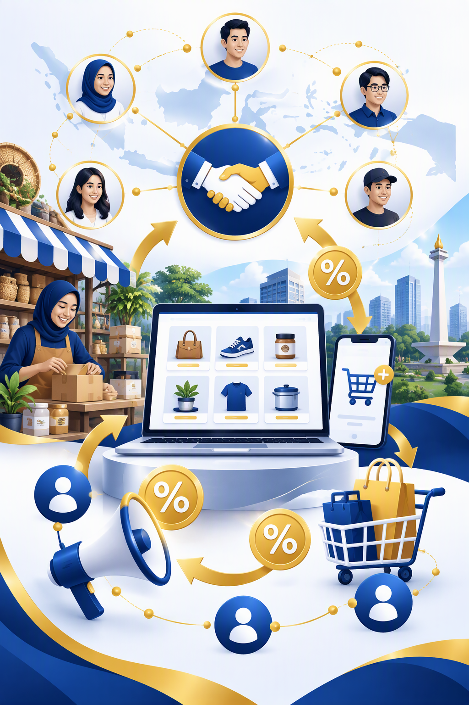
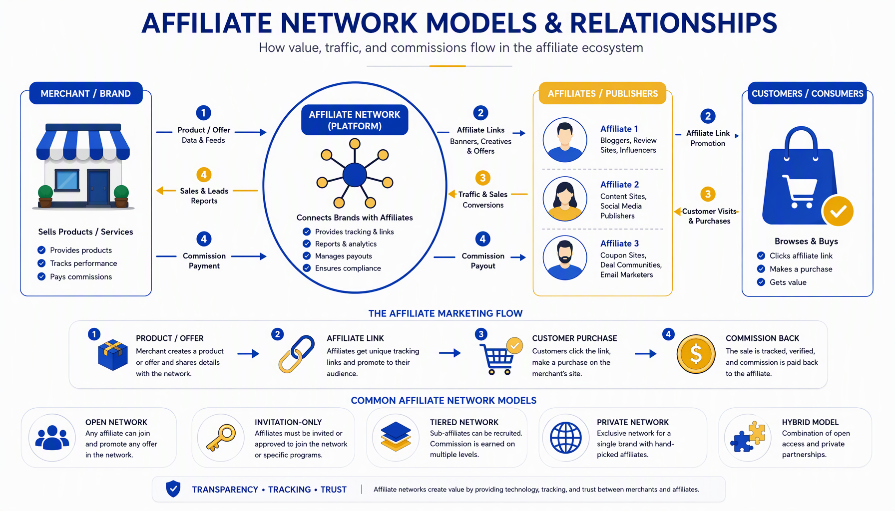
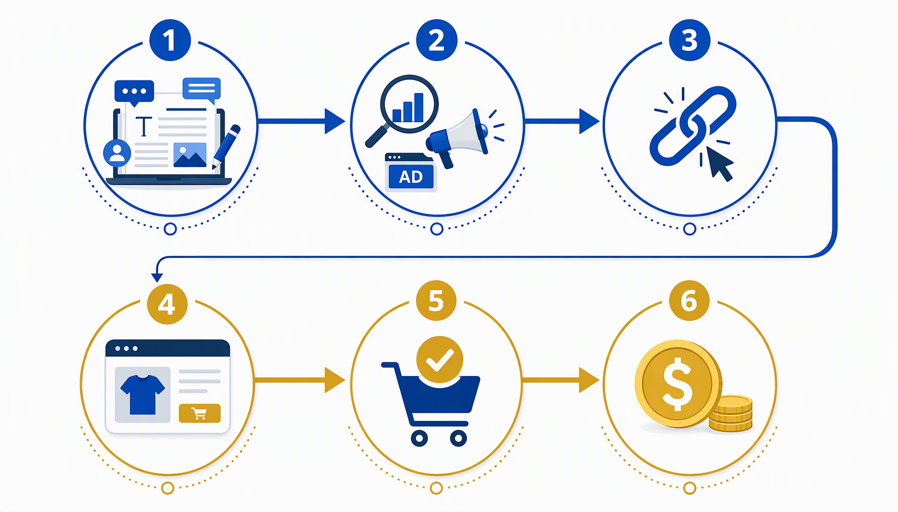
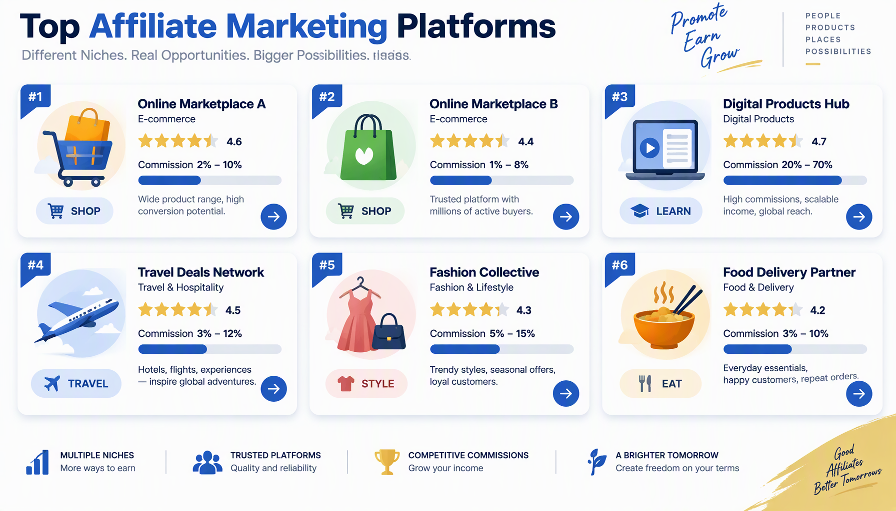
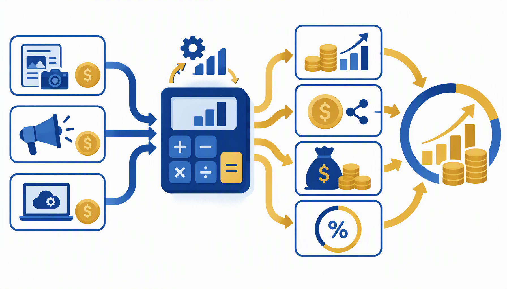

# PANDUAN LENGKAP AFFILIATE MARKETING UNTUK UMKM INDONESIA

**Penulis: Siraj Nur Ihrom**
**SNISHOP.COM | Edition 2026**

---

## DAFTAR ISI

**BAGIAN 1: FONDASI AFFILIATE MARKETING**

1. Memahami Affiliate Marketing: Konsep, Model, dan Peluang
2. Jenis-Jenis Program Affiliate dan Struktur Komisi
3. Memilih Niche dan Platform Affiliate yang Tepat
4. Mendaftarkan Bisnis ke Program Affiliate Ternama

**BAGIAN 2: STRATEGI DAN EKSEKUSI**

5. Membangun Konten yang Menghasilkan Konversi
6. Teknik Penempatan Link Affiliate yang Efektif
7. Memanfaatkan Media Sosial untuk Traffic Affiliate
8. Optimasi SEO untuk Meningkatkan Pendapatan Pasif

**BAGIAN 3: SKALING DAN OTOMASI**

9. Analisis Performa dan Pengukuran ROI
10. Strategi Scaling dan Otomasi Affiliate Marketing

**BONUS**
- 3 Studi Kasus Sukses Affiliate Marketing UMKM Indonesia
- Kalkulator ROI Affiliate Marketing
- Rencana Implementasi 30 Hari

---

# BAGIAN 1: FONDASI AFFILIATE MARKETING

---

## Bab 1: Memahami Affiliate Marketing: Konsep, Model, dan Peluang

### 1.1 Apa Itu Affiliate Marketing?

Affiliate marketing adalah model pemasaran berbasis kinerja di mana seorang affiliate (pemasar) mendapatkan komisi dari penjualan produk atau jasa milik merchant (penjual) melalui promosi yang dilakukannya. Model ini menciptakan ekosistem saling menguntungkan: merchant mendapatkan penjualan tanpa biaya iklan di muka, sementara affiliate menghasilkan pendapatan dari konten yang dibuatnya.

Di Indonesia, affiliate marketing telah berkembang pesat sejak 2020. Data Asosiasi E-Commerce Indonesia (idEA) mencatat pertumbuhan transaksi affiliate di marketplace lokal meningkat 340% antara 2021 dan 2025. Ini membuka peluang besar bagi UMKM untuk berpartisipasi baik sebagai merchant maupun affiliate.

### 1.2 Bagaimana Affiliate Marketing Bekerja?

Proses affiliate marketing mengikuti alur berikut:

1. **Pendaftaran**: Affiliate mendaftar ke program affiliate merchant atau melalui jaringan affiliate (affiliate network).
2. **Dapatkan Link Unik**: Setelah diterima, affiliate menerima link referral unik yang melacak setiap klik dan pembelian.
3. **Promosi**: Affiliate mempromosikan produk melalui konten di blog, media sosial, email, atau platform digital lainnya.
4. **Klik dan Konversi**: Calon pembeli mengklik link affiliate dan melakukan tindakan yang ditentukan (pembelian, pendaftaran, dll).
5. **Komisi**: Affiliate menerima komisi sesuai persentase atau nilai tetap yang ditetapkan program.

### 1.3 Model Pembayaran Affiliate

Terdapat beberapa model pembayaran dalam affiliate marketing:

| Model | Deskripsi | Contoh |
|-------|-----------|--------|
| **Pay Per Sale (PPS)** | Komisi dibayar saat terjadi penjualan | 5-15% dari nilai transaksi |
| **Pay Per Lead (PPL)** | Komisi dibayar saat ada pendaftaran atau leads | Rp5.000-Rp50.000 per leads |
| **Pay Per Click (PPC)** | Komisi dibayar per klik pada link | Rp100-Rp500 per klik |
| **Recurring Commission** | Komisi berulang selama pelanggan aktif | 10-30% per bulan |
| **Tiered Commission** | Persentase meningkat sesuai volume penjualan | 5% untuk 1-10 sales, 10% untuk 11-50 sales |

### 1.4 Mengapa Affiliate Marketing Cocok untuk UMKM?

**Modal Minimal**: Tidak perlu memproduksi produk sendiri. Cukup promosi produk orang lain dan dapatkan komisi.

**Fleksibel**: Bisa dijalankan dari mana saja, kapan saja. Cocok sebagai sampingan atau bisnis utama.

**Skalabel**: Semakin banyak konten berkualitas yang dibuat, semakin besar potensi pendapatan pasif.

**Rendah Risiko**: Tidak ada inventaris, tidak ada pengiriman, tidak ada layanan pelanggan yang harus ditangani sendiri.

### 1.5 Peluang Affiliate Marketing di Indonesia 2026

Pasar affiliate marketing Indonesia diproyeksikan mencapai Rp15 triliun pada 2026. Beberapa faktor pendorong:

- **Penetrasi internet** yang terus meningkat hingga 78% populasi
- **Pertumbuhan e-commerce** lokal (Shopee, Tokopedia, Lazada, Bukalapak)
- **Adopsi media sosial** yang tinggi (Instagram, TikTok, YouTube, Facebook)
- **Tren konten kreator** dan influencer marketing
- **Program affiliate pemerintah** untuk UMKM digital

### 1.6 Perbedaan Affiliate Marketing dengan Dropship dan Reseller

Banyak yang menyamakan affiliate dengan dropship atau reseller. Padahal ketiganya berbeda:

| Aspek | Affiliate | Dropship | Reseller |
|-------|-----------|----------|----------|
| **Modal** | Hampir nol | Sedang (untuk website) | Besar (stok barang) |
| **Inventaris** | Tidak ada | Tidak ada | Ada |
| **Pengiriman** | Ditangani merchant | Ditangani supplier | Ditangani sendiri |
| **Layanan pelanggan** | Ditangani merchant | Ditangani dropshipper | Ditangani sendiri |
| **Margin** | Komisi (5-50%) | Selisih harga (10-30%) | Selisih harga (20-50%) |
| **Risiko** | Sangat rendah | Sedang | Tinggi |

---

## Bab 2: Jenis-Jenis Program Affiliate dan Struktur Komisi

### 2.1 Program Affiliate Marketplace Indonesia

Setiap marketplace besar di Indonesia memiliki program affiliate tersendiri:

**Shopee Affiliate Program**
- Komisi: 5-10% per penjualan
- Cookie duration: 7 hari
- Minimum payout: Rp50.000
- Kategori unggulan: Fashion, Kecantikan, Elektronik, Rumah Tangga
- Keunggulan: Brand awareness tinggi, traffic organik besar

**Tokopedia Affiliate**
- Komisi: 2.5-10% per penjualan
- Cookie duration: 24 jam
- Minimum payout: Rp100.000
- Kategori unggulan: Elektronik, Gadget, Otomotif, Hobi
- Keunggulan: Nilai transaksi rata-rata tinggi

**Lazada Affiliate Program**
- Komisi: 4-13% per penjualan
- Cookie duration: 7 hari
- Minimum payout: Rp50.000
- Kategori unggulan: Fashion, Kesehatan, Ibu dan Anak
- Keunggulan: Sering ada bonus kampanye musiman

**Bukalapak Affiliate**
- Komisi: 2.5-7% per penjualan
- Cookie duration: 3 hari
- Minimum payout: Rp25.000
- Kategori unggulan: Produk UMKM, Kerajinan, Makanan
- Keunggulan: Fokus pada produk lokal dan UMKM

### 2.2 Program Affiliate Produk Digital

Produk digital biasanya menawarkan komisi lebih tinggi karena margin keuntungan lebih besar:

**Platform Kursus Online**
- Udemy: 10-15% per penjualan
- Coursera: 10-45% tergantung kursus
- Skillshare: Rp50.000-Rp150.000 per pendaftaran baru
- Ruangguru: 10-20% per langganan

**Software dan Tools**
- Canva Pro: 20% recurring commission
- Hosting (Niagahoster, Dewaweb): 30-60% per penjualan
- Email marketing (Mailchimp, ConvertKit): 20-30% recurring
- Accounting tools (Jurnal, Xero): 15-25% per langganan

**E-Book dan Produk Informasi**
- Google Play Books: 10-70% (ditentukan penjual)
- Gramedia Digital: 5-15% per penjualan
- Produk informasi independen: 30-50% per penjualan

### 2.3 Program Affiliate Jasa dan Layanan

**Travel dan Akomodasi**
- Traveloka: 3-6% per booking
- Tiket.com: 2-5% per transaksi
- AirBnB: Rp150.000 per tamu pertama
- Agoda: 4-7% per booking

**Keuangan dan Asuransi**
- Ajaib: Rp25.000-Rp100.000 per akun baru
- Bibit: Rp50.000 per investasi pertama
- Asuransi online: Rp50.000-Rp200.000 per polis

**Food Delivery**
- GoFood: Rp5.000-Rp15.000 per pesanan pertama
- GrabFood: Rp5.000-Rp10.000 per transaksi
- ShopeeFood: Rp8.000-Rp20.000 per pesanan

### 2.4 Memahami Struktur Komisi

Komisi affiliate tidak selalu sesederhana "persen dari penjualan". Ada beberapa faktor yang memengaruhi:

**Base Commission vs Bonus Commission**
- Base: Persentase tetap dari setiap penjualan
- Bonus: Tambahan persentase saat mencapai target tertentu

**First-Sale vs Repeat-Sale Commission**
- First-sale: Komisi hanya dari pembelian pertama
- Repeat-sale: Komisi dari setiap pembelian ulang (biasanya lebih kecil)

**Tiered Commission Structure**
- Level 1: Komisi langsung dari penjualan yang Anda hasilkan
- Level 2: Komisi dari affiliate yang Anda rekrut (jika program mendukung multi-tier)

**Cookie Duration dan Attribution Window**
- Cookie duration: Berapa lama tracking link Anda aktif setelah klik pertama
- Attribution window: Periode di mana penjualan masih dihitung sebagai konversi Anda
- Semakin panjang cookie duration, semakin menguntungkan affiliate

### 2.5 Perbandingan Komisi Antar Platform

| Platform | Komisi Rata-rata | Cookie Duration | Minimum Payout | Frekuensi Pembayaran |
|----------|-----------------|-----------------|----------------|---------------------|
| Shopee | 5-10% | 7 hari | Rp50.000 | Bulanan |
| Tokopedia | 2.5-10% | 24 jam | Rp100.000 | Bulanan |
| Lazada | 4-13% | 7 hari | Rp50.000 | Bulanan |
| Bukalapak | 2.5-7% | 3 hari | Rp25.000 | Bulanan |
| Canva | 20% recurring | 120 hari | $5 | Bulanan |
| Niagahoster | 60% | 90 hari | Rp100.000 | Bulanan |
| Traveloka | 3-6% | 7 hari | Rp100.000 | Bulanan |

---

## Bab 3: Memilih Niche dan Platform Affiliate yang Tepat

### 3.1 Prinsip Memilih Niche Affiliate

Niche yang tepat adalah fondasi keberhasilan affiliate marketing. Berikut kriteria memilih niche:

**Passion dan Pengetahuan**: Pilih topik yang Anda kuasai atau minati. Konten yang autentik lebih mudah menghasilkan konversi.

**Ukuran Pasar**: Niche harus cukup besar untuk menghasilkan traffic, tapi tidak terlalu kompetitif sehingga sulit bersaing.

**Ketersediaan Produk**: Pastikan ada cukup banyak produk affiliate di niche tersebut dengan komisi yang menarik.

**Potensi Konten Evergreen**: Pilih niche yang kontennya tetap relevan dalam jangka panjang, bukan hanya tren sesaat.

**Daya Beli Audiens**: Audiens niche tersebut harus memiliki kemampuan dan kemauan untuk membeli produk yang dipromosikan.

### 3.2 Niche Affiliate Terpopuler di Indonesia

**Kecantikan dan Perawatan Diri**
- Potensi: Sangat tinggi, pasar wanita Indonesia sangat aktif
- Produk: Skincare, makeup, haircare, parfum
- Platform: Shopee, Sociolla, Lazada
- Komisi rata-rata: 7-12%
- Tips: Fokus pada review jujur dan perbandingan produk

**Fashion dan Aksesoris**
- Potensi: Tinggi, tren fashion terus bergulir
- Produk: Pakaian, sepatu, tas, aksesoris
- Platform: Shopee, Tokopedia, Zalora
- Komisi rata-rata: 5-10%
- Tips: Buat konten outfit inspiration dan styling guide

**Teknologi dan Gadget**
- Potensi: Tinggi, daya beli relatif besar
- Produk: Smartphone, laptop, aksesoris tech, smart home
- Platform: Tokopedia, Lazada, Blibli
- Komisi rata-rata: 2-5% (nilai transaksi tinggi)
- Tips: Review mendalam dan perbandingan spesifikasi

**Makanan dan Minuman**
- Potensi: Menengah, volume tinggi tapi margin kecil
- Produk: Snack, minuman, bumbu, makanan sehat
- Platform: Shopee, Tokopedia, GrabMart
- Komisi rata-rata: 3-7%
- Tips: Konten resep dan rekomendasi oleh-oleh

**Parenting dan Ibu Anak**
- Potensi: Sangat tinggi, pembelian berulang
- Produk: Popok, susu, pakaian anak, mainan edukatif
- Platform: Shopee, Lazada, Mothercare
- Komisi rata-rata: 5-10%
- Tips: Konten parenting yang informatif dan empathetic

**Olahraga dan Kebugaran**
- Potensi: Meningkat pesat pasca pandemi
- Produk: Alat olahraga, suplemen, pakaian olahraga
- Platform: Shopee, Decathlon, Tokopedia
- Komisi rata-rata: 5-8%
- Tips: Konten workout dan tips kesehatan

**Keuangan dan Investasi**
- Potensi: Tinggi, komisi per lead besar
- Produk: Reksadana, saham, asuransi, pinjaman
- Platform: Ajaib, Bibit, Asetku
- Komisi rata-rata: Rp25.000-Rp100.000 per akun
- Tips: Konten edukasi keuangan yang kredibel

### 3.3 Evaluasi Platform Affiliate

Saat memilih platform affiliate, pertimbangkan faktor berikut:

**Reputasi dan Kepercayaan**: Platform yang terpercaya memastikan pembayaran komisi tepat waktu dan tidak ada manipulasi tracking.

**Kemudahan Penggunaan**: Dashboard yang intuitif memudahkan pelacakan performa dan penarikan komisi.

**Kualitas Materi Promosi**: Platform yang baik menyediakan banner, deskripsi produk, dan aset promosi berkualitas tinggi.

**Dukungan Affiliate**: Responsif terhadap pertanyaan dan masalah teknis.

**Fitur Tracking**: Real-time tracking, laporan detail, dan atribusi yang akurat.

### 3.4 Strategi Multi-Platform

Jangan bergantung pada satu platform saja. Diversifikasi sumber pendapatan affiliate Anda:

**Kombinasi Marketplace**: Daftarkan diri di 2-3 marketplace sekaligus (misalnya Shopee + Tokopedia + Lazada) untuk memperluas pilihan produk.

**Produk Fisik + Digital**: Gabungkan affiliate produk fisik (komisi lebih kecil tapi volume tinggi) dengan produk digital (komisi besar tapi volume lebih rendah).

**Lokal + Internasional**: Selain marketplace lokal, pertimbangkan program affiliate internasional seperti Amazon Associates atau ClickBank untuk produk yang relevan.

**Direct + Network**: Beberapa brand memiliki program affiliate langsung (in-house) yang biasanya menawarkan komisi lebih tinggi daripada melalui network.

### 3.5 Riset Kompetitor di Niche Anda

Sebelum memulai, pelajari siapa saja yang sudah bermain di niche Anda:

**Identifikasi Top Affiliate**: Cari 5-10 affiliate teratas di niche Anda melalui Google, YouTube, atau Instagram.

**Analisis Konten Mereka**: Perhatikan jenis konten yang mereka buat, platform yang mereka gunakan, dan gaya promosi mereka.

**Temukan Celah**: Apa yang belum mereka bahas? Sudut pandang apa yang bisa Anda tawarkan?

**Benchmark Komisi**: Berapa perkiraan pendapatan mereka? Ini membantu Anda menetapkan target yang realistis.

---

## Bab 4: Mendaftarkan Bisnis ke Program Affiliate Ternama

### 4.1 Persiapan Sebelum Mendaftar

Sebelum mendaftar program affiliate, siapkan hal-hal berikut:

**Akun yang Aktif dan Terverifikasi**: Pastikan akun media sosial atau website Anda sudah aktif minimal 3 bulan dengan konten yang konsisten.

**Konten Berkualitas**: Program affiliate selektif akan memeriksa kualitas konten Anda. Pastikan minimal ada 10-20 konten yang relevan.

**Audience yang Relevan**: Jika Anda memiliki followers, pastikan mereka sesuai dengan niche produk yang akan dipromosikan.

**Rekening Bank Aktif**: Untuk penarikan komisi, Anda memerlukan rekening bank atas nama sendiri yang aktif.

**NPWP (Opsional tapi Disarankan)**: Beberapa program affiliate memotong pajak 20% jika tidak menyertakan NPWP.

**KTP dan Data Diri**: Siapkan scan KTP dan data diri lengkap untuk verifikasi identitas.

### 4.2 Panduan Pendaftaran Shopee Affiliate

**Langkah 1: Akses Halaman Pendaftaran**
Buka affiliate.shopee.co.id dan klik "Daftar Sekarang".

**Langkah 2: Login dengan Akun Shopee**
Gunakan akun Shopee yang sudah aktif. Jika belum punya, buat akun terlebih dahulu.

**Langkah 3: Lengkapi Profil Affiliate**
Isi data diri, informasi media sosial atau website, dan niche konten Anda.

**Langkah 4: Tunggu Verifikasi**
Proses verifikasi biasanya memakan waktu 1-3 hari kerja. Anda akan mendapat notifikasi via email.

**Langkah 5: Mulai Promosi**
Setelah diterima, Anda bisa langsung generate link affiliate dari produk manapun di Shopee.

**Tips Agar Diterima**:
- Pastikan profil Shopee lengkap dan foto profil jelas
- Akun harus sudah pernah bertransaksi minimal 1 kali
- Media sosial atau website harus aktif dengan konten original
- Jangan menggunakan nama yang menyalahi merek dagang

### 4.3 Panduan Pendaftaran Tokopedia Affiliate

**Langkah 1: Akses Halaman Affiliate**
Buka affiliate.tokopedia.com dan login dengan akun Tokopedia.

**Langkah 2: Isi Formulir Pendaftaran**
Lengkapi data diri, informasi platform promosi, dan nomor rekening bank.

**Langkah 3: Verifikasi Identitas**
Upload KTP dan foto selfie untuk verifikasi identitas.

**Langkah 4: Tunggu Approval**
Verifikasi memakan waktu 3-7 hari kerja.

**Langkah 5: Generate Link dan Promosikan**
Gunakan fitur "Bagikan" di halaman produk untuk mendapatkan link affiliate.

### 4.4 Panduan Pendaftaran Lazada Affiliate

**Langkah 1: Daftar di Lazada Affiliate Network**
Buka affiliate.lazada.co.id dan klik "Join Now".

**Langkah 2: Pilih Tipe Akun**
Pilih antara "Individual" atau "Company" sesuai jenis akun Anda.

**Langkah 3: Lengkapi Informasi**
Isi data diri, website/media sosial, dan metode pembayaran.

**Langkah 4: Submit dan Tunggu Verifikasi**
Proses verifikasi 1-5 hari kerja.

**Langkah 5: Akses Dashboard dan Mulai Promosi**
Setelah diterima, Anda bisa mengakses dashboard dan generate link affiliate.

### 4.5 Pendaftaran Program Affiliate Internasional

**Amazon Associates**
- Buka affiliate-program.amazon.com
- Login atau buat akun Amazon
- Isi data website/media sosial dan informasi pajak (W-8BEN untuk WNI)
- Verifikasi identitas via telepon atau postcard
- Mulai promosikan produk Amazon

**ClickBank**
- Daftar di clickbank.com
- Isi data diri dan metode pembayaran
- Tidak ada verifikasi ketat, langsung bisa promosi
- Fokus pada produk digital dengan gravity score tinggi

**ShareASale**
- Daftar di shareasale.com
- Pilih merchant yang sesuai niche
- Verifikasi biasanya 1-3 hari
- Banyak merchant internasional dengan komisi menarik

### 4.6 Kesalahan Umum Saat Pendaftaran

**Menggunakan Data Palsu**: Semua program affiliate melakukan verifikasi. Data palsu akan menyebabkan penolakan atau pembekuan akun.

**Website/Media Sosial Kosong**: Pastikan platform promosi Anda sudah memiliki konten sebelum mendaftar.

**Tidak Membaca Syarat dan Ketentuan**: Setiap program memiliki aturan berbeda mengenai cara promosi, cookie duration, dan minimum payout.

**Mendaftar Terlalu Banyak Sekaligus**: Fokus pada 2-3 program terlebih dahulu, kuasai, baru tambahkan program lain.

**Menyertakan Link Affiliate di Konten yang Tidak Relevan**: Ini melanggar aturan hampir semua program affiliate dan bisa menyebabkan akun dibekukan.

---

# BAGIAN 2: STRATEGI DAN EKSEKUSI

---

## Bab 5: Membangun Konten yang Menghasilkan Konversi

### 5.1 Jenis Konten Affiliate yang Efektif

Tidak semua konten sama dalam menghasilkan konversi affiliate. Berikut jenis konten yang terbukti efektif:

**Review Produk Mendalam**
- Panjang: 1.000-2.500 kata
- Struktur: Pendahuluan, spesifikasi, kelebihan, kekurangan, perbandingan dengan kompetitor, kesimpulan
- Tingkat konversi: 3-8% (tertinggi di antara semua jenis konten)
- Tips: Gunakan foto original produk, sertakan pengalaman pribadi

**Artikel Perbandingan (Versus)**
- Format: "Produk A vs Produk B: Mana yang Lebih Baik?"
- Panjang: 1.500-3.000 kata
- Tingkat konversi: 2-6%
- Tips: Buat tabel perbandingan yang jelas, berikan rekomendasi berdasarkan kebutuhan spesifik

**Daftar Rekomendasi (Best-of)**
- Format: "10 Produk Terbaik untuk [Kebutuhan] di 2026"
- Panjang: 2.000-4.000 kata
- Tingkat konversi: 1.5-4%
- Tips: Urutkan dari yang paling direkomendasikan, jelaskan alasan setiap pilihan

**Tutorial dan How-To**
- Format: Panduan langkah demi langkah yang mengintegrasikan produk
- Panjang: 1.500-3.000 kata
- Tingkat konversi: 1-3%
- Tips: Produk yang direkomendasikan harus benar-benar dibutuhkan untuk menyelesaikan tutorial

**Artikel Edukasi**
- Format: Penjelasan konsep yang mengaitkan dengan solusi produk
- Panjang: 1.000-2.000 kata
- Tingkat konversi: 0.5-2%
- Tips: Edukasi dulu, jualan kemudian. Konten harus benar-benar bermanfaat

### 5.2 Formula Konten Affiliate yang Menghasilkan

Gunakan formula AIDA untuk menulis konten affiliate yang efektif:

**Attention (Perhatian)**
- Judul yang menarik dan spesifik
- Paragraf pembuka yang langsung menyentuh masalah pembaca
- Hook visual (gambar atau video di awal konten)

**Interest (Minat)**
- Ceritakan masalah yang relevan dengan pembaca
- Sajikan data atau fakta yang mendukung
- Buat pembaca merasa "ini tentang saya"

**Desire (Keinginan)**
- Tunjukkan bagaimana produk menyelesaikan masalah
- Sertakan testimonial atau bukti sosial
- Jelaskan manfaat, bukan hanya fitur

**Action (Tindakan)**
- Call-to-action yang jelas dan mendesak
- Tombol atau link yang mudah diklik
- Tawarkan bonus atau insentif tambahan (jika memungkinkan)

### 5.3 Menulis Review Produk yang Meyakinkan

Review produk adalah konten affiliate paling efektif. Berikut struktur review yang ideal:

**Pendahuluan (100-200 kata)**
- Perkenalkan produk dan mengapa Anda mereviewnya
- Sebutkan pengalaman Anda dengan produk (berapa lama menggunakan)
- Berikan gambaran singkat kesimpulan

**Spesifikasi dan Fitur (200-400 kata)**
- Daftar spesifikasi teknis utama
- Jelaskan fitur-fitur unggulan
- Gunakan tabel atau bullet points untuk kemudahan membaca

**Pengalaman Penggunaan (300-500 kata)**
- Ceritakan pengalaman pribadi menggunakan produk
- Sertakan foto original (jika memungkinkan)
- Jelaskan konteks penggunaan (untuk siapa produk ini cocok)

**Kelebihan (100-200 kata)**
- Daftar 3-5 kelebihan utama
- Jelaskan mengapa setiap kelebihan penting
- Bandingkan dengan ekspektasi Anda

**Kekurangan (100-200 kata)**
- Daftar 2-3 kekurangan
- Jelaskan apakah kekurangan tersebut signifikan
- Berikan konteks (apakah ada workaround)

**Perbandingan dengan Kompetitor (200-300 kata)**
- Bandingkan dengan 2-3 produk sejenis
- Gunakan tabel perbandingan
- Jelaskan kapan harus memilih produk ini vs kompetitor

**Kesimpulan dan Rekomendasi (100-200 kata)**
- Rangkum penilaian keseluruhan
- Berikan rating (misalnya 4.5/5)
- Rekomendasikan untuk siapa produk ini paling cocok
- Sertakan link affiliate dengan CTA yang jelas

### 5.4 Konten Visual yang Meningkatkan Konversi

Konten teks saja tidak cukup. Tambahkan elemen visual untuk meningkatkan konversi:

**Foto Produk Original**: Foto yang Anda ambil sendiri lebih dipercaya daripada foto dari merchant.

**Infografis Perbandingan**: Visual yang membandingkan beberapa produk dalam satu gambar.

**Screenshot Dashboard**: Jika mereview software atau aplikasi, sertakan screenshot tampilan.

**Video Review**: Video unboxing atau demo produk meningkatkan kepercayaan secara signifikan.

**Tabel Spesifikasi**: Informasi teknis yang disajikan dalam format tabel lebih mudah dicerna.

### 5.5 Konten Affiliate untuk Platform Berbeda

Setiap platform membutuhkan pendekatan konten yang berbeda:

**Blog/Website**
- Konten panjang dan mendalam (1.500-3.000 kata)
- Optimasi SEO untuk kata kunci transactional
- Multiple link affiliate dalam satu artikel
- Schema markup untuk review produk

**Instagram**
- Visual menarik di feed (carousel atau single image)
- Caption singkat dengan CTA di bio link
- Stories dengan link sticker
- Reels untuk demo produk singkat

**YouTube**
- Video review 8-15 menit
- Link affiliate di deskripsi dan pinned comment
- Thumbnail yang menarik klik
- End screen dengan rekomendasi video lain

**TikTok**
- Video pendek 15-60 detik
- Hook di 3 detik pertama
- Link di bio (karena tidak bisa link langsung di video)
- Gunakan trending sound dan format

**Twitter/X**
- Thread informatif 5-10 tweet
- Link affiliate di tweet terakhir
- Visual atau screenshot di tweet pertama
- Gunakan hashtag yang relevan

---

## Bab 6: Teknik Penempatan Link Affiliate yang Efektif

### 6.1 Prinsip Penempatan Link Affiliate

Penempatan link affiliate yang strategis bisa meningkatkan CTR (Click-Through Rate) hingga 300%. Berikut prinsip dasarnya:

**Relevansi Kontekstual**: Link harus muncul di konteks yang relevan. Jangan tempatkan link produk kecantikan di artikel tentang otomotif.

**Natural dan Tidak Memaksa**: Link harus terasa seperti bagian natural dari konten, bukan iklan yang dipaksakan.

**Visibility yang Cukup**: Link harus mudah dilihat tanpa mengganggu alur baca.

**Multiple Touchpoints**: Berikan pembaca beberapa kesempatan untuk mengklik, tapi jangan berlebihan.

**Transparansi**: Selalu disclose bahwa konten Anda mengandung link affiliate. Ini membangun kepercayaan dan memenuhi regulasi.

### 6.2 Teknik Penempatan Link di Blog/Website

**Dalam Paragraf Konten**
- Sisihkan link secara natural dalam kalimat
- Contoh: "Setelah mencoba selama 3 bulan, saya merekomendasikan [Nama Produk](link affiliate) untuk Anda yang memiliki masalah X."
- Gunakan anchor text yang deskriptif, bukan "klik di sini"

**Di Akhir Paragraf Review**
- Setelah membahas kelebihan produk, tempatkan CTA dengan link
- Contoh: "Cek harga terbaru [Nama Produk] di Shopee [link affiliate]"

**Dalam Tabel Perbandingan**
- Setiap baris produk dalam tabel perbandingan bisa memiliki link affiliate
- Pastikan link terlihat jelas dan mudah diklik

**Sebagai Tombol CTA**
- Gunakan tombol visual yang mencolok untuk CTA utama
- Contoh: "Beli Sekarang di Tokopedia" atau "Cek Diskon di Lazada"

**Di Bagian Kesimpulan**
- Rangkuman review selalu diakhiri dengan link affiliate
- Ini adalah tempat dengan konversi tertinggi karena pembaca sudah membaca seluruh review

### 6.3 Teknik Penempatan Link di Media Sosial

**Instagram**
- Bio link: Gunakan tools seperti Linktree untuk multiple link
- Stories: Gunakan link sticker untuk direct link ke produk
- Caption: Tulis "Link di bio" atau "Swipe up" (untuk akun yang memenuhi syarat)
- Highlights: Simpan stories dengan link affiliate di highlight yang terorganisir

**YouTube**
- Deskripsi video: Taruh link affiliate di 3 baris pertama
- Pinned comment: Tempatkan link affiliate di komentar yang di-pin
- End screen: Arahkan ke video lain yang juga mengandung link affiliate
- Cards: Gunakan cards di titik penting video untuk mengarahkan ke link

**TikTok**
- Bio link: Satu-satunya tempat untuk link langsung
- Link di caption tidak bisa diklik di TikTok
- Gunakan "Link di bio saya" sebagai CTA
- Buat konten yang mendorong penonton mengunjungi profil Anda

**Facebook**
- Postingan dengan link langsung bisa diklik
- Gunakan format link preview yang menarik
- Grup Facebook: Bagikan konten bernilai tinggi dengan link affiliate secara natural
- Facebook Stories: Gunakan link sticker

**Twitter/X**
- Thread: Tempatkan link affiliate di tweet terakhir
- Single tweet: Link bisa langsung diklik
- Bio: Tambahkan link ke landing page yang berisi rekomendasi produk
- Pinned tweet: Gunakan untuk promosi produk unggulan

### 6.4 Teknik Penempatan Link di Email Marketing

**Subject Line**: Jangan tempatkan link di subject line. Gunakan subject line yang menarik untuk membuka email.

**Header Email**: Sertakan CTA utama di bagian atas email untuk pembaca yang langsung ingin bertindak.

**Dalam Konten Email**: Sisipkan link secara natural dalam body email, sama seperti di blog.

**Tombol CTA**: Gunakan tombol visual yang mencolok untuk link utama.

**Footer Email**: Sertakan link tambahan di footer untuk pembaca yang scroll sampai bawah.

**P.S. Section**: Bagian P.S. di akhir email memiliki tingkat pembacaan tinggi. Manfaatkan untuk CTA tambahan.

### 6.5 Membuat Link Affiliate yang Menarik Diklik

**Gunakan Anchor Text yang Deskriptif**
- Buruk: "Klik di sini"
- Baik: "Cek harga terbaru di Shopee"
- Lebih baik: "Lihat diskon 50% untuk [Nama Produk] di Shopee"

**Tambahkan Urgency**
- "Promo berakhir hari ini"
- "Stok terbatas, cek ketersediaan"
- "Diskon khusus bulan ini"

**Sertakan Nilai Tambah**
- "Dengan kode voucher saya, Anda dapat diskon tambahan 10%"
- "Gratis ongkir khusus dari link ini"

**Gunakan Visual CTA**
- Tombol berwarna kontras
- Icon panah atau shopping cart
- Badge "Promo" atau "Diskon"

### 6.6 Menghindari Kesalahan Penempatan Link

**Terlalu Banyak Link**: Lebih dari 5-7 link affiliate dalam satu artikel bisa terlihat spammy dan menurunkan kepercayaan.

**Link yang Tidak Relevan**: Jangan menempatkan link produk yang tidak ada hubungannya dengan konten.

**Link yang Tersembunyi**: Jangan menyembunyikan link affiliate dalam teks kecil atau warna yang sama dengan background.

**Tidak Disclosure**: Selalu beri tahu pembaca bahwa konten Anda mengandung link affiliate. Ini wajib secara etika dan regulasi.

**Link yang Rusak**: Periksa secara berkala bahwa semua link affiliate masih aktif dan mengarah ke produk yang benar.

---

## Bab 7: Memanfaatkan Media Sosial untuk Traffic Affiliate

### 7.1 Strategi Media Sosial untuk Affiliate Marketing

Media sosial adalah sumber traffic terbesar untuk affiliate marketing di Indonesia. Berikut strategi untuk setiap platform:

**Instagram: Visual Commerce**
- Fokus pada konten visual berkualitas tinggi
- Gunakan carousel untuk review produk multi-slide
- Manfaatkan Reels untuk demo produk singkat
- Stories untuk flash sale dan promo terbatas waktu
- Build trust melalui konten behind-the-scenes dan personal branding

**TikTok: Viral Content**
- Buat konten entertaining yang mengedukasi
- Gunakan trending sounds dan format
- Hook di 3 detik pertama sangat krusial
- Konsistensi posting: minimal 1 video per hari
- Kolaborasi dengan kreator lain untuk memperluas jangkauan

**YouTube: Long-form Review**
- Video review mendalam (10-20 menit)
- Tutorial dan how-to yang mengintegrasikan produk
- Unboxing dan first impression
- Perbandingan produk head-to-head
- Optimasi thumbnail dan judul untuk CTR tinggi

**Facebook: Community Building**
- Buat grup Facebook seputar niche Anda
- Bagikan konten bernilai tinggi secara konsisten
- Gunakan Facebook Live untuk demo produk real-time
- Manfaatkan Facebook Marketplace untuk produk fisik
- Jalankan Facebook Ads untuk mempromosikan konten affiliate

**Twitter/X: Real-time Engagement**
- Buat thread informatif tentang produk
- Ikuti dan engage dengan tren yang relevan
- Gunakan hashtag yang tepat untuk visibilitas
- Share link affiliate dalam konteks percakapan yang natural
- Build personal brand sebagai expert di niche Anda

### 7.2 Membangun Audience yang Engaged

Traffic dari media sosial hanya berguna jika audience-nya engaged dan percaya pada rekomendasi Anda.

**Konsistensi Konten**: Posting secara rutin sesuai jadwal. Algoritma media sosial menghargai konsistensi.

**Kualitas di Atas Kuantitas**: Satu konten berkualitas lebih baik daripada sepuluh konten medioker.

**Interaksi dengan Followers**: Balas komentar, DM, dan mention. Bangun hubungan personal dengan audience.

**Konten Bernilai Tinggi**: 80% konten harus memberikan nilai (edukasi, hiburan, inspirasi), 20% boleh berisi promosi.

**Autentisitas**: Jujur tentang kelebihan dan kekurangan produk. Audience bisa mendeteksi review yang tidak autentik.

### 7.3 Konten Viral untuk Affiliate Marketing

Beberapa format konten memiliki potensi viral lebih tinggi:

**Before-After Transformation**
- Tunjukkan perubahan sebelum dan setelah menggunakan produk
- Format ini sangat efektif untuk produk kecantikan, fitness, dan home improvement
- Pastikan transformasi yang ditampilkan realistis dan bisa diverifikasi

**Unboxing Experience**
- Rekam pengalaman membuka kemasan produk
- Tunjukkan detail produk dari berbagai sudut
- Berikan first impression yang jujur

**Life Hack atau Tips Tricks**
- Bagikan tips yang relevan dengan niche Anda
- Integrasikan produk sebagai bagian dari solusi
- Buat tips yang praktis dan bisa langsung diterapkan

**Challenge atau Trend**
- Ikuti challenge atau tren yang sedang viral
- Adaptasi dengan niche dan produk affiliate Anda
- Pastikan tetap autentik dan tidak dipaksakan

**Comparison atau Versus**
- Bandingkan 2-3 produk sejenis
- Buat konten yang membantu audience membuat keputusan
- Format ini sangat dicari oleh orang yang siap membeli

### 7.4 Paid Promotion untuk Affiliate

Menggunakan iklan berbayar bisa mempercepat pertumbuhan traffic affiliate:

**Instagram/Facebook Ads**
- Budget minimum: Rp50.000-Rp100.000 per hari untuk mulai
- Target audience yang spesifik berdasarkan interest dan behavior
- Gunakan konten yang sudah terbukti organik performanya
- A/B test berbagai creative dan copy
- Retarget orang yang sudah engage dengan konten Anda

**TikTok Ads**
- Budget minimum: Rp100.000 per hari
- Format In-Feed Ads paling cocok untuk affiliate
- Target berdasarkan interest dan hashtag behavior
- Gunakan konten native yang tidak terlihat seperti iklan
- Manfaatkan Spark Ads untuk mempromosikan konten organik

**YouTube Ads**
- Budget fleksibel, mulai dari Rp50.000
- Format TrueView In-Stream cocok untuk review produk
- Target berdasarkan keyword search dan channel yang ditonton
- Video iklan harus engaging di 5 detik pertama
- Arahkan ke landing page, bukan langsung ke link affiliate

**Google Ads**
- Target keyword transactional seperti "review [produk]" atau "[produk A] vs [produk B]"
- Budget mulai dari Rp100.000 per hari
- Arahkan ke artikel blog yang mengandung link affiliate
- Gunakan ad extension untuk meningkatkan CTR
- Monitor ROI dengan ketat karena biaya per klik bisa tinggi

### 7.5 Influencer Collaboration

Berkolaborasi dengan influencer bisa memperluas jangkauan secara signifikan:

**Micro-Influencer (1K-10K followers)**
- Engagement rate biasanya lebih tinggi (5-10%)
- Biaya lebih terjangkau (Rp500.000-Rp5.000.000 per post)
- Audience lebih niche dan targeted
- Cocok untuk produk spesifik

**Mid-Tier Influencer (10K-100K followers)**
- Balance antara jangkauan dan engagement
- Biaya Rp5.000.000-Rp50.000.000 per post
- Professional dalam membuat konten
- Cocok untuk brand awareness dan konversi

**Macro Influencer (100K-1M followers)**
- Jangkauan luas
- Biaya Rp50.000.000-Rp500.000.000 per post
- Cocok untuk kampanye besar
- Pastikan audience mereka sesuai dengan target market produk

**Mega Influencer (1M+ followers)**
- Jangkauan sangat luas
- Biaya di atas Rp500.000.000 per post
- Cocok untuk brand awareness skala nasional
- ROI sulit diukur langsung untuk affiliate

### 7.6 Mengukur Performa Media Sosial

Track metrik berikut untuk mengevaluasi efektivitas media sosial:

**Reach dan Impressions**: Berapa banyak orang yang melihat konten Anda?

**Engagement Rate**: Berapa persen yang like, comment, share, atau save?

**Click-Through Rate (CTR)**: Berapa persen yang mengklik link affiliate?

**Conversion Rate**: Berapa persen yang melakukan pembelian setelah klik?

**Revenue per Platform**: Berapa pendapatan affiliate dari setiap platform?

**Cost per Acquisition (CPA)**: Jika menggunakan paid promotion, berapa biaya untuk mendapatkan satu konversi?

---

## Bab 8: Optimasi SEO untuk Meningkatkan Pendapatan Pasif

### 8.1 Mengapa SEO Penting untuk Affiliate Marketing?

SEO (Search Engine Optimization) adalah strategi jangka panjang yang bisa menghasilkan pendapatan pasif berkelanjutan. Berbeda dengan media sosial yang membutuhkan posting konsisten, konten yang teroptimasi SEO bisa terus menghasilkan traffic dan konversi selama bertahun-tahun.

**Organic Traffic yang Konsisten**: Artikel blog yang ranking di halaman 1 Google bisa menghasilkan ribuan kunjungan per bulan tanpa biaya tambahan.

**High-Intent Audience**: Orang yang mencari melalui Google biasanya sudah memiliki niat beli. Kata kunci seperti "review [produk]" atau "harga [produk] termurah" menunjukkan buyer intent yang tinggi.

**Credibility dan Trust**: Ranking tinggi di Google memberikan kesan kredibel. Orang lebih percaya rekomendasi dari website yang muncul di halaman pertama pencarian.

**Biaya Efektif**: Setelah konten ranking, traffic bersifat gratis. Tidak perlu biaya iklan seperti di media sosial.

### 8.2 Riset Keyword untuk Affiliate Marketing

Riset keyword yang tepat adalah fondasi SEO affiliate. Berikut langkah-langkahnya:

**Identifikasi Seed Keywords**
- Mulai dari nama produk, kategori produk, dan masalah yang diselesaikan produk
- Contoh: "skincare jerawat", "laptop mahasiswa", "rekomendasi air fryer"

**Gunakan Tools Riset Keyword**
- Google Keyword Planner (gratis)
- Ubersuggest (freemium)
- Ahrefs Keyword Generator (gratis terbatas)
- SEMrush Keyword Magic Tool (berbayar)

**Analisis Search Intent**
- Informational: "cara memilih laptop" (belum siap beli)
- Commercial: "review laptop ASUS ROG" (sedang mempertimbangkan)
- Transactional: "harga laptop ASUS ROG 2026" (siap beli)
- Fokus pada keyword commercial dan transactional untuk affiliate

**Evaluasi Kompetisi**
- Periksa halaman 1 Google untuk keyword target
- Jika didominasi website besar (Detik, Kompas, dll), cari keyword alternatif
- Target keyword dengan volume 100-1.000 pencarian/bulan dan kompetisi rendah

**Long-tail Keywords**
- Keyword panjang (3-5 kata) biasanya lebih spesifik dan memiliki konversi lebih tinggi
- Contoh: "laptop untuk desain grafis under 10 juta" lebih baik daripada "laptop desain"

### 8.3 On-Page SEO untuk Konten Affiliate

Optimasi on-page memastikan konten Anda mudah dipahami oleh Google dan menarik bagi pembaca:

**Judul Halaman (Title Tag)**
- Panjang: 50-60 karakter
- Sertakan keyword utama di awal
- Buat menarik dan mengundang klik
- Contoh: "Review [Produk] 2026: Kelebihan, Kekurangan, dan Harga Terbaru"

**Meta Deskripsi**
- Panjang: 150-160 karakter
- Rangkuman menarik dari konten
- Sertakan keyword secara natural
- Tambahkan CTA untuk meningkatkan CTR

**Struktur Heading**
- H1: Judul utama (hanya satu per halaman)
- H2: Sub-bab utama
- H3: Sub-sub-bab
- H4: Detail tambahan
- Sertakan keyword di beberapa heading

**Konten Berkualitas**
- Panjang minimal 1.500 kata untuk artikel affiliate
- Jawab semua pertanyaan yang mungkin dimiliki pembaca
- Gunakan data, statistik, dan bukti untuk mendukung klaim
- Update konten secara berkala agar tetap relevan

**Optimasi Gambar**
- Gunakan nama file yang deskriptif: "review-laptop-asus-rog.jpg"
- Tambahkan alt text yang menjelaskan gambar
- Kompres gambar untuk kecepatan loading
- Gunakan format WebP untuk ukuran lebih kecil

**Internal Linking**
- Link ke artikel lain di website Anda yang relevan
- Membantu Google memahami struktur website
- Meningkatkan time on site dan pageviews per visit

**External Linking**
- Link ke sumber terpercaya untuk mendukung klaim
- Link ke produk affiliate dengan anchor text yang natural
- Jangan terlalu banyak external link yang tidak relevan

### 8.4 Technical SEO untuk Website Affiliate

**Kecepatan Website**
- Target loading time di bawah 3 detik
- Gunakan hosting yang cepat dan reliable
- Aktifkan caching dan CDN
- Kompres dan optimasi gambar
- Minimize CSS dan JavaScript

**Mobile-Friendly**
- Pastikan website responsive di semua ukuran layar
- Google menggunakan mobile-first indexing
- Test dengan Google Mobile-Friendly Test tool

**SSL Certificate (HTTPS)**
- Wajib untuk website affiliate
- Meningkatkan kepercayaan pengunjung
- Faktor ranking Google

**Sitemap XML**
- Buat dan submit sitemap ke Google Search Console
- Memudahkan Google mengindex semua halaman

**Robots.txt**
- Konfigurasi dengan benar agar tidak memblokir halaman penting
- Izinkan Googlebot mengcrawl konten affiliate Anda

**Schema Markup**
- Gunakan schema Review untuk artikel review produk
- Implementasi schema Product untuk informasi harga dan ketersediaan
- Tambahkan schema BreadcrumbList untuk navigasi

### 8.5 Link Building untuk Website Affiliate

Backlink dari website terpercaya meningkatkan otoritas domain dan ranking Google:

**Guest Posting**
- Tulis artikel tamu di website niche yang relevan
- Sertakan link ke website Anda di dalam konten atau author bio
- Fokus pada kualitas website, bukan kuantitas link

**Broken Link Building**
- Cari link yang rusak di website niche Anda
- Hubungi pemilik website dan tawarkan konten Anda sebagai pengganti

**Resource Page Link Building**
- Cari halaman resource di website yang merekomendasikan produk
- Hubungi dan minta pertimbangan untuk mencantumkan produk yang Anda review

**HARO (Help A Reporter Out)**
- Jawab pertanyaan dari jurnalis yang membutuhkan expert
- Jika jawaban Anda digunakan, Anda mendapat backlink dari media besar

**Skyscraper Technique**
- Cari konten populer di niche Anda
- Buat versi yang lebih baik dan lebih lengkap
- Hubungi website yang link ke konten asli dan minta mereka link ke versi Anda

### 8.6 Local SEO untuk Affiliate Indonesia

Jika target audience Anda spesifik lokasi di Indonesia:

**Google My Business**
- Daftarkan website atau bisnis Anda di Google My Business
- Optimasi profil dengan informasi lengkap dan akurat
- Minta review dari pelanggan atau pembaca

**Local Keywords**
- Target keyword dengan nama kota atau daerah
- Contoh: "toko laptop terbaik di Surabaya" atau "rekomendasi skincare di Bandung"

**Local Citations**
- Daftarkan bisnis di direktori lokal Indonesia
- Pastikan NAP (Name, Address, Phone) konsisten di semua platform

**Local Content**
- Buat konten yang relevan dengan lokasi target
- Contoh: "Panduan Belanja Online dari Seller Lokal Jakarta"

### 8.7 Mengukur Keberhasilan SEO Affiliate

Track metrik berikut untuk mengevaluasi performa SEO:

**Organic Traffic**: Jumlah kunjungan dari mesin pencari. Gunakan Google Analytics.

**Keyword Rankings**: Posisi keyword target di hasil pencarian. Track dengan tools seperti Ahrefs atau SEMrush.

**Click-Through Rate (CTR)**: Persentase orang yang klik link affiliate setelah membaca konten.

**Conversion Rate**: Persentase pengunjung yang melakukan pembelian.

**Revenue per Page**: Pendapatan affiliate dari setiap halaman artikel.

**Backlink Profile**: Jumlah dan kualitas backlink ke website Anda.

**Domain Authority**: Skor otoritas domain website Anda (skala 1-100).

---

# BAGIAN 3: SKALING DAN OTOMASI

---

## Bab 9: Analisis Performa dan Pengukuran ROI

### 9.1 Metrik Kunci Affiliate Marketing

Untuk mengoptimalkan pendapatan affiliate, Anda harus track metrik-metrik berikut:

**Click-Through Rate (CTR)**
- Rumus: (Jumlah klik link affiliate / Jumlah impresions) x 100%
- Benchmark: 1-3% untuk konten blog, 2-5% untuk email, 0.5-2% untuk media sosial
- CTR rendah menunjukkan konten atau CTA tidak menarik

**Conversion Rate**
- Rumus: (Jumlah penjualan / Jumlah klik) x 100%
- Benchmark: 1-5% tergantung niche dan produk
- Conversion rate rendah bisa disebabkan oleh landing page merchant yang buruk atau produk tidak sesuai ekspektasi

**Average Order Value (AOV)**
- Rumus: Total nilai penjualan / Jumlah transaksi
- Penting untuk memahami berapa nilai rata-rata transaksi yang Anda hasilkan
- Produk dengan AOV tinggi biasanya memberikan komisi absolut lebih besar

**Earnings Per Click (EPC)**
- Rumus: Total komisi / Jumlah klik
- Metrik ini menunjukkan berapa pendapatan rata-rata per klik
- EPC tinggi berarti traffic Anda berkualitas dan relevan

**Revenue Per Visitor (RPV)**
- Rumus: Total komisi / Jumlah pengunjung unik
- Mengukur seberapa efektif website Anda menghasilkan uang dari setiap pengunjung

**Return on Investment (ROI)**
- Rumus: (Pendapatan - Biaya) / Biaya x 100%
- Biaya termasuk: hosting, tools, iklan, waktu (jika dihargai)
- ROI positif berarti bisnis affiliate Anda profitable

### 9.2 Tools untuk Tracking dan Analytics

**Google Analytics (Gratis)**
- Track traffic, behavior, dan konversi di website Anda
- Setup goal tracking untuk link affiliate
- Gunakan UTM parameters untuk melacak sumber traffic

**Google Search Console (Gratis)**
- Monitor performa SEO website Anda
- Lihat keyword apa yang mendatangkan traffic
- Identifikasi masalah teknis yang menghambat ranking

**Dashboard Affiliate Network**
- Setiap platform affiliate (Shopee, Tokopedia, dll) memiliki dashboard sendiri
- Track klik, konversi, dan komisi secara real-time
- Download laporan untuk analisis lebih lanjut

**Bitly atau Short.io (Freemium)**
- Shorten link affiliate untuk tracking yang lebih baik
- Lihat jumlah klik per link
- Bandingkan performa berbagai CTA

**Pretty Links (WordPress Plugin)**
- Kelola dan track semua link affiliate di satu tempat
- Buat link yang lebih clean dan branded
- Analisis CTR per link

**Voluum atau BeMob (Berbayar)**
- Advanced tracking untuk affiliate marketer serius
- Real-time analytics dan fraud detection
- A/B testing untuk landing page dan CTA

### 9.3 Cara Membaca dan Menganalisis Data

**Identifikasi Pola**
- Konten atau platform mana yang menghasilkan konversi tertinggi?
- Waktu atau hari apa yang paling produktif?
- Produk atau kategori apa yang paling laku?

**Segmentasi Data**
- Pisahkan data berdasarkan sumber traffic (organic, social, paid, email)
- Analisis performa per platform affiliate
- Bandingkan konversi berdasarkan jenis konten

**Cari Bottleneck**
- Di mana drop-off terbesar terjadi? (klik tapi tidak beli, atau tidak klik sama sekali?)
- Apakah ada halaman dengan traffic tinggi tapi konversi rendah?
- Produk apa yang banyak diklik tapi sedikit menghasilkan penjualan?

**A/B Testing**
- Test berbagai judul konten
- Test posisi penempatan link affiliate
- Test jenis CTA (tombol vs teks vs gambar)
- Test waktu posting di media sosial

### 9.4 Menghitung ROI Affiliate Marketing

**Langkah 1: Hitung Total Biaya**
- Hosting website: Rp500.000-Rp2.000.000 per tahun
- Domain: Rp150.000-Rp300.000 per tahun
- Tools (email marketing, analytics, dll): Rp200.000-Rp1.000.000 per bulan
- Iklan (jika ada): Rp1.000.000-Rp10.000.000 per bulan
- Konten (jika hire writer): Rp500.000-Rp2.000.000 per artikel
- Waktu Anda sendiri: Hargai waktu Anda, misalnya Rp100.000 per jam

**Langkah 2: Hitung Total Pendapatan**
- Jumlah dari semua komisi yang diterima
- Pisahkan per platform untuk analisis lebih detail
- Hitung pendapatan recurring jika ada

**Langkah 3: Hitung ROI**
- ROI = (Pendapatan - Biaya) / Biaya x 100%
- Contoh: Pendapatan Rp10.000.000, Biaya Rp3.000.000
- ROI = (10.000.000 - 3.000.000) / 3.000.000 x 100% = 233%

**Langkah 4: Evaluasi**
- ROI di atas 100% berarti profitable
- ROI 50-100% masih acceptable untuk fase pertumbuhan
- ROI di bawah 50% perlu evaluasi dan optimasi
- ROI negatif berarti Anda rugi dan harus segera adjust strategi

### 9.5 Reporting dan Evaluasi Berkala

**Harian**: Cek dashboard affiliate untuk melihat klik dan konversi hari ini

**Mingguan**: Analisis performa konten dan platform. Identifikasi apa yang bekerja dan apa yang tidak.

**Bulanan**: Hitung ROI dan bandingkan dengan bulan sebelumnya. Buat laporan komprehensif.

**Kuartalan**: Evaluasi strategi secara keseluruhan. Apakah niche masih profitable? Apakah perlu pivot?

**Tahunan**: Review bisnis affiliate secara holistik. Tetapkan target dan strategi untuk tahun berikutnya.

---

## Bab 10: Strategi Scaling dan Otomasi Affiliate Marketing

### 10.1 Dari Side Hustle ke Full-Time Business

Banyak affiliate marketer memulai sebagai sampingan dan berkembang menjadi bisnis utama. Berikut tahapan scaling:

**Fase 1: Validasi (Bulan 1-3)**
- Fokus: Membuktikan bahwa niche Anda profitable
- Target: Rp1.000.000-Rp5.000.000 per bulan
- Strategi: Buat 10-20 konten berkualitas, bangun presence di 1-2 platform
- Investasi: Waktu dan effort, minimal modal finansial

**Fase 2: Pertumbuhan (Bulan 4-12)**
- Fokus: Meningkatkan traffic dan konversi secara konsisten
- Target: Rp5.000.000-Rp20.000.000 per bulan
- Strategi: Scale konten yang bekerja, mulai invest di paid ads, diversifikasi platform
- Investasi: Sebagian profit untuk reinvestasi

**Fase 3: Scaling (Tahun 1-2)**
- Fokus: Membangun sistem dan tim
- Target: Rp20.000.000-Rp100.000.000 per bulan
- Strategi: Hire content writer, VA, atau specialist. Otomasi proses yang repetitif
- Investasi: Tim dan tools

**Fase 4: Optimasi (Tahun 2+)**
- Fokus: Maksimalkan profit dan ekspansi
- Target: Rp100.000.000+ per bulan
- Strategi: Masuk ke niche baru, bangun multiple website, negosiasi komisi khusus dengan merchant
- Investasi: Diversifikasi dan strategic partnerships

### 10.2 Otomasi Proses Affiliate

Otomasi menghemat waktu dan meningkatkan efisiensi. Berikut proses yang bisa diotomasi:

**Content Scheduling**
- Tools: Buffer, Hootsuite, Later, Meta Business Suite
- Otomasi: Jadwalkan posting media sosial untuk 1-4 minggu ke depan
- Benefit: Konsistensi tanpa harus online setiap hari

**Email Marketing Automation**
- Tools: Mailchimp, ConvertKit, ActiveCampaign
- Otomasi: Welcome sequence, nurture campaign, re-engagement
- Benefit: Membangun hubungan dengan subscriber secara otomatis

**Link Management**
- Tools: Pretty Links, ThirstyAffiliates, Geniuslink
- Otomasi: Redirect link, cloaking, A/B testing
- Benefit: Kelola ratusan link affiliate dengan mudah

**Analytics dan Reporting**
- Tools: Google Data Studio, Supermetrics, DashThis
- Otomasi: Dashboard real-time, laporan otomatis
- Benefit: Monitor performa tanpa manual tracking

**Social Media Management**
- Tools: Sprout Social, SocialBee, Publer
- Otomasi: Content calendar, auto-posting, engagement tracking
- Benefit: Kelola multiple platform dari satu dashboard

### 10.3 Delegasi dan Outsourcing

Scaling membutuhkan delegasi. Berikut peran yang bisa di-outsource:

**Content Writer**
- Tugas: Menulis artikel blog, deskripsi produk, script video
- Biaya: Rp300.000-Rp1.500.000 per artikel (1.000-2.000 kata)
- Platform: Projects.co.id, Sribulancer, Fastwork
- Tips: Berikan brief yang jelas dan contoh konten yang Anda sukai

**Virtual Assistant (VA)**
- Tugas: Admin, scheduling, email management, data entry
- Biaya: Rp2.000.000-Rp5.000.000 per bulan (part-time)
- Platform: Glints, JobStreet, LinkedIn
- Tips: Train VA Anda dengan SOP yang jelas

**Graphic Designer**
- Tugas: Buat thumbnail, infografis, banner promosi
- Biaya: Rp100.000-Rp500.000 per desain
- Platform: Fastwork, 99designs, Fiverr
- Tips: Berikan brand guideline dan contoh desain yang Anda inginkan

**Video Editor**
- Tugas: Edit video YouTube, Reels, TikTok
- Biaya: Rp200.000-Rp1.000.000 per video
- Platform: Fastwork, Projects.co.id
- Tips: Berikan script dan reference video yang Anda sukai

**SEO Specialist**
- Tugas: Riset keyword, on-page optimization, link building
- Biaya: Rp3.000.000-Rp10.000.000 per bulan
- Platform: LinkedIn, Upwork, agency lokal
- Tips: Minta portfolio dan case study sebelum hire

### 10.4 Diversifikasi Sumber Pendapatan

Jangan bergantung pada satu sumber pendapatan saja. Diversifikasi untuk stabilitas:

**Multiple Affiliate Programs**
- Daftarkan diri di 5-10 program affiliate berbeda
- Gabungkan marketplace lokal dan internasional
- Diversifikasi berdasarkan kategori produk

**Multiple Platforms**
- Jangan hanya fokus di satu media sosial
- Bangun presence di blog, YouTube, Instagram, TikTok
- Setiap platform bisa menjadi sumber traffic yang saling melengkapi

**Multiple Revenue Streams**
- Affiliate marketing sebagai base
- Tambahkan sponsored content
- Jual produk digital sendiri (e-book, course, template)
- Tawarkan jasa konsultasi atau coaching
- Monetize dengan display ads (Google AdSense)

### 10.5 Negosiasi Komisi Khusus

Setelah Anda memiliki track record yang baik, Anda bisa negosiasi komisi lebih tinggi:

**Build Track Record**
- Tunjukkan data penjualan yang konsisten
- Dokumentasikan traffic dan konversi yang Anda hasilkan
- Build reputasi sebagai affiliate yang reliable

**Hubungi Affiliate Manager**
- Setiap program affiliate memiliki affiliate manager
- Hubungi mereka setelah Anda mencapai volume penjualan tertentu
- Sampaikan pencapaian dan minta review komisi

**Present Value Proposition**
- Jelaskan berapa revenue yang Anda hasilkan untuk merchant
- Tunjukkan potensi pertumbuhan jika komisi dinaikkan
- Berikan data konkret, bukan hanya asumsi

**Negosiasi Win-Win**
- Minta komisi lebih tinggi sebagai ganti exclusive deal
- Tawarkan promosi tambahan (email blast, dedicated content)
- Negosiasi tiered commission berdasarkan volume

### 10.6 Membangun Brand Personal

Brand personal yang kuat meningkatkan kepercayaan dan konversi:

**Konsistensi Visual**
- Gunakan warna, font, dan style yang konsisten di semua platform
- Buat logo dan branding yang profesional
- Invest di desain yang berkualitas

**Konsistensi Suara**
- Tentukan tone of voice: formal, casual, humoris, atau inspiratif?
- Gunakan bahasa yang sesuai dengan target audience
- Be authentic dan jangan mencoba menjadi orang lain

**Konsistensi Nilai**
- Hanya rekomendasikan produk yang benar-benar Anda percaya
- Jujur tentang kelebihan dan kekurangan
- Prioritaskan kepentingan audience di atas komisi

**Engagement dengan Audience**
- Balas komentar dan pesan secara rutin
- Buat konten interaktif (poll, Q&A, giveaway)
- Dengarkan feedback dan saran dari audience

### 10.7 Menghadapi Perubahan Algoritma dan Regulasi

Affiliate marketing tidak statis. Algoritma platform dan regulasi terus berubah:

**Update Algoritma**
- Ikuti berita dan update dari Google, media sosial, dan marketplace
- Diversifikasi traffic source agar tidak bergantung pada satu algoritma
- Fokus pada konten berkualitas yang selalu relevan

**Perubahan Regulasi**
- Pantau regulasi tentang affiliate marketing di Indonesia
- Pastikan disclosure affiliate selalu ada di konten Anda
- Patuhi aturan pajak untuk pendapatan affiliate

**Adaptasi Cepat**
- Jika satu platform berubah dan performa turun, segera pivot
- Experiment dengan platform dan format baru
- Jangan takut untuk meninggalkan strategi yang tidak lagi bekerja

---

# STUDI KASUS: SUKSES AFFILIATE MARKETING UMKM INDONESIA

## Studi Kasus 1: Dari Blog Pribadi ke Pendapatan Rp50 Juta per Bulan

**Profil**: Rina, 28 tahun, content creator kecantikan dari Bandung

**Awal Mulai (Januari 2023)**
- Memulai blog review skincare dengan modal domain dan hosting Rp500.000
- Fokus pada review jujur produk skincare lokal dan internasional
- Konsisten menulis 2-3 artikel per minggu

**Strategi yang Diterapkan**
- Riset keyword mendalam untuk setiap artikel
- Review produk dengan foto original dan pengalaman pribadi
- Bangun komunitas di Instagram (sekarang 45K followers)
- Daftar di 5 program affiliate: Shopee, Sociolla, Lazada, Tokopedia, dan brand langsung

**Tantangan**
- 6 bulan pertama: Traffic sangat rendah (100-200 visitor/bulan)
- Kompetisi ketat di niche kecantikan
- Beberapa program affiliate menolak pendaftaran awal

**Titik Balik (Bulan 7-12)**
- Artikel "Review Skincare Routine untuk Kulit Berminyak" ranking #1 Google
- Traffic melonjak ke 5.000 visitor/bulan
- Pendapatan pertama: Rp800.000 di bulan ke-8

**Hasil Saat Ini (Oktober 2026)**
- Traffic blog: 50.000 visitor/bulan
- Instagram: 45K followers dengan engagement rate 8%
- Pendapatan affiliate: Rp45-55 juta per bulan
- Tim: 2 content writer, 1 VA, 1 graphic designer
- Revenue streams: Affiliate (70%), Sponsored content (20%), Digital products (10%)

**Pelajaran Kunci**
- Konsistensi adalah kunci. Butuh 6-12 bulan untuk melihat hasil signifikan
- Fokus pada kualitas konten, bukan kuantitas
- Bangun hubungan dengan audience, bukan hanya jualan
- Diversifikasi sumber pendapatan dan platform

## Studi Kasus 2: Mahasiswa yang Menghasilkan Rp15 Juta dari TikTok Affiliate

**Profil**: Dimas, 22 tahun, mahasiswa teknik di Yogyakarta

**Awal Mulai (Juni 2024)**
- Iseng membuat akun TikTok tentang gadget dan tech review
- Modal: Smartphone saja, tanpa lighting atau equipment mahal
- Posting 1 video per hari selama 3 bulan pertama

**Strategi yang Diterapkan**
- Fokus pada video unboxing dan quick review gadget affordable
- Gunakan trending sounds dan format TikTok
- Hook di 3 detik pertama setiap video
- Link affiliate di bio (Linktree dengan 10+ link)

**Tantangan**
- Video awal hanya ditonton 50-100 kali
- Algoritma TikTok sulit ditembus di awal
- Equipment terbatas menghasilkan kualitas video pas-pasan

**Titik Balik (Bulan 4-6)**
- Video "Rekomendasi TWS Under 200 Ribu" viral dengan 2 juta views
- Followers melonjak dari 500 ke 15.000 dalam semalam
- Komisi pertama: Rp1.200.000 dari satu video viral

**Hasil Saat Ini (Oktober 2026)**
- Followers TikTok: 180K
- Average views per video: 20K-50K
- Pendapatan affiliate: Rp12-18 juta per bulan
- Brand deals: Rp5-10 juta per video sponsored
- Equipment: Kamera mirrorless, lighting kit, microphone (investasi dari profit)

**Pelajaran Kunci**
- Satu video viral bisa mengubah segalanya
- Konsistensi posting sangat penting di TikTok
- Tidak perlu equipment mahal di awal
- Fokus pada konten yang membantu orang membuat keputusan pembelian

## Studi Kasus 3: Ibu Rumah Tangga dengan Pendapatan Pasif Rp8 Juta dari Blog Resep

**Profil**: Sari, 35 tahun, ibu rumah tangga di Surabaya

**Awal Mulai (Maret 2023)**
- Memulai blog resep masakan dan review alat dapur
- Motivasi: Hobi memasak dan ingin menghasilkan tambahan income
- Modal: Laptop bekas dan internet rumah

**Strategi yang Diterapkan**
- Tulis resep dengan foto original hasil masakan sendiri
- Review alat dapur dengan link affiliate ke Tokopedia dan Shopee
- Fokus pada long-tail keyword: "resep rendang daging sapi empuk", "review air fryer Philips"
- Bangun Pinterest account untuk traffic tambahan

**Tantangan**
- Sulit membagi waktu antara mengurus rumah dan nge-blog
- Kompetisi dengan blog resep besar (Cookpad, Femdaily)
- 8 bulan pertama hampir tidak ada penghasilan

**Titik Balik (Bulan 9-14)**
- Artikel "10 Air Fryer Terbaik 2024" ranking di halaman 1 Google
- Traffic dari Pinterest mulai konsisten
- Komisi pertama yang signifikan: Rp600.000 di bulan ke-10

**Hasil Saat Ini (Oktober 2026)**
- Traffic blog: 25.000 visitor/bulan
- Pinterest followers: 12K
- Pendapatan affiliate: Rp7-9 juta per bulan (pasif, tanpa posting baru)
- Konten evergreen terus menghasilkan komisi
- Sedang membangun course online "Blogging untuk Ibu Rumah Tangga"

**Pelajaran Kunci**
- Konten evergreen bisa menghasilkan pendapatan pasif bertahun-tahun
- Niche spesifik (alat dapur) lebih mudah ditembus daripada niche umum
- Pinterest adalah sumber traffic yang underrated untuk blog Indonesia
- Tidak perlu posting setiap hari, kualitas lebih penting dari kuantitas

---

# KALKULATOR ROI AFFILIATE MARKETING

Gunakan kalkulator ini untuk memperkirakan potensi pendapatan dan ROI bisnis affiliate Anda.

## Input Biaya Bulanan

| Komponen Biaya | Estimasi Biaya |
|----------------|----------------|
| Hosting website | Rp100.000 |
| Domain (dibagi 12 bulan) | Rp15.000 |
| Tools (email marketing, analytics) | Rp300.000 |
| Iklan (opsional) | Rp2.000.000 |
| Konten (writer, designer) | Rp3.000.000 |
| **Total Biaya Bulanan** | **Rp5.415.000** |

## Estimasi Pendapatan

**Skenario Konservatif**
- Traffic: 5.000 visitor/bulan
- CTR link affiliate: 2%
- Klik: 100 klik/bulan
- Conversion rate: 2%
- Penjualan: 2 transaksi/bulan
- Komisi rata-rata: Rp50.000
- **Pendapatan: Rp100.000/bulan**
- **ROI: -98% (rugi, masih fase investasi)**

**Skenario Moderat**
- Traffic: 20.000 visitor/bulan
- CTR link affiliate: 3%
- Klik: 600 klik/bulan
- Conversion rate: 3%
- Penjualan: 18 transaksi/bulan
- Komisi rata-rata: Rp75.000
- **Pendapatan: Rp1.350.000/bulan**
- **ROI: -75% (masih rugi, tapi semakin baik)**

**Skenario Optimis**
- Traffic: 50.000 visitor/bulan
- CTR link affiliate: 4%
- Klik: 2.000 klik/bulan
- Conversion rate: 4%
- Penjualan: 80 transaksi/bulan
- Komisi rata-rata: Rp100.000
- **Pendapatan: Rp8.000.000/bulan**
- **ROI: 48% (profitable!)**

**Skenario Sukses (Seperti Studi Kasus)**
- Traffic: 100.000 visitor/bulan
- CTR link affiliate: 5%
- Klik: 5.000 klik/bulan
- Conversion rate: 5%
- Penjualan: 250 transaksi/bulan
- Komisi rata-rata: Rp150.000
- **Pendapatan: Rp37.500.000/bulan**
- **ROI: 593% (sangat profitable!)**

## Break-Even Analysis

Untuk mencapai break-even dengan biaya bulanan Rp5.415.000:
- Diperlukan pendapatan minimal Rp5.415.000/bulan
- Dengan komisi rata-rata Rp100.000 per transaksi
- Butuh 55 transaksi/bulan
- Dengan conversion rate 3%, butuh 1.833 klik/bulan
- Dengan CTR 3%, butuh 61.100 visitor/bulan

**Timeline realistis untuk mencapai break-even: 12-18 bulan dengan kerja konsisten**

---

# RENCANA IMPLEMENTASI 30 HARI

## Minggu 1: Fondasi (Hari 1-7)

**Hari 1-2: Riset dan Persiapan**
- Tentukan niche affiliate Anda (gunakan kriteria di Bab 3)
- Riset 5-10 kompetitor di niche tersebut
- Daftar 2-3 program affiliate yang relevan
- Siapkan akun media sosial yang akan digunakan

**Hari 3-4: Setup Platform**
- Buat website/blog (WordPress direkomendasikan)
- Setup hosting dan domain
- Install tema dan plugin essential (Yoast SEO, Pretty Links)
- Buat halaman About, Contact, dan Privacy Policy

**Hari 5-7: Konten Pertama**
- Riset 10 keyword target (gunakan tips di Bab 8)
- Tulis artikel pertama (review produk atau artikel perbandingan)
- Optimasi on-page SEO (title tag, meta description, heading structure)
- Publish dan share di media sosial

**Target Minggu 1**: Website live, 1 artikel published, 2-3 program affiliate terdaftar

## Minggu 2: Konten dan Konsistensi (Hari 8-14)

**Hari 8-10: Produksi Konten Batch**
- Tulis 3 artikel tambahan (total 4 artikel di website)
- Fokus pada artikel evergreen yang akan tetap relevan berbulan-bulan
- Sertakan link affiliate di setiap artikel secara natural

**Hari 11-12: Media Sosial**
- Buat konten untuk Instagram/TikTok/YouTube (pilih 1-2 platform)
- Posting minimal 1 konten per hari
- Gunakan link affiliate di bio atau deskripsi

**Hari 13-14: Networking**
- Follow dan engage dengan affiliate marketer lain di niche Anda
- Join grup Facebook atau komunitas Telegram tentang affiliate marketing
- Comment di blog atau channel YouTube yang relevan

**Target Minggu 2**: 4 artikel published, 7 posting media sosial, mulai membangun network

## Minggu 3: Optimasi dan Ekspansi (Hari 15-21)

**Hari 15-17: Analisis Performa**
- Cek Google Analytics: berapa visitor yang datang?
- Cek dashboard affiliate: berapa klik dan konversi?
- Identifikasi konten mana yang perform terbaik
- Optimasi konten yang kurang perform

**Hari 18-19: Konten Lanjutan**
- Tulis 2 artikel baru berdasarkan insight dari analisis
- Experiment dengan format konten berbeda (video, infografis, podcast)
- Update artikel lama dengan informasi terbaru

**Hari 20-21: Email Marketing**
- Setup email marketing (Mailchimp free tier cukup untuk mulai)
- Buat lead magnet (free e-book, checklist, atau template)
- Tambahkan opt-in form di website
- Kirim email pertama ke subscriber

**Target Minggu 3**: Analisis performa, 6 artikel published, email list started

## Minggu 4: Scaling dan Planning (Hari 22-30)

**Hari 22-24: Paid Promotion (Opsional)**
- Jika ada budget, coba jalankan iklan Rp50.000-Rp100.000 per hari
- Promosikan artikel terbaik di Facebook/Instagram Ads
- Track ROI dengan ketat

**Hari 25-27: Konten Lanjutan**
- Tulis 2 artikel baru (total 8 artikel di bulan pertama)
- Buat 1 konten video (YouTube atau TikTok)
- Experiment dengan platform baru (Pinterest misalnya)

**Hari 28-30: Evaluasi dan Planning Bulan 2**
- Hitung total pendapatan dan ROI bulan pertama
- Identifikasi apa yang bekerja dan apa yang tidak
- Buat rencana untuk bulan ke-2 dengan target lebih tinggi
- Set target: 2x lipat traffic dan konversi dari bulan 1

**Target Minggu 4**: 8 artikel published, 1 video content, rencana bulan 2 selesai

## Checklist Implementasi 30 Hari

**Minggu 1**
- [ ] Niche ditentukan dan divalidasi
- [ ] 2-3 program affiliate terdaftar
- [ ] Website/blog live
- [ ] 1 artikel pertama published
- [ ] Akun media sosial setup

**Minggu 2**
- [ ] Total 4 artikel published
- [ ] 7 posting media sosial
- [ ] Network dengan 10 affiliate marketer
- [ ] Join 2-3 komunitas affiliate

**Minggu 3**
- [ ] Analisis performa dilakukan
- [ ] Total 6 artikel published
- [ ] Email marketing setup
- [ ] Lead magnet created
- [ ] 10+ subscriber email

**Minggu 4**
- [ ] Total 8 artikel published
- [ ] 1 video content created
- [ ] Evaluasi ROI bulan pertama
- [ ] Rencana bulan ke-2 dibuat
- [ ] Target bulan ke-2 ditetapkan

---

# KESIMPULAN

Affiliate marketing adalah model bisnis yang accessible, scalable, dan profitable untuk UMKM Indonesia. Dengan modal minimal, Anda bisa membangun sumber pendapatan pasif yang signifikan.

Kunci keberhasilan affiliate marketing:

1. **Pilih niche yang tepat**: Spesifik, profitable, dan sesuai passion Anda
2. **Buat konten berkualitas**: Fokus pada nilai untuk pembaca, bukan hanya jualan
3. **Konsisten**: Butuh 6-12 bulan untuk melihat hasil signifikan
4. **Diversifikasi**: Jangan bergantung pada satu platform atau program affiliate
5. **Analisis dan optimasi**: Track performa dan adjust strategi secara berkala
6. **Build trust**: Jujur dan autentik dalam setiap rekomendasi
7. **Scale**: Delegasi dan otomasi saat bisnis sudah profitable

Mulai hari ini, ambil langkah pertama. Daftar di satu program affiliate, tulis satu artikel, atau buat satu video review. Action adalah kunci.

Semoga panduan ini membantu Anda membangun bisnis affiliate marketing yang sukses. Selamat mencoba dan semoga berhasil!

---

**SNISHOP.COM**
**Panduan Lengkap Affiliate Marketing untuk UMKM Indonesia**
**Edition 2026**

**Penulis: Siraj Nur Ihrom**

Hak cipta dilindungi undang-undang. Dilarang menggandakan, mendistribusikan, atau menyimpan bagian manapun dari publikasi ini tanpa izin tertulis dari penerbit.

**SNISHOP.COM** - Partner Digital UMKM Indonesia
