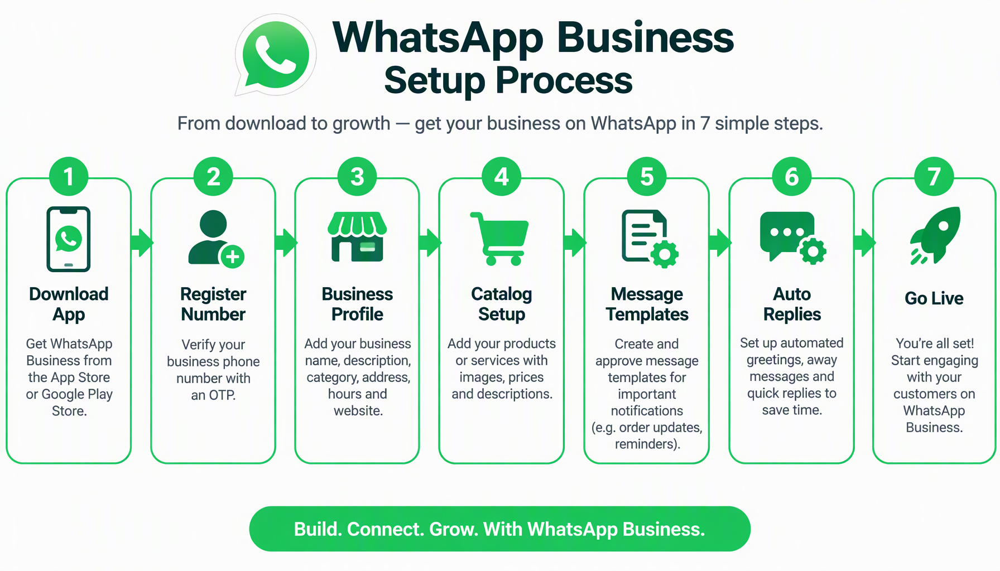
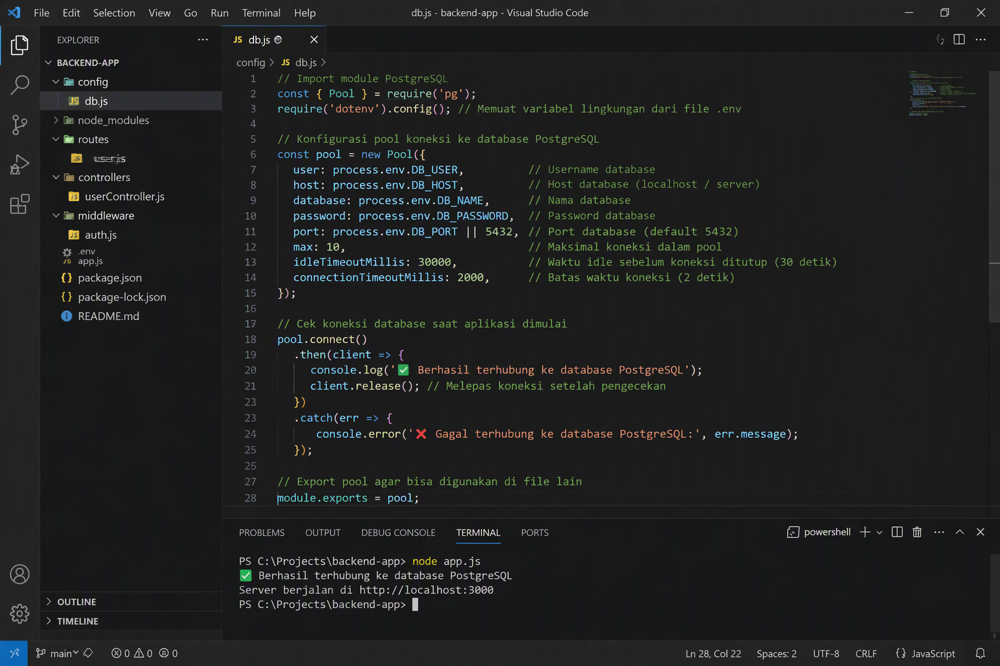
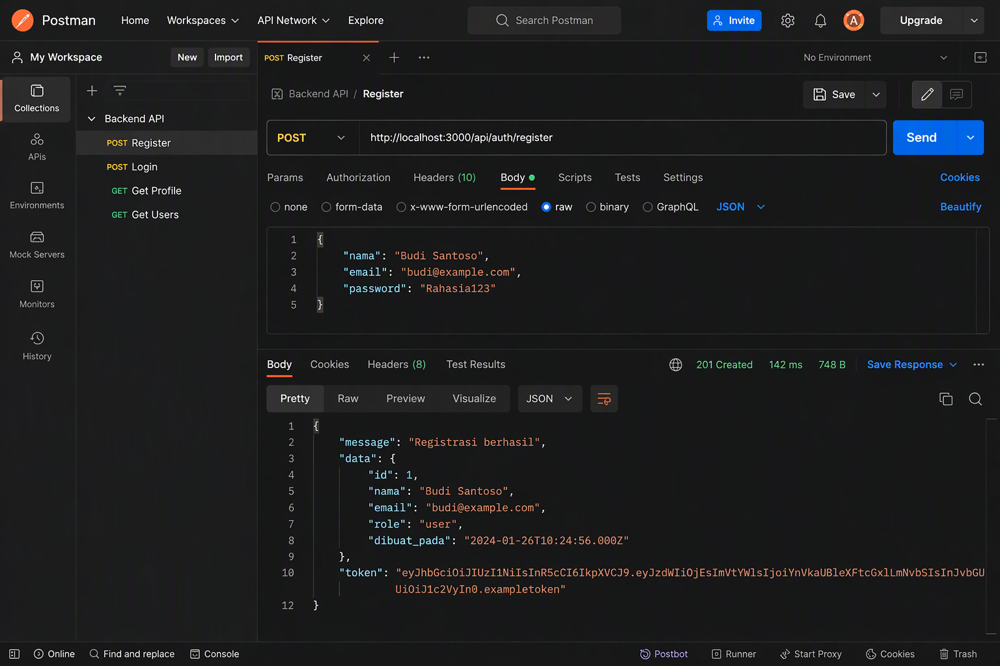

# Panduan Lengkap AI Chatbot untuk Bisnis UMKM Indonesia

Oleh: Tim SNISHOP
Edisi Pertama, 2026

---

Hak Cipta 2026 pada PT SNISHOP Indonesia. Seluruh hak cipta dilindungi undang-undang. Dilarang menggandakan, mendistribusikan, atau menyimpan bagian mana pun dari buku ini tanpa izin tertulis dari penerbit.

Informasi dalam buku ini disusun berdasarkan penelitian dan pengalaman praktis. Penulis dan penerbit tidak bertanggung jawab atas kerugian yang mungkin timbul akibat penggunaan informasi di dalamnya. Selalu konsultasikan keputusan bisnis Anda dengan profesional yang relevan.

---

## Daftar Isi

### BAGIAN 1: FONDASI AI CHATBOT

- Bab 1: Revolusi Customer Service - Mengapa UMKM Butuh AI Chatbot
- Bab 2: Memahami Chatbot - Jenis, Kemampuan, dan Batasan
- Bab 3: Memilih Platform yang Tepat - Chatfuel, ManyChat, Tidio, Intercom, Drift
- Bab 4: Desain Percakapan - Prinsip UX untuk Chatbot
- Bab 5: Setup dan Konfigurasi - Dari Nol hingga Live

### BAGIAN 2: MEMBANGUN CHATBOT CERDAS

- Bab 6: Integrasi dengan Website dan Media Sosial
- Bab 7: FAQ Otomatis - Menjawab Pertanyaan Umum 24/7
- Bab 8: Lead Generation - Mengumpulkan Prospek dengan Chatbot
- Bab 9: E-commerce Chatbot - Katalog, Order, dan Payment
- Bab 10: Booking dan Reservasi Otomatis
- Bab 11: Customer Support - Handling Komplain dan Eskalasi
- Bab 12: Integrasi dengan CRM dan Email Marketing

### BAGIAN 3: OPTIMASI DAN SCALE UP

- Bab 13: Analytics dan Monitoring - Mengukur Performa Chatbot
- Bab 14: NLP dan Machine Learning - Membuat Chatbot Lebih Cerdas
- Bab 15: Studi Kasus - 3 UMKM Indonesia dengan Chatbot Sukses
- Bab 16: Roadmap 30 Hari - Dari Pemula Menjadi Chatbot Expert

## LAMPIRAN

- Kalkulator ROI Chatbot
- Kode Referral Eksklusif SNISHOP
- Glosarium Istilah Teknis

---

## Kata Pengantar

Bisnis kecil dan menengah di Indonesia menghadapi tantangan besar dalam melayani pelanggan. Jumlah pertanyaan yang masuk setiap hari bisa mencapai ratusan, sementara tim customer service terbatas. Di sinilah AI chatbot menjadi solusi yang mengubah permainan.

Buku ini ditulis khusus untuk pemilik UMKM yang ingin memanfaatkan teknologi chatbot tanpa harus memiliki latar belakang teknis. Kami memandu Anda langkah demi langkah, mulai dari memahami dasar-dasar chatbot hingga mengimplementasikannya secara praktis dalam bisnis Anda.

Setelah membaca panduan ini, Anda akan mampu membangun chatbot yang bisa menjawab pertanyaan pelanggan secara otomatis, mengumpulkan prospek, memproses pesanan, dan bahkan menangani komplain. Semua ini berjalan 24 jam sehari, 7 hari seminggu, tanpa henti.

Mari kita mulai perjalanan transformasi digital bisnis Anda.

---

# BAGIAN 1: FONDASI AI CHATBOT

## Bab 1: Revolusi Customer Service - Mengapa UMKM Butuh AI Chatbot

### Lanskap Customer Service di Era Digital

Dunia bisnis Indonesia sedang mengalami perubahan besar. Berdasarkan data dari Asosiasi E-Commerce Indonesia, transaksi digital terus meningkat setiap tahunnya. Pelanggan kini mengharapkan respons cepat, layanan 24 jam, dan pengalaman yang personal. Mereka tidak lagi mau menunggu berjam-jam untuk mendapatkan jawaban atas pertanyaan sederhana.

Bayangkan skenario ini. Seorang pelanggan mengunjungi Instagram toko online Anda pada pukul 11 malam. Ia tertarik dengan produk yang Anda posting dan ingin menanyakan ukuran serta ketersediaan stok. Jika tidak ada yang membalas dalam 30 menit, ia akan beralih ke toko kompetitor yang lebih responsif. Data dari HubSpot menunjukkan bahwa 73 persen konsumen menganggap respons cepat sebagai faktor terpenting dalam pengalaman customer service.

Inilah realitas yang dihadapi UMKM Indonesia saat ini. Sumber daya terbatas, tetapi tuntutan pelanggan terus meningkat. Solusinya bukan menambah staf customer service yang berarti biaya tambahan besar. Solusinya adalah AI chatbot.

### Apa yang Membuat Chatbot Begitu Penting untuk UMKM

Chatbot bukan sekadar tren teknologi. Ia adalah alat strategis yang menyelesaikan masalah nyata dalam operasional bisnis sehari-hari. Berikut adalah alasan mengapa setiap UMKM perlu mempertimbangkan implementasi chatbot.

**Pertama, ketersediaan 24/7.** Chatbot tidak tidur, tidak sakit, dan tidak mengambil cuti. Ia siap melayani pelanggan kapan pun. Ini sangat penting bagi bisnis yang memiliki pelanggan dari berbagai zona waktu, terutama jika Anda menjual produk secara online ke seluruh Indonesia.

**Kedua, konsistensi jawaban.** Setiap pelanggan mendapatkan informasi yang sama akuratnya. Tidak ada risiko jawaban yang berbeda dari satu staf ke staf lainnya. Chatbot memberikan respons yang terstandar namun tetap terasa personal.

**Ketiga, efisiensi biaya.** Sebuah studi dari IBM menunjukkan bahwa chatbot dapat mengurangi biaya customer service hingga 30 persen. Untuk UMKM dengan anggaran terbatas, penghematan ini sangat signifikan. Anda bisa mengalokasikan dana yang tersimpan untuk pengembangan bisnis.

**Keempat, skalabilitas.** Saat bisnis Anda tumbuh dan jumlah pertanyaan meningkat, chatbot dapat menangani volume percakapan yang jauh lebih besar tanpa perlu merekrut tambahan staf. Satu chatbot bisa menangani ribuan percakapan secara bersamaan.

**Kelima, pengumpulan data.** Setiap interaksi dengan pelanggan menghasilkan data berharga. Chatbot dapat merekam preferensi, keluhan, dan pola pertanyaan pelanggan. Data ini menjadi fondasi untuk pengambilan keputusan bisnis yang lebih baik.

### Data dan Fakta: Chatbot di Indonesia

Adopsi chatbot di Indonesia tumbuh pesat. Beberapa data penting yang perlu Anda ketahui:

- Lebih dari 65 persen konsumen Indonesia lebih suka berkomunikasi dengan bisnis melalui platform messaging
- Chatbot mampu menyelesaikan 70 hingga 80 persen pertanyaan rutin tanpa intervensi manusia
- Perusahaan yang mengimplementasikan chatbot melaporkan peningkatan kepuasan pelanggan hingga 25 persen
- Waktu respons rata-rata chatbot adalah di bawah 5 detik, dibandingkan 10 menit atau lebih untuk layanan manual
- ROI chatbot rata-rata tercapai dalam waktu 6 hingga 12 bulan setelah implementasi

### Mitos Seputar Chatbot yang Perlu Diluruskan

Sebelum melangkah lebih jauh, ada beberapa kesalahpahaman tentang chatbot yang perlu kita klarifikasi.

**Mitos 1: Chatbot hanya untuk perusahaan besar.** Ini tidak benar. Platform chatbot modern seperti Chatfuel dan ManyChat dirancang khusus untuk bisnis kecil dan menengah. Biayanya terjangkau dan tidak memerlukan tim teknis.

**Mitos 2: Chatbot akan menggantikan seluruh staf manusia.** Chatbot dirancang untuk menangani pertanyaan rutin dan repetitif. Interaksi yang kompleks dan emosional tetap membutuhkan sentuhan manusia. Chatbot dan manusia bekerja bersama, bukan saling menggantikan.

**Mitos 3: Membuat chatbot itu sulit.** Dengan platform no-code dan low-code yang ada saat ini, siapa pun bisa membuat chatbot dasar dalam hitungan jam. Anda tidak perlu bisa menulis kode program. Yang Anda butuhkan adalah pemahaman tentang alur percakapan dan kebutuhan pelanggan.

**Mitos 4: Chatbot terasa kaku dan tidak natural.** Teknologi Natural Language Processing (NLP) modern membuat chatbot semakin cerdas dalam memahami konteks dan nuansa percakapan. Dengan desain yang baik, pelanggan bisa merasa sedang mengobrol dengan asisten yang ramah.

### Kesiapan Bisnis Anda untuk Chatbot

Sebelum membangun chatbot, evaluasi apakah bisnis Anda sudah siap. Berikut beberapa indikator kesiapan.

Anda menerima pertanyaan yang sama berulang setiap hari. Jika pertanyaan seperti "berapa harganya", "apakah masih tersedia", atau "di mana lokasi toko" muncul puluhan kali sehari, chatbot bisa sangat membantu.

Anda kehilangan pelanggan karena respons lambat. Jika pelanggan sering mengeluh harus menunggu lama atau Anda tahu ada penjualan yang hilang karena keterlambatan balasan, chatbot adalah solusinya.

Anda memiliki basis pengetahuan yang jelas. Chatbot bekerja paling baik ketika ada informasi yang terstruktur untuk dibagikan. Jika Anda sudah memiliki FAQ, katalog produk, atau prosedur layanan, bahan-bahan ini bisa langsung diintegrasikan ke chatbot.

Anda ingin meningkatkan efisiensi operasional. Chatbot membebaskan tim Anda dari tugas-tugas repetitif sehingga mereka bisa fokus pada pekerjaan yang lebih bernilai tinggi.

### Apa yang Akan Anda Pelajari di Buku Ini

Buku ini dirancang sebagai panduan komprehensif untuk membawa Anda dari nol hingga mahir dalam implementasi chatbot. Setiap bagian dibangun secara bertahap.

Bagian pertama meletakkan fondasi. Anda akan memahami jenis-jenis chatbot, cara memilih platform, prinsip desain percakapan, dan langkah-langkah setup awal.

Bagian kedua masuk ke implementasi praktis. Anda akan belajar cara mengintegrasikan chatbot dengan berbagai saluran, membangun fitur FAQ otomatis, lead generation, e-commerce, booking, customer support, dan integrasi dengan CRM.

Bagian ketiga membahas optimasi dan pengembangan. Anda akan mempelajari analytics, NLP dan machine learning, studi kasus nyata dari UMKM Indonesia, dan roadmap 30 hari untuk implementasi.

Di akhir buku, Anda juga akan menemukan kalkulator ROI untuk menghitung potensi penghematan dan pendapatan tambahan dari chatbot, serta kode referral eksklusif untuk mendapatkan diskon pada platform chatbot terkemuka.

### Langkah Pertama yang Bisa Anda Ambil Hari Ini

Sambil membaca buku ini, mulailah dengan langkah-langkah sederhana. Catat sepuluh pertanyaan yang paling sering ditanyakan pelanggan kepada bisnis Anda. Daftar ini akan menjadi fondasi untuk membangun skrip chatbot pertama Anda. Semakin spesifik Anda dalam mengidentifikasi kebutuhan pelanggan, semakin efektif chatbot yang bisa Anda bangun.

Siapkan juga daftar saluran komunikasi yang digunakan pelanggan Anda. Apakah mereka lebih banyak menghubungi melalui WhatsApp, Instagram Direct Message, website, atau kombinasi dari semuanya? Informasi ini akan membantu Anda memilih platform dan saluran yang tepat untuk chatbot.

Perjalanan Anda menuju customer service yang lebih baik dimulai dari sini. Mari kita lanjutkan ke bab berikutnya dan memahami lebih dalam tentang apa itu chatbot dan bagaimana cara kerjanya.

---

## Bab 2: Memahami Chatbot - Jenis, Kemampuan, dan Batasan

### Definisi dan Cara Kerja Dasar Chatbot

Chatbot adalah program komputer yang mensimulasikan percakapan dengan manusia melalui antarmuka teks atau suara. Dalam konteks bisnis, chatbot berfungsi sebagai asisten virtual yang berinteraksi dengan pelanggan secara otomatis.

Cara kerja chatbot pada dasarnya cukup sederhana. Pelanggan mengirim pesan, chatbot memproses pesan tersebut, dan kemudian memberikan respons yang sesuai. Proses pemrosesan ini bisa menggunakan berbagai pendekatan, dari yang paling dasar hingga yang sangat canggih.

Pada tingkat paling sederhana, chatbot bekerja berdasarkan aturan (rules-based). Anda mendefinisikan serangkaian aturan seperti "jika pelanggan mengetik 'harga', maka kirim daftar harga". Pendekatan ini mudah dibuat dan sangat andal untuk pertanyaan yang terprediksi.

Pada tingkat yang lebih canggih, chatbot menggunakan kecerdasan buatan (AI) untuk memahami makna di balik pesan pelanggan. Teknologi ini disebut Natural Language Processing atau NLP. Chatbot AI bisa memahami variasi dalam cara orang bertanya, menangkap konteks percakapan, dan memberikan respons yang lebih natural.

### Jenis-Jenis Chatbot Berdasarkan Teknologi

Memahami jenis-jenis chatbot akan membantu Anda memilih pendekatan yang tepat untuk bisnis Anda.

### Rule-Based Chatbot (Chatbot Berbasis Aturan)

Jenis ini bekerja berdasarkan pohon keputusan yang telah ditentukan sebelumnya. Chatbot mengenali kata kunci tertentu dan memberikan respons yang sudah disiapkan. Keunggulannya adalah sangat andal untuk skenario yang sudah diprediksi dan mudah dibangun tanpa keahlian teknis.

Contoh penggunaan yang ideal: menjawab pertanyaan tentang jam operasional, memberikan informasi harga, atau memandu pelanggan melalui proses pemesanan sederhana.

Keterbatasannya adalah tidak bisa menangani pertanyaan di luar skenario yang telah diprogram. Jika pelanggan bertanya dengan cara yang tidak terduga, chatbot ini mungkin tidak bisa memberikan jawaban yang relevan.

### AI-Powered Chatbot (Chatbot Berbasis Kecerdasan Buatan)

Chatbot jenis ini menggunakan machine learning untuk memahami bahasa natural. Ia bisa belajar dari setiap interaksi dan semakin akurat seiring waktu. Chatbot AI memahami konteks, menangkap nuansa, dan bisa menangani pertanyaan yang lebih kompleks.

Contoh penggunaan yang ideal: customer service untuk produk dengan banyak variasi pertanyaan, asisten penjualan yang bisa merekomendasikan produk berdasarkan kebutuhan pelanggan.

Keterbatasannya membutuhkan lebih banyak data dan waktu untuk pelatihan, serta biaya yang lebih tinggi dibandingkan chatbot berbasis aturan.

### Hybrid Chatbot (Gabungan Aturan dan AI)

Ini adalah pendekatan yang paling banyak digunakan dalam praktik. Chatbot hybrid menggunakan aturan untuk pertanyaan rutin dan beralih ke AI untuk pertanyaan yang lebih kompleks. Jika chatbot tidak bisa menjawab, percakapan dialihkan ke agen manusia.

Contoh penggunaan yang ideal: hampir semua skenario bisnis UMKM. Anda mendapatkan keandalan chatbot berbasis aturan untuk pertanyaan umum, ditambah fleksibilitas AI untuk situasi yang lebih kompleks.

### Jenis-Jenis Chatbot Berdasarkan Saluran

Chatbot juga bisa dikategorikan berdasarkan saluran tempat mereka beroperasi.

**Website Chatbot** berinteraksi dengan pengunjung melalui widget chat di website Anda. Ini cocok untuk bisnis yang memiliki traffic website tinggi dan ingin meningkatkan konversi.

**Social Media Chatbot** beroperasi di platform seperti Instagram, Facebook Messenger, atau WhatsApp. Ini ideal untuk bisnis yang mengandalkan media sosial sebagai saluran utama komunikasi dengan pelanggan.

**Voice Chatbot** menggunakan suara sebagai antarmuka, seperti Google Assistant atau Amazon Alexa. Jenis ini masih jarang digunakan oleh UMKM di Indonesia.

**SMS Chatbot** berkomunikasi melalui pesan teks. Meskipun terlihat kuno, jenis ini masih relevan untuk pasar dengan penetrasi smartphone rendah.

Untuk sebagian besar UMKM Indonesia, website chatbot dan social media chatbot adalah pilihan yang paling tepat. Keduanya akan kita bahas secara mendalam di bab-bab selanjutnya.

### Kemampuan Chatbot yang Relevan untuk UMKM

Chatbot modern memiliki berbagai kemampuan yang bisa langsung dimanfaatkan oleh bisnis Anda.

**Menjawab Pertanyaan Otomatis.** Ini adalah fungsi paling dasar dan paling banyak digunakan. Chatbot bisa menjawab pertanyaan tentang produk, harga, ketersediaan stok, jam operasional, lokasi, dan informasi umum lainnya.

**Memproses Transaksi.** Chatbot bisa membantu pelanggan memilih produk, menambahkan ke keranjang, dan bahkan memproses pembayaran. Beberapa platform sudah terintegrasi dengan payment gateway populer di Indonesia.

**Mengumpulkan Informasi Pelanggan.** Chatbot bisa meminta dan merekam data kontak pelanggan, preferensi, dan kebutuhan mereka. Data ini sangat berharga untuk pemasaran dan penjualan lanjutan.

**Mengirim Notifikasi dan Pengingat.** Chatbot bisa mengirim pengingat tentang pesanan yang belum dibayar, jadwal reservasi yang akan datang, atau promosi khusus.

**Melakukan Kualifikasi Lead.** Chatbot bisa mengajukan pertanyaan untuk menentukan apakah seorang prospek cocok untuk produk atau layanan Anda, lalu mengarahkan mereka ke langkah selanjutnya.

**Menangani Keluhan Dasar.** Chatbot bisa menerima keluhan pelanggan, mencatat detailnya, dan menentukan apakah perlu eskalasi ke agen manusia.

### Batasan Chatbot yang Perlu Anda Pahami

Meskipun chatbot sangat berguna, penting untuk memahami batasannya agar Anda tidak memiliki ekspektasi yang tidak realistis.

**Chatbot Tidak Memiliki Empati.** Ketika pelanggan mengalami masalah serius atau emosional, chatbot tidak bisa memberikan empati yang tulus. Untuk situasi seperti ini, intervensi manusia tetap diperlukan.

**Chatbot Bisa Salah Memahami.** Terutama pada chatbot berbasis aturan, ada kemungkinan chatbot salah menginterpretasi pesan pelanggan. Desain yang baik dan fallback mechanism bisa mengurangi risiko ini, tetapi tidak menghilangkannya sepenuhnya.

**Chatbot Tidak Bisa Menangani Situasi yang Sangat Kompleks.** Jika pelanggan memiliki masalah yang memerlukan analisis mendalam atau keputusan yang tidak terstandar, chatbot harus bisa mengenali batasannya dan mengalihkan ke manusia.

**Chatbot Memerlukan Pemeliharaan.** Jawaban perlu diperbarui seiring perubahan produk atau layanan. Percakapan perlu dianalisis dan dioptimasi secara berkala. Chatbot bukan sistem "set and forget".

### Tabel Perbandingan: Rule-Based vs AI-Powered Chatbot

| Aspek | Rule-Based | AI-Powered |
|-------|-----------|------------|
| Kecepatan setup | Cepat (hitungan jam) | Lebih lama (hitungan minggu) |
| Biaya | Rendah | Lebih tinggi |
| Akurasi untuk pertanyaan rutin | Sangat tinggi | Tinggi |
| Kemampuan menangani pertanyaan baru | Terbatas | Baik |
| Pemahaman konteks | Terbatas | Baik |
| Kebutuhan data | Minimal | Banyak |
| Cocok untuk UMKM pemula | Sangat cocok | Untuk yang sudah berkembang |
| Fleksibilitas | Rendah | Tinggi |

### Memilih Pendekatan yang Tepat untuk Bisnis Anda

Untuk sebagian besar UMKM yang baru memulai dengan chatbot, pendekatan hybrid adalah yang paling direkomendasikan. Mulailah dengan chatbot berbasis aturan untuk menangani pertanyaan-pertanyaan paling umum. Seiring waktu dan pengumpulan data, tambahkan kemampuan AI untuk menangani pertanyaan yang lebih kompleks.

Pertimbangan penting dalam memilih pendekatan meliputi volume pertanyaan yang Anda terima, variasi pertanyaan dari pelanggan, anggaran yang tersedia, dan ketersediaan data historis percakapan.

Jika Anda menerima kurang dari 100 pertanyaan per hari dengan variasi rendah, chatbot berbasis aturan sudah cukup. Jika Anda menerima ratusan pertanyaan dengan variasi tinggi, investasi pada chatbot AI akan memberikan hasil yang lebih baik dalam jangka panjang.

### Persiapan Membangun Chatbot Pertama Anda

Sebelum kita masuk ke pemilihan platform di bab selanjutnya, ada beberapa persiapan yang perlu Anda lakukan. Pertama, kumpulkan semua pertanyaan yang sering ditanyakan pelanggan. Kategorikan berdasarkan topik seperti produk, harga, pengiriman, pembayaran, dan komplain.

Kedua, tentukan tujuan utama chatbot Anda. Apakah untuk mengurangi beban customer service, meningkatkan penjualan, atau keduanya? Tujuan yang jelas akan memandu desain percakapan Anda.

Ketiga, identifikasi titik eskalasi. Tentukan kapan chatbot harus mengalihkan percakapan ke manusia. Misalnya, jika pelanggan sudah dua kali menyatakan tidak puas atau jika masalah memerlukan keputusan khusus.

Keempat, siapkan materi pendukung seperti gambar produk, deskripsi, daftar harga, dan informasi lainnya yang akan ditampilkan chatbot.

Dengan persiapan ini, Anda sudah siap untuk memilih platform yang tepat. Mari kita bahas opsi-opsi terbaik untuk UMKM Indonesia di bab selanjutnya.

---

## Bab 3: Memilih Platform yang Tepat - Chatfuel, ManyChat, Tidio, Intercom, Drift

### Mengapa Pemilihan Platform Sangat Penting

Platform chatbot adalah fondasi dari seluruh sistem customer service otomatis Anda. Memilih platform yang tepat berarti mendapatkan keseimbangan antara kemudahan penggunaan, fitur yang dibutuhkan, dan anggaran yang tersedia. Keputusan ini akan memengaruhi seberapa efektif chatbot Anda dalam melayani pelanggan dan seberapa mudah Anda mengelolanya sehari-hari.

Ada puluhan platform chatbot di pasaran, tetapi tidak semuanya cocok untuk UMKM Indonesia. Dalam bab ini, kami akan membahas lima platform terbaik yang paling relevan untuk bisnis Anda: Chatfuel, ManyChat, Tidio, Intercom, dan Drift.

### Chatfuel: Terbaik untuk Social Media Automation

Chatfuel adalah platform chatbot yang fokus pada automasi media sosial, khususnya Instagram dan Facebook Messenger. Didirikan pada tahun 2015, platform ini telah digunakan oleh lebih dari 500.000 bisnis di seluruh dunia.

### Keunggulan utama Chatfuel:

Antarmuka visual drag-and-drop yang sangat intuitif membuat siapa pun bisa membangun chatbot tanpa coding. Anda cukup menarik dan melepas blok-blok percakapan untuk membuat alur dialog yang kompleks.

Fitur Instagram DM Automation sangat powerful. Anda bisa mengatur auto-reply untuk story mentions, komentar di post, dan pesan langsung. Ini sangat cocok untuk bisnis fashion, kuliner, dan kecantikan yang sangat aktif di Instagram.

Integrasi dengan berbagai tools marketing seperti Zapier, Google Sheets, dan Mailchimp memungkinkan Anda menghubungkan chatbot dengan sistem yang sudah ada.

Template siap pakai untuk berbagai industri mempercepat proses setup. Anda tidak perlu memulai dari nol.

### Kekurangan Chatfuel:

Fokus utama pada media sosial berarti fitur website chat tidak sekuat platform lain. Jika website adalah saluran utama Anda, pertimbangkan opsi lain.

Harga bisa meningkat seiring pertumbuhan. Plan berbayar dihitung berdasarkan jumlah pengguna aktif, sehingga biaya bisa naik signifikan jika chatbot Anda sangat populer.

**Harga:** Plan gratis tersedia untuk hingga 50 pengguna. Plan Pro dimulai dari 45 dolar per bulan.

**Kode referral SNISHOP:** Gunakan kode **SNISHOP40** untuk mendapatkan diskon 40 persen tahun pertama. Daftar di chatfuel.com dan masukkan kode saat checkout.

### ManyChat: Terbaik untuk Marketing Funnel

ManyChat adalah pesaing utama Chatfuel dengan pendekatan yang sedikit berbeda. Platform ini sangat kuat dalam membangun marketing funnel melalui chatbot. Jika tujuan utama Anda adalah konversi dan penjualan, ManyChat patut dipertimbangkan.

### Keunggulan utama ManyChat:

Fitur Growth Tools memungkinkan Anda mengubah interaksi di media sosial menjadi percakapan chatbot. Misalnya, ketika seseorang berkomentar pada postingan Instagram, ManyChat bisa otomatis mengirim DM dengan link produk atau penawaran khusus.

Visual Flow Builder sangat fleksibel. Anda bisa membuat alur percakapan yang kompleks dengan logika percabangan, kondisi, dan variabel.

Fitur broadcast memungkinkan Anda mengirim pesan massal ke semua subscriber. Ini seperti email marketing, tetapi melalui chat dengan tingkat open rate yang jauh lebih tinggi.

Integrasi e-commerce yang solid dengan Shopify, WooCommerce, dan platform toko online lainnya.

### Kekurangan ManyChat:

Kurva pembelajaran sedikit lebih curam dibandingkan Chatfuel karena fiturnya yang lebih banyak.

Fitur AI dan NLP masih terbatas dibandingkan platform yang lebih fokus pada customer service.

**Harga:** Plan gratis tersedia dengan fitur dasar. Plan Pro dimulai dari 15 dolar per bulan.

**Kode referral SNISHOP:** Gunakan kode **SNISHOP35** untuk mendapatkan diskon 35 persen pada Pro plan. Daftar di manychat.com dan masukkan kode saat checkout.

### Tidio: Terbaik untuk Customer Support dan Live Chat

Tidio adalah platform yang menggabungkan chatbot dengan live chat. Ini adalah pilihan ideal jika Anda menginginkan kombinasi antara automasi dan sentuhan manusia. Tidio sangat kuat dalam hal customer support.

### Keunggulan utama Tidio:

Kombinasi chatbot dan live chat dalam satu platform. Chatbot menangani pertanyaan rutin, dan ketika diperlukan, percakapan bisa dialihkan ke agen manusia secara mulus.

Fitur Lyro AI chatbot menggunakan GPT untuk memberikan respons yang sangat natural dan cerdas. Lyro bisa dilatih dengan data dari website Anda sehingga jawabannya sangat relevan.

Dashboard yang bersih dan mudah digunakan. Anda bisa melihat semua percakapan dari berbagai saluran dalam satu tempat.

Plugin WordPress dan integrasi dengan Shopify membuatnya mudah dipasang di website populer.

Fitur ticketing system membantu Anda mengelola dan melacak keluhan pelanggan secara terstruktur.

### Kekurangan Tidio:

Fitur social media chatbot tidak selengkap Chatfuel atau ManyChat.

Beberapa fitur advanced hanya tersedia di plan yang lebih mahal.

**Harga:** Plan gratis tersedia untuk hingga 50 percakapan per bulan. Plan Starter dimulai dari 29 dolar per bulan.

**Kode referral SNISHOP:** Gunakan kode **SNISHOP25** untuk mendapatkan diskon 25 persen tahun pertama. Daftar di tidio.com dan masukkan kode saat checkout.

### Intercom: Terbaik untuk Bisnis yang Sedang Berkembang

Intercom adalah platform customer communication yang lebih komprehensif. Platform ini cocok untuk UMKM yang sudah memiliki tim customer service dan ingin meningkatkan efisiensi mereka dengan chatbot.

### Keunggulan utama Intercom:

Fitur Fin AI Agent sangat canggih. Menggunakan teknologi AI terbaru untuk memahami dan menjawab pertanyaan pelanggan dengan akurasi tinggi. Fin bisa belajar dari basis pengetahuan Anda dan memberikan jawaban yang kontekstual.

Platform all-in-one yang mencakup live chat, chatbot, email, dan help center. Semua kebutuhan komunikasi pelanggan ada dalam satu sistem.

Fitur reporting dan analytics yang sangat detail. Anda bisa melacak performa chatbot, kepuasan pelanggan, dan efisiensi tim.

Custom bot builder memungkinkan Anda membuat chatbot yang disesuaikan dengan kebutuhan spesifik bisnis Anda.

### Kekurangan Intercom:

Harga lebih tinggi dibandingkan platform lain. Ini mungkin menjadi pertimbangan untuk UMKM dengan anggaran sangat terbatas.

Fitur yang sangat banyak bisa terasa overwhelming untuk pemula.

**Harga:** Dimulai dari 39 dolar per bulan untuk plan Essential.

**Kode referral SNISHOP:** Gunakan kode **SNISHOPINTER** untuk mendapatkan free setup dan training. Daftar di intercom.com dan hubungi tim SNISHOP untuk aktivasi.

### Drift: Terbaik untuk B2B dan Lead Generation

Drift adalah platform conversational marketing yang fokus pada bisnis B2B (business-to-business). Jika Anda menjual produk atau layanan kepada bisnis lain, Drift memiliki fitur yang sangat relevan.

### Keunggulan utama Drift:

Fitur conversational marketing yang dirancang khusus untuk kualifikasi lead. Chatbot bisa mengajukan pertanyaan untuk menentukan kebutuhan prospek dan mengarahkan mereka ke tim penjualan yang tepat.

Booking meeting terintegrasi. Prospek yang sudah qualified bisa langsung menjadwalkan meeting dengan tim penjualan Anda melalui chatbot.

Website visitor tracking memungkinkan Anda melihat siapa yang mengunjungi website Anda dan memulai percakapan secara proaktif.

Sales engagement tools yang membantu tim penjualan Anda mengikuti dan merespons prospek dengan lebih efektif.

### Kekurangan Drift:

Fokus B2B berarti mungkin tidak cocok untuk bisnis B2C (business-to-consumer) murni.

Harga cukup tinggi untuk UMKM kecil.

Fitur bisa terlalu kompleks untuk bisnis yang hanya membutuhkan chatbot sederhana.

**Harga:** Plan Premium dimulai dari 2.500 dolar per bulan. Tersedia plan gratis dengan fitur terbatas.

**Kode referral SNISHOP:** Gunakan kode **SNISHOPDRIFT** untuk mendapatkan diskon 30 persen pada Advanced plan. Daftar di drift.com dan masukkan kode saat checkout.

### Tabel Perbandingan Lima Platform

| Fitur | Chatfuel | ManyChat | Tidio | Intercom | Drift |
|-------|----------|----------|-------|----------|-------|
| Fokus utama | Social media | Marketing funnel | Customer support | All-in-one | B2B sales |
| Kemudahan setup | Sangat mudah | Mudah | Mudah | Sedang | Sedang |
| Instagram DM | Sangat baik | Sangat baik | Dasar | Baik | Terbatas |
| Website chat | Dasar | Dasar | Sangat baik | Sangat baik | Sangat baik |
| AI/NLP | Dasar | Dasar | Baik (Lyro) | Sangat baik (Fin) | Baik |
| Harga mulai | 45 dolar/bulan | 15 dolar/bulan | 29 dolar/bulan | 39 dolar/bulan | 2.500 dolar/bulan |
| Cocok untuk UMKM | Sangat cocok | Sangat cocok | Sangat cocok | Cocok | Untuk B2B |
| Kode referral | SNISHOP40 | SNISHOP35 | SNISHOP25 | SNISHOPINTER | SNISHOPDRIFT |

### Rekomendasi Berdasarkan Jenis Bisnis Anda

**Untuk toko online di Instagram dan Facebook:** Pilih Chatfuel atau ManyChat. Keduanya memiliki fitur social media automation yang sangat kuat. Chatfuel lebih mudah untuk pemula, sementara ManyChat lebih fleksibel untuk funnel yang kompleks.

**Untuk bisnis jasa dan layanan:** Pilih Tidio. Kombinasi chatbot dan live chat sangat cocok untuk bisnis yang membutuhkan sentuhan manusia dalam interaksi tertentu, seperti klinik, salon, atau konsultan.

**Untuk bisnis yang sedang scale-up:** Pilih Intercom. Platform ini akan tumbuh bersama bisnis Anda dan menyediakan semua tools yang Anda butuhkan untuk customer communication yang komprehensif.

**Untuk bisnis B2B:** Pilih Drift. Fitur conversational marketing dan lead qualification sangat relevan untuk bisnis yang menjual ke perusahaan lain.

### Tips Menghemat Biaya Platform

Beberapa strategi untuk memaksimalkan anggaran chatbot Anda. Mulailah dengan plan gratis atau termurah. Banyak platform menyediakan plan gratis yang cukup untuk bisnis kecil. Upgrade hanya ketika Anda benar-benar membutuhkan fitur tambahan.

Manfaatkan kode referral SNISHOP. Diskon yang kami negosiasikan bisa menghemat ratusan dolar per tahun.

Gunakan satu platform untuk semua saluran. Menggabungkan beberapa platform berarti biaya ganda dan manajemen yang lebih rumit.

Evaluasi ulang setiap kuartal. Pastikan Anda mendapatkan nilai yang sepadan dari platform yang Anda gunakan. Jika tidak, pertimbangkan untuk beralih.

### Ringkasan Pemilihan Platform

Tidak ada platform yang sempurna untuk semua bisnis. Yang terpenting adalah memilih platform yang sesuai dengan kebutuhan spesifik, anggaran, dan tingkat keahlian Anda. Jangan terlalu lama dalam tahap pemilihan. Mulailah dengan pilihan yang cukup baik, pelajari dari pengalaman, dan sesuaikan seiring waktu.

Di bab selanjutnya, kita akan membahas cara mendesain percakapan chatbot yang efektif. Apapun platform yang Anda pilih, prinsip desain percakapan yang baik tetap sama.

---

## Bab 4: Desain Percakapan - Prinsip UX untuk Chatbot

### Mengapa Desain Percakapan Menentukan Segalanya

Anda bisa memiliki platform chatbot tercanggih di dunia, tetapi jika desain percakapannya buruk, pelanggan akan frustrasi dan meninggalkannya. Desain percakapan (conversation design) adalah seni dan ilmu dalam menciptakan interaksi antara manusia dan chatbot yang terasa natural, membantu, dan menyenangkan.

Prinsip utamanya sederhana: desainlah percakapan seolah-olah Anda sedang berbicara langsung dengan pelanggan. Gunakan bahasa yang sama dengan yang digunakan pelanggan Anda. Antisipasi kebutuhan mereka. Berikan nilai di setiap interaksi.

### Prinsip Pertama: Kenali Persona Chatbot Anda

Setiap chatbot yang baik memiliki persona yang konsisten. Persona ini menentukan nada bicara, gaya bahasa, dan cara chatbot berinteraksi dengan pelanggan.

Untuk bisnis UMKM Indonesia, ada beberapa pilihan persona yang umum. Persona pertama adalah asisten ramah yang menggunakan bahasa santai namun sopan, cocok untuk toko online fashion atau kuliner. Persona kedua adalah profesional terpercaya yang menggunakan bahasa lebih formal, cocok untuk bisnis jasa seperti konsultan atau klinik. Persona ketiga adalah teman yang membantu dengan gaya sangat kasual, cocok untuk brand yang menargetkan generasi muda.

Apapun persona yang Anda pilih, kuncinya adalah konsistensi. Chatbot harus menggunakan gaya bahasa yang sama dari awal hingga akhir percakapan. Buat panduan gaya bahasa singkat yang mencakup salam pembuka, cara menyapa pelanggan, cara menyampaikan informasi, dan cara menutup percakapan.

### Prinsip Kedua: Rancang Alur Percakapan yang Logis

Alur percakapan adalah peta jalan yang memandu pelanggan dari satu titik ke titik berikutnya. Alur yang baik terasa seperti percakapan natural, bukan interogasi.

Mulailah setiap percakapan dengan sambutan yang jelas. Beritahu pelanggan bahwa mereka sedang berinteraksi dengan chatbot dan berikan opsi-opsi yang tersedia. Contoh: "Halo, selamat datang di Toko Batik Nusantara! Saya adalah asisten virtual. Saya bisa membantu Anda dengan: 1) Melihat katalog produk, 2) Cek ketersediaan stok, 3) Informasi pengiriman, 4) Berbicara dengan staf kami."

Gunakan pertanyaan tertutup ketika memungkinkan. Daripada bertanya "Apa yang bisa saya bantu?", lebih baik berikan opsi seperti "Apakah Anda ingin melihat produk baru atau produk diskon?" Pertanyaan tertutup lebih mudah dijawab dan menjaga percakapan tetap terarah.

Berikan konfirmasi di setiap langkah penting. Setelah pelanggan memilih produk, konfirmasi pilihan mereka sebelum melanjutkan ke langkah berikutnya. Ini mencegah kesalahan dan membuat pelanggan merasa aman.

### Prinsip Ketiga: Antisipasi Kegagalan dan Siapkan Fallback

Tidak ada chatbot yang sempurna. Pelanggan akan mengetik hal-hal yang tidak Anda antisipasi. Yang penting adalah bagaimana chatbot Anda menangani situasi tersebut.

Siapkan pesan fallback yang membantu. Jangan hanya menampilkan "Maaf, saya tidak mengerti." Gantilah dengan sesuatu yang lebih konstruktif seperti "Maaf, saya belum bisa memahami pertanyaan tersebut. Berikut beberapa hal yang bisa saya bantu: 1) Melihat produk, 2) Cek harga, 3) Info pengiriman. Atau ketik 'staf' untuk berbicara dengan tim kami."

Berikan jalan keluar yang mudah. Jika pelanggan terjebak dalam alur percakapan, mereka harus bisa kembali ke menu utama atau berbicara dengan manusia kapan saja. Selalu sediakan opsi "kembali ke menu utama" dan "bicara dengan staf" di setiap titik percakapan.

Catat setiap kegagalan. Ketika chatbot tidak bisa menjawab, catat pertanyaan tersebut. Ini adalah data berharga untuk memperbaiki chatbot Anda di masa depan.

### Prinsip Keempat: Gunakan Elemen Visual dengan Bijak

Chatbot modern tidak hanya bisa mengirim teks. Mereka bisa menampilkan gambar, tombol, carousel, quick reply, dan elemen visual lainnya. Manfaatkan ini untuk membuat percakapan lebih menarik dan informatif.

Gunakan gambar produk saat menampilkan katalog. Pelanggan lebih tertarik melihat produk daripada membaca deskripsi panjang.

Gunakan tombol dan quick reply untuk memandu pelanggan. Daripada meminta pelanggan mengetik jawaban, berikan tombol yang bisa mereka klik. Ini mengurangi usaha dan mempercepat percakapan.

Gunakan carousel untuk menampilkan beberapa produk sekaligus. Format ini sangat efektif untuk showcase produk dengan gambar, judul, harga, dan tombol aksi.

Gunakan emoji dengan hemat dan konsisten dengan persona. Emoji bisa membuat percakapan terasa lebih hangat, tetapi penggunaan berlebihan akan terlihat tidak profesional.

### Prinsip Kelima: Hormati Waktu Pelanggan

Setiap pelanggan memiliki kesibukan. Chatbot Anda harus menghargai waktu mereka dengan memberikan informasi yang ringkas dan relevan.

Jangan mengirim pesan terlalu panjang. Pecah informasi menjadi beberapa pesan pendek yang mudah dicerna. Idealnya, setiap pesan tidak lebih dari 3 sampai 4 kalimat.

Jangan mengirim terlalu banyak pesan berturut-turut. Batasi jumlah pesan dalam satu giliran chatbot. Jika ada banyak informasi, berikan ringkasan dan tawarkan detail lebih lanjut jika pelanggan tertarik.

Segera berikan nilai. Dalam 2 sampai 3 pesan pertama, pelanggan harus sudah merasakan manfaat dari berinteraksi dengan chatbot Anda. Jangan habiskan waktu dengan formalitas berlebihan.

### Contoh Desain Percakapan yang Baik

Berikut contoh percakapan yang menerapkan prinsip-prinsip di atas. Skenario ini adalah untuk toko online sepatu.

Pembukaan: "Hai, selamat datang di SneakerID! Saya Botsi, asisten virtual Anda. Ada yang bisa saya bantu hari ini?" dengan quick reply: "Lihat koleksi baru", "Cek pesanan saya", "Info pengiriman", "Bicara dengan staf".

Skenario pelanggan memilih "Lihat koleksi baru": "Tentu! Koleksi terbaru kami sudah hadir. Mau lihat untuk pria atau wanita?" dengan quick reply: "Pria", "Wanita", "Unisex".

Setelah pelanggan memilih: "Berikut koleksi terbaru untuk pria. Semua tersedia dalam ukuran 39 sampai 44." diikuti carousel gambar produk dengan nama, harga, dan tombol "Detail" dan "Beli".

### Prinsip Keenam: Uji Coba dan Iterasi

Desain percakapan bukanlah proses sekali jadi. Anda perlu menguji, mengukur, dan memperbaiki secara berkelanjutan.

Mulailah dengan menguji sendiri. Jalankan setiap skenario percakapan dan rasakan dari sudut pandang pelanggan. Apakah alurnya natural? Apakah informasinya jelas? Apakah ada titik yang membingungkan?

Minta teman atau keluarga untuk mencoba. Orang yang belum familiar dengan chatbot Anda bisa menemukan masalah yang tidak Anda sadari.

Analisis percakapan nyata secara berkala. Perhatikan di titik mana pelanggan berhenti merespons, pertanyaan apa yang tidak bisa dijawab, dan alur mana yang paling sering digunakan.

Lakukan perbaikan kecil secara rutin. Tambahkan jawaban baru, perbaiki kalimat yang membingungkan, dan optimasi alur yang kurang efisien.

### Kesalahan Umum dalam Desain Percakapan

Hindari kesalahan-kesalahan berikut yang sering dilakukan pemula.

Memaksa chatbot berpura-pura menjadi manusia. Justru lebih baik jika pelanggan tahu mereka berinteraksi dengan chatbot. Transparansi membangun kepercayaan.

Membuat alur percakapan terlalu bercabang. Semakin kompleks alur, semakin sulit dikelola dan semakin besar kemungkinan terjadi kesalahan.

Mengabaikan konteks. Chatbot yang baik mengingat apa yang baru saja dibicarakan dan tidak mengulangi pertanyaan yang sudah dijawab.

Tidak memberikan opsi eskalasi. Selalu sediakan cara bagi pelanggan untuk berbicara dengan manusia jika mereka membutuhkan.

### Checklist Desain Percakapan

Sebelum meluncurkan chatbot, pastikan Anda sudah memeriksa hal-hal berikut. Apakah pesan sambutan sudah jelas dan memberikan opsi yang relevan? Apakah semua tombol dan quick reply berfungsi dengan benar? Apakah pesan fallback sudah informatif dan membantu? Apakah opsi eskalasi ke manusia tersedia di setiap titik? Apakah panjang pesan sudah sesuai dan tidak terlalu panjang? Apakah persona chatbot konsisten di seluruh percakapan? Apakah Anda sudah menguji semua skenario utama? Apakah Anda sudah menyiapkan rencana untuk perbaikan berkelanjutan?

Jika semua jawaban ya, chatbot Anda siap untuk diluncurkan. Jika belum, perbaiki dulu sebelum go live.

---

## Bab 5: Setup dan Konfigurasi - Dari Nol hingga Live

### Persiapan Sebelum Setup

Sebelum Anda membuka platform chatbot dan mulai membangun, ada beberapa hal yang perlu disiapkan. Persiapan yang matang akan menghemat waktu dan menghasilkan chatbot yang lebih efektif.

Siapkan dokumen berisi semua informasi bisnis yang akan dibagikan chatbot. Ini mencakup nama bisnis, alamat, jam operasional, nomor telepon, email, deskripsi bisnis, daftar produk atau layanan beserta harga, kebijakan pengiriman, kebijakan retur, dan FAQ.

Siapkan aset visual yang dibutuhkan. Foto produk dengan latar belakang bersih dan resolusi yang memadai. Logo bisnis dalam format PNG dengan latar transparan. Gambar banner untuk menyambut pelanggan di awal percakapan.

Tentukan metrik keberhasilan. Bagaimana Anda akan tahu chatbot Anda berhasil? Beberapa metrik umum meliputi jumlah percakapan per hari, persentase pertanyaan yang berhasil dijawab tanpa eskalasi, waktu respons rata-rata, dan tingkat kepuasan pelanggan.

### Langkah-Langkah Setup Chatfuel

Panduan ini menggunakan Chatfuel sebagai contoh utama karena popularitasnya di kalangan UMKM Indonesia. Langkah-langkahnya serupa untuk platform lain.

### Langkah 1: Membuat Akun

Kunjungi chatfuel.com dan klik tombol "Get Started Free". Daftar menggunakan akun Facebook atau email Anda. Setelah masuk, Anda akan melihat dashboard utama.

Gunakan kode referral **SNISHOP40** saat mendaftar untuk mendapatkan diskon 40 persen tahun pertama.

### Langkah 2: Memilih Template atau Mulai dari Nol

Chatfuel menyediakan berbagai template untuk industri berbeda. Jika Anda baru memulai, memilih template bisa mempercepat proses. Pilih template yang paling sesuai dengan bisnis Anda, lalu sesuaikan dengan kebutuhan.

Jika Anda ingin kontrol penuh, pilih "Start from Scratch". Anda akan mulai dengan kanvas kosong dan membangun alur percakapan dari awal.

### Langkah 3: Menghubungkan dengan Instagram atau Facebook

Untuk menggunakan Chatfuel, Anda perlu menghubungkan dengan halaman Facebook atau akun Instagram bisnis Anda. Klik "Add Channel" dan pilih platform yang diinginkan. Ikuti instruksi otorisasi yang muncul.

Pastikan Anda menggunakan akun yang memiliki hak admin atas halaman Facebook atau akun Instagram bisnis yang akan dihubungkan.

### Langkah 4: Membangun Alur Percakapan Pertama

Di Chatfuel, alur percakapan dibangun menggunakan blok-blok visual. Setiap blok mewakili satu langkah dalam percakapan.

Mulailah dengan blok "Start". Ini adalah blok pertama yang dilihat pelanggan ketika mereka memulai percakapan. Tulis pesan sambutan yang ramah dan berikan beberapa opsi. Contoh: "Halo! Selamat datang di [Nama Bisnis Anda]. Ada yang bisa saya bantu?"

Tambahkan quick reply buttons untuk opsi utama. Misalnya: "Lihat produk", "Cek pesanan", "Info pengiriman", dan "Bicara dengan kami".

Untuk setiap opsi, buat blok baru yang terhubung. Misalnya, untuk opsi "Lihat produk", buat blok yang menampilkan katalog produk Anda.

### Langkah 5: Menambahkan Konten

Isi setiap blok dengan konten yang relevan. Gunakan teks yang ringkas dan jelas. Tambahkan gambar produk jika diperlukan. Gunakan tombol untuk memandu pelanggan ke langkah berikutnya.

### Langkah 6: Mengatur Auto-Reply

Chatfuel memungkinkan Anda mengatur auto-reply untuk berbagai trigger. Misalnya, auto-reply untuk komentar di postingan Instagram, auto-reply untuk mention di story, dan auto-reply untuk pesan langsung yang mengandung kata kunci tertentu.

Atur kata kunci yang paling sering digunakan pelanggan. Misalnya, kata kunci "harga" bisa memicu respons otomatis yang menampilkan daftar harga. Kata kunci "lokasi" bisa mengirim peta dan alamat toko Anda.

### Langkah 7: Menguji Chatbot

Sebelum meluncurkan, uji chatbot Anda secara menyeluruh. Chatfuel menyediakan fitur test chat yang memungkinkan Anda mensimulasikan percakapan.

Jalankan setiap skenario yang sudah Anda rancang. Pastikan semua tombol berfungsi, semua alur terhubung dengan benar, dan tidak ada dead end.

### Langkah 8: Meluncurkan dan Monitoring

Setelah semua tes berhasil, chatbot Anda siap untuk go live. Aktifkan chatbot dan mulailah monitoring percakapan.

Di minggu pertama, pantau percakapan secara intensif. Perhatikan pertanyaan-pertanyaan yang tidak terjawab dan alur yang menyebabkan pelanggan berhenti merespons. Gunakan data ini untuk perbaikan.

### Langkah-Langkah Setup Tidio

Jika Anda memilih Tidio untuk customer support dan live chat, berikut langkah-langkah setupnya.

### Langkah 1: Daftar Akun

Kunjungi tidio.com dan buat akun baru. Gunakan kode referral **SNISHOP25** untuk diskon 25 persen tahun pertama.

### Langkah 2: Install Widget Chat

Tidio menyediakan plugin untuk WordPress, Shopify, dan platform populer lainnya. Jika website Anda menggunakan platform tersebut, install plugin Tidio dan ikuti instruksi koneksi.

Untuk website custom, salin kode JavaScript yang disediakan Tidio dan tempelkan sebelum tag penutup di HTML website Anda.

### Langkah 3: Konfigurasi Tampilan Widget

Sesuaikan tampilan widget chat dengan brand Anda. Ubah warna, posisi, pesan sambutan, dan avatar chatbot agar sesuai dengan identitas visual bisnis Anda.

### Langkah 4: Membangun Chatbot dengan Lyro

Tidio menggunakan Lyro AI yang bisa dilatih dengan data dari website Anda. Unggah dokumen FAQ, halaman produk, dan informasi lainnya. Lyro akan mempelajari materi ini dan menggunakannya untuk menjawab pertanyaan pelanggan.

### Langkah 5: Mengatur Trigger dan Kondisi

Atur kapan chatbot harus aktif. Misalnya, chatbot bisa aktif di luar jam kerja dan dialihkan ke live chat saat jam kerja. Anda juga bisa mengatur trigger berdasarkan perilaku pengunjung, seperti pengunjung yang sudah berada di website selama lebih dari 30 detik.

### Langkah 6: Menyiapkan Eskalasi ke Manusia

Tentukan kondisi kapan chatbot harus mengalihkan percakapan ke agen manusia. Misalnya, jika pelanggan mengetik kata "staf" atau "manusia", atau jika chatbot tidak bisa menjawab setelah dua kali percobaan.

### Konfigurasi Umum yang Berlaku untuk Semua Platform

Apapun platform yang Anda pilih, ada konfigurasi umum yang perlu diperhatikan.

**Pengaturan Waktu Respons.** Atur ekspektasi waktu respons di pesan sambutan. Jika chatbot Anda tidak bisa menjawab sesuatu dan perlu eskalasi ke manusia, beritahu pelanggan berapa lama mereka perlu menunggu.

**Pengaturan Bahasa.** Pastikan chatbot menggunakan bahasa yang sesuai dengan target pasar Anda. Untuk pasar Indonesia, gunakan Bahasa Indonesia yang baik namun tidak terlalu formal. Sesuaikan dengan persona brand Anda.

**Pengaturan Jam Operasional.** Jika chatbot Anda dilengkapi dengan opsi eskalasi ke manusia, atur jam operasional tim Anda. Di luar jam tersebut, chatbot akan menangani semua percakapan secara otomatis.

**Pengaturan Notifikasi.** Atur notifikasi agar tim Anda diberitahu ketika ada percakapan yang perlu ditangani. Ini bisa melalui email, push notification, atau integrasi dengan Slack.

### Checklist Pra-Launching

Sebelum chatbot Anda go live, periksa daftar berikut:

Semua alur percakapan sudah diuji dan berfungsi dengan benar. Pesan sambutan sudah jelas dan memberikan opsi yang relevan. Pesan fallback sudah informatif dan tidak membuat pelanggan frustrasi. Opsi eskalasi ke manusia tersedia dan berfungsi. Gambar dan aset visual sudah ditampilkan dengan benar. Semua tombol dan quick reply berfungsi. Informasi bisnis seperti alamat, jam operasional, dan kontak sudah akurat. Chatbot telah diuji di berbagai perangkat (desktop dan mobile). Tim Anda sudah siap menangani eskalasi dari chatbot.

### Troubleshooting Umum

Beberapa masalah yang sering terjadi saat setup dan cara mengatasinya.

**Chatbot tidak muncul di website.** Periksa apakah kode JavaScript sudah dipasang dengan benar. Pastikan tidak ada konflik dengan script lain di website Anda.

**Auto-reply Instagram tidak berfungsi.** Pastikan akun Instagram Anda terhubung dengan halaman Facebook. Pastikan juga tipe akun Instagram Anda adalah Business atau Creator.

**Chatbot memberikan jawaban yang salah.** Periksa alur percakapan dan pastikan kata kunci sudah diatur dengan benar. Tambahkan variasi kata kunci untuk mencakup lebih banyak cara pelanggan bertanya.

**Pelanggan terjebak dalam loop.** Periksa apakah ada dead end dalam alur percakapan. Pastikan setiap blok memiliki jalan keluar, baik berupa tombol kembali ke menu utama atau opsi berbicara dengan manusia.

### Langkah Selanjutnya

Selamat! Chatbot Anda sekarang sudah live. Tetapi ini baru permulaan. Di bagian kedua buku ini, Anda akan mempelajari cara membangun fitur-fitur canggih yang membuat chatbot Anda semakin bernilai bagi bisnis dan pelanggan Anda.

Mulailah dengan fitur yang paling berdampak untuk bisnis Anda. Jika Anda menjalankan toko online, prioritaskan katalog produk dan pemrosesan pesanan. Jika Anda menjalankan bisnis jasa, fokus pada booking dan FAQ otomatis.

Ingat, chatbot yang baik terus berkembang. Dengarkan umpan balik pelanggan, analisis data percakapan, dan lakukan perbaikan secara berkala. Dalam beberapa bulan, chatbot Anda akan menjadi aset yang sangat berharga bagi bisnis Anda.

---

# BAGIAN 2: MEMBANGUN CHATBOT CERDAS

## Bab 6: Integrasi dengan Website dan Media Sosial

### Mengapa Integrasi Multi-Saluran Penting

Pelanggan Anda tidak hanya berada di satu tempat. Beberapa menghubungi Anda melalui Instagram, yang lain melalui WhatsApp, dan sebagian lagi melalui website. Jika chatbot Anda hanya ada di satu saluran, Anda melewatkan banyak peluang untuk melayani dan mengkonversi pelanggan.

Integrasi multi-saluran berarti chatbot Anda hadir dan berfungsi konsisten di semua platform yang digunakan pelanggan. Mereka mendapatkan pengalaman yang sama baiknya, baik melalui Instagram DM, Facebook Messenger, widget website, atau WhatsApp.

### Integrasi dengan Instagram

Instagram adalah platform media sosial paling populer untuk bisnis di Indonesia. Mengintegrasikan chatbot dengan Instagram DM bisa meningkatkan engagement dan penjualan secara signifikan.

### Setup Instagram DM Automation di Chatfuel:

Pastikan akun Instagram Anda berstatus Business atau Creator dan terhubung dengan halaman Facebook. Di Chatfuel, buka menu "Channels" dan pilih "Instagram". Klik "Connect" dan ikuti proses otorisasi.

Setelah terhubung, Anda bisa mengatur berbagai trigger. Comment Auto-Reply akan mengirim DM otomatis ketika seseorang berkomentar pada postingan Anda dengan kata kunci tertentu. Misalnya, pelanggan berkomentar "Mau" pada postingan produk, chatbot otomatis mengirim DM dengan detail produk dan link pembelian.

Story Mention Auto-Reply mengirim ucapan terima kasih ketika seseorang mention akun Anda di story mereka. Ini memperkuat hubungan dengan pelanggan dan mendorong user-generated content.

Keyword Auto-Reply mengirim balasan otomatis ketika seseorang mengirim DM dengan kata kunci tertentu. Atur kata kunci populer seperti "harga", "ukuran", "ongkir", dan "promo".

### Best Practices untuk Instagram DM Automation:

Jangan mengirim pesan spam. Pastikan auto-reply hanya dipicu oleh interaksi yang relevan. Personalisasi pesan dengan menyebut nama pelanggan jika memungkinkan. Sertakan call-to-action yang jelas di setiap pesan, seperti "Klik di sini untuk melihat katalog" atau "Balas 'YA' untuk konfirmasi pesanan".

### Integrasi dengan Facebook Messenger

Facebook Messenger masih menjadi salah satu saluran chatbot terbesar. Dengan lebih dari 100 juta pengguna aktif di Indonesia, kehadirannya tidak bisa diabaikan.

### Setup Facebook Messenger Chatbot:

Di Chatfuel atau ManyChat, proses setup Messenger dimulai dengan menghubungkan halaman Facebook Anda. Setelah terhubung, Anda bisa membangun alur percakapan yang akan berjalan di Messenger.

Fitur penting yang bisa Anda manfaatkan meliputi Messenger Welcome Message yang muncul ketika pengguna pertama kali membuka chat dengan halaman Anda. Messenger Menu mengatur menu persisten yang selalu terlihat di bagian bawah chat. Messenger Referral Plugin memungkinkan Anda melacak dari mana pelanggan berasal.

### Strategi Konten untuk Messenger:

Gunakan format yang kaya. Messenger mendukung teks, gambar, video, carousel, tombol, dan quick reply. Manfaatkan semua format ini untuk membuat percakapan yang menarik.

Gunakan broadcast message untuk mengirim pengumuman ke semua subscriber. Tingkat open rate Messenger bisa mencapai 80 persen, jauh lebih tinggi dari email. Tetapi jangan menyalahgunakan. Kirim broadcast hanya untuk informasi yang benar-benar berharga.

### Integrasi dengan Website

Widget chat di website Anda adalah saluran yang sangat penting. Pengunjung yang sudah berada di website Anda menunjukkan minat yang tinggi, dan chatbot bisa membantu mengkonversi minat tersebut menjadi tindakan.

### Setup Website Chat Widget:

Untuk Tidio, Intercom, atau platform yang mendukung website chat, proses setup umumnya melibatkan pemasangan kode JavaScript di website Anda. Berikut langkah-langkah umumnya.

Salin kode widget dari dashboard platform Anda. Tempelkan kode tersebut sebelum tag penutup di HTML website Anda, tepat sebelum tag `</body>`. Jika Anda menggunakan WordPress, gunakan plugin resmi yang disediakan platform. Untuk Shopify, tambahkan kode melalui pengaturan theme.

Sesuaikan tampilan widget dengan brand Anda. Atur warna utama agar sesuai dengan palet warna website. Sesuaikan posisi widget, biasanya di pojok kanan bawah. Tulis pesan sambutan yang menarik dan relevan.

### Strategi Website Chatbot:

Gunakan proactive message. Jangan menunggu pelanggan memulai percakapan. Setelah pengunjung berada di website selama beberapa detik, chatbot bisa menyapa mereka. Contoh: "Halo! Apakah Anda sedang mencari sesuatu yang spesifik? Saya bisa membantu."

Gunakan chatbot untuk mengurangi bounce rate. Jika pengunjung tampak akan meninggalkan website (berdasarkan scroll atau gerakan mouse), chatbot bisa menawarkan bantuan atau diskon khusus.

Sediakan navigasi yang intuitif. Tombol-tombol di chatbot bisa mengarahkan pengunjung ke halaman-halaman penting di website Anda, seperti katalog produk, halaman promo, atau formulir kontak.

### Integrasi dengan WhatsApp

WhatsApp adalah platform messaging paling populer di Indonesia. Meskipun integrasi chatbot dengan WhatsApp sedikit lebih kompleks, hasilnya sangat berharga.

### Opsi Integrasi WhatsApp:

WhatsApp Business API adalah jalur resmi untuk mengintegrasikan chatbot dengan WhatsApp. Anda perlu mendaftar melalui penyedia resmi seperti Twilio, MessageBird, atau Qiscus. Prosesnya membutuhkan verifikasi bisnis dan persetujuan dari WhatsApp.

WhatsApp Business App memiliki fitur auto-reply bawaan yang terbatas. Meskipun bukan chatbot penuh, fitur ini bisa menjadi langkah awal bagi UMKM yang baru memulai.

### Best Practices untuk WhatsApp Chatbot:

WhatsApp memiliki kebijakan yang ketat mengenai pesan bisnis. Pastikan Anda mematuhi semua aturan untuk menghindari pemblokiran akun. Jangan mengirim pesan promosi kepada pengguna yang belum memberikan consent.

Gunakan template message yang sudah disetujui WhatsApp untuk pesan proaktif. Untuk pesan yang dipicu oleh interaksi pengguna, Anda memiliki lebih banyak kebebasan dalam format pesan.

### Mengelola Semua Saluran dari Satu Dashboard

Salah satu tantangan integrasi multi-saluran adalah mengelola percakapan dari berbagai platform. Solusinya adalah menggunakan inbox terpusat.

Platform seperti Tidio dan Intercom menyediakan unified inbox yang menggabungkan semua percakapan dari berbagai saluran dalam satu tempat. Tim Anda bisa membalas pesan dari Instagram, Facebook, dan website tanpa perlu berpindah-pindah aplikasi.

Jika platform chatbot Anda tidak menyediakan unified inbox, Anda bisa menggunakan tools tambahan seperti Crisp, Front, atau Help Scout untuk menggabungkan semua saluran.

### Tips Praktis Integrasi Multi-Saluran

Mulailah dengan satu atau dua saluran. Jangan mencoba mengintegrasikan semua saluran sekaligus. Mulailah dengan saluran yang paling banyak digunakan pelanggan Anda, lalu tambahkan saluran lain secara bertahap.

Pastikan konsistensi pengalaman. Pelanggan harus mendapatkan kualitas layanan yang sama di semua saluran. Informasi yang diberikan juga harus konsisten.

Atur routing yang cerdas. Jika pelanggan menghubungi Anda melalui beberapa saluran, sistem harus bisa mengenali bahwa itu adalah orang yang sama dan tidak mengulangi percakapan dari awal.

Lacak performa per saluran. Setiap saluran mungkin memiliki karakteristik berbeda. Lacak metrik seperti volume percakapan, tingkat resolusi, dan kepuasan pelanggan per saluran untuk mengoptimalkan masing-masing.

---

## Bab 7: FAQ Otomatis - Menjawab Pertanyaan Umum 24/7

### Kekuatan FAQ Otomatis

FAQ otomatis adalah fitur chatbot yang paling langsung memberikan dampak. Bayangkan bisa menjawab pertanyaan pelanggan secara instan, kapan pun, tanpa perlu staf yang berjaga. Ini bukan mimpi, ini adalah realitas yang bisa Anda bangun hari ini.

Data menunjukkan bahwa hingga 80 persen pertanyaan pelanggan bersifat rutin dan repetitif. Pertanyaan seperti "berapa harga produk X", "apakah bisa dikirim ke kota saya", atau "apa saja metode pembayaran yang tersedia" muncul berulang setiap hari. Dengan FAQ otomatis, Anda membebaskan tim Anda dari menjawab pertanyaan yang sama berulang kali.

### Mengidentifikasi Pertanyaan untuk FAQ Otomatis

Langkah pertama adalah mengidentifikasi pertanyaan apa saja yang paling sering ditanyakan pelanggan. Berikut cara melakukannya.

**Analisis Riwayat Percakapan.** Jika Anda sudah memiliki riwayat chat dengan pelanggan, baca dan catat pertanyaan yang muncul berulang. Kelompokkan berdasarkan topik. Biasanya Anda akan menemukan bahwa 20 pertanyaan mencakup 80 persen dari semua pertanyaan yang masuk.

**Tanya Tim Customer Service.** Tim yang berinteraksi langsung dengan pelanggan setiap hari tahu persis pertanyaan apa yang paling sering muncul. Kumpulkan mereka dan buat daftar pertanyaan bersama.

**Periksa Review dan Testimoni.** Pelanggan sering mengungkapkan kebingungan atau pertanyaan di review mereka. Baca review di Google, media sosial, dan marketplace untuk menemukan pertanyaan yang belum terjawab.

**Analisis Pencarian di Website.** Jika website Anda memiliki fitur pencarian, periksa kata kunci yang paling sering dicari. Ini menunjukkan informasi apa yang sulit ditemukan pelanggan.

### Struktur FAQ Otomatis yang Efektif

Setelah Anda memiliki daftar pertanyaan, saatnya membangun struktur FAQ di chatbot.

**Kelompokkan Berdasarkan Kategori.** Buat menu utama yang membagi FAQ menjadi beberapa kategori. Untuk toko online, kategorinya bisa meliputi: produk dan harga, pengiriman dan ongkir, pembayaran, retur dan garansi, serta informasi toko.

**Gunakan Hirarki Pertanyaan.** Mulai dari pertanyaan umum, lalu tawarkan detail lebih lanjut. Contoh: pelanggan memilih "Pengiriman" di menu utama, kemudian memilih "Berapa lama waktu pengiriman?", lalu chatbot menampilkan rincian waktu pengiriman berdasarkan wilayah.

**Sertakan Kata Kunci.** Untuk setiap jawaban FAQ, tambahkan beberapa variasi kata kunci. Pertanyaan "Kapan pesanan saya sampai?" dan "Berapa lama pengiriman?" pada dasarnya sama tetapi menggunakan kata yang berbeda. Chatbot harus bisa mengenali keduanya.

### Contoh Implementasi FAQ untuk Berbagai Jenis Bisnis

### Toko Online Fashion:

Kategori produk: "Apa saja ukuran yang tersedia?", "Apakah warna di foto sama dengan aslinya?", "Apakah ada koleksi baru?", "Bagaimana cara merawat produk ini?"

Kategori pemesanan: "Bagaimana cara memesan?", "Apakah bisa custom ukuran?", "Berapa minimum order?", "Apakah ada diskon untuk pembelian banyak?"

Kategori pengiriman: "Berapa ongkir ke kota saya?", "Kapan pesanan saya dikirim?", "Kurir apa yang digunakan?", "Apakah bisa dikirim ke luar Jawa?"

Kategori pembayaran: "Metode pembayaran apa saja yang tersedia?", "Apakah bisa COD?", "Apakah ada cicilan?", "Bagaimana jika pembayaran gagal?"

### Bisnis Kuliner:

Kategori menu: "Apa saja menu yang tersedia?", "Apakah ada opsi vegetarian?", "Apakah makanan halal?", "Berapa porsi untuk satu menu?"

Kategori pemesanan: "Apakah bisa pesan antar?", "Berapa minimum order untuk delivery?", "Berapa lama waktu persiapan?", "Apakah bisa pesan untuk catering?"

Kategori reservasi: "Bagaimana cara booking meja?", "Apakah bisa booking untuk acara besar?", "Apakah ada private room?", "Berapa kapasitas maksimal?"

### Bisnis Jasa (Klinik, Salon, Konsultan):

Kategori layanan: "Layanan apa saja yang tersedia?", "Berapa harga layanan X?", "Berapa lama durasi treatment?", "Apakah ada garansi?"

Kategori jadwal: "Kapan jadwal yang tersedia?", "Siapa dokter/terapis yang bertugas?", "Apakah bisa booking di hari yang sama?", "Bagaimana cara membatalkan jadwal?"

Kategori umum: "Di mana lokasi Anda?", "Apakah ada parkir?", "Apakah bisa jalan kaki dari stasiun?", "Jam operasional Anda kapan?"

### Teknik Penulisan Jawaban FAQ yang Baik

Cara Anda menulis jawaban FAQ sama pentingnya dengan pertanyaan yang Anda pilih. Berikut panduan menulis jawaban yang efektif.

**Ringkas dan Langsung.** Jangan bertele-tele. Pelanggan ingin jawaban cepat. Contoh jawaban yang baik: "Ongkir ke Jakarta: 15.000 rupiah. Estimasi tiba: 2-3 hari kerja. Kami menggunakan JNE dan SiCepat."

**Gunakan Format yang Mudah Dibaca.** Untuk informasi yang terstruktur, gunakan list atau tabel. Contoh: "Metode pembayaran yang kami terima: 1. Transfer bank (BCA, Mandiri, BNI), 2. E-wallet (GoPay, OVO, DANA), 3. COD (khusus area Jakarta), 4. Kartu kredit (Visa, Mastercard)."

**Sertakan Call-to-Action.** Setelah memberikan jawaban, arahkan pelanggan ke langkah selanjutnya. Contoh: "Ongkir ke Surabaya 20.000 rupiah dengan estimasi 3-4 hari. Mau langsung pesan? Klik di sini untuk melihat produk kami."

**Tawarkan Bantuan Lebih Lanjut.** Setelah menjawab, tanyakan apakah ada yang bisa dibantu lebih lanjut. Ini menunjukkan kepedulian dan menjaga percakapan tetap berjalan.

### Mengukur Efektivitas FAQ Otomatis

Setelah FAQ otomatis berjalan, ukur performanya secara berkala.

**Tingkat Resolusi.** Berapa persen pertanyaan yang berhasil dijawab tanpa eskalasi ke manusia? Target yang baik adalah di atas 70 persen.

**Tingkat Kepuasan.** Setelah menjawab pertanyaan, tanyakan apakah pelanggan puas dengan jawabannya. Gunakan quick reply: "Ya, terima kasih" atau "Belum, saya butuh bantuan lebih lanjut".

**Pertanyaan yang Tidak Terjawab.** Lacak pertanyaan yang tidak bisa dijawab chatbot. Ini adalah peluang untuk menambahkan FAQ baru.

**Waktu Penghematan.** Hitung berapa banyak waktu yang dihemat tim Anda karena FAQ otomatis. Jika chatbot menjawab 200 pertanyaan per hari dengan rata-rata 2 menit per jawaban manual, Anda menghemat lebih dari 6 jam kerja setiap hari.

### Pemeliharaan FAQ Otomatis

FAQ otomatis bukan sistem yang bisa ditinggalkan begitu saja. Ia perlu pemeliharaan berkala.

Perbarui jawaban ketika ada perubahan harga, kebijakan, atau informasi bisnis. Tinjau daftar pertanyaan setiap bulan dan tambahkan pertanyaan baru yang muncul. Analisis pertanyaan yang gagal dijawab dan cari polanya.

Libatkan tim customer service dalam pemeliharaan. Mereka yang berinteraksi langsung dengan pelanggan adalah sumber informasi terbaik tentang pertanyaan baru dan perubahan kebutuhan.

### Integrasi FAQ dengan Basis Pengetahuan

Untuk bisnis dengan banyak informasi, pertimbangkan untuk mengintegrasikan FAQ dengan basis pengetahuan yang lebih komprehensif. Platform seperti Tidio dengan Lyro AI dan Intercom dengan Fin bisa membaca dan memahami seluruh basis pengetahuan Anda, sehingga bisa menjawab pertanyaan yang lebih kompleks dan bervariasi.

Cara kerjanya adalah Anda mengunggah dokumen, halaman website, atau artikel ke platform chatbot. AI kemudian mempelajari materi tersebut dan menggunakannya untuk menjawab pertanyaan pelanggan. Pendekatan ini jauh lebih fleksibel daripada FAQ berbasis aturan tradisional.

---

## Bab 8: Lead Generation - Mengumpulkan Prospek dengan Chatbot

### Chatbot sebagai Mesin Lead Generation

Lead generation adalah proses menarik dan mengumpulkan informasi dari calon pelanggan yang menunjukkan minat terhadap produk atau layanan Anda. Chatbot adalah alat lead generation yang sangat efektif karena ia bisa memulai percakapan, mengumpulkan informasi, dan mengkualifikasi prospek secara otomatis.

Data dari HubSpot menunjukkan bahwa chatbot bisa meningkatkan konversi lead hingga 300 persen dibandingkan formulir tradisional. Alasannya sederhana: percakapan terasa lebih natural dan tidak mengintimidasi dibandingkan mengisi formulir panjang.

### Strategi Lead Generation dengan Chatbot

### Strategi 1: Lead Magnet melalui Chatbot

Tawarkan sesuatu yang berharga sebagai imbalan atas informasi kontak pelanggan. Contoh lead magnet yang efektif meliputi ebook atau panduan gratis, template atau checklist gratis, diskon atau voucher khusus, akses ke konten eksklusif, dan konsultasi gratis.

Caranya: chatbot menawarkan lead magnet, pelanggan memberikan nama dan email atau nomor WhatsApp untuk menerima lead magnet tersebut, lalu chatbot mengirim lead magnet secara otomatis dan mencatat data kontak ke database Anda.

### Strategi 2: Quiz dan Assessment

Quiz adalah cara yang menyenangkan untuk mengumpulkan informasi sekaligus memberikan nilai kepada pelanggan. Contoh untuk bisnis kebugaran: "Mau tahu program latihan yang cocok untuk Anda? Jawab 5 pertanyaan singkat ini dan kami akan memberikan rekomendasi personal."

Di akhir quiz, chatbot memberikan hasil dan rekomendasi, lalu meminta kontak untuk mengirim detail lebih lanjut. Ini adalah cara yang natural untuk mengumpulkan data tanpa terasa memaksa.

### Strategi 3: Proactive Chat

Jangan menunggu pelanggan memulai percakapan. Chatbot bisa menyapa pengunjung website secara proaktif berdasarkan perilaku mereka. Misalnya, jika pengunjung sudah melihat halaman harga selama lebih dari 30 detik, chatbot bisa menyapa: "Halo! Sepertinya Anda tertarik dengan paket kami. Ada yang bisa saya bantu untuk memilih paket yang tepat?"

### Strategi 4: Exit Intent

Ketika pengunjung tampak akan meninggalkan website, chatbot bisa muncul dengan penawaran terakhir. "Tunggu dulu! Sebelum Anda pergi, mau dapatkan diskon 10 persen untuk pembelian pertama? Masukkan email Anda dan kami akan kirimkan kode diskon."

### Membangun Funnel Lead Generation

Funnel lead generation yang efektif memiliki beberapa tahap.

**Tahap 1: Menarik Perhatian.** Chatbot menyapa pengunjung dengan pesan yang relevan dan menarik. Gunakan informasi kontekstual seperti halaman yang sedang dikunjungi atau waktu yang dihabiskan di website.

**Tahap 2: Memberikan Nilai.** Sebelum meminta apa-apa, berikan sesuatu yang berharga. Ini bisa berupa informasi yang berguna, rekomendasi produk, atau jawaban atas pertanyaan.

**Tahap 3: Mengumpulkan Informasi.** Setelah memberikan nilai, minta informasi kontak secara bertahap. Jangan langsung meminta banyak data sekaligus. Mulailah dengan nama, lalu nomor WhatsApp atau email.

**Tahap 4: Mengkualifikasi.** Ajukan pertanyaan untuk memahami kebutuhan prospek. Untuk bisnis B2B, pertanyaan bisa meliputi ukuran perusahaan, industri, dan tantangan yang dihadapi. Untuk bisnis B2C, pertanyaan bisa meliputi kebutuhan spesifik dan anggaran.

**Tahap 5: Mengarahkan ke Langkah Selanjutnya.** Berdasarkan informasi yang dikumpulkan, arahkan prospek ke langkah yang tepat. Ini bisa berupa jadwal demo, konsultasi, atau langsung ke pembelian.

### Contoh Implementasi Lead Generation

### Untuk Bisnis Properti:

Chatbot di website agen properti. Pengunjung melihat listing rumah. Chatbot menyapa: "Rumah di BSD City ini sedang banyak diminati. Mau tahu lebih detail?" Pengunjung mengklik "Ya". Chatbot menampilkan detail rumah, foto, dan virtual tour. Kemudian bertanya: "Apakah Anda berencana membeli untuk tinggal sendiri atau investasi?" Setelah beberapa pertanyaan kualifikasi, chatbot meminta kontak: "Boleh saya minta nama dan nomor WhatsApp Anda? Agen kami akan menghubungi Anda untuk jadwal viewing."

### Untuk Bisnis Pendidikan:

Chatbot di website lembaga kursus. Pengunjung melihat daftar kursus. Chatbot menyapa: "Hai! Mau menemukan kursus yang cocok untuk karier Anda?" Pengunjung tertarik. Chatbot menjalankan quiz singkat tentang minat dan tujuan karier. Setelah quiz: "Berdasarkan jawaban Anda, kami merekomendasikan Kursus Digital Marketing. Mau download silabus lengkapnya? Masukkan email Anda dan kami akan kirimkan."

### Untuk Bisnis Software:

Chatbot di website SaaS. Pengunjung melihat halaman pricing. Chatbot menyapa: "Butuh bantuan memilih paket yang tepat?" Setelah percakapan singkat, chatbot menawarkan free trial: "Coba gratis selama 14 hari, tanpa kartu kredit. Mau saya buatkan akun trial untuk Anda?"

### Mengintegrasikan Chatbot dengan Sistem Lead Management

Data lead yang dikumpulkan chatbot perlu disalurkan ke tempat yang tepat agar bisa ditindaklanjuti.

**Integrasi dengan Spreadsheet.** Untuk bisnis kecil, data lead bisa dikirim langsung ke Google Sheets melalui integrasi Zapier. Setiap lead baru otomatis tercatat dengan nama, kontak, dan informasi kualifikasi.

**Integrasi dengan CRM.** Untuk bisnis yang lebih besar, integrasikan chatbot dengan CRM seperti HubSpot, Zoho, atau Salesforce. Data lead otomatis masuk ke pipeline penjualan dan bisa langsung ditindaklanjuti oleh tim sales.

**Integrasi dengan Email Marketing.** Setelah data kontak dikumpulkan, chatbot bisa memicu rangkaian email nurturing. Misalnya, setelah seseorang mendownload ebook, serangkaian email otomatis dikirim selama beberapa hari ke depan untuk membangun hubungan dan mengarahkan ke pembelian.

### Mengukur Keberhasilan Lead Generation

Beberapa metrik penting untuk mengukur efektivitas lead generation chatbot Anda.

**Conversion Rate.** Berapa persen pengunjung yang berinteraksi dengan chatbot dan memberikan informasi kontak mereka? Target yang baik adalah 10 sampai 15 persen.

**Lead Quality.** Dari semua lead yang dikumpulkan, berapa persen yang akhirnya menjadi pelanggan? Ini mengukur seberapa baik chatbot Anda dalam mengkualifikasi prospek.

**Waktu Respons Lead.** Berapa lama waktu antara pengumpulan lead dan tindak lanjut pertama? Semakin cepat, semakin baik. Keunggulan chatbot adalah bisa mengumpulkan dan mengirim lead secara real-time.

**Biaya per Lead.** Hitung total biaya platform chatbot dibagi jumlah lead yang dihasilkan. Bandingkan dengan biaya per lead dari saluran lain seperti iklan berbayar.

### Tips Meningkatkan Konversi Lead Generation

Personalisasi pesan berdasarkan sumber traffic. Pengunjung dari Instagram mungkin memiliki ekspektasi berbeda dengan pengunjung dari Google.

Gunakan social proof. Tampilkan jumlah pelanggan yang sudah puas atau testimoni singkat dalam percakapan chatbot.

Buat urgency. Penawaran terbatas waktu atau kuota terbatas bisa mendorong pengunjung untuk bertindak segera.

A/B test berbagai pendekatan. Coba pesan sambutan yang berbeda, lead magnet yang berbeda, dan alur percakapan yang berbeda. Ukur mana yang memberikan konversi tertinggi.

---

## Bab 9: E-commerce Chatbot - Katalog, Order, dan Payment

### Revolusi Belanja Melalui Percakapan

Conversational commerce adalah tren yang mengubah cara orang berbelanja. Alih-alih menavigasi website yang rumit, pelanggan cukup mengobrol dengan chatbot untuk menemukan produk, memeriksa ketersediaan, dan melakukan pembelian. Proses ini lebih cepat, lebih mudah, dan lebih personal.

Data dari Juniper Research memproyeksikan transaksi melalui chatbot akan mencapai 112 miliar dolar secara global. Di Indonesia, tren ini diperkuat oleh kebiasaan masyarakat yang sudah sangat terbiasa dengan messaging apps.

### Membangun Katalog Produk di Chatbot

Katalog produk adalah fondasi dari e-commerce chatbot. Cara Anda menampilkan produk akan sangat memengaruhi pengalaman berbelanja pelanggan.

**Format Carousel.** Format ini menampilkan beberapa produk secara berdampingan, masing-masing dengan gambar, nama, harga singkat, dan tombol aksi. Pelanggan bisa menggeser untuk melihat lebih banyak produk. Ini adalah format yang paling populer untuk katalog chatbot.

**Format List.** Untuk kategori produk dengan banyak variasi, format list lebih cocok. Setiap item menampilkan nama, harga, dan deskripsi singkat. Pelanggan bisa mengklik untuk melihat detail.

**Format Quiz.** Untuk bisnis dengan banyak variasi produk, quiz bisa membantu pelanggan menemukan produk yang tepat. Contoh untuk toko skincare: "Jenis kulit Anda: normal, berminyak, kering, atau kombinasi?" Berdasarkan jawaban, chatbot merekomendasikan produk yang sesuai.

### Alur Pemesanan Melalui Chatbot

Alur pemesanan yang baik harus sederhana, jelas, dan memberikan kepercayaan kepada pelanggan.

**Langkah 1: Pemilihan Produk.** Pelanggan memilih produk dari katalog atau berdasarkan rekomendasi chatbot. Chatbot menampilkan detail produk termasuk gambar, deskripsi, harga, dan opsi variasi (ukuran, warna, dll).

**Langkah 2: Kustomisasi.** Jika ada opsi kustomisasi, chatbot memandu pelanggan melalui proses pemilihan. Misalnya, pemilihan ukuran, warna, atau penambahan aksesoris.

**Langkah 3: Keranjang Belanja.** Chatbot merangkum pesanan pelanggan: produk yang dipilih, jumlah, harga satuan, subtotal, ongkir, dan total. Pelanggan bisa mengonfirmasi atau mengubah pesanan.

**Langkah 4: Informasi Pengiriman.** Chatbot meminta alamat pengiriman. Untuk mempercepat, jika pelanggan sudah pernah memesan sebelumnya, chatbot bisa menampilkan alamat yang tersimpan.

**Langkah 5: Pembayaran.** Chatbot menampilkan opsi pembayaran yang tersedia dan memandu pelanggan melalui proses pembayaran.

**Langkah 6: Konfirmasi.** Setelah pembayaran berhasil, chatbot mengirim konfirmasi pesanan dengan nomor order, ringkasan pesanan, dan estimasi waktu pengiriman.

### Integrasi dengan Payment Gateway

Untuk memproses pembayaran melalui chatbot, Anda perlu mengintegrasikan dengan payment gateway. Di Indonesia, beberapa payment gateway populer yang mendukung integrasi chatbot meliputi Midtrans, Xendit, dan Tripay.

### Cara Kerja Integrasi:

Pelanggan memilih metode pembayaran di chatbot. Chatbot mengirim permintaan ke payment gateway melalui API. Payment gateway menghasilkan link pembayaran atau virtual account. Chatbot mengirim link atau nomor VA kepada pelanggan. Pelanggan melakukan pembayaran melalui channel yang dipilih. Payment gateway mengirim notifikasi ke chatbot setelah pembayaran berhasil. Chatbot mengkonfirmasi pesanan dan memproses fulfillment.

### Metode Pembayaran yang Perlu Didukung:

Untuk pasar Indonesia, pastikan chatbot Anda mendukung minimal transfer bank (BCA, Mandiri, BNI, BRI), e-wallet (GoPay, OVO, DANA, ShopeePay), dan QRIS. Jika memungkinkan, tambahkan juga kartu kredit dan layanan buy now pay later.

### Menangani Pertanyaan Pra-Pembelian

Sebelum memutuskan membeli, pelanggan biasanya memiliki pertanyaan. Chatbot Anda harus siap menjawabnya.

**Pertanyaan tentang Produk.** Sediakan informasi detail untuk setiap produk. Jika chatbot tidak bisa menjawab pertanyaan spesifik, ia harus bisa mengalihkan ke staf manusia tanpa membuat pelanggan menunggu lama.

**Pertanyaan tentang Pengiriman.** Integrasikan chatbot dengan API jasa pengiriman untuk menghitung ongkir secara real-time berdasarkan lokasi pelanggan. Ini meningkatkan kepercayaan dan mengurangi pertanyaan lanjutan.

**Pertanyaan tentang Ketersediaan.** Sinkronkan stok chatbot dengan sistem inventori Anda. Pelanggan harus bisa melihat apakah produk yang mereka inginkan masih tersedia.

### Strategi Upselling dan Cross-selling

Chatbot adalah alat yang sangat efektif untuk upselling dan cross-selling karena ia bisa memberikan rekomendasi yang kontekstual dan personal.

**Upselling.** Ketika pelanggan melihat produk tertentu, chatbot bisa merekomendasikan versi yang lebih premium. "Anda melihat Blender Standard seharga 350.000 rupiah. Kami juga punya Blender Pro dengan kapasitas lebih besar dan 5 kecepatan untuk 500.000 rupiah. Mau lihat perbedaannya?"

**Cross-selling.** Setelah pelanggan menambahkan produk ke keranjang, chatbot bisa merekomendasikan produk pelengkap. "Anda membeli kamera. Banyak pelanggan kami juga membeli tripod dan tas kamera ini. Mau ditambahkan?"

**Bundling.** Chatbot bisa menawarkan paket bundling dengan harga khusus. "Beli shampoo dan conditioner bersamaan dan dapatkan diskon 15 persen. Mau coba?"

### Penanganan Masalah Pasca-Pembelian

Setelah pembelian, chatbot tetap berperan penting dalam pengalaman pelanggan.

**Tracking Pesanan.** Pelanggan bisa mengecek status pesanan mereka melalui chatbot. Cukup masukkan nomor order, dan chatbot menampilkan status terkini beserta estimasi waktu tiba.

**Retur dan Penukaran.** Chatbot bisa memandu pelanggan melalui proses retur. Mulai dari pengajuan, pengumpulan bukti, hingga pengaturan pengiriman kembali.

**Feedback.** Setelah pesanan diterima, chatbot bisa meminta ulasan atau rating. Ini penting untuk membangun kepercayaan dan meningkatkan layanan.

### Keamanan Transaksi

Keamanan adalah prioritas utama dalam e-commerce chatbot. Pastikan platform yang Anda pilih mendukung enkripsi data dan compliance dengan standar keamanan PCI DSS untuk pemrosesan pembayaran.

Jangan pernah menyimpan informasi sensitif seperti nomor kartu kredit di chatbot. Gunakan tokenisasi melalui payment gateway untuk menangani data pembayaran.

Informasikan kepada pelanggan bahwa transaksi mereka aman. Tampilkan badge keamanan dan informasikan kebijakan privasi Anda.

---

## Bab 10: Booking dan Reservasi Otomatis

### Mengapa Bisnis Jasa Butuh Chatbot Booking

Bagi bisnis jasa seperti klinik, salon, restoran, atau konsultan, manajemen jadwal adalah tantangan harian. Pelanggan menelepon untuk booking, staf mencatat di buku atau spreadsheet, dan konflik jadwal sering terjadi. Chatbot bisa mengotomatisasi seluruh proses ini.

Data menunjukkan bahwa 60 persen pelanggan lebih suka booking online dibandingkan melalui telepon. Chatbot memberikan pengalaman booking yang mudah, cepat, dan bisa dilakukan kapan saja.

### Membangun Sistem Booking dengan Chatbot

**Langkah 1: Tentukan Layanan dan Durasi.** Buat daftar semua layanan yang bisa di-book beserta durasinya. Contoh untuk salon: potong rambut (30 menit), coloring (120 menit), treatment rambut (60 menit), manicure (45 menit).

**Langkah 2: Atur Ketersediaan.** Tentukan jam operasional dan jumlah slot yang tersedia untuk setiap layanan. Misalnya, salon dengan 3 stylist bisa menangani 3 pelanggan secara bersamaan.

**Langkah 3: Bangun Alur Booking.** Alur booking standar meliputi pemilihan layanan, pemilihan tanggal, pemilihan waktu, pengisian data pelanggan, dan konfirmasi booking.

**Langkah 4: Kirim Pengingat.** Chatbot otomatis mengirim pengingat H-1 dan beberapa jam sebelum jadwal. Ini mengurangi no-show secara signifikan.

### Contoh Implementasi untuk Berbagai Bisnis

### Restoran - Reservasi Meja:

Chatbot memulai: "Selamat datang di Restaurant Sederhana! Mau reservasi meja?" Pelanggan memilih tanggal dan waktu. Chatbot menampilkan ketersediaan: "Untuk tanggal 25 Oktober pukul 19.00, tersedia meja untuk 2, 4, atau 6 orang. Mau berapa orang?" Pelanggan memilih. Chatbot meminta nama dan nomor telepon. "Reservasi Anda dikonfirmasi. Nama: Budi Santoso. Tanggal: 25 Oktober, pukul 19.00. Meja untuk 4 orang. Ada catatan khusus?"

### Klinik - Booking Appointment:

Chatbot memulai: "Selamat datang di Klinik Gigi Sehat. Ingin membuat janji temu?" Pelanggan memilih jenis layanan, misalnya konsultasi umum, pembersihan gigi, atau cabut gigi. Chatbot menampilkan jadwal dokter yang tersedia. Pelanggan memilih dokter dan waktu. Chatbot mencatat data pasien dan mengirim konfirmasi.

### Salon - Booking Treatment:

Chatbot memulai: "Hai, mau booking treatment di Salon Cantik?" Pelanggan memilih treatment. Chatbot menampilkan stylist yang tersedia beserta portofolio mereka. Pelanggan memilih stylist dan waktu. Chatbot mengirim konfirmasi dengan detail treatment yang akan dilakukan.

### Fitur Lanjutan untuk Sistem Booking

**Manajemen Waitlist.** Jika tidak ada slot tersedia, chatbot bisa menawarkan waitlist. "Maaf, pukul 19.00 sudah penuh. Mau saya masukkan ke waitlist? Jika ada pembatalan, Anda akan mendapat notifikasi."

**Rescheduling dan Pembatalan.** Pelanggan bisa mengubah atau membatalkan jadwal melalui chatbot. Atur kebijakan pembatalan, misalnya pembatalan harus dilakukan minimal 24 jam sebelum jadwal.

**Deposit dan Pre-payment.** Untuk mengurangi no-show, chatbot bisa meminta deposit saat booking. Integrasikan dengan payment gateway untuk memproses deposit secara otomatis.

**Integrasi dengan Kalender.** Sinkronkan booking dengan Google Calendar atau kalender digital lainnya. Ini memastikan tidak ada konflik jadwal dan seluruh tim bisa melihat jadwal yang sudah di-book.

### Mengurangi No-Show dengan Chatbot

No-show adalah masalah besar bagi bisnis jasa. Setiap pembatalan mendadak berarti pendapatan yang hilang. Chatbot bisa membantu mengurangi no-show secara signifikan.

**Pengingat Bertahap.** Kirim pengingat pada beberapa waktu: H-3 (informasi), H-1 (konfirmasi), dan H-0 (pengingat terakhir). Setiap pengingat memberikan opsi untuk mengkonfirmasi, mengubah jadwal, atau membatalkan.

**Konfirmasi Aktif.** Jangan hanya mengirim pengingat. Minta pelanggan mengonfirmasi kehadiran mereka. "Ketik 'YA' untuk mengkonfirmasi appointment Anda besok pukul 10.00 di Klinik Gigi Sehat."

**Insentif Kehadiran.** Berikan reward untuk pelanggan yang konsisten hadir tepat waktu. Chatbot bisa mencatat riwayat kehadiran dan memberikan diskon atau benefit untuk pelanggan setia.

### Integrasi Booking dengan Sistem Lain

Untuk hasil optimal, sistem booking chatbot perlu terintegrasi dengan sistem lain yang Anda gunakan.

Integrasi dengan POS (Point of Sale) memastikan bahwa data booking terhubung dengan sistem kasir. Ketika pelanggan datang, staf bisa langsung melihat riwayat booking dan layanan yang dipilih.

Integrasi dengan CRM memungkinkan Anda melacak riwayat pelanggan secara lengkap, termasuk booking sebelumnya, layanan yang dipilih, dan preferensi mereka.

Integrasi dengan email marketing memungkinkan Anda mengirim follow-up setelah kunjungan, meminta review, atau menawarkan layanan lanjutan.

### Mengukur Keberhasilan Sistem Booking

Metrik utama untuk mengukur efektivitas sistem booking chatbot meliputi jumlah booking yang berhasil melalui chatbot dibandingkan saluran lain, persentase no-show sebelum dan sesudah implementasi chatbot, tingkat pembatalan dan alasannya, dan waktu yang dihemat staf dari automasi booking.

Target yang realistis adalah chatbot menangani minimal 50 persen dari semua booking dalam 3 bulan pertama, dengan tingkat no-show turun minimal 30 persen.

---

## Bab 11: Customer Support - Handling Komplain dan Eskalasi

### Peran Chatbot dalam Customer Support

Customer support adalah area di mana chatbot memberikan dampak paling langsung. Dengan menangani pertanyaan rutin secara otomatis, chatbot membebaskan tim Anda untuk fokus pada masalah yang lebih kompleks dan membutuhkan empati manusia.

Namun, penting untuk memahami bahwa chatbot dalam customer support bukan tentang menggantikan manusia sepenuhnya. Ini tentang menciptakan kolaborasi yang efektif antara mesin dan manusia, di mana masing-masing melakukan apa yang terbaik.

### Desain Eskalasi yang Efektif

Eskalasi adalah proses mengalihkan percakapan dari chatbot ke agen manusia. Desain eskalasi yang baik memastikan pelanggan tidak merasa dibuang-buang waktu dan agen manusia menerima konteks yang cukup untuk membantu.

### Kapan Harus Eskalasi:

Pelanggan secara eksplisit meminta bicara dengan manusia. Ini harus selalu dihormati. Jangan memaksa pelanggan terus berinteraksi dengan chatbot jika mereka sudah meminta manusia.

Chatbot tidak bisa menjawab setelah dua kali percobaan. Jika chatbot sudah mencoba dua kali dan pelanggan masih belum puas, ini saatnya mengalihkan.

Percakapan menjadi emosional. Jika pelanggan menunjukkan tanda-tanda frustrasi atau marah, chatbot harus mengenali ini dan segera mengalihkan ke manusia.

Masalah memerlukan keputusan khusus. Keluhan tentang kerusakan produk, permintaan refund, atau masalah teknis yang kompleks memerlukan penilaian manusia.

### Cara Eskalasi yang Baik:

Chatbot mengakui situasi: "Saya mengerti Anda membutuhkan bantuan lebih lanjut. Saya akan menghubungkan Anda dengan tim kami."

Chatbot merangkum masalah: "Saya akan menyampaikan bahwa Anda mengalami masalah dengan pesanan nomor 12345 tentang produk yang tidak sesuai."

Chatbot memberikan estimasi waktu: "Salah satu tim kami akan membalas dalam 5 menit. Terima kasih atas kesabaran Anda."

Chatbot mentransfer konteks: Semua informasi percakapan sebelumnya diteruskan ke agen manusia sehingga pelanggan tidak perlu mengulang.

### Menangani Komplain dengan Chatbot

Komplain adalah bagian tak terpisahkan dari bisnis. Chatbot bisa membantu menangani komplain dasar dan memastikan komplain yang serius ditangani dengan tepat.

**Langkah 1: Akui dan Empati.** Meskipun chatbot tidak memiliki emosi, ia bisa mengakui situasi pelanggan. "Saya mengerti kekecewaan Anda. Mari saya bantu menyelesaikan masalah ini."

**Langkah 2: Kumpulkan Informasi.** Chatbot meminta detail yang diperlukan untuk memahami masalah. "Bisa tolong sebutkan nomor pesanan Anda? Dan jelaskan secara singkat masalah yang Anda alami."

**Langkah 3: Kategorisasi.** Berdasarkan informasi yang dikumpulkan, chatbot mengkategorikan tingkat keparahan komplain. Komplain ringan seperti pertanyaan tentang status pengiriman bisa ditangani otomatis. Komplain berat seperti produk rusak atau kesalahan pesanan memerlukan eskalasi.

**Langkah 4: Solusi atau Eskalasi.** Untuk komplain ringan, chatbot memberikan solusi langsung. "Pesanan Anda sedang dalam perjalanan dan estimasi tiba besok. Berikut nomor resi Anda." Untuk komplain berat, chatbot mengalihkan ke manusia dengan konteks lengkap.

**Langkah 5: Follow-up.** Setelah masalah diselesaikan, chatbot bisa mengirim pesan follow-up untuk memastikan pelanggan puas dengan solusinya.

### Template Penanganan Komplain

Berikut beberapa template yang bisa Anda sesuaikan untuk bisnis Anda.

### Template Komplain Produk Rusak:

Chatbot: "Saya mengerti produk yang Anda terima dalam kondisi rusak. Kami mohon maaf atas ketidaknyamanan ini. Untuk membantu menyelesaikan masalah ini, saya perlu beberapa informasi: 1. Nomor pesanan, 2. Foto produk yang rusak, 3. Apakah kemasan luar juga rusak?"

Setelah informasi terkumpul: "Terima kasih atas informasinya. Saya akan meneruskan ini ke tim quality control kami. Salah satu tim kami akan menghubungi Anda dalam 1x24 jam dengan solusi. Kami bisa mengirim pengganti atau memproses refund sesuai preferensi Anda."

### Template Komplain Keterlambatan Pengiriman:

Chatbot: "Saya mengerti Anda khawatir dengan keterlambatan pesanan. Mari saya cek statusnya. Bisa tolong berikan nomor pesanan Anda?"

Setelah dicek: "Pesanan Anda dengan nomor 67890 saat ini sedang dalam perjalanan melalui JNE dengan nomor resi ABC123. Estimasi pengiriman yang tertera adalah 3-5 hari kerja. Jika sudah lebih dari 5 hari kerja, kami akan segera investigasi lebih lanjut. Mau saya buatkan tiket prioritas untuk ini?"

### Sentimen Analysis Sederhana

Meskipun chatbot berbasis aturan tidak memiliki kemampuan sentimen analysis canggih, Anda bisa mendeteksi tanda-tanda frustrasi pelanggan melalui kata kunci.

Daftar kata kunci negatif seperti "kecewa", "marah", "rusak", "salah", "tipu", "penipuan", "jelek", "buruk", "tidak puas", dan "komplain". Ketika kata-kata ini terdeteksi, chatbot bisa langsung menawarkan eskalasi tanpa memaksa pelanggan melalui alur standar.

### Membangun Knowledge Base untuk Support

Knowledge base yang komprehensif adalah kunci keberhasilan chatbot support. Semakin banyak informasi yang dimiliki chatbot, semakin banyak masalah yang bisa diselesaikan tanpa eskalasi.

Struktur knowledge base sebaiknya mencakup dokumentasi produk lengkap, panduan troubleshooting, kebijakan perusahaan yang relevan, dan FAQ lanjutan.

Untuk platform yang mendukung AI seperti Tidio dan Intercom, knowledge base ini bisa langsung diunggah dan dipelajari oleh chatbot. Untuk platform berbasis aturan, Anda perlu menerjemahkan knowledge base ke dalam alur percakapan.

### Metrik Customer Support Chatbot

**First Contact Resolution (FCR).** Persentase masalah yang diselesaikan dalam satu interaksi tanpa perlu follow-up. Target: di atas 60 persen untuk chatbot.

**Average Handling Time.** Rata-rata waktu yang dibutuhkan untuk menyelesaikan satu kasus. Chatbot seharusnya bisa menurunkan waktu ini secara signifikan.

**Customer Satisfaction Score (CSAT).** Tanyakan rating kepuasan setelah interaksi selesai. Gunakan skala 1 sampai 5 dan targetkan rata-rata di atas 4.

**Escalation Rate.** Persentase percakapan yang dialihkan ke manusia. Target: di bawah 30 persen setelah chatbot berjalan beberapa bulan.

---

## Bab 12: Integrasi dengan CRM dan Email Marketing

### Mengapa Chatbot Butuh CRM

Chatbot tanpa CRM seperti salesman yang memiliki ingatan buruk. Setiap kali pelanggan menghubungi, percakapan dimulai dari nol. Ini frustrasi bagi pelanggan dan tidak efisien bagi bisnis.

CRM (Customer Relationship Management) adalah sistem yang menyimpan seluruh riwayat interaksi dengan pelanggan. Ketika chatbot terintegrasi dengan CRM, ia bisa mengakses data pelanggan sebelumnya, memberikan layanan yang lebih personal, dan menindaklanjuti percakapan secara otomatis.

### Integrasi Chatbot dengan CRM

### Data yang Perlu Disinkronkan:

Profil pelanggan termasuk nama, kontak, dan preferensi. Riwayat percakapan dengan chatbot dan agen manusia. Riwayat pembelian dan transaksi. Status dalam sales funnel atau pipeline. Catatan dan tag khusus dari interaksi sebelumnya.

### Cara Integrasi:

Sebagian besar platform chatbot populer menyediakan integrasi langsung dengan CRM utama. Chatfuel dan ManyChat bisa terintegrasi melalui Zapier, sementara Tidio dan Intercom memiliki integrasi native dengan banyak CRM.

Langkah-langkah umum integrasi: hubungkan akun chatbot dengan CRM melalui API key atau OAuth. Petakan field data antara chatbot dan CRM. Atur trigger dan aksi. Misalnya, ketika chatbot mengumpulkan email baru, otomatis buat kontak baru di CRM.

### CRM yang Direkomendasikan untuk UMKM:

HubSpot CRM adalah pilihan terbaik untuk pemula. Plan gratisnya sudah sangat memadai untuk UMKM. Fitur mencakup contact management, deal pipeline, email tracking, dan reporting.

Zoho CRM adalah alternatif yang lebih terjangkau dengan fitur yang komprehensif. Cocok untuk bisnis yang sudah menggunakan ekosistem Zoho.

Mekari Qontak adalah CRM lokal Indonesia yang terintegrasi baik dengan WhatsApp. Cocok jika WhatsApp adalah saluran utama komunikasi bisnis Anda.

### Integrasi dengan Email Marketing

Email marketing dan chatbot saling melengkapi. Chatbot mengumpulkan data dan membangun hubungan, sementara email marketing nurturing prospek dan mempertahankan pelanggan.

### Pola Integrasi yang Efektif:

Pola 1: Chatbot ke Email. Pelanggan memberikan email melalui chatbot. Email otomatis masuk ke mailing list Anda. Rangkaian email nurturing otomatis dikirim berdasarkan minat yang dinyatakan di chatbot.

Pola 2: Email ke Chatbot. Pelanggan mengklik link di email yang mengarah ke chatbot. Chatbot melanjutkan percakapan berdasarkan konteks email. Misalnya, pelanggan mengklik link dari email promosi produk baru dan chatbot membantu mereka memilih produk yang tepat.

### Otomatisasi Email yang Dipicu oleh Chatbot:

Welcome series. Ketika pelanggan baru berinteraksi dengan chatbot dan memberikan kontak, rangkaian email sambutan otomatis dikirim. Email pertama: ucapan terima kasih dan brand story. Email kedua: produk atau layanan unggulan. Email ketiga: testimoni dan social proof. Email keempat: penawaran khusus.

Abandoned cart recovery. Jika pelanggan memulai proses pemesanan melalui chatbot tetapi tidak menyelesaikan, rangkaian email pengingat otomatis dikirim. Email pertama (1 jam setelah abandonment): pengingat tentang produk yang ditinggalkan. Email kedua (24 jam): tawaran bantuan atau insentif kecil. Email ketiga (48 jam): urgency dan penawaran terakhir.

Post-purchase follow-up. Setelah pembelian melalui chatbot, email follow-up otomatis dikirim. Email pertama: konfirmasi dan informasi pengiriman. Email kedua: panduan penggunaan produk. Email ketiga: permintaan review. Email keempat: rekomendasi produk pelengkap.

### Segmentasi Berbasis Data Chatbot

Data dari percakapan chatbot sangat berharga untuk segmentasi email marketing.

**Berdasarkan Minat.** Jika pelanggan bertanya tentang produk tertentu di chatbot, tag mereka dengan minat tersebut. Kirim email yang relevan dengan minat mereka.

**Berdasarkan Tahap Funnel.** Pelanggan yang baru bertanya-tanya berbeda dengan yang siap membeli. Segmentasi berdasarkan tahap funnel memastikan pesan yang tepat disampaikan pada waktu yang tepat.

**Berdasarkan Perilaku.** Pelanggan yang sering berinteraksi dengan chatbot tetapi tidak membeli memerlukan pendekatan berbeda dengan pelanggan yang sudah berulang kali membeli.

### Workflow Otomatis yang Menggabungkan Chatbot dan Email

Berikut contoh workflow lengkap yang menggabungkan chatbot dan email marketing.

Workflow 1: Lead nurturing. Pengunjung website berinteraksi dengan chatbot dan mendownload ebook. Email otomatis terkirim. Jika pelanggan membuka email dan mengklik link, chatbot mengirim pesan follow-up di Instagram. Jika pelanggan merespons, chatbot melanjutkan nurturing. Jika tidak ada respons, email kedua dikirim 3 hari kemudian.

Workflow 2: Re-engagement. Pelanggan yang sudah lama tidak berinteraksi menerima email re-engagement. Jika mereka mengklik, chatbot menyambut mereka kembali dengan penawaran khusus. Jika mereka merespons di chatbot, data diperbarui di CRM dan mereka masuk kembali ke pipeline aktif.

### Mengukur Keberhasilan Integrasi

Metrik yang perlu dilacak untuk mengukur efektivitas integrasi chatbot dan email marketing meliputi jumlah lead yang berpindah dari chatbot ke email, open rate dan click rate email yang dipicu oleh chatbot, konversi dari workflow chatbot-email, dan waktu yang dihemat dari automasi.

### Tips Praktis Integrasi

Mulailah dengan sederhana. Jangan mencoba membangun semua workflow sekaligus. Pilih satu atau dua workflow yang paling berdampak dan implementasikan terlebih dahulu.

Pastikan data sinkron dengan benar. Periksa secara berkala bahwa data dari chatbot masuk ke CRM dan email marketing dengan lengkap dan akurat.

Hormati privasi pelanggan. Beritahu pelanggan bahwa data mereka akan digunakan untuk komunikasi lebih lanjut dan berikan opsi untuk unsubscribe.

Test dan iterasi. Lacak performa setiap workflow dan lakukan penyesuaian berdasarkan data.

---

# BAGIAN 3: OPTIMASI DAN SCALE UP

## Bab 13: Analytics dan Monitoring - Mengukur Performa Chatbot

### Mengapa Analytics Sangat Penting

Tanpa analytics, Anda menjalankan chatbot dalam kegelapan. Anda tidak tahu apakah chatbot Anda efektif, di mana letak kelemahannya, atau bagaimana cara memperbaikinya. Analytics memberikan data yang Anda butuhkan untuk membuat keputusan yang tepat dan terus meningkatkan performa chatbot.

Prinsipnya sederhana: apa yang diukur, bisa ditingkatkan. Dengan melacak metrik yang tepat secara konsisten, Anda bisa mengoptimalkan chatbot Anda secara bertahap dan menghasilkan peningkatan yang signifikan dalam jangka panjang.

### Metrik Utama yang Harus Dilacak

### Metrik Engagement:

Total percakapan per hari atau minggu menunjukkan seberapa banyak pelanggan yang berinteraksi dengan chatbot Anda. Tren naik menunjukkan chatbot semakin dikenal dan dipercaya.

Rata-rata pesan per percakapan menunjukkan kedalaman interaksi. Jika terlalu pendek, mungkin chatbot tidak cukup menarik. Jika terlalu panjang, mungkin chatbot membingungkan.

Durasi percakapan menunjukkan berapa lama pelanggan menghabiskan waktu dengan chatbot. Ini relevan terutama untuk chatbot yang dirancang untuk nurturing atau konsultasi.

### Metrik Efektivitas:

Completion rate adalah persentase percakapan yang mencapai tujuan yang ditetapkan. Jika tujuan chatbot adalah membantu pelanggan menyelesaikan pemesanan, completion rate mengukur berapa persen percakapan yang berhasil menghasilkan pesanan.

Fallback rate adalah persentase pesan yang tidak bisa dijawab chatbot. Target yang baik adalah di bawah 20 persen. Jika lebih tinggi, chatbot Anda perlu diperkaya dengan lebih banyak jawaban.

Escalation rate adalah persentase percakapan yang dialihkan ke manusia. Ini terkait dengan fallback rate tetapi tidak sama. Beberapa eskalasi memang disengaja untuk interaksi yang memerlukan sentuhan manusia.

### Metrik Kepuasan:

CSAT (Customer Satisfaction Score) diukur dengan meminta rating setelah percakapan selesai. Gunakan pertanyaan sederhana: "Seberapa puas Anda dengan layanan ini?" dengan skala 1 sampai 5.

NPS (Net Promoter Score) mengukur seberapa mungkin pelanggan merekomendasikan bisnis Anda. "Seberapa mungkin Anda merekomendasikan kami kepada teman atau kolega?" dengan skala 0 sampai 10.

### Metrik Bisnis:

Conversion rate mengukur persentase percakapan yang menghasilkan tindakan yang diinginkan, seperti pembelian, booking, atau pengumpulan lead.

Revenue attributed to chatbot mengukur total pendapatan yang dihasilkan melalui percakapan chatbot. Ini bisa dari pemesanan langsung atau lead yang akhirnya menjadi pelanggan.

Cost savings menghitung penghematan biaya dari penggunaan chatbot. Bandingkan biaya chatbot dengan biaya yang akan dikeluarkan jika semua pertanyaan ditangani manusia.

### Dashboard Monitoring

Buat dashboard monitoring yang menampilkan metrik-metrik kunci dalam satu tampilan. Ini memudahkan Anda memantau performa chatbot secara sekilas.

**Dashboard Harian** mencakup jumlah percakapan hari ini, completion rate, escalation rate, dan rata-rata CSAT.

**Dashboard Mingguan** mencakup tren percakapan selama 7 hari, top pertanyaan, top kegagalan chatbot, dan perbandingan dengan minggu sebelumnya.

**Dashboard Bulanan** mencakup ringkasan performa keseluruhan, ROI chatbot, rekomendasi berdasarkan data, dan rencana perbaikan untuk bulan berikutnya.

### Analisis Percakapan untuk Perbaikan

Data kuantitatif saja tidak cukup. Anda juga perlu menganalisis kualitas percakapan secara kualitatif.

**Review Percakapan Secara Berkala.** Sisihkan waktu setiap minggu untuk membaca sampel percakapan acak. Perhatikan apakah chatbot memberikan jawaban yang tepat, apakah alur percakapan terasa natural, dan di mana pelanggan mengalami frustrasi.

**Identifikasi Pola Kegagalan.** Jika banyak pelanggan bertanya dengan cara yang tidak bisa dijawab chatbot, tambahkan variasi jawaban baru. Jika pelanggan sering terjebak di alur tertentu, perbaiki alur tersebut.

**Kumpulkan Umpan Balik Langsung.** Setelah percakapan selesai, tanyakan apakah pelanggan puas. Jika tidak, minta mereka menjelaskan apa yang bisa diperbaiki.

### A/B Testing untuk Chatbot

A/B testing memungkinkan Anda membandingkan dua versi elemen chatbot untuk menentukan mana yang lebih efektif.

### Elemen yang Bisa Di-A/B Test:

Pesan sambutan. Coba dua versi pesan pembukaan dan ukur mana yang menghasilkan engagement lebih tinggi.

Struktur menu. Coba susunan opsi yang berbeda di menu utama dan ukur mana yang menghasilkan completion rate lebih tinggi.

Tone of voice. Coba gaya bahasa yang berbeda dan ukur dampaknya terhadap CSAT.

Call-to-action. Coba formulasi CTA yang berbeda dan ukur mana yang menghasilkan konversi lebih tinggi.

### Cara Melakukan A/B Testing:

Tentukan hipotesis. Misalnya, "Pesan sambutan yang menyebutkan nama pelanggan akan menghasilkan engagement 20 persen lebih tinggi."

Buat dua variasi. Versi A (kontrol) dan Versi B (eksperimen).

Jalankan secara acak. Bagi percakapan secara acak antara kedua variasi.

Kumpulkan data selama minimal 2 minggu untuk mendapatkan sampel yang cukup.

Analisis hasil. Gunakan data untuk menentukan variasi mana yang lebih baik secara statistik.

### Reporting untuk Stakeholder

Jika Anda perlu melaporkan performa chatbot kepada tim atau manajemen, buat laporan yang fokus pada dampak bisnis.

Format laporan yang efektif mencakup ringkasan eksekutif dalam 3 sampai 5 poin utama, metrik kunci dibandingkan dengan periode sebelumnya, dampak terhadap metrik bisnis seperti pendapatan dan penghematan biaya, insight utama dari data, dan rekomendasi tindakan selanjutnya.

### Tools untuk Analytics Chatbot

Sebagian besar platform chatbot menyediakan analytics bawaan. Namun, untuk analisis yang lebih mendalam, pertimbangkan tools tambahan.

Google Analytics bisa melacak interaksi chatbot di website Anda. Chatfuel dan ManyChat menyediakan dashboard analytics bawaan. Tidio dan Intercom memiliki reporting yang sangat detail. Untuk analisis custom, Anda bisa mengekspor data percakapan dan menganalisisnya di spreadsheet atau tools BI.

---

## Bab 14: NLP dan Machine Learning - Membuat Chatbot Lebih Cerdas

### Pengantar NLP untuk Chatbot

Natural Language Processing (NLP) adalah cabang kecerdasan buatan yang memungkinkan komputer memahami, menginterpretasi, dan menghasilkan bahasa manusia. Dalam konteks chatbot, NLP adalah teknologi yang mengubah chatbot dari sekadar mesin pencocok kata kunci menjadi asisten yang benar-benar bisa memahami maksud pelanggan.

Tanpa NLP, chatbot hanya bisa mengenali kata kunci yang sudah diprogram. Dengan NLP, chatbot bisa memahami bahwa "kapan paket saya sampai", "estimasi delivery kapan", dan "kapan barangnya dateng" semuanya menanyakan hal yang sama.

### Bagaimana NLP Bekerja di Chatbot

Proses NLP dalam chatbot melibatkan beberapa tahap.

**Tokenization.** Pesan pelanggan dipecah menjadi kata-kata atau token individual. "Kapan pesanan saya sampai" menjadi ["kapan", "pesanan", "saya", "sampai"].

**Intent Recognition.** Chatbot mengenali maksud di balik pesan. Dalam contoh di atas, intent-nya adalah "cek_status_pengiriman".

**Entity Extraction.** Chatbot mengekstrak informasi spesifik dari pesan. Misalnya, jika pelanggan berkata "Kapan pesanan nomor 12345 sampai", entity-nya adalah nomor_pesanan: 12345.

**Response Generation.** Berdasarkan intent dan entity yang dikenali, chatbot menghasilkan respons yang sesuai.

### Meningkatkan Chatbot dengan NLP

**Latih dengan Data Percakapan Nyata.** Semakin banyak data percakapan yang diproses chatbot, semakin akurat pemahaman NLP-nya. Ekspor percakapan dari chatbot Anda dan gunakan untuk melatih model NLP.

**Tambahkan Variasi Utterance.** Untuk setiap intent, tambahkan banyak variasi cara pelanggan bisa mengungkapkan maksud tersebut. Untuk intent "cek_harga", variasi bisa meliputi "berapa harganya", "harga berapa ya", "boleh tahu harganya", "costnya berapa", dan masih banyak lagi.

**Gunakan Synonym dan Context.** Ajarkan chatbot memahami sinonim dan konteks. "Mahal" dan "tidak terjangkau" bisa berarti hal yang sama dalam konteks tertentu. "Bisa" dan "bisa dong" juga.

### Platform AI untuk Chatbot UMKM

Beberapa platform menyediakan kemampuan NLP yang bisa langsung digunakan oleh UMKM.

**Tidio Lyro.** Menggunakan teknologi GPT untuk memberikan respons yang sangat natural. Lyro bisa dilatih dengan data dari website Anda dan belajar dari setiap interaksi. Setup sangat mudah, cukup unggah dokumen dan Lyro akan mempelajarinya.

**Intercom Fin.** AI agent canggih yang bisa menjawab pertanyaan berdasarkan basis pengetahuan Anda. Fin memahami konteks percakapan dan bisa menangani pertanyaan multi-langkah. Ia juga bisa belajar dari resolusi sebelumnya.

**Dialogflow dari Google.** Platform NLP yang sangat powerful dengan free tier yang cukup untuk UMKM. Dialogflow mendukung lebih dari 30 bahasa termasuk Bahasa Indonesia. Anda bisa membangun chatbot yang memahami intent dan entity dengan akurasi tinggi.

**IBM Watson Assistant.** Platform NLP enterprise yang kini tersedia untuk bisnis kecil. Watson bisa dilatih dengan data spesifik industri dan memberikan hasil yang sangat akurat.

### Implementasi NLP Bertahap

Anda tidak perlu langsung mengadopsi NLP penuh. Berikut pendekatan bertahap.

**Tahap 1: Keyword Matching yang Diperkaya.** Mulai dengan memperkaya daftar kata kunci untuk setiap jawaban. Tambahkan sinonim, variasi bahasa informal, dan typo umum.

**Tahap 2: Intent-Based Routing.** Kelompokkan pertanyaan ke dalam intent-intent utama. Gunakan platform NLP untuk mengenali intent dari pesan pelanggan, lalu arahkan ke alur yang sesuai.

**Tahap 3: Entity Extraction.** Tambahkan kemampuan untuk mengekstrak informasi spesifik dari pesan pelanggan. Ini memungkinkan chatbot menangani pertanyaan yang lebih kompleks dan personal.

**Tahap 4: Context Awareness.** Buat chatbot yang mengingat konteks percakapan. Jika pelanggan baru saja bertanya tentang produk A, lalu bertanya "berapa harganya", chatbot tahu bahwa "harganya" mengacu pada produk A.

**Tahap 5: Continuous Learning.** Chatbot belajar dari setiap interaksi. Ia semakin akurat seiring waktu dan bisa menangani semakin banyak variasi pertanyaan.

### Tantangan NLP untuk Bahasa Indonesia

NLP untuk Bahasa Indonesia memiliki tantangan tersendiri yang perlu Anda pahami.

**Bahasa Informal.** Orang Indonesia sering menggunakan bahasa informal dalam chat. Singkatan seperti "yg" untuk "yang", "gk" untuk "enggak", dan "sy" untuk "saya" perlu dikenali oleh chatbot.

**Campur Kode.** Percakapan sering mencampur Bahasa Indonesia dengan Bahasa Inggris atau bahasa daerah. "Ini barangnya ready stock ga ya?" mencampur Indonesia dan Inggris.

**Variasi Regional.** Kata yang sama bisa memiliki arti berbeda di daerah berbeda. "Pulsa" bisa berarti kredit telepon atau energi. Konteks sangat penting.

Untuk mengatasi tantangan ini, latih chatbot dengan data percakapan yang mencerminkan cara pelanggan Anda sebenarnya berkomunikasi. Jangan hanya menggunakan bahasa formal.

### Mengukur Keberhasilan NLP

Metrik untuk mengukur efektivitas NLP chatbot Anda meliputi akurasi intent recognition, persentase pesan yang berhasil dipahami tanpa fallback, dan tren peningkatan seiring waktu.

Target yang realistis adalah akurasi intent recognition di atas 85 persen setelah 3 bulan pelatihan, dan terus meningkat menjadi di atas 90 persen setelah 6 bulan.

### Masa Depan Chatbot AI

Teknologi chatbot AI terus berkembang pesat. Beberapa tren yang perlu Anda perhatikan meliputi kemampuan multimodal di mana chatbot bisa memahami teks, gambar, dan suara secara bersamaan, personalisasi yang lebih dalam di mana chatbot mengingat preferensi dan riwayat pelanggan secara detail, serta proactive intelligence di mana chatbot bisa mengantisipasi kebutuhan pelanggan sebelum mereka bertanya.

Untuk UMKM, kunci keberhasilan adalah mengadopsi teknologi secara bertahap dan fokus pada memberikan nilai nyata bagi pelanggan. Jangan tergiur teknologi terbaru jika dasar-dasarnya belum kuat.

---

## Bab 15: Studi Kasus - 3 UMKM Indonesia dengan Chatbot Sukses

### Mengapa Studi Kasus Penting

Teori dan panduan memang penting, tetapi tidak ada yang lebih meyakinkan daripada bukti nyata. Dalam bab ini, kami menyajikan tiga studi kasus dari UMKM Indonesia yang berhasil mengimplementasikan chatbot dalam bisnis mereka. Setiap studi kasus mencakup latar belakang, tantangan, solusi, implementasi, dan hasil yang dicapai.

Ketiga studi kasus ini dipilih karena mewakili jenis bisnis yang berbeda dan menggunakan platform yang berbeda. Ini menunjukkan bahwa chatbot bisa bermanfaat untuk berbagai jenis UMKM, apapun industri dan skalanya.

### Studi Kasus 1: Toko Fashion Musa - Chatfuel untuk Instagram DM Automation

### Latar Belakang Bisnis

Toko Fashion Musa adalah bisnis online yang menjual pakaian wanita muslimah melalui Instagram. Didirikan oleh Musa pada tahun 2021, bisnis ini berkembang dari usaha rumahan menjadi toko online dengan lebih dari 50.000 followers di Instagram. Produk meliputi hijab, tunik, dress, dan setelan muslimah.

Sebelum menggunakan chatbot, Musa dan satu stafnya menghabiskan waktu 6 hingga 8 jam per hari hanya untuk membalas pesan di Instagram DM. Pertanyaan yang paling umum meliputi ketersediaan stok, ukuran, harga, dan cara pemesanan. Banyak pertanyaan yang berulang, tetapi setiap pelanggan mengharapkan respons yang cepat dan personal.

### Tantangan

Volume pesan yang tinggi. Rata-rata 150 hingga 200 pesan masuk per hari, dengan lonjakan hingga 500 pesan saat ada posting produk baru atau promo.

Respons lambat. Karena keterbatasan SDM, waktu respons rata-rata adalah 45 menit. Banyak pelanggan yang sudah hilang sebelum mendapat balasan.

Kesalahan informasi. Karena kelelahan, staf kadang memberikan informasi yang tidak akurat tentang stok atau harga.

Hilangnya penjualan di malam hari. Banyak pelanggan berbelanja di malam hari, tetapi tidak ada yang membalas setelah pukul 9 malam.

### Solusi: Chatfuel Instagram DM Automation

Musa memutuskan untuk menggunakan Chatfuel setelah membaca ulasan positif dari sesama pemilik bisnis online. Dengan kode referral **SNISHOP40**, ia mendapatkan diskon 40 persen untuk tahun pertama.

### Implementasi

Minggu pertama: Musa membangun chatbot dasar. Ia memulai dengan pesan sambutan yang memberikan opsi utama: lihat katalog, cek stok, info harga, dan cara pemesanan. Ia menggunakan template dari Chatfuel dan menyesuaikannya dengan brand Toko Fashion Musa.

Minggu kedua: Musa menambahkan fitur auto-reply untuk komentar. Ketika pelanggan berkomentar "Mau" atau "Info" pada postingan produk, chatbot otomatis mengirim DM dengan detail produk, foto, harga, dan link untuk memesan.

Minggu ketiga: Musa mengintegrasikan chatbot dengan Google Sheets untuk sinkronisasi stok. Setiap kali ada penjualan, stok otomatis diperbarui di spreadsheet, dan chatbot menampilkan informasi stok yang akurat.

Minggu keempat: Musa menambahkan fitur broadcast untuk mengumumkan produk baru dan promo kepada subscriber. Ia juga mengatur auto-reply untuk story mention, mengirim ucapan terima kasih dan kode diskon kepada pelanggan yang memposting foto dengan produk Toko Fashion Musa.

### Hasil Setelah 3 Bulan

Waktu respons turun dari 45 menit menjadi kurang dari 1 menit untuk pertanyaan yang bisa dijawab chatbot. Ini adalah peningkatan yang dramatis dan langsung dirasakan oleh pelanggan.

Penjualan meningkat 85 persen dibandingkan 3 bulan sebelumnya. Peningkatan ini terutama berasal dari penjualan di malam hari yang sebelumnya tidak tertangani dan dari respons instan terhadap komentar di postingan.

Jumlah pelanggan yang hilang karena respons lambat turun 70 persen. Pelanggan yang sebelumnya pergi karena harus menunggu sekarang mendapatkan jawaban instan.

Musa dan stafnya bisa fokus pada pekerjaan yang lebih bernilai seperti mengembangkan produk baru, membuat konten kreatif, dan menangani keluhan yang memerlukan sentuhan manusia. Waktu yang mereka habiskan untuk membalas pesan turun dari 6-8 jam menjadi 2 jam per hari.

### Pelajaran Kunci

Mulailah dari yang sederhana. Musa tidak mencoba membangun chatbot yang sempurna sejak awal. Ia mulai dengan fitur dasar dan menambahkan fitur secara bertahap berdasarkan umpan balik pelanggan.

Konsistensi adalah kunci. Chatbot Musa memberikan respons yang konsisten 24/7. Pelanggan tahu mereka bisa mengandalkan Toko Fashion Musa untuk respons cepat kapan pun.

Data stok yang akurat sangat penting. Integrasi dengan Google Sheets memastikan chatbot tidak memberikan informasi yang salah tentang ketersediaan produk.

### Studi Kasus 2: Restaurant Sederhana - ManyChat untuk Booking dan Order

### Latar Belakang Bisnis

Restaurant Sederhana adalah jaringan restoran keluarga dengan 3 cabang di Jabodetabek. Dimiliki oleh Pak Hadi sejak tahun 2018, restoran ini menyajikan masakan Indonesia rumahan dengan harga terjangkau. Kapasitas setiap cabang adalah 80 tempat duduk.

Sebelum chatbot, reservasi meja dilakukan melalui telepon dan WhatsApp. Pelanggan sering mengeluh karena sulit mendapatkan jalur saat jam sibuk. Pemesanan makanan untuk delivery juga melalui WhatsApp, yang sering kewalahan saat jam makan siang dan makan malam.

### Tantangan

Overwhelmed di jam sibuk. Dua staf penerima telepon kewalahan menangani panggilan masuk saat jam makan siang (11.00-14.00) dan makan malam (17.00-21.00). Banyak panggilan yang tidak terjawab.

No-show tinggi. Tingkat no-show untuk reservasi mencapai 35 persen, menyebabkan revenue loss yang signifikan.

Kesalahan pemesanan. Pesanan yang dicatat manual sering terjadi kesalahan, baik dalam item maupun jumlah.

Tidak ada data pelanggan. Restoran tidak memiliki data tentang preferensi pelanggan, frekuensi kunjungan, atau pola pemesanan.

### Solusi: ManyChat untuk Booking dan Order

Pak Hadi memilih ManyChat karena fitur marketing funnel-nya yang kuat dan integrasi yang baik dengan Instagram dan Facebook. Dengan kode referral **SNISHOP35**, ia mendapatkan diskon 35 persen pada Pro plan.

### Implementasi

Minggu pertama: Pak Hadi membangun chatbot booking meja. Pelanggan bisa memilih cabang, tanggal, waktu, dan jumlah orang melalui percakapan di Instagram DM atau Facebook Messenger. Chatbot menampilkan ketersediaan real-time berdasarkan data yang diinput staf setiap pagi.

Minggu kedua: Fitur pengingat otomatis ditambahkan. H-1 sebelum reservasi, chatbot mengirim pengingat dan meminta konfirmasi. Jika pelanggan tidak mengonfirmasi dalam 4 jam, reservasi otomatis dibatalkan dan slot tersedia untuk orang lain.

Minggu ketiga: Fitur pemesanan makanan ditambahkan. Pelanggan bisa melihat menu, memilih item, menentukan jumlah, dan mengirim pesanan. Chatbot menampilkan ringkasan pesanan dan total harga sebelum konfirmasi.

Minggu keempat: Integrasi dengan sistem POS restoran. Pesanan dari chatbot otomatis masuk ke dapur melalui sistem POS. Pembayaran dilakukan di tempat untuk dine-in dan melalui transfer untuk delivery.

### Hasil Setelah 3 Bulan

Table turnover meningkat 40 persen. Dengan sistem booking yang efisien dan pengingat otomatis yang mengurangi no-show hingga di bawah 10 persen, restoran bisa mengoptimalkan penggunaan meja.

Kepuasan pelanggan mencapai skor 92 persen. Pelanggan menyukai kemudahan booking dan pemesanan melalui chat. Mereka tidak perlu lagi menunggu di telepon.

Staf penerima telepon sekarang bisa fokus pada pelayanan di tempat. Beban kerja mereka berkurang signifikan, dan mereka bisa memberikan perhatian lebih kepada pelanggan yang datang ke restoran.

Data pelanggan terkumpul dengan baik. Restoran sekarang memiliki database lebih dari 2.000 pelanggan dengan data preferensi dan frekuensi kunjungan. Data ini digunakan untuk program loyalitas dan promosi yang ditargetkan.

Pendapatan meningkat 55 persen. Kombinasi dari peningkatan efisiensi, penurunan no-show, dan peningkatan volume pemesanan melalui chat berkontribusi pada pertumbuhan ini.

### Pelajaran Kunci

Pengingat otomatis adalah game changer. Mengurangi no-show dari 35 persen menjadi di bawah 10 persen memberikan dampak finansial yang sangat besar.

Integrasi dengan POS sangat penting. Tanpa integrasi ini, staf harus menginput pesanan dari chatbot secara manual ke sistem dapur, yang bisa menyebabkan kesalahan dan keterlambatan.

Data pelanggan adalah aset. Dengan data yang terkumpul, restoran bisa menjalankan program marketing yang lebih efektif dan personal.

### Studi Kasus 3: Klinik Gigi Sehat - Tidio untuk FAQ dan Appointment

### Latar Belakang Bisnis

Klinik Gigi Sehat adalah praktik dokter gigi yang dijalankan oleh drg. Sari di Bandung. Klinik ini memiliki 3 dokter gigi umum dan 1 dokter gigi spesialis ortodonti. Layanan meliputi konsultasi, pembersihan gigi, tambal gigi, cabut gigi, pemasangan kawat gigi, dan veneer.

Sebelum chatbot, klinik menerima rata-rata 80 telepon dan 60 pesan WhatsApp per hari. Sebagian besar adalah pertanyaan umum tentang harga, jadwal dokter, dan cara booking appointment. Dua staf administrasi menangani semua panggilan dan pesan ini.

### Tantangan

Beban kerja administrasi yang berat. Dua staf administrasi menghabiskan 80 persen waktu mereka menjawab pertanyaan yang sama berulang.

Pasien baru sulit booking. Pasien baru sering kesulitan mendapatkan informasi yang jelas tentang proses booking, sehingga banyak yang menunda atau pergi ke klinik lain.

Informasi tidak konsisten. Jawaban yang diberikan staf bisa berbeda-beda tergantung siapa yang menjawab, terutama tentang harga dan ketersediaan jadwal.

Jam di luar operasional. Banyak pasien yang mencoba menghubungi di malam hari atau akhir pekan ketika klinik tutup.

### Solusi: Tidio untuk FAQ dan Appointment

drg. Sari memilih Tidio karena kombinasi chatbot dan live chat yang sangat cocok untuk bisnis jasa kesehatan. Dengan kode referral **SNISHOP25**, ia mendapatkan diskon 25 persen tahun pertama.

### Implementasi

Minggu pertama: drg. Sari membangun chatbot FAQ menggunakan Tidio. Ia memasukkan semua pertanyaan umum ke dalam chatbot, termasuk daftar harga lengkap, jadwal dokter per hari, lokasi dan petunjuk arah, informasi asuransi yang diterima, dan prosedur persiapan treatment.

Minggu kedua: Fitur booking appointment ditambahkan. Pasien bisa memilih jenis layanan, dokter yang diinginkan, tanggal, dan waktu. Chatbot menampilkan ketersediaan berdasarkan jadwal yang sudah diatur. Setelah booking, pasien menerima konfirmasi dengan detail appointment.

Minggu ketiga: Fitur pengingat appointment diaktifkan. Pasien menerima pengingat H-1 dan 2 jam sebelum appointment. Pengingat menyertakan opsi untuk mengkonfirmasi, membatalkan, atau menjadwalkan ulang.

Minggu keempat: Integrasi dengan sistem rekam medis klinik. Data pasien yang dikumpulkan chatbot otomatis masuk ke sistem, melengkapi profil pasien dengan informasi dari percakapan.

### Hasil Setelah 3 Bulan

Beban kerja administrasi turun 70 persen. Staf administrasi sekarang hanya menangani pertanyaan yang benar-benar memerlukan intervensi manusia. Waktu yang sebelumnya dihabiskan untuk menjawab telepon dan WhatsApp bisa dialihkan untuk membantu pasien di tempat.

Jumlah pasien baru meningkat 55 persen. Kemudahan booking melalui chatbot dan ketersediaan informasi 24/7 membuat lebih banyak pasien baru yang berhasil mendaftar. Banyak pasien melaporkan bahwa mereka memilih Klinik Gigi Sehat karena proses booking-nya mudah dan informatif.

Tingkat no-show turun dari 30 persen menjadi 8 persen. Pengingat otomatis dan konfirmasi melalui chatbot sangat efektif dalam memastikan pasien datang sesuai jadwal.

Kepuasan pasien meningkat. Pasien menghargai kemudahan mendapatkan informasi dan booking appointment tanpa harus menunggu di telepon. Skor kepuasan pasien naik dari 3,6 menjadi 4,5 dari skala 5.

drg. Sari bisa fokus pada perawatan pasien. Sebagai pemilik dan dokter, waktu drg. Sari yang sebelumnya banyak tersita untuk mengurus administrasi sekarang bisa digunakan untuk merawat pasien dan mengembangkan layanan klinik.

### Pelajaran Kunci

Untuk bisnis jasa, informasi yang jelas dan mudah diakses adalah kunci. Pasien tidak ingin bermain telepon-teleponan. Mereka ingin informasi yang jelas dan booking yang mudah.

Pengingat appointment sangat efektif. Penurunan no-show dari 30 persen menjadi 8 persen berarti pendapatan yang jauh lebih stabil dan efisien operasional yang lebih baik.

Integrasi dengan sistem existing sangat penting. Dengan menghubungkan chatbot ke sistem rekam medis, data pasien terkelola dengan baik dan staf tidak perlu menginput data dua kali.

### Benang Merah dari Ketiga Studi Kasus

Ketiga studi kasus ini memiliki beberapa kesamaan yang layak diperhatikan.

Semua dimulai dari masalah yang sama: terlalu banyak pertanyaan rutin yang membebani tim. Solusinya juga serupa: automasi pertanyaan rutin sehingga tim bisa fokus pada pekerjaan bernilai tinggi.

Semua berhasil mencapai ROI positif dalam waktu kurang dari 3 bulan. Penghematan waktu dan peningkatan pendapatan jauh melebihi biaya platform chatbot.

Semua mengimplementasikan secara bertahap. Tidak ada yang mencoba membangun chatbot sempurna dalam semalam. Mereka mulai dari fitur dasar, belajar dari umpan balik, dan menambahkan fitur secara bertahap.

Semua menekankan pentingnya pemeliharaan berkelanjutan. Chatbot yang efektif bukan hanya dibangun sekali, tetapi terus diperbaiki dan ditingkatkan berdasarkan data dan umpan balik.

---

## Bab 16: Roadmap 30 Hari - Dari Pemula Menjadi Chatbot Expert

### Tentang Roadmap Ini

Roadmap 30 hari ini dirancang untuk memandu Anda dari nol hingga memiliki chatbot yang fully operational dalam bisnis Anda. Setiap hari memiliki tugas yang jelas dan bisa diselesaikan dalam 1 sampai 2 jam. Jika Anda mengikuti roadmap ini dengan konsisten, dalam 30 hari Anda sudah memiliki chatbot yang live dan melayani pelanggan.

Roadmap ini bersifat fleksibel. Jika Anda sudah memiliki beberapa langkah yang selesai, silakan loncat ke hari yang sesuai. Yang penting adalah memastikan setiap langkah diselesaikan dengan baik sebelum melanjutkan ke langkah berikutnya.

### Minggu 1: Fondasi dan Perencanaan

### Hari 1: Audit Kebutuhan

Luangkan waktu untuk mengidentifikasi kebutuhan spesifik bisnis Anda. Catat semua pertanyaan yang sering ditanyakan pelanggan. Daftar saluran komunikasi yang digunakan pelanggan. Tentukan tujuan utama chatbot: apakah untuk customer service, penjualan, atau keduanya.

Output: dokumen berisi daftar 20 pertanyaan teratas, saluran utama pelanggan, dan 3 tujuan utama chatbot.

### Hari 2: Riset Platform

Bandingkan platform chatbot yang dibahas di Bab 3. Pilih satu platform yang paling sesuai dengan kebutuhan dan anggaran Anda. Daftar akun menggunakan kode referral SNISHOP yang sesuai.

Output: akun platform chatbot yang sudah terdaftar dan siap digunakan.

### Hari 3: Pelajari Platform

Habiskan waktu menjelajahi dashboard platform. Tonton tutorial video yang disediakan. Baca dokumentasi. Jangan khawatir jika belum paham semuanya, yang penting Anda familiar dengan antarmuka dan fitur-fitur utama.

Output: pemahaman dasar tentang cara navigasi di platform dan fitur-fitur yang tersedia.

### Hari 4: Desain Persona Chatbot

Tentukan persona chatbot Anda. Nama, gaya bahasa, nada bicara. Buat panduan gaya bahasa singkat yang mencakup cara menyapa, cara memberikan informasi, dan cara menutup percakapan.

Output: dokumen persona chatbot dan panduan gaya bahasa satu halaman.

### Hari 5: Rancang Alur Percakapan Utama

Di atas kertas atau tools seperti draw.io, rancang alur percakapan utama chatbot Anda. Mulai dari pesan sambutan, menu utama, dan alur untuk setiap opsi. Fokus pada 3 sampai 5 alur utama terlebih dahulu.

Output: diagram alur percakapan utama yang mencakup pesan sambutan, menu, dan minimal 3 alur lengkap.

### Hari 6: Siapkan Konten

Kumpulkan semua konten yang dibutuhkan chatbot. Foto produk, deskripsi, daftar harga, informasi kontak, peta lokasi, FAQ, dan materi lainnya. Organisir dalam folder yang rapi.

Output: folder berisi semua konten yang siap diunggah ke chatbot.

### Hari 7: Review dan Revisi

Review semua yang sudah disiapkan di minggu pertama. Pastikan alur percakapan logis, konten lengkap, dan persona konsisten. Revisi jika diperlukan.

Output: semua materi siap untuk tahap pembangunan.

### Minggu 2: Pembangunan Chatbot

### Hari 8: Setup Akun dan Integrasi Dasar

Hubungkan platform chatbot dengan akun media sosial atau website Anda. Pastikan koneksi berfungsi dengan benar.

Output: chatbot terhubung dengan minimal satu saluran komunikasi.

### Hari 9: Bangun Pesan Sambutan dan Menu Utama

Implementasikan pesan sambutan dan menu utama di platform. Tambahkan quick reply buttons atau tombol sesuai desain.

Output: pesan sambutan dan menu utama sudah live di platform.

### Hari 10: Bangun Alur FAQ

Implementasikan alur FAQ untuk 10 pertanyaan teratas. Gunakan kata kunci dan variasi yang sudah disiapkan.

Output: 10 jawaban FAQ sudah aktif di chatbot.

### Hari 11: Bangun Alur Produk atau Layanan

Implementasikan alur untuk menampilkan katalog produk atau daftar layanan. Tambahkan gambar, deskripsi, dan harga.

Output: alur produk/layanan sudah berfungsi dengan baik.

### Hari 12: Bangun Alur Kontak dan Eskalasi

Implementasikan alur untuk menghubungkan pelanggan dengan tim Anda. Tambahkan opsi "bicara dengan staf" di setiap titik percakapan.

Output: fitur eskalasi sudah berfungsi dan tim Anda siap menerima handover.

### Hari 13: Tambahkan Fitur Khusus

Implementasikan fitur khusus sesuai kebutuhan bisnis. Untuk toko online: alur pemesanan. Untuk bisnis jasa: alur booking. Untuk semua bisnis: alur lead generation.

Output: minimal satu fitur khusus sudah aktif.

### Hari 14: Testing Internal

Uji seluruh alur percakapan secara menyeluruh. Minta anggota tim untuk mencoba chatbot dan memberikan umpan balik. Catat semua masalah yang ditemukan.

Output: daftar masalah yang perlu diperbaiki dan catatan umpan balik dari penguji internal.

### Minggu 3: Perbaikan dan Penyempurnaan

### Hari 15: Perbaiki Masalah yang Ditemukan

Atasi semua masalah yang ditemukan saat testing. Perbaiki alur yang membingungkan, tambahkan jawaban yang kurang, dan pastikan semua tombol berfungsi.

Output: semua masalah kritis sudah diperbaiki.

### Hari 16: Tambahkan Variasi Kata Kunci

Perkaya setiap jawaban dengan variasi kata kunci. Pikirkan semua cara berbeda pelanggan bisa menanyakan hal yang sama. Tambahkan bahasa informal dan singkatan umum.

Output: setiap jawaban memiliki minimal 5 variasi kata kunci.

### Hari 17: Sempurnakan Pesan Fallback

Pastikan pesan fallback informatif dan membantu. Tambahkan opsi yang bisa dipilih pelanggan ketika chatbot tidak memahami pertanyaan mereka.

Output: pesan fallback yang membantu dan tidak membuat frustrasi.

### Hari 18: Optimasi Tampilan Visual

Periksa tampilan chatbot di berbagai perangkat. Pastikan gambar ditampilkan dengan benar, tombol bisa diklik, dan teks mudah dibaca di layar kecil.

Output: chatbot tampil optimal di desktop dan mobile.

### Hari 19: Setup Analytics

Aktifkan dan konfigurasikan analytics di platform Anda. Tentukan metrik-metrik yang akan dilacak dan buat dashboard monitoring sederhana.

Output: analytics aktif dan dashboard monitoring siap digunakan.

### Hari 20: Siapkan Prosedur Eskalasi

Buat prosedur tertulis untuk tim Anda tentang cara menangani eskalasi dari chatbot. Termasuk cara mengakses konteks percakapan, cara merespons, dan kapan mengalihkan kembali ke chatbot.

Output: dokumen prosedur eskalasi yang jelas dan dipahami seluruh tim.

### Hari 21: Final Testing

Lakukan testing akhir secara menyeluruh. Uji setiap alur, setiap tombol, dan setiap skenario. Pastikan semuanya berfungsi sempurna.

Output: chatbot dinyatakan siap untuk soft launch.

### Minggu 4: Peluncuran dan Optimasi

### Hari 22: Soft Launch

Luncurkan chatbot secara terbatas. Beritahu tim Anda dan beberapa pelanggan setia bahwa chatbot sudah tersedia. Minta mereka mencoba dan memberikan umpan balik.

Output: chatbot live dengan pengawasan intensif.

### Hari 23: Monitoring Intensif

Pantau setiap percakapan yang masuk. Catat pertanyaan yang tidak terjawab, alur yang bermasalah, dan umpan balik dari pengguna.

Output: log harian berisi temuan dan area perbaikan.

### Hari 24: Perbaikan Cepat

Atasi masalah yang ditemukan di hari 23. Tambahkan jawaban untuk pertanyaan baru yang muncul. Perbaiki alur yang menyebabkan kebingungan.

Output: perbaikan berdasarkan data hari pertama dan kedua.

### Hari 25: Pengumuman Resmi

Umumkan chatbot Anda ke semua saluran komunikasi. Posting di media sosial, tambahkan banner di website, dan beritahu pelanggan melalui email.

Output: pelanggan diinformasikan tentang keberadaan chatbot.

### Hari 26: Analisis Data Awal

Setelah 4 hari live, analisis data percakapan. Identifikasi pola pertanyaan, titik kegagalan, dan metrik kinerja awal.

Output: laporan analisis data awal dengan insight dan rekomendasi.

### Hari 27: Optimasi Berdasarkan Data

Implementasikan perbaikan berdasarkan analisis data. Tambahkan FAQ baru, perbaiki alur yang bermasalah, dan optimasi berdasarkan pola yang teridentifikasi.

Output: chatbot versi yang lebih baik berdasarkan data nyata.

### Hari 28: Tambahkan Fitur Tambahan

Berdasarkan permintaan pelanggan dan data percakapan, tambahkan satu atau dua fitur baru yang paling dibutuhkan.

Output: fitur tambahan yang relevan sudah aktif.

### Hari 29: Dokumentasi

Dokumentasikan seluruh setup chatbot Anda. Buat panduan untuk tim tentang cara mengelola dan memperbarui chatbot. Catat semua keputusan desain dan alasannya.

Output: dokumentasi lengkap tentang chatbot Anda.

### Hari 30: Evaluasi dan Perencanaan Jangka Panjang

Evaluasi keseluruhan proses 30 hari. Apa yang berhasil, apa yang bisa diperbaiki. Buat rencana untuk 3 bulan ke depan, termasuk fitur baru yang ingin ditambahkan, metrik target, dan jadwal review berkala.

Output: rencana 90 hari ke depan untuk pengembangan chatbot.

### Setelah 30 Hari: Kebiasaan Rutin

Setelah menyelesaikan roadmap 30 hari, terapkan kebiasaan rutin berikut untuk menjaga chatbot Anda tetap optimal.

**Harian (5 menit):** Periksa metrik utama dan respons terhadap eskalasi yang tertunda.

**Mingguan (30 menit):** Review percakapan sampel, tambahkan FAQ baru, dan perbaiki masalah yang ditemukan.

**Bulanan (2 jam):** Analisis performa menyeluruh, update konten dan harga, dan rencanakan perbaikan.

**Kuartalan (half day):** Evaluasi strategis, pertimbangkan fitur baru, dan sesuaikan tujuan chatbot dengan tujuan bisnis.

### Kode Referral SNISHOP untuk Mendukung Perjalanan Anda

Seluruh perjalanan 30 hari ini akan lebih mudah dan terjangkau dengan kode referral eksklusif dari SNISHOP. Berikut ringkasan kode yang bisa Anda gunakan.

| Platform | Kode Referral | Benefit |
|----------|--------------|---------|
| Chatfuel | SNISHOP40 | Diskon 40 persen tahun pertama |
| ManyChat | SNISHOP35 | Diskon 35 persen Pro plan |
| Tidio | SNISHOP25 | Diskon 25 persen tahun pertama |
| Intercom | SNISHOPINTER | Free setup dan training |
| Drift | SNISHOPDRIFT | Diskon 30 persen Advanced plan |

Gunakan kode ini saat mendaftar untuk mendapatkan harga terbaik. Investasi Anda dalam chatbot akan kembali dalam hitungan bulan, bukan tahun.

---

## Kalkulator ROI Chatbot

### Hitung Penghematan dan Pendapatan Tambahan Anda

Gunakan kalkulator sederhana ini untuk memperkirakan ROI dari implementasi chatbot di bisnis Anda.

### Langkah 1: Hitung Biaya Customer Service Saat Ini

| Komponen | Perhitungan | Hasil |
|----------|------------|-------|
| Jumlah pertanyaan per hari | ... | A |
| Rata-rata waktu per jawaban (menit) | ... | B |
| Total menit kerja per hari | A x B | C |
| Total jam kerja per hari | C / 60 | D |
| Jumlah staf CS | ... | E |
| Biaya gaji per staf per bulan | ... | F |
| Total biaya CS per bulan | E x F | G |

### Langkah 2: Estimasi Penghematan dengan Chatbot

| Komponen | Perhitungan | Hasil |
|----------|------------|-------|
| Persentase pertanyaan yang bisa diotomasi | ... | H |
| Persentase waktu yang dihemat | H x 0,8 | I |
| Penghematan jam kerja per hari | D x I | J |
| Penghematan biaya per bulan (estimasi) | G x I | K |

### Langkah 3: Estimasi Pendapatan Tambahan

| Komponen | Perhitungan | Hasil |
|----------|------------|-------|
| Penjualan yang hilang per bulan karena respons lambat | ... | L |
| Persentase yang bisa diselamatkan chatbot | ... | M |
| Pendapatan tambahan dari lead generation per bulan | ... | N |
| Peningkatan penjualan dari upselling chatbot per bulan | ... | O |
| Total pendapatan tambahan per bulan | L x M + N + O | P |

### Langkah 4: Hitung ROI

| Komponen | Perhitungan | Hasil |
|----------|------------|-------|
| Biaya platform chatbot per bulan | ... | Q |
| Total benefit per bulan | K + P | R |
| Benefit bersih per bulan | R - Q | S |
| ROI bulanan | (S / Q) x 100% | T |
| Payback period (bulan) | Q / S | U |

### Contoh Perhitungan:

Sebagai ilustrasi, berikut contoh perhitungan untuk toko online dengan volume menengah.

Pertanyaan per hari: 150. Waktu per jawaban: 3 menit. Total menit per hari: 450 menit (7,5 jam). Staf CS: 2 orang. Gaji per staf: 4.000.000 rupiah per bulan. Total biaya CS: 8.000.000 rupiah per bulan.

Chatbot mengotomasi 70 persen pertanyaan. Penghematan waktu: 56 persen. Penghematan biaya: 4.480.000 rupiah per bulan.

Penjualan yang hilang karena respons lambat: 5.000.000 rupiah per bulan. 60 persen bisa diselamatkan: 3.000.000 rupiah. Pendapatan tambahan dari lead generation: 2.000.000 rupiah. Peningkatan dari upselling: 1.500.000 rupiah. Total pendapatan tambahan: 6.500.000 rupiah.

Biaya platform chatbot: 700.000 rupiah per bulan (sekitar 45 dolar). Total benefit: 10.980.000 rupiah. Benefit bersih: 10.280.000 rupiah. ROI bulanan: 1.468 persen. Payback period: kurang dari 1 hari.

Angka ini mungkin terlihat sangat optimis, tetapi memang demikianlah potensi chatbot. Investasi yang kecil dibandingkan dengan manfaat yang dihasilkan. Tentu saja, hasil aktual akan bervariasi tergantung bisnis Anda.

---

## Glosarium Istilah Teknis

**AI (Artificial Intelligence):** Kecerdasan buatan, teknologi yang memungkinkan komputer melakukan tugas yang biasanya memerlukan kecerdasan manusia.

**API (Application Programming Interface):** Antarmuka pemrograman yang memungkinkan dua sistem perangkat lunak berkomunikasi dan bertukar data.

**Broadcast:** Pesan massal yang dikirim ke banyak penerima secara bersamaan melalui chatbot.

**Chatbot:** Program komputer yang mensimulasikan percakapan dengan manusia.

**Completion Rate:** Persentase percakapan chatbot yang berhasil mencapai tujuan yang ditetapkan.

**CRM (Customer Relationship Management):** Sistem untuk mengelola hubungan dan interaksi dengan pelanggan.

**CSAT (Customer Satisfaction Score):** Skor kepuasan pelanggan yang diukur melalui survei rating.

**Eskalasi:** Proses mengalihkan percakapan dari chatbot ke agen manusia.

**Fallback:** Respons yang diberikan chatbot ketika tidak bisa memahami atau menjawab pertanyaan pelanggan.

**Funnel:** Rangkaian langkah yang memandu pelanggan dari kesadaran hingga pembelian.

**Intent:** Maksud atau tujuan di balik pesan pelanggan.

**Lead:** Calon pelanggan yang menunjukkan minat terhadap produk atau layanan Anda.

**NLP (Natural Language Processing):** Cabang AI yang memungkinkan komputer memahami dan memproses bahasa manusia.

**NPS (Net Promoter Score):** Metrik yang mengukur kemungkinan pelanggan merekomendasikan bisnis Anda.

**No-Show:** Pelanggan yang sudah booking tetapi tidak datang tanpa pemberitahuan.

**Quick Reply:** Tombol jawaban cepat yang bisa diklik pelanggan untuk merespons chatbot.

**ROI (Return on Investment):** Ukuran keuntungan investasi, dihitung dengan membandingkan benefit terhadap biaya.

**Trigger:** Peristiwa atau kondisi yang memicu chatbot untuk mengirim pesan atau menjalankan aksi.

**Unified Inbox:** Kotak masuk terpusat yang menggabungkan pesan dari berbagai saluran komunikasi.

**Upselling:** Teknik penjualan dengan menawarkan versi yang lebih premium atau mahal dari produk yang diminati pelanggan.

---

## Penutup

Selamat, Anda telah menyelesaikan panduan lengkap AI chatbot untuk bisnis UMKM Indonesia. Pengetahuan yang Anda dapatkan dari buku ini adalah fondasi yang kuat untuk mentransformasi cara bisnis Anda melayani pelanggan.

Ingat, kunci keberhasilan chatbot bukanlah teknologi tercanggih atau platform termahal. Kunci keberhasilan adalah pemahaman mendalam tentang kebutuhan pelanggan, desain percakapan yang empatik, dan komitmen untuk terus memperbaiki berdasarkan data.

Mulailah dari langkah kecil. Pilih satu platform, bangun chatbot sederhana, luncurkan, dan pelajari dari hasilnya. Dalam beberapa minggu, Anda akan melihat perbedaan. Dalam beberapa bulan, chatbot akan menjadi salah satu aset paling berharga dalam bisnis Anda.

Tim SNISHOP siap mendukung perjalanan Anda. Gunakan kode referral yang kami sediakan, manfaatkan roadmap 30 hari, dan jangan ragu untuk kembali ke buku ini sebagai referensi kapan pun Anda membutuhkan.

Sukses untuk bisnis Anda. Saatnya menjadikan chatbot sebagai keunggulan kompetitif Anda.

---

### Panduan Lengkap AI Chatbot untuk Bisnis UMKM Indonesia
Edisi Pertama, 2026
Diterbitkan oleh SNISHOP

Untuk pertanyaan dan dukungan, hubungi tim SNISHOP melalui website resmi kami.

Seluruh hak cipta dilindungi. Dilarang menggandakan atau mendistribusikan tanpa izin tertulis.
