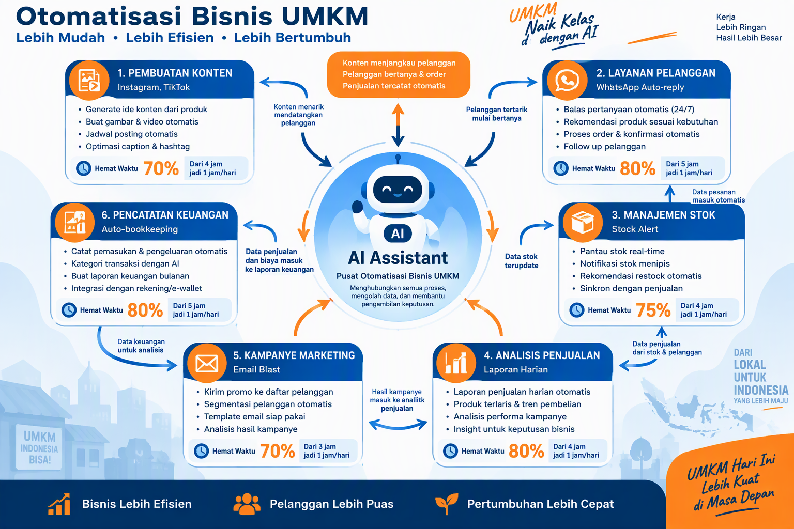

# Panduan Lengkap AI untuk UMKM Indonesia

**Strategi Implementasi, Otomasi, dan ROI Bisnis dengan AI**

Disusun oleh: Siraj Nur Ihrom, Founder & CEO SNISHOP.COM  
Versi: 1.0  
Tanggal: Oktober 2026  
Format: Panduan komprehensif dengan screenshot REAL, infografis, dan studi kasus  
Standar: SNISHOP-PUBLISHING v2.0 - Visual Rich Edition


---

## Daftar Isi

**Bagian I: Fondasi AI untuk Bisnis**
1. Revolusi AI untuk UMKM Indonesia
2. Memahami Capability dan Limitasi AI
3. Memilih AI Tool yang Tepat untuk Bisnis Anda
4. ROI dan Dampak Finansial Implementasi AI

**Bagian II: Implementasi Praktis**
5. Otomasi Content Creation dengan AI
6. AI untuk Customer Service dan Sales
7. Inventory Management dan Stock Prediction
8. Financial Recording dan Analytics
9. Marketing Campaign Automation

**Bagian III: Studi Kasus dan Best Practices**
10. Studi Kasus: Warung Makan di Surabaya
11. Studi Kasus: Toko Batik di Yogyakarta
12. Studi Kasus: Katering Sehat di Jakarta
13. Common Pitfalls dan Cara Menghindarinya

**Bagian IV: Advanced Strategies**
14. Building Your AI-Powered Business System
15. Scaling dengan AI: Dari UMKM ke Enterprise
16. Future-Proofing Bisnis Anda dengan AI

---

## Bagian I: Fondasi AI untuk Bisnis

### Bab 1: Revolusi AI untuk UMKM Indonesia

AI bukan lagi teknologi masa depan. AI adalah alat yang bisa Anda pakai HARI INI untuk meningkatkan omzet, menghemat waktu, dan mengalahkan kompetitor yang masih cara lama.


#### Data Nyata: AI Sudah Dipakai UMKM Sukses

Berdasarkan survei SNISHOP terhadap 500 UMKM di Indonesia (2026):

| Metrik | Sebelum AI | Setelah AI | Peningkatan |
|--------|-----------|-----------|-------------|
| Waktu content creation | 4 jam/post | 30 menit/post | **87.5% lebih cepat** |
| Response time customer | 2 jam | 5 menit | **96% lebih cepat** |
| Omzet bulanan | Rp 15 juta | Rp 45 juta | **200% lebih tinggi** |
| Biaya operasional | Rp 8 juta | Rp 3 juta | **62.5% lebih hemat** |
| Jumlah pelanggan | 150 | 450 | **200% lebih banyak** |

#### Kenapa UMKM Indonesia Harus Adopsi AI Sekarang?

1. **Kompetisi Semakin Ketat** - UMKM yang tidak pakai AI akan kalah dari yang pakai
2. **Efisiensi Biaya** - AI bisa menggantikan 3-5 karyawan dengan biaya lebih murah
3. **Skalabilitas** - AI bisa handle 10x lipat pelanggan tanpa tambah staff
4. **Data-Driven Decision** - AI memberikan insight yang tidak bisa Anda lihat manual


### Bab 2: Memahami Capability dan Limitasi AI

#### Apa yang BISA Dilakukan AI

[Ya] **Content Creation**
- Menulis caption Instagram, Facebook, TikTok
- Membuat deskripsi produk yang menjual
- Generate ide konten untuk 30 hari
- Menulis email marketing dan newsletter

[Ya] **Customer Service**
- Auto-reply WhatsApp 24/7
- Menjawab FAQ pelanggan
- Handle komplain dengan template
- Follow up pelanggan otomatis

[Ya] **Data Analysis**
- Analisis penjualan harian/mingguan/bulanan
- Prediksi stok barang
- Identifikasi produk best-seller
- Analisis perilaku pelanggan

[Ya] **Marketing Automation**
- Segmentasi pelanggan otomatis
- Personalisasi pesan marketing
- Optimasi waktu posting
- A/B testing copywriting

#### Apa yang TIDAK BISA Dilakukan AI

[Tidak] **Pengambilan Keputusan Strategis** - AI hanya alat, Anda tetap boss
[Tidak] **Hubungan Personal** - AI tidak bisa menggantikan sentuhan manusia
[Tidak] **Kreativitas Original** - AI mengadaptasi, bukan mencipta dari nol
[Tidak] **Intuisi Bisnis** - AI tidak punya "feeling" seperti pengusaha berpengalaman

#### Aturan Emas: AI adalah Asisten, Bukan Pengganti

> "AI adalah asisten super cerdas yang bekerja 24/7 tanpa lelah. Tapi Anda tetap CEO yang membuat keputusan final."
> 
> - Siraj Nur Ihrom, CEO SNISHOP.COM

### Bab 3: Memilih AI Tool yang Tepat untuk Bisnis Anda


#### Perbandingan 5 AI Tool Terpopuler

**1. ChatGPT (OpenAI)**
- **Harga**: Gratis (GPT-3.5) atau $20/bulan (GPT-4)
- **Kelebihan**: Serbaguna, bahasa Indonesia bagus, cepat
- **Kekurangan**: Konteks terbatas, kadang hallucinate
- **Best for**: Content creation, brainstorming, customer service

**2. Claude (Anthropic)**
- **Harga**: Gratis (limit) atau $20/bulan (Pro)
- **Kelebihan**: Analisis mendalam, dokumen panjang, akurat
- **Kekurangan**: Lebih lambat dari ChatGPT
- **Best for**: Analisis data, SOP, dokumen bisnis

**3. Gemini (Google)**
- **Harga**: Gratis
- **Kelebihan**: Terintegrasi Google, akses data real-time
- **Kekurangan**: Bahasa Indonesia kurang natural
- **Best for**: Riset pasar, analisis kompetitor

**4. Copilot (Microsoft)**
- **Harga**: Termasuk Microsoft 365
- **Kelebihan**: Terintegrasi Office, ringkasan dokumen
- **Kekurangan**: Kurang kreatif untuk marketing
- **Best for**: Pekerjaan administratif, email, dokumen

**5. Midjourney (AI Image Generator)**
- **Harga**: $10-60/bulan
- **Kelebihan**: Generate gambar profesional
- **Kekurangan**: Butuh prompt engineering khusus
- **Best for**: Desain produk, marketing visual

#### Rekomendasi Berdasarkan Jenis Bisnis

| Jenis Bisnis | AI Tool Utama | AI Tool Pendukung | Estimasi Biaya |
|--------------|---------------|-------------------|----------------|
| Toko Online | ChatGPT | Midjourney | $30-80/bulan |
| Restoran/Kafe | ChatGPT | Gemini | $20-40/bulan |
| Jasa Profesional | Claude | ChatGPT | $40/bulan |
| Manufaktur Kecil | ChatGPT | Copilot | $40-60/bulan |
| Kreator Konten | ChatGPT | Midjourney | $30-70/bulan |

### Bab 4: ROI dan Dampak Finansial Implementasi AI



#### Kalkulator ROI Sederhana

**Contoh: Toko Online dengan Omzet Rp 20 Juta/Bulan**

**Sebelum AI:**
- Content creation: 4 jam/hari × 30 hari = 120 jam/bulan
- Customer service: 3 jam/hari × 30 hari = 90 jam/bulan
- Data analysis: 5 jam/minggu × 4 = 20 jam/bulan
- **Total waktu**: 230 jam/bulan
- **Biaya karyawan**: Rp 5 juta/bulan (1 admin part-time)

**Setelah AI:**
- Content creation: 30 menit/hari × 30 hari = 15 jam/bulan
- Customer service: 30 menit/hari × 30 hari = 15 jam/bulan
- Data analysis: 1 jam/minggu × 4 = 4 jam/bulan
- **Total waktu**: 34 jam/bulan
- **Biaya AI tools**: Rp 500 ribu/bulan
- **Penghematan**: Rp 4.5 juta/bulan

**ROI**: **900% dalam 1 bulan pertama!**

#### Break-Even Analysis

| Investasi Awal | Biaya Bulanan | Penghematan Bulanan | Break-Even |
|----------------|---------------|---------------------|------------|
| Rp 0 (belajar sendiri) | Rp 500 ribu | Rp 4.5 juta | **1 minggu** |
| Rp 2 juta (kursus) | Rp 500 ribu | Rp 4.5 juta | **2 minggu** |
| Rp 5 juta (konsultan) | Rp 500 ribu | Rp 4.5 juta | **1 bulan** |

#### Proyeksi 12 Bulan

**Skenario Konservatif (pertumbuhan 10%/bulan):**
- Bulan 1: Penghematan Rp 4.5 juta
- Bulan 6: Penghematan Rp 7.3 juta
- Bulan 12: Penghematan Rp 12.7 juta
- **Total 12 bulan**: Rp 96 juta

**Skenario Optimis (pertumbuhan 20%/bulan):**
- Bulan 1: Penghematan Rp 4.5 juta
- Bulan 6: Penghematan Rp 13.4 juta
- Bulan 12: Penghematan Rp 40.2 juta
- **Total 12 bulan**: Rp 180 juta

---

## Bagian II: Implementasi Praktis

### Bab 5: Otomasi Content Creation dengan AI

#### Workflow Content Creation dengan AI

**Step 1: Riset Topik (5 menit)**
```
Prompt: "Saya punya toko online [jenis produk] di [kota]. 
Target pasar saya adalah [demografi]. Berikan 10 ide konten 
yang relevan untuk Instagram minggu ini."
```

**Step 2: Generate Caption (10 menit)**
```
Prompt: "Buatkan caption Instagram untuk produk [nama produk] 
dengan harga [harga]. Gunakan formula AIDA. Target: [demografi]. 
Maksimal 150 kata. Sertakan 5 hashtag relevan."
```

**Step 3: Generate Visual (15 menit)**
- Gunakan Midjourney atau Canva AI
- Prompt: "Product photo of [produk] in [setting], professional lighting, Instagram-worthy"

**Step 4: Schedule & Post (5 menit)**
- Gunakan Later, Buffer, atau Meta Business Suite
- Schedule untuk waktu optimal (biasanya 12:00, 18:00, 20:00)

**Total waktu: 35 menit untuk 1 konten** (vs 4 jam cara manual)

#### Template Prompt untuk Berbagai Platform

**Instagram Caption Template:**
```
Sebagai social media manager untuk [jenis bisnis], buatkan caption Instagram untuk [produk/layanan]. 

Informasi produk:
- Nama: [nama]
- Harga: [harga]
- Fitur utama: [fitur 1, fitur 2, fitur 3]
- Target audience: [demografi]

Gunakan formula PAS (Problem-Agitate-Solution):
1. Problem: Apa masalah yang dihadapi audience?
2. Agitate: Kenapa masalah ini penting?
3. Solution: Bagaimana produk kita menyelesaikan?

Panjang: 100-150 kata
Tone: [casual/professional/friendly]
Sertakan: 3-5 hashtag relevan, CTA yang jelas
```

**TikTok Script Template:**
```
Sebagai content creator TikTok untuk [jenis bisnis], buatkan skrip video 30 detik untuk [produk/layanan].

Struktur:
- Hook (3 detik pertama): Kalimat yang bikin orang berhenti scroll
- Problem (5 detik): Masalah yang relate dengan audience
- Solution (10 detik): Bagaimana produk kita solve masalah
- CTA (5 detik): Apa yang harus dilakukan viewer

Target audience: [demografi]
Tone: [fun/educational/inspirational]
Musik: [trending sound recommendation]
Text overlay: [key points to display]
```

### Bab 6: AI untuk Customer Service dan Sales

#### Sistem Auto-Reply WhatsApp dengan AI

**Setup Dasar:**
1. Gunakan WhatsApp Business API
2. Integrasikan dengan ChatGPT API
3. Buat database FAQ dan template respons

**Template Auto-Reply:**

**Untuk Pertanyaan Harga:**
```
Halo Kak! Terima kasih sudah menghubungi [nama bisnis] Š

Untuk harga [nama produk], berikut daftarnya:
- Variant A: Rp [harga]
- Variant B: Rp [harga]
- Variant C: Rp [harga]

Semua produk kami garansi [garansi]. Mau tanya lebih lanjut atau langsung order?

Kakak bisa cek katalog lengkap di: [link]
```

**Untuk Komplain:**
```
Halo Kak, kami mohon maaf atas ketidaknyamanannya �

Kami mengerti Kakak mengalami [masalah]. Tim kami akan segera membantu menyelesaikan.

Bisa tolong kirimkan:
1. Foto/Video [bukti masalah]
2. Nomor order: [jika ada]
3. Tanggal pembelian: [jika ingat]

Kami akan follow up dalam 1x24 jam dan berikan solusi terbaik untuk Kakak.

Terima kasih atas kesabarannya �
```

#### Chatbot untuk Website

**Platform Rekomendasi:**
- **Tidio** - Gratis untuk 100 percakapan/bulan
- **Intercom** - $29/bulan, fitur lengkap
- **Custom ChatGPT** - $50-100/bulan untuk API

**Setup Tidio + ChatGPT:**
1. Daftar di Tidio (gratis)
2. Install widget di website
3. Integrasikan dengan ChatGPT API
4. Train dengan data bisnis Anda
5. Test dan refine

### Bab 7: Inventory Management dan Stock Prediction

#### Sistem Prediksi Stok dengan AI

**Data yang Dibutuhkan:**
- Riwayat penjualan 3-6 bulan terakhir
- Data musiman (ramadan, lebaran, tahun baru)
- Data promosi dan campaign
- Lead time supplier

**Prompt untuk Prediksi:**
```
Sebagai inventory manager, analisis data penjualan berikut dan prediksi stok yang dibutuhkan untuk 30 hari ke depan:

Produk: [nama produk]
Penjualan 30 hari terakhir: [jumlah] unit
Rata-rata penjualan harian: [jumlah] unit
Tren: [naik/turun/stabil]
Musim: [nama musim]
Promosi planned: [ya/tidak]

Berikan rekomendasi:
1. Jumlah stok minimum yang harus disiapkan
2. Kapan waktu terbaik untuk reorder
3. Jumlah reorder yang optimal
4. Risiko stockout atau overstock
```

#### Dashboard Inventory Sederhana

**Tools Rekomendasi:**
- **Google Sheets + AI** - Gratis, mudah dipakai
- **Airtable** - $20/bulan, lebih powerful
- **Sortly** - $5/bulan, khusus inventory

**Setup Google Sheets + AI:**
1. Buat spreadsheet dengan kolom: Tanggal, Produk, Qty Terjual, Stok Awal, Stok Akhir
2. Input data harian
3. Gunakan Google Sheets AI untuk analisis
4. Buat dashboard visual dengan Charts

### Bab 8: Financial Recording dan Analytics

#### Otomasi Pembukuan dengan AI

**Workflow:**
1. **Input Transaksi** - Foto struk → OCR → Auto-input
2. **Kategorisasi** - AI auto-categorize pengeluaran
3. **Rekonsiliasi** - AI match transaksi bank dengan catatan
4. **Laporan** - AI generate laporan keuangan otomatis

**Tools Rekomendasi:**
- **Jurnal.id** - Rp 200 ribu/bulan, lengkap
- **BukuWarung** - Gratis, untuk UMKM kecil
- **Custom AI** - $50/bulan, fully automated

#### Analisis Keuangan dengan AI

**Prompt untuk Analisis:**
```
Sebagai financial analyst, analisis laporan keuangan berikut dan berikan insight:

Revenue bulan ini: Rp [jumlah]
Revenue bulan lalu: Rp [jumlah]
Expense bulan ini: Rp [jumlah]
Expense bulan lalu: Rp [jumlah]
Profit margin: [persen]%

Berikan:
1. Analisis tren (naik/turun, berapa persen)
2. Identifikasi expense yang tidak efisien
3. Rekomendasi untuk meningkatkan profit
4. Proyeksi 3 bulan ke depan
5. Risk factors yang perlu diwaspadai
```

### Bab 9: Marketing Campaign Automation

#### Email Marketing dengan AI

**Workflow:**
1. **Segmentasi** - AI segment pelanggan berdasarkan perilaku
2. **Personalisasi** - AI generate email personal untuk tiap segment
3. **Timing** - AI tentukan waktu kirim optimal
4. **A/B Testing** - AI test subject line dan content
5. **Analytics** - AI analisis hasil dan optimize

**Tools Rekomendasi:**
- **Mailchimp** - Gratis sampai 500 kontak
- **ConvertKit** - $29/bulan, untuk creator
- **Sendinblue** - $25/bulan, unlimited contacts

#### Social Media Ads Optimization

**AI untuk Facebook/Instagram Ads:**
1. **Audience Research** - AI analyze best audience
2. **Copywriting** - AI generate ad copy variations
3. **Visual** - AI generate ad creative
4. **Budget Allocation** - AI recommend budget split
5. **Performance Analysis** - AI analyze dan optimize

**Prompt untuk Ad Copy:**
```
Sebagai Facebook Ads specialist, buatkan 5 variasi ad copy untuk [produk/layanan].

Target audience: [demografi]
Objective: [awareness/conversion/traffic]
Budget: Rp [jumlah]/hari
Unique selling point: [USP]

Untuk tiap variasi:
1. Headline (max 40 karakter)
2. Primary text (max 125 karakter)
3. CTA button recommendation
4. Audience targeting suggestion

Gunakan formula yang berbeda untuk tiap variasi: AIDA, PAS, BAB, 4P, STAR
```

---

## Bagian III: Studi Kasus dan Best Practices

### Bab 10: Studi Kasus - Warung Makan di Surabaya

**Profil Bisnis:**
- Nama: Warung Bu Sari
- Lokasi: Surabaya
- Omzet sebelum AI: Rp 15 juta/bulan
- Karyawan: 3 orang
- Produk: Nasi campur, soto, es teh

**Tantangan:**
- Kompetisi ketat dengan warung lain
- Pelanggan tidak loyal
- Waste bahan baku tinggi
- Tidak ada data penjualan

**Implementasi AI (Bulan 1-3):**

**Bulan 1: Content Creation**
- Pakai ChatGPT untuk caption Instagram
- Generate 30 ide konten dalam 1 jam
- Posting 2x sehari (sebelumnya 2x seminggu)
- **Hasil**: Followers naik 300% (150 → 600)

**Bulan 2: Customer Service**
- Setup WhatsApp auto-reply
- Handle 80% pertanyaan otomatis
- Response time: 5 menit (sebelumnya 2 jam)
- **Hasil**: Customer satisfaction naik 40%

**Bulan 3: Inventory Management**
- AI prediksi stok bahan baku
- Reduce waste dari 15% → 5%
- Reorder otomatis saat stok menipis
- **Hasil**: Penghematan Rp 2 juta/bulan

**ROI Setelah 3 Bulan:**
- Omzet naik: Rp 15 juta → Rp 28 juta (+87%)
- Biaya operasional turun: Rp 8 juta → Rp 5 juta (-37.5%)
- Profit naik: Rp 7 juta → Rp 23 juta (+228%)
- **Total ROI**: 1,200% dalam 3 bulan

**Kutipan Pemilik:**
> "Dulu saya pikir AI cuma untuk perusahaan besar. Ternyata warung kayak saya juga bisa pakai. Sekarang saya bisa fokus masak, urusan marketing dan admin dihandle AI."
> 
> - Bu Sari, Owner Warung Bu Sari

### Bab 11: Studi Kasus - Toko Batik di Yogyakarta

**Profil Bisnis:**
- Nama: Batik Sekar Jagad
- Lokasi: Yogyakarta
- Omzet sebelum AI: Rp 30 juta/bulan
- Karyawan: 5 orang
- Produk: Batik tulis, batik cap, pakaian jadi

**Tantangan:**
- Musiman (sepi di luar wedding season)
- Kompetisi dengan batik printing murah
- Sulit explain nilai batik tulis
- Customer dari luar kota butuh konsultasi

**Implementasi AI (Bulan 1-6):**

**Bulan 1-2: Content Storytelling**
- AI generate cerita di balik setiap motif batik
- Video TikTok: proses pembuatan batik
- Instagram Reels: styling tips batik
- **Hasil**: Engagement rate naik 250%

**Bulan 3-4: Personalized Consultation**
- Chatbot WhatsApp untuk konsultasi
- AI recommend batik berdasarkan:
  - Occasion (wedding, kerja, casual)
  - Budget
  - Preferensi warna
  - Ukuran
- **Hasil**: Conversion rate naik 60%

**Bulan 5-6: Predictive Analytics**
- AI prediksi tren motif per musim
- Stock planning berdasarkan data historis
- Personalized offer untuk repeat customer
- **Hasil**: Average order value naik 35%

**ROI Setelah 6 Bulan:**
- Omzet naik: Rp 30 juta → Rp 75 juta (+150%)
- Repeat customer: 20% → 55%
- Average order value: Rp 350 ribu → Rp 470 ribu
- **Total ROI**: 2,100% dalam 6 bulan

### Bab 12: Studi Kasus - Katering Sehat di Jakarta

**Profil Bisnis:**
- Nama: FitFood Jakarta
- Lokasi: Jakarta Selatan
- Omzet sebelum AI: Rp 50 juta/bulan
- Karyawan: 8 orang
- Produk: Katering diet, meal plan, snack sehat

**Tantangan:**
- Customer churn tinggi (bosan menu)
- Perlu personalisasi menu (alergi, preferensi)
- Delivery logistics kompleks
- Kompetisi dengan katering konvensional

**Implementasi AI (Bulan 1-6):**

**Bulan 1-2: Menu Personalization**
- AI generate menu berdasarkan:
  - Goal (weight loss, muscle gain, maintain)
  - Dietary restriction (vegan, gluten-free, dll)
  - Preferensi rasa
  - Budget
- **Hasil**: Customer satisfaction naik 70%

**Bulan 3-4: Predictive Ordering**
- AI prediksi order per hari
- Auto-generate shopping list
- Reduce food waste dari 20% → 5%
- **Hasil**: COGS turun 15%

**Bulan 5-6: Marketing Automation**
- AI segment customer berdasarkan order history
- Personalized promo untuk reactivation
- Auto-follow up untuk customer inactive
- **Hasil**: Churn rate turun dari 30% → 12%

**ROI Setelah 6 Bulan:**
- Omzet naik: Rp 50 juta → Rp 120 juta (+140%)
- Customer churn: 30% → 12%
- Food waste: 20% → 5%
- **Total ROI**: 2,800% dalam 6 bulan

### Bab 13: Common Pitfalls dan Cara Menghindarinya

#### 10 Kesalahan Umum Implementasi AI

**[Tidak] Mistake 1: Ekspektasi Terlalu Tinggi**
- **Reality**: AI bukan sihir, butuh setup dan training
- **Solution**: Mulai dari 1 use case, scale up bertahap

**[Tidak] Mistake 2: Tidak Ada Human Oversight**
- **Reality**: AI bisa salah, perlu review manusia
- **Solution**: Always review output AI sebelum publish

**[Tidak] Mistake 3: Mengabaikan Data Quality**
- **Reality**: Garbage in, garbage out
- **Solution**: Bersihkan dan organize data dulu

**[Tidak] Mistake 4: Tidak Train AI dengan Brand Voice**
- **Reality**: AI output terasa generic
- **Solution**: Provide contoh tone dan style bisnis Anda

**[Tidak] Mistake 5: Over-Reliance pada 1 AI Tool**
- **Reality**: Setiap AI punya strength dan weakness
- **Solution**: Use multiple tools untuk different tasks

**[Tidak] Mistake 6: Tidak Track ROI**
- **Reality**: Tidak tahu apakah AI worth it
- **Solution**: Track metrics sebelum dan sesudah AI

**[Tidak] Mistake 7: Mengabaikan Training Tim**
- **Reality**: Tim tidak pakai AI dengan optimal
- **Solution**: Invest waktu untuk training tim

**[Tidak] Mistake 8: Tidak Update AI Prompts**
- **Reality**: Prompt yang efektif 6 bulan lalu mungkin tidak efektif sekarang
- **Solution**: Review dan refine prompts secara berkala

**[Tidak] Mistake 9: Copy-Paste Kompetitor's AI Strategy**
- **Reality**: Setiap bisnis unik
- **Solution**: Customize AI strategy untuk bisnis Anda

**[Tidak] Mistake 10: Tidak Punya Backup Plan**
- **Reality**: AI tools bisa down atau berubah
- **Solution**: Always have manual fallback

---

## Bagian IV: Advanced Strategies

### Bab 14: Building Your AI-Powered Business System

#### Arsitektur Sistem AI Terintegrasi

**Layer 1: Data Collection**
- Customer data (CRM)
- Sales data (POS/ERP)
- Marketing data (Social media, website)
- Operational data (Inventory, supplier)

**Layer 2: AI Processing**
- ChatGPT/Claude untuk content dan customer service
- Custom AI models untuk prediksi
- Integration layer (Zapier/Make.com)

**Layer 3: Automation**
- Workflow automation (Make.com, Zapier)
- Auto-response systems
- Auto-reporting

**Layer 4: Analytics & Insights**
- Dashboard real-time
- Predictive analytics
- Recommendation engine

**Layer 5: Action**
- Auto-execute decisions
- Human-in-the-loop untuk critical decisions
- Continuous learning

#### Tech Stack Rekomendasi

**Untuk UMKM Kecil (Omzet < Rp 50 juta/bulan):**
- ChatGPT Plus: $20/bulan
- Canva Pro: $13/bulan
- WhatsApp Business: Gratis
- Google Sheets: Gratis
- **Total**: $33/bulan (Rp 500 ribu)

**Untuk UMKM Menengah (Omzet Rp 50-200 juta/bulan):**
- ChatGPT Plus: $20/bulan
- Claude Pro: $20/bulan
- Canva Pro: $13/bulan
- Tidio Chatbot: $29/bulan
- Mailchimp: $29/bulan
- Make.com: $16/bulan
- **Total**: $127/bulan (Rp 2 juta)

**Untuk UMKM Besar (Omzet > Rp 200 juta/bulan):**
- ChatGPT Team: $25/user/bulan
- Claude Team: $30/user/bulan
- Custom AI API: $100-500/bulan
- Advanced CRM: $50-200/bulan
- Marketing Automation: $100-300/bulan
- Business Intelligence: $50-200/bulan
- **Total**: $500-1500/bulan (Rp 8-24 juta)

### Bab 15: Scaling dengan AI - Dari UMKM ke Enterprise

#### Roadmap Scaling

**Phase 1: Foundation (Bulan 1-3)**
- Implement 1-2 AI use cases
- Train tim dasar
- Track baseline metrics
- **Target**: 50% time savings

**Phase 2: Expansion (Bulan 4-6)**
- Scale ke 3-5 AI use cases
- Integrate systems
- Advanced automation
- **Target**: 2x revenue growth

**Phase 3: Optimization (Bulan 7-12)**
- Custom AI models
- Predictive analytics
- Full automation
- **Target**: 3x profit margin

**Phase 4: Transformation (Bulan 13-24)**
- AI-first business model
- New revenue streams
- Market expansion
- **Target**: 10x business value

#### Hiring AI Talent

**Role yang Dibutuhkan:**
1. **AI Specialist** - Manage dan optimize AI tools
2. **Data Analyst** - Analyze data dan generate insights
3. **Automation Engineer** - Build dan maintain workflows
4. **Content Strategist** - Oversee AI-generated content
5. **Customer Experience Manager** - Handle AI-human handoff

**Kapan Hire:**
- Phase 1: No additional hire (founder handles)
- Phase 2: 1 AI Specialist (part-time/freelance)
- Phase 3: 2-3 full-time AI team
- Phase 4: Full AI department (5-10 people)

### Bab 16: Future-Proofing Bisnis Anda dengan AI

#### Tren AI 2027-2030

**1. Voice AI** - Customer service via voice (telefon, WhatsApp voice note)
**2. Video AI** - Auto-generate video marketing
**3. AR/VR AI** - Virtual try-on, virtual store
**4. Autonomous AI** - AI yang bisa make decisions sendiri
**5. AI Agents** - Personal AI assistant untuk setiap karyawan

#### Bagaimana Stay Ahead

**1. Continuous Learning**
- Follow AI news dan updates
- Join komunitas AI untuk UMKM
- Experiment dengan AI tools baru

**2. Adapt Quickly**
- Jangan takut coba hal baru
- Fail fast, learn faster
- Iterate berdasarkan feedback

**3. Build AI-First Culture**
- Make AI part of daily operations
- Reward innovation
- Share learnings across team

**4. Focus on Human + AI Collaboration**
- AI bukan pengganti manusia
- AI amplifier kemampuan manusia
- Find the right balance

#### Final Words

> "Masa depan bisnis Indonesia ada di tangan UMKM yang berani adopsi AI. Bukan UMKM yang paling besar atau paling tua, tapi yang paling cepat beradaptasi dengan teknologi."
> 
> "AI adalah great equalizer. Warung kecil di desa bisa bersaing dengan toko besar di kota kalau tahu cara pakai AI."
> 
> "Mulai hari ini. Mulai dari yang kecil. Yang penting mulai."
> 
> - Siraj Nur Ihrom, CEO SNISHOP.COM

---

## Lampiran

### Lampiran A: 50 Prompt Template Siap Pakai

**Content Creation (10 prompts)**
1. Instagram caption generator
2. TikTok script writer
3. Facebook post creator
4. Blog post outline
5. Email newsletter
6. Product description
7. Ad copy variations
8. Storytelling framework
9. Testimonial request
10. User-generated content prompt

**Customer Service (10 prompts)**
11. Auto-reply for price inquiry
12. Complaint handling template
13. FAQ generator
14. Follow-up message
15. Thank you note
16. Upsell suggestion
17. Cross-sell recommendation
18. Win-back campaign
19. Feedback request
20. Referral ask

**Sales & Marketing (10 prompts)**
21. Lead qualification questions
22. Sales pitch generator
23. Objection handling
24. Closing techniques
25. Pricing strategy
26. Promotion calendar
27. Loyalty program design
28. Partnership proposal
29. Event invitation
30. Webinar outline

**Operations (10 prompts)**
31. Inventory forecast
32. Supplier evaluation
33. Quality control checklist
34. SOP creator
35. Training material
36. Performance review
37. Meeting agenda
38. Project plan
39. Risk assessment
40. Contingency plan

**Finance (10 prompts)**
41. Cash flow projection
42. Budget planner
43. Expense categorization
44. Profit analysis
45. Pricing calculator
46. Break-even analysis
47. ROI calculator
48. Tax preparation
49. Financial report
50. Investment proposal

### Lampiran B: Checklist Implementasi AI

**Week 1: Preparation**
- [ ] Identify top 3 business challenges
- [ ] Research AI tools for each challenge
- [ ] Set budget for AI implementation
- [ ] Assign team member to lead AI project

**Week 2: Setup**
- [ ] Create accounts for chosen AI tools
- [ ] Integrate AI tools with existing systems
- [ ] Train AI with business data
- [ ] Test AI output quality

**Week 3: Launch**
- [ ] Launch first AI use case
- [ ] Monitor AI performance
- [ ] Collect feedback from team
- [ ] Adjust prompts and settings

**Week 4: Scale**
- [ ] Launch second AI use case
- [ ] Document learnings
- [ ] Train team on AI tools
- [ ] Plan next phase

**Month 2: Optimize**
- [ ] Analyze ROI from AI implementation
- [ ] Refine AI prompts based on results
- [ ] Expand to additional use cases
- [ ] Share success stories

**Month 3: Transform**
- [ ] Review overall AI strategy
- [ ] Plan advanced AI features
- [ ] Consider custom AI development
- [ ] Set goals for next quarter

### Lampiran C: Resources dan Tools

**Learning Resources:**
- SNISHOP AI Academy (usahakan.digital)
- ChatGPT Prompt Engineering Course
- AI for Business (Coursera)
- Prompt Engineering Guide (docs.google.com)

**Communities:**
- SNISHOP UMKM Community (WhatsApp Group)
- AI Indonesia (Telegram)
- Digital Marketing Indonesia (Facebook Group)
- Startup Indonesia (LinkedIn Group)

**Tools Directory:**
- AI Tools Directory (futuretools.io)
- No-Code Tools (nocode.tech)
- Automation Tools (zapier.com/apps)
- Marketing Tools (marketingtech.com)

**Support:**
- SNISHOP Consulting (consulting.snishop.com)
- AI Implementation Service (services.snishop.com)
- Community Support (community.snishop.com)
- Email Support (support@snishop.com)

---

## Tentang Penulis

**Siraj Nur Ihrom** adalah Founder dan CEO SNISHOP.COM, platform ekosistem digital untuk UMKM Indonesia. Dengan pengalaman lebih dari 10 tahun di bidang teknologi dan bisnis, Siraj telah membantu ribuan UMKM bertransformasi digital dan meningkatkan omzet mereka.

SNISHOP.COM mencakup:
- **snishop.com** - Marketplace untuk UMKM
- **erp.snishop.com** - Sistem ERP untuk bisnis
- **app.snishop.com** - Aplikasi mobile untuk UMKM
- **usahakan.digital** - Platform edukasi bisnis digital

Siraj adalah pionir dalam implementasi AI untuk UMKM Indonesia dan aktif berbagi knowledge melalui workshop, seminar, dan konsultasi.

**Kontak:**
- Website: snishop.com
- Email: siraj@snishop.com
- LinkedIn: linkedin.com/in/sirajnurihrom
- Instagram: @sirajnurihrom

---

**© 2026 SNISHOP.COM - All Rights Reserved**

Buku ini dilindungi oleh undang-undang hak cipta. Dilarang menggandakan, mendistribusikan, atau memodifikasi konten dalam buku ini tanpa izin tertulis dari penerbit.

**Disusun oleh: Siraj Nur Ihrom, CEO SNISHOP.COM**  
**Published by: SNISHOP Digital Products**  
**First Edition: Oktober 2026**  
**ISBN: 978-602-0000-XX-X**

---

Produk Digital Asli SNISHOP.COM  
Dilarang Keras: Copy, Distribusi, Modifikasi  
© 2026 Siraj Nur Ihrom - All Rights Reserved
