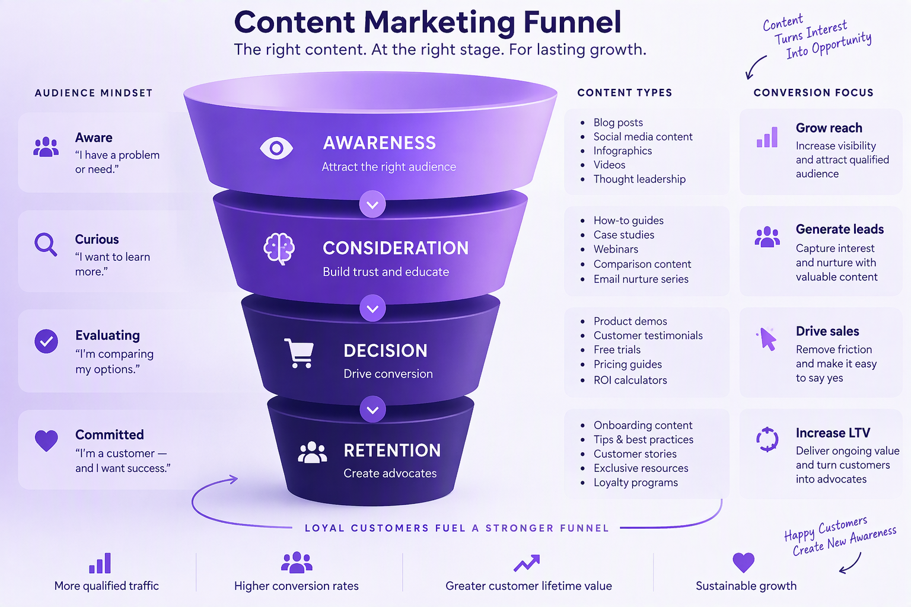
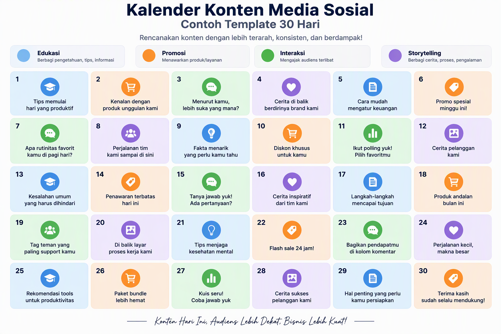
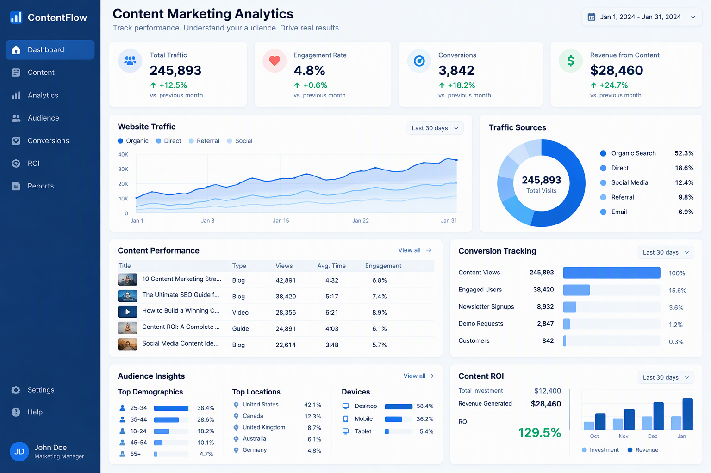

# Panduan Lengkap Canva untuk Desain Bisnis UMKM Indonesia

**Kuasai Desain Profesional Tanpa Latar Belakang Desain: Panduan Paling Komprehensif untuk Pengusaha UMKM Indonesia**

Penulis: Siraj Nur Ihrom
CEO & Founder SNISHOP.COM

---

## Daftar Isi

**BAGIAN I: FONDASI DESAIN**

Bab 1: Dasar-Dasar Desain Grafis untuk Non-Designer
Bab 2: Mengenal Canva: Interface dan Fitur Lengkap
Bab 3: Template dan Brand Kit untuk Konsistensi Visual

**BAGIAN II: PRODUKSI KONTEN**

Bab 4: Desain Konten Social Media
Bab 5: Desain Materi Bisnis
Bab 6: Editing Foto dan Video Dasar
Bab 7: Elemen Grafis dan Ilustrasi

**BAGIAN III: OPTIMASI DAN SKALING**

Bab 8: Export dan Optimasi untuk Berbagai Platform
Bab 9: Workflow Efisien dan Kolaborasi Tim
Bab 10: Studi Kasus dan Implementation Plan

**LAMPIRAN**

Penutup
Tentang Penulis

---

# BAGIAN I: FONDASI DESAIN

---

## Bab 1: Dasar-Dasar Desain Grafis untuk Non-Designer

Sebelum Anda membuka Canva dan mulai mendesain, ada fondasi yang harus Anda pahami terlebih dahulu. Desain grafis bukan sekadar soal membuat sesuatu terlihat cantik. Desain grafis adalah komunikasi visual. Setiap elemen yang Anda letakkan di kanvas harus memiliki tujuan: menyampaikan pesan, mengarahkan perhatian pembaca, atau membangun emosi tertentu.

Banyak pemilik UMKM Indonesia menganggap desain adalah bakat bawaan. Padahal, desain adalah keterampilan yang bisa dipelajari dengan memahami prinsip-prinsip dasarnya. Anda tidak perlu sekolah desain empat tahun untuk membuat konten visual yang profesional. Yang Anda butuhkan adalah pemahaman tentang lima prinsip dasar desain, teori warna, tipografi, komposisi, dan pengetahuan tentang kesalahan umum yang harus dihindari.

### 1.1 Lima Prinsip Dasar Desain

Setiap desain profesional yang Anda lihat, mulai dari kemasan produk di supermarket hingga billboard di jalan tol, dibangun di atas lima prinsip dasar yang sama. Prinsip-prinsip ini adalah hierarki visual, kontras, alignment, proximity, dan repetition.

**Prinsip Pertama: Hierarki Visual**

Hierarki visual adalah cara Anda mengatur elemen desain sehingga pembaca tahu mana yang harus dilihat pertama, kedua, dan ketiga. Tanpa hierarki yang jelas, desain Anda akan membingungkan. Pembaca tidak tahu harus melihat ke mana terlebih dahulu, dan akhirnya mereka tidak melihat apa-apa sama sekali.

Cara membangun hierarki visual:

Ukuran adalah alat hierarki paling kuat. Elemen yang lebih besar akan selalu menarik perhatian pertama. Dalam desain poster promosi, judul promo harus menjadi elemen teks terbesar. Harga atau diskon bisa menjadi elemen kedua terbesar. Detail informasi lainnya mengikuti dengan ukuran yang lebih kecil.

Warna juga menciptakan hierarki. Elemen dengan warna yang kontras terhadap latar belakang akan menarik perhatian lebih dulu. Jika background Anda putih, teks berwarna merah atau biru tua akan langsung terlihat.

Posisi juga berpengaruh. Mata manusia secara alami membaca dari kiri atas ke kanan bawah. Letakkan informasi terpenting di area kiri atas atau tengah desain.

Contoh penerapan hierarki untuk poster promo UMKM:

- Level 1 (paling besar, paling mencolok): Nama promo atau headline, misalnya "DISKON 50%".
- Level 2 (ukuran sedang): Nama brand dan produk yang dipromosikan.
- Level 3 (ukuran kecil): Detail waktu, lokasi, syarat dan ketentuan.

**Prinsip Kedua: Kontras**

Kontras adalah perbedaan yang jelas antara dua elemen atau lebih. Kontras membuat desain Anda tidak membosankan dan mudah dibaca. Tanpa kontras, semua elemen terlihat sama dan tidak ada yang menonjol.

Jenis-jenis kontras dalam desain:

Kontras warna adalah yang paling umum. Gunakan warna gelap untuk teks di atas latar terang, atau sebaliknya. Hindari teks abu-abu terang di atas latar putih karena akan sulit dibaca. Kontras warna juga berlaku untuk elemen non-teks. Tombol call-to-action harus berwarna kontras terhadap background agar terlihat bisa diklik.

Kontras ukuran menciptakan dinamika. Gabungkan elemen besar dan kecil dalam satu desain. Jika semua teks berukuran sama, desain terlihat datar. Buat judul tiga kali lebih besar dari body text untuk menciptakan kontras yang efektif.

Kontras bentuk dan berat juga penting. Gabungkan elemen geometris dengan organik, atau teks tebal dengan teks tipis. Kombinasi ini menciptakan ketegangan visual yang menarik perhatian.

**Prinsip Ketiga: Alignment**

Alignment adalah penataan elemen sehingga sejajar satu sama lain. Ini adalah prinsip yang paling sering diabaikan oleh pemula, padahal dampaknya sangat besar terhadap kesan profesional desain Anda.

Dua jenis alignment utama:

Alignment kiri adalah pilihan paling aman dan paling mudah dibaca untuk teks berbahasa Indonesia. Teks yang rata kiri menciptakan garis tepi yang konsisten di sebelah kiri, memudahkan mata mengikuti baris demi baris.

Alignment tengah cocok untuk headline pendek, undangan, atau desain yang ingin memberikan kesan formal dan simetris. Namun, jangan gunakan alignment tengah untuk paragraf panjang karena akan sulit dibaca.

Aturan emas alignment: setiap elemen di desain Anda harus sejajar dengan setidaknya satu elemen lain. Jika Anda ragu, buat garis panduan imajiner dan pastikan semua elemen mengikuti garis tersebut. Canva memiliki fitur grid dan ruler yang sangat membantu untuk menjaga alignment.

**Prinsip Keempat: Proximity**

Proximity berarti mengelompokkan elemen-elemen yang berhubungan secara berdekatan, dan menjauhkan elemen-elemen yang tidak berhubungan. Prinsip ini membantu pembaca memahami struktur informasi dengan cepat.

Contoh penerapan proximity pada kartu nama:

- Kelompok 1: Logo dan nama perusahaan, diletakkan berdekatan di bagian atas.
- Kelompok 2: Nama kontak, nomor telepon, dan email, diletakkan berdekatan di bagian bawah.
- Jarak antara kedua kelompok ini harus lebih besar daripada jarak antar elemen dalam satu kelompok.

Penerapan proximity pada poster:

- Judul promo dan gambar produk diletakkan berdekatan karena saling terkait.
- Informasi kontak dan alamat diletakkan berdekatan di bagian bawah.
- Beri ruang kosong yang cukup antara kedua kelompok tersebut.

**Prinsip Kelima: Repetisi**

Repetisi adalah pengulangan elemen visual tertentu di seluruh desain. Repetisi menciptakan konsistensi dan memperkuat identitas visual brand Anda.

Elemen yang bisa direpetisi:

- Warna brand yang konsisten di semua materi marketing.
- Font yang sama untuk semua judul dan body text.
- Style elemen grafis yang serupa, misalnya selalu menggunakan rounded rectangle atau selalu menggunakan garis tipis sebagai pembatas.
- Posisi logo yang selalu di tempat yang sama pada setiap konten.

Repetisi adalah kunci dari brand recognition. Ketika pelanggan melihat warna dan font yang sama berulang kali, mereka akan langsung mengasosiasikannya dengan brand Anda. Inilah mengapa Coca-Cola selalu menggunakan merah dan putih, dan mengapa Anda bisa mengenali produk mereka dari jarak jauh.

### 1.2 Teori Warna untuk Bisnis

Warna bukan sekadar preferensi estetika. Warna memiliki dampak psikologis yang nyata terhadap persepsi dan keputusan pembelian pelanggan. Memahami teori warna akan membantu Anda membuat desain yang tidak hanya indah, tetapi juga efektif secara bisnis.

**Roda Warna dan Harmoni Warna**

Roda warna terdiri dari 12 warna utama: tiga warna primer (merah, kuning, biru), tiga warna sekunder (oranye, hijau, ungu), dan enam warna tersier.

Skema warna yang bisa Anda gunakan:

Monokromatik menggunakan satu warna dasar dengan variasi kecerahan dan saturasi. Skema ini aman, elegan, dan mudah diterapkan. Contoh: berbagai shades dari biru navy untuk brand korporat.

Analog menggunakan warna-warna yang bersebelahan di roda warna. Skema ini harmonis dan nyaman di mata. Contoh: biru, biru-hijau, dan hijau untuk brand kesehatan.

Komplementer menggunakan warna-warna yang berhadapan di roda warna. Skema ini menciptakan kontras tinggi dan energi visual. Contoh: biru dan oranye untuk brand yang ingin tampil dinamis.

Triadik menggunakan tiga warna yang berjarak sama di roda warna. Skema ini vibrant dan berani. Contoh: merah, kuning, dan biru untuk brand anak-anak.

**Psikologi Warna dalam Konteks Indonesia**

Warna memiliki makna budaya yang spesifik di Indonesia. Berikut panduan psikologi warna untuk pasar Indonesia:

Merah: melambangkan keberanian, semangat, dan keberuntungan. Sangat populer untuk promosi dan diskon. Banyak brand F&B Indonesia menggunakan merah karena merangsang nafsu makan.

Kuning: melambangkan kebahagiaan, kehangatan, dan keceriaan. Cocok untuk brand makanan ringan, produk anak, dan konten yang ingin terasa positif.

Biru: melambangkan kepercayaan, profesionalisme, dan ketenangan. Banyak digunakan oleh brand jasa, keuangan, dan teknologi. Biru adalah warna paling aman untuk brand korporat.

Hijau: melambangkan alam, kesehatan, dan kesegaran. Sangat cocok untuk brand produk organik, kesehatan, dan lingkungan. Hijau juga memiliki konotasi Islami yang kuat di Indonesia.

Hitam: melambangkan kemewahan, eksklusivitas, dan kekuatan. Cocok untuk brand premium dan fashion. Gunakan hitam sebagai aksen, bukan warna dominan, kecuali untuk brand luxury.

Putih: melambangkan kesucian, kebersihan, dan kesederhanaan. Banyak digunakan sebagai warna latar untuk memberikan ruang napas pada desain.

Emas: melambangkan kemakmuran, kualitas tinggi, dan prestige. Populer untuk brand fashion Muslim dan produk premium di Indonesia.

**Membuat Palet Warna Brand**

Langkah-langkah membuat palet warna untuk brand UMKM Anda:

Langkah 1: Pilih satu warna utama yang merepresentasikan karakter brand Anda. Jika brand Anda adalah kedai kopi artisan, warna cokelat tua atau hijau gelap bisa menjadi pilihan tepat.

Langkah 2: Pilih satu warna sekunder yang melengkapi warna utama. Gunakan roda warna untuk menemukan pasangan yang harmonis.

Langkah 3: Pilih satu warna aksen untuk call-to-action dan elemen penting. Warna ini harus kontras terhadap warna utama dan sekunder.

Langkah 4: Tentukan satu warna netral untuk latar belakang dan teks. Putih, abu-abu terang, atau krem adalah pilihan umum.

Langkah 5: Uji palet warna Anda. Buat tiga desain berbeda menggunakan palet tersebut dan pastikan semuanya terlihat kohesif.

### 1.3 Tipografi: Memilih dan Mengombinasikan Font

Tipografi adalah seni memilih dan mengatur teks. Font yang Anda gunakan mempengaruhi keseluruhan kesan desain dan bagaimana pesan Anda dipersepsikan oleh pembaca.

**Kategori Font Utama**

Serif: font dengan kaki kecil di ujung huruf. Memberikan kesan tradisional, terpercaya, dan elegan. Contoh: Times New Roman, Georgia, Playfair Display. Cocok untuk brand yang ingin tampil profesional dan mapan.

Sans-serif: font tanpa kaki. Memberikan kesan modern, bersih, dan ramah. Contoh: Arial, Helvetica, Montserrat, Open Sans. Cocok untuk brand teknologi, startup, dan bisnis yang ingin tampil kontemporer.

Script: font yang meniru tulisan tangan. Memberikan kesan personal, kreatif, dan feminin. Contoh: Great Vibes, Pacifico, Dancing Script. Cocok untuk brand wedding, beauty, dan produk artisan. Gunakan dengan hemat, hanya untuk headline pendek.

Display: font dekoratif dengan karakter kuat. Memberikan kesan unik dan berani. Contoh: Bebas Neue, Lobster, Righteous. Cocok untuk headline dan poster, tidak cocok untuk body text.

**Aturan Mengombinasikan Font**

Aturan pertama: gunakan maksimal dua atau tiga font dalam satu desain. Lebih dari tiga font akan membuat desain terlihat berantakan dan tidak profesional.

Aturan kedua: kombinasikan font dari kategori yang berbeda. Pairing yang efektif biasanya menggabungkan satu font serif dengan satu sans-serif, atau satu font display dengan satu sans-serif sederhana.

Aturan ketiga: pastikan kontras yang cukup antara kedua font. Jika kedua font terlalu mirip, terlihat seperti kesalahan. Jika terlalu berbeda tanpa harmoni, terlihat berantakan.

Contoh pairing font untuk UMKM Indonesia:

- Brand fashion Muslim: Playfair Display (headline) dan Montserrat (body text).
- Kedai kopi artisan: Bebas Neue (headline) dan Open Sans (body text).
- Brand skincare alami: Great Vibes (accent) dan Lato (body text).
- Konsultan bisnis: Oswald (headline) dan Roboto (body text).

**Ukuran Font yang Direkomendasikan**

Untuk konten Instagram post: headline 36-48pt, sub-headline 24-30pt, body text 16-20pt.

Untuk brosur A4: headline 24-36pt, sub-headline 18-24pt, body text 10-12pt.

Untuk presentasi: judul slide 36-44pt, isi slide 24-28pt, catatan kaki 14-16pt.

### 1.4 Komposisi dan Layout

Komposisi adalah cara Anda mengatur semua elemen visual dalam satu desain. Komposisi yang baik memandu mata pembaca melalui informasi secara berurutan dan membuat desain terasa seimbang.

**Rule of Thirds**

Rule of thirds membagi kanvas menjadi sembilan bagian equal menggunakan dua garis horizontal dan dua garis vertikal. Titik-titik perpotongan garis adalah area yang secara alami menarik perhatian mata. Letakkan elemen terpenting di titik-titik perpotongan tersebut.

Di Canva, Anda bisa mengaktifkan grid rule of thirds melalui menu Settings, lalu Guides. Fitur ini akan menampilkan garis panduan yang membantu Anda menempatkan elemen secara optimal.

**White Space (Ruang Kosong)**

White space adalah area kosong di sekitar elemen desain. Banyak pemula takut dengan white space dan cenderung memenuhi setiap inci kanvas dengan elemen. Padahal, white space adalah tanda desain profesional.

Fungsi white space:

- Memberikan ruang napas bagi mata pembaca.
- Menonjolkan elemen penting. Desain dengan banyak white space di sekitar produk akan membuat produk terlihat lebih premium.
- Meningkatkan keterbacaan teks. Jarak antar paragraf dan margin yang cukup membuat teks lebih mudah dibaca.
- Menciptakan kesan mewah dan eksklusif. Brand premium selalu menggunakan white space yang generous.

**Grid System**

Grid adalah kerangka tak terlihat yang mengatur tata letak elemen. Canva menyediakan fitur grid yang bisa Anda sesuaikan. Untuk konten Instagram, grid 2x2 atau 3x3 bekerja dengan baik. Untuk brosur, grid kolom bekerja efektif untuk memisahkan informasi.

### 1.5 Kesalahan Umum yang Harus Dihindari

Setelah bertahun-tahun mengamati desain-desain UMKM Indonesia, berikut adalah kesalahan yang paling sering terjadi dan cara menghindarinya.

**Kesalahan 1: Terlalu Banyak Font**

Menggunakan empat atau lebih font dalam satu desain. Solusi: batasi maksimal dua font, atau satu font dengan variasi weight (bold, regular, light).

**Kesalahan 2: Kontras Teks dan Background Rendah**

Teks kuning di atas latar putih, atau teks gelap di atas foto gelap. Solusi: selalu pastikan teks mudah dibaca. Gunakan overlay gelap di bawah teks yang diletakkan di atas foto.

**Kesalahan 3: Tidak Ada Hierarki**

Semua elemen berukuran sama sehingga tidak jelas mana yang penting. Solusi: tentukan satu elemen sebagai bintang utama, buat lebih besar dan lebih mencolok dari yang lain.

**Kesalahan 4: Stretching atau Distorsi Gambar**

Mengubah ukuran gambar tanpa menjaga proporsi sehingga terlihat gepeng atau memanjang. Solusi: selalu tarik dari sudut gambar sambil menahan tombol Shift untuk menjaga rasio aspek.

**Kesalahan 5: Margin Terlalu Sempit**

Menempatkan teks atau elemen terlalu dekat dengan tepi kanvas. Solusi: beri jarak minimal 20px dari tepi untuk konten digital, dan minimal 5mm untuk desain cetak.

**Kesalahan 6: Menggunakan Gambar Buram atau Pixelated**

Gambar yang pecah saat diperbesar menurunkan kredibilitas desain secara drastis. Solusi: gunakan gambar dengan resolusi minimal 72 DPI untuk layar dan 300 DPI untuk cetak. Di Canva, pilih gambar berkualitas tinggi dari library atau upload gambar asli dengan resolusi tinggi.

**Kesalahan 7: Tidak Konsisten Antar Desain**

Setiap post Instagram menggunakan warna dan font yang berbeda-beda. Solusi: buat brand kit dan template yang bisa digunakan berulang kali untuk menjaga konsistensi.

### 1.6 Membangun Mata Desain: Latihan Praktis

Setelah memahami teori, Anda perlu melatih "mata desain" Anda. Mata desain adalah kemampuan untuk melihat dan mengevaluasi kualitas visual secara intuitif. Kabar baiknya, kemampuan ini bisa dilatih oleh siapa saja.

**Latihan 1: Analisis Desain Profesional**

Luangkan 15 menit setiap hari untuk menganalisis desain-desain yang Anda temui. Buka Instagram, lihat iklan di jalan, perhatikan kemasan produk di supermarket. Tanyakan pada diri sendiri:

- Apa yang pertama kali menarik perhatian saya?
- Mengapa elemen itu menarik perhatian? (Ukuran? Warna? Posisi?)
- Bagaimana hierarki visualnya?
- Apakah ada keseimbangan dalam komposisi?
- Apa yang bisa saya tiru untuk bisnis saya?

**Latihan 2: Redesign Spontan**

Ambil satu desain yang menurut Anda kurang baik (bisa dari bisnis sendiri atau bisnis lain yang Anda temui). Coba redesign secara mental atau di Canva. Identifikasi apa yang salah dan bagaimana Anda akan memperbaikinya menggunakan prinsip-prinsip yang sudah dipelajari.

**Latihan 3: Tiru untuk Belajar**

Pilih satu desain profesional yang Anda kagumi. Coba tiru sedekat mungkin di Canva. Tujuannya bukan untuk menjiplak, tetapi untuk memahami teknik yang digunakan desainer profesional. Perhatikan spacing, proporsi, pemilihan warna, dan kombinasi font. Setelah selesai, bandingkan dengan aslinya dan identifikasi perbedaan.

**Latihan 4: Batasi Diri**

Tantang diri Anda untuk membuat desain menggunakan hanya satu warna, satu font, dan maksimal tiga elemen. Batasan ini memaksa Anda untuk berpikir kreatif dan benar-benar memahami setiap elemen yang Anda letakkan di kanvas.

### Checklist Bab 1: Fondasi Desain

Gunakan checklist ini sebelum mulai mendesain di Canva:

- Apakah saya sudah menentukan hierarki visual (mana yang paling penting)?
- Apakah ada kontras yang cukup antara teks dan background?
- Apakah semua elemen sejajar (aligned) dengan benar?
- Apakah elemen yang berhubungan diletakkan berdekatan (proximity)?
- Apakah saya menggunakan maksimal dua hingga tiga font?
- Apakah palet warna saya konsisten (maksimal empat hingga lima warna)?
- Apakah ada white space yang cukup?
- Apakah gambar yang digunakan beresolusi tinggi?
- Apakah desain ini terlihat berbeda jika dibalik (untuk mengecek balance)?
- Apakah saya sudah mengecek desain pada ukuran sebenarnya (bukan hanya zoom in)?

---

## Bab 2: Mengenal Canva: Interface dan Fitur Lengkap

Setelah memahami prinsip dasar desain, saatnya Anda mengenal alat yang akan menjadi partner sehari-hari dalam menciptakan visual bisnis: Canva. Bab ini akan membawa Anda menyelajahi seluruh ekosistem Canva, dari navigasi dasar hingga fitur-fitur yang jarang diketahui pengguna pemula.

### 2.1 Navigasi Utama Canva

Canva bisa diakses melalui browser web di canva.com atau melalui aplikasi desktop dan mobile. Semua versi memiliki fitur yang sama, tetapi pengalaman penggunaannya sedikit berbeda.

**Beranda (Home)**

Saat Anda login ke Canva, halaman beranda menampilkan beberapa section penting:

Section "Continue editing" menampilkan desain yang terakhir Anda kerjakan. Ini memudahkan Anda untuk melanjutkan pekerjaan yang belum selesai.

Section "Create a design" menampilkan tombol untuk memulai desain baru. Anda bisa memilih dari template yang sudah ada atau membuat kanvas kosong dengan ukuran kustom.

Section "Recent designs" menampilkan riwayat desain Anda, diurutkan berdasarkan waktu terakhir diakses.

Di sidebar kiri, Anda akan menemukan menu-menu berikut:

Templates: koleksi jutaan template yang bisa langsung digunakan atau dikustomisasi.

Elements: library elemen desain termasuk shape, ikon, ilustrasi, foto, video, dan audio.

Text: tools untuk menambahkan dan memformat teks.

Uploads: area untuk mengunggah aset Anda sendiri (foto, logo, font, video).

Projects: folder untuk mengorganisir semua desain Anda.

Brand: section untuk mengatur brand kit (khusus Canva Pro dan Teams).

Apps: marketplace aplikasi tambahan yang terintegrasi dengan Canva.

**Memulai Desain Baru**

Ada beberapa cara untuk memulai desain di Canva:

Cara pertama, gunakan search bar di halaman beranda. Ketik jenis desain yang Anda inginkan, misalnya "Instagram post", "logo", atau "brochure". Canva akan menampilkan template yang sesuai.

Cara kedua, klik tombol "Create a design" di pojok kanan atas, lalu pilih ukuran yang sudah ditentukan atau masukkan ukuran kustom.

Cara ketiga, browse melalui kategori di sidebar kiri untuk menemukan template berdasarkan jenis desain.

### 2.2 Perbedaan Canva Gratis vs Canva Pro

Memahami perbedaan antara versi gratis dan berbayar sangat penting agar Anda bisa memutuskan investasi mana yang memberikan nilai terbaik untuk bisnis Anda.

**Canva Gratis mencakup:**

- Lebih dari 250.000 template gratis.
- Lebih dari 1 juta foto dan grafik gratis.
- 5GB penyimpanan cloud.
- Akses ke tools editing dasar.
- Bisa digunakan untuk kolaborasi terbatas.

**Canva Pro (sekitar Rp 150.000 per bulan) menambahkan:**

- Lebih dari 100 juta foto, grafik, dan video premium.
- 7.000+ template premium tambahan.
- 1TB penyimpanan cloud.
- Background Remover untuk menghapus latar belakang foto dengan satu klik.
- Brand Kit untuk menyimpan logo, warna, dan font brand.
- Magic Resize untuk mengubah ukuran desain ke berbagai format secara otomatis.
- Schedule konten langsung ke social media.
- Content Planner untuk merencanakan konten.
- Akses ke fitur Canva AI termasuk Magic Write dan Text to Image.

**Canva Teams (sekitar Rp 450.000 per bulan untuk lima orang) menambahkan:**

- Semua fitur Canva Pro.
- Kolaborasi tim real-time.
- Brand Controls untuk memastikan konsistensi visual tim.
- Approval workflow.
- Template library yang bisa dibagikan ke seluruh tim.
- Manajemen tim dan permission settings.

**Rekomendasi untuk UMKM:**

Untuk pemilik UMKM yang baru memulai, Canva Gratis sudah cukup untuk kebutuhan dasar. Namun, begitu bisnis Anda mulai berkembang dan Anda perlu memproduksi konten secara konsisten, Canva Pro adalah investasi yang sangat worth it. Dengan biaya sekitar Rp 150.000 per bulan, Anda menghemat jutaan rupiah dibandingkan menyewa desainer.

### 2.3 Workspace dan Editor Canva

Editor Canva adalah tempat Anda menghabiskan sebagian besar waktu. Memahami setiap bagian dari editor akan mempercepat workflow Anda secara signifikan.

**Area Utama Editor:**

Canvas area adalah ruang kerja utama di tengah layar. Di sinilah Anda mendesain. Anda bisa zoom in dan out menggunakan scroll mouse atau slider di pojok kanan bawah.

Sidebar kiri berisi semua tools dan elemen yang bisa Anda tambahkan ke desain.

Toolbar di atas canvas berubah tergantung elemen yang sedang dipilih. Jika Anda memilih teks, toolbar menampilkan opsi font, ukuran, warna, dan alignment. Jika Anda memilih gambar, toolbar menampilkan opsi crop, filter, dan adjustment.

**Fitur-Fitur Penting di Editor:**

Position tool: mengatur layering elemen (bring forward, send backward, bring to front, send to back). Shortcut keyboard: Ctrl + bracket keys untuk memindahkan layer.

Duplicate: menduplikasi elemen yang dipilih. Shortcut: Ctrl + D. Ini sangat berguna untuk membuat elemen yang sama berulang kali dengan posisi berbeda.

Lock: mengunci elemen agar tidak bisa bergerak atau tergeser secara tidak sengaja. Sangat berguna untuk elemen background atau watermark.

Group: mengelompokkan beberapa elemen menjadi satu unit sehingga bisa dipindahkan dan di-resize bersamaan. Shortcut: Ctrl + G.

Undo dan Redo: Ctrl + Z untuk undo, Ctrl + Y untuk redo. Canva menyimpan riwayat hingga 100 langkah, jadi Anda tidak perlu takut membuat kesalahan.

### 2.4 Tools Dasar yang Wajib Dikuasai

**Text Tool**

Klik tombol "Text" di sidebar atau tekan tombol T pada keyboard untuk menambahkan teks. Tiga opsi default tersedia: Add a heading (untuk judul besar), Add a subheading (untuk sub-judul), dan Add a little bit of body text (untuk paragraf).

Setelah teks ditambahkan, toolbar di atas canvas menampilkan opsi:

- Font family: memilih jenis font.
- Font size: mengatur ukuran teks.
- Bold, italic, underline: formatting dasar.
- Text color: mengubah warna teks.
- Text alignment: rata kiri, tengah, rata kanan, atau justify.
- Spacing: mengatur line spacing dan letter spacing.
- Effects: menambahkan shadow, lift, hollow, splice, dan efek lainnya.
- Animate: menambahkan animasi pada teks (untuk desain presentasi atau video).

**Image Tool**

Anda bisa menambahkan gambar dari tiga sumber:

Library Canva: browse atau search jutaan foto dan grafik di bagian Elements.

Upload sendiri: upload dari komputer Anda melalui bagian Uploads.

Drag and drop: langsung seret gambar dari komputer ke canvas.

Setelah gambar ditambahkan, Anda bisa:

- Crop: memotong bagian gambar yang tidak diinginkan.
- Flip: membalik gambar secara horizontal atau vertikal.
- Adjust: mengubah brightness, contrast, saturation, dan parameter lainnya.
- Filter: menerapkan filter warna seperti yang ada di Instagram.
- Edit image: mengakses fitur AI seperti Background Remover dan Magic Eraser.

**Shape Tool**

Shape adalah elemen dasar seperti kotak, lingkaran, segitiga, garis, dan panah. Shape sangat berguna untuk:

- Membuat background berwarna dengan bentuk tertentu.
- Membuat frame untuk foto.
- Membuat divider atau pembatas antar section.
- Membuat badge atau label promo.
- Membuat diagram dan infografis sederhana.

### 2.5 Upload Assets ke Canva

Mengelola aset dengan baik di Canva akan menghemat waktu Anda secara signifikan dalam jangka panjang.

**Cara Upload:**

Klik menu "Uploads" di sidebar kiri, lalu klik "Upload files". Anda bisa upload beberapa file sekaligus. Canva mendukung format JPG, PNG, SVG, HEIC, WEBP untuk gambar, dan MP4, MOV, WEBM untuk video.

**Organisasi Folder Uploads:**

Buat folder untuk mengkategorikan aset Anda. Struktur folder yang direkomendasikan untuk UMKM:

- Folder "Logo": berisi file logo dalam berbagai varian (full color, hitam putih, icon only).
- Folder "Produk": berisi foto-foto produk yang sudah diedit.
- Folder "Background": berisi tekstur atau pola yang sering digunakan.
- Folder "Tim": berisi foto anggota tim untuk keperluan profil perusahaan.
- Folder "Ikon": berisi ikon kustom atau ilustrasi brand.

**Tips Upload yang Efisien:**

Selalu upload gambar dengan resolusi tertinggi yang Anda miliki. Canva akan mengecilkan secara otomatis untuk display, tetapi jika Anda butuh versi besar untuk cetak, Anda memerlukan file asli beresolusi tinggi.

Gunakan format PNG untuk logo dan elemen yang membutuhkan latar transparan. Gunakan format JPG untuk foto biasa karena ukurannya lebih kecil.

Beri nama file yang jelas sebelum upload, misalnya "logo-utama-fullcolor.png" bukan "IMG_20250101.png".

### 2.6 Setup Brand Kit

Brand Kit adalah salah satu fitur paling berharga di Canva Pro. Fitur ini memungkinkan Anda menyimpan elemen-elemen identitas visual brand sehingga bisa diakses dengan cepat setiap kali Anda membuat desain baru.

**Komponen Brand Kit:**

Logo: upload semua varian logo Anda. Minimal tiga varian: logo penuh (full logo), logo tanpa tagline (secondary logo), dan icon atau monogram saja.

Warna: masukkan palet warna brand Anda. Canva mengizinkan hingga lima warna di Brand Kit. Setiap kali Anda memilih warna untuk teks, shape, atau background, palet brand Anda akan muncul sebagai opsi pertama.

Font: pilih dua hingga tiga font yang menjadi identitas tipografi brand Anda. Font-font ini akan muncul di bagian atas daftar font setiap kali Anda memformat teks.

**Langkah-langkah Setup Brand Kit:**

Langkah 1: Klik menu "Brand" di sidebar kiri editor.

Langkah 2: Klik "Set up your brand" jika ini pertama kali, atau klik "Add new" untuk menambahkan komponen.

Langkah 3: Upload logo Anda. Pastikan file logo berformat PNG dengan background transparan agar fleksibel digunakan di berbagai latar.

Langkah 4: Masukkan kode warna brand Anda. Jika Anda belum tahu kode warnanya, gunakan fitur color picker di Canva untuk mengambil warna dari logo atau foto brand Anda.

Langkah 5: Pilih font-font brand Anda. Canva Pro memiliki ribuan font, dan Anda bisa memilih hingga tiga font untuk Brand Kit.

Langkah 6: Simpan dan uji. Buat desain baru dan pastikan semua elemen Brand Kit Anda muncul dan bisa digunakan dengan mudah.

### 2.7 Fitur-Fitur Canva yang Jarang Diketahui

Selain fitur-fitur utama yang sudah dibahas, Canva memiliki beberapa fitur tersembunyi yang bisa sangat berguna untuk produktivitas desain Anda.

**Magic Design (AI-Powered)**

Magic Design adalah fitur berbasis AI yang bisa membuat desain otomatis berdasarkan deskripsi yang Anda berikan. Anda cukup mengetik "buat poster promo diskon akhir tahun untuk toko sepatu" dan Magic Design akan menghasilkan beberapa opsi desain yang bisa Anda kustomisasi lebih lanjut.

Cara menggunakan Magic Design:

Langkah 1: Di halaman beranda Canva, klik "Create a design".

Langkah 2: Pilih jenis desain yang diinginkan.

Langkah 3: Di editor, klik tombol "Design" di sidebar, lalu pilih tab "Magic Design".

Langkah 4: Ketik deskripsi desain yang Anda inginkan dalam bahasa Indonesia atau Inggris.

Langkah 5: Canva akan menghasilkan beberapa opsi desain. Pilih yang paling sesuai dan kustomisasi.

**Background Remover untuk Video**

Selain untuk foto, Background Remover di Canva Pro juga bisa digunakan untuk video. Fitur ini sangat berguna untuk membuat video presentasi di mana Anda ingin menghapus latar belakang kamar atau ruangan dan menggantinya dengan latar belakang profesional.

**Mockup Generator**

Canva memiliki fitur Smartmockups yang memungkinkan Anda menempatkan desain Anda ke dalam mockup realistis. Misalnya, Anda bisa melihat bagaimana logo Anda terlihat di atas kaos, di layar laptop, di mug, atau di tote bag.

Cara menggunakan Mockup:

Langkah 1: Buka desain logo atau grafis Anda di Canva.

Langkah 2: Klik elemen yang ingin di-mockup.

Langkah 3: Klik "Edit image" di toolbar.

Langkah 4: Pilih "Mockups" dari daftar efek.

Langkah 5: Pilih kategori mockup (apparel, print, merchandise, dll).

Langkah 6: Pilih mockup spesifik yang diinginkan.

Langkah 7: Canva akan secara otomatis menempatkan desain Anda ke dalam mockup dengan perspektif dan pencahayaan yang realistis.

**Canva Apps Marketplace**

Canva memiliki marketplace aplikasi yang mengintegrasikan tools pihak ketiga langsung ke dalam editor. Beberapa aplikasi yang berguna untuk UMKM:

TypeCraft: membuat teks melengkung dan bergaya untuk desain yang lebih dinamis.

QR Code: membuat QR code langsung di dalam Canva tanpa perlu tool eksternal.

Color Palette Generator: menghasilkan palet warna dari foto yang Anda upload.

Bulk Create: membuat banyak variasi desain dari data spreadsheet.

Charts: membuat grafik dan diagram langsung di dalam desain.

**Keyboard Shortcuts Lanjutan**

Selain shortcut dasar yang sudah dibahas, berikut shortcut lanjutan yang menghemat waktu:

- Ctrl + Shift + H: menyembunyikan atau menampilkan ruler dan guides.
- Ctrl + Shift + ]: memindahkan elemen ke layer paling atas.
- Ctrl + Shift + [: memindahkan elemen ke layer paling bawah.
- T: langsung menambahkan text box.
- R: langsung menambahkan rectangle.
- C: langsung menambahkan circle.
- L: langsung menambahkan line.
- / (slash): membuka quick actions menu untuk pencarian cepat.

### Checklist Bab 2: Setup Canva

- Apakah saya sudah login dan familiar dengan navigasi utama Canva?
- Apakah saya sudah memahami perbedaan fitur gratis dan Pro?
- Apakah saya sudah menjelajahi editor dan mengetahui fungsi setiap area?
- Apakah saya sudah mengupload aset-aset penting (logo, foto produk)?
- Apakah folder uploads saya sudah terorganisir dengan baik?
- Apakah Brand Kit saya sudah disetup dengan logo, warna, dan font?
- Apakah saya sudah mencoba minimal tiga tools dasar (text, image, shape)?
- Apakah saya sudah mengetahui shortcut keyboard yang paling berguna?

---

## Bab 3: Template dan Brand Kit untuk Konsistensi Visual

Template adalah salah satu alasan utama mengapa Canva begitu powerful untuk UMKM. Dengan template, Anda tidak perlu memulai dari nol setiap kali membuat desain baru. Namun, menggunakan template bukan sekadar memilih desain yang terlihat bagus lalu mengganti teksnya. Ada seni dan strategi dalam memanfaatkan template secara optimal untuk membangun identitas visual yang konsisten dan profesional.

### 3.1 Cara Menggunakan Template dengan Benar

Canva memiliki lebih dari 100.000 template yang mencakup hampir setiap jenis desain yang bisa Anda bayangkan: post Instagram, story, flyer, brosur, kartu nama, presentasi, invoice, label produk, dan masih banyak lagi.

**Langkah-langkah Memilih Template:**

Langkah 1: Tentukan jenis desain yang Anda butuhkan. Misalnya, Anda ingin membuat post Instagram untuk promo akhir pekan.

Langkah 2: Di halaman beranda Canva, klik "Create a design" dan pilih "Instagram Post (Square)". Atau, langsung search "Instagram post promo" di kolom pencarian.

Langkah 3: Browse template yang tersedia. Gunakan filter di sidebar untuk mempersempit hasil berdasarkan kategori, warna, tema, atau harga (gratis vs Pro).

Langkah 4: Pilih template yang paling mendekati kebutuhan Anda. Jangan mencari template yang sempurna, carilah template yang strukturnya sesuai dengan kebutuhan Anda.

Langkah 5: Klik template untuk membukanya di editor.

**Kustomisasi Template yang Efektif:**

Setelah template terbuka, jangan langsung mengganti semua elemen. Ikuti pendekatan bertahap ini:

Tahap 1: Ganti konten teks dengan pesan Anda sendiri. Pastikan hierarki visual tetap terjaga: headline tetap menjadi elemen terbesar, informasi pendukung tetap lebih kecil.

Tahap 2: Ganti gambar atau foto dengan foto produk atau brand Anda sendiri. Jika template menggunakan foto model, ganti dengan foto yang relevan dengan bisnis Anda.

Tahap 3: Sesuaikan warna dengan palet brand Anda. Gunakan Brand Kit untuk mengganti warna secara cepat dan konsisten.

Tahap 4: Sesuaikan font jika diperlukan. Jika font template bukan bagian dari brand kit Anda, ganti dengan font brand Anda.

Tahap 5: Tambahkan atau hapus elemen sesuai kebutuhan. Jika template memiliki elemen dekoratif yang tidak cocok dengan brand Anda, hapus. Jika Anda perlu menambahkan logo atau informasi kontak, tambahkan.

### 3.2 Kustomisasi Template Tingkat Lanjut

Template yang bagus adalah starting point, bukan final product. Untuk membuat desain yang benar-benar unik dan mencerminkan brand Anda, lakukan kustomisasi tingkat lanjut berikut.

**Mengubah Layout Template:**

Anda tidak harus mengikuti layout template secara persis. Pindahkan elemen-elemen untuk menciptakan komposisi baru. Geser posisi headline dari tengah ke kiri. Pindahkan gambar dari kanan ke atas. Gabungkan dua template yang berbeda: ambil layout dari satu template dan style visual dari template lain.

**Menggabungkan Elemen dari Berbagai Template:**

Buka dua template sekaligus di tab berbeda pada browser. Ambil elemen yang Anda suka dari template A, copy, lalu paste ke template B. Canva mengizinkan Anda membuka beberapa desain sekaligus di tab yang berbeda.

**Membuat Variasi dari Satu Template:**

Setelah Anda mengkustomisasi satu template menjadi desain yang sesuai brand, buat beberapa variasi untuk kebutuhan berbeda:

- Variasi 1: ganti warna background untuk membedakan jenis konten (promo vs edukasi vs testimonial).
- Variasi 2: ganti orientasi dari square ke portrait untuk story atau reels cover.
- Variasi 3: ganti headline dan gambar untuk konten baru, tetapi pertahankan layout dan style visual.

### 3.3 Membangun Sistem Desain Sederhana

Sistem desain bukan hanya untuk perusahaan besar. UMKM pun bisa membangun sistem desain sederhana yang memastikan semua materi visual terlihat konsisten dan profesional.

**Komponen Sistem Desain untuk UMKM:**

Komponen 1: Palet Warna

Tentukan empat hingga lima warna brand:

- Warna primer: warna utama brand, digunakan paling dominan. Contoh: biru tua (#1A237E).
- Warna sekunder: warna pelengkap, digunakan untuk aksen. Contoh: emas (#FFB300).
- Warna netral terang: untuk background. Contoh: putih (#FFFFFF) atau krem (#FAFAFA).
- Warna netral gelap: untuk teks. Contoh: abu-abu tua (#333333) atau hitam (#000000).
- Warna aksen: untuk call-to-action dan elemen penting. Contoh: merah (#D32F2F).

Komponen 2: Tipografi

Tentukan dua font:

- Font headline: font dengan karakter kuat untuk judul dan headline. Contoh: Montserrat Bold.
- Font body: font yang mudah dibaca untuk teks panjang. Contoh: Open Sans Regular.

Tentukan juga ukuran standar:

- Headline besar: 48pt.
- Sub-headline: 28pt.
- Body text: 16pt.
- Caption: 12pt.

Komponen 3: Elemen Visual

Tentukan style elemen grafis yang konsisten:

- Bentuk yang digunakan: rounded rectangle, circle, atau sharp rectangle.
- Style garis: solid, dashed, atau dotted.
- Style border: tebal tipisnya border, warna border.
- Shadow: apakah menggunakan shadow atau flat design.

Komponen 4: Layout Template

Buat template dasar untuk setiap jenis konten:

- Template post edukasi: judul di atas, tiga hingga lima poin di tengah, logo di bawah.
- Template post promo: headline promo besar di tengah, gambar produk di samping, detail di bawah.
- Template post testimonial: foto customer di atas, quote di tengah, nama dan rating di bawah.
- Template story: judul besar di atas, konten di tengah, swipe-up CTA di bawah.

**Cara Mendokumentasikan Sistem Desain di Canva:**

Buat satu desain khusus di Canva dengan judul "Brand Guidelines" yang berisi semua komponen sistem desain Anda. Desain ini berfungsi sebagai referensi bagi siapa saja yang membuat konten visual untuk brand Anda.

Isi dokumen Brand Guidelines:

- Halaman 1: logo dan variasi penggunaannya.
- Halaman 2: palet warna dengan kode warna.
- Halaman 3: tipografi dengan contoh penggunaan.
- Halaman 4: contoh layout untuk setiap jenis konten.
- Halaman 5: do and don't dalam penggunaan elemen visual brand.

### 3.4 Brand Kit untuk Konsistensi Jangka Panjang

Konsistensi visual adalah investasi jangka panjang. Setiap kali Anda memproduksi konten yang selaras dengan brand kit, Anda sedang membangun pengenalan brand di benak pelanggan.

**Strategi Konsistensi Visual:**

Aturan 80/20: 80% konten Anda harus mengikuti template dan brand kit secara ketat. 20% sisanya boleh bereksperimen dengan layout atau style baru untuk menjaga variasi dan kesegaran visual.

Audit visual bulanan: setiap bulan, buka profil Instagram atau channel marketing Anda dan lihat secara keseluruhan. Apakah semua konten terlihat seperti berasal dari brand yang sama? Jika ada yang terlihat berbeda, perbaiki template atau brand guidelines Anda.

Update berkala: brand kit bukan harga mati. Setiap enam bulan hingga satu tahun, evaluasi apakah brand kit Anda masih merepresentasikan bisnis Anda. Bisnis yang berkembang mungkin perlu menyesuaikan palet warna atau tipografi untuk mencerminkan posisi baru di pasar.

**Tips Praktis Konsistensi untuk Tim:**

Jika Anda memiliki tim yang membuat konten, pastikan setiap anggota tim:

- Memiliki akses ke Brand Kit di Canva.
- Menggunakan template yang sudah ditentukan.
- Mengikuti brand guidelines yang sudah didokumentasikan.
- Tidak mengubah elemen identitas brand (logo, warna utama, font utama) tanpa persetujuan.

### Checklist Bab 3: Template dan Brand Kit

- Apakah saya sudah memilih dan mengkustomisasi minimal lima template untuk kebutuhan utama?
- Apakah saya sudah membuat variasi dari setiap template dasar?
- Apakah sistem desain saya sudah terdokumentasi (palet warna, tipografi, elemen visual)?
- Apakah Brand Kit di Canva sudah lengkap (logo, warna, font)?
- Apakah saya sudah membuat dokumen Brand Guidelines di Canva?
- Apakah semua orang di tim sudah memiliki akses ke Brand Kit?
- Apakah saya sudah menjadwalkan audit visual bulanan?

### 3.5 Studi Kasus Mini: Transformasi Visual Warung Kopi Lokal

Untuk memberikan gambaran nyata bagaimana template dan brand kit bekerja, berikut contoh kasus sebuah warung kopi lokal di Surabaya.

Kopi Mantap adalah warung kopi dengan dua cabang yang awalnya memiliki visual sangat tidak konsisten. Branch A menggunakan warna hijau dan font sans-serif untuk semua materinya. Branch B menggunakan warna cokelat dan font serif. Menu di setiap cabang berbeda desain. Poster promo di Instagram tidak memiliki pola yang konsisten.

Pemilik Kopi Mantap kemudian melakukan transformasi visual menggunakan Canva:

Langkah 1: Menentukan identitas visual baru. Palet warna: cokelat tua (#3E2723), krem (#EFEBE9), dan aksen oranye (#FF6D00). Font headline: Bebas Neue. Font body: Lato.

Langkah 2: Membuat Brand Kit di Canva Pro dengan elemen-elemen tersebut.

Langkah 3: Membuat lima template master: menu board, poster promo Instagram, story Instagram, kartu member, dan stiker kemasan.

Langkah 4: Menerapkan template baru di kedua cabang secara serentak.

Hasil setelah dua bulan:

- Kedua cabang kini memiliki visual yang identik dan profesional.
- Pengenalan brand meningkat: pelanggan mulai mengenali konten Kopi Mantap hanya dari warna dan font di feed Instagram.
- Engagement Instagram naik 120% dari rata-rata sebelumnya.
- Waktu pembuatan materi promo menurun dari dua hari menjadi dua jam per kampanye.
- Biaya desain nol rupiah karena semua dibuat sendiri di Canva.

Kasus Kopi Mantap membuktikan bahwa konsistensi visual melalui template dan brand kit bisa dicapai oleh UMKM dengan budget terbatas, asalkan ada kemauan untuk belajar dan disiplin dalam penerapannya.

---

# BAGIAN II: PRODUKSI KONTEN

---

## Bab 4: Desain Konten Social Media

Social media adalah saluran marketing paling penting bagi UMKM Indonesia di era digital ini. Dan kunci sukses di social media bukan hanya konten yang bagus, tetapi konten yang secara visual menarik, konsisten, dan diproduksi secara efisien. Bab ini akan memandu Anda membuat desain konten untuk setiap platform utama dengan ukuran optimal, teknik batch creation, dan strategi content calendar visual.

### 4.1 Instagram: Platform Visual Utama

Instagram tetap menjadi platform visual nomor satu untuk UMKM Indonesia. Dengan lebih dari 100 juta pengguna aktif di Indonesia, Instagram adalah etalase digital yang tidak boleh diabaikan.

**Ukuran Optimal untuk Instagram:**

- Post square: 1080 x 1080 pixel (rasio 1:1).
- Post portrait: 1080 x 1350 pixel (rasio 4:5). Ini adalah ukuran yang paling direkomendasikan karena mengambil ruang layar lebih besar di feed.
- Post landscape: 1080 x 566 pixel (rasio 1.91:1). Jarang digunakan karena mengambil ruang layar lebih kecil.
- Story dan Reels: 1080 x 1920 pixel (rasio 9:16).
- IGTV cover: 420 x 654 pixel (rasio 1:1.55).
- Profile picture: 320 x 320 pixel.

**Jenis Konten Instagram dan Tips Desainnya:**

Konten edukasi (carousel): gunakan slide pertama sebagai hook visual dengan judul besar dan mencolok. Slide kedua hingga terakhir berisi poin-poin edukasi. Slide terakhir berisi call-to-action. Gunakan warna background yang konsisten dan nomor halaman di setiap slide agar audiens tahu progres mereka.

Konten promo: fokus pada satu pesan utama. "Diskon 50%" harus menjadi teks terbesar. Gunakan warna merah atau oranye untuk menciptakan urgency. Tambahkan countdown timer atau batas waktu untuk mendorong tindakan segera.

Konten testimonial: gunakan foto customer yang jelas (dengan izin). Letakkan quote testimonial di tengah dengan font yang mudah dibaca. Tambahkan nama customer dan rating bintang untuk kredibilitas.

Konten behind-the-scenes: gunakan style yang lebih casual. Filter foto yang konsisten dengan brand. Tambahkan teks overlay singkat untuk konteks.

Konten reels cover: desain cover reels harus menarik perhatian di feed. Gunakan teks besar (maksimal lima hingga enam kata), foto atau ilustrasi yang eye-catching, dan warna yang kontras.

**Mendesain Grid Instagram yang Kohesif:**

Grid Instagram adalah tampilan keseluruhan profil Anda ketika dilihat dari halaman utama. Grid yang kohesif membuat profil terlihat profesional dan menarik untuk di-follow.

Tiga pendekatan grid:

Pendekatan checkerboard: alternasikan antara dua jenis konten. Misalnya, satu post foto produk, satu post quote, satu post foto produk, dan seterusnya.

Pendekatan row-by-row: setiap tiga post (satu baris) membentuk satu kesatuan visual atau tema.

Pendekatan color coordination: semua post menggunakan palet warna yang sama, menciptakan kesan harmonis saat dilihat secara keseluruhan.

### 4.2 Facebook: Platform Komunitas

Facebook masih sangat relevan untuk UMKM Indonesia, terutama untuk menjangkau audiens usia 25-54 tahun. Facebook Groups dan Facebook Marketplace adalah fitur yang sangat berguna untuk UMKM.

**Ukuran Optimal untuk Facebook:**

- Cover page: 820 x 312 pixel (desktop) atau 642 x 312 pixel (mobile). Gunakan 820 x 360 pixel sebagai ukuran aman yang berfungsi di kedua platform.
- Post gambar: 1200 x 630 pixel (landscape) atau 1080 x 1080 pixel (square).
- Event cover: 1920 x 1005 pixel.
- Story: 1080 x 1920 pixel.

**Tips Desain Konten Facebook:**

Facebook mengizinkan ukuran gambar yang lebih fleksibel dibandingkan Instagram. Namun, tetap gunakan ukuran yang direkomendasikan agar gambar tidak terpotong atau terlihat pecah.

Untuk post link dengan preview, gunakan gambar berukuran 1200 x 628 pixel. Gambar ini akan muncul sebagai thumbnail di samping judul link.

Untuk event, desain cover yang informatif: nama event, tanggal, lokasi, dan visual yang merepresentasikan tema event.

### 4.3 TikTok: Platform Video Pendek

TikTok adalah platform dengan pertumbuhan tercepat di Indonesia. Meskipun fokus pada video, elemen visual seperti thumbnail dan cover tetap penting.

**Ukuran Optimal untuk TikTok:**

- Video: 1080 x 1920 pixel (rasio 9:16).
- Thumbnail: 1080 x 1920 pixel.
- Profile picture: 200 x 200 pixel.

**Tips Desain untuk TikTok:**

Thumbnail video harus memiliki teks besar yang menjelaskan isi video. Banyak kreator menggunakan tiga hingga lima kata dengan font bold dan warna kontras.

Desain thumbnail harus terlihat jelas meskipun ditampilkan dalam ukuran kecil di grid profil.

Gunakan warna-warna cerah dan kontras tinggi karena TikTok adalah platform yang sangat visual dan kompetitif.

### 4.4 Twitter/X: Platform Informasi Real-Time

Twitter mungkin bukan platform utama untuk sebagian besar UMKM, tetapi tetap berguna untuk customer service, PR, dan menjangkau audiens profesional.

**Ukuran Optimal untuk Twitter:**

- Header profile: 1500 x 500 pixel.
- Post gambar: 1200 x 675 pixel (rasio 16:9).
- Post single image: 1080 x 1080 pixel juga bisa digunakan.

### 4.5 Batch Creation: Membuat Banyak Desain Sekaligus

Salah satu tantangan terbesar social media marketing adalah konsistensi produksi konten. Anda perlu memposting setiap hari, dan membuat desain satu per satu sangat memakan waktu. Solusinya adalah batch creation.

**Langkah-langkah Batch Creation di Canva:**

Langkah 1: Siapkan semua konten untuk satu minggu atau satu bulan. Buat daftar topik, headline, dan gambar yang dibutuhkan.

Langkah 2: Pilih satu template dasar untuk setiap jenis konten. Misalnya, template A untuk konten edukasi, template B untuk promo, template C untuk testimonial.

Langkah 3: Duplikasi template sesuai jumlah konten yang akan dibuat. Jika Anda butuh 30 post Instagram untuk satu bulan, duplikasi template A sebanyak 10 kali, template B sebanyak 10 kali, dan template C sebanyak 10 kali.

Langkah 4: Isi konten satu per satu. Ganti teks dan gambar sesuai rencana konten. Karena semua desain menggunakan template yang sama, proses ini akan sangat cepat.

Langkah 5: Review keseluruhan. Buka semua desain dan pastikan mereka terlihat kohesif sebagai satu kesatuan.

**Fitur Bulk Create di Canva Pro:**

Canva Pro memiliki fitur Bulk Create yang memungkinkan Anda membuat banyak desain secara otomatis dari data spreadsheet.

Cara menggunakan Bulk Create:

Langkah 1: Siapkan file CSV atau spreadsheet berisi data konten. Kolom-kolomnya bisa berupa: judul, deskripsi, nama produk, harga, dan URL gambar.

Langkah 2: Di Canva, buka desain template Anda. Klik "Apps" di sidebar, lalu cari dan buka "Bulk Create".

Langkah 3: Upload file data Anda atau masukkan data secara manual.

Langkah 4: Hubungkan setiap kolom data dengan elemen di desain. Misalnya, kolom "judul" dihubungkan dengan text box headline.

Langkah 5: Klik "Generate designs". Canva akan membuat satu desain untuk setiap baris data.

Langkah 6: Review dan sesuaikan hasil jika diperlukan.

Dengan Bulk Create, Anda bisa membuat 30 desain dalam waktu kurang dari 10 menit, dibandingkan beberapa jam jika dibuat satu per satu.

### 4.6 Content Calendar Visual

Content calendar adalah rencana jadwal konten yang akan dipublikasikan. Content calendar visual menambahkan elemen desain ke dalam perencanaan ini.

**Cara Membuat Content Calendar Visual di Canva:**

Langkah 1: Buat desain baru dengan ukuran besar, misalnya 1920 x 1080 pixel atau lebih besar.

Langkah 2: Buat grid kalender dengan 30 atau 31 kolom (satu untuk setiap hari).

Langkah 3: Untuk setiap hari, letakkan thumbnail kecil dari desain yang akan diposting.

Langkah 4: Beri label warna untuk setiap jenis konten: biru untuk edukasi, merah untuk promo, hijau untuk testimonial, kuning untuk behind-the-scenes.

Langkah 5: Cetak atau simpan sebagai PDF dan tempel di dinding workspace Anda.

Content calendar visual membantu Anda melihat keseimbangan konten secara sekilas. Jika terlalu banyak warna merah (promo) dalam satu minggu, Anda tahu perlu menambahkan lebih banyak konten edukasi.

### 4.7 Strategi Konten per Platform untuk UMKM Indonesia

Setiap platform memiliki karakteristik audiens dan format konten yang berbeda. Memahami perbedaan ini akan membantu Anda membuat konten yang lebih efektif.

**Instagram untuk UMKM:**

Instagram adalah platform visual utama. Audiens Instagram Indonesia cenderung berusia 18-34 tahun dan sangat responsif terhadap konten visual yang menarik.

Strategi konten Instagram untuk UMKM:

- Feed post: fokus pada kualitas visual. Gunakan post portrait (4:5) karena mengambil ruang layar lebih besar dan lebih mencolok di feed.
- Carousel: format terbaik untuk konten edukasi. Algoritma Instagram memberikan boost pada carousel karena waktu yang dihabiskan audiens lebih lama.
- Reels: format terbaik untuk menjangkau audiens baru. Algoritma Reels lebih agresif dalam mendistribusikan konten ke non-followers.
- Story: format terbaik untuk engagement dengan followers yang sudah ada. Gunakan sticker poll, quiz, dan question box untuk interaksi.

Frekuensi posting ideal: satu feed post per hari, tiga hingga lima story per hari, tiga hingga empat reels per minggu.

**Facebook untuk UMKM:**

Facebook masih sangat kuat untuk menjangkau audiens yang lebih luas, terutama usia 25-54 tahun. Facebook Groups adalah fitur yang sangat powerful untuk membangun komunitas.

Strategi konten Facebook untuk UMKM:

- Gunakan Facebook Groups untuk membangun komunitas di sekitar niche bisnis Anda.
- Post yang mengandung cerita personal atau behind-the-scenes cenderung mendapat engagement lebih tinggi di Facebook.
- Facebook Events sangat berguna untuk mempromosikan acara offline maupun online.
- Facebook Marketplace adalah fitur gratis yang bisa digunakan untuk menjual produk langsung.

**TikTok untuk UMKM:**

TikTok adalah platform dengan potensi pertumbuhan terbesar. Algoritma TikTok memberikan kesempatan yang sama untuk konten dari akun kecil maupun besar untuk menjadi viral.

Strategi konten TikTok untuk UMKM:

- Fokus pada konten video vertikal 15-60 detik.
- Tiga detik pertama adalah segalanya. Hook audiens dengan pertanyaan, fakta mengejutkan, atau visual yang menarik.
- Gunakan musik trending untuk meningkatkan jangkauan.
- Konten edukasi singkat (tips, tutorial, hack) sangat populer di TikTok.
- Konsistensi lebih penting daripada kualitas produksi tinggi. Posting setiap hari lebih baik daripada posting satu video berkualitas tinggi seminggu sekali.

**WhatsApp Business untuk UMKM:**

WhatsApp Business adalah alat yang sering diabaikan tetapi sangat powerful untuk UMKM Indonesia. Gunakan fitur WhatsApp Business untuk:

- Katalog produk dengan foto-foto yang sudah didesain di Canva.
- Status WhatsApp yang bisa digunakan seperti story untuk promosi harian.
- Broadcast message untuk mengumumkan promo atau produk baru.
- Quick reply untuk merespons pertanyaan pelanggan dengan cepat.

### Checklist Bab 4: Konten Social Media

- Apakah saya sudah mengetahui ukuran optimal untuk setiap platform yang saya gunakan?
- Apakah saya sudah membuat minimal tiga template berbeda untuk jenis konten yang berbeda?
- Apakah saya sudah mencoba fitur Bulk Create untuk produksi massal?
- Apakah saya sudah membuat content calendar visual untuk bulan ini?
- Apakah semua konten saya sudah mengikuti brand guidelines?
- Apakah saya sudah menyiapkan konten minimal dua minggu ke depan?

---

## Bab 5: Desain Materi Bisnis

Selain konten social media, UMKM membutuhkan berbagai materi bisnis fisik dan digital untuk mendukung operasional dan marketing. Bab ini membahas cara mendesain setiap jenis materi bisnis di Canva, dari logo hingga packaging label, dengan tips agar hasilnya terlihat profesional.

### 5.1 Desain Logo

Logo adalah wajah brand Anda. Logo yang baik mudah dikenali, sederhana, dan berfungsi di berbagai ukuran dan latar belakang.

**Prinsip Desain Logo:**

Simplicity: logo yang sederhana lebih mudah diingat dan lebih fleksibel penggunaannya. Hindari terlalu banyak detail yang akan hilang saat logo diperkecil.

Scalability: logo harus terlihat baik dalam ukuran besar (billboard) maupun kecil (favicon website). Uji logo Anda dengan memperkecilnya hingga 1cm dan pastikan masih bisa dikenali.

Relevance: logo harus mencerminkan karakter dan industri bisnis Anda. Logo untuk salon spa akan sangat berbeda dengan logo untuk bengkel mobil.

Timelessness: hindari tren desain yang cepat usang. Logo yang baik tetap relevan selama 10-20 tahun.

**Langkah-langkah Membuat Logo di Canva:**

Langkah 1: Tentukan karakter brand. Apakah brand Anda playful atau serious? Modern atau klasik? Luxury atau affordable?

Langkah 2: Pilih style logo. Ada lima style utama: wordmark (teks nama brand, seperti Google), lettermark (inisial, seperti IBM), pictorial mark (ikon, seperti Apple), abstract mark (bentuk abstrak, seperti Nike swoosh), dan emblem (teks dalam badge, seperti Starbucks).

Langkah 3: Di Canva, mulai dengan kanvas kosong berukuran 1000 x 1000 pixel.

Langkah 4: Eksplorasi elemen grafis di menu Elements. Cari ikon atau shape yang relevan dengan bisnis Anda.

Langkah 5: Kombinasikan elemen grafis dengan teks nama brand. Pastikan proporsi antara ikon dan teks seimbang.

Langkah 6: Pilih warna yang sesuai dengan karakter brand. Gunakan maksimal tiga warna.

Langkah 7: Uji logo di berbagai latar belakang (putih, hitam, berwarna) dan berbagai ukuran.

Langkah 8: Export logo dalam format PNG transparan untuk penggunaan maksimal.

**Catatan Penting tentang Logo di Canva:**

Logo yang dibuat menggunakan elemen Canva memiliki batasan lisensi. Anda tidak bisa mendaftarkan trademark untuk logo yang menggunakan elemen stock dari Canva. Untuk logo yang benar-benar unik dan bisa didaftarkan trademark, pertimbangkan untuk mengombinasikan elemen custom atau bekerja sama dengan desainer profesional untuk membuat elemen orisinal.

### 5.2 Kartu Nama

Kartu nama masih relevan di era digital, terutama untuk networking tatap muka, meeting bisnis, dan event.

**Ukuran Standar Kartu Nama di Indonesia:**

Ukuran standar: 88 x 53 mm (atau 3.5 x 2 inci). Di Canva, pilih ukuran custom dan masukkan dimensi ini.

**Tips Desain Kartu Nama:**

Sisi depan: logo, nama lengkap, jabatan, dan tagline singkat.

Sisi belakang: nomor telepon, email, alamat website, alamat fisik (jika ada), dan QR code yang mengarah ke website atau WhatsApp.

Gunakan font yang mudah dibaca. Ukuran font minimal 7pt untuk informasi kontak.

Tinggalkan white space yang cukup. Jangan memenuhi seluruh kartu dengan informasi.

Gunakan warna brand yang konsisten.

**Langkah di Canva:**

Langkah 1: Search "business card" di template Canva.

Langkah 2: Pilih template yang sesuai karakter brand.

Langkah 3: Kustomisasi dengan informasi dan warna brand Anda.

Langkah 4: Tambahkan QR code: di Canva, buka Apps, cari "QR Code", masukkan URL, dan generate.

Langkah 5: Export sebagai PDF Print untuk hasil cetak terbaik.

### 5.3 Flyer dan Brosur

Flyer (selembar) dan brosur (dilipat) adalah materi marketing cetak yang masih sangat efektif untuk UMKM, terutama untuk menjangkau pelanggan lokal.

**Ukuran Flyer:**

A5 (148 x 210 mm): ukuran paling umum untuk flyer.
A4 (210 x 297 mm): untuk flyer yang membutuhkan lebih banyak informasi.
DL (99 x 210 mm): ukuran panjang, cocok untuk dimasukkan ke amplop.

**Struktur Flyer yang Efektif:**

Headline: satu kalimat yang menangkap perhatian. Contoh: "Buka Puasa Hemat, Mulai dari 25 Ribu!"

Visual utama: satu foto produk atau ilustrasi yang menarik.

Informasi utama: tiga hingga lima poin kunci (harga, menu, lokasi, jam operasional).

Call-to-action: "Pesan sekarang via WhatsApp" atau "Kunjungi toko kami".

Kontak: nomor telepon, alamat, social media handle.

**Struktur Brosur Lipat Tiga (Tri-fold):**

Panel luar: panel depan (logo, judul, visual utama), panel belakang (kontak, alamat, QR code), panel lipatan (tagline atau ringkasan).

Panel dalam: tiga panel berisi detail informasi, penawaran, atau katalog produk.

**Tips Desain Brosur di Canva:**

Gunakan template "tri-fold brochure" yang sudah tersedia di Canva. Template ini sudah memiliki ukuran dan lipatan yang tepat.

Pastikan informasi penting tidak berada di area lipatan. Beri jarak minimal 5mm dari garis lipatan.

Gunakan hierarki visual yang jelas. Panel pertama yang dilihat harus memiliki elemen paling menarik.

Export sebagai PDF Print dengan crop marks jika akan dicetak profesional.

### 5.4 Presentasi Bisnis

Presentasi yang profesional meningkatkan kredibilitas Anda di mata klien, investor, atau partner bisnis.

**Ukuran Presentasi di Canva:**

Standard: 1920 x 1080 pixel (16:9). Ini adalah ukuran widescreen yang paling umum.

**Struktur Presentasi Bisnis yang Efektif:**

Slide 1: cover dengan judul presentasi, nama perusahaan, dan logo.

Slide 2: agenda atau daftar isi.

Slide 3-5: masalah atau tantangan yang dihadapi audiens.

Slide 6-10: solusi yang Anda tawarkan.

Slide 11-13: bukti sosial (testimonial, data, studi kasus).

Slide 14-15: penawaran atau call-to-action.

Slide 16: kontak dan informasi lanjutan.

**Tips Desain Presentasi di Canva:**

Gunakan maksimal lima hingga tujuh baris teks per slide. Slide bukan dokumen, slide adalah panduan visual.

Setiap slide harus memiliki satu pesan utama. Jika satu slide memiliki tiga pesan, pecah menjadi tiga slide.

Gunakan gambar berkualitas tinggi sebagai latar atau ilustrasi. Canva memiliki ribuan foto gratis yang bisa digunakan.

Gunakan konsistensi visual: font yang sama, palet warna yang sama, style elemen yang sama di seluruh slide.

Manfaatkan fitur presentasi Canva: mode presenter menampilkan catatan presenter di layar Anda sementara audiens hanya melihat slide.

### 5.5 Invoice Header dan Dokumen Bisnis

Dokumen bisnis seperti invoice, quotation, dan surat penawaran juga bisa didesain di Canva agar terlihat profesional.

**Tips Desain Invoice Header:**

Header invoice harus mencantumkan: logo perusahaan, nama perusahaan, alamat, nomor telepon, email, dan website.

Gunakan layout yang bersih dan profesional. Header tidak perlu mencolok, yang penting informatif dan rapi.

Buat template invoice di Canva, export sebagai PDF, lalu gunakan di software akuntansi Anda.

**Template Dokumen Bisnis Lainnya:**

Canva juga menyediakan template untuk: surat penawaran, quotation, purchase order, delivery order, company profile, dan proposal bisnis. Gunakan template ini sebagai starting point dan kustomisasi sesuai kebutuhan.

### 5.6 Packaging Label dan Stiker

Label produk dan stiker adalah materi bisnis yang bersentuhan langsung dengan pelanggan. Desain yang baik meningkatkan perceived value produk Anda.

**Jenis Label Produk:**

Label primer: label utama yang menempel langsung pada kemasan produk. Harus mencantumkan nama produk, berat/varian, dan logo brand.

Label sekunder: label tambahan seperti stiker segel, stiker "terima kasih", atau label pengiriman.

Label informasi: label yang mencantumkan komposisi, cara penggunaan, tanggal kedaluwarsa, dan informasi regulasi lainnya.

**Tips Desain Label di Canva:**

Ukurkan label harus sesuai dengan kemasan. Ukur dimensi area label pada kemasan Anda sebelum mendesain.

Gunakan font yang mudah dibaca bahkan dalam ukuran kecil. Minimal 6pt untuk informasi penting.

Pertimbangkan warna kemasan saat memilih warna label. Label harus kontras terhadap kemasan agar informasi mudah dibaca.

Untuk label makanan, pastikan ada ruang untuk informasi wajib: nama produk, komposisi, tanggal kedaluwarsa, dan izin edar (jika ada).

Export label sebagai PDF Print untuk kualitas cetak terbaik. Atau export sebagai PNG jika akan dicetak secara digital.

**Stiker untuk Marketing:**

Stiker adalah alat marketing yang murah dan efektif. Desain stiker di Canva dengan ukuran standar 5 x 5 cm atau 7 x 7 cm.

Ide penggunaan stiker: stiker "terima kasih" di dalam paket, stiker QR code yang mengarah ke WhatsApp atau Instagram, stiker promo yang bisa ditempel pelanggan di laptop atau kendaraan mereka.

### 5.7 Desain untuk Marketplace dan E-Commerce

Bagi UMKM yang menjual melalui marketplace seperti Shopee, Tokopedia, atau Lazada, visual produk adalah faktor penentu utama apakah calon pelanggan akan mengklik produk Anda atau produk kompetitor.

**Foto Produk Utama:**

Foto produk utama di marketplace harus memiliki latar putih bersih. Ini adalah standar yang digunakan hampir semua marketplace besar. Di Canva, Anda bisa menggunakan Background Remover untuk menghapus latar belakang foto produk, lalu letakkan di atas latar putih.

Tips foto produk untuk marketplace:

- Gunakan pencahayaan yang merata. Hindari bayangan keras.
- Foto produk dari beberapa sudut: depan, samping, belakang, dan detail.
- Pastikan produk mengisi minimal 80% frame foto.
- Tambahkan watermark logo kecil di sudut foto untuk mencegah pencurian gambar.
- Gunakan ukuran minimal 800 x 800 pixel agar pelanggan bisa zoom untuk melihat detail.

**Banner Toko Marketplace:**

Setiap toko di marketplace memiliki banner atau header yang bisa dikustomisasi. Desain banner toko di Canva dengan spesifikasi:

- Shopee: 1200 x 467 pixel (store decoration) atau 1200 x 580 pixel (shop header).
- Tokopedia: 1200 x 300 pixel (etalase header).
- Lazada: 1053 x 370 pixel (store cover).

Banner toko harus mencantumkan: nama toko, tagline atau value proposition, highlight promo (jika ada), dan elemen visual yang konsisten dengan brand.

**Infografis Produk untuk Deskripsi:**

Banyak pelanggan marketplace membaca deskripsi produk melalui gambar infografis. Buat infografis produk di Canva yang mencantumkan:

- Spesifikasi produk dalam format visual yang mudah dibaca.
- Keunggulan produk dibandingkan kompetitor.
- Cara penggunaan atau cara perawatan.
- Ukuran atau dimensi produk.
- Informasi garansi atau jaminan.

### 5.8 Desain untuk Email Marketing

Email marketing masih menjadi salah satu channel paling efektif untuk UMKM, terutama untuk nurturing pelanggan dan mengumumkan promo.

**Email Header dan Banner:**

Ukuran standar email header: 600 x 200 pixel. Desain header email harus sederhana dan langsung menyampaikan pesan. Gunakan logo, nama brand, dan mungkin satu elemen visual pendukung.

**Newsletter Template:**

Buat template newsletter di Canva dengan ukuran lebar 600 pixel (standar email) dan panjang sesuai konten. Template newsletter yang efektif memiliki:

- Header dengan logo dan nama brand.
- Section hero dengan headline utama dan gambar pendukung.
- Section konten utama dengan artikel atau informasi.
- Section produk unggulan dengan foto dan harga.
- Section call-to-action dengan tombol yang mencolok.
- Footer dengan informasi kontak dan social media.

Export newsletter sebagai gambar (PNG atau JPG) dan upload ke platform email marketing Anda. Atau export sebagai PDF jika platform email Anda mendukung format tersebut.

### Checklist Bab 5: Materi Bisnis

- Apakah logo saya sudah memenuhi prinsip simplicity, scalability, dan relevance?
- Apakah kartu nama saya sudah mencantumkan semua informasi kontak yang diperlukan?
- Apakah flyer dan brosur saya memiliki hierarki visual yang jelas?
- Apakah presentasi saya memiliki maksimal lima hingga tujuh baris teks per slide?
- Apakah invoice header saya terlihat profesional dan informatif?
- Apakah label produk saya sudah sesuai ukuran kemasan dan mudah dibaca?
- Apakah semua materi bisnis menggunakan elemen brand yang konsisten?

---

## Bab 6: Editing Foto dan Video Dasar

Kualitas visual foto dan video sangat mempengaruhi persepsi pelanggan terhadap brand Anda. Untungnya, Canva dilengkapi dengan tools editing foto dan video yang cukup powerful untuk kebutuhan UMKM. Anda tidak perlu software mahal seperti Adobe Photoshop atau Premiere Pro untuk menghasilkan visual yang menarik.

### 6.1 Adjustment Foto Dasar

Setiap foto produk atau foto marketing bisa ditingkatkan kualitasnya dengan beberapa adjustment dasar. Canva menyediakan tools adjustment yang intuitif dan mudah digunakan.

**Brightness (Kecerahan):**

Brightness mengatur seberapa terang atau gelap foto secara keseluruhan. Foto yang underexposed (terlalu gelap) bisa diperbaiki dengan menaikkan brightness. Namun, hati-hati jangan menaikkan terlalu tinggi karena akan membuat foto terlihat washed out dan kehilangan detail.

Tips: naikkan brightness secara bertahap, lima hingga sepuluh poin setiap kali, dan bandingkan dengan versi asli.

**Contrast (Kontras):**

Contrast mengatur perbedaan antara area paling terang dan paling gelap dalam foto. Menaikkan kontras membuat foto terlihat lebih tajam dan dinamis. Menurunkan kontras memberikan efek soft dan dreamy.

Untuk foto produk, menaikkan kontras sedikit (10-20 poin) biasanya membuat produk terlihat lebih menonjol dan menarik.

**Saturation (Saturasi):**

Saturation mengatur intensitas warna dalam foto. Menaikkan saturation membuat warna lebih hidup dan mencolok. Menurunkan saturation membuat warna lebih pudar, dan jika diturunkan sepenuhnya, foto menjadi hitam putih.

Tips: gunakan saturation dengan hati-hati. Saturasi berlebihan membuat foto terlihat tidak natural dan justru menurunkan kredibilitas. Untuk foto makanan, kenaikan saturasi 10-15 poin bisa membuat makanan terlihat lebih segar dan menggugah selera.

**Highlights dan Shadows:**

Highlights mengatur kecerahan area yang sudah terang dalam foto. Menurunkan highlights mengembalikan detail di area yang terlalu terang (overexposed).

Shadows mengatur kecerahan area yang gelap dalam foto. Menaikkan shadows mengembalikan detail di area bayangan yang terlalu gelap.

Kombinasi menurunkan highlights dan menaikkan shadows adalah teknik umum untuk menyeimbangkan eksposur foto yang memiliki dynamic range tinggi.

**White Balance (Temperature dan Tint):**

Temperature mengatur keseimbangan warna antara hangat (kuning) dan dingin (biru). Foto yang diambil di bawah lampu kuning akan terlihat terlalu hangat dan bisa diperbaiki dengan menurunkan temperature.

Tint mengatur keseimbangan warna antara hijau dan magenta. Adjustment ini jarang diperlukan tetapi berguna untuk mengoreksi warna cast dari lampu fluorescent.

### 6.2 Filter di Canva

Filter adalah cara cepat untuk memberikan mood dan tone tertentu pada foto. Canva menyediakan puluhan filter yang bisa dikategorikan ke dalam beberapa kelompok:

Filter warm: memberikan tone hangat (kuning, oranye) pada foto. Cocok untuk foto makanan, lifestyle, dan konten yang ingin terasa cozy.

Filter cool: memberikan tone dingin (biru, teal) pada foto. Cocok untuk foto produk teknologi, jasa profesional, dan konten yang ingin terasa modern.

Filter vintage: memberikan efek retro atau jadul pada foto. Cocok untuk konten nostalgia atau brand dengan positioning heritage.

Filter black and white: mengubah foto menjadi hitam putih. Cocok untuk foto portrait, artistik, atau ketika warna dalam foto terlalu mengganggu dan Anda ingin fokus pada komposisi.

**Tips Menggunakan Filter:**

Jangan gunakan filter dengan intensitas 100%. Atur intensitas filter ke 50-70% untuk hasil yang lebih natural dan elegan.

Gunakan filter yang sama untuk semua foto dalam satu feed Instagram untuk menjaga konsistensi visual.

Jika brand Anda memiliki tone warna tertentu, pilih satu atau dua filter signature dan gunakan secara konsisten.

### 6.3 Crop dan Resize

Crop adalah salah satu tools editing yang paling sering digunakan. Crop digunakan untuk memotong bagian foto yang tidak diinginkan, mengubah komposisi, atau menyesuaikan ukuran foto untuk platform tertentu.

**Teknik Crop yang Efektif:**

Rule of thirds crop: saat crop, posisikan subjek utama di perpotongan garis rule of thirds, bukan di tengah. Ini menciptakan komposisi yang lebih dinamis dan menarik.

Negative space crop: tinggalkan ruang kosong di sekitar subjek untuk menciptakan kesan minimalis dan premium.

Square crop untuk Instagram: pastikan subjek utama tetap terlihat jelas saat foto di-crop ke bentuk kotak.

**Resize untuk Berbagai Platform:**

Setelah foto di-crop, Anda perlu menyesuaikan ukurannya untuk setiap platform. Canva Pro memiliki fitur Magic Resize yang melakukan ini secara otomatis. Untuk pengguna gratis, lakukan resize manual:

Langkah 1: Buka desain baru dengan ukuran platform tujuan.

Langkah 2: Copy foto dari desain asal.

Langkah 3: Paste ke desain baru dan sesuaikan posisi.

### 6.4 Background Remover

Background Remover adalah salah satu fitur paling populer di Canva Pro. Fitur ini menggunakan AI untuk menghapus latar belakang foto secara otomatis dengan hasil yang sangat baik.

**Cara Menggunakan Background Remover:**

Langkah 1: Klik foto yang ingin diedit di canvas.

Langkah 2: Klik "Edit image" di toolbar atas.

Langkah 3: Pilih "BG Remover" atau "Background Remover".

Langkah 4: Canva akan secara otomatis mendeteksi subjek dan menghapus latar belakang.

Langkah 5: Jika ada area yang kurang sempurna, gunakan tool "Erase" dan "Restore" untuk memperbaiki secara manual.

**Kegunaan Background Remover untuk UMKM:**

Membuat foto produk dengan latar putih atau transparan untuk katalog online.

Membuat stiker atau decal dari foto produk atau orang.

Membuat komposisi desain di mana produk diletakkan di atas background baru.

Membuat foto profil yang bersih dan profesional dari foto yang latar belakangnya berantakan.

### 6.5 Video Editing Dasar di Canva

Canva bukan hanya tool desain statis. Canva juga memiliki kemampuan video editing yang cukup mumpuni untuk kebutuhan konten social media UMKM.

**Fitur Video Editing di Canva:**

Trim dan split: memotong bagian video yang tidak diinginkan. Klik video di timeline, seret ujung kiri atau kanan untuk memotong durasi. Gunakan fitur split untuk memotong video menjadi beberapa bagian.

Mengatur durasi: setiap clip di timeline bisa diatur durasi secara presisi. Klik clip dan masukkan durasi yang diinginkan dalam detik.

Transitions: Canva menyediakan berbagai transisi antar clip, termasuk fade, dissolve, slide, dan wipe. Klik ikon transisi di antara dua clip di timeline untuk memilih jenis transisi.

Text overlay: tambahkan teks di atas video untuk judul, subtitle, caption, atau call-to-action. Animasikan teks agar muncul dan hilang dengan efek yang menarik.

Music dan audio: tambahkan musik latar dari library Canva atau upload audio sendiri. Atur volume musik agar tidak menutupi suara utama dalam video.

Stock video: Canva menyediakan ribuan klip video stock yang bisa digunakan jika Anda tidak memiliki footage sendiri.

**Langkah-langkah Membuat Video Pendek di Canva:**

Langkah 1: Buat desain baru dengan ukuran "Video" (1920 x 1080 pixel) atau "Mobile Video" (1080 x 1920 pixel untuk Reels dan TikTok).

Langkah 2: Upload video footage Anda atau pilih dari library stock.

Langkah 3: Seret video ke timeline di bagian bawah editor.

Langkah 4: Trim dan atur urutan clip sesuai storyboard.

Langkah 5: Tambahkan transisi antar clip.

Langkah 6: Tambahkan teks overlay untuk judul, caption, dan CTA.

Langkah 7: Tambahkan musik latar.

Langkah 8: Preview video secara keseluruhan.

Langkah 9: Export sebagai MP4.

**Tips Video untuk UMKM:**

Durasi optimal untuk Reels dan TikTok: 15-30 detik untuk konten hiburan, 30-60 detik untuk konten edukasi.

Tiga detik pertama adalah yang paling krusial. Hook audiens di tiga detik pertama dengan visual yang menarik atau pertanyaan yang memancing rasa ingin tahu.

Tambahkan subtitle atau teks pada video karena banyak pengguna menonton tanpa suara.

Gunakan musik yang sedang trending untuk meningkatkan jangkauan di TikTok dan Reels.

### 6.6 Membuat Foto Produk Profesional dengan Canva

Foto produk yang baik tidak selalu membutuhkan studio foto mahal. Dengan smartphone dan Canva, Anda bisa membuat foto produk yang terlihat profesional.

**Setup Foto Produk Sederhana:**

Alat yang dibutuhkan: smartphone dengan kamera yang baik, meja dengan permukaan bersih, kertas putih atau karton putih sebagai latar, dan cahaya alami dari jendela.

Langkah-langkah:

Langkah 1: Siapkan meja di dekat jendela untuk mendapatkan cahaya alami yang merata. Hindari cahaya langsung yang menciptakan bayangan keras.

Langkah 2: Letakkan kertas putih sebagai latar belakang. Tekuk kertas sehingga membentuk kurva lembut antara permukaan meja dan dinding belakang. Ini menghilangkan garis tepi yang tajam.

Langkah 3: Letakkan produk di tengah area foto. Pastikan produk bersih dan tidak ada debu atau noda.

Langkah 4: Ambil foto dari beberapa sudut: depan, atas (flat lay), 45 derajat, dan detail close-up.

Langkah 5: Transfer foto ke Canva dan gunakan tools editing untuk menyempurnakan.

**Editing Foto Produk di Canva:**

Setelah foto diambil, lakukan editing berikut di Canva:

Crop: hilangkan area yang tidak perlu. Fokuskan frame pada produk.

Adjust brightness dan contrast: pastikan produk terlihat jelas dengan latar yang bersih.

Adjust white balance: jika latar terlihat kekuningan atau kebiruan, gunakan adjustment temperature untuk mengoreksi.

Background Remover: hapus latar belakang sepenuhnya dan ganti dengan warna putih murni atau warna yang sesuai brand.

Tambahkan shadow: untuk memberikan dimensi, tambahkan drop shadow halus di bawah produk.

Resize: sesuaikan ukuran foto untuk platform yang berbeda (square untuk Instagram, portrait untuk marketplace).

### 6.7 Membuat Video Promosi Tanpa Kamera

Tidak semua bisnis memiliki kemampuan atau resource untuk memproduksi video original. Canva menyediakan solusi untuk membuat video promosi tanpa perlu merekam footage sendiri.

**Membuat Video dari Template:**

Canva memiliki ratusan template video yang bisa dikustomisasi. Template ini mencakup video promosi, video testimonial, video tutorial, video announcement, dan banyak lagi.

Langkah-langkah membuat video dari template:

Langkah 1: Buka Canva dan pilih "Video" sebagai jenis desain.

Langkah 2: Browse template video di sidebar. Filter berdasarkan kategori atau style.

Langkah 3: Pilih template yang sesuai dengan kebutuhan.

Langkah 4: Ganti teks dengan pesan Anda sendiri.

Langkah 5: Ganti foto atau video stock dengan konten Anda sendiri.

Langkah 6: Sesuaikan warna dengan brand kit.

Langkah 7: Atur durasi setiap scene sesuai kebutuhan.

Langkah 8: Tambahkan musik dari library Canva atau upload audio sendiri.

Langkah 9: Preview dan export sebagai MP4.

**Membuat Video Slideshow Produk:**

Video slideshow adalah cara efektif untuk menampilkan katalog produk tanpa perlu syuting. Di Canva, Anda bisa membuat slideshow dengan:

Mengupload foto-foto produk Anda.

Menempatkan setiap foto di slide terpisah dengan durasi tiga hingga lima detik.

Menambahkan transisi antar slide (fade, slide, atau zoom).

Menambahkan teks overlay dengan nama produk dan harga.

Menambahkan musik latar yang sesuai dengan karakter brand.

Mengexport sebagai MP4 untuk di-upload ke Instagram Reels, TikTok, atau YouTube Shorts.

### Checklist Bab 6: Editing Foto dan Video

- Apakah saya sudah memahami adjustment dasar (brightness, contrast, saturation)?
- Apakah saya sudah mencoba minimal tiga filter berbeda pada foto produk?
- Apakah semua foto produk saya sudah di-crop dengan komposisi yang baik?
- Apakah saya sudah menggunakan Background Remover untuk foto produk?
- Apakah saya sudah membuat minimal satu video pendek di Canva?
- Apakah video saya memiliki hook di tiga detik pertama?
- Apakah saya sudah menambahkan subtitle atau teks pada video?

---

## Bab 7: Elemen Grafis dan Ilustrasi

Elemen grafis adalah building block dari desain yang menarik. Canva menyediakan jutaan elemen grafis, dari shape sederhana hingga ilustrasi kompleks. Memahami cara mencari, menggunakan, dan mengombinasikan elemen-elemen ini akan meningkatkan kualitas desain Anda secara signifikan.

### 7.1 Mencari dan Menggunakan Elemen di Canva

Library elemen Canva bisa diakses melalui menu "Elements" di sidebar kiri editor. Di dalamnya, Anda akan menemukan beberapa kategori:

Shapes: bentuk-bentuk dasar seperti kotak, lingkaran, segitiga, garis, dan panah. Bentuk-bentuk ini bisa dikustomisasi warnanya dan dimodifikasi sudutnya.

Lines and grids: garis lurus, garis lengkung, dan grid untuk membuat tabel atau layout terstruktur.

Illustrations: ilustrasi flat, 3D, hand-drawn, dan berbagai style lainnya. Library ini sangat besar dan mencakup hampir setiap topik.

Photos: jutaan foto stock yang bisa langsung digunakan dalam desain.

Icons: ikon-ikon dalam berbagai style: outline, filled, flat, dan hand-drawn.

Graphics: elemen grafis dekoratif seperti bingkai, texture, pattern, dan badge.

Videos: klip video stock yang bisa digunakan dalam desain video.

Audio: musik dan efek suara untuk video.

**Tips Mencari Elemen yang Tepat:**

Gunakan kata kunci bahasa Inggris untuk hasil yang lebih luas. Canva mengindeks elemennya dalam bahasa Inggris. Misalnya, search "leaf decoration" bukan "dekorasi daun".

Gunakan filter untuk mempersempit hasil. Anda bisa memfilter berdasarkan warna, orientasi (horizontal, vertikal, square), dan tipe (gratis vs Pro).

Gunakan tanda kutip untuk pencarian yang lebih spesifik. Search "coffee cup" akan mencari elemen yang mengandung kedua kata tersebut.

Eksplorasi koleksi yang dikurasi. Canva memiliki koleksi elemen yang dikelompokkan berdasarkan tema, seperti "Summer Collection", "Business Essentials", atau "Indonesian Culture".

### 7.2 Kombinasi Shape untuk Desain Kustom

Shape adalah elemen paling serbaguna di Canva. Dengan mengombinasikan shape-shape dasar, Anda bisa membuat desain kustom yang unik.

**Teknik Kombinasi Shape:**

Membuat badge promo: gabungkan lingkaran (untuk bentuk dasar) dengan bintang atau segitiga di dalamnya, tambahkan teks di tengah, dan beri warna brand. Hasilnya adalah badge "DISKON" atau "NEW" yang menarik.

Membuat frame foto: gunakan empat garis tipis untuk membuat bingkai di sekitar foto. Atau gunakan shape dengan hole di tengah (seperti donat) untuk membuat frame dekoratif.

Membuat diagram: gunakan kotak dan lingkaran sebagai node, garis sebagai penghubung, dan ikon di dalam setiap node untuk membuat infografis sederhana.

Membuat pattern: duplikasi satu shape berulang kali dengan jarak yang sama untuk menciptakan pattern geometris yang bisa digunakan sebagai background atau elemen dekoratif.

**Mengubah Properti Shape:**

Setiap shape di Canva bisa dimodifikasi:

Warna: klik shape dan pilih warna dari color picker atau Brand Kit.

Border: tambahkan border dengan mengatur ketebalan dan warna garis.

Rounded corners: untuk rectangle, seret titik bulat di sudut untuk mengubah tingkat kebulatan sudut.

Opacity: kurangi opacity untuk menciptakan efek transparan.

Gradient: Canva mengizinkan gradient pada shape. Pilih dua warna dan atur arah gradient (horizontal, vertikal, diagonal).

### 7.3 Membuat Custom Graphics

Dengan mengombinasikan berbagai elemen, Anda bisa membuat grafik kustom yang unik untuk brand Anda.

**Membuat Infografis Sederhana:**

Infografis adalah cara efektif untuk menyajikan data dan informasi secara visual. Di Canva, Anda bisa membuat infografis dengan langkah-langkah berikut:

Langkah 1: Tentukan data atau informasi yang ingin disampaikan.

Langkah 2: Buat kanvas berukuran 800 x 2000 pixel (atau ukuran custom sesuai kebutuhan).

Langkah 3: Bagi kanvas menjadi beberapa section menggunakan shape atau garis sebagai pembatas.

Langkah 4: Di setiap section, letakkan angka besar (untuk statistik), ikon yang relevan, dan teks penjelasan singkat.

Langkah 5: Gunakan warna yang konsisten dan hierarki visual yang jelas.

**Membuat Ilustrasi Brand:**

Anda bisa membuat ilustrasi kustom untuk brand menggunakan elemen-elemen Canva:

Karakter brand: gabungkan shape dan ilustrasi untuk membuat maskot atau karakter sederhana yang merepresentasikan brand.

Pattern brand: buat pattern khas brand Anda dengan menduplikasi dan mengatur elemen-elemen tertentu secara berulang.

Icon set kustom: pilih ikon-ikon dari library yang memiliki style konsisten (misalnya semua outline atau semua filled) dan gunakan sebagai icon set brand Anda.

### 7.4 Icon Sets untuk Navigasi dan Kategori

Ikon adalah elemen visual kecil yang sangat berguna untuk komunikasi cepat. Dalam desain bisnis, ikon digunakan untuk:

Menunjukkan kategori produk atau layanan.

Memperjelas poin-poin dalam presentasi atau infografis.

Menambah visual interest pada desain yang didominasi teks.

Membuat navigasi visual di website atau aplikasi.

**Tips Memilih dan Menggunakan Ikon:**

Konsisten dalam style: jangan mencampur ikon outline dengan ikon filled dalam satu desain. Pilih satu style dan gunakan secara konsisten.

Konsisten dalam ketebalan garis: jika menggunakan ikon outline, pastikan semua ikon memiliki ketebalan garis yang sama.

Ukuran yang konsisten: semua ikon dalam satu set harus memiliki ukuran visual yang sama, meskipun bentuk aslinya berbeda.

Warna yang konsisten: gunakan warna brand untuk semua ikon, atau gunakan satu warna netral (hitam atau abu-abu) untuk konsistensi.

### 7.5 Ilustrasi untuk Branding

Ilustrasi memberikan sentuhan personal dan unik yang tidak bisa dicapai oleh foto stock. Canva menyediakan berbagai style ilustrasi yang bisa digunakan untuk branding.

**Style Ilustrasi yang Tersedia di Canva:**

Flat illustration: style modern dengan warna-warna solid dan bentuk sederhana. Cocok untuk brand teknologi, startup, dan bisnis modern.

Hand-drawn illustration: style yang terlihat seperti digambar tangan. Cocok untuk brand artisan, craft, dan bisnis yang ingin terasa personal.

3D illustration: style tiga dimensi yang trendy. Cocok untuk brand yang ingin tampil kekinian dan eye-catching.

Watercolor illustration: style cat air yang lembut dan artistik. Cocok untuk brand wedding, beauty, dan produk lifestyle.

**Menggunakan Ilustrasi untuk Branding:**

Pilih satu style ilustrasi dan gunakan secara konsisten di semua materi marketing. Jika Anda memilih flat illustration untuk website, gunakan flat illustration juga untuk social media, brosur, dan presentasi.

Ilustrasi bisa digunakan sebagai pengganti foto ketika foto yang sesuai tidak tersedia. Ilustrasi juga berguna untuk menggambarkan konsep abstrak yang sulit difoto.

### 7.6 Free vs Premium Elements

Memahami perbedaan antara elemen gratis dan premium membantu Anda merencanakan budget dan menghindari kejutan saat mendesain.

**Elemen Gratis:**

Canva menyediakan ratusan ribu elemen gratis yang berkualitas baik. Untuk sebagian besar kebutuhan UMKM, elemen gratis sudah lebih dari cukup.

Elemen gratis ditandai tanpa ikon mahkota di hasil pencarian.

**Elemen Premium (Pro):**

Elemen premium memiliki kualitas dan variasi yang lebih besar. Setiap elemen premium ditandai dengan ikon mahkota kecil. Jika Anda menggunakan elemen premium tanpa langganan Pro, desain Anda akan memiliki watermark.

Apakah worth it untuk upgrade ke Pro? Jika Anda memproduksi konten secara rutin (setiap hari atau setiap minggu), jawabannya ya. Biaya Rp 150.000 per bulan sangat kecil dibandingkan waktu yang dihemat dan kualitas yang didapat.

**Strategi Menggunakan Elemen Secara Efisien:**

Buat folder "Elemen Favorit" di Canva untuk menyimpan elemen yang sering digunakan. Ini menghemat waktu pencarian secara signifikan.

Gunakan elemen gratis sebagai basis dan tambahkan elemen premium hanya untuk elemen kunci yang membutuhkan kualitas lebih tinggi.

Selalu cek lisensi elemen sebelum menggunakannya untuk keperluan komersial. Sebagian besar elemen Canva bisa digunakan untuk keperluan komersial, tetapi ada batasan tertentu yang perlu diperhatikan.

### 7.7 Membuat Desain yang Unik dengan Elemen Canva

Salah satu tantangan menggunakan elemen stock adalah risiko desain terlihat sama dengan orang lain yang menggunakan elemen yang sama. Berikut strategi untuk membuat desain yang unik meskipun menggunakan elemen stock.

**Strategi 1: Layering Elemen**

Jangan gunakan elemen apa adanya. Tumpuk beberapa elemen untuk menciptakan komposisi baru. Misalnya, letakkan elemen daun di atas shape lingkaran, lalu beri opacity 50% pada daunnya. Hasilnya adalah elemen dekoratif yang tidak akan ditemukan orang lain.

**Strategi 2: Mengubah Warna Elemen**

Sebagian besar elemen di Canva bisa diubah warnanya. Ubah warna elemen stock menjadi warna brand Anda. Ini tidak hanya membuat desain lebih unik tetapi juga memperkuat identitas visual brand.

**Strategi 3: Mengombinasikan Elemen dari Kategori Berbeda**

Ambil ilustrasi dari satu kategori, shape dari kategori lain, dan texture dari kategori ketiga. Kombinasikan ketiganya untuk menciptakan visual yang benar-benar unik. Misalnya, gabungkan ilustrasi bunga (dari kategori botanical) dengan shape hexagon (dari kategori shapes) dan texture kertas (dari kategori backgrounds) untuk membuat label produk yang artistik.

**Strategi 4: Crop dan Mask Elemen**

Gunakan frame atau shape sebagai mask untuk memotong elemen menjadi bentuk yang tidak biasa. Foto produk yang di-mask ke dalam bentuk lingkaran akan terlihat berbeda dari foto produk biasa. Ilustrasi yang di-crop hanya menampilkan bagian tertentu akan menciptakan efek misterius yang menarik.

**Strategi 5: Tambahkan Sentuhan Manual**

Setelah menempatkan elemen stock, tambahkan sentuhan manual: teks di atas elemen, garis atau shape dekoratif buatan sendiri, atau adjustment warna yang unik. Sentuhan manual ini membuat desain Anda berbeda dari siapa pun yang menggunakan elemen yang sama.

### 7.8 Lisensi dan Hak Cipta Elemen Canva

Memahami lisensi elemen Canva sangat penting, terutama jika desain Anda akan digunakan untuk keperluan komersial.

**Aturan Umum Lisensi Canva:**

Elemen gratis dan premium di Canva bisa digunakan untuk keperluan komersial, termasuk untuk materi marketing bisnis Anda. Namun, ada beberapa batasan:

Anda tidak bisa menjual elemen stock secara langsung atau sebagai bagian dari template yang dijual.

Anda tidak bisa mendaftarkan trademark untuk desain yang menggunakan elemen stock Canva tanpa modifikasi signifikan.

Anda tidak bisa menggunakan elemen Canva dalam logo yang akan didaftarkan sebagai trademark.

Anda tidak bisa mendistribusikan elemen Canva sebagai file terpisah.

**Untuk Logo dan Brand Identity:**

Jika Anda merencanakan untuk mendaftarkan trademark logo Anda, hindari menggunakan elemen stock Canva sebagai komponen utama logo. Gunakan elemen stock hanya sebagai referensi atau inspirasi, lalu buat elemen orisinal atau kerja sama dengan ilustrator untuk membuat elemen unik.

**Untuk Konten Social Media dan Marketing:**

Untuk konten social media, brosur, flyer, dan materi marketing lainnya, Anda bebas menggunakan elemen Canva tanpa khawatir masalah lisensi. Selama desain Anda merupakan karya original yang mengombinasikan berbagai elemen (bukan sekadar mengambil satu elemen dan menempatkannya di kanvas), penggunaannya aman secara hukum.

### Checklist Bab 7: Elemen Grafis

- Apakah saya sudah menjelajahi library Elements di Canva secara menyeluruh?
- Apakah saya sudah mencoba mengombinasikan shape untuk membuat desain kustom?
- Apakah saya sudah membuat minimal satu infografis sederhana?
- Apakah ikon-ikon yang saya gunakan sudah konsisten dalam style dan ukuran?
- Apakah saya sudah memilih satu style ilustrasi untuk brand saya?
- Apakah saya sudah memahami perbedaan elemen gratis dan premium?
- Apakah saya sudah menyimpan elemen-elemen favorit di folder terpisah?

---

# BAGIAN III: OPTIMASI DAN SKALING

---

## Bab 8: Export dan Optimasi untuk Berbagai Platform

Setelah desain selesai, langkah terakhir yang sama pentingnya adalah export dengan pengaturan yang tepat. Format file, resolusi, dan ukuran file yang salah bisa membuat desain yang sudah Anda buat dengan susah payah terlihat buruk saat dipublikasikan. Bab ini membahas semua yang perlu Anda ketahui tentang export dan optimasi file di Canva.

### 8.1 Format File di Canva

Canva mendukung beberapa format file, masing-masing dengan kegunaan spesifik.

**PNG (Portable Network Graphics):**

Karakteristik: format lossless, mendukung transparansi, kualitas tinggi.

Kapan digunakan: untuk logo, elemen yang membutuhkan latar transparan, desain dengan teks atau grafis tajam, dan gambar yang akan di-upload ke social media.

Keunggulan: kualitas terbaik untuk grafis dan teks. Mendukung background transparan.

Kekurangan: ukuran file lebih besar dibandingkan JPG.

**JPG (JPEG):**

Karakteristik: format lossy (ada kompresi), tidak mendukung transparansi, ukuran file lebih kecil.

Kapan digunakan: untuk foto atau desain yang didominasi foto, untuk email marketing (ukuran file kecil berarti email loading lebih cepat), dan untuk website (loading lebih cepat).

Keunggulan: ukuran file kecil, cocok untuk web.

Kekurangan: kualitas menurun jika kompresi terlalu tinggi. Tidak mendukung transparansi.

**PDF (Portable Document Format):**

Karakteristik: format dokumen yang mempertahankan kualitas cetak, mendukung CMYK.

Kapan digunakan: untuk semua materi yang akan dicetak (brosur, flyer, kartu nama, poster), untuk dokumen bisnis (proposal, invoice, laporan), dan untuk file yang akan dikirim ke percetakan profesional.

Opsi PDF di Canva: "PDF Standard" untuk penggunaan digital dan cetak ringan, "PDF Print" untuk cetak profesional dengan kualitas tertinggi.

**SVG (Scalable Vector Graphics):**

Karakteristik: format vektor yang bisa diperbesar tanpa kehilangan kualitas, bisa diedit di software vektor.

Kapan digunakan: untuk logo yang akan digunakan di berbagai ukuran, untuk elemen grafis yang akan di-embed di website, dan untuk desain yang perlu diskalakan ke ukuran sangat besar.

Catatan: SVG hanya tersedia untuk Canva Pro dan hanya untuk desain yang menggunakan elemen vektor.

**MP4 (Video):**

Karakteristik: format video standar yang didukung semua platform.

Kapan digunakan: untuk konten video social media (Reels, TikTok, YouTube Shorts), untuk video presentasi, dan untuk iklan video.

Opsi kualitas: bisa memilih antara kualitas rendah (file kecil), standar, atau tinggi.

**GIF:**

Karakteristik: format animasi sederhana, mendukung transparansi.

Kapan digunakan: untuk animasi sederhana di social media, untuk banner website animasi, dan untuk elemen dekoratif bergerak.

Catatan: GIF memiliki keterbatasan 256 warna, sehingga tidak cocok untuk foto atau desain dengan gradasi warna kompleks.

### 8.2 Resolusi Optimal untuk Setiap Kebutuhan

Resolusi yang tepat memastikan desain Anda terlihat tajam di mana pun ditampilkan.

**Untuk Layar Digital:**

Resolusi standar: 72 PPI (pixels per inch) sudah cukup untuk tampilan layar.

Instagram post: 1080 x 1080 pixel (square) atau 1080 x 1350 pixel (portrait).

Instagram story: 1080 x 1920 pixel.

Facebook post: 1200 x 630 pixel.

Website banner: 1920 x 600 pixel (atau sesuai template website).

Email header: 600 x 200 pixel.

**Untuk Cetak:**

Resolusi standar: 300 PPI untuk kualitas cetak terbaik.

Kartu nama: 1050 x 600 pixel (88 x 53 mm pada 300 PPI).

Flyer A5: 1748 x 2480 pixel (148 x 210 mm pada 300 PPI).

Brosur A4: 2480 x 3508 pixel (210 x 297 mm pada 300 PPI).

Poster A3: 3508 x 4961 pixel (297 x 420 mm pada 300 PPI).

Banner besar: 150 PPI bisa diterima karena dilihat dari jarak jauh.

### 8.3 Kompresi File untuk Web

File yang terlalu besar memperlambat loading website dan konsumsi data audiens. Kompresi file adalah langkah penting untuk konten digital.

**Teknik Kompresi di Canva:**

Saat export sebagai JPG, Canva menyediakan slider kualitas. Mengatur kualitas ke 80% biasanya menghasilkan penurunan ukuran file yang signifikan dengan penurunan kualitas yang hampir tidak terlihat.

Saat export sebagai PNG, gunakan opsi "Compress" yang tersedia di Canva Pro untuk mengurangi ukuran file tanpa mengorbankan kualitas secara signifikan.

**Tools Kompresi Eksternal:**

Jika hasil export dari Canva masih terlalu besar, gunakan tools kompresi tambahan:

TinyPNG (tinypng.com): kompresi PNG dan JPG secara online, gratis, dan sangat efektif. Bisa mengurangi ukuran file hingga 70% tanpa penurunan kualitas yang terlihat.

Squoosh (squoosh.app): tool kompresi dari Google yang memungkinkan Anda mengatur parameter kompresi secara detail dan melihat perbandingan before-after secara real-time.

### 8.4 Export untuk Cetak

Mencetak desain memerlukan pengaturan khusus agar hasil cetak sesuai dengan yang terlihat di layar.

**Hal-hal yang Perlu Diperhatikan:**

Color mode: layar menggunakan RGB (Red, Green, Blue), sedangkan percetakan menggunakan CMYK (Cyan, Magenta, Yellow, Black). Beberapa warna yang terlihat cerah di layar (terutama neon dan warna sangat jenuh) tidak bisa direproduksi secara persis di cetak. Canva Pro mengizinkan export dalam CMYK untuk hasil cetak yang lebih akurat.

Bleed area: jika desain Anda memiliki warna atau elemen yang menyentuh tepi kertas, tambahkan bleed area (biasanya 3mm di setiap sisi). Bleed area memastikan tidak ada garis putih di tepi setelah pemotongan kertas.

Safe zone: jangan letakkan teks atau elemen penting terlalu dekat dengan tepi. Beri jarak minimal 5mm dari tepi sebagai safe zone.

**Langkah Export untuk Cetak di Canva:**

Langkah 1: Klik "Share" di pojok kanan atas editor.

Langkah 2: Pilih "Download".

Langkah 3: Pilih format "PDF Print".

Langkah 4: Centang "Crop marks and bleed" jika desain akan dipotong setelah cetak.

Langkah 5: Pilih CMYK jika tersedia (Canva Pro) untuk akurasi warna cetak.

Langkah 6: Klik "Download".

### 8.5 Batch Export

Jika Anda memiliki banyak desain yang perlu di-export sekaligus, Canva Pro menyediakan fitur batch export.

**Cara Batch Export:**

Langkah 1: Buka folder "Projects" di Canva.

Langkah 2: Pilih beberapa desain yang ingin di-export dengan mencentang checkbox di setiap desain.

Langkah 3: Klik "Download" di toolbar atas.

Langkah 4: Pilih format file yang diinginkan.

Langkah 5: Klik "Download". Canva akan meng-export semua desain yang dipilih dan menggabungkannya dalam satu file ZIP.

**Tips Batch Export:**

Pastikan semua desain yang di-export sudah final dan sudah di-review. Batch export tidak mengizinkan preview individual, jadi pastikan semuanya sudah siap.

Beri nama file yang jelas dan konsisten sebelum export agar mudah diorganisir setelah download.

Gunakan format yang sesuai untuk semua desain dalam satu batch. Jika beberapa desain untuk cetak dan beberapa untuk digital, pisahkan menjadi dua batch.

### 8.6 Optimasi untuk Kecepatan Loading Website

Kecepatan loading website sangat mempengaruhi pengalaman pengguna dan ranking di Google. Gambar yang terlalu besar adalah salah satu penyebab utama website lambat.

**Panduan Ukuran File untuk Web:**

- Banner hero website: maksimal 200KB, format JPG dengan kualitas 80%.
- Thumbnail produk: maksimal 50-100KB, format JPG.
- Ikon: gunakan format SVG jika memungkinkan, atau PNG dengan ukuran sesuai tampilan.
- Foto blog: maksimal 150KB, format JPG dengan kualitas 75-80%.
- Background pattern: maksimal 30KB, format PNG atau SVG.

**Teknik Optimasi di Canva:**

Saat export dari Canva untuk penggunaan web, pilih format JPG dan atur kualitas ke 75-80%. Ini biasanya menghasilkan penurunan ukuran file 50-70% dibandingkan PNG dengan penurunan kualitas yang hampir tidak terlihat.

Untuk gambar yang membutuhkan transparansi, gunakan PNG tetapi kompres lebih lanjut menggunakan TinyPNG atau Squoosh setelah download dari Canva.

**Format Modern: WebP**

WebP adalah format gambar modern yang dikembangkan oleh Google. WebP menghasilkan ukuran file 25-35% lebih kecil dibandingkan JPG pada kualitas yang sama. Banyak platform website modern mendukung WebP.

Sayangnya, Canva belum mendukung export langsung ke format WebP. Solusinya: export sebagai JPG atau PNG dari Canva, lalu konversi ke WebP menggunakan tool online seperti Squoosh atau CloudConvert.

### 8.7 Persiapan File untuk Percetakan Profesional

Jika Anda memutuskan untuk mencetak materi marketing secara profesional, ada beberapa hal tambahan yang perlu disiapkan.

**Spesifikasi untuk Percetakan:**

Sebelum mengirim file ke percetakan, konfirmasi spesifikasi berikut:

- Format file yang diterima: biasanya PDF, kadang AI atau EPS.
- Color mode: CMYK untuk cetak offset, RGB kadang diterima untuk cetak digital.
- Resolusi: minimal 300 DPI.
- Bleed area: biasanya 3mm di setiap sisi.
- Safe zone: minimal 5mm dari tepi untuk teks dan elemen penting.
- Font: convert semua teks ke outline/curve atau embed font dalam PDF.

**Checklist Pre-Print:**

- Apakah color mode sudah CMYK?
- Apakah resolusi sudah minimal 300 DPI?
- Apakah bleed area sudah ditambahkan?
- Apakah safe zone sudah dijaga?
- Apakah sudah di-proof dengan mencetak satu kopi di printer biasa?
- Apakah file sudah di-export sebagai PDF Print?

Mencetak satu kopi proof di printer biasa sebelum mengirim ke percetakan profesional bisa menghemat banyak uang. Ini memungkinkan Anda mengecek layout, warna, dan keterbacaan teks sebelum mencetak ratusan atau ribuan kopi.

### 8.8 Panduan Format per Platform

Tabel referensi cepat format export untuk setiap kebutuhan:

| Kebutuhan | Format | Resolusi | Catatan |
|-----------|--------|----------|---------|
| Instagram post | PNG | 1080x1350px | Kualitas tertinggi |
| Instagram story | PNG | 1080x1920px | Full screen portrait |
| Facebook post | JPG | 1200x630px | Ukuran kecil untuk loading cepat |
| Website banner | PNG atau JPG | 1920x600px | Kompresi untuk web |
| Brosur cetak | PDF Print | 300 PPI, CMYK | Dengan crop marks |
| Kartu nama | PDF Print | 300 PPI, CMYK | Dengan bleed area |
| Logo | PNG transparan | 1000x1000px | Background transparan |
| Logo vektor | SVG | Scalable | Untuk percetakan besar |
| Video Reels | MP4 | 1080x1920px | 30fps, kualitas tinggi |
| Presentasi | PDF Standard | 1920x1080px | Untuk dikirim ke klien |
| Email header | JPG | 600x200px | Kompresi maksimal |

### Checklist Bab 8: Export dan Optimasi

- Apakah saya sudah memilih format file yang tepat untuk setiap kebutuhan?
- Apakah resolusi file sudah sesuai dengan tujuan penggunaan (layar vs cetak)?
- Apakah saya sudah mengompresi file untuk web agar loading cepat?
- Apakah saya sudah menambahkan bleed area untuk desain cetak?
- Apakah saya sudah menggunakan CMYK untuk desain yang akan dicetak?
- Apakah saya sudah mencoba batch export untuk menghemat waktu?
- Apakah nama file sudah jelas dan terorganisir?

---

## Bab 9: Workflow Efisien dan Kolaborasi Tim

Seiring bisnis Anda berkembang, kebutuhan desain akan meningkat. Satu orang mungkin tidak bisa lagi menangani semua produksi konten visual. Saatnya Anda memikirkan workflow yang efisien dan kolaborasi tim menggunakan Canva.

### 9.1 Canva Teams: Kolaborasi yang Terstruktur

Canva Teams adalah paket langganan yang dirancang untuk kolaborasi tim. Dengan Canva Teams, setiap anggota tim bisa mengakses dan berkontribusi pada desain secara real-time.

**Fitur Utama Canva Teams:**

Shared workspace: semua desain, template, dan aset tersimpan di satu workspace yang bisa diakses seluruh anggota tim. Tidak perlu lagi kirim file bolak-balik via email atau WhatsApp.

Brand Controls: admin bisa mengunci elemen brand (logo, warna, font) agar tidak bisa diubah oleh anggota tim. Ini memastikan konsistensi visual meskipun banyak orang yang membuat konten.

Permission settings: admin bisa mengatur siapa yang bisa edit, siapa yang bisa hanya melihat, dan siapa yang bisa approve desain.

Approval workflow: desain bisa melalui proses review dan approval sebelum dipublikasikan. Ini mencegah konten yang belum disetujui keluar secara tidak sengaja.

**Setup Canva Teams:**

Langkah 1: Admin utama membuat akun Canva Teams dan mengundang anggota tim via email.

Langkah 2: Setup Brand Kit dan Brand Controls.

Langkah 3: Buat folder struktur untuk mengorganisir desain. Struktur yang direkomendasikan: folder per platform (Instagram, Facebook, TikTok), folder per bulan (Januari, Februari, Maret), atau folder per kampanye (Promo Ramadhan, Launching Produk Baru).

Langkah 4: Buat template library yang bisa digunakan seluruh tim.

Langkah 5: Tetapkan SOP desain: siapa yang membuat, siapa yang review, siapa yang approve, dan siapa yang publish.

### 9.2 Sharing Designs dan Feedback

Kolaborasi yang efektif membutuhkan cara sharing dan feedback yang terstruktur.

**Cara Sharing Designs di Canva:**

Edit link: bagikan link yang mengizinkan penerima untuk mengedit desain. Gunakan ini untuk kolaborasi aktif dengan anggota tim.

View link: bagikan link yang hanya mengizinkan penerima untuk melihat desain. Gunakan ini untuk review oleh klien atau atasan.

Comment feature: penerima bisa menambahkan komentar langsung di elemen tertentu dalam desain. Ini jauh lebih efektif daripada feedback via chat yang sering tidak kontekstual.

**Best Practices untuk Feedback:**

Spesifik: jangan hanya bilang "ini kurang bagus". Katakan "headline terlalu kecil, coba perbesar menjadi 48pt" atau "warna background kurang kontras dengan teks, coba gunakan biru yang lebih gelap".

Konstrukstif: sertakan saran perbaikan bersama kritik.

Tepat waktu: berikan feedback segera setelah desain selesai, jangan menunda karena akan menghambat workflow.

Terstruktur: gunakan sistem approval. Misalnya, setiap desain harus di-approve oleh marketing manager sebelum dipublikasikan.

### 9.3 Template Library untuk Tim

Template library yang terorganisir adalah kunci efisiensi tim. Dengan template yang sudah disiapkan, anggota tim tidak perlu memulai dari nol setiap kali membuat konten.

**Membangun Template Library:**

Langkah 1: Identifikasi jenis konten yang paling sering dibuat. Untuk UMKM, biasanya: post Instagram (edukasi, promo, testimonial), story, flyer, dan brosur.

Langkah 2: Buat template master untuk setiap jenis konten. Template master harus sudah berisi elemen brand (logo, warna, font) dan layout standar.

Langkah 3: Simpan template di folder khusus "Template Library" di Canva Teams.

Langkah 4: Beri nama template yang jelas: "IG Post - Edukasi - V2", "IG Post - Promo - V3", "Flyer A5 - Promo - V1".

Langkah 5: Dokumentasikan cara penggunaan setiap template dalam satu halaman panduan singkat.

**Versioning Template:**

Setiap kali template diperbarui, buat versi baru daripada mengedit versi lama. Beri penomoran versi: V1, V2, V3. Ini memungkinkan Anda untuk kembali ke versi sebelumnya jika diperlukan dan melacak perkembangan desain dari waktu ke waktu.

### 9.4 Time-Saving Hacks

Berikut adalah kumpulan tips dan trik untuk menghemat waktu dalam menggunakan Canva sehari-hari.

**Shortcut Keyboard yang Wajib Diketahui:**

- T: menambahkan text box baru.
- R: menambahkan rectangle.
- C: menambahkan circle.
- L: menambahkan line.
- Ctrl + D: menduplikasi elemen yang dipilih.
- Ctrl + G: mengelompokkan elemen yang dipilih.
- Ctrl + Shift + G: memisahkan grup.
- Ctrl + Z: undo.
- Ctrl + Y: redo.
- Ctrl + A: memilih semua elemen.
- Ctrl + Arrow keys: memindahkan elemen satu pixel per langkah (untuk positioning presisi).
- Alt + drag: menduplikasi elemen sambil menyeret.

**Tips Efisiensi Lainnya:**

Gunakan Position tool (shortcut: Alt + S setelah memilih elemen) untuk alignment otomatis. Daripada menggeser elemen secara manual, gunakan tool ini untuk meratakan elemen ke kiri, tengah, atau kanan secara presisi.

Copy style: klik elemen yang sudah diformat, klik paint roller icon, lalu klik elemen lain untuk menyalin semua formatting sekaligus. Ini menghemat waktu saat Anda perlu menerapkan style yang sama ke banyak elemen.

Bulk create untuk konten berulang: seperti dibahas di Bab 4, gunakan fitur Bulk Create untuk membuat banyak variasi konten dari satu template dan data spreadsheet.

Schedule langsung dari Canva: Canva Pro mengizinkan Anda menjadwalkan post langsung ke Instagram, Facebook, dan LinkedIn. Ini menghemat waktu karena Anda tidak perlu download lalu upload ke setiap platform secara manual.

### 9.5 Membangun SOP Desain untuk UMKM

SOP (Standard Operating Procedure) desain memastikan kualitas dan konsistensi output meskipun banyak orang yang terlibat.

**Contoh SOP Desain untuk UMKM:**

Tahap 1: Perencanaan. Content manager membuat brief konten yang mencakup: jenis konten, platform tujuan, headline atau pesan utama, gambar yang dibutuhkan, deadline, dan target audiens.

Tahap 2: Desain. Desainer (atau tim marketing) membuat desain menggunakan template yang sudah ditentukan. Setiap desain harus mengikuti brand guidelines.

Tahap 3: Review. Content manager atau pemilik bisnis me-review desain. Feedback diberikan melalui fitur komentar di Canva.

Tahap 4: Revisi. Desainer merevisi berdasarkan feedback. Maksimal dua kali revisi untuk menjaga efisiensi.

Tahap 5: Approval. Content manager memberikan approval final.

Tahap 6: Export dan Schedule. Desain di-export dalam format yang sesuai dan dijadwalkan untuk publikasi.

**Template Brief Konten:**

Untuk mempercepat proses, buat template brief yang bisa diisi untuk setiap konten yang akan dibuat:

- Judul konten:
- Jenis konten (edukasi/promo/testimonial/hiburan):
- Platform tujuan:
- Headline:
- Pesan utama:
- Call-to-action:
- Gambar yang dibutuhkan:
- Deadline:
- Catatan khusus:

### 9.6 Mengukur dan Meningkatkan Kualitas Desain Secara Berkala

Seiring berjalannya waktu, penting untuk mengevaluasi apakah desain-desain Anda terus meningkat kualitasnya dan memberikan dampak yang terukur bagi bisnis.

**Metrik yang Perlu Dipantau:**

Untuk social media: engagement rate (likes + comments + shares dibagi followers), reach (jumlah orang unik yang melihat konten), impressions (total tampilan konten), click-through rate (persentase orang yang mengklik link di bio atau CTA), dan follower growth rate.

Untuk materi cetak: jumlah brosur atau flyer yang terdistribusi, respons langsung dari materi cetak (misalnya, pelanggan yang menyebutkan mendapat brosur), dan kualitas materi cetak (apakah sobek, luntur, atau tetap bagus).

Untuk website: bounce rate (persentase pengunjung yang langsung keluar), time on page (berapa lama pengunjung berada di halaman), dan conversion rate (persentase pengunjung yang melakukan tindakan yang diinginkan).

**Audit Desain Bulanan:**

Lakukan audit desain setiap bulan dengan langkah-langkah berikut:

Langkah 1: Buka semua konten yang dipublikasikan dalam satu bulan terakhir.

Langkah 2: Evaluasi konsistensi visual. Apakah semua konten terlihat seperti berasal dari brand yang sama?

Langkah 3: Evaluasi kualitas. Apakah ada desain yang terlihat kurang baik dibandingkan yang lain? Identifikasi apa yang membuatnya kurang baik.

Langkah 4: Evaluasi performa. Konten mana yang mendapat engagement tertinggi? Konten mana yang paling rendah? Apa pola yang terlihat?

Langkah 5: Buat catatan perbaikan untuk bulan berikutnya. Update template jika diperlukan.

**Benchmarking dengan Kompetitor:**

Luangkan waktu setiap bulan untuk melihat desain-desain kompetitor atau brand lain di industri Anda. Perhatikan:

- Style visual apa yang sedang tren di industri Anda?
- Jenis konten apa yang mendapat engagement tertinggi?
- Apakah ada teknik atau format baru yang bisa Anda adaptasi?

Benchmarking bukan untuk meniru, tetapi untuk memahami standar industri dan menemukan inspirasi untuk diferensiasi.

### Checklist Bab 9: Workflow dan Kolaborasi

- Apakah saya sudah mempertimbangkan Canva Teams untuk bisnis saya?
- Apakah folder desain saya sudah terorganisir dengan struktur yang jelas?
- Apakah template library saya sudah lengkap untuk semua jenis konten?
- Apakah SOP desain sudah didokumentasikan dan dipahami seluruh tim?
- Apakah proses feedback dan approval sudah berjalan efisien?
- Apakah seluruh tim sudah menguasai shortcut keyboard dasar?
- Apakah saya sudah menggunakan fitur schedule untuk social media?

---

## Bab 10: Studi Kasus dan Implementation Plan

Teori dan panduan tanpa contoh nyata kurang memberikan gambaran tentang dampak yang bisa dicapai. Bab ini menyajikan tiga studi kasus UMKM Indonesia yang telah berhasil mentransformasi bisnis mereka melalui desain Canva, dilengkapi dengan ROI calculator dan implementation plan 30 hari yang bisa Anda terapkan langsung.

### 10.1 Studi Kasus 1: Hijab Premium ID (Fashion)

**Latar Belakang:**

Hijab Premium ID adalah brand hijab dan busana Muslim yang berbasis di Bandung. Didirikan pada tahun 2022, bisnis ini awalnya dijalankan oleh sepasang suami istri dengan modal terbatas. Mereka menghadapi tantangan umum UMKM fashion: produk berkualitas tetapi tidak terlihat menarik di social media karena desain konten yang seadanya.

**Kondisi Awal:**

- Followers Instagram: 2.500.
- Engagement rate: 1,2% (sangat rendah untuk niche fashion).
- Konten tidak konsisten: kadang posting tiga kali sehari, kadang tidak posting selama seminggu.
- Tidak ada identitas visual yang konsisten: setiap post menggunakan warna dan font yang berbeda.
- Foto produk seadanya tanpa editing profesional.
- Tidak ada template standar untuk konten.

**Intervensi dengan Canva:**

Bulan 1: Setup fondasi visual.

- Menentukan palet warna brand: dusty pink (#D4A0A0), cream (#F5E6CC), dan gold (#C5A55A).
- Memilih dua font: Playfair Display untuk headline dan Montserrat untuk body text.
- Membuat Brand Kit di Canva Pro.
- Mendesain logo baru menggunakan elemen Canva.
- Membuat lima template dasar: post edukasi fashion, post produk baru, post promo, post testimonial, dan post behind-the-scenes.

Bulan 2: Produksi konten konsisten.

- Membuat content calendar untuk 30 hari penuh.
- Menggunakan batch creation untuk membuat 30 post dalam satu hari kerja.
- Posting secara konsisten: satu post feed setiap hari, tiga story setiap hari.
- Menggunakan fitur schedule di Canva Pro untuk menjadwalkan konten.

Bulan 3: Optimasi dan scaling.

- Menganalisis konten mana yang mendapat engagement tertinggi.
- Membuat variasi template berdasarkan konten yang paling sukses.
- Memulai desain untuk marketplace (Shopee, Tokopedia) dengan visual yang konsisten.
- Membuat katalog produk digital menggunakan Canva.

**Hasil Setelah Tiga Bulan:**

- Followers Instagram meningkat dari 2.500 menjadi 7.500 (kenaikan 200%).
- Engagement rate meningkat dari 1,2% menjadi 4,8% (kenaikan 300%).
- Penjualan online meningkat 150%.
- Waktu produksi konten menurun dari 3 jam per post menjadi 30 menit per post.
- Konsistensi posting: dari rata-rata 3 post per minggu menjadi 7 post per minggu.

**Investasi dan Penghematan:**

- Biaya Canva Pro: Rp 150.000 per bulan.
- Estimasi biaya desainer freelance untuk output yang sama: Rp 4.000.000 per bulan (30 post feed, 90 story, 4 katalog).
- Penghematan: Rp 3.850.000 per bulan.
- ROI: 2.567% per bulan.

### 10.2 Studi Kasus 2: Kopi Nusantara (F&B)

**Latar Belakang:**

Kopi Nusantara adalah jaringan kedai kopi kecil dengan tiga cabang di Yogyakarta. Dimulai dari satu kedai pada tahun 2021, bisnis ini berkembang menjadi tiga cabang tetapi menghadapi tantangan dalam menjaga konsistensi branding dan materi marketing di semua lokasi.

**Kondisi Awal:**

- Setiap cabang memiliki materi marketing yang berbeda-beda.
- Menu board di setiap cabang tidak konsisten secara visual.
- Tidak ada materi marketing digital yang profesional.
- Brosur dan flyer dicetak secara terpisah oleh setiap cabang dengan kualitas berbeda.
- Biaya desain dan cetak mencapai Rp 7 juta per bulan.
- Tidak adaPresence di social media yang terkelola dengan baik.

**Intervensi dengan Canva:**

Bulan 1: Standarisasi visual.

- Membuat Brand Kit terpusat untuk semua cabang.
- Mendesain template menu board yang seragam.
- Membuat template poster promo yang bisa disesuaikan untuk setiap cabang.
- Mendesain kemasan (cup sleeve, sticker cup, paper bag) secara digital.

Bulan 2: Digital marketing.

- Membuat akun Instagram terpusat untuk semua cabang.
- Mendesain konten social media dengan template yang konsisten.
- Membuat Google Maps listing dengan foto-foto yang sudah didesain di Canva.
- Mendesain loyalty card digital.

Bulan 3: Efisiensi operasional.

- Semua materi marketing dibuat di satu tempat (Canva Teams).
- Setiap cabang manager bisa mengakses dan mencetak materi yang dibutuhkan.
- Template yang sudah ada tinggal diganti teks promo untuk periode berikutnya.
- Desain packaging dan label produk baru untuk merchandise (biji kopi kemasan).

**Hasil Setelah Tiga Bulan:**

- Penghematan biaya desain dan cetak: dari Rp 7 juta menjadi Rp 2 juta per bulan (penghematan Rp 5 juta per bulan).
- Konsistensi visual di semua tiga cabang tercapai 100%.
- Followers Instagram baru: 5.000 dalam tiga bulan.
- Engagement rate Instagram: 5,2%.
- Peningkatan penjualan merchandise (biji kopi kemasan): 80%.
- Waktu pembuatan materi marketing: dari 2 minggu per kampanye menjadi 2 hari.

**Investasi dan Penghematan:**

- Biaya Canva Teams (5 pengguna): Rp 450.000 per bulan.
- Biaya desain dan cetak sebelumnya: Rp 7.000.000 per bulan.
- Biaya desain dan cetak setelah Canva: Rp 2.000.000 per bulan (hanya cetak).
- Penghematan: Rp 4.550.000 per bulan.
- ROI: 1.011% per bulan.

### 10.3 Studi Kasus 3: Konsultan Bisnis Jakarta (Jasa)

**Latar Belakang:**

Konsultan Bisnis Jakarta adalah firma konsultasi kecil yang melayani UMKM dan startup di bidang keuangan, operasional, dan strategi bisnis. Dipimpin oleh seorang konsultan senior dengan dua staf, firma ini kesulitan membangun citra profesional karena materi marketing mereka terlihat amatir.

**Kondisi Awal:**

- Presentasi untuk klien dibuat di PowerPoint dengan desain template default.
- Proposal bisnis tidak memiliki identitas visual yang konsisten.
- Tidak ada company profile yang profesional.
- Website sederhana tanpa visual yang menarik.
- Social media hampir tidak aktif.
- Calon klien sering ragu karena tampilan materi yang tidak profesional.

**Intervensi dengan Canva:**

Bulan 1: Membangun citra profesional.

- Redesign logo dan Brand Kit.
- Membuat template presentasi yang profesional dan konsisten.
- Mendesain company profile 12 halaman.
- Membuat template proposal bisnis yang bisa dikustomisasi untuk setiap klien.

Bulan 2: Digital presence.

- Redesign konten LinkedIn dengan visual yang profesional.
- Membuat infografis edukasi bisnis secara rutin (dua kali seminggu).
- Mendesain e-book gratis sebagai lead magnet.
- Membuat template invoice dan dokumen bisnis yang profesional.

Bulan 3: Scaling.

- Membuat webinar slide deck yang menarik.
- Mendesain materi workshop dan training.
- Membuat one-pager untuk setiap layanan konsultasi.
- Mendesain case study template untuk mendokumentasikan keberhasilan proyek.

**Hasil Setelah Tiga Bulan:**

- Tingkat conversion dari proposal ke kontrak meningkat dari 20% menjadi 45%.
- Klien baru secara aktif menyebutkan bahwa presentasi dan proposal terlihat profesional.
- LinkedIn followers meningkat dari 300 menjadi 2.200.
- E-book lead magnet di-download 500 kali dalam dua bulan.
- Dua klien baru datang langsung karena melihat konten LinkedIn yang informatif.
- Revenue meningkat 60% dalam tiga bulan.

**Investasi dan Penghematan:**

- Biaya Canva Pro: Rp 150.000 per bulan.
- Estimasi biaya desainer untuk output yang sama: Rp 5.000.000 per bulan.
- Penghematan: Rp 4.850.000 per bulan.
- ROI: 3.233% per bulan.
- Peningkatan revenue dari conversion rate yang lebih tinggi: tidak bisa dihitung secara langsung tetapi signifikan.

### 10.4 ROI Calculator

Berdasarkan tiga studi kasus di atas dan data umum pasar, berikut adalah perhitungan ROI menggunakan Canva untuk UMKM Indonesia.

**Skenario 1: UMKM Mikro (Pemilik Bisnis Melakukan Sendiri)**

Biaya tanpa Canva:

- Waktu yang dihabiskan untuk desain: 10 jam per minggu.
- Jika waktu tersebut digunakan untuk operasional bisnis dengan nilai Rp 50.000 per jam: Rp 2.000.000 per minggu atau Rp 8.000.000 per bulan.
- Biaya desainer freelance jika di-outsource: Rp 3.000.000 per bulan.

Biaya dengan Canva Gratis:

- Waktu untuk desain setelah menguasai Canva: 3 jam per minggu.
- Nilai waktu: Rp 600.000 per minggu atau Rp 2.400.000 per bulan.
- Biaya Canva: Rp 0.

Penghematan: Rp 5.600.000 per bulan (dibandingkan desainer) atau Rp 5.600.000 per bulan (dibandingkan waktu sendiri).

Biaya dengan Canva Pro:

- Waktu untuk desain: 2 jam per minggu (lebih cepat karena fitur Pro).
- Nilai waktu: Rp 400.000 per minggu atau Rp 1.600.000 per bulan.
- Biaya Canva Pro: Rp 150.000 per bulan.
- Total biaya: Rp 1.750.000 per bulan.

Penghematan dengan Canva Pro: Rp 6.250.000 per bulan (dibandingkan desainer) atau Rp 1.250.000 per bulan (dibandingkan Canva Gratis, dari penghematan waktu).

**Skenario 2: UMKM Kecil (Tim 3-5 Orang)**

Biaya tanpa Canva:

- Desainer paruh waktu: Rp 3.500.000 per bulan.
- Freelance untuk proyek khusus: Rp 1.500.000 per bulan.
- Total: Rp 5.000.000 per bulan.

Biaya dengan Canva Teams:

- Langganan Canva Teams (5 orang): Rp 450.000 per bulan.
- Waktu tim untuk desain: 5 jam per minggu total.
- Nilai waktu: Rp 1.000.000 per minggu atau Rp 4.000.000 per bulan.
- Total biaya: Rp 4.450.000 per bulan.

Penghematan langsung: Rp 550.000 per bulan.

Penghematan tidak langsung: konsistensi visual yang lebih baik, kecepatan produksi lebih tinggi, dan kemampuan untuk merespons peluang marketing dengan cepat.

**Tabel Ringkasan ROI:**

| Skenario | Biaya Sebelumnya | Biaya dengan Canva | Penghematan/Bulan | ROI |
|----------|-----------------|-------------------|-------------------|-----|
| UMKM Mikro (Canva Pro) | Rp 3.000.000 | Rp 150.000 | Rp 2.850.000 | 1.900% |
| UMKM Mikro (Canva Pro, hitung waktu) | Rp 8.000.000 | Rp 1.750.000 | Rp 6.250.000 | 357% |
| UMKM Kecil (Canva Teams) | Rp 5.000.000 | Rp 4.450.000 | Rp 550.000 | 12% |
| Konsultan (Canva Pro) | Rp 5.000.000 | Rp 150.000 | Rp 4.850.000 | 3.233% |

Catatan: ROI dihitung sebagai (Penghematan - Biaya Canva) / Biaya Canva x 100%.

### 10.5 Implementation Plan 30 Hari

Berikut adalah rencana implementasi 30 hari untuk mentransformasi desain bisnis UMKM Anda menggunakan Canva. Rencana ini dirancang agar bisa dijalankan oleh pemilik bisnis yang bekerja sendiri maupun oleh tim kecil.

**Minggu 1 (Hari 1-7): Fondasi**

Hari 1: Setup akun Canva. Daftar akun Canva (gratis atau Pro sesuai budget). Lengkapi profil bisnis Anda.

Hari 2: Pelajari prinsip desain dasar. Baca kembali Bab 1 buku ini. Pahami hierarki, kontras, alignment, proximity, dan repetition.

Hari 3: Tentukan identitas visual brand. Pilih palet warna (3-5 warna), pilih font (2 font: satu untuk headline, satu untuk body text), dan tentukan style visual secara umum.

Hari 4: Setup Brand Kit di Canva. Upload logo, masukkan kode warna, dan pilih font brand.

Hari 5: Eksplorasi template. Luangkan waktu satu jam untuk browsing template di Canva. Simpan (favorite) minimal 20 template yang sesuai dengan kebutuhan bisnis Anda.

Hari 6: Buat template pertama. Pilih satu template dan kustomisasi dengan brand kit Anda. Ini akan menjadi template master pertama Anda.

Hari 7: Buat tiga variasi dari template master. Misalnya, satu untuk edukasi, satu untuk promo, dan satu untuk testimonial.

**Minggu 2 (Hari 8-14): Produksi Pertama**

Hari 8: Buat content calendar untuk dua minggu ke depan. Tentukan topik dan jenis konten untuk setiap hari.

Hari 9: Batch creation hari pertama. Buat 7 desain post Instagram menggunakan template yang sudah dibuat.

Hari 10: Batch creation hari kedua. Buat 7 desain story Instagram atau konten untuk platform lain.

Hari 11: Pelajari editing foto di Canva. Edit foto-foto produk Anda menggunakan adjustment dan filter yang sudah dipelajari di Bab 6.

Hari 12: Buat desain materi bisnis pertama. Pilih satu: kartu nama, flyer, atau invoice header.

Hari 13: Review semua desain yang sudah dibuat. Pastikan semuanya konsisten secara visual.

Hari 14: Jadwalkan konten minggu pertama untuk publikasi. Gunakan fitur schedule di Canva Pro atau jadwalkan secara manual.

**Minggu 3 (Hari 15-21): Eksplorasi dan Pengembangan**

Hari 15: Pelajari elemen grafis dan ilustrasi. Eksplorasi library Elements dan coba buat desain kustom menggunakan kombinasi shape.

Hari 16: Buat satu infografis untuk bisnis Anda. Bisa berupa "5 Tips Memilih Produk X" atau "Proses Pembuatan Produk Y".

Hari 17: Pelajari video editing dasar di Canva. Buat satu video pendek 15-30 detik untuk Reels atau TikTok.

Hari 18: Buat desain untuk marketplace. Jika Anda menjual di Shopee atau Tokopedia, desain banner toko dan foto produk yang menarik.

Hari 19: Buat dokumen brand guidelines sederhana di Canva. Dokumentasikan semua elemen visual brand Anda.

Hari 20: Evaluasi konten yang sudah dipublikasikan di minggu 2. Lihat engagement rate, likes, comments, dan shares.

Hari 21: Berdasarkan evaluasi, tentukan jenis konten mana yang paling berhasil dan buat template tambahan untuk jenis konten tersebut.

**Minggu 4 (Hari 22-30): Optimasi dan Sistem**

Hari 22: Buat tiga template tambahan berdasarkan evaluasi minggu 3.

Hari 22: Optimasi template yang ada berdasarkan feedback dan data engagement.

Hari 23: Setup sistem file yang terorganisir. Buat folder di Canva untuk setiap jenis konten dan setiap bulan.

Hari 24: Jika memiliki tim, onboard mereka ke Canva. Bagikan Brand Kit, template library, dan brand guidelines.

Hari 25: Buat SOP desain sederhana. Dokumentasikan proses dari brief hingga publish.

Hari 26: Batch creation untuk minggu ke-5 dan ke-6.

Hari 27: Pelajari satu fitur Canva baru yang belum Anda coba (misalnya: Mockups, Print on Demand, atau Canva AI).

Hari 28: Evaluasi keseluruhan 30 hari. Hitung waktu yang dihemat, kualitas desain yang meningkat, dan engagement yang berubah.

Hari 29: Buat rencana untuk bulan kedua. Tentukan target dan area yang perlu ditingkatkan.

Hari 30: Rayakan pencapaian Anda. Anda sudah menyelesaikan 30 hari transformasi desain bisnis Anda.

**Target Setelah 30 Hari:**

- Brand Kit lengkap dan ter-setup di Canva.
- Minimal 10 template master untuk berbagai jenis konten.
- Content calendar berjalan untuk minimal empat minggu.
- Konten social media diposting secara konsisten setiap hari.
- Minimal satu materi bisnis baru (kartu nama, flyer, atau company profile).
- Pemahaman solid tentang prinsip desain dan cara menggunakan Canva.
- Penghematan waktu minimal 50% dibandingkan sebelum menggunakan Canva.

### 10.6 50 Template Rekomendasi untuk UMKM

Berikut adalah 50 jenis template yang direkomendasikan untuk UMKM Indonesia, diorganisir berdasarkan kategori:

**Social Media (20 Template):**

1. Instagram post square, format edukasi carousel (5 slide).
2. Instagram post portrait, format single image promo.
3. Instagram story, format quiz atau polling.
4. Instagram story, format countdown promo.
5. Instagram reels cover, format tips atau tutorial.
6. Facebook cover page, ukuran desktop dan mobile.
7. Facebook post, format event announcement.
8. TikTok thumbnail, format hook text.
9. LinkedIn banner, format personal branding.
10. LinkedIn post, format infografis bisnis.
11. Twitter header, format brand awareness.
12. YouTube thumbnail, format tutorial.
13. WhatsApp status, format promo flash sale.
14. Instagram post, format testimonial pelanggan.
15. Instagram post, format before-after.
16. Instagram story, format behind-the-scenes.
17. Instagram post, format quote atau inspirasi.
18. Instagram post, format product showcase.
19. Instagram story, format this-or-that poll.
20. Instagram post, format announcement atau pengumuman.

**Materi Bisnis Cetak (15 Template):**

21. Kartu nama, desain minimalis dua sisi.
22. Flyer A5, format promo satu sisi.
23. Brosur tri-fold, format katalog layanan.
24. Poster A3, format event atau promo.
25. Label produk, format bulat untuk kemasan.
26. Stiker terima kasih, format ucapan untuk paket.
27. Invoice header, format profesional.
28. Company profile, format 8-12 halaman.
29. Menu restoran, format satu halaman.
30. Price list, format daftar harga produk.
31. Packaging box, format desain kotak produk.
32. Hang tag, format label gantung untuk fashion.
33. Loyalty card, format kartu member.
34. Sertifikat, format penghargaan atau pelatihan.
35. Undangan, format event atau launching produk.

**Presentasi dan Dokumen (10 Template):**

36. Presentasi pitch deck, format 15-20 slide.
37. Presentasi company profile, format 10-15 slide.
38. Proposal bisnis, format 8-12 halaman.
39. Quotation, format penawaran harga.
40. Laporan tahunan, format 10-20 halaman.
41. E-book, format lead magnet 15-30 halaman.
42. Workbook, format worksheet untuk klien.
43. One-pager, format ringkasan layanan.
44. Case study, format dokumentasi keberhasilan klien.
45. Webinar slide deck, format 20-30 slide.

**Marketing dan Promosi (5 Template):**

46. Email header, format newsletter.
47. Banner website, format hero section.
48. Katalog produk digital, format 10-20 halaman.
49. Infografis, format data visualization.
50. Gift card atau voucher, format nominal tertentu.

### Checklist Bab 10: Implementation

- Apakah saya sudah memilih satu studi kasus yang paling relevan dengan bisnis saya?
- Apakah saya sudah menghitung ROI potensial untuk bisnis saya sendiri?
- Apakah saya sudah memulai implementation plan 30 hari?
- Apakah saya sudah memilih minimal 10 template dari daftar 50 rekomendasi?
- Apakah saya sudah menetapkan target yang terukur untuk 30 hari ke depan?

---

## Penutup

Selamat, Anda telah menyelesaikan perjalanan belajar desain Canva dari nol hingga mahir. Buku ini telah membekali Anda dengan fondasi teori desain, penguasaan tools Canva, strategi produksi konten, dan sistem kerja yang efisien. Namun, pengetahuan tanpa eksekusi tidak akan menghasilkan apa-apa.

Kunci keberhasilan desain untuk bisnis UMKM bukan pada bakat alami atau software mahal. Kunci keberhasilan adalah konsistensi. Konsisten menggunakan prinsip desain yang benar. Konsisten menerapkan brand identity di setiap materi visual. Konsisten memproduksi dan mempublikasikan konten berkualitas.

Canva telah mendemokratisasi desain grafis. Alat yang dulunya hanya bisa digunakan oleh desainer profesional yang sekolah bertahun-tahun, sekarang bisa digunakan oleh siapa saja, termasuk Anda, pemilik UMKM yang ingin bisnisnya tampil profesional tanpa budget desainer.

Langkah selanjutnya sangat sederhana: buka Canva, pilih template, kustomisasi dengan brand Anda, dan mulai publikasikan. Jangan menunggu sempurna. Desain pertama Anda mungkin tidak sempurna, desain ke-50 akan jauh lebih baik, dan desain ke-500 akan membuat Anda terlihat seperti profesional sejati.

Ingat, setiap brand besar yang Anda kagumi visualnya pernah berada di posisi Anda sekarang: memulai dari nol, belajar dari kesalahan, dan berkembang secara bertahap. Yang membedakan mereka yang sukses dari yang tidak adalah keberanian untuk memulai dan konsistensi untuk terus berkarya.

Terapkan ilmu dari buku ini mulai hari ini. Gunakan implementation plan 30 hari. Hitung ROI Anda. Dan saksikan sendiri bagaimana desain yang baik bisa mentransformasi persepsi pelanggan terhadap bisnis Anda dan pada akhirnya meningkatkan penjualan.

Sukses untuk bisnis Anda.

---

## Tentang Penulis

Siraj Nur Ihrom adalah CEO dan Founder SNISHOP.COM, sebuah platform digital yang berfokus pada pemberdayaan UMKM Indonesia melalui tools, edukasi, dan solusi bisnis yang praktis dan terjangkau.

Dengan pengalaman lebih dari satu dekade di bidang teknologi dan bisnis digital, Siraj memahami tantangan yang dihadapi pelaku UMKM Indonesia dalam membangun presence digital yang profesional. Dari kebutuhan desain yang konsisten hingga produksi konten yang efisien, Siraj mengembangkan berbagai produk dan layanan di SNISHOP.COM untuk menjawab tantangan tersebut.

Sebagai praktisi yang percaya bahwa setiap pengusaha UMKM berhak mendapatkan akses ke tools dan pengetahuan yang berkualitas, Siraj menulis buku ini untuk menjembatani kesenjangan antara desain profesional dan keterbatasan budget yang dihadapi sebagian besar UMKM Indonesia.

Pendekatan Siraj dalam edukasi bersifat praktis dan berorientasi hasil. Setiap konsep yang disampaikan dalam buku ini didasarkan pada pengalaman nyata membantu ribuan UMKM Indonesia meningkatkan kualitas visual bisnis mereka melalui Canva.

---

Cetakan pertama, Desember 2025

---

Akhir naskah
