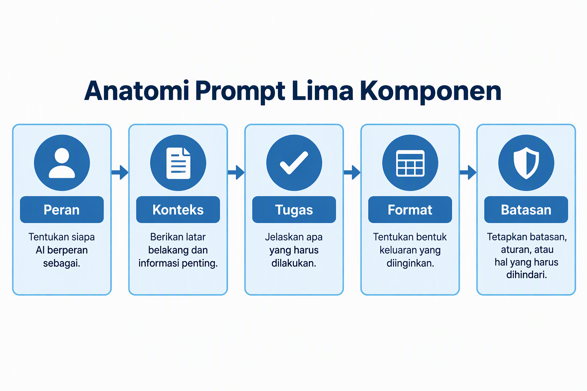
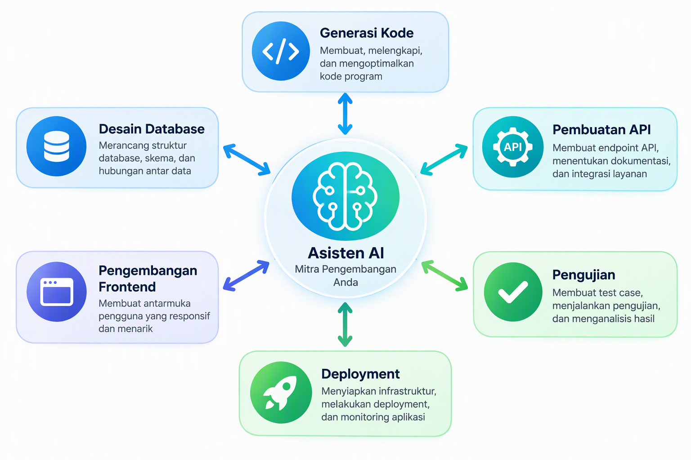
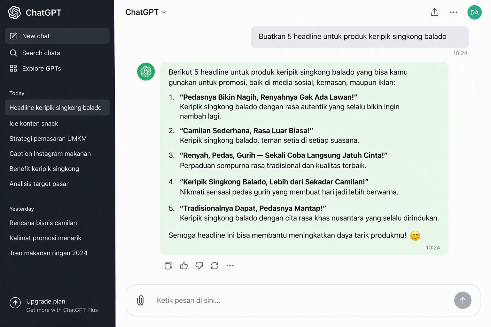

# Panduan Lengkap ChatGPT untuk Produktivitas Bisnis UMKM Indonesia

### Maksimalkan Potensi AI untuk Mengembangkan Usaha Anda


**Penulis:** Siraj Nur Ihrom, CEO SNISHOP.COM

**Penerbit:** SNISHOP.COM

**Edisi:** Pertama, Desember 2025

---

## Daftar Isi

### BAGIAN I: MEMAHAMI CHATGPT

- Bab 1: Pengenalan ChatGPT dan AI untuk Bisnis
- Bab 2: Setup dan Navigasi ChatGPT
- Bab 3: Prompt Engineering, Seni Bertanya pada AI

### BAGIAN II: APLIKASI UNTUK BISNIS

- Bab 4: Otomatisasi Tugas Harian
- Bab 5: Pembuatan Konten dan Copywriting
- Bab 6: Analisis Data dan Research
- Bab 7: Customer Service dan Sales Support

### BAGIAN III: ADVANCED DAN INTEGRASI

- Bab 8: Integrasi ChatGPT dengan Tools Bisnis Lainnya
- Bab 9: Advanced Techniques dan Best Practices
- Bab 10: Studi Kasus dan Implementation Plan

### PENUTUP

### TENTANG PENULIS

---

# BAGIAN I: MEMAHAMI CHATGPT

---

## Bab 1: Pengenalan ChatGPT dan AI untuk Bisnis


### 1.1 Apa Itu ChatGPT?

ChatGPT adalah asisten virtual berbasis kecerdasan buatan yang dikembangkan oleh OpenAI. Platform ini menggunakan model bahasa besar (large language model) yang dilatih dengan miliaran teks dari berbagai sumber, termasuk buku, artikel, website, dan dokumen lainnya. Hasilnya, ChatGPT mampu memahami pertanyaan dalam bahasa manusia dan memberikan respons yang relevan, terstruktur, dan bermanfaat.

Bagi pelaku UMKM, ChatGPT bukan sekadar alat chat biasa. Ini adalah asisten digital yang bisa membantu Anda menulis email, membuat konten pemasaran, menganalisis data penjualan, menyusun strategi bisnis, bahkan memberikan saran keuangan. Yang membuat ChatGPT istimewa adalah kemampuannya untuk beradaptasi dengan konteks bisnis Anda. Semakin spesifik informasi yang Anda berikan, semakin akurat dan berguna jawaban yang dihasilkan.

ChatGPT diluncurkan pada November 2022 dan dengan cepat menjadi fenomena global. Dalam dua bulan pertama, platform ini mencapai 100 juta pengguna aktif, menjadikannya aplikasi konsumen dengan pertumbuhan tercepat dalam sejarah teknologi. Hingga tahun 2025, ChatGPT telah digunakan oleh jutaan bisnis di seluruh dunia, termasuk ribuan UMKM di Indonesia yang telah merasakan manfaatnya dalam meningkatkan produktivitas dan efisiensi operasional.

### 1.2 Bagaimana ChatGPT Bekerja?

Untuk menggunakan ChatGPT secara optimal, Anda perlu memahami dasar cara kerjanya. ChatGPT bekerja dengan memproses teks yang Anda masukkan (disebut prompt), kemudian menghasilkan respons berdasarkan pola yang dipelajari selama proses pelatihan.

Prosesnya bisa diibaratkan seperti berikut. Pertama, Anda memberikan input berupa teks pertanyaan atau instruksi. Kedua, ChatGPT menganalisis teks tersebut, memecahnya menjadi token (unit teks kecil), dan memahami makna serta konteksnya. Ketiga, model menghasilkan respons kata demi kata berdasarkan probabilitas statistik dari pola bahasa yang telah dipelajari. Keempat, respons tersebut ditampilkan kepada Anda dalam format teks yang mudah dibaca.

Penting untuk dipahami bahwa ChatGPT tidak "berpikir" seperti manusia. Ia tidak memiliki kesadaran atau pemahaman sejati. Namun, kemampuannya dalam mengenali pola bahasa sangat canggih sehingga hasilnya sering kali terasa seperti berbicara dengan manusia yang sangat berpengetahuan. ChatGPT juga tidak memiliki akses real-time ke internet (kecuali versi tertentu dengan fitur browsing), sehingga pengetahuannya terbatas pada data yang digunakan saat pelatihan.

### 1.3 Perbedaan GPT-3.5 vs GPT-4

OpenAI menyediakan beberapa versi model ChatGPT, dan yang paling umum digunakan adalah GPT-3.5 dan GPT-4. Berikut perbandingan detail keduanya:

GPT-3.5 (Versi Gratis):

- Tersedia gratis untuk semua pengguna
- Mampu menangani teks hingga sekitar 4.000 token (kira-kira 3.000 kata) dalam satu percakapan
- Kecepatan respons lebih cepat karena model lebih ringan
- Cocok untuk tugas-tugas dasar seperti menulis email singkat, menjawab pertanyaan umum, dan membuat konten sederhana
- Terkadang kurang akurat untuk tugas-tugas kompleks yang memerlukan penalaran mendalam
- Tidak mendukung analisis gambar atau file

GPT-4 (Versi Berbayar):

- Tersedia melalui langganan ChatGPT Plus (USD 20 per bulan, sekitar Rp 300.000)
- Mampu menangani teks hingga 8.000 token atau lebih (hingga 128.000 token untuk GPT-4 Turbo)
- Akurasi dan kualitas respons jauh lebih baik, terutama untuk tugas kompleks
- Mampu menganalisis gambar (multimodal)
- Lebih baik dalam memahami nuansa, konteks, dan instruksi kompleks
- Mendukung analisis file dan dokumen yang diunggah
- Lebih kreatif dan detail dalam menghasilkan konten panjang
- Kemampuan penalaran logis dan matematika yang lebih kuat

Untuk UMKM dengan anggaran terbatas, GPT-3.5 sudah cukup untuk memulai. Namun, jika bisnis Anda memerlukan analisis mendalam, pembuatan konten berkualitas tinggi, atau pengolahan data kompleks, investasi pada GPT-4 melalui ChatGPT Plus akan memberikan return yang sangat worthwhile.

### 1.4 Kemampuan ChatGPT untuk Bisnis

ChatGPT memiliki beragam kemampuan yang bisa langsung diterapkan dalam operasional bisnis Anda. Berikut adalah kemampuan utama yang paling relevan untuk UMKM:

**Penulisan dan Editing:** ChatGPT bisa menulis berbagai jenis teks bisnis, mulai dari email profesional, deskripsi produk, artikel blog, caption media sosial, proposal bisnis, hingga press release. Kualitas tulisannya bisa disesuaikan dengan tone dan gaya bahasa yang Anda inginkan, apakah formal, kasual, atau persuasif.

**Analisis dan Riset:** Anda bisa menggunakan ChatGPT untuk menganalisis tren pasar, memahami perilaku konsumen, melakukan analisis kompetitor, dan mengidentifikasi peluang bisnis baru. Meskipun tidak menggantikan riset pasar profesional, ChatGPT memberikan starting point yang sangat baik.

**Penerjemahan dan Lokalisasi:** Jika bisnis Anda menargetkan pasar internasional, ChatGPT bisa menerjemahkan konten bisnis ke berbagai bahasa dengan kualitas yang cukup baik. Platform ini juga memahami konteks budaya Indonesia sehingga bisa membantu lokalisasi konten untuk berbagai daerah.

**Pemecahan Masalah:** ChatGPT bisa menjadi mitra brainstorming untuk menyelesaikan berbagai tantangan bisnis. Mulai dari strategi meningkatkan penjualan, cara mengurangi biaya operasional, hingga solusi untuk masalah manajemen tim.

**Organisasi dan Perencanaan:** ChatGPT membantu menyusun business plan, marketing plan, content calendar, project timeline, dan berbagai dokumen perencanaan bisnis lainnya.

### 1.5 Limitasi ChatGPT yang Perlu Dipahami

Meskipun sangat powerful, ChatGPT memiliki beberapa keterbatasan yang harus Anda sadari:

**Halusinasi AI:** ChatGPT terkadang menghasilkan informasi yang terlihat meyakinkan tetapi sebenarnya tidak akurat atau bahkan salah. Ini disebut hallucination. Oleh karena itu, selalu verifikasi informasi penting, terutama yang berkaitan dengan angka, regulasi, atau fakta kritis.

**Tidak Memiliki Pengetahuan Real-Time:** Kecuali Anda menggunakan versi dengan fitur browsing aktif, ChatGPT tidak memiliki akses ke informasi terbaru. Pengetahuannya terbatas pada data pelatihan terakhir.

**Tidak Bisa Menggantikan Penilaian Manusia:** ChatGPT tidak bisa membuat keputusan bisnis final. Semua output harus ditinjau dan divalidasi oleh Anda sebelum diterapkan.

**Keterbatasan Kontekstual:** ChatGPT memiliki batasan dalam jumlah teks yang bisa diingat dalam satu percakapan. Untuk percakapan yang sangat panjang, konteks awal mungkin terlupakan.

**Bias Data:** Karena dilatih dengan data dari internet, ChatGPT mungkin mereproduksi bias yang ada dalam data tersebut. Selalu kritisi output dan sesuaikan dengan konteks spesifik bisnis Anda.

### 1.6 Mengapa AI Penting untuk Bisnis UMKM di Indonesia?

Indonesia memiliki lebih dari 64 juta UMKM yang menyumbang 61 persen terhadap Produk Domestik Bruto nasional. Namun, banyak UMKM yang masih menghadapi tantangan dalam hal efisiensi operasional, akses ke informasi pasar, dan kapasitas sumber daya manusia. Di sinilah AI, khususnya ChatGPT, bisa menjadi game changer.

**Efisiensi Biaya:** Dengan ChatGPT, UMKM bisa mengotomatisasi banyak tugas yang sebelumnya memerlukan staf tambahan. Sebuah toko online yang biasanya membutuhkan dua orang untuk menangani customer service dan konten media sosial, bisa mengurangi beban kerja hingga 60 persen dengan bantuan ChatGPT. Ini berarti penghematan gaji karyawan yang bisa dialokasikan untuk investasi lain.

**Akses ke Pengetahuan Profesional:** ChatGPT memberikan akses ke pengetahuan yang setara dengan konsultan bisnis profesional dengan biaya yang jauh lebih rendah. UMKM bisa mendapatkan saran strategi pemasaran, analisis keuangan, dan perencanaan bisnis yang biasanya hanya terjangkau oleh perusahaan besar.

**Daya Saing:** Di era digital, kecepatan dan kualitas adalah kunci. UMKM yang mengadopsi AI bisa merespons tren pasar lebih cepat, menghasilkan konten lebih banyak dan berkualitas, serta melayani pelanggan lebih efisien dibandingkan kompetitor yang belum memanfaatkan teknologi ini.

**Skalabilitas:** ChatGPT memungkinkan UMKM untuk meningkatkan kapasitas operasional tanpa perlu menambah sumber daya secara proporsional. Satu orang dengan bantuan ChatGPT bisa menghasilkan output yang setara dengan tim beranggotakan tiga sampai lima orang.

**Transformasi Digital di Indonesia:** Pemerintah Indonesia melalui Kementerian Koperasi dan UKM telah aktif mendorong digitalisasi UMKM. Program-program seperti e-Smart IKM dan Making Indonesia 4.0 memberikan insentif bagi UMKM yang mengadopsi teknologi digital. Dalam konteks ini, ChatGPT dan AI lainnya menjadi enabler yang sangat powerful karena barrier to entry-nya rendah. Anda tidak perlu memiliki latar belakang teknis atau modal besar untuk mulai menggunakan AI. Yang Anda butuhkan hanyalah koneksi internet, perangkat yang memadai, dan kemauan untuk belajar.

Data dari berbagai survei menunjukkan bahwa UMKM yang mengadopsi teknologi digital mengalami pertumbuhan revenue rata-rata 30 persen lebih tinggi dibandingkan yang tidak. Lebih jauh, UMKM yang memanfaatkan AI melaporkan peningkatan produktivitas hingga 40 persen dan pengurangan biaya operasional hingga 25 persen. Angka-angka ini bukan sekadar statistik, mereka merepresentasikan perbedaan antara bisnis yang bertahan dan yang tertinggal di era kompetisi digital yang semakin ketat.

### 1.7 Checklist Kesiapan Mengadopsi ChatGPT

Sebelum mulai menggunakan ChatGPT untuk bisnis Anda, pastikan Anda telah memenuhi checklist berikut:

1. Anda memiliki perangkat yang terhubung ke internet, baik komputer, laptop, atau smartphone
2. Anda memiliki alamat email aktif untuk mendaftar akun ChatGPT
3. Anda memahami jenis tugas bisnis apa saja yang bisa dibantu oleh ChatGPT
4. Anda siap meluangkan waktu minimal 30 menit per hari untuk belajar dan beradaptasi
5. Anda memiliki daftar tugas repetitif yang selama ini menyita waktu
6. Anda berkomitmen untuk mengevaluasi dan memverifikasi output ChatGPT sebelum menggunakannya
7. Anda memahami bahwa ChatGPT adalah alat bantu, bukan pengganti keputusan manusia

### 1.8 Tips dan Best Practices Bab 1

- Mulailah dari tugas-tugas sederhana seperti menulis email atau membuat caption media sosial sebelum beralih ke tugas yang lebih kompleks
- Simpan percakapan penting Anda sebagai referensi untuk digunakan kembali di masa depan
- Jangan ragu untuk meminta ChatGPT memperbaiki atau merevisi outputnya jika hasilnya belum sesuai harapan
- Selalu cantumkan konteks bisnis yang spesifik agar output lebih relevan

### 1.9 Kesalahan Umum yang Harus Dihindari

- Menganggap ChatGPT selalu benar tanpa melakukan verifikasi
- Memberikan instruksi yang terlalu umum tanpa konteks spesifik
- Mengandalkan ChatGPT sepenuhnya untuk keputusan bisnis kritis tanpa analisis tambahan
- Tidak meluangkan waktu untuk mempelajari cara menulis prompt yang efektif

---

## Bab 2: Setup dan Navigasi ChatGPT



### 2.1 Membuat Akun ChatGPT

Langkah pertama untuk menggunakan ChatGPT adalah membuat akun. Prosesnya sederhana dan hanya membutuhkan beberapa menit.

Langkah-langkah Pendaftaran:

1. Buka browser Anda dan kunjungi chat.openai.com
2. Klik tombol "Sign Up" di halaman utama
3. Pilih metode pendaftaran: menggunakan email, akun Google, atau akun Apple
4. Jika menggunakan email, masukkan alamat email aktif Anda dan buat password yang kuat
5. Verifikasi email Anda dengan mengklik tautan konfirmasi yang dikirimkan
6. Lengkapi profil dasar Anda, termasuk nama
7. Setujui syarat dan ketentuan penggunaan
8. Akun Anda siap digunakan

Setelah berhasil mendaftar, Anda akan langsung diarahkan ke antarmuka ChatGPT dan bisa mulai mengirimkan pesan pertama Anda.

### 2.2 Memahami Interface ChatGPT

Antarmuka ChatGPT dirancang agar intuitif dan mudah digunakan. Berikut adalah komponen-komponen utama yang perlu Anda ketahui:

**Panel Kiri (Sidebar):** Di bagian kiri layar, Anda akan menemukan daftar percakapan sebelumnya. Setiap percakapan disimpan secara otomatis dan diberi judul berdasarkan pesan pertama Anda. Anda bisa mengklik percakapan lama untuk melanjutkan atau melihat kembali isinya. Di bagian atas panel ini terdapat tombol "New Chat" untuk memulai percakapan baru.

**Area Chat (Tengah):** Ini adalah area utama tempat Anda berinteraksi dengan ChatGPT. Pesan Anda muncul di sebelah kanan, sedangkan respons ChatGPT muncul di sebelah kiri. Area ini menampilkan seluruh percakapan secara kronologis.

**Kotak Input (Bawah):** Di bagian bawah layar terdapat kotak teks tempat Anda mengetik pesan atau instruksi. Di sebelah kanan kotak input terdapat tombol kirim. Anda juga bisa melampirkan file (pada versi Plus) dengan mengklik ikon klip kertas.

**Menu Settings:** Klik nama Anda di pojok kiri bawah untuk mengakses pengaturan akun, termasuk pengelolaan langganan, custom instructions, dan preferensi lainnya.

### 2.3 Perbedaan Paket Free, Plus, dan Team

Memilih paket yang tepat sangat penting untuk memaksimalkan manfaat ChatGPT sesuai kebutuhan bisnis Anda.

ChatGPT Free (Gratis):

- Akses ke model GPT-3.5 atau GPT-4o mini
- Jumlah pesan terbatas per hari (sekitar 10-15 pesan untuk GPT-4o mini)
- Tidak ada akses ke analisis file atau gambar
- Tidak ada prioritas akses saat traffic tinggi
- Cocok untuk: UMKM yang baru mulai mengeksplorasi AI dan memiliki kebutuhan dasar

ChatGPT Plus (Rp 300.000 per bulan):

- Akses penuh ke GPT-4 dan GPT-4 Turbo
- Akses ke DALL-E untuk membuat gambar
- Akses ke analisis file dan data
- Akses ke browsing internet
- Akses ke Custom GPTs (model yang dikustomisasi)
- Prioritas akses saat traffic tinggi
- Cocok untuk: UMKM yang serius memanfaatkan AI untuk operasional harian

ChatGPT Team (USD 25 per pengguna per bulan, sekitar Rp 375.000):

- Semua fitur Plus
- Workspace tim dengan manajemen anggota
- Console admin untuk pengelolaan
- Upload dan analisis file dalam jumlah besar
- Context window yang lebih panjang
- Cocok untuk: UMKM dengan tim yang ingin berkolaborasi menggunakan ChatGPT

**Rekomendasi untuk UMKM:** Jika Anda baru memulai, gunakan versi gratis selama satu sampai dua minggu untuk memahami cara kerja ChatGPT. Setelah itu, pertimbangkan upgrade ke Plus jika Anda merasa AI memberikan nilai tambah yang signifikan bagi bisnis Anda. Untuk sebagian besar UMKM, paket Plus sudah lebih dari cukup.

### 2.4 Cara Memulai Percakapan Pertama

Memulai percakapan dengan ChatGPT sangat mudah. Cukup ketik pesan Anda di kotak input dan tekan Enter. Namun, ada beberapa pendekatan yang bisa Anda gunakan untuk mendapatkan hasil optimal.

**Pendekatan Langsung:** Langsung sampaikan apa yang Anda butuhkan. Contoh: "Buatkan saya caption Instagram untuk promosi produk keripik pedas dengan target audiens anak muda usia 18 sampai 25 tahun."

**Pendekatan Kontekstual:** Berikan latar belakang terlebih dahulu, lalu sampaikan permintaan Anda. Contoh: "Saya pemilik toko online yang menjual pakaian muslim wanita di Bandung. Target pasar saya adalah ibu-ibu muda usia 25 sampai 35 tahun. Buatkan saya lima ide konten Instagram untuk minggu depan yang bisa meningkatkan engagement."

**Pendekatan Iteratif:** Mulai dengan pertanyaan umum, lalu perdalam secara bertahap. Contoh pertama: "Apa saja strategi pemasaran digital yang efektif untuk UMKM kuliner?" Contoh kedua, setelah mendapat jawaban: "Dari strategi tersebut, mana yang paling cocok untuk warung makan kecil dengan budget di bawah Rp 500.000 per bulan?"

### 2.5 Managing Conversations

ChatGPT menyimpan riwayat percakapan Anda secara otomatis. Berikut cara mengelolanya dengan efektif:

**Menamai Percakapan:** Secara default, ChatGPT memberi nama percakapan secara otomatis. Anda bisa mengubahnya dengan mengklik ikon pensil di samping nama percakapan di panel kiri. Beri nama yang deskriptif seperti "Strategi Marketing Q1 2026" atau "Draft Email Supplier" agar mudah ditemukan kembali.

**Menghapus Percakapan:** Jika sebuah percakapan sudah tidak relevan, Anda bisa menghapusnya dengan mengklik ikon tempat sampah di samping nama percakapan. Ingat bahwa percakapan yang dihapus tidak bisa dikembalikan.

**Menggunakan Folder (Plus):** Pada versi Plus, Anda bisa mengorganisir percakapan ke dalam folder berdasarkan topik atau proyek. Ini sangat berguna jika Anda menggunakan ChatGPT untuk berbagai aspek bisnis.

**Memulai Percakapan Baru:** Selalu mulai percakapan baru untuk topik yang berbeda. Ini membantu ChatGPT mempertahankan konteks yang relevan dan menghindari kebingungan antar topik.

### 2.6 Settings dan Customization

Pengaturan ChatGPT memungkinkan Anda mengustomisasi pengalaman sesuai kebutuhan bisnis.

**Custom Instructions:** Ini adalah fitur powerful yang memungkinkan Anda memberikan informasi permanen tentang diri Anda dan preferensi Anda. Di bagian "What would you like ChatGPT to know about you", Anda bisa menuliskan konteks bisnis Anda. Di bagian "How would you like ChatGPT to respond", Anda bisa mengatur gaya respons yang diinginkan.

Contoh Custom Instructions untuk pemilik UMKM:

Bagian pertama (tentang Anda): "Saya adalah pemilik UMKM yang bergerak di bidang fashion muslim di Yogyakarta. Tim saya terdiri dari 5 orang. Saya menggunakan ChatGPT untuk membantu pemasaran, customer service, dan perencanaan bisnis. Target pasar saya adalah wanita muslim usia 20 sampai 40 tahun di seluruh Indonesia."

Bagian kedua (preferensi respons): "Berikan jawaban yang praktis dan bisa langsung diterapkan. Gunakan bahasa Indonesia yang profesional namun tidak kaku. Sertakan contoh konkret dan angka whenever possible. Format jawaban dengan heading dan bullet points agar mudah dibaca."

**General Preferences:** Anda juga bisa mengatur preferensi umum seperti panjang respons default, tingkat detail, dan format output. Pengaturan ini akan diterapkan ke semua percakapan baru Anda.

**Data Controls:** Di bagian pengaturan, Anda bisa mengontrol bagaimana data percakapan Anda disimpan dan digunakan. Untuk keperluan bisnis yang sensitif, pertimbangkan untuk menonaktifkan riwayat pelatihan (training history) agar data bisnis Anda tidak digunakan untuk melatih model.

### 2.7 Template Setup ChatGPT untuk UMKM

Berikut template yang bisa Anda gunakan untuk mengoptimalkan setup ChatGPT:

Template Custom Instructions:

```
Tentang Bisnis Saya:
- Nama usaha: [Nama usaha Anda]
- Bidang: [Jenis bisnis, misalnya fashion, F&B, jasa konsultasi]
- Lokasi: [Kota/daerah]
- Ukuran tim: [Jumlah karyawan]
- Target pasar: [Deskripsi pelanggan ideal]
- Produk/jasa utama: [Daftar produk atau jasa]
- Tujuan bisnis 6 bulan ke depan: [Target spesifik]

Preferensi Respons:
- Bahasa: Indonesia profesional
- Gaya: Praktis, langsung bisa diterapkan
- Format: Gunakan heading, bullet points, dan contoh konkret
- Sertakan: Angka estimasi, timeline, dan langkah-langkah spesifik
```

### 2.8 Checklist Setup ChatGPT

1. Akun ChatGPT telah berhasil dibuat dan terverifikasi
2. Anda telah menjelajahi seluruh area interface dan memahami fungsi masing-masing
3. Anda telah memilih paket yang sesuai dengan kebutuhan dan anggaran
4. Custom Instructions telah diisi dengan informasi bisnis Anda
5. Anda telah melakukan minimal tiga percakapan percobaan untuk membiasakan diri
6. Anda telah mengatur preferensi respons sesuai kebutuhan
7. Anda telah membuat sistem penamaan percakapan yang terorganisir

### 2.9 Tips dan Best Practices Bab 2

- Gunakan percakapan terpisah untuk setiap proyek atau tugas agar konteks tetap fokus
- Manfaatkan fitur "Share" untuk membagikan percakapan berguna kepada tim Anda
- Bookmark percakapan penting yang berisi template atau instruksi yang sering digunakan
- Rutin bersihkan percakapan lama yang sudah tidak relevan

### 2.10 Kesalahan Umum yang Harus Dihindari

- Mencampuradukkan banyak topik berbeda dalam satu percakapan
- Lupa mengisi Custom Instructions sehingga setiap percakapan harus diulang dari awal
- Tidak menghapus percakapan yang berisi informasi sensitif atau rahasia bisnis
- Menggunakan password yang lemah untuk akun ChatGPT Anda

---

## Bab 3: Prompt Engineering, Seni Bertanya pada AI



### 3.1 Dasar-Dasar Prompt Engineering

Prompt engineering adalah seni dan ilmu dalam merumuskan pertanyaan atau instruksi untuk AI agar menghasilkan output yang optimal. Ini adalah keterampilan paling penting yang harus Anda kuasai untuk memaksimalkan nilai ChatGPT bagi bisnis Anda.

Bayangkan ChatGPT seperti seorang karyawan baru yang sangat cerdas tetapi belum mengenal bisnis Anda. Semakin jelas dan lengkap brief yang Anda berikan, semakin baik hasil kerjanya. Prompt engineering pada dasarnya adalah cara memberikan brief tersebut.

Prinsip dasar prompt engineering yang perlu Anda ingat adalah CLASP:

**C (Context):** Berikan konteks yang cukup. Siapa Anda, apa bisnis Anda, dan apa situasinya.

**L (Length):** Tentukan panjang output yang diinginkan, apakah ringkasan singkat atau penjelasan detail.

**A (Audience):** Jelaskan siapa target audiens dari output yang Anda minta.

**S (Style):** Tentukan gaya penulisan, apakah formal, kasual, persuasif, atau edukatif.

**P (Purpose):** Jelaskan tujuan dari output yang Anda minta, apakah untuk menjual, mengedukasi, atau menghibur.

### 3.2 Struktur Prompt yang Efektif

Prompt yang efektif biasanya mengikuti struktur tertentu. Berikut adalah formula yang telah terbukti menghasilkan output berkualitas tinggi:

Formula RICE:

**R (Role):** Tetapkan peran untuk ChatGPT. "Bertindaklah sebagai konsultan pemasaran digital dengan pengalaman 10 tahun di industri UMKM Indonesia."

**I (Instruction):** Sampaikan instruksi dengan jelas. "Buatkan strategi konten Instagram untuk tiga bulan ke depan."

**C (Context):** Berikan konteks yang relevan. "Bisnis saya adalah toko online yang menjual sepatu handmade dengan harga Rp 300.000 sampai Rp 800.000. Target pasar adalah pria dan wanita usia 22 sampai 35 tahun di kota-kota besar. Saat ini kami memiliki 2.000 followers di Instagram."

**E (Example/Expectation):** Berikan contoh atau ekspektasi spesifik. "Saya ingin strategi yang mencakup jenis konten (foto produk, behind the scene, testimonial, edukasi), frekuensi posting (minimal 4 kali seminggu), dan contoh caption untuk setiap jenis konten."

### 3.3 Context Setting: Memberikan Latar Belakang yang Tepat

Context setting adalah fondasi dari prompt yang baik. Tanpa konteks yang cukup, ChatGPT akan menghasilkan output yang generik dan kurang berguna. Berikut adalah cara memberikan konteks yang efektif:

**Konteks Bisnis:** Jelaskan jenis bisnis Anda, ukuran perusahaan, industri, dan posisi Anda di pasar. Contoh: "Saya pemilik katering rumahan di Semarang dengan 3 karyawan. Kami melayani katering harian untuk kantor dan acara pernikahan. Omzet bulanan sekitar Rp 45 juta."

**Konteks Situasi:** Jelaskan situasi spesifik yang melatarbelakangi permintaan Anda. Contoh: "Penjualan kami turun 20 persen dalam dua bulan terakhir karena masuknya kompetitor baru yang menawarkan harga lebih murah. Kami perlu strategi untuk mempertahankan pelanggan dan menarik pelanggan baru."

**Konteks Audiens:** Deskripsikan target audiens Anda secara detail. Contoh: "Pelanggan ideal saya adalah manajer HRD di perusahaan menengah yang bertanggung jawab memesan katering untuk 50 sampai 200 karyawan. Mereka menghargai ketepatan waktu, variasi menu, dan harga yang kompetitif."

**Konteks Sumber Daya:** Jelaskan keterbatasan sumber daya yang Anda miliki. Contoh: "Budget pemasaran saya hanya Rp 2 juta per bulan. Tim saya terdiri dari saya sendiri dan satu admin. Kami tidak memiliki desainer grafis profesional."

### 3.4 Role Assignment: Menetapkan Peran untuk ChatGPT

Menetapkan peran (role assignment) adalah teknik yang sangat efektif untuk meningkatkan kualitas output. Ketika Anda memberikan peran spesifik, ChatGPT akan menyesuaikan gaya, kedalaman, dan perspektif jawabannya.

Daftar Peran yang Berguna untuk UMKM:

- Konsultan bisnis dan strategi
- Copywriter profesional
- Analis keuangan
- Spesialis media sosial
- Customer service manager
- HR consultant
- Product developer
- Market researcher
- Business coach
- Content strategist
- Email marketing specialist
- SEO specialist

Contoh Penerapan Role Assignment:

Prompt biasa: "Buatkan email untuk pelanggan."

Prompt dengan role: "Bertindaklah sebagai specialist email marketing dengan pengalaman menangani brand fashion Indonesia. Buatkan email sequence 5 bagian untuk pelanggan yang sudah meninggalkan keranjang belanja mereka (abandoned cart). Gunakan pendekatan yang persuasif tetapi tidak agresif. Sertakan subject line untuk setiap email dan tentukan waktu pengiriman yang optimal."

### 3.5 Chain-of-Thought: Memandu AI Berpikir Bertahap

Chain-of-thought prompting adalah teknik di mana Anda meminta ChatGPT untuk menjelaskan proses berpikirnya secara bertahap. Teknik ini sangat berguna untuk tugas-tugas yang memerlukan analisis atau penalaran kompleks.

Cara Menerapkan:

Tambahkan instruksi seperti "Jelaskan langkah demi langkah bagaimana Anda sampai pada kesimpulan tersebut" atau "Pikirkan secara bertahap sebelum memberikan jawaban akhir."

Contoh untuk Bisnis:

Prompt: "Saya ingin meningkatkan profit margin bisnis kopi saya yang saat ini sebesar 15 persen menjadi 25 persen dalam enam bulan. Harga jual satu cup kopi adalah Rp 25.000 dengan HPP Rp 21.250. Analisis secara bertahap: (1) Identifikasi komponen HPP, (2) Evaluasi opsi pengurangan biaya, (3) Evaluasi opsi peningkatan harga, (4) Hitungkan dampak setiap skenario terhadap profit margin, (5) Berikan rekomendasi terbaik dengan perhitungan detail."

Dengan pendekatan chain-of-thought, ChatGPT akan menguraikan analisisnya secara sistematis, sehingga Anda bisa mengikuti logika di balik setiap rekomendasi dan memverifikasi perhitungannya.

### 3.6 Few-Shot Prompting: Memberikan Contoh

Few-shot prompting adalah teknik di mana Anda memberikan beberapa contoh output yang diinginkan agar ChatGPT bisa meniru pola dan gaya tersebut. Ini sangat berguna untuk menghasilkan konten yang konsisten dengan brand voice Anda.

Contoh Penerapan:

Prompt: "Buatkan caption Instagram untuk produk baru kami (tas rajut handmade) dengan gaya yang sama seperti contoh-contoh berikut:

Contoh 1: 'Setiap jahitan menceritakan dedikasi. Tas rajut kami dibuat dengan cinta oleh pengrajin lokal yang telah menekuni seni ini selama 15 tahun. Rp 450.000, tersedia dalam 5 warna. Order via DM atau klik link di bio.'

Contoh 2: 'Kesempurnaan ada dalam detail. Tas rajut premium yang tidak hanya menjadi aksesori, tetapi juga pernyataan gaya. Handmade dengan bahan berkualitas tinggi. Limited edition, hanya 20 pcs. DM untuk order.'

Sekarang buatkan caption untuk tas rajut model baru dengan harga Rp 550.000, tersedia dalam 3 warna earth tone, dan hanya diproduksi 15 pcs."

### 3.7 Template Prompt untuk Berbagai Kebutuhan Bisnis

Berikut adalah kumpulan template prompt yang bisa langsung Anda gunakan dan sesuaikan:

Template Prompt untuk Analisis Kompetitor:

```
Bertindaklah sebagai analis bisnis berpengalaman. Saya bergerak di bidang [jenis bisnis] di [lokasi].
Kompetitor utama saya adalah:
1. [Kompetitor A] - [kekuatan utama mereka]
2. [Kompetitor B] - [kekuatan utama mereka]
3. [Kompetitor C] - [kekuatan utama mereka]

Analisis secara detail:
- Positioning masing-masing kompetitor
- Keunggulan dan kelemahan mereka
- Celah pasar yang bisa saya manfaatkan
- Strategi diferensiasi yang bisa saya terapkan
- Estimasi investasi dan timeline untuk implementasi
```

Template Prompt untuk Business Plan:

```
Bertindaklah sebagai konsultan bisnis yang specializing dalam UMKM Indonesia.
Buatkan kerangka business plan untuk bisnis [jenis bisnis] dengan detail berikut:
- Modal awal: Rp [jumlah]
- Lokasi: [kota/daerah]
- Target pasar: [deskripsi]
- Keunggulan kompetitif: [deskripsi]

Sertakan:
- Ringkasan eksekutif
- Analisis pasar dengan data realistis
- Strategi pemasaran dengan budget detail
- Proyeksi keuangan 12 bulan (bulan per bulan)
- Analisis break-even point
- Rencana operasional harian
- Risiko utama dan mitigasinya
```

Template Prompt untuk Konten Media Sosial:

```
Bertindaklah sebagai social media manager profesional.
Bisnis saya: [deskripsi singkat bisnis]
Produk yang dipromosikan: [nama dan deskripsi produk]
Target audiens: [usia, gender, minat, lokasi]
Platform: [Instagram/TikTok/Facebook]
Tone of voice: [ceria/profesional/edukatif/inspiratif]

Buatkan content calendar untuk [1 minggu/1 bulan] dengan:
- [Jumlah] posting per minggu
- Jenis konten yang bervariasi (produk, edukasi, behind the scene, testimonial)
- Caption lengkap untuk setiap posting
- Saran visual/foto untuk setiap posting
- Hashtag yang relevan (15-20 per posting)
- Best time to post berdasarkan data audiens Indonesia
```

### 3.8 Common Mistakes dalam Prompt Engineering

Kesalahan 1: Prompt Terlalu Singkat dan Umum

Buruk: "Buatkan marketing plan."
Baik: "Buatkan marketing plan 3 bulan untuk toko online sepatu dengan budget Rp 5 juta per bulan, target meningkatkan penjualan 30 persen, menggunakan Instagram dan TikTok sebagai channel utama."

Kesalahan 2: Tidak Memberikan Konteks yang Cukup

Buruk: "Buatkan email untuk pelanggan."
Baik: "Buatkan email promotional untuk pelanggan yang sudah tidak berbelanja selama 3 bulan. Bisnis saya adalah toko skincare natural. Tawarkan diskon 20 persen sebagai insentif. Tone: hangat dan personal, bukan hard selling. Panjang maksimal 200 kata."

Kesalahan 3: Meminta Terlalu Banyak dalam Satu Prompt

Sebaiknya pecah permintaan kompleks menjadi beberapa prompt terpisah. Misalnya, jangan meminta business plan lengkap dalam satu prompt. Mintalah per bagian: pertama ringkasan eksekutif, kemudian analisis pasar, lalu strategi pemasaran, dan seterusnya.

Kesalahan 4: Tidak Melakukan Iterasi

Output pertama ChatGPT jarang sempurna. Gunakan pendekatan iteratif dengan meminta revisi dan perbaikan. Contoh: "Bagus, tetapi bagian strategi pemasaran perlu lebih detail. Tambahkan timeline mingguan dan alokasi budget per channel."

Kesalahan 5: Tidak Memanfaatkan Custom Instructions

Jika Anda harus mengulang konteks yang sama di setiap percakapan, berarti Anda belum memanfaatkan Custom Instructions dengan optimal. Isi Custom Instructions sekali, dan konteks bisnis Anda akan diterapkan secara otomatis di semua percakapan.

### 3.9 Checklist Prompt Engineering

1. Prompt Anda mengandung elemen CLASP (Context, Length, Audience, Style, Purpose)
2. Anda telah menetapkan peran yang sesuai untuk ChatGPT
3. Anda memberikan konteks bisnis yang spesifik dan relevan
4. Anda menyertakan contoh output yang diinginkan (jika diperlukan)
5. Anda menentukan format output yang jelas (daftar, tabel, narasi, dll.)
6. Anda siap melakukan iterasi jika output pertama belum memuaskan
7. Anda memverifikasi fakta dan angka penting dari output ChatGPT

### 3.10 Tips dan Best Practices Bab 3

- Simpan prompt-prompt terbaik Anda dalam dokumen terpisah sebagai library
- Pelajari dari setiap interaksi, catat prompt mana yang menghasilkan output terbaik
- Bereksperimen dengan berbagai gaya dan struktur prompt
- Gunakan ChatGPT untuk memperbaiki prompt Anda sendiri, minta saran untuk meningkatkan kualitas prompt
- Bergabunglah dengan komunitas pengguna ChatGPT untuk berbagi tips dan template prompt

---

# BAGIAN II: APLIKASI UNTUK BISNIS

---

## Bab 4: Otomatisasi Tugas Harian


### 4.1 Email Drafting dan Reply

Email masih menjadi saluran komunikasi bisnis yang paling penting. Namun, menulis email yang profesional dan efektif bisa memakan waktu signifikan, terutama jika Anda membalas puluhan email setiap hari. ChatGPT bisa memangkas waktu ini hingga 70 persen.

Cara Menggunakan ChatGPT untuk Email:

Langkah pertama adalah memberikan konteks tentang email yang akan ditulis. Siapa penerimanya, apa tujuannya, dan tone apa yang diinginkan. Berikut contoh prompt yang efektif:

Prompt: "Buatkan email balasan untuk klien yang menanyakan status proyek redesign website mereka. Situasi: proyek sedang on-track dan akan selesai sesuai jadwal pada 15 Januari 2026. Tahap saat ini adalah final review. Tone: profesional dan reassuring. Panjang: 3-4 paragraf. Sertakan penawaran untuk meeting progress update minggu depan."

Template Email Bisnis yang Bisa Anda Gunakan:

Email Penawaran Produk:

```
Subject: [Nama Produk] Solusi Tepat untuk [Masalah Klien]

Yth. [Nama Penerima],

[Paragraf 1: Sapaan personal dan referensi ke konteks, misalnya pertemuan sebelumnya atau rekomendasi dari pihak ketiga]

[Paragraf 2: Identifikasi masalah atau kebutuhan yang dihadapi penerima]

[Paragraf 3: Perkenalkan produk/jasa Anda sebagai solusi, sertakan 2-3 keunggulan utama]

[Paragraf 4: Social proof, misalnya jumlah klien yang puas atau testimoni singkat]

[Paragraf 5: Call to action yang jelas, misalnya jadwal demo atau konsultasi gratis]

Salam hormat,
[Nama Anda]
[Jabatan]
[Nama Perusahaan]
[Nomor Telepon]
```

Template Email Follow-Up:

```
Subject: Follow-Up: [Topik Pembahasan Sebelumnya]

Yth. [Nama Penerima],

Terima kasih atas waktu Anda pada [tanggal pertemuan/konversasi sebelumnya]. Saya sangat mengapresiasi [hal spesifik yang dibahas].

Sebagaimana yang kita diskusikan, [ringkasan singkat action item atau kesepakatan]. Saya ingin memastikan bahwa [tindak lanjut yang diperlukan].

[Jika ada dokumen atau informasi tambahan yang dijanjikan, lampirkan di sini]

Apakah Anda tersedia untuk [usulan tindak lanjut selanjutnya] pada [usulan waktu]?

Salam hangat,
[Nama Anda]
```

Estimasi Penghematan Waktu:

Sebuah UMKM rata-rata mengirim dan membalas 30-50 email per hari. Tanpa ChatGPT, setiap email membutuhkan waktu 5-10 menit untuk ditulis, termasuk memikirkan struktur dan diksi. Total: 150-500 menit per hari (2,5-8,3 jam). Dengan ChatGPT, waktu per email berkurang menjadi 1-3 menit (termasuk review dan editing). Total: 30-150 menit per hari (0,5-2,5 jam). Penghematan: sekitar 2-6 jam per hari, atau 10-30 jam per minggu.

Contoh Praktis Email Sebelum dan Sesudah ChatGPT:

Sebelum menggunakan ChatGPT, Anda mungkin menghabiskan 15 menit untuk menulis email penawaran seperti ini. Anda membaca ulang beberapa kali, memperbaiki diksi, dan memastikan strukturnya tepat. Dengan ChatGPT, Anda cukup memberikan prompt singkat dan dalam 30 detik Anda mendapatkan draft yang bisa langsung direview dan dikirim. Waktu total: 2-3 menit termasuk review.

Prompt: "Buatkan email penawaran kerjasama catering untuk acara corporate kepada PT Maju Bersama. Kapasitas 200 pax, tanggal 15 Februari 2026. Budget mereka Rp 75.000 per pax. Tone profesional. Sertakan 3 paket menu yang bisa kami tawarkan."

Hasil yang Anda dapatkan adalah email lengkap dengan pembuka yang menarik, tiga opsi paket menu dengan rincian harga, penutup yang persuasif, dan call to action yang jelas. Anda tinggal review, sesuaikan detail spesifik jika perlu, dan kirim.

Tips Tambahan untuk Email dengan ChatGPT:

Simpan email-email terbaik yang pernah Anda buat dengan bantuan ChatGPT dalam folder khusus. Folder ini berfungsi sebagai library yang bisa Anda rujuk di masa depan. Ketika Anda membutuhkan email serupa, Anda bisa menggunakan email lama sebagai referensi dan meminta ChatGPT membuat variasi baru berdasarkan template yang sudah terbukti efektif.

Selain itu, mintalah ChatGPT membuat beberapa variasi email untuk A/B testing. Misalnya, minta tiga versi subject line yang berbeda untuk email marketing yang sama. Kirim masing-masing versi ke segmen audiens yang berbeda dan ukur mana yang memiliki open rate tertinggi. Pendekatan data-driven ini bisa meningkatkan efektivitas email marketing Anda secara signifikan.

### 4.2 Scheduling dan Calendar Management

Meskipun ChatGPT tidak terintegrasi langsung dengan kalender Anda, ia bisa membantu merencanakan jadwal dan membuat template manajemen waktu yang efektif.

Cara Menggunakan ChatGPT untuk Penjadwalan:

Prompt: "Bantu saya menyusun jadwal mingguan yang optimal. Saya adalah pemilik UMKM kuliner dengan aktivitas berikut: (1) Belanja bahan baku, butuh 2 jam, sebaiknya pagi hari, (2) Produksi makanan, butuh 4 jam, (3) Pengiriman order, butuh 2 jam, (4) Admin dan keuangan, butuh 1,5 jam, (5) Marketing dan media sosial, butuh 1 jam, (6) Istirahat dan sholat. Jam kerja: 07.00-17.00, Senin-Sabtu. Buat jadwal yang efisien dengan waktu buffer yang cukup."

Template Weekly Planning Prompt:

```
Saya ingin merencanakan minggu depan dengan detail. Berikut prioritas utama saya:
1. [Prioritas 1] - deadline [tanggal]
2. [Prioritas 2] - deadline [tanggal]
3. [Prioritas 3] - deadline [tanggal]

Meeting yang sudah terjadwal:
- [Hari, jam, durasi, topik]
- [Hari, jam, durasi, topik]

Tugas rutin:
- [Tugas harian yang harus dilakukan]

Buatkan jadwal harian Senin-Jumat yang mengoptimalkan produktivitas saya,
dengan mempertimbangkan energi level (tugas berat di pagi hari, tugas ringan di siang hari).
```

### 4.3 Data Entry dan Processing

ChatGPT bisa membantu mengolah data yang Anda miliki menjadi format yang lebih berguna. Meskipun tidak bisa menggantikan spreadsheet untuk pengolahan data skala besar, ChatGPT sangat berguna untuk tugas-tugas berikut:

Format Konversi Data:

Prompt: "Ubah data penjualan berikut dari format teks menjadi tabel yang rapi dengan kolom: No, Tanggal, Nama Produk, Jumlah, Harga Satuan, Total. Berikut datanya: [tempel data mentah Anda]."

Analisis Data Sederhana:

Prompt: "Berikut data penjualan bulanan saya selama 6 bulan terakhir: Januari Rp 45 juta, Februari Rp 52 juta, Maret Rp 48 juta, April Rp 61 juta, Mei Rp 55 juta, Juni Rp 67 juta. Analisis tren penjualan, hitung rata-rata pertumbuhan bulanan, identifikasi bulan terbaik dan terburuk, dan berikan prediksi sederhana untuk 3 bulan ke depan."

Pembuatan Formula Spreadsheet:

Prompt: "Saya memiliki spreadsheet dengan kolom A (Nama Produk), kolom B (Harga Beli), kolom C (Harga Jual), kolom D (Jumlah Terjual). Buatkan formula Google Sheets untuk: (1) menghitung profit per produk, (2) menghitung margin profit persentase, (3) menghitung total revenue, (4) menemukan produk dengan margin tertinggi, (5) membuat ranking produk berdasarkan volume penjualan."

**Estimasi Penghematan:** Tugas data processing yang biasanya memakan waktu 2-3 jam per minggu bisa dikurangi menjadi 30 menit dengan bantuan ChatGPT. Penghematan: 1,5-2,5 jam per minggu atau 6-10 jam per bulan.

### 4.4 Document Summarization

Sebagai pemilik UMKM, Anda mungkin harus membaca banyak dokumen, mulai dari laporan keuangan, kontrak, regulasi pemerintah, hingga riset pasar. ChatGPT bisa meringkas dokumen-dokumen ini dalam hitungan detik.

Cara Menggunakan ChatGPT untuk Meringkas Dokumen:

Prompt: "Ringkas dokumen berikut dalam format bullet points yang mencakup: (1) poin-poin kunci, (2) angka dan data penting, (3) tindakan yang perlu saya lakukan, (4) deadline atau tenggat waktu yang disebutkan. Dokumen: [tempel isi dokumen]."

Template Ringkasan Eksekutif:

```
Buatkan ringkasan eksekutif dari dokumen berikut dengan format:
- Kesimpulan utama (2-3 kalimat)
- Poin-poin penting (5-7 bullet points)
- Data dan angka kritis
- Risiko yang perlu diwaspadai
- Rekomendasi tindakan selanjutnya
- Timeline atau deadline yang disebutkan

Panjang ringkasan: maksimal 500 kata.
Bahasa: Indonesia formal.
```

### 4.5 Meeting Notes dan Notulensi

ChatGPT bisa mengubah catatan meeting yang berantakan menjadi notulensi yang terstruktur dan profesional.

Prompt Template untuk Notulensi:

```
Berikut catatan kasar dari meeting saya hari ini. Ubah menjadi notulensi profesional dengan format:

Tanggal: [tanggal]
Peserta: [daftar peserta]
Durasi: [durasi]

Agenda:
1. [Agenda 1]
2. [Agenda 2]

Pembahasan:
[Untuk setiap agenda, ringkas diskusi utama]

Keputusan:
[Daftar keputusan yang diambil]

Action Items:
[Daftar tindakan selanjutnya dengan penanggung jawab dan deadline]

Catatan tambahan:
[Hal-hal lain yang perlu didokumentasikan]

Catatan kasar saya:
[tempel catatan kasar Anda di sini]
```

### 4.6 Task Management

ChatGPT bisa membantu Anda menyusun dan memprioritaskan tugas-tugas bisnis.

Prompt untuk Prioritas Tugas:

```
Berikut daftar tugas saya minggu ini:
1. Menyelesaikan laporan keuangan bulanan - deadline Rabu
2. Meeting dengan supplier baru - deadline Kamis
3. Membuat konten Instagram untuk 2 minggu ke depan - deadline Jumat
4. Follow-up 5 klien yang belum bayar invoice - deadline Selasa
5. Training karyawan baru tentang SOP - deadline Sabtu
6. Restock bahan baku yang mulai habis - deadline Senin
7. Evaluasi kinerja karyawan bulanan - deadline Jumat

Bantu saya:
- Prioritaskan tugas menggunakan matriks Eisenhower (urgent vs important)
- Buatkan jadwal harian yang realistis
- Identifikasi tugas yang bisa didelegasikan
- Sarankan cara mengotomatisasi tugas yang repetitif
```

### 4.7 Checklist Otomatisasi Tugas Harian

1. Identifikasi 5 tugas harian yang paling menyita waktu Anda
2. Tentukan tugas mana yang bisa dibantu oleh ChatGPT
3. Siapkan template prompt untuk setiap jenis tugas
4. Tetapkan waktu spesifik dalam sehari untuk menggunakan ChatGPT
5. Ukur penghematan waktu setelah satu minggu penerapan
6. Evaluasi dan tingkatbaiki workflow Anda

### 4.8 Tips dan Best Practices Bab 4

- Buat template prompt untuk tugas-tugas yang sering diulang agar lebih efisien
- Selalu review output ChatGPT sebelum mengirim email atau dokumen ke pihak eksternal
- Gunakan ChatGPT untuk membuat checklist tugas harian berdasarkan prioritas
- Simpan email dan dokumen terbaik yang dihasilkan ChatGPT sebagai referensi

### 4.9 Kesalahan Umum yang Harus Dihindari

- Mengirim email hasil ChatGPT tanpa membaca dan mengeditnya terlebih dahulu
- Memberikan data sensitif perusahaan (password, data keuangan detail) ke ChatGPT tanpa pertimbangan keamanan
- Mengharapkan ChatGPT bisa langsung terhubung dengan kalender atau sistem manajemen tugas Anda
- Tidak menyimpan template prompt yang sudah terbukti efektif

---

## Bab 5: Pembuatan Konten dan Copywriting



### 5.1 Social Media Content

Media sosial adalah saluran pemasaran paling efektif dan efisien untuk UMKM. Namun, konsistensi dalam menghasilkan konten berkualitas adalah tantangan terbesar. ChatGPT bisa menjadi mesin produksi konten yang tidak pernah kehabisan ide.

Strategi Konten Instagram dengan ChatGPT:

Prompt: "Bertindaklah sebagai social media strategist yang memahami algoritma Instagram 2025. Bisnis saya adalah [deskripsi bisnis]. Target audiens: [deskripsi audiens]. Buatkan content plan 30 hari dengan detail:

Hari 1-7: Tema [misalnya, perkenalan produk]
Hari 8-14: Tema [misalnya, edukasi]
Hari 15-21: Tema [misalnya, social proof]
Hari 22-30: Tema [misalnya, promosi]

Untuk setiap hari, sertakan:
- Jenis konten (feed post, Reel, Story, Carousel)
- Ide visual yang detail
- Caption lengkap dengan hook di kalimat pertama
- 20 hashtag yang relevan (campuran hashtag populer dan niche)
- Best time to post
- Call to action yang spesifik"

Template Caption Instagram:

```
[HOOK - Kalimat pertama yang menarik perhatian, maksimal 15 kata]

[ISI - Sampaikan nilai atau informasi utama, 2-3 paragraf pendek]

[CTA - Ajakan bertindak yang jelas]

---
[Hashtag block: 5 hashtag besar (1jt+ post), 10 hashtag medium (100k-1jt), 5 hashtag niche (10k-100k)]
```

Contoh Caption yang Dihasilkan ChatGPT:

Untuk bisnis kopi lokal: "Satu tegukan, seribu cerita. Biji kopi kami dipilih langsung dari petani di dataran tinggi Toraja, disangrai dengan presisi untuk menghasilkan karakter rasa yang unik. Setiap cangkir adalah penghormatan untuk kerja keras mereka. Sudahkah Anda mencoba blend baru kami, Nusantara Sunrise? Kunjungi outlet terdekat atau order online. Kopi terbaik dimulai dari cerita terbaik.

KopiIndonesia #KopiNusantara #SpecialtyCoffeeIndonesia #KopiToraja #CoffeeLoversIndonesia #NgopiPagi #KopiLokal #IndonesianCoffee #CoffeeTime #CafeHopping #KopiEnak #MorningCoffee #KopiSus #CoffeeAddict #WarungKopi #KopiKita #IndonesiaNgopi #Coffeegram #KopiHitam #BijiKopiLokal"

**Estimasi Penghematan:** Membuat konten media sosial untuk 1 minggu biasanya membutuhkan waktu 4-6 jam (riset ide, menulis caption, mencari hashtag). Dengan ChatGPT, waktu ini berkurang menjadi 1-2 jam. Penghematan: 2-4 jam per minggu atau 8-16 jam per bulan.

Strategi Content Pillars untuk UMKM:

Content pillars adalah tema-tema utama yang menjadi fondasi strategi konten Anda. Dengan menentukan 4-5 content pillars, Anda memastikan konten yang dihasilkan konsisten, bervariasi, dan relevan dengan target audiens. ChatGPT bisa membantu Anda merumuskan dan mengisi setiap pillar dengan konten yang berkualitas.

Contoh content pillars untuk toko online fashion muslim:

Pillar 1, Produk dan Koleksi (30 persen konten): Showcase produk baru, detail material, cara styling, perpaduan warna, dan outfit inspirasi. Pillar ini bertujuan untuk meningkatkan awareness dan desire terhadap produk Anda.

Pillar 2, Edukasi Fashion (25 persen konten): Tips memilih hijab sesuai bentuk wajah, cara merawat kain, panduan ukuran, tren fashion terkini, dan sejarah motif tradisional. Pillar ini memposisikan brand Anda sebagai ahli di bidangnya.

Pillar 3, Behind the Brand (20 persen konten): Proses produksi, cerita pengrajin, nilai-nilai brand, kegiatan sosial, dan keseharian tim. Pillar ini membangun emotional connection dengan audiens.

Pillar 4, Social Proof (15 persen konten): Testimoni pelanggan, foto OOTD pelanggan, review dari influencer, jumlah produk terjual, dan rating kepuasan. Pillar ini membangun kepercayaan.

Pillar 5, Promosi dan Penawaran (10 persen konten): Flash sale, diskon spesial, bundle offer, gratis ongkir, dan program loyalty. Pillar ini mendorong konversi langsung.

Workflow Batch Content Creation:

Alih-alih membuat konten setiap hari, gunakan pendekatan batch creation untuk efisiensi maksimal. Luangkan waktu 2-3 jam di awal minggu untuk menghasilkan seluruh konten selama seminggu. Berikut workflow-nya:

Langkah 1, buka ChatGPT dan minta 20 ide konten berdasarkan content pillars Anda. Langkah 2, pilih 12-15 ide terbaik untuk posting selama seminggu (sesuai frekuensi posting). Langkah 3, minta ChatGPT menuliskan caption lengkap untuk setiap posting. Langkah 4, minta rekomendasi visual dan hashtag untuk setiap posting. Langkah 5, review dan edit semua caption, tambahkan sentuhan personal brand Anda. Langkah 6, jadwalkan semua posting menggunakan tools seperti Later, Buffer, atau Meta Business Suite.

Dengan workflow ini, Anda bisa menyelesaikan konten satu minggu dalam waktu kurang dari 3 jam, dibandingkan 6-8 jam jika dibuat harian. Penghematan waktu: 3-5 jam per minggu, atau 12-20 jam per bulan.

### 5.2 Blog Posts dan Artikel

Blog adalah alat SEO yang powerful untuk menarik trafik organik ke website bisnis Anda. ChatGPT bisa membantu menghasilkan artikel berkualitas tinggi yang dioptimasi untuk mesin pencari.

Prompt Template untuk Blog Post:

```
Bertindaklah sebagai content writer profesional yang memahami SEO.
Tulis artikel blog dengan spesifikasi berikut:

Topik: [topik artikel]
Kata kunci utama: [keyword utama]
Kata kunci sekunder: [keyword pendukung 1], [keyword pendukung 2]
Panjang: [1.000/1.500/2.000] kata
Target pembaca: [deskripsi pembaca]
Tone: [edukatif/inspiratif/kasual/profesional]

Struktur artikel:
- Judul yang menarik dan mengandung keyword utama (maksimal 60 karakter)
- Meta deskripsi (150-160 karakter)
- Pendahuluan yang hook pembaca di 100 kata pertama
- 3-5 subheading (H2) yang mengandung keyword
- Setiap subheading memiliki 2-3 paragraf informatif
- Sertakan data, statistik, atau contoh konkret
- Sisipkan keyword secara natural (density 1-2 persen)
- Kesimpulan dengan call to action
- Saran internal link ke halaman lain di website
```

Ide Artikel Blog untuk Berbagai Jenis UMKM:

Untuk toko online fashion: "7 Tren Fashion Muslim 2026 yang Wajib Ada di Lemari Anda", "Cara Merawat Pakaian Agar Tetap Awet dan Seperti Baru", "Panduan Memilih Ukuran Pakaian Online Tanpa Harus Mencoba", "5 Kesalahan Fashion yang Sering Dilakukan Wanita Berhijab".

Untuk bisnis kuliner: "Resep Rahasia [Nama Menu] yang Bisa Dicoba di Rumah", "Behind the Scene: Proses Produksi [Nama Produk] Kami", "5 Bahan Baku Premium yang Kami Gunakan dan Mengapa Itu Penting", "Tips Menyimpan Makanan Agar Tetap Segar Lebih Lama".

Untuk jasa konsultasi: "5 Tanda Bisnis Anda Membutuhkan Konsultan Keuangan", "Panduan Lengkap Mengelola Arus Kas untuk UMKM", "Kesalahan Pajak yang Sering Dilakukan Pengusaha Pemula", "Cara Membaca Laporan Keuangan Dalam 10 Menit".

### 5.3 Email Marketing

Email marketing memiliki ROI tertinggi di antara semua channel pemasaran digital, yaitu rata-rata Rp 56.000 untuk setiap Rp 1.000 yang diinvestasikan. ChatGPT bisa membantu Anda membuat kampanye email yang efektif.

Template Email Sequence:

Welcome Series (3 Email):

Email 1 (Segera setelah subscribe): "Selamat Datang di [Brand]! Ini Hadiah Khusus untuk Anda". Isi: ucapan terima kasih, perkenalan brand, dan kode diskon 10 persen untuk pembelian pertama.

Email 2 (Hari ke-2): "Cerita di Balik [Brand]: Mengapa Kami Hadir". Isi: brand story, nilai-nilai yang dipegang, dan komitmen terhadap kualitas.

Email 3 (Hari ke-4): "Produk Terlaris Kami yang Wajib Anda Coba". Isi: showcase 3-5 produk terlaris dengan testimoni pelanggan dan link pembelian.

Prompt untuk Email Marketing:

```
Buatkan email sequence 5 email untuk kampanye peluncuran produk baru.

Produk: [nama dan deskripsi produk]
Harga: [harga]
Unique selling point: [keunggulan utama]
Target: [deskripsi audiens]
Timeline pengiriman:
- Email 1: H-7 (teaser)
- Email 2: H-5 (manfaat produk)
- Email 3: H-3 (social proof)
- Email 4: H-1 (pengingat + bonus early bird)
- Email 5: Hari H (launch announcement)

Untuk setiap email sertakan:
- Subject line (maksimal 50 karakter, gunakan urgency atau curiosity)
- Preview text (maksimal 100 karakter)
- Body email (150-250 kata)
- Call to action yang spesifik
```

### 5.4 Product Descriptions

Deskripsi produk yang baik bisa meningkatkan konversi penjualan hingga 30 persen. ChatGPT bisa menghasilkan deskripsi produk yang persuasif dan informatif dalam hitungan detik.

Template Deskripsi Produk:

```
Buatkan deskripsi produk untuk marketplace dengan format berikut:

Nama produk: [nama]
Kategori: [kategori]
Harga: [harga]
Spesifikasi: [ukuran, bahan, warna, berat]
Keunggulan: [3-5 keunggulan utama]

Output yang dibutuhkan:
1. Judul produk yang SEO-friendly (maksimal 70 karakter, mengandung keyword)
2. Deskripsi singkat (2-3 kalimat untuk preview)
3. Deskripsi lengkap (150-200 kata, persuasif, mengandung keyword secara natural)
4. Bullet points spesifikasi (5-7 poin)
5. 5 kata kunci pencarian yang relevan

Tone: [profesional/kasual/mewah/edukatif]
Platform: [Shopee/Tokopedia/TikTok Shop/website sendiri]
```

Contoh Deskripsi Produk:

Untuk tas rajut handmade: "Tas Rajut Premium Artisan Collection. Setiap tas dikerjakan tangan oleh pengrajin berpengalaman selama 3-5 hari kerja, menghasilkan karya unik yang tidak bisa disamai oleh mesin. Terbuat dari benang katun organik berkualitas tinggi yang lembut namun tahan lama. Desain timeless cocok untuk segala kesempatan, dari casual outing hingga acara semi-formal. Dilapisi kain furing premium di bagian dalam untuk menjaga bentuk dan melindungi isi tas Anda. Tersedia dalam 5 pilihan warna earth tone yang elegan. Dimensi 25 cm x 18 cm x 8 cm, cukup untuk membawa dompet, ponsel, kunci, dan kebutuhan harian lainnya."

### 5.5 Ad Copy untuk Iklan Digital

Copy iklan yang efektif adalah kunci keberhasilan kampanye iklan digital. ChatGPT bisa menghasilkan berbagai variasi ad copy untuk A/B testing.

Template Ad Copy:

```
Buatkan 10 variasi ad copy untuk iklan [Facebook/Instagram/TikTok] dengan detail:

Produk/jasa: [deskripsi]
Target audiens: [usia, gender, minat, lokasi]
Budget iklan: [budget]
Goal: [brand awareness/konversi/traffic]
USP: [unique selling proposition]
Promo: [jika ada]

Format untuk setiap variasi:
- Headline (maksimal 40 karakter)
- Primary text (125 karakter untuk versi pendek, 300 karakter untuk versi panjang)
- Description (maksimal 30 karakter)
- CTA button recommendation
- Saran visual pendukung

Variasi harus mencakup:
- 3 angle emosional (fear, joy, trust)
- 3 angle rasional (harga, kualitas, convenience)
- 2 angle social proof (testimoni, jumlah pengguna)
- 2 angle urgency (limited time, limited stock)
```

### 5.6 Content Calendar Creation

Konsistensi adalah kunci keberhasilan konten marketing. Content calendar membantu Anda merencanakan dan mengorganisir konten dalam jangka waktu tertentu.

Prompt untuk Content Calendar:

```
Buatkan content calendar 3 bulan (Januari-Maret 2026) untuk bisnis saya.

Bisnis: [jenis dan deskripsi bisnis]
Platform utama: Instagram, TikTok, Facebook
Platform sekunder: YouTube Shorts, Twitter
Frekuensi posting: Instagram 5x/minggu, TikTok 7x/minggu, Facebook 3x/minggu
Event penting: [Hari Raya, tahun baru Imlek, valentine, dll.]
Goal: Meningkatkan followers 50% dan engagement rate 5%

Format calendar:
- Tabel mingguan dengan kolom: Tanggal, Platform, Jenis Konten, Topik, Caption Draft, Status
- Tandai tanggal-tanggal penting
- Variasikan jenis konten: edukasi, hiburan, promosi, behind the scene, UGC
- Sesuaikan konten dengan momentum dan tren musiman
```

### 5.7 Editing dan Proofreading

Selain membuat konten baru, ChatGPT juga bisa membantu mengedit dan memperbaiki konten yang sudah Anda tulis.

Prompt untuk Editing:

```
Edit dan perbaiki teks berikut dengan instruksi:
1. Perbaiki tata bahasa dan ejaan
2. Tingkatkan kejelasan dan flow
3. Pastikan tone konsisten: [formal/kasual/profesional]
4. Pangkas kalimat yang bertele-tele
5. Pastikan tidak ada pengulangan yang tidak perlu
6. Tingkatkan kekuatan kalimat pembuka dan penutup
7. Berikan track changes (tunjukkan apa yang diubah dan alasannya)

Teks asli:
[tempel teks Anda di sini]
```

### 5.8 Checklist Pembuatan Konten

1. Tentukan tujuan konten sebelum mulai membuat (awareness, engagement, konversi)
2. Kenali target audiens Anda secara detail
3. Gunakan template prompt yang sudah terbukti efektif
4. Selalu review dan edit output ChatGPT sebelum dipublikasikan
5. Tambahkan sentuhan personal dan brand voice yang unik
6. Sertakan data dan fakta yang terverifikasi
7. Uji berbagai format dan gaya untuk menemukan yang paling resonan

### 5.9 Tips dan Best Practices Bab 5

- Buat brand guideline yang bisa Anda masukkan ke Custom Instructions agar tone konsisten
- Simpan konten terbaik yang dihasilkan ChatGPT sebagai referensi untuk prompt di masa depan
- Gunakan ChatGPT untuk membuat variasi konten dari satu ide utama
- Kombinasikan output ChatGPT dengan visual yang menarik dari Canva atau desainer Anda

### 5.10 Kesalahan Umum yang Harus Dihindari

- Meng-copy paste konten ChatGPT tanpa editing, sehingga terasa generik
- Menggunakan fakta atau statistik dari ChatGPT tanpa verifikasi
- Membuat semua konten dengan gaya yang sama, sehingga audiens bosan
- Lupa menambahkan call to action yang jelas di setiap konten

---

## Bab 6: Analisis Data dan Research


### 6.1 Market Research

Riset pasar adalah fondasi dari setiap keputusan bisnis yang baik. ChatGPT bisa membantu Anda melakukan riset pasar awal yang komprehensif tanpa memerlukan budget besar untuk konsultan riset profesional.

Prompt Template untuk Riset Pasar:

```
Bertindaklah sebagai market researcher profesional.
Saya berencana memulai/mengembangkan bisnis [jenis bisnis] di [lokasi].
Modal yang tersedia: Rp [jumlah]

Lakukan analisis pasar berikut:
1. Estimasi ukuran pasar (TAM, SAM, SOM) untuk bisnis ini di Indonesia
2. Tren industri dalam 3 tahun terakhir dan proyeksi 3 tahun ke depan
3. Segmentasi pasar: demografi, psikografi, dan perilaku konsumen
4. Faktor-faktor yang mendorong pertumbuhan pasar ini
5. Tantangan dan hambatan utama di industri ini
6. Regulasi pemerintah yang relevan
7. Peluang yang belum tergarap maksimal

Sertakan data dan statistik yang relevan. Jika Anda tidak memiliki data pasti,
berikan estimasi yang masuk akal berdasarkan pengetahuan Anda dan jelaskan asumsinya.
```

Contoh Hasil Riset Pasar untuk Bisnis Kopi Susu:

ChatGPT bisa memberikan analisis seperti: pasar kopi Indonesia diperkirakan mencapai Rp 120 triliun pada 2025 dengan pertumbuhan 8-10 persen per tahun. Segmen kopi susu khususnya tumbuh 25-30 persen per tahun didorong oleh preferensi konsumen muda terhadap minuman kopi yang terjangkau dan mudah diakses. Target pasar utama adalah usia 18-35 tahun (65 persen dari total konsumsi kopi), dengan pengeluaran rata-rata Rp 150.000-300.000 per bulan untuk kopi.

### 6.2 Competitive Analysis

Memahami posisi Anda dibandingkan kompetitor adalah kunci untuk mengembangkan strategi yang efektif.

Prompt Template untuk Analisis Kompetitor:

```
Lakukan analisis kompetitif mendalam untuk bisnis [jenis bisnis] di [lokasi].

Kompetitor yang saya identifikasi:
1. [Nama] - [deskripsi singkat, harga, keunggulan]
2. [Nama] - [deskripsi singkat, harga, keunggulan]
3. [Nama] - [deskripsi singkat, harga, keunggulan]

Untuk setiap kompetitor, analisis:
- Positioning dan target market
- Strategi harga
- Kekuatan produk/layanan
- Kelemahan yang teridentifikasi dari review pelanggan
- Strategi pemasaran yang digunakan (online dan offline)
- Estimasi market share

Setelah itu, berikan:
- Matriks perbandingan kompetitif
- Celah pasar (market gap) yang bisa saya manfaatkan
- Rekomendasi positioning yang berbeda dari kompetitor
- Strategi entry yang paling efektif
```

### 6.3 Data Interpretasi

Salah satu kemampuan ChatGPT yang paling berharga adalah kemampuannya untuk menginterpretasi data dan mengubah angka mentah menjadi insight bisnis yang actionable.

Prompt untuk Interpretasi Data Penjualan:

```
Berikut data penjualan saya selama 12 bulan terakhir:

Bulan | Revenue | Jumlah Transaksi | Rata-rata Nilai Transaksi
Januari | Rp 45jt | 450 | Rp 100.000
Februari | Rp 52jt | 480 | Rp 108.333
Maret | Rp 48jt | 460 | Rp 104.348
... [lanjutkan untuk setiap bulan]

Analisis:
1. Identifikasi tren dan pola musiman
2. Hitung pertumbuhan rata-rata bulanan
3. Tentukan bulan terbaik dan terburuk beserta penyebabnya
4. Analisis korelasi antara jumlah transaksi dan nilai transaksi
5. Berikan prediksi untuk 3 bulan ke depan
6. Rekomendasi strategi untuk meningkatkan revenue di bulan-bulan yang lemah
7. Identifikasi metrik mana yang perlu dioptimalkan
```

### 6.4 Report Generation

ChatGPT bisa membantu Anda membuat laporan bisnis yang terstruktur dan profesional dalam waktu singkat.

Template Laporan Bisnis:

```
Buatkan laporan [bulanan/kuartalan] bisnis dengan data berikut:

Periode: [bulan/tahun]
Data operasional: [metric utama]
Data keuangan: [revenue, biaya, profit]
Data pemasaran: [traffic, konversi, CAC]
Data pelanggan: [jumlah pelanggan baru, retensi, NPS]

Format laporan:
1. Ringkasan Eksekutif (maksimal 1 halaman)
2. Kinerja Utama (highlight metrik terpenting)
3. Analisis Detail per Divisi
4. Perbandingan dengan Periode Sebelumnya (MoM dan YoY)
5. Perbandingan dengan Target
6. Tantangan dan Hambatan
7. Rencana Tindakan untuk Periode Berikutnya
8. Lampiran Data

Gunakan bahasa yang profesional, sertakan visualisasi data dalam bentuk tabel,
dan berikan rekomendasi yang spesifik dan actionable.
```

### 6.5 Trend Analysis

Mengidentifikasi tren sebelum kompetitor Anda melakukannya bisa menjadi keunggulan kompetitif yang signifikan.

Prompt untuk Analisis Tren:

```
Bertindaklah sebagai trend analyst untuk industri [jenis industri] di Indonesia.

Analisis tren berikut untuk tahun 2026:
1. Tren konsumen: perubahan perilaku dan preferensi
2. Tren teknologi: tools dan platform baru yang relevan
3. Tren pemasaran: strategi dan channel yang sedang naik daun
4. Tren regulasi: kebijakan pemerintah yang berdampak
5. Tren ekonomi: faktor makro yang mempengaruhi daya beli

Untuk setiap tren:
- Jelaskan dampaknya terhadap UMKM di industri ini
- Berikan contoh konkret penerapannya
- Estimasi timeline adopsi di Indonesia
- Rekomendasi tindakan yang bisa saya ambil sekarang
- Tingkat urgensi (tinggi/sedang/rendah)
```

### 6.6 Customer Feedback Analysis

Umpan balik pelanggan adalah emas bagi bisnis Anda. ChatGPT bisa membantu menganalisis feedback dari berbagai sumber dan mengubahnya menjadi insight yang actionable.

Prompt untuk Analisis Feedback Pelanggan:

```
Berikut kumpulan review dan feedback dari pelanggan saya dalam 3 bulan terakhir:

Dari Google Review (jumlah: 50, rata-rata: 4.2 bintang):
[Tempel review positif dan negatif]

Dari Instagram DM (jumlah: 30):
[Tempel feedback utama]

Dari WhatsApp (jumlah: 20):
[Tempel keluhan dan saran utama]

Analisis:
1. Kategorikan feedback ke dalam: produk, pelayanan, harga, pengiriman, kemasan
2. Identifikasi top 5 keluhan utama dengan frekuensi kemunculan
3. Identifikasi top 5 pujian utama
4. Hitung sentiment score (persentase positif vs negatif)
5. Berikan rekomendasi perbaikan untuk setiap keluhan utama
6. Prioritaskan tindakan berdasarkan dampak dan kemudahan implementasi
7. Buatkan template balasan untuk setiap jenis feedback
```

### 6.7 Analisis Keuangan Dasar

ChatGPT bisa membantu Anda memahami kesehatan keuangan bisnis dan memberikan rekomendasi perbaikan.

Prompt untuk Analisis Keuangan:

```
Bertindaklah sebagai analis keuangan UMKM. Berikut data keuangan bisnis saya:

Revenue bulanan: Rp [jumlah]
HPP: Rp [jumlah]
Biaya operasional tetap: Rp [jumlah] (sewa, gaji, utilitas)
Biaya operasional variabel: Rp [jumlah] (marketing, pengiriman, packaging)
Utang: Rp [jumlah]
Kas yang tersedia: Rp [jumlah]

Hitung dan analisis:
1. Gross profit margin
2. Net profit margin
3. Break-even point (dalam unit dan rupiah)
4. Operating leverage ratio
5. Cash runway (berapa bulan bisnis bisa bertahan dengan kas saat ini)
6. Rasio utang terhadap ekuitas

Berikan rekomendasi:
- Area mana yang perlu dioptimalkan untuk meningkatkan profit
- Strategi mengurangi biaya tanpa mengorbankan kualitas
- Target keuangan realistis untuk 6 bulan ke depan
- Warning signs yang perlu diwaspadai
```

### 6.8 Checklist Analisis Data

1. Kumpulkan data dari semua sumber yang relevan sebelum memulai analisis
2. Pastikan data yang Anda masukkan ke ChatGPT sudah bersih dan terstruktur
3. Selalu minta ChatGPT menunjukkan perhitungan dan asumsinya
4. Verifikasi angka-angka kritis secara independen
5. Gunakan analisis ChatGPT sebagai starting point, bukan kesimpulan final
6. Dokumentasikan insight utama dan rencana tindakannya

### 6.9 Tips dan Best Practices Bab 6

- Sajikan data dalam format yang terstruktur (tabel atau list) agar ChatGPT bisa memprosesnya lebih akurat
- Minta ChatGPT menjelaskan asumsi dan metodologi di balik setiap analisis
- Gabungkan analisis kuantitatif dari ChatGPT dengan intuisi bisnis Anda
- Lakukan analisis secara berkala (mingguan atau bulanan) untuk mendeteksi tren lebih dini

### 6.10 Kesalahan Umum yang Harus Dihindari

- Memasukkan data mentah yang tidak terstruktur dan mengharapkan analisis yang akurat
- Menerima angka dari ChatGPT tanpa memverifikasi perhitungannya
- Mengandalkan satu kali analisis tanpa melakukan follow-up dan monitoring
- Tidak menindaklanjuti insight yang dihasilkan dengan rencana aksi konkret

---

## Bab 7: Customer Service dan Sales Support


### 7.1 Chatbot Setup untuk Customer Service

Customer service yang responsif adalah kunci kepuasan pelanggan. Namun, bagi UMKM dengan sumber daya terbatas, menyediakan layanan 24/7 adalah tantangan besar. ChatGPT bisa membantu Anda membangun sistem customer service yang efisien.

Meskipun ChatGPT tidak bisa langsung dijadikan chatbot di website atau WhatsApp Anda tanpa integrasi API, Anda bisa menggunakan ChatGPT untuk merancang skrip dan respons yang kemudian diimplementasikan di platform chatbot lain.

Langkah-langkah Merancang Chatbot dengan ChatGPT:

Langkah 1: Identifikasi pertanyaan yang paling sering diajukan pelanggan. Prompt: "Berikut 20 pertanyaan yang paling sering ditanyakan pelanggan saya. Kategorikan mereka ke dalam kelompok: informasi produk, pemesanan, pembayaran, pengiriman, komplain, dan lainnya. Untuk setiap pertanyaan, buatkan jawaban yang informatif dan ramah."

Langkah 2: Buat decision tree untuk percakapan. Prompt: "Buatkan flowchart percakapan customer service untuk skenario berikut: (1) pelanggan menanyakan status pesanan, (2) pelanggan ingin retur produk, (3) pelanggan komplain kualitas produk, (4) pelanggan menanyakan ketersediaan stok. Untuk setiap skenario, sertakan greeting, pertanyaan klarifikasi, solusi, dan closing."

Langkah 3: Tulis template respons untuk setiap skenario.

### 7.2 FAQ Generation

FAQ (Frequently Asked Questions) yang komprehensif bisa mengurangi volume pertanyaan pelanggan hingga 40 persen.

Prompt Template untuk FAQ:

```
Buatkan FAQ komprehensif untuk bisnis saya dengan detail:

Jenis bisnis: [deskripsi]
Produk/jasa utama: [daftar produk/jasa]
Channel penjualan: [website/marketplace/offline store/WhatsApp]
Kebijakan: [retur, garansi, pengiriman, pembayaran]

Buatkan FAQ untuk kategori berikut:
1. Informasi Produk (10 pertanyaan)
2. Pemesanan dan Pembayaran (8 pertanyaan)
3. Pengiriman dan Logistik (8 pertanyaan)
4. Retur dan Penukaran (5 pertanyaan)
5. Program Loyalti dan Promo (5 pertanyaan)

Format untuk setiap FAQ:
- Pertanyaan (gunakan bahasa natural yang biasa dipakai pelanggan)
- Jawaban (ringkas, informatif, dan ramah, maksimal 3 kalimat)
- Variasi pertanyaan (2-3 cara berbeda pelanggan mungkin menanyakan hal yang sama)

Tone: ramah, membantu, dan profesional
```

### 7.3 Response Templates

Memiliki template respons yang siap pakai memungkinkan tim customer service Anda menjawab dengan cepat dan konsisten.

Kategori Template Respons:

Template Respons Pertanyaan Produk:
```
Halo [Nama]! Terima kasih sudah menghubungi [Nama Bisnis].

Mengenai [nama produk] yang Anda tanyakan:
- [Spesifikasi/info yang diminta]
- Harga: Rp [harga]
- Ketersediaan: [stok tersedia/pre-order]

[Informasi tambahan yang relevan]

Ada yang bisa kami bantu lagi? Jangan ragu untuk bertanya ya!

Salam,
[Nama CS]
```

Template Respons Komplain:
```
Halo [Nama], kami sangat menyesal mendengar pengalaman Anda.
Kami memahami kekecewaan Anda dan ingin segera menyelesaikan masalah ini.

Terkait [masalah yang dilaporkan], berikut yang akan kami lakukan:
1. [Tindakan immediat]
2. [Tindakan selanjutnya]
3. [Timeline penyelesaian]

Sebagai bentuk permintaan maaf kami, [kompensasi yang ditawarkan].

Kami akan follow up pada [waktu] untuk memastikan semuanya beres.
Terima kasih atas kesabaran dan pengertian Anda.

Salam,
[Nama CS]
```

### 7.4 Handling Complaints

Menangani komplain dengan baik bisa mengubah pelanggan yang kecewa menjadi pelanggan setia. ChatGPT bisa membantu Anda menyusun strategi penanganan komplain yang efektif.

Framework HEART untuk Handling Complaints:

Prompt: "Bertindaklah sebagai customer experience specialist. Buatkan panduan penanganan komplain menggunakan framework HEART (Hear, Empathize, Apologize, Resolve, Thank) untuk skenario berikut:

1. Produk yang diterima tidak sesuai deskripsi
2. Pengiriman terlambat lebih dari 5 hari
3. Produk rusak saat diterima
4. Pelanggan menerima produk yang salah
5. Pelanggan tidak puas dengan kualitas layanan

Untuk setiap skenario, berikan:
- Respons empati yang tulus
- Solusi spesifik dengan opsi
- Template pesan WhatsApp yang bisa langsung digunakan
- Kompensasi yang proporsional
- Follow-up action untuk mencegah terulang
```

### 7.5 Sales Scripts

Script penjualan yang baik bisa meningkatkan konversi secara signifikan. ChatGPT bisa membantu Anda membuat script yang persuasif namun tetap terasa natural.

Template Sales Script untuk WhatsApp:

```
Buatkan sales script untuk WhatsApp dengan skenario:

Produk: [nama dan deskripsi]
Harga: Rp [harga]
Target: [deskripsi pelanggan]
Situasi: [pelanggan baru yang bertanya/pelanggan lama yang belum reorder/prospect dari iklan]

Script harus mencakup:
1. Opening (sapaan hangat, perkenalan singkat)
2. Qualification (pertanyaan untuk memahami kebutuhan)
3. Presentation (penjelasan produk yang relevan dengan kebutuhan)
4. Handling objections (respons untuk 5 keberatan yang paling umum)
5. Closing (teknik closing yang tidak agresif)
6. Follow-up (pesan follow-up jika belum ada keputusan)

Tone: ramah, helpful, tidak hard selling
Panjang setiap pesan: maksimal 3-4 kalimat (sesuai format chat)
```

### 7.6 Follow-Up Emails dan Messages

Follow-up adalah kunci dalam penjualan. Banyak transaksi tidak terjadi di kontak pertama, tetapi di follow-up ketiga atau keempat.

Template Follow-Up Sequence:

```
Buatkan follow-up sequence 5 pesan via WhatsApp untuk pelanggan yang sudah
menanyakan produk tetapi belum melakukan pembelian.

Produk: [nama dan harga]
Waktu sejak kontak terakhir: [berapa hari]

Sequence:
- Hari ke-1: Reminder lembut + informasi tambahan tentang produk
- Hari ke-3: Social proof (testimoni pelanggan lain) + scarcity
- Hari ke-5: Penawaran khusus (diskon/bonus) + deadline
- Hari ke-7: Last chance + alternative produk yang lebih terjangkau
- Hari ke-10: Break-up message (pesan terakhir yang membuka pintu untuk masa depan)

Tone setiap pesan: helpful, tidak pushy, tetap ramah
Setiap pesan: maksimal 4 kalimat
```

### 7.7 Customer Persona Creation

Memahami pelanggan ideal Anda adalah fondasi dari semua strategi bisnis. ChatGPT bisa membantu Anda membuat customer persona yang detail dan actionable.

Prompt untuk Customer Persona:

```
Bertindaklah sebagai marketing strategist. Buatkan 3 customer persona untuk bisnis saya.

Bisnis: [jenis bisnis]
Produk: [daftar produk dengan harga]
Lokasi: [kota/daerah]
Data yang saya miliki: [demografi pelanggan saat ini, pola pembelian, feedback]

Untuk setiap persona, sertakan:
1. Nama fiktif dan foto deskripsi
2. Usia, pekerjaan, pendapatan bulanan
3. Status pernikahan dan keluarga
4. Lokasi dan gaya hidup
5. Goals dan aspirasi
6. Pain points dan tantangan
7. Perilaku belanja (online/offline, frekuensi, rata-rata spending)
8. Media sosial yang digunakan
9. Faktor yang mempengaruhi keputusan pembelian
10. Keberatan yang mungkin muncul
11. Cara terbaik menjangkau persona ini
12. Pesan marketing yang paling resonan
```

### 7.8 Checklist Customer Service dan Sales

1. Identifikasi 10 pertanyaan pelanggan yang paling sering muncul
2. Siapkan template respons untuk setiap kategori pertanyaan
3. Buat FAQ komprehensif yang bisa diakses pelanggan
4. Latih tim Anda menggunakan script yang dihasilkan ChatGPT
5. Evaluasi kepuasan pelanggan secara berkala
6. Perbarui template secara rutin berdasarkan feedback

### 7.9 Tips dan Best Practices Bab 7

- Personalisasi setiap template dengan nama pelanggan dan detail spesifik
- Respons cepat lebih penting daripada respons sempurna, gunakan template sebagai starting point
- Selalu akhiri percakapan dengan pertanyaan terbuka untuk menjaga engagement
- Dokumentasikan setiap komplain dan solusinya untuk perbaikan berkelanjutan

### 7.10 Kesalahan Umum yang Harus Dihindari

- Menggunakan bahasa robotik dari template tanpa sentuhan personal
- Terlalu lama membalas pesan pelanggan, bahkan dengan template yang sudah disiapkan
- Tidak memiliki eskalasi path untuk komplain yang kompleks
- Mengabaikan follow-up setelah masalah selesai

---

# BAGIAN III: ADVANCED DAN INTEGRASI

---

## Bab 8: Integrasi ChatGPT dengan Tools Bisnis Lainnya


### 8.1 Zapier Integration

Zapier adalah platform otomasi yang menghubungkan berbagai aplikasi bisnis Anda. Dengan mengintegrasikan ChatGPT ke Zapier, Anda bisa membuat workflow otomatis yang menghemat waktu secara signifikan.

Cara Kerja Zapier dengan ChatGPT:

Zapier bekerja dengan konsep trigger dan action. Trigger adalah event yang memulai workflow, sedangkan action adalah tugas yang dijalankan secara otomatis. Dengan ChatGPT API, Anda bisa menambahkan langkah AI ke dalam workflow Zapier Anda.

Contoh Workflow Otomatis:

Workflow 1, Otomasi Respons Email: Trigger ada email baru masuk yang mengandung kata "harga" atau "promo". Action: ChatGPT membaca isi email dan membuat draft balasan berdasarkan template yang sudah ditentukan. Action selanjutnya: draft balasan dikirim ke Gmail Anda untuk review sebelum dikirim ke pelanggan.

Workflow 2, Otomasi Konten Media Sosial: Trigger ada produk baru ditambahkan ke database. Action: ChatGPT membuat caption Instagram, deskripsi produk, dan tweet berdasarkan informasi produk. Action selanjutnya: konten yang dihasilkan dikirim ke buffer Hootsuite untuk dijadwalkan posting.

Workflow 3, Otomasi Customer Support: Trigger ada pesan baru masuk via WhatsApp Business API. Action: ChatGPT menganalisis pesan dan mengategorikannya (pertanyaan produk, komplain, permintaan informasi). Action selanjutnya: untuk pertanyaan sederhana, ChatGPT membuat respons otomatis. Untuk komplain, pesan diteruskan ke tim CS dengan ringkasan dan saran respons.

Langkah-Langkah Setup Zapier:

1. Daftar akun Zapier di zapier.com (versi gratis mendukung 5 workflow)
2. Buat Zap baru dan tentukan trigger app (misalnya Gmail)
3. Konfigurasi trigger conditions
4. Tambahkan action step, pilih OpenAI (ChatGPT) sebagai app
5. Masukkan API key OpenAI Anda
6. Konfigurasi prompt yang akan dikirim ke ChatGPT
7. Tambahkan action step selanjutnya untuk mengirim hasil ke app tujuan
8. Test workflow dan aktifkan

Estimasi Biaya dan ROI:

Zapier free: 100 tasks per bulan, cukup untuk UMKM kecil. Zapier Starter: USD 19,99 per bulan (Rp 300.000), 750 tasks. Dengan asumsi setiap task menghemat 2 menit waktu manusia, 750 tasks menghemat 25 jam per bulan. Jika nilai waktu Anda Rp 100.000 per jam, ROI-nya adalah Rp 2.500.000 dikurangi Rp 300.000 = Rp 2.200.000 per bulan.

### 8.2 Google Workspace Integration

Google Workspace (Gmail, Google Docs, Google Sheets, Google Calendar) adalah suite produktivitas yang digunakan sebagian besar UMKM Indonesia. Integrasi dengan ChatGPT bisa meningkatkan efisiensi secara dramatis.

Integrasi dengan Gmail:

Gunakan ChatGPT untuk membuat template email yang bisa Anda simpan sebagai template di Gmail. Untuk setiap jenis komunikasi rutin (penawaran, follow-up, konfirmasi pesanan, penanganan komplain), buatlah template yang bisa dipanggil dengan beberapa klik.

Prompt: "Buatkan 10 template email Gmail untuk bisnis [jenis bisnis] saya. Kategorikan ke dalam: (1) konfirmasi pesanan, (2) notifikasi pengiriman, (3) follow-up pasca pembelian, (4) penanganan komplain, (5) penawaran ulang. Setiap template harus memiliki variabel yang bisa diganti seperti [nama pelanggan], [nama produk], dan [nomor pesanan]."

Integrasi dengan Google Sheets:

ChatGPT bisa membantu Anda membuat formula Google Sheets yang kompleks untuk analisis data bisnis.

Prompt: "Buatkan template Google Sheets untuk tracking penjualan harian dengan fitur: (1) input data penjualan (tanggal, produk, jumlah, harga), (2) kalkulasi otomatis total dan profit, (3) dashboard ringkasan bulanan dengan chart, (4) peringatan stok rendah, (5) analisis produk terlaris. Berikan formula lengkap untuk setiap cell dan instruksi setup."

Integrasi dengan Google Docs:

Gunakan ChatGPT untuk membuat draft dokumen bisnis di Google Docs, seperti proposal, kontrak, SOP, dan laporan.

### 8.3 Slack dan Komunikasi Tim

Jika bisnis Anda menggunakan Slack atau platform komunikasi tim lainnya, ChatGPT bisa membantu mengoptimalkan komunikasi internal.

Penerapan ChatGPT untuk Komunikasi Tim:

- Membuat ringkasan diskusi channel Slack yang panjang
- Menyusun agenda meeting yang terstruktur
- Membuat status update otomatis untuk proyek
- Menulis pengumuman internal yang jelas dan informatif

Prompt Template:

```
Buatkan template pesan Slack untuk:
1. Daily standup update (apa yang dikerjakan kemarin, hari ini, dan hambatan)
2. Weekly report ke manajemen
3. Project kickoff announcement
4. Deadline reminder yang sopan
5. Celebrasi pencapaian tim

Format: singkat, jelas, menggunakan bullet points
Tone: profesional namun hangat
```

### 8.4 CRM Tools Integration

Customer Relationship Management (CRM) adalah tulang punggung pengelolaan hubungan pelanggan. ChatGPT bisa meningkatkan efektivitas CRM Anda.

Integrasi ChatGPT dengan CRM:

ChatGPT bisa membantu dalam beberapa aspek CRM:

Pertama, enrichment data pelanggan. Ketika Anda mendapatkan lead baru, ChatGPT bisa membantu menganalisis informasi yang tersedia dan membuat profil pelanggan yang lebih lengkap.

Kedua, segmentasi pelanggan. ChatGPT bisa membantu Anda merumuskan kriteria segmentasi berdasarkan data yang ada di CRM.

Ketiga, personalisasi komunikasi. Berdasarkan data interaksi di CRM, ChatGPT bisa membuat pesan yang dipersonalisasi untuk setiap segmen pelanggan.

Prompt untuk CRM Optimization:

```
Saya menggunakan [nama CRM] untuk mengelola [jumlah] kontak pelanggan.
Data yang tersedia: nama, email, telepon, tanggal pembelian terakhir,
total pembelian, kategori produk yang dibeli, sumber lead.

Bantu saya:
1. Merumuskan 5 segmen pelanggan yang actionable
2. Untuk setiap segmen, tentukan strategi komunikasi yang optimal
3. Buatkan template email untuk setiap segmen
4. Tentukan metrik yang harus di-track untuk setiap segmen
5. Buatkan workflow nurturing untuk lead baru
```

### 8.5 Project Management Tools

Tools seperti Trello, Asana, atau Notion bisa diintegrasikan dengan ChatGPT untuk meningkatkan efisiensi manajemen proyek.

Penerapan ChatGPT untuk Project Management:

ChatGPT bisa membantu membuat task descriptions yang jelas, menyusun project timeline, membuat status report, dan mengidentifikasi risiko proyek.

Prompt Template:

```
Buatkan project plan untuk [nama proyek] dengan detail:

Objective: [tujuan proyek]
Timeline: [tanggal mulai] sampai [tanggal selesai]
Tim: [jumlah dan peran anggota tim]
Budget: Rp [jumlah]
Dependencies: [ketergantungan dengan proyek/tim lain]

Output yang dibutuhkan:
1. Work Breakdown Structure (WBS)
2. Timeline dengan milestone (format Gantt chart deskriptif)
3. Task list untuk setiap anggota tim
4. Risk register (risiko, probabilitas, dampak, mitigasi)
5. Template status report mingguan
6. Definition of Done untuk setiap deliverable
```

### 8.6 Automation Workflows

Menggabungkan ChatGPT dengan berbagai tools bisnis Anda bisa menciptakan workflow otomatis yang sangat powerful.

Contoh Automation Workflow Lengkap:

Workflow Penerimaan Pesanan hingga Fulfillment:

Step 1: Pesanan masuk via marketplace (trigger otomatis). Step 2: ChatGPT memproses data pesanan dan memperbarui spreadsheet inventory. Step 3: ChatGPT membuat label pengiriman dan notifikasi ke tim gudang. Step 4: ChatGPT mengirim konfirmasi ke pelanggan via email dan WhatsApp. Step 5: Setelah pengiriman, ChatGPT mengirim follow-up email meminta review. Step 6: ChatGPT merekam data transaksi ke CRM dan memperbarui riwayat pelanggan.

**Estimasi Efisiensi:** Workflow manual untuk satu pesanan membutuhkan 15-20 menit (verifikasi, update inventory, buat label, kirim notifikasi, dll.). Dengan otomasi, waktu per pesanan berkurang menjadi 2-3 menit (hanya perlu verifikasi manual). Untuk 50 pesanan per hari, penghematan: 50 x 15 menit = 12,5 jam per hari.

### 8.7 API Basics untuk Non-Technical Founder

Meskipun Anda bukan seorang programmer, memahami dasar-dasar API akan membantu Anda memanfaatkan ChatGPT secara lebih mendalam.

Apa Itu API?

API (Application Programming Interface) adalah jembatan yang memungkinkan dua aplikasi berkomunikasi. ChatGPT API memungkinkan Anda mengirim teks ke ChatGPT dan menerima respons secara otomatis dari aplikasi Anda sendiri, tanpa harus membuka website ChatGPT.

Cara Kerja ChatGPT API:

Konsepnya sederhana. Aplikasi Anda mengirim permintaan (request) berisi teks atau prompt ke server OpenAI. Server OpenAI memproses permintaan tersebut menggunakan model AI. Server mengembalikan respons ke aplikasi Anda. Aplikasi Anda menampilkan atau memproses respons tersebut.

Kapan Anda Membutuhkan API?

Anda memerlukan API jika: Anda ingin ChatGPT terintegrasi langsung di website Anda sebagai chatbot. Anda ingin memproses data dalam jumlah besar secara otomatis. Anda ingin membangun aplikasi custom yang menggunakan kemampuan AI. Anda ingin mengotomatisasi workflow yang melibatkan analisis teks.

Opsi No-Code untuk Mengakses API:

Jika Anda tidak bisa coding, gunakan platform no-code berikut untuk mengakses ChatGPT API: Zapier (seperti yang dijelaskan di bagian sebelumnya), Make.com (alternatif Zapier dengan harga lebih terjangkau), Bubble.io (untuk membangun aplikasi web dengan AI), atau Voiceflow (untuk membangun chatbot tanpa coding).

### 8.8 Checklist Integrasi

1. Identifikasi tools bisnis utama yang Anda gunakan sehari-hari
2. Tentukan workflow yang paling repetitif dan bisa diotomatisasi
3. Mulai dari integrasi sederhana (misalnya Zapier + Gmail)
4. Ukur penghematan waktu dari setiap integrasi
5. Tingkatkan kompleksitas secara bertahap
6. Dokumentasikan semua workflow otomatis untuk referensi tim

### 8.9 Tips dan Best Practices Bab 8

- Mulai dari satu integrasi sederhana, kuasai, baru tambahkan integrasi lain
- Selalu test workflow otomatis dengan data dummy sebelum menggunakan data real
- Monitor error rate dan kualitas output secara berkala
- Pertahankan human oversight untuk keputusan yang memerlukan penilaian manusia

### 8.10 Kesalahan Umum yang Harus Dihindari

- Mengotomatisasi terlalu banyak workflow sekaligus tanpa testing yang memadai
- Tidak memiliki backup plan jika integrasi gagal
- Mengabaikan keamanan data saat menghubungkan berbagai platform
- Tidak melatih tim untuk menggunakan workflow baru yang sudah diotomatisasi

---

## Bab 9: Advanced Techniques dan Best Practices

### 9.1 Custom Instructions yang Advanced

Custom Instructions adalah fitur yang memungkinkan Anda mengatur perilaku default ChatGPT. Di tingkat advanced, Anda bisa menggunakan Custom Instructions untuk menciptakan "personalitas AI" yang konsisten dengan brand Anda.

Struktur Custom Instructions Advanced:

```
IDENTITAS DAN KONTEKS:
Saya adalah [nama], founder dan CEO [nama perusahaan].
Bisnis saya bergerak di bidang [industri] dengan fokus pada [spesialisasi].
Tim saya terdiri dari [jumlah] orang dengan kapasitas [deskripsi].
Revenue bulanan: Rp [jumlah]. Target growth: [persen] per tahun.

KEAHLIAN YANG DIMINTA:
Ketika saya meminta analisis bisnis, gunakan framework [sebutkan framework].
Ketika saya meminta konten marketing, gunakan tone [brand voice].
Ketika saya meminta analisis keuangan, sertakan perhitungan detail dan asumsi.

FORMAT OUTPUT:
Selalu gunakan format yang terstruktur dengan heading dan bullet points.
Sertakan angka konkret dan estimasi waktu implementasi.
Berikan opsi A dan B untuk setiap keputusan strategis.
Akhiri setiap respons dengan "Next Steps" yang actionable.

BATASAN:
Jangan berikan saran yang memerlukan investasi di atas Rp [jumlah] tanpa menyebutkan alternatif yang lebih terjangkau.
Selalu pertimbangkan konteks pasar Indonesia dan regulasi lokal.
Jika tidak yakin tentang suatu fakta, katakan dengan jujur.
```

### 9.2 System Prompts untuk Custom GPTs

Custom GPTs memungkinkan Anda membuat versi ChatGPT yang dikustomisasi untuk tujuan spesifik. System prompt adalah instruksi dasar yang mendefinisikan perilaku Custom GPT Anda.

Contoh System Prompt untuk Custom GPT Marketing Assistant:

```
Kamu adalah Asisten Marketing [Nama Brand], seorang specialist pemasaran digital
yang fokus pada UMKM Indonesia. Karakteristik kamu:

KEAHLIAN:
- Pemasaran media sosial (Instagram, TikTok, Facebook)
- Copywriting dan content creation
- Analisis pasar dan kompetitor
- Email marketing dan automation
- SEO dan content marketing

GAYA KOMUNIKASI:
- Profesional namun hangat dan mudah dipahami
- Menggunakan contoh konkret dari bisnis Indonesia
- Selalu memberikan angka estimasi (waktu, biaya, ROI)
- Proaktif memberikan saran tambahan yang relevan

ATURAN:
1. Selalu mulai dengan memahami konteks bisnis user sebelum memberikan saran
2. Berikan minimal 3 opsi untuk setiap rekomendasi
3. Sertakan template yang bisa langsung digunakan
4. Jika pertanyaan di luar keahlian marketing, arahkan ke profesional yang tepat
5. Gunakan data dan tren terbaru tentang pasar Indonesia
6. Hindari jargon marketing yang terlalu teknis tanpa penjelasan
```

### 9.3 Conversation Branching

Conversation branching adalah teknik di mana Anda mengembangkan percakapan ke beberapa arah berbeda dari satu titik awal. Ini berguna untuk mengeksplorasi berbagai skenario bisnis.

Cara Menerapkan Conversation Branching:

Mulai dengan satu percakapan yang berisi konteks bisnis Anda. Dari percakapan ini, buat beberapa branch (cabang) untuk mengeksplorasi skenario berbeda.

Contoh: Anda memiliki percakapan utama tentang strategi pertumbuhan bisnis. Branch A mengeksplorasi strategi ekspansi ke kota baru. Branch B mengeksplorasi strategi menambah lini produk. Branch C mengeksplorasi strategi kemitraan dengan bisnis lain. Setiap branch dikembangkan secara terpisah dengan analisis mendalam.

Di ChatGPT, Anda bisa menggunakan fitur "Branching" (pada versi Plus) atau membuat percakapan terpisah dengan menyertakan konteks yang sama di setiap percakapan.

### 9.4 Memory Management

ChatGPT memiliki fitur memory yang memungkinkan ia mengingat informasi penting dari percakapan sebelumnya. Mengelola memory dengan baik akan meningkatkan kualitas interaksi Anda.

Cara Mengelola Memory:

Tambahkan informasi penting ke memory secara eksplisit. Contoh: "Ingat bahwa bisnis saya berlokasi di Yogyakarta, target pasar kami adalah mahasiswa, dan budget marketing bulanan kami Rp 3 juta."

Review memory secara berkala dan hapus informasi yang sudah tidak relevan. Memory yang penuh dengan informasi usang bisa mengurangi kualitas respons.

Gunakan memory untuk preferensi yang konsisten, bukan untuk informasi yang berubah-ubah. Contoh yang baik untuk memory: brand voice, target pasar, nilai perusahaan. Contoh yang tidak cocok untuk memory: promo minggu ini, stok barang hari ini.

Membangun Prompt Library untuk Tim:

Salah satu aset paling berharga yang bisa Anda bangun dengan ChatGPT adalah prompt library, yaitu koleksi prompt yang telah teruji dan terbukti menghasilkan output berkualitas tinggi untuk bisnis Anda. Prompt library ini bisa digunakan oleh seluruh tim untuk memastikan konsistensi dan efisiensi.

Struktur prompt library yang efektif:

Kategori pertama, Customer Service. Kumpulkan semua prompt untuk respons pelanggan, penanganan komplain, FAQ, dan template komunikasi rutin. Kategori kedua, Marketing dan Konten. Kumpulkan prompt untuk caption media sosial, ad copy, email marketing, deskripsi produk, dan content planning. Kategori ketiga, Operasional. Kumpulkan prompt untuk SOP, laporan, analisis data, scheduling, dan task management. Kategori keempat, Strategi. Kumpulkan prompt untuk analisis kompetitor, business plan, market research, dan financial analysis.

Untuk setiap prompt dalam library, dokumentasikan: nama prompt, deskripsi kegunaan, prompt lengkap dengan variabel yang bisa diganti, contoh output yang dihasilkan, dan catatan tips untuk mendapatkan hasil terbaik.

Simpan prompt library dalam dokumen yang bisa diakses seluruh tim, seperti Google Docs atau Notion. Update secara berkala berdasarkan feedback dan hasil penggunaan. Dengan prompt library yang terkelola dengan baik, anggota tim baru bisa langsung produktif menggunakan ChatGPT tanpa harus belajar dari nol.

### 9.5 Ethical Considerations

Menggunakan AI secara etis sangat penting untuk menjaga reputasi bisnis Anda dan mematuhi regulasi yang berlaku.

Prinsip Etika AI untuk UMKM:

Transparansi: Jika Anda menggunakan AI untuk berkomunikasi dengan pelanggan (misalnya chatbot), beri tahu mereka bahwa mereka sedang berinteraksi dengan AI. Ini membangun kepercayaan dan memenuhi prinsip transparansi.

Akurasi: Selalu verifikasi informasi yang dihasilkan AI sebelum disebarkan, terutama informasi yang berkaitan dengan kesehatan, keuangan, atau legal.

Privasi: Jangan memasukkan data pribadi pelanggan (nama lengkap, nomor telepon, alamat) ke dalam prompt ChatGPT. Gunakan data anonim atau generik.

Fairness: Pastikan output AI tidak mengandung diskriminasi atau bias terhadap kelompok tertentu.

Akuntabilitas: Anda sebagai pemilik bisnis bertanggung jawab penuh atas semua output yang dihasilkan AI dan digunakan dalam bisnis Anda.

### 9.6 Menghindari Hallucinations

Hallucination adalah fenomena ketika AI menghasilkan informasi yang terdengar meyakinkan tetapi sebenarnya salah atau tidak akurat. Ini adalah salah satu tantangan terbesar dalam menggunakan ChatGPT untuk bisnis.

Strategi Mengurangi Hallucination:

Strategi 1, Minta Sumber: Tambahkan instruksi "Hanya sertakan fakta yang kamu yakin kebenarannya. Jika tidak yakin, katakan dengan jelas."

Strategi 2, Verifikasi Silang: Selalu verifikasi informasi kritis dari sumber lain, terutama angka statistik, regulasi pemerintah, dan data pasar.

Strategi 3, Batasi Scope: Semakin spesifik pertanyaan Anda, semakin kecil kemungkinan hallucination. Daripada bertanya "Apa tren bisnis 2026?", tanyakan "Apa 5 tren pemasaran digital yang terdokumentasi dengan baik untuk UMKM kuliner di Indonesia berdasarkan data 2024-2025?"

Strategi 4, Gunakan Temperature Rendah: Jika menggunakan API, set parameter temperature lebih rendah (0.2-0.5) untuk respons yang lebih deterministik dan kurang kreatif. Ini mengurangi risiko hallucination.

Strategi 5, Chain of Verification: Minta ChatGPT untuk memverifikasi jawabannya sendiri. "Setelah memberikan jawaban, review kembali setiap klaim fakta dan beri rating tingkat keyakinan kamu (tinggi/sedang/rendah) untuk setiap klaim."

### 9.7 Quality Control Framework

Menerapkan quality control yang ketat terhadap output ChatGPT sangat penting untuk menjaga kualitas bisnis Anda.

Framework QC 4-Layer:

Layer 1, Akurasi Fakta: Verifikasi semua data, angka, dan fakta yang disebutkan. Cross-reference dengan sumber terpercaya.

Layer 2, Relevansi Konteks: Pastikan output sesuai dengan konteks bisnis, target pasar, dan budaya Indonesia.

Layer 3, Brand Consistency: Periksa apakah tone, gaya bahasa, dan pesan konsisten dengan brand guideline Anda.

Layer 4, Actionability: Evaluasi apakah output memberikan langkah-langkah konkret yang bisa langsung diterapkan.

Checklist QC untuk Setiap Output:

1. Apakah informasi faktual sudah diverifikasi?
2. Apakah output relevan dengan konteks bisnis saya?
3. Apakah tone dan gaya sesuai dengan brand voice?
4. Apakah ada langkah konkret yang bisa diambil?
5. Apakah output bebas dari bias atau konten yang tidak pantas?
6. Apakah output sudah diedit untuk kesalahan tata bahasa?
7. Apakah output sudah disesuaikan dengan platform tujuan?

### 9.8 Advanced Prompt Patterns

Berikut adalah beberapa teknik prompting advanced yang bisa meningkatkan kualitas output secara signifikan:

**Tree of Thought:** Minta ChatGPT mengeksplorasi beberapa jalur pemikiran secara paralel sebelum sampai pada kesimpulan. Prompt: "Untuk masalah [masalah bisnis], jelajahi 3 pendekatan berbeda. Untuk setiap pendekatan, analisis kelebihan, kekurangan, biaya, dan timeline. Kemudian bandingkan ketiganya dan rekomendasikan yang terbaik."

**Socratic Method:** Minta ChatGPT mengajukan pertanyaan balik untuk memperdalam analisis. Prompt: "Saya ingin mengembangkan bisnis saya ke [arah]. Sebelum memberikan saran, ajukan 10 pertanyaan kritis kepada saya untuk memahami kesiapan dan konteks bisnis saya secara lebih mendalam."

Reverse Engineering: Minta ChatGPT memulai dari hasil yang diinginkan dan bekerja mundur. Prompt: "Saya ingin mencapai revenue Rp 1 miliar per bulan dalam 12 bulan. Saat ini revenue saya Rp 100 juta per bulan. Bekerja mundur dari target tersebut, identifikasi milestone bulanan, strategi yang diperlukan, dan sumber daya yang dibutuhkan."

### 9.9 Tips dan Best Practices Bab 9

- Dokumentasikan semua Custom Instructions dan system prompts yang Anda gunakan
- Buat SOP untuk quality control output ChatGPT
- Audit hallucination secara berkala dan catat pola kesalahan
- Libatkan tim dalam mengembangkan dan menyempurnakan prompt library

### 9.10 Kesalahan Umum yang Harus Dihindari

- Terlalu bergantung pada memory ChatGPT tanpa memverifikasi informasinya
- Menggunakan output AI tanpa quality control untuk komunikasi publik
- Mengabaikan pertimbangan etika dalam penggunaan AI
- Tidak memperbarui Custom Instructions seiring perkembangan bisnis

---

## Bab 10: Studi Kasus dan Implementation Plan


### 10.1 Studi Kasus 1: Toko Online Fashion "HijabCantik"

Latar Belakang:

HijabCantik adalah toko online fashion muslim yang berbasis di Bandung, Jawa Barat. Didirikan pada 2022 oleh Rina Agustina (28 tahun), bisnis ini menjual hijab, gamis, dan aksesori muslim untuk wanita usia 18 sampai 35 tahun. Sebelum mengadopsi ChatGPT, Rina mengerjakan semuanya sendiri, mulai dari fotografi produk, upload ke marketplace, membalas chat pelanggan, membuat konten Instagram, hingga mengelola keuangan.

Tantangan Sebelum ChatGPT:

Rina menghabiskan 12-14 jam per hari untuk operasional bisnis. Customer service menyita 4 jam per hari (membalas 80-100 chat via WhatsApp dan marketplace). Pembuatan konten media sosial membutuhkan 8-10 jam per minggu. Administrasi dan pembukuan memakan waktu 2 jam per hari. Rina tidak memiliki waktu untuk strategi pertumbuhan bisnis. Revenue stagnan di Rp 35 juta per bulan dengan profit margin 20 persen (Rp 7 juta per bulan).

Penerapan ChatGPT:

Bulan 1: Rina mulai menggunakan ChatGPT untuk customer service. Ia membuat 50 template respons untuk pertanyaan yang paling sering ditanyakan. Hasil: waktu balas chat berkurang dari rata-rata 5 menit menjadi 30 detik. Waktu yang dihabiskan untuk CS turun dari 4 jam menjadi 1,5 jam per hari.

Bulan 2: Rina menggunakan ChatGPT untuk konten media sosial. Ia membuat content calendar bulanan dan menghasilkan caption untuk 30 posting sekaligus. Hasil: waktu pembuatan konten turun dari 10 jam menjadi 3 jam per minggu. Frekuensi posting meningkat dari 3 kali menjadi 6 kali per minggu.

Bulan 3: Rina menggunakan ChatGPT untuk analisis data penjualan dan optimasi listing produk di marketplace. Ia memperbaiki deskripsi produk dengan keyword yang tepat dan membuat strategi pricing berdasarkan analisis kompetitor. Hasil: konversi listing meningkat 25 persen.

Bulan 4-6: Rina menambahkan email marketing, otomatisasi follow-up, dan perencanaan ekspansi produk dengan bantuan ChatGPT.

Hasil Setelah 6 Bulan:

- Waktu kerja Rina turun dari 14 jam menjadi 8 jam per hari (penghematan 6 jam per hari, 30 jam per minggu)
- Revenue meningkat dari Rp 35 juta menjadi Rp 98 juta per bulan (naik 180 persen)
- Profit margin meningkat dari 20 persen menjadi 28 persen (karena efisiensi operasional)
- Profit bulanan naik dari Rp 7 juta menjadi Rp 27,4 juta (naik 291 persen)
- Followers Instagram tumbuh dari 5.000 menjadi 18.000
- Rating toko di marketplace meningkat dari 4.6 menjadi 4.9
- Rina bisa merekrut 2 karyawan baru untuk menangani pengiriman dan packing

Breakdown Penghematan Waktu:

| Aktivitas | Sebelum (jam/minggu) | Sesudah (jam/minggu) | Penghematan |
|---|---|---|---|
| Customer Service | 28 | 7,5 | 20,5 |
| Konten Media Sosial | 10 | 3 | 7 |
| Administrasi | 14 | 7 | 7 |
| Analisis dan Strategi | 0 | 3 | -3 (tambahan) |
| Total | 52 | 20,5 | 31,5 |

### 10.2 Studi Kasus 2: Konsultan Keuangan "Financia Consulting"

Latar Belakang:

Financia Consulting adalah firma konsultan keuangan kecil di Jakarta yang didirikan oleh Budi Hartono (35 tahun). Klien utamanya adalah UMKM yang membutuhkan bantuan dalam perencanaan keuangan, pengurusan kredit bank, dan pelaporan pajak. Tim terdiri dari Budi sendiri dan dua konsultan junior.

Tantangan Sebelum ChatGPT:

Budi menghabiskan 60 persen waktunya untuk riset dan penyusunan laporan. Setiap proposal konsultasi membutuhkan 4-6 jam untuk ditulis. Laporan analisis keuangan klien membutuhkan 8-12 jam per klien. Riset regulasi pajak terbaru membutuhkan 3-4 jam per minggu. Budi hanya bisa menangani 8 klien aktif per bulan karena keterbatasan waktu. Revenue: Rp 40 juta per bulan dari 8 klien (rata-rata Rp 5 juta per klien).

Penerapan ChatGPT:

Bulan 1: Budi menggunakan ChatGPT untuk mempercepat penyusunan proposal dan laporan. Ia membuat template proposal yang disesuaikan dengan jenis klien. ChatGPT digunakan untuk menghasilkan draft awal yang kemudian ia review dan sempurnakan. Hasil: waktu penyusunan proposal turun dari 5 jam menjadi 1,5 jam.

Bulan 2: Budi menggunakan ChatGPT untuk riset regulasi dan analisis keuangan. Ia memasukkan data keuangan klien dan meminta ChatGPT melakukan analisis rasio, identifikasi masalah, dan rekomendasi perbaikan. Hasil: waktu analisis per klien turun dari 10 jam menjadi 3 jam.

Bulan 3: Budi mengembangkan Custom GPT khusus untuk analisis keuangan UMKM. Ia melatihnya dengan framework analisis yang biasa ia gunakan dan data historis klien (tanpa informasi sensitif). Hasil: konsistensi analisis meningkat dan waktu penyusunan laporan turun lebih lanjut.

Bulan 4-6: Budi menggunakan ChatGPT untuk membuat konten edukasi keuangan di LinkedIn dan Instagram sebagai strategi personal branding. Ia juga mengotomatisasi follow-up dengan calon klien dan pembuatan materi presentasi.

Hasil Setelah 6 Bulan:

- Kapasitas klien meningkat dari 8 menjadi 20 klien aktif per bulan (naik 150 persen)
- Revenue meningkat dari Rp 40 juta menjadi Rp 100 juta per bulan (naik 150 persen)
- Waktu kerja Budi turun dari 60 jam menjadi 45 jam per minggu
- Produktivitas per konsultan naik 3x lipat
- Client satisfaction score meningkat dari 7.8 menjadi 9.1 (skala 10)
- Budi berhasil mendapatkan 2 kontrak retainer dengan perusahaan menengah (Rp 15 juta per bulan per kontrak)
- LinkedIn followers tumbuh dari 500 menjadi 3.500

Breakdown Penghematan Waktu per Aktivitas:

| Aktivitas | Sebelum (jam/minggu) | Sesudah (jam/minggu) | Penghematan |
|---|---|---|---|
| Riset dan Analisis | 25 | 8 | 17 |
| Penyusunan Laporan | 20 | 7 | 13 |
| Proposal Writing | 10 | 4 | 6 |
| Konten dan Personal Branding | 0 | 5 | -5 (tambahan) |
| Total | 55 | 24 | 31 |

### 10.3 Studi Kasus 3: Startup F&B "KopiKita"

Latar Belakang:

KopiKita adalah startup F&B yang mengelola tiga outlet kopi di Surabaya. Didirikan oleh Dimas Prasetyo (30 tahun) dan istrinya pada 2023, KopiKita menawarkan kopi specialty dengan konsep grab-and-go. Tim terdiri dari Dimas (strategi dan keuangan), istrinya (operasional), dan 8 barista.

Tantangan Sebelum ChatGPT:

Dimas dan istrinya mengerjakan 80 persen tugas operasional dan administratif sendiri. Mereka kewalahan dengan tugas repetitif: membuat jadwal shift barista, menghitung HPP per menu, merespons review online, membuat laporan harian ke investor, meriset supplier, dan merencanakan promo. Dimas tidak memiliki waktu untuk memikirkan strategi ekspansi yang sudah ia rencanakan. Revenue total tiga outlet: Rp 120 juta per bulan. Net profit margin: 12 persen (Rp 14,4 juta per bulan).

Penerapan ChatGPT:

Bulan 1: Dimas mengotomatisasi tugas-tugas administratif. ChatGPT digunakan untuk membuat jadwal shift mingguan berdasarkan ketersediaan karyawan dan prediksi traffic. Template laporan harian dan mingguan dibuat dengan bantuan ChatGPT. Hasil: waktu admin turun dari 3 jam menjadi 45 menit per hari.

Bulan 2: Dimas menggunakan ChatGPT untuk analisis HPP dan pricing. Ia memasukkan data bahan baku dan meminta ChatGPT menghitung HPP per menu, mengidentifikasi menu dengan margin terendah, dan merekomendasikan penyesuaian harga atau resep. Hasil: HPP rata-rata turun 8 persen melalui optimasi resep dan negosiasi supplier (dengan data yang disiapkan ChatGPT).

Bulan 3: Dimas mengotomatisasi manajemen reputasi online. ChatGPT membuat respons untuk setiap review di Google dan platform delivery. Ia juga menggunakan ChatGPT untuk merancang program loyalty dan promo yang berbasis data penjualan. Hasil: rating Google naik dari 4.3 menjadi 4.7, jumlah review meningkat 60 persen.

Bulan 4-6: Dimas menggunakan ChatGPT untuk menyusun business plan ekspansi, menganalisis lokasi potensial untuk outlet keempat, dan mempersiapkan pitch deck untuk investor. Ia juga mengotomatisasi 80 persen tugas repetitif yang sebelumnya menyita waktunya.

Hasil Setelah 6 Bulan:

- Dimas bisa mengalokasikan 60 persen waktunya untuk strategi (sebelumnya hanya 10 persen)
- Revenue meningkat dari Rp 120 juta menjadi Rp 180 juta per bulan (naik 50 persen)
- Net profit margin meningkat dari 12 persen menjadi 21,6 persen (naik 120 persen dalam hal profit absolut, dari Rp 14,4 juta menjadi Rp 38,9 juta)
- Outlet keempat berhasil dibuka pada bulan ke-5 dengan persiapan yang matang
- Employee satisfaction meningkat karena jadwal kerja yang lebih terstruktur
- Program loyalty berhasil meningkatkan repeat order rate dari 35 persen menjadi 58 persen

Breakdown Penghematan Waktu:

| Aktivitas | Sebelum (jam/minggu) | Sesudah (jam/minggu) | Penghematan |
|---|---|---|---|
| Administrasi dan Laporan | 21 | 5 | 16 |
| Analisis HPP dan Pricing | 8 | 2 | 6 |
| Manajemen Reputasi Online | 7 | 1,5 | 5,5 |
| Scheduling dan HR | 5 | 1 | 4 |
| Total | 41 | 9,5 | 31,5 |

### 10.4 ROI Calculator

Berikut adalah kalkulator ROI untuk mengukur manfaat ChatGPT bagi bisnis UMKM Anda. Tiga skenario disajikan untuk memberikan gambaran yang realistis.

Skenario 1: Konservatif (ChatGPT Free)

Asumsi: Anda menggunakan ChatGPT versi gratis. Anda meluangkan waktu 30 menit per hari untuk belajar dan menggunakan ChatGPT. Anda berhasil mengotomatisasi tugas-tugas dasar seperti menulis email dan membuat caption media sosial.

Perhitungan:

- Waktu yang dihemat: 5 jam per minggu (20 jam per bulan)
- Nilai waktu per jam: Rp 100.000 (berdasarkan rata-rata waktu pemilik UMKM)
- Nilai penghematan bruto: 20 jam x Rp 100.000 = Rp 2.000.000 per bulan
- Biaya ChatGPT: Rp 0 (gratis)
- Biaya Zapier free: Rp 0
- Nilai penghematan neto: Rp 2.000.000 per bulan
- Nilai penghematan tahunan: Rp 24.000.000
- ROI: infinite (karena tidak ada investasi finansial, hanya waktu belajar)

Skenario 2: Moderat (ChatGPT Plus)

Asumsi: Anda berlangganan ChatGPT Plus (Rp 300.000 per bulan). Anda menggunakan GPT-4 untuk tugas-tugas yang lebih kompleks seperti analisis data, pembuatan business plan, dan konten berkualitas tinggi. Anda juga menggunakan Zapier Starter untuk otomasi dasar.

Perhitungan:

- Waktu yang dihemat: 15 jam per minggu (60 jam per bulan)
- Nilai waktu per jam: Rp 100.000
- Nilai penghematan bruto: 60 jam x Rp 100.000 = Rp 6.000.000 per bulan
- Peningkatan revenue dari konten yang lebih baik: Rp 1.500.000 per bulan
- Total manfaat: Rp 7.500.000 per bulan
- Biaya ChatGPT Plus: Rp 300.000 per bulan
- Biaya Zapier Starter: Rp 300.000 per bulan
- Total biaya: Rp 600.000 per bulan
- Nilai penghematan neto: Rp 6.900.000 per bulan
- Nilai penghematan tahunan: Rp 82.800.000
- ROI: (Rp 6.900.000 / Rp 600.000) x 100% = 1.150%

Skenario 3: Optimis (ChatGPT Plus + Integrasi Penuh)

Asumsi: Anda berlangganan ChatGPT Plus dan menggunakan integrasi penuh dengan Zapier, CRM, dan tools otomasi lainnya. Anda mengotomatisasi 80 persen tugas repetitif. Tim Anda (3-5 orang) juga menggunakan ChatGPT secara aktif.

Perhitungan:

- Waktu yang dihemat (Anda): 30 jam per minggu (120 jam per bulan)
- Waktu yang dihemat (tim, 3 orang): 15 jam per minggu per orang (60 jam per bulan total)
- Total waktu yang dihemat: 180 jam per bulan
- Nilai waktu per jam (rata-rata): Rp 75.000
- Nilai penghematan bruto: 180 jam x Rp 75.000 = Rp 13.500.000 per bulan
- Peningkatan revenue dari efisiensi dan konten: Rp 5.000.000 per bulan
- Pengurangan biaya operasional (tidak perlu hire 1 karyawan): Rp 3.500.000 per bulan
- Total manfaat: Rp 22.000.000 per bulan
- Biaya ChatGPT Plus: Rp 300.000 per bulan
- Biaya Zapier: Rp 500.000 per bulan
- Biaya tools tambahan: Rp 200.000 per bulan
- Total biaya: Rp 1.000.000 per bulan
- Nilai penghematan neto: Rp 21.000.000 per bulan
- Nilai penghematan tahunan: Rp 252.000.000
- ROI: (Rp 21.000.000 / Rp 1.000.000) x 100% = 2.100%

Ringkasan Perbandingan Tiga Skenario:

| Metrik | Konservatif | Moderat | Optimis |
|---|---|---|---|
| Waktu dihemat/minggu | 5 jam | 15 jam | 45 jam |
| Manfaat bruto/bulan | Rp 2jt | Rp 7,5jt | Rp 22jt |
| Biaya tools/bulan | Rp 0 | Rp 600rb | Rp 1jt |
| Manfaat neto/bulan | Rp 2jt | Rp 6,9jt | Rp 21jt |
| Manfaat neto/tahun | Rp 24jt | Rp 82,8jt | Rp 252jt |
| ROI | Infinite | 1.150% | 2.100% |

### 10.5 Implementation Plan 30 Hari

Berikut adalah rencana implementasi ChatGPT untuk bisnis Anda selama 30 hari. Rencana ini dirancang agar Anda bisa mulai melihat hasil dalam minggu pertama dan terus membangun momentum.

Minggu 1: Fondasi (Hari 1-7)

Hari 1: Daftar akun ChatGPT dan jelajahi interface. Luangkan 1 jam untuk mencoba berbagai percakapan dasar. Isi Custom Instructions dengan informasi bisnis Anda.

Hari 2: Identifikasi 10 tugas repetitif yang paling menyita waktu Anda. Urutkan berdasarkan frekuensi dan dampak. Pilih 3 tugas teratas yang akan diotomatisasi pertama kali.

Hari 3: Buat template prompt untuk 3 tugas prioritas. Test setiap template minimal 5 kali dan refine sampai hasilnya memuaskan. Simpan template terbaik di dokumen terpisah.

Hari 4: Terapkan ChatGPT untuk tugas pertama (misalnya, membalas email atau chat pelanggan). Ukur waktu yang dibutuhkan sebelum dan sesudah menggunakan ChatGPT.

Hari 5: Terapkan ChatGPT untuk tugas kedua (misalnya, membuat konten media sosial). Buat content plan untuk 2 minggu ke depan.

Hari 6: Terapkan ChatGPT untuk tugas ketiga (misalnya, analisis data atau pembuatan laporan). Bandingkan kualitas output dengan cara manual.

Hari 7: Evaluasi minggu pertama. Hitung total waktu yang dihemat. Catat tantangan yang dihadapi dan solusinya. Refine template prompt berdasarkan pengalaman.

Minggu 2: Ekspansi (Hari 8-14)

Hari 8-9: Pelajari teknik prompt engineering yang lebih advanced (role assignment, chain-of-thought, few-shot). Terapkan pada tugas-tugas bisnis Anda.

Hari 10-11: Kembangkan template untuk 5 tugas tambahan. Fokus pada area yang berbeda dari minggu pertama (misalnya, jika minggu pertama fokus pada CS dan konten, minggu kedua fokus pada analisis dan perencanaan).

Hari 12-13: Mulai gunakan ChatGPT untuk tugas-tugas strategis seperti analisis kompetitor, perencanaan marketing, dan pengembangan produk.

Hari 14: Evaluasi minggu kedua. Hitung total penghematan waktu untuk 2 minggu. Identifikasi area baru yang bisa dioptimalkan.

Minggu 3: Integrasi (Hari 15-21)

Hari 15-16: Pelajari dasar-dasar Zapier dan buat akun. Identifikasi workflow yang bisa diotomatisasi dengan Zapier + ChatGPT.

Hari 17-18: Buat workflow otomatis pertama (misalnya, otomatisasi respons email atau notifikasi pesanan baru). Test dengan data dummy.

Hari 19-20: Implementasikan workflow otomatis dan monitor hasilnya. Buat workflow kedua dan ketiga.

Hari 21: Evaluasi minggu ketiga. Hitung penghematan waktu dari otomasi. Dokumentasikan semua workflow yang telah dibuat.

Minggu 4: Optimasi (Hari 22-30)

Hari 22-23: Review dan refine semua template prompt dan workflow yang telah dibuat. Hapus yang tidak efektif, perbaiki yang kurang optimal.

Hari 24-25: Latih anggota tim (jika ada) untuk menggunakan ChatGPT. Buat SOP penggunaan ChatGPT untuk bisnis Anda.

Hari 26-27: Gunakan ChatGPT untuk menyusun rencana bisnis 3 bulan ke depan berdasarkan insight yang telah dikumpulkan.

Hari 28-29: Hitung ROI secara komprehensif. Bandingkan dengan tiga skenario di bagian sebelumnya. Identifikasi area untuk peningkatan lebih lanjut.

Hari 30: Rayakan pencapaian Anda! Buat rencana untuk bulan kedua dengan target yang lebih ambisius.

Milestone dan Target:

| Minggu | Target | Metrik Keberhasilan |
|---|---|---|
| 1 | 3 tugas diotomatisasi | Penghematan minimal 5 jam/minggu |
| 2 | 8 tugas diotomatisasi | Penghematan minimal 10 jam/minggu |
| 3 | 3 workflow otomatis aktif | Penghematan minimal 15 jam/minggu |
| 4 | Semua workflow teroptimasi | Penghematan minimal 15 jam/minggu + rencana bulan 2 |

### 10.6 Kumpulan 100+ Prompt Template

Berikut adalah kumpulan prompt template yang dikategorikan berdasarkan fungsi bisnis. Setiap template bisa langsung Anda gunakan dengan mengisi bagian yang berada di dalam kurung siku.

### Kategori: Customer Service (15 Prompt)

1. "Buatkan respons ramah untuk pelanggan yang menanyakan status pesanan nomor [nomor]. Pesanan dikirim via [kurir] pada [tanggal] dengan estimasi sampai [tanggal]."

2. "Buatkan template permintaan maaf untuk pelanggan yang menerima produk rusak. Tawarkan penggantian atau refund. Tone: tulus dan solutif."

3. "Buatkan FAQ untuk [jenis bisnis] yang mencakup 20 pertanyaan paling umum tentang [produk/layanan]."

4. "Buatkan script WhatsApp untuk follow-up pelanggan yang sudah 30 hari tidak berbelanja. Tawarkan insentif yang menarik."

5. "Buatkan respons untuk review negatif di Google. Akui masalah, minta maaf, dan tawarkan solusi. Review: [tempel review]."

6. "Buatkan template ucapan terima kasih pasca pembelian yang bisa dikirim otomatis via WhatsApp setelah transaksi."

7. "Buatkan panduan ukuran produk [jenis produk] yang mudah dipahami pelanggan, termasuk cara mengukur dan tabel ukuran."

8. "Buatkan template respons untuk pelanggan yang meminta diskon. Tetap sopan, jelaskan value produk, dan tawarkan alternatif jika tidak bisa memberi diskon."

9. "Buatkan survey kepuasan pelanggan singkat (5 pertanyaan) yang bisa dikirim via WhatsApp setelah transaksi."

10. "Buatkan template notifikasi pengiriman untuk pelanggan, termasuk nomor resi dan estimasi waktu sampai."

11. "Buatkan respons untuk pelanggan yang bertanya tentang perbedaan antara [produk A] dan [produk B]. Sertakan rekomendasi berdasarkan kebutuhan."

12. "Buatkan template pengumuman perubahan jam operasional atau kebijakan baru untuk pelanggan."

13. "Buatkan script untuk menangani pelanggan yang marah. Gunakan teknik de-eskalasi dan berikan opsi solusi."

14. "Buatkan template undangan untuk pelanggan VIP ke event eksklusif [nama event]."

15. "Buatkan program referral sederhana yang bisa dipromosikan via WhatsApp. Sertakan mekanisme, reward, dan template pesan."

### Kategori: Konten Media Sosial (20 Prompt)

16. "Buatkan 30 ide konten Instagram untuk [jenis bisnis] yang mencakup edukasi, hiburan, promosi, dan behind the scene."

17. "Buatkan caption Instagram untuk foto produk [nama produk]. Tone: [ceria/elegan/edukatif]. Sertakan CTA dan 20 hashtag."

18. "Buatkan script video TikTok 30 detik untuk mempromosikan [produk]. Hook di 3 detik pertama harus kuat."

19. "Buatkan 10 ide Reels Instagram yang bisa meningkatkan engagement untuk akun [jenis bisnis]."

20. "Buatkan content calendar 4 minggu untuk Facebook page [jenis bisnis] dengan 3 posting per minggu."

21. "Buatkan thread Twitter/X tentang [topik relevan dengan bisnis] yang edukatif dan engaging, terdiri dari 8 tweet."

22. "Buatkan caption untuk posting testimonial pelanggan. Buat terasa autentik dan membangun kepercayaan."

23. "Buatkan 5 ide konten carousel Instagram yang edukatif tentang [topik relevan]."

24. "Buatkan script video YouTube Shorts 60 detik tentang [topik]. Akhiri dengan CTA ke [tujuan]."

25. "Buatkan bio Instagram yang menarik untuk [jenis bisnis]. Maksimum 150 karakter. Sertakan USP dan CTA."

26. "Buatkan 10 pertanyaan interaktif untuk Instagram Story yang bisa meningkatkan engagement."

27. "Buatkan template highlight Instagram untuk kategori: produk, promo, testimoni, FAQ, behind the scene."

28. "Buatkan caption untuk posting pengumuman produk baru. Bangun antisipasi dan excitement."

29. "Buatkan 5 ide kolaborasi konten dengan influencer atau brand lain yang relevan."

30. "Buatkan strategi hashtag untuk [jenis bisnis]: 10 hashtag besar, 15 medium, 10 niche. Jelaskan cara menggunakannya."

31. "Buatkan caption untuk momen hari raya [sebutkan hari raya] yang relevan dengan [jenis bisnis]."

32. "Buatkan 7 ide konten mingguan dengan tema harian: Motivation Monday, Tutorial Tuesday, dll."

33. "Buatkan template balasan untuk komentar positif dan negatif di media sosial."

34. "Buatkan strategi cross-posting konten dari Instagram ke TikTok dan Facebook dengan penyesuaian format."

35. "Buatkan analisis kompetitor di media sosial: [kompetitor A] vs [kompetitor B]. Bandingkan konten, engagement, dan strategi."

### Kategori: Copywriting dan Penjualan (20 Prompt)

36. "Buatkan 5 variasi headline untuk landing page [produk/jasa]. Target: [audiens]. Goal: [konversi/awareness]."

37. "Buatkan deskripsi produk untuk [marketplace] dengan SEO optimization. Produk: [nama], harga: [harga], keunggulan: [daftar]."

38. "Buatkan email penjualan dingin (cold email) untuk menawarkan [jasa] ke [target klien]. Maksimum 150 kata."

39. "Buatkan 3 variasi ad copy untuk Facebook Ads. Produk: [nama]. Target: [demografi]. Goal: [konversi]."

40. "Buatkan sales letter panjang (1.000 kata) untuk [produk premium]. Gunakan framework AIDA."

41. "Buatkan 10 tagline untuk brand [jenis bisnis]. Tone: [modern/tradisional/playful/elegant]."

42. "Buatkan script presentasi penjualan 5 menit untuk [produk/jasa] ke calon klien."

43. "Buatkan 5 variasi CTA (call to action) untuk [landing page/email/posting]. Goal: [aksi yang diinginkan]."

44. "Buatkan brochure text 3 lipatan untuk [bisnis]. Sertakan: tentang kami, produk/layanan, keunggulan, testimoni, kontak."

45. "Buatkan proposal bisnis 2 halaman untuk [proyek/kerjasama]. Target pembaca: [deskripsi]."

46. "Buatkan 10 subject line email marketing dengan open rate tinggi untuk kampanye [jenis kampanye]."

47. "Buatkan script telemarketing 2 menit untuk menawarkan [produk] ke [target]. Include handling objections."

48. "Buatkan case study pelanggan: dari masalah, ke solusi, ke hasil. Data: [tempel data]."

49. "Buatkan press release untuk [announcement: peluncuran produk/event/partnership]."

50. "Buatkan company profile 1 halaman yang menarik untuk [perusahaan]. Target: calon klien/investor."

51. "Buatkan 5 variasi unique selling proposition untuk [bisnis]. Analisis kompetitor singkat untuk konteks."

52. "Buatkan pricing page copy untuk [produk SaaS/jasa]. 3 tier pricing. Tone: profesional dan transparan."

53. "Buatkan script webinar 30 menit tentang [topik] yang memposisikan [bisnis Anda] sebagai ahli."

54. "Buatkan white paper outline tentang [topik industri] yang bisa digunakan sebagai lead magnet."

55. "Buatkan 5 email nurture sequence untuk lead yang baru download [lead magnet]. Goal: konversi ke pembeli."

### Kategori: Analisis dan Strategi (20 Prompt)

56. "Lakukan analisis SWOT untuk [bisnis saya] berdasarkan informasi berikut: [deskripsi bisnis, pasar, kompetitor]."

57. "Buatkan analisis Porter's Five Forces untuk industri [jenis industri] di Indonesia."

58. "Analisis data penjualan berikut dan identifikasi tren, pola musiman, dan rekomendasi: [tempel data]."

59. "Buatkan business model canvas untuk [ide bisnis baru]. Sertakan 9 blok dengan detail."

60. "Lakukan analisis break-even untuk bisnis [jenis bisnis] dengan data: fixed cost Rp [jumlah], variable cost per unit Rp [jumlah], harga jual Rp [jumlah]."

61. "Buatkan proyeksi keuangan 12 bulan untuk [jenis bisnis] dengan asumsi: modal awal Rp [jumlah], revenue growth [persen] per bulan."

62. "Analisis kelayakan bisnis [ide bisnis] di [lokasi]. Sertakan estimasi pasar, kompetitor, dan proyeksi ROI."

63. "Buatkan rencana ekspansi untuk [bisnis] dari [kota saat ini] ke [kota target]. Analisis pasar dan strategi entry."

64. "Buatkan pricing strategy untuk [produk baru]. Pertimbangkan: HPP, kompetitor, perceived value, dan target margin."

65. "Analisis efektivitas kampanye marketing terakhir saya: spend Rp [jumlah], result [metric]. Berikan rekomendasi perbaikan."

66. "Buatkan risk assessment untuk [proyek/keputusan bisnis]. Identifikasi 10 risiko dengan probabilitas dan mitigasi."

67. "Buatkan benchmarking terhadap 5 kompetitor teratas di industri [jenis industri]. Bandingkan produk, harga, marketing, dan reputasi."

68. "Evaluasi kesehatan keuangan bisnis saya berdasarkan data berikut: [tempel data]. Berikan skor 1-10 untuk setiap aspek."

69. "Buatkan strategi diversifikasi produk untuk [bisnis] berdasarkan tren pasar dan kekuatan inti kami."

70. "Analisis customer journey untuk [jenis bisnis]. Identifikasi touchpoints, pain points, dan peluang optimasi."

71. "Buatkan OKR (Objectives and Key Results) untuk kuartal berikutnya. Goal utama: [tujuan bisnis]."

72. "Lakukan analisis make vs buy untuk [keputusan bisnis]. Bandingkan biaya, risiko, dan timeline kedua opsi."

73. "Buatkan exit strategy options untuk [bisnis]. Valuasi saat ini: Rp [jumlah]. Goal: maksimalisasi nilai dalam 3 tahun."

74. "Buatkan partnership proposal untuk kolaborasi dengan [brand potensial]. Highlight mutual benefit."

75. "Analisis dampak kenaikan [biaya bahan baku/BBM/regulasi baru] terhadap bisnis saya. Berikan strategi mitigasi."

### Kategori: Operasional dan Produktivitas (15 Prompt)

76. "Buatkan SOP standar untuk [proses bisnis: penerimaan pesanan/pengiriman/penanganan komplain]. Format step-by-step."

77. "Buatkan template evaluasi kinerja karyawan bulanan untuk posisi [posisi]. Sertakan KPI dan skala penilaian."

78. "Buatkan job description untuk posisi [posisi] di [jenis bisnis]. Sertakan tanggung jawab, kualifikasi, dan KPI."

79. "Buatkan agenda meeting mingguan yang efektif untuk tim [jumlah] orang. Durasi: 60 menit. Fokus: [topik]."

80. "Buatkan checklist harian untuk [posisi: pemilik toko/barista/admin]. Pastikan semua tugas kritis tercakup."

81. "Buatkan template laporan keuangan bulanan sederhana untuk UMKM. Sertakan: revenue, HPP, opex, profit, dan rasio kunci."

82. "Buatkan inventory management system sederhana menggunakan Google Sheets untuk [jenis produk]."

83. "Buatkan panduan onboarding karyawan baru untuk [jenis bisnis]. Durasi: 1 minggu. Sertakan materi dan checklist."

84. "Buatkan sistem KPI untuk [posisi]. 5 KPI utama dengan target terukur dan cara pengukuran."

85. "Buatkan template notulen meeting yang terstruktur. Sertakan: peserta, agenda, pembahasan, keputusan, dan action items."

86. "Buatkan workflow standar untuk [proses: order to delivery]. Identifikasi bottleneck dan saran perbaikan."

87. "Buatkan budget bulanan untuk rumah tangga pemilik bisnis yang memisahkan keuangan pribadi dan bisnis."

88. "Buatkan rencana kontingensi untuk [risiko: bencana alam/resesi/kehilangan supplier utama]. Sertakan trigger dan action plan."

89. "Buatkan template perbandingan vendor/supplier untuk keputusan procurement. Kriteria: harga, kualitas, pengiriman, pembayaran."

90. "Buatkan sistem reward dan punishment untuk karyawan [jenis bisnis]. Adil, transparan, dan memotivasi."

### Kategori: Pengembangan Diri dan Leadership (10 Prompt)

91. "Buatkan rencana pengembangan diri 90 hari untuk pemilik UMKM yang ingin meningkatkan keterampilan [leadership/financial/marketing]."

92. "Buatkan daftar 20 buku bisnis wajib baca untuk pemilik UMKM, dengan ringkasan 3 kalimat per buku dan pelajaran kunci."

93. "Buatkan panduan negosiasi dengan supplier untuk mendapatkan harga dan termin pembayaran yang lebih baik."

94. "Buatkan framework pengambilan keputusan untuk keputusan bisnis besar (investasi, ekspansi, hiring)."

95. "Buatkan rencana networking 3 bulan untuk memperluas koneksi bisnis di industri [jenis industri]."

96. "Buatkan panduan public speaking untuk presentasi bisnis di depan investor atau klien besar."

97. "Buatkan strategi personal branding di LinkedIn untuk pemilik UMKM yang ingin dikenal sebagai ahli di industrinya."

98. "Buatkan panduan delegasi efektif: tugas apa yang harus didelegasikan, kepada siapa, dan bagaimana cara mengawasinya."

99. "Buatkan rencana manajemen stres dan work-life balance untuk pemilik UMKM yang bekerja 60+ jam per minggu."

100. "Buatkan daftar 10 mentor atau role model bisnis Indonesia yang bisa dipelajari, dengan pelajaran kunci dari masing-masing."

### Kategori: Bonus dan Spesial (10 Prompt)

101. "Buatkan pitch deck 10 slide untuk [startup/bisnis] yang akan presentasi ke investor. Struktur: problem, solution, market, traction, team, financials, ask."

102. "Buatkan grant proposal untuk [program pemerintah/incubator]. Bisnis: [deskripsi]. Dana yang diajukan: Rp [jumlah]."

103. "Buatkan rencana CSR (Corporate Social Responsibility) sederhana untuk UMKM dengan budget Rp 2 juta per bulan."

104. "Buatkan strategi masuk ke pasar ekspor untuk [produk]. Target negara: [negara]. Sertakan regulasi, logistik, dan marketing."

105. "Buatkan rencana suksesi bisnis keluarga untuk UMKM yang ingin mempersiapkan generasi berikutnya."

106. "Buatkan panduan sertifikasi dan legalitas yang dibutuhkan untuk [jenis bisnis] di Indonesia. Sertakan biaya dan timeline."

107. "Buatkan strategi crisis management untuk [skenario: viral negatif/recall produk/data breach]. Timeline respons dan template komunikasi."

108. "Buatkan business plan untuk pivot bisnis dari [model lama] ke [model baru]. Analisis risiko dan roadmap transisi."

109. "Buatkan panduan audit internal sederhana untuk UMKM. Checklist keuangan, operasional, dan compliance."

110. "Buatkan visi dan misi perusahaan yang inspiratif untuk [jenis bisnis]. Sertakan nilai-nilai inti dan long-term goals."

### 10.7 Ringkasan dan Langkah Selanjutnya

Ketiga studi kasus di atas menunjukkan pola yang konsisten. ChatGPT memberikan dampak terbesar dalam tiga area: penghematan waktu operasional, peningkatan kualitas dan kuantitas konten, dan perbaikan pengambilan keputusan berbasis data.

Kunci keberhasilan implementasi ChatGPT adalah:

Pertama, mulai dari yang sederhana. Jangan mencoba mengotomatisasi semuanya sekaligus. Pilih satu atau dua tugas yang paling menyita waktu dan mulai dari sana.

Kedua, investasikan waktu untuk mempelajari prompt engineering. Kualitas output ChatGPT sangat bergantung pada kualitas prompt Anda. Setiap jam yang Anda investasikan untuk mempelajari prompt engineering akan menghemat puluhan jam di masa depan.

Ketiga, ukur dan dokumentasikan. Catat waktu yang dihemat, revenue yang meningkat, dan efisiensi yang didapat. Data ini akan membantu Anda membenarkan investasi dan mengidentifikasi area perbaikan.

Keempat, libatkan tim. ChatGPT bukan hanya alat untuk pemilik bisnis. Setiap anggota tim bisa memanfaatkannya untuk meningkatkan produktivitas mereka.

Kelima, tetap kritis dan etis. ChatGPT adalah alat bantu, bukan pengganti penilaian manusia. Selalu verifikasi output dan gunakan secara bertanggung jawab.

---

## Penutup

Perjalanan mengadopsi AI dalam bisnis UMKM Anda baru saja dimulai. Buku ini telah memberikan fondasi yang kuat, dari pemahaman dasar ChatGPT hingga teknik-teknik advanced dan studi kasus nyata. Namun, yang paling penting bukanlah apa yang Anda ketahui, melainkan apa yang Anda terapkan.

Dunia AI berkembang sangat cepat. Model baru dengan kemampuan yang lebih canggih akan terus diluncurkan. Fitur-fitur baru akan ditambahkan. Dan kompetitor Anda mungkin sudah mulai mengadopsi teknologi ini. Yang membedakan UMKM yang berhasil dan yang tertinggal bukanlah akses ke teknologi, melainkan keberanian untuk memulai dan konsistensi untuk terus belajar.

Mulailah hari ini. Buka ChatGPT, masukkan prompt pertama Anda, dan rasakan sendiri bagaimana AI bisa mengubah cara Anda menjalankan bisnis. Dari menghemat waktu beberapa jam per minggu hingga meningkatkan revenue ratusan persen, kemungkinannya sangat luas bagi mereka yang mau mengambil langkah pertama.

Terima kasih telah membaca buku ini. Semoga menjadi awal dari transformasi digital bisnis Anda. Sampai jumpa di puncak kesuksesan.

---

## Tentang Penulis


Siraj Nur Ihrom adalah CEO dan Founder SNISHOP.COM, platform solusi bisnis digital untuk UMKM Indonesia. Dengan pengalaman lebih dari satu dekade di bidang teknologi dan bisnis digital, Siraj memiliki visi untuk mendemokratisasi akses terhadap tools dan pengetahuan bisnis berkualitas tinggi bagi jutaan pelaku UMKM di Indonesia.

Melalui SNISHOP.COM, Siraj telah membantu ribuan UMKM Indonesia mengadopsi teknologi digital untuk meningkatkan produktivitas, memperluas jangkauan pasar, dan meningkatkan profitabilitas. Pemahaman mendalamnya tentang tantangan unik yang dihadapi UMKM Indonesia menjadi fondasi dari setiap produk dan konten yang dihasilkan.

Buku ini merupakan hasil dari pengalaman langsung bekerja dengan ratusan UMKM di berbagai industri, dari fashion, kuliner, jasa, hingga manufaktur kecil. Setiap template, strategi, dan studi kasus di dalamnya telah diuji dan divalidasi di dunia nyata.

Siraj percaya bahwa dengan kombinasi yang tepat antara teknologi AI, strategi bisnis yang solid, dan semangat kewirausahaan, setiap UMKM Indonesia bisa bersaing dan berkembang di era digital.

---

Cetakan pertama, Desember 2025

---

Akhir naskah