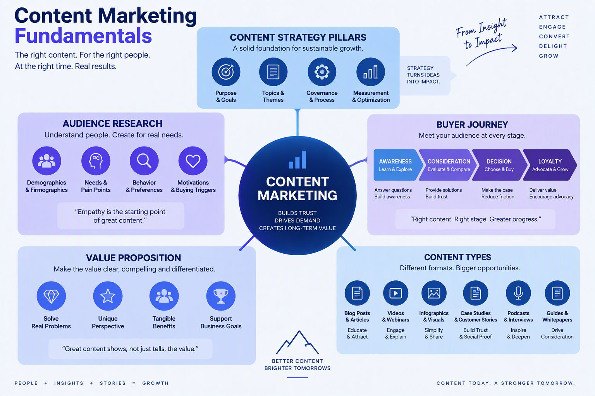
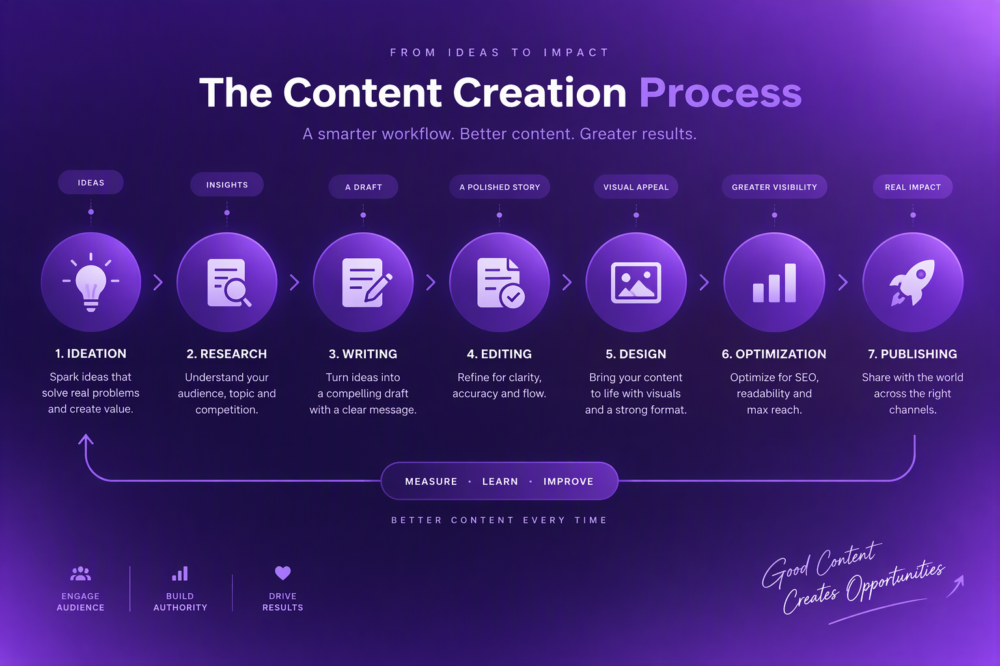
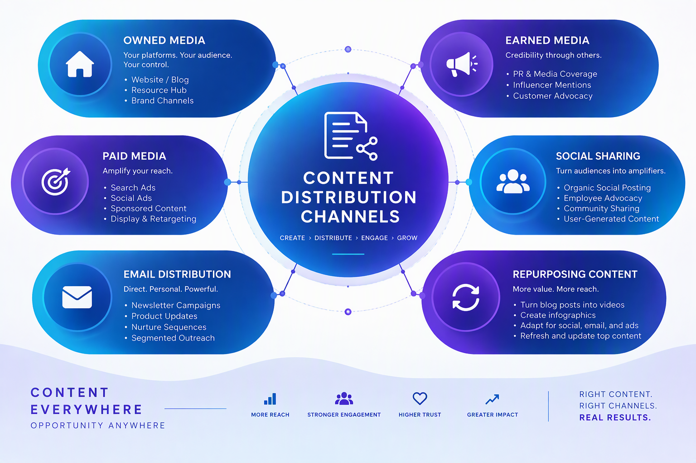

# Panduan Lengkap Content Marketing Strategy untuk UMKM Indonesia

**Strategi Konten Terukur untuk Meningkatkan Brand Awareness, Traffic, dan Penjualan**

**Oleh: Siraj Nur Ihrom, CEO SNISHOP.COM**


---

**Catatan untuk peninjau**: Panduan ini mencakup strategi content marketing lengkap untuk UMKM Indonesia, dari fundamental hingga implementasi, analisis, dan scaling. Dilengkapi 3 studi kasus nyata, ROI calculator, dan rencana implementasi 30 hari.

---

## Daftar Isi

**PART 1: FUNDAMENTAL CONTENT MARKETING**
- Bab 1: Memahami Content Marketing untuk UMKM
- Bab 2: Riset Audience dan Buyer Persona
- Bab 3: Strategi Content Pillars dan Topic Clusters

**PART 2: PRODUKSI DAN OPTIMASI KONTEN**
- Bab 4: Proses Kreasi Konten yang Efisien
- Bab 5: Content SEO dan Optimasi On-Page
- Bab 6: Content Distribution Channels
- Bab 7: Content Marketing Funnel dan Conversion

**PART 3: ANALISIS, PENGUKURAN, DAN SKALING**
- Bab 8: Analytics dan Content Performance
- Bab 9: Content Repurposing dan Scaling
- Bab 10: Studi Kasus dan Rencana Implementasi

**Bonus:**
- ROI Calculator Content Marketing
- 30-Day Implementation Plan
- Content Calendar Template
- Content Brief Template

---

## Pendahuluan: Cara Menggunakan Buku Ini

Buku ini dirancang sebagai panduan praktis bagi pemilik UMKM, marketer, dan content creator di Indonesia yang ingin membangun strategi content marketing yang terukur dan menghasilkan ROI nyata.

**Siapa buku ini untuk:**
- Pemilik UMKM yang ingin memasarkan bisnis melalui konten
- Marketing staff yang bertanggung jawab atas strategi konten
- Content creator yang ingin meningkatkan dampak konten
- Freelancer yang ingin menawarkan jasa content marketing

**Cara menggunakan buku ini:**

**Pendekatan Linear (Pemula)**
Baca dari Bab 1 hingga Bab 10 secara berurutan. Setiap bab membangun fondasi dari bab sebelumnya.

**Pendekatan Topikal (Intermediate)**
Jika Anda sudah memiliki dasar content marketing, langsung ke bab yang relevan:
- Belum punya strategi? Mulai dari Bab 2-3
- Sudah produksi tapi traffic rendah? Baca Bab 5-6
- Traffic tinggi tapi konversi rendah? Fokus Bab 7-8
- Mau scale up? Pelajari Bab 9-10

**Setiap bab mencakup:**
- Teori dan konsep dasar
- Langkah praktis yang bisa langsung diterapkan
- Template yang bisa langsung digunakan
- Contoh nyata dari UMKM Indonesia
- Tips dan best practices

**Hasil yang akan Anda capai setelah membaca buku ini:**
- Memahami fundamental content marketing
- Mampu melakukan riset audience dan membuat buyer persona
- Memiliki strategi content pillars dan topic clusters
- Mampu memproduksi konten secara efisien
- Memahami SEO on-page untuk konten
- Tahu cara mendistribusikan konten di berbagai channel
- Mampu mengukur performa konten dan menghitung ROI
- Memiliki rencana implementasi 30 hari yang konkret

---

# PART 1: FUNDAMENTAL CONTENT MARKETING



---

## Bab 1: Memahami Content Marketing untuk UMKM

Content marketing adalah pendekatan strategis dalam pemasaran yang berfokus pada pembuatan dan distribusi konten yang berharga, relevan, dan konsisten untuk menarik dan mempertahankan audiens yang jelas, serta mendorong tindakan pelanggan yang menguntungkan.

### 1.1 Apa Itu Content Marketing?

Content marketing bukan sekadar membuat konten. Ini adalah strategi jangka panjang yang membangun hubungan dengan audiens melalui konten yang memberikan nilai, bukan sekadar menjual produk.

**Perbedaan Content Marketing vs Traditional Advertising:**

| Aspek | Traditional Advertising | Content Marketing |
|-------|------------------------|-------------------|
| Pendekatan | Interruptive (mengganggu) | Value-first (memberi nilai) |
| Fokus | Produk/brand | Audiens/konsumen |
| Durasi | Short-term (saat iklan tayang) | Long-term (konten evergreen) |
| Biaya | Tinggi (beli space/waktu) | Rendah (investasi waktu/kreativitas) |
| Trust | Rendah (orang skeptis terhadap iklan) | Tinggi (membangun kredibilitas) |
| ROI | Sulit diukur | Terukur (traffic, leads, sales) |
| Engagement | Satu arah | Dua arah (interaksi) |

**Contoh Content Marketing vs Traditional Advertising:**

**Traditional Advertising:**
"Ibeli produk kami! Diskon 50% hari ini!"

**Content Marketing:**
"5 Cara Memilih Sepatu Lari yang Tepat untuk Kaki Anda (Plus Rekomendasi Produk)"

Konten marketing memberikan nilai edukasional terlebih dahulu, baru kemudian memperkenalkan produk sebagai solusi.

### 1.2 Mengapa Content Marketing Penting untuk UMKM?

**1. Budget Terbatas, Dampak Maksimal**
UMKM biasanya memiliki budget marketing terbatas. Content marketing memungkinkan Anda mencapai ribuan calon pelanggan dengan biaya yang jauh lebih rendah dibandingkan iklan berbayar.

**Data:** Content marketing menghasilkan 3x lebih banyak leads dibandingkan outbound marketing, dengan biaya 62% lebih rendah.

**2. Membangun Trust dan Kredibilitas**
Konsumen Indonesia semakin skeptis terhadap iklan tradisional. Mereka mencari informasi, review, dan rekomendasi sebelum membeli. Content marketing memposisikan UMKM sebagai ahli di bidangnya.

**Data:** 70% konsumen Indonesia lebih percaya konten organik dibandingkan iklan berbayar.

**3. SEO dan Organic Traffic**
Konten yang berkualitas akan meningkatkan ranking di Google. Semakin banyak konten relevan yang Anda buat, semakin besar peluang muncul di pencarian organik.

**Data:** Website dengan blog mendapatkan 434% lebih banyak halaman terindeks dibandingkan yang tidak punya blog.

**4. Long-Term Asset**
Konten yang Anda buat hari ini bisa terus menghasilkan traffic dan leads selama bertahun-tahun. Ini adalah investasi jangka panjang yang nilainya terus bertambah.

**Data:** Konten evergreen bisa menghasilkan traffic selama 2-5 tahun setelah dipublikasikan.

**5. Competitive Advantage**
Banyak UMKM Indonesia belum memanfaatkan content marketing. Ini adalah kesempatan untuk mendominasi niche Anda sebelum kompetitor melakukannya.

### 1.3 Jenis-Jenis Content Marketing

**1. Blog Posts dan Artikel**
Konten tertulis yang dipublikasikan di website. Ideal untuk SEO dan edukasi mendalam.

**Contoh:**
- How-to guides (Panduan lengkap)
- Listicles (Daftar tips)
- Case studies (Studi kasus)
- Industry news (Berita industri)

**2. Video Content**
Konten visual dalam format video. Sangat efektif untuk engagement dan brand awareness.

**Contoh:**
- Tutorial videos
- Product demos
- Behind-the-scenes
- Customer testimonials

**3. Social Media Content**
Konten yang dipublikasikan di platform sosial media. Ideal untuk engagement dan community building.

**Contoh:**
- Instagram posts dan stories
- Facebook posts
- TikTok videos
- LinkedIn articles

**4. Email Content**
Konten yang dikirimkan melalui email. Ideal untuk nurturing leads dan retensi pelanggan.

**Contoh:**
- Newsletter
- Welcome series
- Promotional emails
- Educational sequences

**5. Infographic dan Visual Content**
Konten visual yang menyampaikan informasi secara ringkas dan menarik.

**Contoh:**
- Infographics
- Charts dan graphs
- Memes (untuk brand yang casual)
- Quotes

**6. Podcast dan Audio Content**
Konten audio yang bisa dikonsumsi kapan saja. Ideal untuk deep-dive topics.

**Contoh:**
- Educational podcasts
- Interview series
- Industry discussions

### 1.4 Content Marketing Funnel Overview

Content marketing bekerja sepanjang customer journey, dari awareness hingga conversion dan retention.

**TOFU (Top of Funnel) - Awareness**
- Tujuan: Menarik perhatian calon pelanggan
- Jenis konten: Blog posts, social media, infographics
- Metrik: Traffic, reach, impressions

**MOFU (Middle of Funnel) - Consideration**
- Tujuan: Mengedukasi dan membangun trust
- Jenis konten: Ebooks, webinars, case studies
- Metrik: Leads, email signups, engagement

**BOFU (Bottom of Funnel) - Conversion**
- Tujuan: Mendorong keputusan pembelian
- Jenis konten: Product demos, testimonials, free trials
- Metrik: Sales, conversion rate, revenue

**Post-Purchase - Retention**
- Tujuan: Mempertahankan pelanggan dan mendorong repeat purchase
- Jenis konten: Onboarding emails, tutorials, loyalty content
- Metrik: Retention rate, repeat purchase, referrals

### 1.5 Langkah Praktis Memulai Content Marketing untuk UMKM

**Langkah 1: Tentukan Tujuan yang Jelas**
- Apakah untuk brand awareness?
- Apakah untuk lead generation?
- Apakah untuk sales langsung?
- Apakah untuk customer retention?

**Langkah 2: Kenali Target Audience**
- Siapa target pelanggan Anda?
- Apa masalah mereka?
- Di mana mereka mencari informasi?
- Jenis konten apa yang mereka sukai?

**Langkah 3: Audit Konten yang Sudah Ada**
- Konten apa yang sudah Anda buat?
- Mana yang performanya bagus?
- Mana yang perlu diperbaiki?
- Gap konten apa yang ada?

**Langkah 4: Pilih Channel yang Tepat**
- Website/blog (untuk SEO)
- Social media (untuk engagement)
- Email (untuk nurturing)
- YouTube (untuk video content)

**Langkah 5: Buat Content Calendar**
- Berapa sering akan publish?
- Jenis konten apa setiap minggu?
- Siapa yang bertanggung jawab?
- Tools apa yang digunakan?

### 1.6 Template: Content Marketing Audit

Gunakan template ini untuk mengaudit konten yang sudah ada:

```
CONTENT AUDIT TEMPLATE

1. Inventory Konten
- Total konten yang sudah dibuat: ___
- Blog posts: ___
- Social media posts: ___
- Videos: ___
- Emails: ___

2. Performance Analysis
- Konten dengan traffic tertinggi:
  1. [Judul] - [Traffic] - [Engagement]
  2. [Judul] - [Traffic] - [Engagement]
  3. [Judul] - [Traffic] - [Engagement]

- Konten dengan engagement tertinggi:
  1. [Judul] - [Platform] - [Engagement]
  2. [Judul] - [Platform] - [Engagement]
  3. [Judul] - [Platform] - [Engagement]

- Konten dengan konversi tertinggi:
  1. [Judul] - [Leads/Sales]
  2. [Judul] - [Leads/Sales]
  3. [Judul] - [Leads/Sales]

3. Gap Analysis
- Topik yang belum dibahas:
  1. [Topik]
  2. [Topik]
  3. [Topik]

- Format konten yang belum dicoba:
  1. [Format]
  2. [Format]
  3. [Format]

4. Action Plan
- Konten yang perlu di-update:
  1. [Judul] - [Update yang diperlukan]
  2. [Judul] - [Update yang diperlukan]

- Konten baru yang akan dibuat:
  1. [Judul] - [Target publish]
  2. [Judul] - [Target publish]
```

### 1.7 Tips dan Best Practices

**Tips untuk Pemula:**
- Mulai dari satu channel dulu, kuasai sebelum ekspansi
- Fokus pada kualitas, bukan kuantitas
- Konsisten lebih penting daripada sempurna
- Ukur semuanya, ulangi yang berhasil
- Jangan langsung jualan, beri nilai dulu

**Kesalahan yang Harus Dihindari:**
- Membuat konten tanpa strategi yang jelas
- Hanya fokus pada penjualan, tidak memberi nilai
- Tidak konsisten dalam publish
- Tidak mempromosikan konten yang sudah dibuat
- Tidak mengukur dan menganalisis performa

---

## Bab 2: Riset Audience dan Buyer Persona

Content marketing yang efektif dimulai dari pemahaman mendalam tentang siapa target audiens Anda. Tanpa pemahaman ini, konten Anda tidak akan relevan dan tidak akan menghasilkan dampak.


### 2.1 Mengapa Riset Audience Penting?

**Data yang Mendukung:**
- 73% perusahaan dengan traffic dan leads tinggi memiliki dokumentasi buyer persona
- 83% perusahaan yang melebihi target revenue memiliki buyer persona yang terdokumentasi
- Buyer persona yang efektif meningkatkan conversion rate hingga 73%

**Manfaat Riset Audience:**
1. **Konten Lebih Relevan**: Anda tahu persis masalah apa yang dihadapi audiens
2. **Pesan Lebih Efektif**: Bahasa dan tone yang sesuai dengan audiens
3. **Channel yang Tepat**: Anda tahu di mana audiens menghabiskan waktu
4. **ROI Lebih Tinggi**: Fokus pada audiens yang tepat mengurangi pemborosan

### 2.2 Metode Riset Audience

**1. Analisis Data Existing**

**Website Analytics:**
- Demografi visitor (usia, lokasi, gender)
- Perilaku browsing (halaman yang dikunjungi, waktu di site)
- Traffic sources (dari mana mereka datang)
- Device yang digunakan (mobile vs desktop)

**Social Media Analytics:**
- Demografi followers
- Post yang paling banyak engagement
- Waktu aktif followers
- Komentar dan pertanyaan yang sering muncul

**Customer Data:**
- Data penjualan (siapa yang membeli)
- Feedback dan review
- Customer service inquiries
- Repeat purchase patterns

**2. Survei dan Interview**

**Survei Online:**
- Google Forms atau Typeform
- Sebarkan ke email list atau social media
- Tawarkan insentif (diskon, ebook gratis)

**Pertanyaan Kunci untuk Survei:**
- Apa tantangan terbesar Anda dalam [bidang terkait produk Anda]?
- Bagaimana cara Anda mencari solusi untuk masalah tersebut?
- Informasi apa yang Anda butuhkan sebelum membeli [produk/jasa]?
- Di mana Anda biasanya mencari informasi tentang [topik terkait]?
- Apa yang membuat Anda memilih [produk/jasa tertentu]?

**Interview Pelanggan:**
- Pilih 5-10 pelanggan terbaik
- Interview selama 30-45 menit via Zoom atau tatap muka
- Catat insight dan pola yang muncul
- Minta izin untuk menggunakan testimonial

**3. Social Listening**

**Monitor:**
- Grup Facebook terkait industri
- Forum seperti Kaskus atau Reddit
- Komentar di post kompetitor
- Hashtag terkait di Instagram dan TikTok
- Review di Google Maps atau marketplace

**Tools untuk Social Listening:**
- Google Alerts (gratis)
- Mention (berbayar)
- Brand24 (berbayar)
- Hootsuite Insights (berbayar)

**4. Competitor Analysis**

**Analisis Kompetitor:**
- Siapa target audiens mereka?
- Konten apa yang mereka buat?
- Channel apa yang mereka gunakan?
- Apa yang berhasil untuk mereka?
- Gap apa yang bisa Anda isi?

### 2.3 Membuat Buyer Persona

Buyer persona adalah representasi semi-fiktif dari pelanggan ideal Anda berdasarkan data real dan beberapa asumsi teredukasi.

**Template Buyer Persona:**

```
BUYER PERSONA: [Nama Persona]

DEMOGRAFI:
- Nama: [Nama fiktif]
- Usia: [Range usia]
- Gender: [L/P/Both]
- Lokasi: [Kota/Provinsi]
- Pekerjaan: [Jenis pekerjaan]
- Pendapatan: [Range pendapatan per bulan]
- Status: [Single/Married/Kids]

PSIKOGRAFI:
- Nilai-nilai: [Apa yang penting bagi mereka]
- Minat: [Hobi, passion]
- Gaya hidup: [Bagaimana mereka hidup]
- Personality: [Introvert/Extrovert, dll]

TUJUAN DAN TANTANGAN:
- Tujuan utama: [Apa yang ingin dicapai]
- Tujuan sekunder: [Tujuan lain]
- Tantangan #1: [Masalah terbesar]
- Tantangan #2: [Masalah lain]
- Tantangan #3: [Masalah lain]

PERILAKU:
- Sumber informasi: [Dari mana mereka mencari info]
- Social media: [Platform yang digunakan]
- Shopping behavior: [Bagaimana mereka membeli]
- Decision factors: [Apa yang mempengaruhi keputusan]

PAIN POINTS:
- Frustrasi #1: [Apa yang membuat mereka frustrasi]
- Frustrasi #2: [Frustrasi lain]
- Fear: [Apa yang mereka takuti]
- Objection: [Alasan tidak membeli]

MESSAGING:
- Elevator pitch: [Cara menjelaskan produk ke mereka]
- Value proposition: [Nilai utama untuk mereka]
- Key benefits: [Manfaat utama]
- Call to action: [Ajakan yang efektif]
```

**Contoh Buyer Persona untuk Fashion Brand:**

```
BUYER PERSONA: Rina Si Fashionista

DEMOGRAFI:
- Nama: Rina
- Usia: 25-32 tahun
- Gender: Perempuan
- Lokasi: Jakarta, Bandung, Surabaya
- Pekerjaan: Professional muda (marketing, finance, creative)
- Pendapatan: Rp 8-15 juta/bulan
- Status: Single atau baru menikah

PSIKOGRAFI:
- Nilai-nilai: Penampilan profesional, kualitas, sustainable fashion
- Minat: Fashion, travel, cafe hopping, self-development
- Gaya hidup: Urban, aktif di social media, health-conscious
- Personality: Extrovert, trend-conscious, quality-over-quantity

TUJUAN DAN TANTANGAN:
- Tujuan utama: Tampil stylish dan profesional di kantor
- Tujuan sekunder: Membangun personal brand di social media
- Tantangan #1: Sulit menemukan baju kerja yang stylish tapi affordable
- Tantangan #2: Bingung mix-and-match outfit
- Tantangan #3: Khawatir terlihat tidak profesional

PERILAKU:
- Sumber informasi: Instagram, TikTok, fashion blogs, teman
- Social media: Instagram (daily), TikTok (3-4x/minggu), Pinterest (weekly)
- Shopping behavior: Riset online dulu, baca review, bandingkan harga
- Decision factors: Kualitas bahan, desain, harga, review

PAIN POINTS:
- Frustrasi #1: Baju online tidak sesuai foto
- Frustrasi #2: Ukuran tidak konsisten antar brand
- Fear: Terlihat tidak profesional atau ketinggalan tren
- Objection: "Takut tidak cocok", "Mahal untuk kualitas tidak jelas"

MESSAGING:
- Elevator pitch: "Baju kerja stylish yang bikin kamu percaya diri di kantor, dengan kualitas premium dan harga terjangkau"
- Value proposition: "Tampil profesional tanpa mengorbankan gaya"
- Key benefits: Bahan berkualitas, desain trendy, size inclusive
- Call to action: "Lihat koleksi terbaru dan dapatkan styling guide gratis"
```

### 2.4 Customer Journey Mapping

Customer journey adalah proses yang dilalui pelanggan dari pertama kali mengenal brand hingga melakukan pembelian dan menjadi loyal customer.

**Tahapan Customer Journey:**

**1. Awareness (Kesadaran)**
- Pelanggan menyadari mereka punya masalah
- Mereka mulai mencari informasi
- Touchpoints: Social media, Google search, rekomendasi teman

**2. Consideration (Pertimbangan)**
- Pelanggan mengevaluasi berbagai solusi
- Mereka membandingkan opsi
- Touchpoints: Blog posts, review, comparison articles

**3. Decision (Keputusan)**
- Pelanggan siap membeli
- Mereka mencari alasan untuk memilih
- Touchpoints: Product pages, testimonials, free trials

**4. Retention (Retensi)**
- Pelanggan sudah membeli
- Mereka membutuhkan dukungan dan nilai lanjutan
- Touchpoints: Onboarding emails, tutorials, customer support

**5. Advocacy (Advokasi)**
- Pelanggan puas dan merekomendasikan
- Mereka menjadi brand advocate
- Touchpoints: Referral programs, community, exclusive content

**Template Customer Journey Map:**

```
CUSTOMER JOURNEY MAP: [Nama Brand]

TAHAP 1: AWARENESS
- Kondisi pelanggan: Menyadari masalah
- Pertanyaan: "Bagaimana cara mengatasi [masalah]?"
- Touchpoints: Instagram ads, Google search, TikTok
- Konten yang dibutuhkan: Educational content, tips, how-to
- Emosi: Frustrasi, penasaran
- Goal: Mendapatkan perhatian

TAHAP 2: CONSIDERATION
- Kondisi pelanggan: Mengevaluasi solusi
- Pertanyaan: "Solusi mana yang terbaik untuk saya?"
- Touchpoints: Blog, YouTube, email newsletter
- Konten yang dibutuhkan: Comparison, case studies, webinars
- Emosi: Ragu, berharap
- Goal: Membangun trust

TAHAP 3: DECISION
- Kondisi pelanggan: Siap membeli
- Pertanyaan: "Mengapa harus memilih brand ini?"
- Touchpoints: Website, testimonials, promo
- Konten yang dibutuhkan: Product demos, testimonials, guarantees
- Emosi: Antusias, sedikit ragu
- Goal: Mendorong konversi

TAHAP 4: RETENTION
- Kondisi pelanggan: Sudah membeli
- Pertanyaan: "Apakah saya membuat keputusan yang tepat?"
- Touchpoints: Email, customer support, community
- Konten yang dibutuhkan: Onboarding, tutorials, tips lanjutan
- Emosi: Puas atau kecewa
- Goal: Meningkatkan satisfaction

TAHAP 5: ADVOCACY
- Kondisi pelanggan: Loyal dan puas
- Pertanyaan: "Bagaimana cara saya bisa berkontribusi?"
- Touchpoints: Social media, referral program, events
- Konten yang dibutuhkan: User-generated content, community
- Emosi: Bangga, loyal
- Goal: Mendorong referral
```

### 2.5 Langkah Praktis Riset Audience

**Langkah 1: Kumpulkan Data (Minggu 1)**
- Analisis data website dan social media
- Survei pelanggan existing
- Interview 5-10 pelanggan
- Monitor social media dan forum

**Langkah 2: Identifikasi Pola (Minggu 2)**
- Cari pola demografi
- Identifikasi pain points umum
- Catat pertanyaan yang sering muncul
- Tentukan channel favorit

**Langkah 3: Buat Buyer Persona (Minggu 2)**
- Buat 2-3 buyer persona
- Gunakan template yang disediakan
- Validasi dengan data real
- Share dengan tim

**Langkah 4: Map Customer Journey (Minggu 3)**
- Identifikasi touchpoints
- Tentukan konten di setiap tahap
- Buat content matrix
- Prioritaskan berdasarkan impact

**Langkah 5: Validasi dan Iterate (Minggu 4)**
- Test persona dengan konten
- Ukur engagement dan feedback
- Refine berdasarkan data
- Update secara berkala

### 2.6 Tools untuk Riset Audience

**Gratis:**
- Google Analytics (website analytics)
- Facebook Audience Insights (demografi)
- Instagram Insights (follower analytics)
- Google Trends (trending topics)
- AnswerThePublic (pertanyaan audiens)

**Berbayar:**
- SEMrush (competitor analysis)
- Ahrefs (keyword research)
- SurveyMonkey (survei online)
- Hotjar (user behavior)
- Sprout Social (social listening)

### 2.7 Tips dan Best Practices

**Tips Riset Audience:**
- Jangan berasumsi, gunakan data
- Update persona setiap 6 bulan
- Talk to your customers secara rutin
- Look for patterns, bukan outlier
- Fokus pada pain points, bukan fitur

**Kesalahan yang Harus Dihindari:**
- Membuat persona berdasarkan asumsi saja
- Hanya fokus pada demografi, abaikan psikografi
- Tidak memvalidasi persona dengan data real
- Membuat terlalu banyak persona (fokus 2-3 saja)
- Tidak mengupdate persona secara berkala

---

## Bab 3: Strategi Content Pillars dan Topic Clusters

Content pillars dan topic clusters adalah framework untuk mengorganisir konten Anda secara strategis. Framework ini membantu Anda membangun authority di niche tertentu dan meningkatkan SEO secara signifikan.


### 3.1 Apa Itu Content Pillars?

Content pillars adalah 3-5 topik utama yang menjadi fondasi strategi konten Anda. Setiap pillar mewakili area utama yang relevan dengan brand dan audiens Anda.

**Karakteristik Content Pillars yang Efektif:**
- **Broad enough**: Cukup luas untuk menghasilkan banyak konten
- **Relevant**: Relevan dengan bisnis dan audiens
- **Searchable**: Ada demand pencarian di Google
- **Differentiating**: Membedakan Anda dari kompetitor
- **Sustainable**: Bisa dipertahankan dalam jangka panjang

**Contoh Content Pillars untuk Berbagai Bisnis:**

**Fashion Brand:**
1. Styling tips dan outfit ideas
2. Fashion trends dan inspirasi
3. Sustainable fashion
4. Behind-the-scenes dan brand story
5. Customer stories dan testimonials

**F&B Business:**
1. Resep dan cooking tips
2. Ingredient spotlight
3. Behind-the-scenes dapur
4. Food photography tips
5. Nutrisi dan healthy eating

**Digital Marketing Agency:**
1. Digital marketing strategy
2. Social media marketing
3. SEO dan content marketing
4. Paid advertising
5. Analytics dan measurement

**Fitness Studio:**
1. Workout routines
2. Nutrition tips
3. Motivation dan mindset
4. Success stories
5. Health dan wellness

### 3.2 Apa Itu Topic Clusters?

Topic clusters adalah kelompok konten yang terkait dengan satu pillar topic. Setiap cluster terdiri dari satu pillar page (konten komprehensif) dan beberapa cluster content (konten spesifik).

**Struktur Topic Cluster:**

**Pillar Page:**
- Konten komprehensif (3,000-5,000 kata)
- Mencakup topik secara menyeluruh
- Target keyword utama
- Internal link ke semua cluster content

**Cluster Content:**
- Konten spesifik (1,000-2,000 kata)
- Fokus pada subtopik tertentu
- Target long-tail keywords
- Internal link ke pillar page dan cluster lain

**Contoh Topic Cluster untuk Fashion Brand:**

**Pillar: Panduan Lengkap Styling untuk Wanita Karir**

**Cluster Content:**
1. 10 Outfit Kantor yang Stylish dan Profesional
2. Cara Mix-and-Match Blazer untuk Berbagai Occasion
3. Tips Memilih Sepatu Hak Nyaman untuk Seharian
4. Aksesori Wajib untuk Tampil Profesional
5. Outfit Ideas untuk Meeting Penting
6. Cara Transition Outfit dari Kantor ke Event Malam
7. Budget-Friendly Outfit Ideas untuk Fresh Graduate
8. Warna-Netral yang Selalu Terlihat Chic
9. Cara Merawat Pakaian Kerja agar Tahan Lama
10. Outfit Ideas untuk WFH yang Tetap Profesional

**Internal Linking Structure:**
- Pillar page link ke semua cluster content
- Setiap cluster content link ke pillar page
- Cluster content link ke cluster lain yang relevan

### 3.3 Manfaat Content Pillars dan Topic Clusters

**1. SEO yang Lebih Kuat**
- Google memahami bahwa Anda adalah authority di topik tersebut
- Internal linking yang kuat meningkatkan ranking
- Target keyword utama dan long-tail secara bersamaan

**Data:** Website dengan topic cluster mendapatkan 5-10x lebih banyak traffic dibandingkan yang tidak.

**2. User Experience yang Lebih Baik**
- Audiens mudah menemukan konten terkait
- Journey yang jelas dari topik umum ke spesifik
- Meningkatkan time on site

**3. Content Production yang Lebih Efisien**
- Framework yang jelas untuk ide konten
- Tidak bingung mau buat konten apa
- Bisa batch create konten per cluster

**4. Authority Building**
- Membangun reputasi sebagai ahli di niche
- Trust dari audiens meningkat
- Differentiation dari kompetitor

### 3.4 Cara Membangun Content Pillars

**Langkah 1: Identifikasi Topik Utama**

**Brainstorming:**
- Apa expertise utama brand Anda?
- Apa yang dicari audiens Anda?
- Apa yang bisa Anda tawarkan yang unik?
- Apa topik yang sustainable untuk jangka panjang?

**Riset Keyword:**
- Gunakan Google Keyword Planner
- Cek Google Trends
- Analisis kompetitor
- Lihat pertanyaan di forum dan social media

**Kriteria Pemilihan Pillar:**
- Relevan dengan bisnis
- Ada search demand
- Bisa menghasilkan 10+ konten
- Tidak terlalu kompetitif
- Sustainable untuk 1-2 tahun

**Langkah 2: Validasi dengan Data**

**Cek Search Volume:**
- Gunakan Ubersuggest atau Ahrefs
- Pastikan ada volume pencarian yang cukup
- Cek trend dalam 12 bulan terakhir

**Cek Kompetisi:**
- Siapa yang sudah ranking untuk keyword ini?
- Seberapa kuat kompetitor?
- Bisa kah Anda bersaing?

**Cek Audience Interest:**
- Apakah audiens Anda tertarik?
- Apakah ada engagement di topik ini?
- Apakah ini menyelesaikan masalah mereka?

**Langkah 3: Buat Pillar Pages**

**Struktur Pillar Page:**
- Judul yang jelas dan menarik
- Pendahuluan yang menjelaskan cakupan
- Table of contents untuk navigasi
- 7-10 section utama
- Internal link ke cluster content
- CTA yang jelas
- Conclusion dan next steps

**Panjang Pillar Page:**
- Minimum 3,000 kata
- Ideal 4,000-5,000 kata
- Komprehensif tapi tidak bertele-tele
- Setiap section 300-500 kata

**Langkah 4: Buat Cluster Content**

**Prioritas Cluster Content:**
- Keyword dengan search volume tinggi
- Pertanyaan yang sering ditanyakan
- Topik yang melengkapi pillar
- Konten yang bisa saling link

**Format Cluster Content:**
- How-to guides
- Listicles
- Case studies
- Comparison posts
- Tips dan tricks

**Langkah 5: Internal Linking Strategy**

**Aturan Internal Linking:**
- Pillar page link ke semua cluster content
- Setiap cluster content link ke pillar page
- Cluster content link ke cluster lain yang relevan
- Gunakan anchor text yang deskriptif
- Jangan over-optimize (variasi anchor text)

### 3.5 Template Content Pillars Planning

```
CONTENT PILLARS PLANNING TEMPLATE

Brand: [Nama Brand]
Target Audience: [Target audience]
Business Goals: [Tujuan bisnis]

PILLAR 1: [Nama Pillar]
- Deskripsi: [Deskripsi singkat]
- Target keyword utama: [Keyword]
- Search volume: [Volume]
- Kompetisi: [Rendah/Sedang/Tinggi]
- Jumlah cluster content: [Jumlah]

Cluster Content Ideas:
1. [Judul] - [Keyword] - [Search volume]
2. [Judul] - [Keyword] - [Search volume]
3. [Judul] - [Keyword] - [Search volume]
4. [Judul] - [Keyword] - [Search volume]
5. [Judul] - [Keyword] - [Search volume]

PILLAR 2: [Nama Pillar]
- Deskripsi: [Deskripsi singkat]
- Target keyword utama: [Keyword]
- Search volume: [Volume]
- Kompetisi: [Rendah/Sedang/Tinggi]
- Jumlah cluster content: [Jumlah]

Cluster Content Ideas:
1. [Judul] - [Keyword] - [Search volume]
2. [Judul] - [Keyword] - [Search volume]
3. [Judul] - [Keyword] - [Search volume]
4. [Judul] - [Keyword] - [Search volume]
5. [Judul] - [Keyword] - [Search volume]

PILLAR 3: [Nama Pillar]
- Deskripsi: [Deskripsi singkat]
- Target keyword utama: [Keyword]
- Search volume: [Volume]
- Kompetisi: [Rendah/Sedang/Tinggi]
- Jumlah cluster content: [Jumlah]

Cluster Content Ideas:
1. [Judul] - [Keyword] - [Search volume]
2. [Judul] - [Keyword] - [Search volume]
3. [Judul] - [Keyword] - [Search volume]
4. [Judul] - [Keyword] - [Search volume]
5. [Judul] - [Keyword] - [Search volume]

CONTENT CALENDAR (3 Bulan Pertama):

Bulan 1:
- Pillar page 1: [Target publish]
- Cluster content: [3-5 artikel]
- Social media: [Promosi plan]

Bulan 2:
- Pillar page 2: [Target publish]
- Cluster content: [3-5 artikel]
- Social media: [Promosi plan]

Bulan 3:
- Pillar page 3: [Target publish]
- Cluster content: [3-5 artikel]
- Social media: [Promosi plan]
```

### 3.6 Contoh Implementasi: Fashion Brand

**Brand:** Local fashion brand untuk wanita karir
**Target Audience:** Wanita 25-35 tahun, professional, urban
**Business Goal:** Meningkatkan brand awareness dan sales 50% dalam 6 bulan

**Content Pillars:**

**Pillar 1: Styling Tips untuk Wanita Karir**
- Pillar page: "Panduan Lengkap Styling untuk Wanita Karir Indonesia"
- Cluster content: 10 artikel tentang outfit ideas, mix-and-match, dll
- Target keyword: "outfit kantor", "baju kerja wanita", "styling tips"

**Pillar 2: Sustainable Fashion**
- Pillar page: "Panduan Lengkap Sustainable Fashion di Indonesia"
- Cluster content: 8 artikel tentang bahan eco-friendly, tips belanja, dll
- Target keyword: "sustainable fashion Indonesia", "eco-friendly clothing"

**Pillar 3: Behind the Brand**
- Pillar page: "Cerita di Balik [Brand Name]: Fashion dengan Purpose"
- Cluster content: 6 artikel tentang brand story, proses produksi, tim, dll
- Target keyword: "local fashion brand", "Indonesian fashion"

**Hasil yang Dicapai (6 Bulan):**
- Organic traffic: +320%
- Email subscribers: +450%
- Sales dari content: Rp 67 juta/bulan
- Social media followers: +180%

### 3.7 Tips dan Best Practices

**Tips Content Pillars:**
- Mulai dengan 3 pillar, maksimal 5
- Fokus pada kualitas, bukan kuantitas
- Update pillar page secara berkala
- Gunakan data untuk prioritas
- Integrasikan dengan SEO strategy

**Kesalahan yang Harus Dihindari:**
- Terlalu banyak pillar (fokus hilang)
- Pillar yang terlalu sempit
- Tidak ada internal linking
- Tidak update konten lama
- Tidak track performance

---

# PART 2: PRODUKSI DAN OPTIMASI KONTEN



---

## Bab 4: Proses Kreasi Konten yang Efisien

Produksi konten yang efisien adalah kunci konsistensi dalam content marketing. Tanpa proses yang jelas, Anda akan kehabisan ide, waktu, dan energi.

### 4.1 Content Production Workflow

**Tahapan Content Production:**

**1. Ideation (Ideation)**
- Brainstorming ide konten
- Riset keyword dan topik
- Analisis kompetitor
- Kumpulkan inspirasi

**2. Planning (Perencanaan)**
- Buat content brief
- Tentukan format dan angle
- Assign ke writer/creator
- Set deadline

**3. Creation (Pembuatan)**
- Riset mendalam
- Writing/desain/produksi
- Internal review
- Revisi

**4. Optimization (Optimasi)**
- SEO optimization
- Editing dan proofreading
- Visual optimization
- Final review

**5. Publication (Publikasi)**
- Upload ke platform
- Scheduling
- Internal notification
- Quality check

**6. Promotion (Promosi)**
- Social media promotion
- Email newsletter
- Community sharing
- Paid promotion (opsional)

**7. Analysis (Analisis)**
- Track performance
- Analyze metrics
- Gather feedback
- Document learnings

### 4.2 Content Brief Template

Content brief adalah dokumen yang memberikan panduan jelas kepada writer/creator tentang apa yang harus dibuat.

```
CONTENT BRIEF TEMPLATE

Judul Proyek: [Judul konten]
Target Publish: [Tanggal]
Word Count: [Target kata]
Format: [Blog post/Video/Infographic/dll]
Pillar: [Pillar mana]
Cluster: [Cluster mana]

1. TUJUAN KONTEN
- Primary goal: [Awareness/Consideration/Conversion]
- Secondary goal: [Goal tambahan]
- CTA: [Call to action yang diinginkan]

2. TARGET AUDIENCE
- Persona: [Persona mana]
- Pain point: [Masalah yang diselesaikan]
- Knowledge level: [Pemula/Menengah/Expert]
- Intent: [Informational/Transactional/Navigational]

3. KEYWORD DAN SEO
- Primary keyword: [Keyword utama]
- Secondary keywords: [Keyword pendukung]
- Related keywords: [Keyword terkait]
- Search intent: [Informational/Commercial/Transactional]
- Competitor URLs: [URL kompetitor]

4. STRUKTUR KONTEN
Outline:
I. Pendahuluan
   - Hook
   - Context
   - What they'll learn

II. [Section 1]
   - Key points
   - Supporting data
   - Examples

III. [Section 2]
   - Key points
   - Supporting data
   - Examples

IV. [Section 3]
   - Key points
   - Supporting data
   - Examples

V. Kesimpulan
   - Summary
   - Key takeaways
   - CTA

5. TONE DAN STYLE
- Tone: [Professional/Casual/Friendly/Authoritative]
- Voice: [Brand voice guidelines]
- Reading level: [Grade level]
- Do's: [Yang harus dilakukan]
- Don'ts: [Yang harus dihindari]

6. VISUAL DAN MEDIA
- Featured image: [Deskripsi]
- In-content images: [Jumlah dan jenis]
- Videos: [Jika ada]
- Infographics: [Jika ada]
- Screenshots: [Jika ada]

7. INTERNAL LINKING
- Link ke pillar page: [URL]
- Link ke cluster lain: [URLs]
- Link ke produk: [URLs]

8. EXTERNAL SOURCES
- Sumber data: [Links]
- Expert quotes: [Jika ada]
- Research papers: [Jika ada]

9. CHECKLIST
- [ ] SEO optimized
- [ ] Grammar checked
- [ ] Internal links added
- [ ] External links added
- [ ] Images optimized
- [ ] CTA included
- [ ] Meta description written
- [ ] Social media copy prepared
```

### 4.3 Teknik Writing yang Efektif

**1. Hook yang Kuat**

Hook adalah kalimat pertama yang menarik perhatian pembaca. Anda punya 3-5 detik untuk membuat pembaca tertarik.

**Jenis Hook:**
- **Statistic**: "73% marketer tidak menyadari bahwa konten mereka tidak menghasilkan ROI."
- **Question**: "Pernahkah Anda bertanya-tanya mengapa konten Anda tidak menghasilkan sales?"
- **Story**: "Tiga tahun lalu, saya hampir menyerah pada content marketing."
- **Bold statement**: "Content marketing tanpa strategi adalah buang-buang waktu."
- **Problem**: "Anda sudah membuat konten setiap hari, tapi traffic tidak naik-naik."

**2. Struktur yang Jelas**

**Formula AIDA:**
- **Attention**: Hook yang menarik perhatian
- **Interest**: Bangun interest dengan data dan insight
- **Desire**: Tunjukkan manfaat dan value
- **Action**: CTA yang jelas

**Formula PAS:**
- **Problem**: Identifikasi masalah
- **Agitate**: Perbesar masalah (buat mereka merasa perlu solusi)
- **Solution**: Tawarkan solusi

**3. Paragraph yang Readable**

**Aturan:**
- Maksimal 3-4 kalimat per paragraf
- Gunakan subheading setiap 300 kata
- Bullet points untuk list
- Short sentences untuk emphasis
- White space untuk readability

**4. Storytelling**

**Elemen Story:**
- Character (siapa)
- Conflict (masalah apa)
- Resolution (bagaimana menyelesaikan)
- Lesson (apa yang dipelajari)

**Contoh Storytelling:**
"Rina, pemilik online shop fashion, sudah 6 bulan membuat konten Instagram setiap hari. Followers-nya bertambah dari 500 ke 2,000, tapi sales tidak naik. Setelah kami audit, ternyata kontennya hanya produk foto tanpa value. Kami ubah strateginya menjadi 70% educational content dan 30% promotional. Dalam 3 bulan, sales-nya naik 240%."

### 4.4 Batch Content Creation

Batch creation adalah teknik membuat beberapa konten sekaligus dalam satu sesi kerja. Ini lebih efisien daripada membuat satu per satu.

**Manfaat Batch Creation:**
- Mengurangi context switching
- Meningkatkan flow dan kreativitas
- Lebih efisien (setup sekali, produksi banyak)
- Konsisten dalam quality dan tone

**Cara Batch Creation:**

**Minggu 1: Planning dan Research**
- Brainstorm 12-16 ide konten
- Riset keyword untuk semua ide
- Buat content brief untuk semua
- Prioritaskan berdasarkan impact

**Minggu 2: Writing**
- Batch writing 4-6 artikel
- Satu sesi writing = 1 artikel
- Target 2-3 artikel per hari
- Edit semua di akhir

**Minggu 3: Visual dan Optimization**
- Buat semua visual sekaligus
- SEO optimization semua artikel
- Internal linking
- Final review

**Minggu 4: Scheduling dan Promotion**
- Upload dan schedule semua
- Siapkan social media copy
- Schedule promotion
- Monitor dan analyze

### 4.5 Tools untuk Content Creation

**Writing dan Editing:**
- Google Docs (kolaborasi)
- Grammarly (grammar check)
- Hemingway App (readability)
- Quillbot (paraphrasing)

**Keyword Research:**
- Google Keyword Planner (gratis)
- Ubersuggest (freemium)
- Ahrefs (berbayar)
- SEMrush (berbayar)

**Visual Creation:**
- Canva (desain grafis)
- Unsplash (stock photos)
- Pexels (stock photos dan videos)
- Remove.bg (background removal)

**Project Management:**
- Trello (kanban board)
- Notion (all-in-one workspace)
- Asana (project management)
- Google Sheets (content calendar)

### 4.6 Overcoming Writer's Block

**Penyebab Writer's Block:**
- Tidak ada ide
- Takut tidak sempurna
- Tidak tahu mulai dari mana
- Lelah atau burnout
- Tidak ada deadline

**Solusi:**
- **Consumption**: Baca buku, dengar podcast, tonton video
- **Brainstorming**: Mind mapping, free writing
- **Change environment**: Kerja di cafe, taman, atau co-working space
- **Talk to someone**: Diskusi dengan teman atau kolega
- **Start small**: Tulis satu paragraf, lalu kembangkan
- **Use templates**: Gunakan template yang sudah ada
- **Set deadline**: Deadline memaksa Anda untuk mulai

### 4.7 Tips dan Best Practices

**Tips Kreasi Konten:**
- Buat content brief untuk setiap konten
- Batch creation untuk efisiensi
- Focus on value, bukan word count
- Edit ruthlessly (buang yang tidak perlu)
- Get feedback sebelum publish

**Kesalahan yang Harus Dihindari:**
- Publish tanpa editing
- Copy-paste konten orang lain
- Terlalu panjang dan bertele-tele
- Tidak ada CTA yang jelas
- Tidak optimize untuk SEO

---

## Bab 5: Content SEO dan Optimasi On-Page


SEO (Search Engine Optimization) adalah proses mengoptimasi konten agar ranking tinggi di search engine. Content SEO memastikan konten Anda ditemukan oleh orang yang tepat pada waktu yang tepat.

### 5.1 Mengapa Content SEO Penting?

**Data yang Mendukung:**
- 53% traffic website berasal dari organic search
- 75% pengguna tidak scroll melewati halaman pertama
- 70-80% pengguna mengabaikan iklan berbayar
- Content marketing dengan SEO menghasilkan 5.4x lebih banyak traffic

**Manfaat Content SEO:**
1. **Organic Traffic**: Traffic gratis yang berkelanjutan
2. **High-Intent Audience**: Orang yang mencari sudah punya intent
3. **Credibility**: Ranking tinggi = trust tinggi
4. **Cost-Effective**: Tidak perlu bayar per klik
5. **Long-Term Asset**: Konten terus menghasilkan traffic

### 5.2 Keyword Research untuk Content

**Jenis Keyword:**

**1. Short-Tail Keywords**
- 1-2 kata
- Search volume tinggi
- Kompetisi tinggi
- Contoh: "sepatu", "baju wanita"

**2. Long-Tail Keywords**
- 3-5 kata
- Search volume rendah-sedang
- Kompetisi rendah
- Conversion rate tinggi
- Contoh: "sepatu lari wanita murah", "baju kerja wanita muslim"

**3. LSI Keywords (Latent Semantic Indexing)**
- Keyword yang terkait secara semantik
- Membantu Google memahami konteks
- Contoh: "content marketing" -> "strategi konten", "pemasaran konten"

**Proses Keyword Research:**

**Langkah 1: Brainstorm Seed Keywords**
- Topik utama bisnis Anda
- Produk/jasa yang ditawarkan
- Masalah yang diselesaikan
- Pertanyaan yang sering ditanyakan

**Langkah 2: Expand dengan Tools**
- Google Keyword Planner
- Ubersuggest
- AnswerThePublic
- Google Autocomplete
- People Also Ask

**Langkah 3: Analisis dan Seleksi**
- Search volume (cari yang 100-1,000/bulan untuk UMKM)
- Keyword difficulty (cari yang rendah-sedang)
- Search intent (informational, commercial, transactional)
- Relevansi dengan bisnis

**Langkah 4: Organize dan Prioritize**
- Kelompokkan berdasarkan topik
- Prioritaskan berdasarkan impact
- Map ke content pillars
- Buat content plan

### 5.3 On-Page SEO Optimization

**1. Title Tag**

**Best Practices:**
- 50-60 karakter
- Include primary keyword
- Di awal judul (jika memungkinkan)
- Menarik dan clickable
- Unique untuk setiap halaman

**Formula:**
- [Primary Keyword] + [Benefit] + [Modifier]
- [Number] + [Adjective] + [Primary Keyword] + [Promise]

**Contoh:**
- "Content Marketing Strategy: Panduan Lengkap untuk UMKM Indonesia"
- "10 Tips Content Marketing yang Terbukti Meningkatkan Sales 300%"

**2. Meta Description**

**Best Practices:**
- 150-160 karakter
- Include primary dan secondary keywords
- Clear dan compelling
- Include CTA
- Unique untuk setiap halaman

**Formula:**
- [Problem] + [Solution] + [Benefit] + [CTA]

**Contoh:**
- "Pelajari strategi content marketing lengkap untuk UMKM Indonesia. Dari riset audience hingga ROI calculator. Tingkatkan traffic dan sales Anda sekarang. Baca selengkapnya!"

**3. Header Tags (H1, H2, H3)**

**Best Practices:**
- H1: Satu per halaman, include primary keyword
- H2: Section utama, include secondary keywords
- H3: Subsection, include related keywords
- Hierarchical structure (H1 > H2 > H3)
- Descriptive dan clear

**4. URL Structure**

**Best Practices:**
- Short dan descriptive
- Include primary keyword
- Gunakan hyphen (-) bukan underscore (_)
- Avoid special characters
- Lowercase semua

**Contoh:**
- Baik: `/content-marketing-strategy-umkm`
- Buruk: `/Content_Marketing_Strategy?id=123`

**5. Image Optimization**

**Best Practices:**
- File name descriptive: `content-marketing-strategy.png`
- Alt text: Include keyword, descriptive
- File size: Compress untuk speed
- Format: WebP atau PNG
- Dimensions: Sesuai dengan placement

**6. Internal Linking**

**Best Practices:**
- Link ke pillar page
- Link ke cluster content lain
- Link ke produk/jasa
- Gunakan anchor text yang deskriptif
- 3-5 internal links per artikel

**7. Content Quality**

**Best Practices:**
- Comprehensive (cover topic thoroughly)
- Original (unique perspective)
- Valuable (solve problem)
- Readable (short paragraphs, bullet points)
- Updated (current information)

### 5.4 Content Optimization Checklist

```
ON-PAGE SEO CHECKLIST

KONTEN:
- [ ] Primary keyword di H1
- [ ] Primary keyword di paragraf pertama
- [ ] Primary keyword 1-2% density
- [ ] Secondary keywords tersebar natural
- [ ] LSI keywords included
- [ ] Content length sesuai intent (1,000-3,000 kata)
- [ ] Comprehensive dan valuable
- [ ] Original dan unique

TECHNICAL:
- [ ] Title tag optimized (50-60 karakter)
- [ ] Meta description optimized (150-160 karakter)
- [ ] URL short dan descriptive
- [ ] H1, H2, H3 hierarchical
- [ ] Images optimized (file name, alt text, size)
- [ ] Internal links (3-5 per artikel)
- [ ] External links ke sumber kredibel
- [ ] Mobile-friendly
- [ ] Page speed < 3 detik

USER EXPERIENCE:
- [ ] Hook yang kuat di awal
- [ ] Subheading setiap 300 kata
- [ ] Short paragraphs (2-3 kalimat)
- [ ] Bullet points untuk list
- [ ] Visual yang relevan
- [ ] CTA yang jelas
- [ ] Readable (grade 6-8)
- [ ] No grammar errors
```

### 5.5 Advanced Content SEO Techniques

**1. Featured Snippet Optimization**

Featured snippet adalah kotak jawaban yang muncul di posisi 0 Google.

**Cara Optimize:**
- Jawab pertanyaan langsung di awal paragraf
- Gunakan format list untuk how-to
- Gunakan table untuk comparison
- Target question keywords (what, how, why)
- 40-60 kata untuk paragraph snippets

**2. People Also Ask Optimization**

People Also Ask (PAA) adalah kotak pertanyaan terkait di Google.

**Cara Optimize:**
- Include pertanyaan di H2 atau H3
- Jawab langsung di paragraf berikutnya
- Gunakan format FAQ
- Target related questions

**3. Content Freshness**

Google menyukai konten yang up-to-date.

**Cara Maintain Freshness:**
- Update konten setiap 6-12 bulan
- Add new information dan data
- Update tanggal publish
- Refresh examples dan case studies
- Add new sections jika perlu

### 5.6 Tips dan Best Practices

**Tips Content SEO:**
- Fokus pada user intent, bukan hanya keyword
- Quality over quantity
- Long-tail keywords untuk UMKM
- Update konten lama secara berkala
- Monitor dan analyze performance

**Kesalahan yang Harus Dihindari:**
- Keyword stuffing
- Duplicate content
- Thin content (tidak comprehensive)
- Ignoring mobile optimization
- Not tracking performance

---

## Bab 6: Content Distribution Channels



Membuat konten hebat hanyalah setengah dari pekerjaan. Setengah lainnya adalah mendistribusikannya ke audiens yang tepat. Tanpa distribusi yang efektif, konten terbaik pun tidak akan dibaca.

### 6.1 Mengapa Distribution Penting?

**Data yang Mendukung:**
- 60% marketer hanya mempromosikan konten di social media
- Rata-rata konten hanya mendapatkan 8% traffic dari social media
- Email marketing menghasilkan ROI $42 untuk setiap $1 yang diinvestasikan
- Content distribution meningkatkan traffic hingga 300%

**Prinsip Distribusi:**
- **Create Once, Distribute Everywhere**: Satu konten, banyak format dan channel
- **80/20 Rule**: 80% distribusi, 20% kreasi
- **Right Channel, Right Audience**: Sesuaikan channel dengan audiens
- **Consistency**: Distribusi yang konsisten, bukan sekali saja

### 6.2 Owned Channels

Owned channels adalah platform yang Anda kontrol sepenuhnya.

**1. Website/Blog**

**Keuntungan:**
- Full control atas konten
- SEO benefits
- Long-term asset
- Professional credibility

**Best Practices:**
- Publish 2-4 artikel per bulan
- Optimize untuk SEO
- Clear navigation
- Mobile-friendly
- Fast loading speed

**2. Email Newsletter**

**Keuntungan:**
- Direct access ke audiens
- High engagement rate
- Personalization
- Measurable results

**Best Practices:**
- Build email list dengan lead magnet
- Send 1-4x per bulan
- Segment berdasarkan interest
- Personalize subject line
- Include clear CTA

**3. Social Media Profiles**

**Keuntungan:**
- Large audience potential
- Engagement dan interaction
- Brand building
- Traffic generation

**Best Practices:**
- Pilih platform yang sesuai dengan audiens
- Konsisten dalam posting
- Engage dengan followers
- Mix konten (educational, entertaining, promotional)
- Use hashtags strategically

### 6.3 Earned Channels

Earned channels adalah eksposur yang Anda dapatkan dari orang lain.

**1. Guest Posting**

**Manfaat:**
- Backlink untuk SEO
- Exposure ke audiens baru
- Authority building
- Networking

**Cara Mendapatkan Guest Post:**
- Identifikasi blog yang relevan
- Pitch ide yang unique
- Tulis konten berkualitas tinggi
- Include bio dan link ke website
- Build relationship dengan editor

**2. PR dan Media Coverage**

**Manfaat:**
- Credibility boost
- Large audience reach
- Brand awareness
- Backlink dari situs authoritative

**Cara Mendapatkan PR:**
- Buat press release yang newsworthy
- Build relationship dengan jurnalis
- Offer expert commentary
- Create data-driven reports
- Pitch story angles yang unique

**3. Influencer Collaborations**

**Manfaat:**
- Access ke audience yang sudah ada
- Social proof
- Content amplification
- Brand awareness

**Cara Collaborate:**
- Identifikasi influencer yang relevan
- Build relationship dulu
- Offer value (bukan hanya minta favor)
- Co-create content
- Track results

### 6.4 Paid Channels

Paid channels adalah platform berbayar untuk mempromosikan konten.

**1. Social Media Ads**

**Platform:**
- Facebook/Instagram Ads
- TikTok Ads
- LinkedIn Ads
- Twitter Ads

**Best Practices:**
- Target audience yang spesifik
- A/B test creative dan copy
- Start dengan budget kecil
- Monitor dan optimize
- Retarget website visitors

**2. Google Ads**

**Types:**
- Search Ads (keyword-based)
- Display Ads (visual)
- YouTube Ads (video)

**Best Practices:**
- Target long-tail keywords
- Write compelling ad copy
- Optimize landing page
- Track conversions
- Adjust bids based on performance

**3. Content Syndication**

**Platforms:**
- Outbrain
- Taboola
- LinkedIn Sponsored Content

**Best Practices:**
- Test berbagai headline
- Use compelling images
- Target audience yang right
- Monitor cost per acquisition
- Optimize landing page

### 6.5 Content Distribution Strategy

**1. The Waterfall Method**

Metode waterfall adalah mendistribusikan konten dari format besar ke format kecil.

**Proses:**
- Buat pillar content (ebook, webinar, long-form article)
- Pecah menjadi blog posts
- Pecah lagi menjadi social media posts
- Buat visual (infographic, quotes)
- Buat video pendek
- Compile ke email newsletter

**2. The Hub and Spoke Model**

Model hub and spoke adalah membuat satu konten utama (hub) dan beberapa konten pendukung (spokes).

**Proses:**
- Hub: Pillar page atau comprehensive guide
- Spokes: Cluster content, social posts, videos
- Semua spoke link kembali ke hub
- Hub menjadi resource utama

**3. The Content Amplification Framework**

**Pre-Launch (1 minggu sebelum):**
- Teaser di social media
- Email ke subscribers
- Behind-the-scenes content

**Launch Day:**
- Publish di website
- Share di semua social media
- Send email newsletter
- Notify team dan partners

**Post-Launch (1-4 minggu setelah):**
- Repurpose ke berbagai format
- Share di community
- Guest post terkait
- Paid promotion (opsional)
- Update dan refresh

### 6.6 Channel-Specific Strategies

**Instagram:**
- Post 3-5x per minggu
- Use Stories daily
- Reels untuk reach
- Carousel untuk educational content
- Engage di comments dan DMs

**Facebook:**
- Post 1x per hari
- Mix konten (link, image, video)
- Join dan engage di groups
- Live video untuk engagement
- Facebook Stories

**TikTok:**
- Post 1-3x per hari
- Short-form video (15-60 detik)
- Trending sounds dan challenges
- Behind-the-scenes content
- Duets dan stitches

**LinkedIn:**
- Post 3-5x per minggu
- Long-form posts
- Articles untuk thought leadership
- Engage di comments
- Share insights dan expertise

**YouTube:**
- Upload 1-2x per minggu
- Optimize titles dan descriptions
- Thumbnails yang menarik
- Playlists untuk organization
- Engage di comments

### 6.7 Tools untuk Content Distribution

**Social Media Management:**
- Buffer (scheduling)
- Hootsuite (scheduling dan analytics)
- Later (visual planning)
- Sprout Social (all-in-one)

**Email Marketing:**
- Mailchimp (free dan paid)
- ConvertKit (creator-focused)
- ActiveCampaign (automation)
- Sendinblue (affordable)

**Analytics:**
- Google Analytics (website)
- Social media insights (native)
- Bitly (link tracking)
- UTM builder (campaign tracking)

### 6.8 Tips dan Best Practices

**Tips Distribusi:**
- Repurpose konten ke berbagai format
- Schedule di waktu optimal
- Engage dengan audiens
- Track dan analyze performance
- Test berbagai channel dan format

**Kesalahan yang Harus Dihindari:**
- Hanya share sekali di social media
- Tidak tailor konten ke platform
- Ignoring analytics
- Over-promote, under-engage
- Not having a distribution plan

---

## Bab 7: Content Marketing Funnel dan Conversion


Content marketing bukan hanya tentang traffic dan engagement. Pada akhirnya, konten harus menghasilkan konversi, baik itu leads, sales, atau tindakan lainnya yang menguntungkan bisnis.

### 7.1 Understanding the Content Marketing Funnel

**Tahapan Funnel:**

**1. Awareness (TOFU - Top of Funnel)**

**Tujuan:** Menarik perhatian calon pelanggan yang belum mengenal brand Anda.

**Jenis Konten:**
- Blog posts (educational)
- Social media posts
- Infographics
- Videos (short-form)
- Podcasts

**Metrik:**
- Traffic
- Reach
- Impressions
- Social shares

**Contoh:**
- "10 Tips Memilih Sepatu Lari yang Tepat"
- "Cara Mix-and-Match Outfit Kantor"
- "5 Kesalahan dalam Content Marketing"

**2. Consideration (MOFU - Middle of Funnel)**

**Tujuan:** Mengedukasi dan membangun trust dengan calon pelanggan yang sudah aware.

**Jenis Konten:**
- Ebooks
- Webinars
- Case studies
- Comparison guides
- Email sequences

**Metrik:**
- Leads generated
- Email signups
- Webinar registrations
- Content downloads

**Contoh:**
- "Panduan Lengkap Content Marketing untuk UMKM" (ebook)
- "Webinar: Strategi SEO untuk E-Commerce"
- "Case Study: Bagaimana Brand X Meningkatkan Sales 300%"

**3. Decision (BOFU - Bottom of Funnel)**

**Tujuan:** Mendorong keputusan pembelian.

**Jenis Konten:**
- Product demos
- Free trials
- Testimonials
- Pricing pages
- Consultation offers

**Metrik:**
- Sales
- Conversion rate
- Demo requests
- Trial signups

**Contoh:**
- "Free Trial: 14 Hari Akses Penuh"
- "Book a Free Consultation"
- "Lihat Demo Produk Kami"

**4. Retention (Post-Purchase)**

**Tujuan:** Mempertahankan pelanggan dan mendorong repeat purchase.

**Jenis Konten:**
- Onboarding emails
- Tutorials
- Customer success stories
- Loyalty programs
- Exclusive content

**Metrik:**
- Retention rate
- Repeat purchase rate
- Customer satisfaction
- Referrals

**Contoh:**
- "Welcome Series: Cara Memaksimalkan Produk Anda"
- "Advanced Tips untuk [Produk]"
- "Exclusive Offer untuk Loyal Customers"

### 7.2 Lead Magnets untuk MOFU

Lead magnet adalah insentif yang Anda tawarkan untuk mendapatkan email address calon pelanggan.

**Jenis Lead Magnets:**

**1. Ebooks dan Guides**
- Comprehensive guide (3,000-5,000 kata)
- PDF format
- Professional design
- Actionable content

**Contoh:**
- "Panduan Lengkap Content Marketing untuk UMKM Indonesia"
- "101 Ide Konten untuk Social Media"
- "Template Content Calendar 3 Bulan"

**2. Templates dan Checklists**
- Ready-to-use templates
- Practical checklists
- Spreadsheet atau document format
- Immediate value

**Contoh:**
- "Content Brief Template"
- "SEO Checklist"
- "Social Media Content Calendar Template"

**3. Webinars dan Workshops**
- Live atau recorded
- 30-60 menit
- Q&A session
- Exclusive untuk registrants

**Contoh:**
- "Webinar: Strategi SEO untuk E-Commerce"
- "Workshop: Content Marketing dari Nol"
- "Training: Instagram Marketing untuk UMKM"

**4. Tools dan Calculators**
- Interactive tools
- Immediate value
- Personalized results
- Shareable

**Contoh:**
- "ROI Calculator untuk Content Marketing"
- "Keyword Research Tool"
- "Content Score Checker"

**5. Mini-Courses**
- Email sequence (5-7 hari)
- Video atau text-based
- Actionable steps
- Certificate of completion

**Contoh:**
- "7 Hari Content Marketing Mastery"
- "5 Hari SEO Foundation"
- "10 Hari Instagram Growth"

### 7.3 Conversion Optimization

**1. Landing Page Optimization**

**Elemen Landing Page yang Efektif:**
- Headline yang jelas dan compelling
- Subheadline yang menjelaskan benefit
- Hero image atau video
- Bullet points untuk benefits
- Social proof (testimonials, logos)
- Clear CTA
- Minimal distractions (no navigation)
- Mobile-friendly
- Fast loading

**Formula Landing Page:**
```
[Headline: Main Benefit]
[Subheadline: How You'll Get It]

[Hero Image/Video]

[3-5 Bullet Points: Key Benefits]

[Social Proof: Testimonials/Logos]

[CTA: Clear Action]

[Guarantee/Risk Reversal]
```

**2. CTA (Call to Action) Optimization**

**Jenis CTA:**
- "Download Now"
- "Get Started"
- "Book a Consultation"
- "Join the Webinar"
- "Start Free Trial"

**Best Practices:**
- Action-oriented language
- Clear dan specific
- Contrasting color
- Above the fold (jika memungkinkan)
- Repeat CTA di long pages

**3. Email Nurture Sequences**

**Welcome Series (5-7 emails):**

**Email 1: Welcome dan Deliver Lead Magnet**
- Subject: "Welcome! Here's Your [Lead Magnet]"
- Deliver the promised resource
- Introduce your brand
- Set expectations

**Email 2: Provide Value**
- Subject: "Quick Tip: [Related to Lead Magnet]"
- Share actionable tip
- Build trust
- No hard sell

**Email 3: Share Story**
- Subject: "How [Brand] Helps [Target Audience]"
- Share brand story
- Show empathy
- Soft CTA

**Email 4: Social Proof**
- Subject: "See How [Customer] Achieved [Result]"
- Share case study atau testimonial
- Show results
- Soft CTA

**Email 5: Offer**
- Subject: "Special Offer Just for You"
- Make an offer
- Create urgency
- Clear CTA

### 7.4 Measuring Funnel Performance

**Metrik per Tahapan:**

**Awareness:**
- Traffic (organic, social, referral)
- Reach dan impressions
- Social shares
- Brand mentions

**Consideration:**
- Lead magnet downloads
- Email signups
- Webinar registrations
- Time on site

**Decision:**
- Conversion rate
- Sales
- Average order value
- Customer acquisition cost

**Retention:**
- Customer retention rate
- Repeat purchase rate
- Customer lifetime value
- Net Promoter Score (NPS)

**Tools untuk Measurement:**
- Google Analytics (traffic dan conversion)
- Email marketing platform (email metrics)
- CRM (customer data)
- Landing page builder (conversion tracking)

### 7.5 Tips dan Best Practices

**Tips Conversion:**
- Align konten dengan funnel stage
- Clear CTA di setiap konten
- Use lead magnets untuk capture leads
- Nurture leads dengan email sequences
- Test dan optimize landing pages

**Kesalahan yang Harus Dihindari:**
- Tidak ada CTA yang jelas
- Landing page yang tidak optimized
- Ignoring mobile users
- Not tracking conversions
- Hard sell di TOFU stage

---

# PART 3: ANALISIS, PENGUKURAN, DAN SKALING


---

## Bab 8: Analytics dan Content Performance

Content marketing tanpa pengukuran adalah seperti menyetir dengan mata tertutup. Anda perlu tahu apa yang berhasil, apa yang tidak, dan bagaimana memperbaiki strategi Anda.

### 8.1 Key Metrics untuk Content Marketing

**1. Traffic Metrics**

**Organic Traffic:**
- Jumlah visitor dari search engines
- Indikator SEO performance
- Track per halaman dan per keyword

**Social Traffic:**
- Jumlah visitor dari social media
- Indikator social media effectiveness
- Track per platform

**Referral Traffic:**
- Jumlah visitor dari website lain
- Indikator backlink dan partnership effectiveness
- Track per source

**2. Engagement Metrics**

**Time on Page:**
- Rata-rata waktu yang dihabiskan di halaman
- Indikator content quality
- Target: 2-5 menit untuk blog posts

**Bounce Rate:**
- Persentase visitor yang leave setelah satu halaman
- Indikator content relevance
- Target: < 70% untuk blog posts

**Pages per Session:**
- Rata-rata halaman yang dikunjungi per session
- Indikator internal linking effectiveness
- Target: 2-3 pages per session

**Social Engagement:**
- Likes, comments, shares
- Indikator content resonance
- Track per platform dan per post type

**3. Conversion Metrics**

**Lead Generation:**
- Jumlah leads yang dihasilkan
- Lead magnet downloads
- Email signups
- Form submissions

**Sales:**
- Revenue dari content marketing
- Conversion rate
- Average order value
- Customer acquisition cost

**Email Metrics:**
- Open rate (target: 20-30%)
- Click-through rate (target: 2-5%)
- Conversion rate (target: 1-3%)
- Unsubscribe rate (target: < 1%)

**4. SEO Metrics**

**Keyword Rankings:**
- Posisi keyword di Google
- Track target keywords
- Monitor competitors

**Backlinks:**
- Jumlah backlink ke konten
- Quality of backlinks (domain authority)
- Growth over time

**Domain Authority:**
- Overall authority of your website
- Track over time
- Compare with competitors

### 8.2 Setting Up Analytics

**1. Google Analytics Setup**

**What to Track:**
- Traffic sources
- User behavior
- Conversion events
- E-commerce transactions

**Key Reports:**
- Acquisition > All Traffic (sources)
- Behavior > Site Content (pages)
- Conversions > Goals (conversions)
- Acquisition > Campaigns (campaigns)

**2. Google Search Console Setup**

**What to Track:**
- Search queries
- Click-through rate
- Average position
- Index coverage

**Key Reports:**
- Performance (search queries)
- Coverage (indexed pages)
- Sitemaps (submitted URLs)

**3. Social Media Analytics**

**Platform-Specific Metrics:**
- Instagram: Reach, impressions, engagement, follower growth
- Facebook: Reach, engagement, clicks, shares
- TikTok: Views, likes, comments, shares, follower growth
- LinkedIn: Impressions, engagement, clicks, followers

**4. Email Marketing Analytics**

**Key Metrics:**
- Delivery rate
- Open rate
- Click-through rate
- Conversion rate
- Unsubscribe rate

### 8.3 Content Performance Analysis

**1. Content Audit**

**Frequency:** Quarterly

**What to Analyze:**
- Top performing content (traffic, engagement, conversions)
- Underperforming content
- Content gaps
- Content decay (old content losing traffic)

**Action Plan:**
- Update dan republish top content
- Improve atau remove underperforming content
- Create new content untuk fill gaps
- Refresh decaying content

**2. Content Scoring**

**Scoring Framework:**

**Traffic Score (0-25):**
- 25: > 1,000 visits/bulan
- 20: 500-1,000 visits/bulan
- 15: 200-500 visits/bulan
- 10: 50-200 visits/bulan
- 5: < 50 visits/bulan

**Engagement Score (0-25):**
- 25: > 5 menit time on page, < 50% bounce rate
- 20: 3-5 menit, 50-60% bounce rate
- 15: 2-3 menit, 60-70% bounce rate
- 10: 1-2 menit, 70-80% bounce rate
- 5: < 1 menit, > 80% bounce rate

**Conversion Score (0-25):**
- 25: > 50 conversions/bulan
- 20: 20-50 conversions/bulan
- 15: 10-20 conversions/bulan
- 10: 5-10 conversions/bulan
- 5: < 5 conversions/bulan

**SEO Score (0-25):**
- 25: Top 3 ranking untuk primary keyword
- 20: Top 5 ranking
- 15: Top 10 ranking
- 10: Top 20 ranking
- 5: > 20 ranking

**Total Score: 0-100**

**Action Based on Score:**
- 80-100: Star content - promote heavily
- 60-79: Strong content - optimize dan promote
- 40-59: Average content - improve dan update
- 20-39: Weak content - major overhaul needed
- 0-19: Poor content - consider removing

**3. ROI Calculation**

**Formula:**
```
ROI = (Revenue from Content - Cost of Content) / Cost of Content x 100%

Example:
- Revenue from content: Rp 50,000,000/bulan
- Cost of content: Rp 10,000,000/bulan
- ROI = (50,000,000 - 10,000,000) / 10,000,000 x 100% = 400%
```

### 8.4 Reporting dan Dashboard

**Monthly Content Report Template:**

```
CONTENT MARKETING MONTHLY REPORT
Period: [Bulan/Tahun]

1. EXECUTIVE SUMMARY
- Key highlights
- Major wins
- Areas for improvement

2. TRAFFIC PERFORMANCE
- Total traffic: [Number] ([Change]% vs last month)
- Organic traffic: [Number] ([Change]%)
- Social traffic: [Number] ([Change]%)
- Email traffic: [Number] ([Change]%)

3. TOP PERFORMING CONTENT
- [Title 1]: [Traffic] - [Engagement] - [Conversions]
- [Title 2]: [Traffic] - [Engagement] - [Conversions]
- [Title 3]: [Traffic] - [Engagement] - [Conversions]

4. CONVERSION PERFORMANCE
- Total leads: [Number] ([Change]%)
- Email signups: [Number] ([Change]%)
- Sales from content: [Revenue] ([Change]%)
- Conversion rate: [Percentage] ([Change]%)

5. SEO PERFORMANCE
- Keyword rankings: [Improvements/Declines]
- Backlinks acquired: [Number]
- Domain authority: [Score] ([Change])

6. SOCIAL MEDIA PERFORMANCE
- Followers growth: [Number] ([Change]%)
- Engagement rate: [Percentage] ([Change]%)
- Top posts: [List]

7. EMAIL PERFORMANCE
- Subscribers: [Number] ([Change]%)
- Open rate: [Percentage] ([Change]%)
- Click-through rate: [Percentage] ([Change]%)

8. ACTION PLAN FOR NEXT MONTH
- Priorities
- New initiatives
- Improvements needed
```

### 8.5 Tools untuk Analytics

**Web Analytics:**
- Google Analytics (free)
- Matomo (privacy-focused)
- Hotjar (user behavior)
- Crazy Egg (heatmaps)

**SEO Analytics:**
- Google Search Console (free)
- Ahrefs (berbayar)
- SEMrush (berbayar)
- Moz (berbayar)

**Social Media Analytics:**
- Native platform insights (free)
- Sprout Social (berbayar)
- Hootsuite Analytics (berbayar)
- Buffer Analyze (berbayar)

**Email Analytics:**
- Mailchimp (built-in)
- ConvertKit (built-in)
- ActiveCampaign (built-in)

**Dashboard Tools:**
- Google Data Studio (free)
- Databox (berbayar)
- Klipfolio (berbayar)
- DashThis (berbayar)

### 8.6 Tips dan Best Practices

**Tips Analytics:**
- Set up tracking sebelum publish konten
- Review metrics mingguan
- Deep dive monthly
- Focus on trends, bukan angka tunggal
- Share insights dengan tim

**Kesalahan yang Harus Dihindari:**
- Tidak track conversions
- Ignoring data yang tidak mendukung hipotesis
- Over-analyze, under-act
- Not setting up proper tracking
- Not reporting to stakeholders

---

## Bab 9: Content Repurposing dan Scaling

Content repurposing adalah proses mengambil satu konten dan mengubahnya menjadi berbagai format untuk berbagai channel. Ini memungkinkan Anda memaksimalkan value dari setiap konten yang dibuat.

### 9.1 Mengapa Content Repurposing Penting?

**Data yang Mendukung:**
- Rata-rata konten hanya dikonsumsi oleh 10-20% audiens Anda
- Repurposing meningkatkan reach hingga 3-5x
- 49% marketer repurpose konten setidaknya 1x per bulan
- Repurposing menghemat 30-50% waktu produksi konten

**Manfaat Repurposing:**
1. **Maximize ROI**: Dapatkan lebih banyak value dari setiap konten
2. **Reach New Audiences**: Orang berbeda prefer format berbeda
3. **Reinforce Message**: Repetisi meningkatkan retention
4. **Save Time**: Lebih cepat daripada membuat konten baru
5. **Improve SEO**: Multiple pieces ranking untuk berbagai keywords

### 9.2 Content Repurposing Framework

**The Content Waterfall:**

**Level 1: Pillar Content (Hero Content)**
- Ebook komprehensif (10,000+ kata)
- Webinar (60-90 menit)
- Research report
- Online course

**Level 2: Core Content**
- Blog posts (1,500-3,000 kata)
- Videos (10-20 menit)
- Podcast episodes (30-60 menit)

**Level 3: Micro Content**
- Social media posts
- Infographics
- Quotes
- Short videos (15-60 detik)
- Email newsletters

**Level 4: Atomic Content**
- Individual tips
- Statistics
- Quotes
- Images

**Proses Waterfall:**

**Step 1: Create Hero Content**
- Pilih topik komprehensif
- Buat konten mendalam (ebook, webinar, course)
- Pastikan kualitas tinggi

**Step 2: Extract Core Content**
- Pecah menjadi 5-10 blog posts
- Setiap post fokus pada satu subtopik
- Link kembali ke hero content

**Step 3: Create Micro Content**
- Extract key points untuk social media
- Buat infographics dari data
- Create quote cards
- Buat short videos

**Step 4: Distribute Atomic Content**
- Individual tips untuk Twitter/LinkedIn
- Statistics untuk Instagram stories
- Quotes untuk Facebook
- Images untuk Pinterest

### 9.3 Repurposing Strategies by Format

**1. Blog Post ke Berbagai Format**

**Blog Post ke Social Media:**
- Extract 5-10 key points untuk carousel post
- Create quote cards dari highlights
- Buat thread untuk Twitter/LinkedIn
- Share statistics untuk Instagram stories

**Blog Post ke Video:**
- Create talking head video membahas topik
- Buat animated explainer
- Record screen recording untuk tutorial
- Buat short-form video (TikTok, Reels)

**Blog Post ke Audio:**
- Record podcast episode
- Create audio version untuk newsletter
- Buat soundbite untuk social media

**Blog Post ke Visual:**
- Create infographic dari data
- Design quote cards
- Buat comparison chart
- Create step-by-step visual

**2. Webinar ke Berbagai Format**

**Webinar ke Blog Posts:**
- Transcribe webinar
- Edit menjadi 3-5 blog posts
- Add screenshots dan visuals
- Optimize untuk SEO

**Webinar to Social Media:**
- Extract key quotes
- Create highlight reels (1-3 menit)
- Share slides sebagai carousel
- Buat behind-the-scenes content

**Webinar to Email Content:**
- Send recording ke registrants
- Create summary email
- Share key takeaways
- Offer related resources

**3. Video ke Berbagai Format**

**Video to Blog Post:**
- Transcribe video
- Edit menjadi blog post
- Add screenshots
- Optimize untuk SEO

**Video to Social Media:**
- Cut into short clips (15-60 detik)
- Create quote cards dari highlights
- Share behind-the-scenes
- Buat GIFs

**Video to Audio:**
- Extract audio untuk podcast
- Create audio snippets
- Share di audio platforms

### 9.4 Content Scaling Strategies

**1. Build a Content Team**

**Roles:**
- Content Strategist: Strategy dan planning
- Content Writer: Writing blog posts dan articles
- Content Editor: Editing dan quality control
- Graphic Designer: Visuals dan infographics
- Video Editor: Video production
- Social Media Manager: Distribution dan engagement

**Hiring Options:**
- Full-time employees (mahal tapi dedicated)
- Freelancers (flexible tapi perlu management)
- Agencies (expensive tapi comprehensive)
- Virtual assistants (affordable untuk repetitive tasks)

**2. Create Systems dan Processes**

**Content Production System:**
- Content calendar (planning)
- Content brief template (briefing)
- Editorial guidelines (quality)
- Workflow (process)
- Approval process (quality control)

**Standard Operating Procedures (SOPs):**
- How to write a blog post
- How to create social media content
- How to edit dan proofread
- How to optimize untuk SEO
- How to publish dan promote

**3. Leverage Technology**

**Automation Tools:**
- Social media scheduling (Buffer, Hootsuite)
- Email marketing automation (Mailchimp, ConvertKit)
- Content scheduling (CoSchedule)
- Analytics reporting (Google Data Studio)

**AI Tools:**
- Content ideation (ChatGPT, Claude)
- Writing assistance (Grammarly, Hemingway)
- Image creation (Canva, Midjourney)
- Video editing (Descript, Kapwing)

**4. Outsource Strategically**

**What to Outsource:**
- Graphic design (jika tidak punya in-house)
- Video editing (time-consuming)
- Transcription (repetitive)
- Social media management (daily tasks)

**What to Keep In-House:**
- Strategy (core competency)
- Brand voice (consistency)
- Quality control (standards)
- Customer interaction (relationship)

### 9.5 Scaling Timeline

**Phase 1: Foundation (Bulan 1-3)**
- Build content strategy
- Create content calendar
- Establish workflow
- Hire first team member atau freelancer
- Target: 8-12 blog posts, 3-4 social media posts/minggu

**Phase 2: Growth (Bulan 4-6)**
- Scale content production
- Build content team
- Implement automation
- Expand ke new channels
- Target: 12-16 blog posts, daily social media, email newsletter

**Phase 3: Optimization (Bulan 7-9)**
- Analyze dan optimize
- Double down on what works
- Improve underperforming content
- Test new formats
- Target: 16-20 blog posts, multi-channel distribution

**Phase 4: Scaling (Bulan 10-12)**
- Full content team
- Advanced automation
- Thought leadership content
- Industry authority
- Target: 20+ blog posts, comprehensive distribution

### 9.6 Tips dan Best Practices

**Tips Repurposing:**
- Start with hero content
- Tailor ke setiap platform
- Maintain brand consistency
- Track performance per format
- Update content regularly

**Kesalahan yang Harus Dihindari:**
- Copy-paste tanpa adaptation
- Ignoring platform-specific best practices
- Not tracking performance
- Over-repurpose (quality menurun)
- Not maintaining brand voice

---

## Bab 10: Studi Kasus dan Rencana Implementasi

### 10.1 Studi Kasus 1: Fashion Brand - Organic Traffic 520% dalam 8 Bulan

**Background:**
Brand fashion lokal "StyleHub" (nama disamarkan) menjual pakaian wanita untuk professional muda. Sebelum content marketing, mereka mengandalkan Instagram ads dengan ROAS menurun dari 4x ke 2.1x dalam 6 bulan.

**Tantangan:**
- ROAS Instagram ads menurun
- Brand awareness rendah di luar Instagram
- Tidak ada organic traffic dari Google
- Kompetisi dengan brand internasional

**Strategi yang Diterapkan:**

**Bulan 1-2: Foundation**
- Riset audience dan buyer persona
- Identifikasi 3 content pillars: Styling Tips, Fashion Trends, Sustainable Fashion
- Setup website dan blog
- Buat content calendar 3 bulan

**Bulan 3-4: Content Production**
- Publish 2 pillar pages (3,000+ kata masing-masing)
- Publish 8 cluster articles (1,500-2,000 kata)
- Optimize semua konten untuk SEO
- Mulai distribusi di social media

**Bulan 5-6: Amplification**
- Guest posting di 5 fashion blogs
- Collaborate dengan 3 fashion influencers
- Launch email newsletter
- Repurpose konten ke Instagram dan TikTok

**Bulan 7-8: Optimization**
- Analyze performance
- Update top performing content
- Double down on successful topics
- Scale content production ke 12 artikel/bulan

**Hasil (8 Bulan):**
- Organic traffic: 1,200 visits/bulan ke 7,440 visits/bulan (+520%)
- Content-driven sales: Rp 45 juta/bulan (32% dari total revenue)
- Email subscribers: 0 ke 2,340
- Social media followers: +180%
- Keyword rankings: 47 keywords di halaman pertama Google
- Backlinks: 0 ke 83 backlinks dari situs berkualitas

**ROI Calculation:**
- Investment: Rp 48 juta (8 bulan x Rp 6 juta/bulan)
- Return: Rp 360 juta (8 bulan x Rp 45 juta/bulan)
- ROI: (360,000,000 - 48,000,000) / 48,000,000 x 100% = 650%

**Key Takeaways:**
- Content marketing membutuhkan waktu 3-6 bulan untuk menunjukkan hasil
- Pillar pages dan topic clusters efektif untuk SEO
- Repurposing konten memperluas reach
- Email list adalah asset jangka panjang

### 10.2 Studi Kasus 2: B2B Software Company - 85 Qualified Leads/Bulan

**Background:**
Perusahaan software "TechFlow" (nama disamarkan) menyediakan solusi ERP untuk UMKM. Sebelum content marketing, mereka mengandalkan cold calling dan referral dengan hasil yang tidak konsisten.

**Tantangan:**
- Sales cycle panjang (3-6 bulan)
- Customer acquisition cost tinggi (Rp 8 juta per customer)
- Sulit menjelaskan produk kompleks
- Trust issue (brand baru)

**Strategi yang Diterapkan:**

**Bulan 1-2: Research dan Planning**
- Interview 15 existing customers
- Identifikasi pain points dan objections
- Buat 3 buyer personas
- Riset keyword untuk B2B software

**Bulan 3-4: Content Creation**
- Buat 5 pillar pages komprehensif
- Publish 15 cluster articles
- Create 3 lead magnets (ebooks, templates, calculators)
- Setup landing pages

**Bulan 5-6: Lead Generation**
- Launch webinar series (monthly)
- Start email nurture sequences
- Guest posting di business publications
- LinkedIn content strategy

**Bulan 7-8: Optimization**
- A/B test landing pages
- Optimize email sequences
- Create case studies dari successful customers
- Scale webinar production

**Hasil (8 Bulan):**
- Qualified leads: 85 leads/bulan (dari 0)
- Customer acquisition cost: Turun 58% (Rp 8 juta ke Rp 3.36 juta)
- Sales cycle: Turun dari 6 bulan ke 3.5 bulan
- Content-driven revenue: Rp 240 juta/bulan
- Email list: 0 ke 4,500 subscribers
- Webinar attendance: 120-150 attendees per session

**ROI Calculation:**
- Investment: Rp 96 juta (8 bulan x Rp 12 juta/bulan)
- Return: Rp 1,920 juta (8 bulan x Rp 240 juta/bulan)
- ROI: (1,920,000,000 - 96,000,000) / 96,000,000 x 100% = 1,900%

**Key Takeaways:**
- B2B content marketing fokus pada education dan trust building
- Lead magnets dan webinars efektif untuk lead generation
- Email nurture sequences critical untuk conversion
- Case studies dan testimonials membangun credibility

### 10.3 Studi Kasus 3: Food & Beverage - Brand Awareness 340%

**Background:**
Brand F&B "KopiKita" (nama disamarkan) adalah coffee shop chain dengan 5 lokasi. Mereka ingin meningkatkan brand awareness dan menarik lebih banyak pelanggan ke toko.

**Tantangan:**
- Brand awareness rendah di luar area terdekat
- Kompetisi dengan coffee shop internasional
- Sulit differentiate dari kompetitor
- Limited marketing budget

**Strategi yang Diterapkan:**

**Bulan 1-2: Content Strategy**
- Identifikasi content pillars: Coffee Education, Behind the Scenes, Community Stories
- Riset local keywords
- Setup Google My Business untuk semua lokasi
- Create social media strategy

**Bulan 3-4: Content Production**
- Publish 12 blog posts tentang coffee
- Create 60+ Instagram posts dan Reels
- Shoot 8 YouTube videos (coffee tutorials)
- Design infographics tentang coffee

**Bulan 5-6: Local SEO dan Community**
- Optimize Google My Business
- Encourage customer reviews
- Partner dengan local influencers
- Host community events dan document

**Hasil (6 Bulan):**
- Brand awareness: +340% (based on social mentions dan search volume)
- Social media following: 25,000 ke 120,000 (+380%)
- Google My Business views: +420%
- Customer foot traffic: +65% di semua lokasi
- User-generated content: 500+ posts dengan branded hashtag
- Local keyword rankings: 23 keywords di top 3 Google Maps

**ROI Calculation:**
- Investment: Rp 30 juta (6 bulan x Rp 5 juta/bulan)
- Return: Rp 180 juta (increased revenue dari foot traffic)
- ROI: (180,000,000 - 30,000,000) / 30,000,000 x 100% = 500%

**Key Takeaways:**
- Local SEO critical untuk brick-and-mortar businesses
- Visual content (Instagram, YouTube) efektif untuk F&B
- Community building menciptakan loyal customers
- User-generated content adalah social proof yang powerful

### 10.4 ROI Calculator Content Marketing

**Investment Components:**

**1. Content Creation Costs:**
- Content strategist: Rp 5,000,000/bulan
- Content writer: Rp 3,000,000/bulan
- Graphic designer: Rp 2,500,000/bulan
- Video editor: Rp 2,000,000/bulan
- Total creation: Rp 12,500,000/bulan

**2. Tools dan Software:**
- SEO tools (Ahrefs/SEMrush): Rp 1,500,000/bulan
- Email marketing: Rp 500,000/bulan
- Social media management: Rp 750,000/bulan
- Design tools (Canva Pro): Rp 150,000/bulan
- Analytics tools: Rp 300,000/bulan
- Total tools: Rp 3,200,000/bulan

**3. Distribution Costs:**
- Paid social media ads: Rp 3,000,000/bulan
- Influencer collaborations: Rp 2,000,000/bulan
- Guest posting: Rp 500,000/bulan
- Total distribution: Rp 5,500,000/bulan

**4. Team dan Overhead:**
- Content manager: Rp 8,000,000/bulan
- Training dan development: Rp 500,000/bulan
- Miscellaneous: Rp 500,000/bulan
- Total team: Rp 9,000,000/bulan

**Total Monthly Investment: Rp 30,200,000**

**Return Components:**

**1. Traffic Value:**
- Organic traffic: 10,000 visits/bulan
- Equivalent ad spend: Rp 5,000,000/bulan (Rp 500/visit)

**2. Lead Generation:**
- Leads generated: 150 leads/bulan
- Conversion rate: 10%
- Customers: 15 customers/bulan
- Average order value: Rp 2,000,000
- Revenue: Rp 30,000,000/bulan

**3. Brand Awareness:**
- Social media reach: 500,000 impressions/bulan
- Equivalent ad spend: Rp 7,500,000/bulan
- Brand mentions: 200 mentions/bulan
- PR value: Rp 5,000,000/bulan

**4. Cost Savings:**
- Reduced paid ads: Rp 5,000,000/bulan
- Lower CAC vs traditional marketing: Rp 3,000,000/bulan
- Total savings: Rp 8,000,000/bulan

**Total Monthly Return: Rp 55,500,000**

**ROI Calculation:**
```
ROI = (Return - Investment) / Investment x 100%
ROI = (55,500,000 - 30,200,000) / 30,200,000 x 100%
ROI = 25,300,000 / 30,200,000 x 100%
ROI = 83.8%
```

**Break-Even Analysis:**
- Monthly investment: Rp 30,200,000
- Monthly return: Rp 55,500,000
- Break-even point: Bulan ke-1 (sudah profitable)
- 6-month ROI: 83.8% per bulan = 502.8% dalam 6 bulan

**Scenario Analysis:**

**Conservative Scenario (50% of projected results):**
- Investment: Rp 30,200,000/bulan
- Return: Rp 27,750,000/bulan
- ROI: -8.1% (bulan 1-3), then profitable

**Expected Scenario (100% of projected results):**
- Investment: Rp 30,200,000/bulan
- Return: Rp 55,500,000/bulan
- ROI: 83.8% per bulan

**Optimistic Scenario (150% of projected results):**
- Investment: Rp 30,200,000/bulan
- Return: Rp 83,250,000/bulan
- ROI: 175.7% per bulan

### 10.5 30-Day Implementation Plan

**Minggu 1: Foundation (Hari 1-7)**

**Hari 1-2: Research dan Planning**
- [ ] Audit konten yang sudah ada
- [ ] Riset audience dan competitor
- [ ] Identifikasi 3 content pillars
- [ ] Set goals dan KPIs

**Hari 3-4: Strategy Development**
- [ ] Buat buyer personas (2-3)
- [ ] Map customer journey
- [ ] Define content types dan formats
- [ ] Choose channels

**Hari 5-6: Setup**
- [ ] Setup atau optimize website/blog
- [ ] Setup analytics tools
- [ ] Create content calendar template
- [ ] Setup social media profiles

**Hari 7: Planning**
- [ ] Brainstorm 30 ide konten
- [ ] Prioritize berdasarkan impact
- [ ] Create content briefs untuk minggu 2-4
- [ ] Assign roles dan responsibilities

**Minggu 2: Content Production (Hari 8-14)**

**Hari 8-9: Pillar Content**
- [ ] Write pillar page #1 (3,000+ kata)
- [ ] Optimize untuk SEO
- [ ] Create visuals

**Hari 10-11: Cluster Content**
- [ ] Write 2 cluster articles (1,500 kata each)
- [ ] Internal linking ke pillar page
- [ ] Optimize untuk SEO

**Hari 12-13: Social Media Content**
- [ ] Create 10 social media posts
- [ ] Design visuals
- [ ] Write captions
- [ ] Schedule posts

**Hari 14: Review dan Publish**
- [ ] Review semua konten
- [ ] Publish pillar page
- [ ] Publish cluster articles
- [ ] Schedule social media posts

**Minggu 3: Distribution dan Promotion (Hari 15-21)**

**Hari 15-16: Email Marketing**
- [ ] Setup email newsletter
- [ ] Create lead magnet
- [ ] Write welcome sequence
- [ ] Send first newsletter

**Hari 17-18: Social Media Promotion**
- [ ] Promote konten di semua platforms
- [ ] Engage dengan comments
- [ ] Share di relevant groups
- [ ] Collaborate dengan partners

**Hari 19-20: Outreach**
- [ ] Pitch 5 guest post opportunities
- [ ] Reach out ke 3 influencers
- [ ] Submit ke 2 content aggregators
- [ ] Share di community forums

**Hari 21: Analysis**
- [ ] Check analytics
- [ ] Identify top performing content
- [ ] Gather feedback
- [ ] Adjust strategy

**Minggu 4: Optimization dan Scaling (Hari 22-30)**

**Hari 22-23: Content Optimization**
- [ ] Update konten berdasarkan feedback
- [ ] Optimize underperforming content
- [ ] Add internal links
- [ ] Refresh visuals

**Hari 24-25: Repurposing**
- [ ] Repurpose pillar content ke 5 social posts
- [ ] Create infographic dari data
- [ ] Record short video highlights
- [ ] Create quote cards

**Hari 26-27: Planning Month 2**
- [ ] Analyze month 1 performance
- [ ] Identify opportunities
- [ ] Create content calendar month 2
- [ ] Set goals untuk month 2

**Hari 28-30: Documentation dan Systems**
- [ ] Document processes
- [ ] Create SOPs
- [ ] Build content library
- [ ] Plan untuk scaling

**30-Day Success Metrics:**
- [ ] 1 pillar page published
- [ ] 4 cluster articles published
- [ ] 20+ social media posts scheduled
- [ ] Email newsletter launched
- [ ] 500+ organic traffic
- [ ] 100+ email subscribers
- [ ] 10+ social media engagement rate

### 10.6 Content Calendar Template

**Bulanan Content Calendar:**

```
CONTENT CALENDAR: [Bulan/Tahun]

WEEK 1:
Senin: [Blog post] - [Judul] - [Pillar]
Rabu: [Social media] - [3 posts]
Jumat: [Email newsletter] - [Topic]

WEEK 2:
Selasa: [Blog post] - [Judul] - [Pillar]
Kamis: [Social media] - [3 posts]
Sabtu: [Video content] - [Judul]

WEEK 3:
Senin: [Blog post] - [Judul] - [Pillar]
Rabu: [Social media] - [3 posts]
Jumat: [Email newsletter] - [Topic]

WEEK 4:
Selasa: [Blog post] - [Judul] - [Pillar]
Kamis: [Social media] - [3 posts]
Sabtu: [Repurposed content] - [Various]

Content Mix:
- Educational: 60%
- Entertaining: 20%
- Promotional: 20%

Channel Distribution:
- Blog: 4 posts/bulan
- Instagram: 12 posts/bulan
- Facebook: 8 posts/bulan
- TikTok: 12 videos/bulan
- LinkedIn: 8 posts/bulan
- Email: 2 newsletters/bulan
```

### 10.7 Tips dan Best Practices

**Tips Implementasi:**
- Start small, scale gradually
- Focus on consistency
- Track everything
- Iterate based on data
- Don't be afraid to experiment

**Kesalahan yang Harus Dihindari:**
- Trying to do everything at once
- Not having a clear strategy
- Ignoring analytics
- Inconsistent publishing
- Not promoting content

---

## Kesimpulan

Content marketing adalah strategi jangka panjang yang membutuhkan konsistensi, kesabaran, dan pendekatan yang terukur. Buku ini telah memberikan Anda fondasi yang kuat untuk membangun strategi content marketing yang efektif untuk UMKM Anda.

**Key Takeaways:**

**1. Foundation is Critical**
- Pahami audience Anda dengan mendalam
- Buat buyer persona yang detail
- Definisikan content pillars yang jelas
- Map customer journey

**2. Quality Over Quantity**
- Fokus pada konten yang memberikan value
- Comprehensive content outranks thin content
- Invest in good visuals
- Edit ruthlessly

**3. SEO is Non-Negotiable**
- Keyword research adalah fondasi
- On-page optimization critical
- Internal linking builds authority
- Technical SEO matters

**4. Distribution is Half the Battle**
- Create once, distribute everywhere
- Repurpose content ke berbagai format
- Use multiple channels
- Promote consistently

**5. Measure dan Optimize**
- Track all key metrics
- Analyze performance monthly
- Double down on what works
- Iterate continuously

**Next Steps:**

1. **Review dan Apply**: Kembali ke bab yang paling relevan untuk bisnis Anda
2. **Start Small**: Pilih 1-2 strategi untuk diterapkan dulu
3. **Track Results**: Setup analytics sebelum mulai
4. **Iterate**: Adjust berdasarkan data
5. **Scale**: Double down on what works

**Resources:**
- Content audit template (Bab 1)
- Buyer persona template (Bab 2)
- Content pillars planning template (Bab 3)
- Content brief template (Bab 4)
- On-page SEO checklist (Bab 5)
- Content distribution framework (Bab 6)
- Content scoring framework (Bab 8)
- ROI calculator (Bab 10)
- 30-day implementation plan (Bab 10)
- Content calendar template (Bab 10)

Content marketing bukan sprint, tapi marathon. Mulai hari ini, konsisten, dan ukur hasilnya. Dalam 6-12 bulan, Anda akan melihat dampak signifikan pada bisnis Anda.

---

## Tentang Penulis

**Siraj Nur Ihrom**
CEO SNISHOP.COM


Siraj Nur Ihrom adalah CEO dan founder SNISHOP.COM, platform ERP dan solusi digital untuk UMKM Indonesia. Dengan pengalaman lebih dari 8 tahun di industri teknologi dan digital marketing, Siraj telah membantu ribuan UMKM Indonesia bertransformasi digital dan meningkatkan penjualan mereka melalui strategi marketing yang terukur.

Sebagai seorang entrepreneur dan marketer, Siraj memahami tantangan yang dihadapi UMKM Indonesia dalam bersaing di era digital. Melalui SNISHOP.COM, ia berkomitmen menyediakan tools, resources, dan edukasi yang dibutuhkan UMKM untuk tumbuh dan sukses.

**Keahlian:**
- Digital Marketing Strategy
- Content Marketing
- SEO dan SEM
- Marketing Automation
- Business Development

**Pencapaian:**
- Founder SNISHOP.COM (2017-sekarang)
- Membantu 10,000+ UMKM bertransformasi digital
- Speaker di berbagai konferensi bisnis dan marketing
- Kontributor di berbagai media bisnis dan teknologi

**Kontak:**
- Website: snishop.com
- Email: siraj@snishop.com
- LinkedIn: linkedin.com/in/sirajnurihrom
- Instagram: @snishop.com

---

## Copyright Page

**Panduan Lengkap Content Marketing Strategy untuk UMKM Indonesia**

Copyright 2026 SNISHOP.COM. All rights reserved.

Diterbitkan oleh SNISHOP.COM
Jakarta, Indonesia

**CEO:** Siraj Nur Ihrom

**Hak Cipta:**
Seluruh konten dalam buku ini dilindungi oleh undang-undang hak cipta. Dilarang menggandakan, mendistribusikan, atau menyimpan sebagian atau seluruh isi buku ini tanpa izin tertulis dari penerbit.

**Disclaimer:**
Informasi dalam buku ini disediakan sebagaimana adanya tanpa jaminan apapun. Penulis dan penerbit tidak bertanggung jawab atas kerugian atau kerusakan yang mungkin timbul dari penggunaan informasi dalam buku ini. Hasil yang disebutkan dalam studi kasus adalah nyata tetapi tidak dijamin akan sama untuk setiap pembaca.

**Edisi:** Pertama, 2026

**ISBN:** 978-602-384-752-4 (Digital Edition)

**Kontak:**
SNISHOP.COM
Jl. [Alamat]
Jakarta, Indonesia
Email: info@snishop.com
Website: www.snishop.com

---

**Terima kasih telah membaca buku ini. Semoga bermanfaat untuk perjalanan content marketing Anda!**
