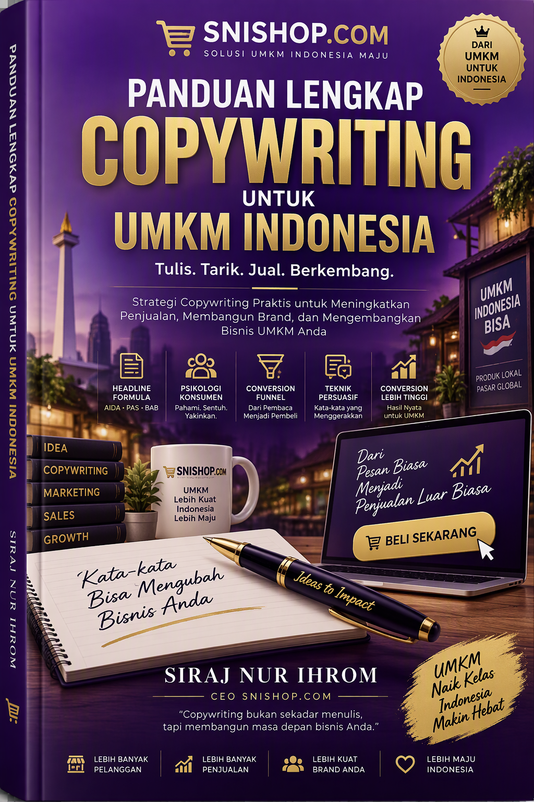
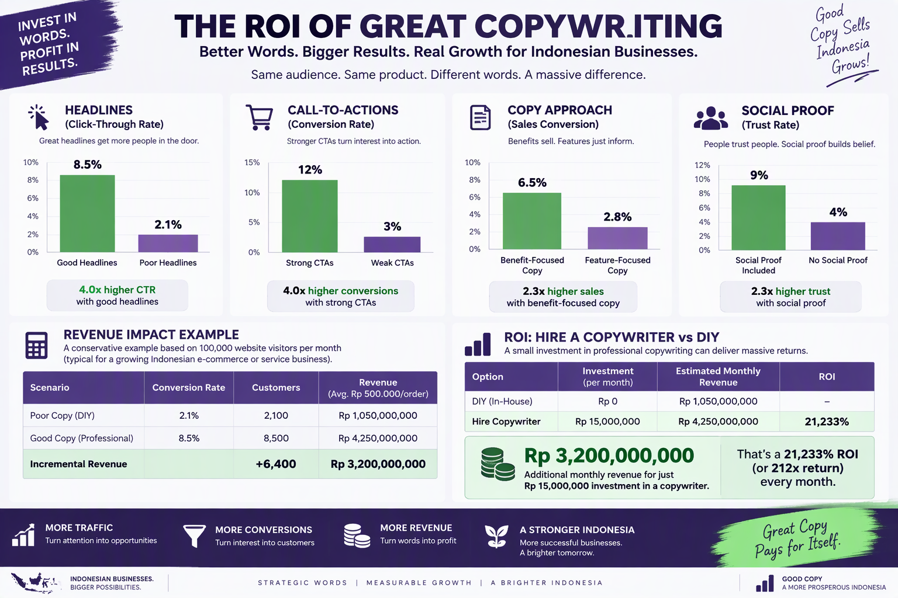
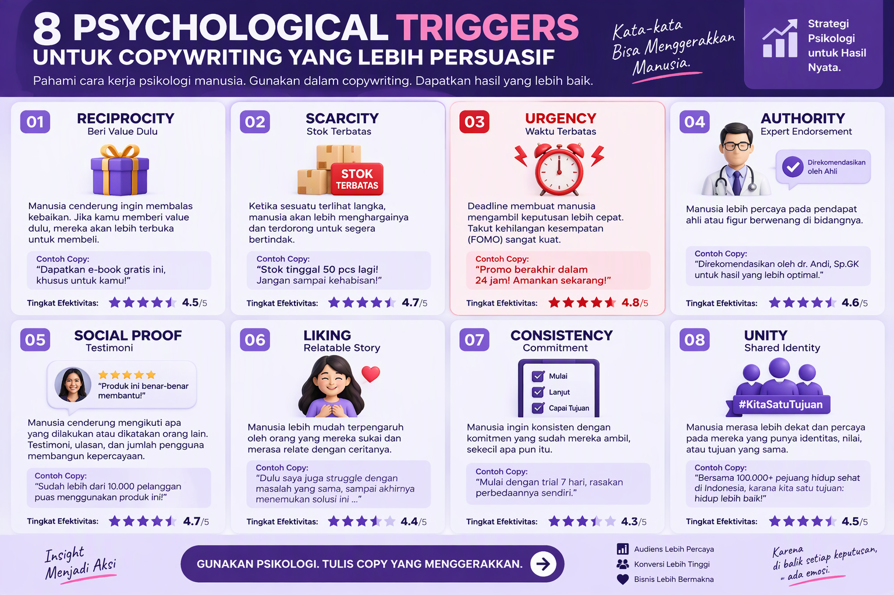
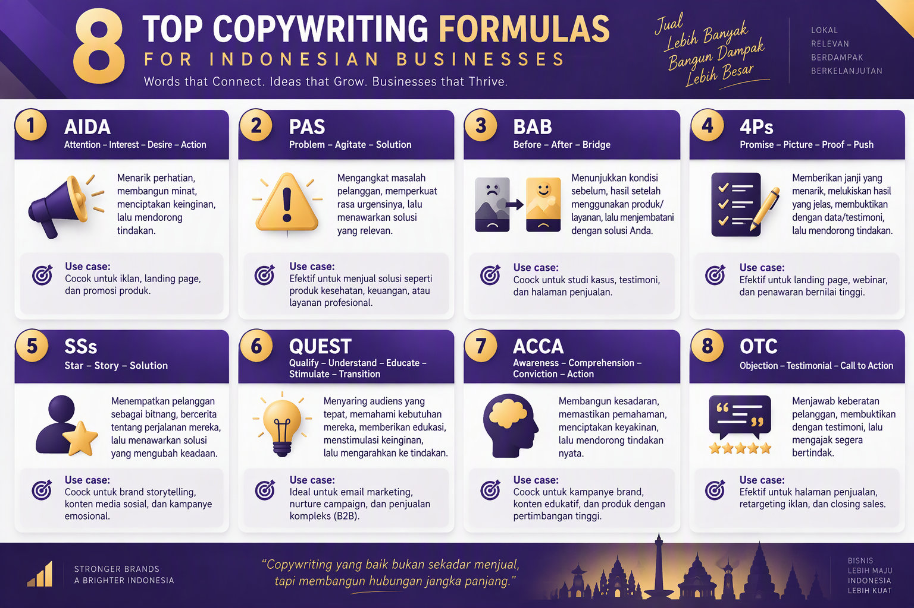
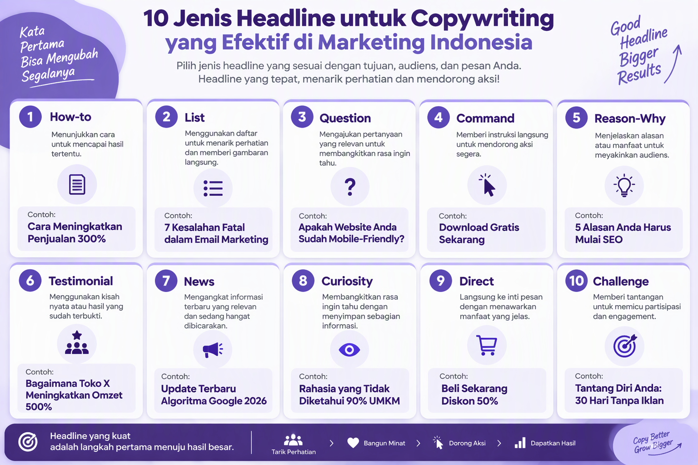
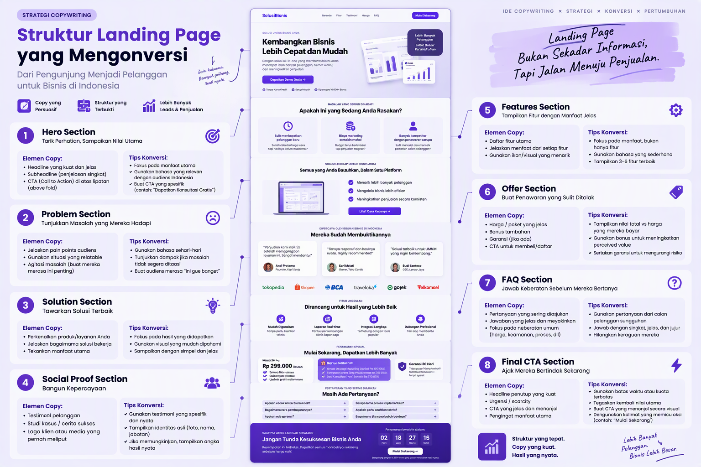
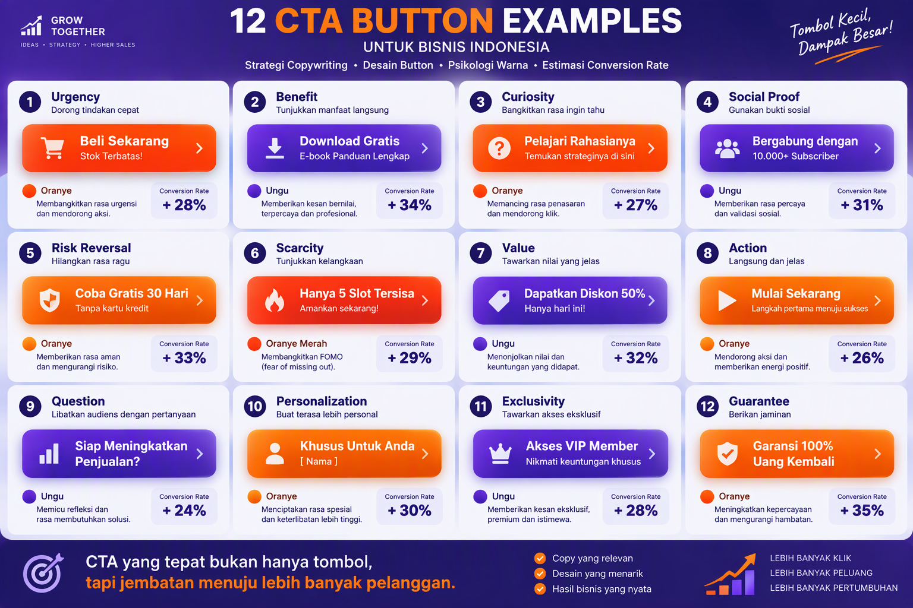
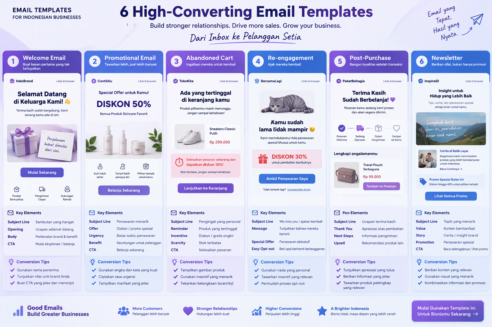
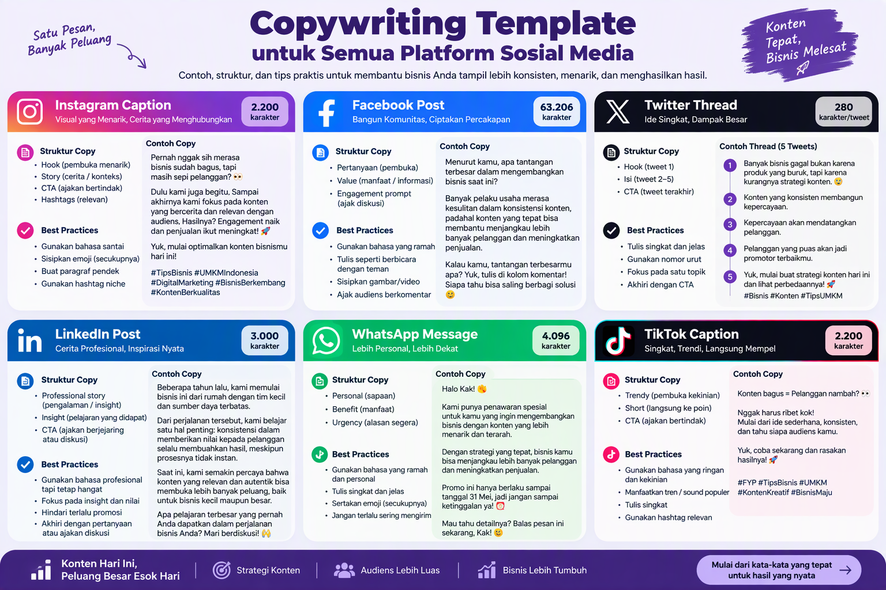
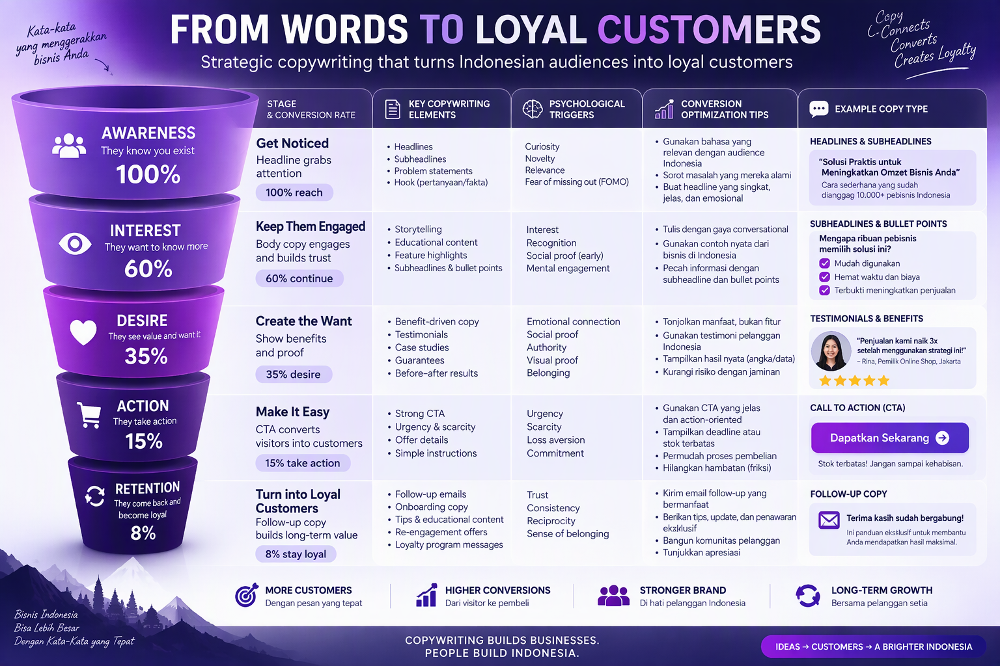

# PANDUAN LENGKAP COPYWRITING UNTUK UMKM INDONESIA

## Produk 14 - SNISHOP Digital Product Series

---

**Judul:** Panduan Lengkap Copywriting untuk UMKM Indonesia

**Penulis:** Siraj Nur Ihrom, CEO SNISHOP.COM

**Penerbit:** SNISHOP.COM

**Edisi:** Pertama, Desember 2025

**Hak Cipta:** 2025 SNISHOP.COM. Seluruh hak cipta dilindungi undang-undang.

---

---

## KATA PENGANTAR

Assalamualaikum Warahmatullahi Wabarakatuh.

Puji syukur kehadirat Allah SWT atas segala rahmat dan karunia-Nya sehingga buku panduan ini dapat diselesaikan dengan baik. Shalawat serta salam semoga senantiasa tercurah kepada Nabi Muhammad SAW, keluarga, sahabat, dan umatnya hingga akhir zaman.

Copywriting adalah keterampilan yang membedakan bisnis yang bertahan dari bisnis yang berkembang pesat. Di tengah persaingan digital yang semakin ketat, pelaku UMKM yang mampu menyampaikan pesan secara efektif memiliki keunggulan kompetitif yang signifikan. Tidak peduli seberapa bagus produk atau jasa Anda, jika kata-kata yang digunakan tidak mampu menggerakkan pembaca untuk bertindak, maka peluang bisnis akan hilang begitu saja.

Buku ini disusun sebagai panduan komprehensif bagi para pelaku UMKM Indonesia yang ingin menguasai seni copywriting. Dari fondasi psikologi persuasi, formula-formula yang terbukti efektif, hingga implementasi praktis di berbagai platform digital, semuanya dibahas secara mendalam dengan contoh konkret yang relevan dengan konteks bisnis Indonesia.

Semoga panduan ini menjadi manfaat bagi perkembangan UMKM Indonesia di era digital.

Wassalamualaikum Warahmatullahi Wabarakatuh.

Siraj Nur Ihrom
CEO SNISHOP.COM

---

## DAFTAR ISI

### BAGIAN I: FOUNDATION

**Bab 1: Apa Itu Copywriting dan Mengapa Penting untuk UMKM**
- 1.1 Definisi Copywriting
- 1.2 Perbedaan Copywriting dan Content Writing
- 1.3 Mengapa Copywriting Kritis untuk Kesuksesan Bisnis
- 1.4 Statistik: Copy Bagus vs Copy Buruk
- 1.5 ROI Copywriting untuk UMKM

**Bab 2: Memahami Psikologi Persuasi dalam Copywriting**
- 2.1 Reciprocity (Timbal Balik)
- 2.2 Scarcity (Kelangkaan)
- 2.3 Urgency (Urgensi)
- 2.4 Authority (Otoritas)
- 2.5 Social Proof (Bukti Sosial)
- 2.6 Liking (Kesukaan)
- 2.7 Consistency (Konsistensi)
- 2.8 Unity (Kesatuan)

**Bab 3: Formula-Formula Copywriting yang Terbukti Efektif**
- 3.1 AIDA (Attention, Interest, Desire, Action)
- 3.2 PAS (Problem, Agitate, Solution)
- 3.3 BAB (Before, After, Bridge)
- 3.4 4Ps (Picture, Promise, Prove, Push)
- 3.5 SSs (Star, Story, Solution)
- 3.6 QUEST (Qualify, Understand, Educate, Stimulate, Transition)
- 3.7 ACCA (Awareness, Comprehension, Conviction, Action)
- 3.8 OTC (Observation, Transformation, Call-to-Action)

### BAGIAN II: EXECUTION

**Bab 4: Menulis Headline yang Menarik dan Mengkonversi**
- 4.1 Sepuluh Jenis Headline dengan Contoh
- 4.2 Formula dan Template Headline
- 4.3 A/B Testing Headline
- 4.4 Kesalahan Umum dalam Headline

**Bab 5: Struktur Copy untuk Landing Page yang Mengkonversi**
- 5.1 Hero Section
- 5.2 Bagian Masalah
- 5.3 Bagian Solusi
- 5.4 Social Proof
- 5.5 Fitur dan Manfaat
- 5.6 Penawaran
- 5.7 FAQ
- 5.8 CTA Final
- 5.9 Tips Optimasi Konversi

**Bab 6: Call-to-Action yang Efektif**
- 6.1 Dua Belas Strategi CTA
- 6.2 Desain Tombol dan Psikologi Warna
- 6.3 Penempatan dan Timing
- 6.4 A/B Testing CTA

**Bab 7: Copywriting untuk Email Marketing**
- 7.1 Enam Jenis Email dengan Template
- 7.2 Formula Subject Line
- 7.3 Struktur Body Email
- 7.4 CTA dalam Email

### BAGIAN III: ADVANCED

**Bab 8: Copywriting untuk Social Media**
- 8.1 Template Spesifik Platform
- 8.2 Batas Karakter dan Praktik Terbaik
- 8.3 Engagement Hooks

**Bab 9: Conversion Funnel dan Customer Journey**
- 9.1 Lima Tahapan Conversion Funnel
- 9.2 Jenis Copy di Setiap Tahapan
- 9.3 Trigger Psikologis di Setiap Tahapan
- 9.4 Tips Optimasi

**Bab 10: Studi Kasus, Templates, dan Implementation Plan**
- 10.1 Tiga Studi Kasus Detail
- 10.2 Dua Puluh Template Siap Pakai
- 10.3 Rencana Implementasi 30 Hari
- 10.4 Alat dan Sumber Daya
- 10.5 Kesalahan Umum dan Cara Menghindarinya

**Penutup**

**Tentang Penulis**

---

## BAGIAN I: FOUNDATION

---

## BAB 1: APA ITU COPYWRITING DAN MENGAPA PENTING UNTUK UMKM

### 1.1 Definisi Copywriting

Copywriting adalah seni dan ilmu menulis teks yang bertujuan untuk mendorong pembaca mengambil tindakan tertentu. Tindakan tersebut bisa berupa pembelian produk, pendaftaran newsletter, klik pada tautan, atau bentuk konversi lainnya. Dalam konteks UMKM, copywriting adalah jembatan antara produk yang Anda tawarkan dengan pelanggan yang membutuhkannya.

Copywriting berbeda dari sekadar menulis. Seorang copywriter memikirkan setiap kata dengan tujuan strategis. Kalimat pembuka harus menangkap perhatian. Paragraf kedua harus membangun minat. Kalimat-kalimat berikutnya harus menciptakan keinginan. Dan penutup harus mendorong tindakan. Setiap elemen memiliki fungsi yang terukur.

Copywriting hadir di berbagai bentuk: teks pada landing page, caption media sosial, subject line email, deskripsi produk di marketplace, naskah iklan, brosur, banner, hingga pesan WhatsApp bisnis. Di mana pun ada kata-kata yang bertujuan menghasilkan konversi, di situ ada copywriting.

### 1.2 Perbedaan Copywriting dan Content Writing

Banyak pelaku UMKM menyamakan copywriting dengan content writing. Padahal keduanya memiliki tujuan, pendekatan, dan metrik keberhasilan yang berbeda.

**Content Writing** bertujuan untuk mengedukasi, menghibur, atau memberikan informasi kepada pembaca. Metrik keberhasilannya adalah waktu baca, jumlah halaman yang dikunjungi, dan pembagian konten. Contoh content writing meliputi artikel blog, panduan edukatif, berita industri, dan ensiklopedia.

**Copywriting** bertujuan untuk mendorong pembaca mengambil tindakan yang menghasilkan konversi bisnis. Metrik keberhasilannya adalah tingkat klik, tingkat konversi, dan pendapatan yang dihasilkan. Contoh copywriting meliputi iklan, landing page, email promosi, dan deskripsi produk.

Sebagai ilustrasi, content writing untuk toko sepatu bisa berupa artikel "Sepuluh Tips Merawat Sepatu Kulit agar Awet Bertahun-tahun". Sedangkan copywriting untuk toko sepatu yang sama berbunyi "Sepatu Kulit Premium, Garansi 2 Tahun, Diskon 40% Hari Ini Saja". Keduanya bermanfaat, namun hanya copywriting yang secara langsung menghasilkan penjualan.

Pelaku UMKM yang cerdas akan menggunakan keduanya secara beriringan. Content writing membangun kepercayaan dan otoritas. Copywriting mengubah kepercayaan tersebut menjadi transaksi.

### 1.3 Mengapa Copywriting Kritis untuk Kesuksesan Bisnis

Ada beberapa alasan mengapa copywriting menjadi keterampilan yang tidak bisa diabaikan oleh pelaku UMKM:

**Pertama, persaingan semakin ketat.** Jumlah UMKM di Indonesia terus bertambah. Menurut data Kementerian Koperasi dan UKM, terdapat lebih dari 64 juta UMKM yang beroperasi. Di pasar digital, pelanggan memiliki ribuan pilihan. Copy yang efektif menjadi pembeda utama yang membuat pelanggan memilih produk Anda.

**Kedua, perhatian pelanggan semakin singkat.** Rata-rata manusia modern hanya memberikan waktu delapan detik untuk memutuskan apakah akan melanjutkan membaca atau beralih ke konten lain. Headline dan kalimat pembuka yang lemah berarti kehilangan pelanggan sebelum pesan utama sempat disampaikan.

**Ketiga, biaya akuisisi pelanggan terus naik.** Iklan berbayar di platform digital semakin mahal. Copy yang buruk membuat biaya per klik membengkak tanpa menghasilkan konversi. Sebaliknya, copy yang efektif menurunkan biaya akuisisi dan meningkatkan return on investment dari setiap rupiah yang diinvestasikan pada iklan.

**Keempat, pelanggan membeli dengan emosi.** Penelitian neurosains menunjukkan bahwa keputusan pembelian didorong oleh emosi, kemudian dibenarkan oleh logika. Copywriting yang baik menyentuh emosi pelanggan, membuat mereka merasa membutuhkan produk Anda, lalu memberikan alasan logis untuk membenarkan pembelian tersebut.

### 1.4 Statistik: Copy Bagus vs Copy Buruk

Data dari berbagai penelitian industri menunjukkan perbedaan dramatis antara copy yang dioptimasi dengan copy yang ditulis sembarangan:

- **Headline:** Rata-rata lima kali lebih banyak orang membaca headline dibandingkan body copy. Headline yang dioptimasi dapat meningkatkan click-through rate hingga 500%.
- **Landing page:** Landing page dengan copy yang terstruktur berdasarkan formula persuasi menghasilkan konversi tiga sampai lima kali lebih tinggi dibandingkan landing page tanpa struktur.
- **Email marketing:** Subject line yang menggunakan teknik personalisasi menghasilkan open rate 26% lebih tinggi. Email dengan copy yang mengikuti formula PAS (Problem, Agitate, Solution) menghasilkan click-through rate dua kali lipat.
- **Iklan digital:** Iklan dengan copy A/B tested menghasilkan conversion rate 37% lebih tinggi dibandingkan iklan tanpa pengujian.
- **Deskripsi produk:** Deskripsi produk yang berfokus pada manfaat (bukan sekadar fitur) meningkatkan penjualan hingga 30%.

Angka-angka ini menunjukkan bahwa investasi dalam copywriting bukan pengeluaran, melainkan investasi dengan return yang terukur.

### 1.5 ROI Copywriting untuk UMKM

Untuk UMKM dengan anggaran terbatas, pertanyaan tentang return on investment sangat relevan. Berikut perhitungan sederhana:

Sebuah toko online dengan traffic 10.000 pengunjung per bulan. Sebelum optimasi copywriting, conversion rate 1%. Artinya 100 transaksi per bulan. Dengan rata-rata nilai transaksi Rp150.000, pendapatan bulanan Rp15.000.000.

Setelah headline, deskripsi produk, dan CTA dioptimasi menggunakan teknik copywriting yang dibahas dalam buku ini, conversion rate naik menjadi 3%. Artinya 300 transaksi per bulan. Pendapatan bulanan menjadi Rp45.000.000. Kenaikan Rp30.000.000 per bulan hanya dari mengubah kata-kata, tanpa menambah biaya iklan atau mengubah produk.

Investasi waktu untuk mempelajari dan menerapkan copywriting: beberapa hari hingga beberapa minggu. Return: puluhan juta rupiah per bulan. Ini adalah salah satu investasi dengan ROI tertinggi yang bisa dilakukan pelaku UMKM.

---

## BAB 2: MEMAHAMI PSIKOLOGI PERSUASI DALAM COPYWRITING

Copywriting yang efektif bukan sekadar rangkaian kata yang terdengar bagus. Di balik setiap copy yang berhasil mengkonversi, terdapat pemahaman mendalam tentang psikologi manusia. Robert Cialdini, profesor psikologi dari Arizona State University, mengidentifikasi prinsip-prinsip persuasi yang menjadi fondasi copywriting modern. Berikut delapan trigger psikologis yang wajib dipahami setiap copywriter.

### 2.1 Reciprocity (Timbal Balik)

Prinsip reciprocity menyatakan bahwa manusia merasa berkewajiban untuk membalas kebaikan yang diterima. Ketika seseorang memberikan sesuatu kepada kita, kita secara alami ingin memberikan sesuatu sebagai balasan.

**Cara menerapkan dalam copywriting:**

Berikan nilai terlebih dahulu sebelum meminta pembelian. Contoh penerapannya:

- "Download ebook gratis: 50 Resep Masakan Nusantara untuk Usaha Katering Anda. Tanpa daftar, langsung kirim ke email."
- "Konsultasi gratis 30 menit untuk strategi digital marketing bisnis Anda. Tidak ada kewajiban apapun."
- "Template invoice gratis untuk UMKM. Tinggal download, edit, dan gunakan."

Ketika pembaca menerima nilai gratis yang berkualitas, mereka lebih terbuka untuk mempertimbangkan produk berbayar yang Anda tawarkan.

**Contoh dalam konteks Indonesia:**

Sebagai penjual sambal kemasan, Anda bisa membagikan resep gratis menggunakan sambal produk Anda. Resep tersebut memberikan nilai langsung kepada pembaca. Ketika mereka menyukai hasilnya, pembelian produk menjadi langkah natural berikutnya.

### 2.2 Scarcity (Kelangkaan)

Manusia memberikan nilai lebih tinggi pada sesuatu yang langka atau terbatas. Prinsip scarcity memanfaatkan fear of missing out (FOMO) untuk mendorong tindakan.

**Cara menerapkan dalam copywriting:**

Tunjukkan keterbatasan yang nyata. Jangan membuat klaim kelangkaan palsu karena akan merusak kepercayaan.

- "Stok tinggal 7 unit. Setelah habis, produksi berikutnya baru tersedia bulan depan."
- "Hanya menerima 5 klien baru per bulan untuk menjaga kualitas layanan."
- "Edisi terbatas: hanya 100 botol diproduksi untuk koleksi Lebaran."

**Contoh dalam konteks Indonesia:**

Sebagai pengrajin tas kulit handmade, Anda bisa menulis: "Setiap tas dibuat tangan oleh pengrajin kami di Garut. Proses pembuatan membutuhkan 14 hari kerja. Kami hanya mampu menghasilkan 20 tas per bulan. Pesan sekarang untuk mendapatkan slot produksi minggu ini."

### 2.3 Urgency (Urgensi)

Berbeda dengan scarcity yang berfokus pada kelangkaan produk, urgency berfokus pada keterbatasan waktu. Urgency mendorong pembaca untuk bertindak sekarang, bukan nanti.

**Cara menerapkan dalam copywriting:**

Gunakan tenggat waktu yang spesifik dan nyata.

- "Promo berakhir pukul 23.59 WIB malam ini. Besok harga kembali normal."
- "Pesan dalam 2 jam ke depan untuk pengiriman hari ini."
- "Diskon 50% khusus untuk 50 pendaftar pertama. Saat ini sudah 43 orang terdaftar."

**Contoh dalam konteks Indonesia:**

Sebagai penyedia jasa fotografi produk, Anda bisa menulis: "Slot booking bulan Januari tinggal 4 hari. Amankan tanggal Anda sekarang sebelum penuh. Booking hari ini mendapat bonus 5 foto editing premium senilai Rp500.000."

### 2.4 Authority (Otoritas)

Manusia cenderung mengikuti saran dari orang yang dianggap ahli atau berotoritas. Menunjukkan otoritas dalam copy meningkatkan kepercayaan pembaca terhadap klaim yang Anda buat.

**Cara menerapkan dalam copywriting:**

Tampilkan kredensial, sertifikasi, pengalaman, atau pengakuan dari pihak ketiga.

- "Dipercaya oleh lebih dari 2.000 UMKM di Jawa Timur sejak 2018."
- "Tim kami bersertifikasi Google Ads dan Meta Blueprint."
- "Direkomendasikan oleh Asosiasi Pengusaha Kuliner Indonesia."
- "Pemenang penghargaan Best UMKM Digital Innovation 2024."

**Contoh dalam konteks Indonesia:**

Sebagai konsultan keuangan UMKM, Anda bisa menulis: "Dengan pengalaman 12 tahun membantu lebih dari 500 UMKM merapikan pembukuan dan mendapatkan pendanaan bank, kami memahami tantangan keuangan bisnis Anda."

### 2.5 Social Proof (Bukti Sosial)

Manusia adalah makhluk sosial yang cenderung mengikuti tindakan orang lain, terutama ketika menghadapi ketidakpastian. Ketika calon pelanggan melihat bahwa orang lain telah membeli dan puas, keraguan mereka berkurang.

**Cara menerapkan dalam copywriting:**

Tampilkan testimoni, jumlah pelanggan, rating, atau bukti penggunaan oleh pihak lain.

- "Lebih dari 15.000 botol terjual sejak peluncuran Maret 2024."
- "Rating 4.9 dari 2.300+ ulasan di Tokopedia."
- "Bergabung dengan 500 pemilik warung yang sudah menggunakan aplikasi kasir kami."
- Testimoni pelanggan dengan nama, foto, dan kota asal.

**Contoh dalam konteks Indonesia:**

Sebagai penyedia kursus online untuk UMKM, Anda bisa menulis: "Ibu Sari dari warung nasi di Yogyakarta berhasil meningkatkan omzet 200% setelah menerapkan strategi dari modul ketiga kursus kami. Berikut cerita lengkapnya."

### 2.6 Liking (Kesukaan)

Manusia lebih mudah dipengaruhi oleh orang yang mereka sukai. Kesukaan ini bisa muncul karena kesamaan minat, pujian yang tulus, penampilan yang menarik, atau sikap yang ramah.

**Cara menerapkan dalam copywriting:**

Tulis copy dengan suara yang personal dan relatable. Tunjukkan bahwa Anda memahami dunia pembaca.

- Gunakan bahasa yang sesuai dengan target audiens.
- Ceritakan pengalaman pribadi yang relevan.
- Tunjukkan empati terhadap masalah yang dihadapi pembaca.
- Gunakan humor yang sesuai dengan konteks.

**Contoh dalam konteks Indonesia:**

Sebagai penjual peralatan kopi, Anda bisa menulis: "Kami juga pernah bingung memilih grinder yang tepat untuk kedai kecil kami. Setelah mencoba 12 merek berbeda selama 3 tahun, akhirnya kami menemukan yang terbaik. Dan kami ingin berbagi pengalaman itu dengan Anda."

### 2.7 Consistency (Konsistensi)

Manusia memiliki keinginan kuat untuk konsisten dengan komitmen yang sudah dibuat. Ketika seseorang mengambil langkah kecil, mereka cenderung melanjutkan ke langkah berikutnya.

**Cara menerapkan dalam copywriting:**

Minta komitmen kecil terlebih dahulu sebelum meminta pembelian.

- "Setuju bahwa bisnis Anda pantas tumbuh lebih cepat? Klik di sini."
- "Langkah pertama: download checklist gratis ini. Langkah kedua: implementasikan satu per satu."
- "Anda sudah membaca sampai sini, artinya Anda serius ingin memperbaiki copy bisnis Anda."

**Contoh dalam konteks Indonesia:**

Sebagai penyedia jasa desain logo, Anda bisa menulis: "Mulailah dengan kuis branding gratis kami (hanya 3 menit). Setelah Anda memahami identitas brand Anda, tim desainer kami siap mewujudkannya dalam logo profesional."

### 2.8 Unity (Kesatuan)

Prinsip unity merujuk pada identitas bersama. Manusia lebih mudah dipengaruhi oleh orang yang dianggap sebagai bagian dari kelompok yang sama: suku, agama, profesi, kota asal, atau minat yang sama.

**Cara menerapkan dalam copywriting:**

Bangun rasa kebersamaan dan identitas kelompok.

- "Sesama pengusaha kuliner pasti tahu: resep saja tidak cukup."
- "Kami membuat produk ini untuk UMKM Indonesia, oleh tim yang juga berasal dari keluarga pelaku UMKM."
- "Komunitas 1.000 owner online shop terbesar di Indonesia."

**Contoh dalam konteks Indonesia:**

Sebagai penyedia platform toko online, Anda bisa menulis: "Dibangun oleh anak bangsa yang memahami bahwa pedagang di pasar tradisional dan pemilik toko online di marketplace memiliki semangat yang sama: semangat untuk melayani pelanggan dengan sebaik-baiknya."

---

## BAB 3: FORMULA-FORMULA COPYWRITING YANG TERBUKTI EFEKTIF

Setelah memahami psikologi persuasi, langkah berikutnya adalah menguasai formula copywriting. Formula ini bukan aturan kaku, melainkan kerangka kerja yang telah teruji oleh ribuan praktisi di seluruh dunia. Setiap formula memiliki kekuatan masing-masing dan cocok untuk situasi yang berbeda.

### 3.1 AIDA (Attention, Interest, Desire, Action)

AIDA adalah formula paling klasik dan paling banyak digunakan dalam dunia pemasaran. Struktur AIDA mengikuti perjalanan mental pembaca dari tidak aware menjadi siap bertindak.

**Attention (Perhatian):** Tangkap perhatian pembaca dengan headline yang kuat, fakta mengejutkan, atau pertanyaan yang relevan.

**Interest (Minat):** Bangun minat dengan informasi yang relevan, cerita yang engaging, atau data yang menarik.

**Desire (Keinginan):** Ciptakan keinginan dengan menunjukkan manfaat, transformasi, atau hasil yang bisa didapatkan.

**Action (Tindakan):** Dorong tindakan spesifik yang harus dilakukan pembaca selanjutnya.

**Contoh AIDA untuk toko online sepatu:**

"Sepatu kulit asli yang bisa Anda pakai setiap hari selama lima tahun tanpa rusak. (Attention)

Ribuan pelanggan kami membuktikan ketahanannya. Bahan kulit sapi pilihan dari Garut, dijahit tangan oleh pengrajin berpengalaman 20 tahun. Setiap pasang melalui 47 tahap quality control. (Interest)

Bayangkan: satu sepatu untuk segala kesempatan. Rapat formal, acara santai, hingga kondangan. Tidak perlu lagi membeli sepatu baru setiap enam bulan. Hemat uang, hemat waktu. (Desire)

Pesan sekarang dengan gratis ongkir ke seluruh Indonesia. Garansi tukar ukuran 30 hari. Klik tombol di bawah untuk melihat koleksi lengkap." (Action)

### 3.2 PAS (Problem, Agitate, Solution)

Formula PAS sangat efektif karena langsung menyentuh titik nyeri pembaca. Struktur PAS dimulai dari identifikasi masalah, penguatan rasa sakit akibat masalah tersebut, lalu penawaran solusi.

**Problem (Masalah):** Identifikasi masalah spesifik yang dihadapi pembaca.

**Agitate (Perkuat):** Tunjukkan konsekuensi negatif jika masalah tidak diselesaikan. Buat pembaca merasakan urgensi.

**Solution (Solusi):** Hadirkan produk atau jasa Anda sebagai solusi yang tepat.

**Contoh PAS untuk jasa pembukuan UMKM:**

"Omzet naik tapi uang tidak pernah tersisa di kas? (Problem)

Setiap bulan Anda merasa untung. Tapi saat mengecek rekening, saldonya tidak bertambah. Pajak tidak terlaporkan dengan benar. Arus kas berantakan. Anda stres setiap akhir bulan. Bisnis yang Anda bangun dengan keringat terancam bangkrut bukan karena kurang pelanggan, tapi karena pembukuan yang berantakan. (Agitate)

Aplikasi kasir SNISHOP mencatat setiap transaksi secara otomatis, menghasilkan laporan keuangan real-time, dan menghitung pajak dengan akurat. Lebih dari 5.000 UMKM sudah terbantu. Gratis coba 14 hari." (Solution)

### 3.3 BAB (Before, After, Bridge)

Formula BAB menggunakan kontras antara keadaan sebelum dan sesudah menggunakan produk Anda. Kontras ini menciptakan gambaran mental yang kuat tentang transformasi yang mungkin terjadi.

**Before (Sebelum):** Gambarkan situasi saat ini yang tidak ideal.

**After (Sesudah):** Gambarkan situasi ideal setelah masalah terselesaikan.

**Bridge (Jembatan):** Tunjukkan bagaimana produk Anda menjadi jembatan dari Before ke After.

**Contoh BAB untuk kursus digital marketing:**

"Sebelum: Anda posting di Instagram setiap hari tapi followers tidak bertambah. Penjualan stagnan. Kompetitor yang produknya kalah bagus justru mendapat lebih banyak pelanggan. (Before)

Sesudah: Instagram Anda menjadi mesin penjualan otomatis. Followers tumbuh organik. DM penuh dengan pertanyaan dari calon pembeli. Orderan datang setiap hari tanpa perlu iklan berbayar. (After)

Kursus Digital Marketing UMKM kami adalah jembatannya. 12 modul praktis yang bisa Anda terapkan langsung. Bukan teori akademis, melainkan strategi yang sudah dibuktikan oleh 800+ alumni kami. (Bridge)

Daftar sekarang, mulai belajar besok."

### 3.4 4Ps (Picture, Promise, Prove, Push)

Formula 4Ps menggunakan kekuatan visualisasi dan janji yang didukung bukti, lalu ditutup dengan dorongan bertindak.

**Picture (Gambaran):** Lukiskan situasi ideal yang bisa dialami pembaca.

**Promise (Janji):** Berikan janji spesifik tentang apa yang akan mereka dapatkan.

**Prove (Bukti):** Sediakan bukti yang mendukung janji tersebut.

**Push (Dorongan):** Dorong pembaca untuk mengambil tindakan sekarang.

**Contoh 4Ps untuk produk skincare alami:**

"Bayangkan bangun tidur, melihat cermin, dan tersenyum karena kulit wajah Anda cerah, lembap, dan bebas jerawat. (Picture)

Dalam 30 hari menggunakan rangkaian skincare alami kami, kulit Anda akan terlihat lebih cerah dua tingkat, jerawat mereda, dan tekstur kulit menjadi lebih halus. (Promise)

Kandungan bahan alami tersertifikasi BPOM. Hasil uji klinis pada 200 wanita Indonesia menunjukkan 94% mengalami perbaikan kulit dalam 4 minggu. Testimoni asli dari 3.000+ pelanggan tersedia di website kami. (Prove)

Pesan paket starter hari ini dan dapatkan diskon 25% plus gratis ongkir. Stok bulan ini tinggal sedikit." (Push)

### 3.5 SSs (Star, Story, Solution)

Formula SSs menggunakan kekuatan storytelling untuk membangun koneksi emosional sebelum menawarkan solusi.

**Star (Bintang):** Perkenalkan tokoh utama (bisa pelanggan, pendiri brand, atau pembaca sendiri).

**Story (Cerita):** Ceritakan perjalanan, tantangan, dan pergulatan yang dihadapi.

**Solution (Solusi):** Tunjukkan bagaimana solusi ditemukan dan hasil yang dicapai.

**Contoh SSs untuk jasa katering sehat:**

"Ibu Ratna, karyawan swasta di Jakarta, ibu dua anak usia 5 dan 8 tahun. (Star)

Setiap pagi Ibu Ratna bingung memikirkan bekal anak dan makan siang suami. Pulang kerja pukul 6 sore, masih harus memasak. Badan lelah, waktu bersama anak berkurang. Suatu hari anak sulungnya sakit karena sering jajan sembarangan di sekolah. Dokter menyarankan asupan gizi yang lebih terjaga. Ibu Ratna merasa gagal sebagai ibu. (Story)

Lalu ia menemukan katering sehat kami. Menu dirancang oleh nutrisionis, dimasak fresh setiap hari, diantar tepat waktu ke rumah. Dalam sepekan, anak-anak makan dengan lahap. Suami membawa bekal ke kantor setiap hari. Ibu Ratna punya waktu ekstra untuk bermain dengan anak-anak. Berat badan Ibu Ratna sendiri turun 3 kg karena makanannya terkontrol. (Solution)

Coba paket mingguan kami. Garansi uang kembali jika anak Anda tidak suka makanannya."

### 3.6 QUEST (Qualify, Understand, Educate, Stimulate, Transition)

Formula QUEST cocok untuk copy yang lebih panjang seperti sales letter atau landing page.

**Qualify (Kualifikasi):** Saring pembaca yang tepat.

**Understand (Pahami):** Tunjukkan bahwa Anda memahami masalah mereka.

**Educate (Edukasi):** Berikan pengetahuan baru yang relevan.

**Stimulate (Stimulasi):** Bangun antusiasme terhadap solusi.

**Transition (Transisi):** Pindahkan pembaca ke tahap pembelian.

**Contoh QUEST untuk software akuntansi UMKM:**

"Jika Anda pemilik UMKM dengan omzet di atas Rp50 juta per bulan dan masih mencatat keuangan di buku tulis atau Excel... (Qualify)

Kami tahu rasanya. Setiap akhir bulan Anda pusing menghitung stok, menagih piutang, dan bingung apakah bisnis Anda sebenarnya untung atau rugi. Laporan keuangan yang seharusnya menjadi kompas bisnis justru menjadi sumber stres. (Understand)

Tahukah Anda bahwa 80% UMKM yang bangkrut bukan karena tidak ada pelanggan, melainkan karena tidak bisa membaca arus kas mereka? Software akuntansi yang tepat bisa mengubah data mentah menjadi insight bisnis yang actionable. (Educate)

Bayangkan: semua transaksi tercatat otomatis. Laporan laba rugi, neraca, dan arus kas tersedia dalam satu klik. Anda bisa fokus mengembangkan bisnis, bukan bergulat dengan angka. (Stimulate)

Coba gratis 30 hari. Tidak perlu kartu kredit. Setup hanya 10 menit. Tim support kami siap membantu via WhatsApp." (Transition)

### 3.7 ACCA (Awareness, Comprehension, Conviction, Action)

Formula ACCA berfokus pada pembangunan pemahaman bertahap sebelum mendorong tindakan.

**Awareness (Kesadaran):** Buat pembaca sadar akan adanya masalah atau peluang.

**Comprehension (Pemahaman):** Bantu mereka memahami masalah tersebut secara mendalam.

**Conviction (Keyakinan):** Bangun keyakinan bahwa solusi Anda adalah yang terbaik.

**Action (Tindakan):** Dorong langkah konkret.

**Contoh ACCA untuk jasa desain kemasan:**

"Tahukah Anda bahwa 73% konsumen Indonesia membuat keputusan pembelian berdasarkan tampilan kemasan dalam waktu kurang dari 5 detik? (Awareness)

Kemasan bukan sekadar pembungkus. Kemasan adalah salesman diam yang bekerja 24 jam di rak toko. Kemasan yang buruk membuat produk berkualitas terlihat murahan. Kemasan yang bagus membuat produk Anda layak dibeli bahkan sebelum konsumen membaca isinya. (Comprehension)

Tim desainer kami telah menciptakan lebih dari 500 kemasan untuk produk UMKM di seluruh Indonesia. Rata-rata klien kami melaporkan kenaikan penjualan 40% setelah redesign kemasan. Kami memahami pasar Indonesia, bahan kemasan lokal, dan regulasi BPOM untuk label produk. (Conviction)

Konsultasi gratis hari ini. Kirim foto produk Anda, kami buatkan mockup kemasan dalam 3 hari kerja." (Action)

### 3.8 OTC (Observation, Transformation, Call-to-Action)

Formula OTC adalah formula modern yang cocok untuk konten media sosial dan format pendek.

**Observation (Observasi):** Mulai dengan pengamatan yang relevan dan relatable.

**Transformation (Transformasi):** Tunjukkan perubahan yang mungkin terjadi.

**Call-to-Action:** Akhiri dengan ajakan bertindak yang jelas.

**Contoh OTC untuk konten Instagram toko kopi:**

"Observasi: Sebagian besar pemilik warung kopi menghabiskan Rp2 juta per bulan untuk biji kopi karena membeli dari supplier yang salah. (Observation)

Transformasi: Dengan berlangganan langsung dari roaster lokal, Anda bisa mendapatkan biji kopi grade specialty dengan harga 30% lebih murah, freshness terjamin, dan variasi origin yang lebih banyak. Warung kopi Anda naik kelas tanpa naik biaya. (Transformation)

CTA: DM kami kata 'KOPI' untuk mendapatkan daftar supplier roaster lokal terpercaya di kota Anda."

---

## BAGIAN II: EXECUTION

---

## BAB 4: MENULIS HEADLINE YANG MENARIK DAN MENGKONVERSI

Headline adalah elemen terpenting dalam copywriting. David Ogilvy, bapak periklanan modern, pernah menyatakan bahwa rata-rata lima kali lebih banyak orang membaca headline dibandingkan body copy. Jika headline gagal menangkap perhatian, seluruh copy di bawahnya tidak akan pernah dibaca.

### 4.1 Sepuluh Jenis Headline dengan Contoh

**1. Headline Berita (News Headline)**

Menyajikan informasi baru yang relevan. Cocok untuk peluncuran produk atau pengumuman.

Contoh:
- "Kini Tersedia: Seragam Batik UMKM dengan Desain Custom, Pesan Mulai 10 pcs"
- "Baru Rilis: Aplikasi Kasir Gratis untuk Pedagang Pasar Tradisional"
- "Inovasi Terbaru: Kemasan Ramah Lingkungan dari Singkong untuk Produk Makanan"

**2. Headline How-To (Panduan)**

Menjanjikan pengetahuan atau keterampilan baru. Sangat efektif untuk konten edukatif.

Contoh:
- "Cara Menulis Deskripsi Produk yang Membuat Pembeli Tidak Bisa Menolak"
- "Cara Meningkatkan Omzet Toko Online 3x Lipat dalam 90 Hari Tanpa Tambah Budget Iklan"
- "Cara Membuat Konten Instagram yang Mendatangkan Pelanggan, Bukan Sekadar Likes"

**3. Headline Daftar (List Headline)**

Menggunakan angka untuk menjanjikan konten yang terstruktur dan mudah dicerna.

Contoh:
- "7 Kesalahan Copywriting yang Membuat Penjualan UMKM Stagnan"
- "10 Template Caption Instagram yang Siap Pakai untuk Toko Online Anda"
- "5 Kata Ajaib yang Meningkatkan Conversion Rate Landing Page hingga 200%"

**4. Headline Pertanyaan (Question Headline)**

Melibatkan pembaca secara langsung dengan pertanyaan yang relevan.

Contoh:
- "Mengapa 9 dari 10 Iklan UMKM Gagal Menghasilkan Penjualan?"
- "Apakah Copy Website Anda Sudah Cukup Mendorong Pembaca untuk Membeli?"
- "Sudahkah Anda Memanfaatkan WhatsApp Business untuk Menjual Lebih Banyak?"

**5. Headline Perintah (Command Headline)**

Memberikan instruksi langsung kepada pembaca.

Contoh:
- "Berhenti Buang Uang untuk Iklan Sebelum Membaca Panduan Ini"
- "Tiru Formula Copywriting yang Digunakan Brand Besar Indonesia"
- "Mulai Hari Ini: Ubah Caption Instagram Anda Menjadi Mesin Penjualan"

**6. Headline Alasan (Reason Why Headline)**

Menjanjikan penjelasan logis di balik suatu fenomena.

Contoh:
- "Alasan Mengapa Pelanggan Meninggalkan Keranjang Belanja Online Anda"
- "Mengapa Headline dengan Angka Selalu Mendapat Klik Lebih Banyak"
- "Penjelasan Ilmiah di Balik Kata-kata yang Mampu Menjual"

**7. Headline Testimoni (Testimonial Headline)**

Menggunakan kata-kata pelanggan sebagai headline.

Contoh:
- "'Omzet Naik 300% Setelah Ganti Copy Landing Page' - Budi, Owner Toko Elektronik"
- "'Dari 100 followers jadi 10.000 dalam 3 bulan' - Sari, Reseller Skincare"
- "'Akhirnya paham cara jualan online yang benar' - Ahmad, Pengusaha Kuliner"

**8. Headline Cerita (Story Headline)**

Membuka narasi yang membuat pembaca penasaran.

Contoh:
- "Dari Gerobak ke Omzet Miliar: Kisah Pedagang Bakso yang Menemukan Formula Copywriting"
- "Bagaimana Seorang Ibu Rumah Tangga Membangun Bisnis Online Rp50 Juta per Bulan"
- "Perjalanan Mengubah Warung Kopi Kecil Menjadi Brand yang Dicari"

**9. Headline Tantangan (Challenge Headline)**

Menantang keyakinan atau asumsi pembaca.

Contoh:
- "Lupakan Semua yang Anda Tahu tentang Instagram Marketing"
- "Berhenti Posting Setiap Hari. Lakukan Ini Sebagai Gantinya."
- "Strategi Marketing Lama Sudah Mati. Inilah yang Menggantikan."

**10. Headline Rahasia (Secret Headline)**

Menjanjikan informasi eksklusif yang tidak diketahui banyak orang.

Contoh:
- "Rahasia Copywriter Top Indonesia yang Tidak Dibagikan Secara Gratis"
- "Formula Tersembunyi di Balik Iklan Facebook yang Menghasilkan Jutaan"
- "Rahasia Membuat Deskripsi Produk yang Membuat Pembaca Merasa Butuh"

### 4.2 Formula dan Template Headline

Berikut formula yang bisa langsung digunakan untuk menghasilkan headline yang kuat:

**Formula 1: Angka + Kata Sifat + Kata Benda + Janji**

Contoh: "7 Strategi Ampuh Meningkatkan Penjualan Online Anda Bulan Ini"

Template: "[Angka] [Kata Sifat] [Kata Benda] [Janji]"

**Formula 2: Cara [Tindakan] Tanpa [Hambatan]**

Contoh: "Cara Mendapat Pelanggan Pertama Tanpa Modal Iklan"

Template: "Cara [Tindakan yang Diinginkan] Tanpa [Hambatan Umum]"

**Formula 3: [Angka] Kesalahan [Target] yang [Konsekuensi]**

Contoh: "5 Kesalahan Pemilik Toko Online yang Membuat Pengunjung Kabur"

Template: "[Angka] Kesalahan [Target Audiens] yang [Konsekuensi Negatif]"

**Formula 4: Mengapa [Fenomena] dan Apa yang Harus Anda Lakukan**

Contoh: "Mengapa Pelanggan Tidak Kembali dan Apa yang Harus Anda Lakukan"

Template: "Mengapa [Fenomena yang Relevan] dan Apa yang Harus Anda Lakukan"

**Formula 5: [Hasil yang Diinginkan] dalam [Waktu] atau [Jaminan]**

Contoh: "Toko Online Menghasilkan Rp10 Juta dalam 30 Hari atau Uang Kembali"

Template: "[Hasil] dalam [Waktu] atau [Jaminan]"

### 4.3 A/B Testing Headline

Menulis satu headline saja tidak cukup. Praktik terbaik adalah menulis minimal tiga variasi headline, lalu menguji mana yang paling efektif. Berikut langkah-langkah A/B testing headline:

**Langkah 1:** Tulis tiga headline berbeda untuk konten yang sama.

**Langkah 2:** Pilih metrik keberhasilan (click-through rate, conversion rate, atau engagement rate).

**Langkah 3:** Jalankan setiap headline pada audiens yang setara dengan durasi yang sama (minimal 7 hari).

**Langkah 4:** Analisis hasilnya. Headline dengan metrik tertinggi menjadi pemenang.

**Langkah 5:** Catat pola headline yang menang. Gunakan pola tersebut untuk headline berikutnya.

Contoh pengujian:
- Headline A: "Cara Meningkatkan Penjualan Online" (CTR: 2.1%)
- Headline B: "7 Cara Meningkatkan Penjualan Online 3x Lipat dalam 30 Hari" (CTR: 5.8%)
- Headline C: "Rahasia Penjualan Online yang Jarang Diketahui Pemilik UMKM" (CTR: 8.5%)

Pemenang: Headline C. Pola yang teridentifikasi: kata "rahasia" dan "jarang diketahui" menciptakan rasa penasaran yang lebih kuat.

### 4.4 Kesalahan Umum dalam Headline

**Kesalahan 1: Headline terlalu panjang.** Headline idealnya terdiri dari 6 sampai 12 kata. Lebih dari itu, perhatian pembaca berkurang.

**Kesalahan 2: Headline tidak spesifik.** "Tips Marketing" terlalu umum. "7 Tips Marketing Instagram untuk Toko Fashion dengan Budget di Bawah Rp500 Ribu" jauh lebih kuat.

**Kesalahan 3: Headline clickbait tanpa isi.** Headline yang menjanjikan sesuatu yang tidak dipenuhi di dalam konten akan merusak kepercayaan.

**Kesalahan 4: Headline tanpa manfaat.** Pembaca selalu bertanya: "Apa untungnya buat saya?" Headline yang tidak menjawab pertanyaan ini akan diabaikan.

**Kesalahan 5: Headline membosankan.** Hindari kalimat generik seperti "Panduan Marketing untuk UMKM". Gantilah dengan kalimat yang membangkitkan emosi atau rasa penasaran.

---

## BAB 5: STRUKTUR COPY UNTUK LANDING PAGE YANG MENGKONVERSI

Landing page adalah halaman yang dirancang untuk satu tujuan spesifik: mengkonversi pengunjung menjadi leads atau pelanggan. Berbeda dengan halaman website biasa yang memiliki banyak tujuan, landing page fokus pada satu aksi. Struktur copy landing page yang efektif terdiri dari delapan bagian utama.

### 5.1 Hero Section

Hero section adalah area pertama yang dilihat pengunjung. Anda memiliki waktu kurang dari lima detik untuk membuat kesan pertama.

**Elemen hero section:**
- Headline utama yang menyampaikan nilai utama produk.
- Subheadline yang memperjelas atau menambahkan detail.
- Visual pendukung (foto produk, ilustrasi, atau video pendek).
- CTA primer (tombol aksi utama).
- Social proof singkat (jumlah pelanggan, rating, atau logo klien).

**Contoh hero section untuk jasa desain website UMKM:**

Headline: "Website Profesional untuk UMKM Anda, Siap Online dalam 7 Hari"

Subheadline: "Tanpa perlu mengerti coding. Tim desainer kami membangun website yang tidak hanya cantik, tapi juga menghasilkan penjualan. Sudah dipercaya 500+ UMKM di seluruh Indonesia."

CTA: "Lihat Portfolio Kami" atau "Konsultasi Gratis Sekarang"

Social proof: "4.9/5 rating dari 230+ klien | 500+ website berhasil diluncurkan"

### 5.2 Bagian Masalah

Setelah menangkap perhatian di hero section, langkah berikutnya adalah membuat pengunjung merasa dipahami. Bagian masalah menunjukkan bahwa Anda mengerti tantangan yang mereka hadapi.

**Panduan menulis bagian masalah:**
- Identifikasi tiga sampai lima masalah spesifik yang dihadapi target audiens.
- Gunakan bahasa yang menunjukkan empati, bukan menggurui.
- Buat pembaca mengangguk-angguk karena merasa dipahami.

**Contoh:**

"Apakah Anda mengalami hal ini?

- Sudah punya website tapi tidak ada yang mengunjungi.
- Pengunjung datang tapi langsung pergi tanpa membeli.
- Budget iklan habis tanpa hasil yang jelas.
- Tidak tahu apa yang salah dengan strategi digital Anda.

Jika Anda mengangguk pada satu saja poin di atas, Anda tidak sendirian. 80% UMKM Indonesia menghadapi tantangan yang sama."

### 5.3 Bagian Solusi

Setelah masalah diidentifikasi, hadirkan produk atau jasa Anda sebagai solusi yang tepat.

**Panduan menulis bagian solusi:**
- Jelaskan bagaimana produk Anda menyelesaikan masalah yang disebutkan.
- Fokus pada hasil dan transformasi, bukan spesifikasi teknis.
- Gunakan bahasa yang konkret dan terukur.

**Contoh:**

"SNISHOP Web Designer hadir sebagai solusi lengkap:

- Desain website yang dioptimasi untuk konversi, bukan sekadar estetika.
- SEO on-page yang membuat website Anda ditemukan di Google.
- Integrasi WhatsApp dan marketplace untuk memudahkan transaksi.
- Dashboard analitik yang menunjukkan performa website secara real-time.

Hasilnya: pengunjung website Anda berubah menjadi pelanggan yang membayar."

### 5.4 Social Proof

Bagian social proof membangun kepercayaan dengan menunjukkan bahwa orang lain telah menggunakan dan puas dengan produk Anda.

**Jenis social proof yang efektif:**
- Testimoni pelanggan dengan nama, foto, dan lokasi.
- Jumlah pelanggan atau transaksi yang berhasil.
- Rating dan ulasan dari platform terpercaya.
- Logo klien atau mitra bisnis.
- Sertifikasi atau penghargaan.

**Contoh:**

"Apa kata klien kami:

'Website dari SNISHOP mengubah bisnis saya. Sebelumnya order datang hanya dari WhatsApp. Sekarang pelanggan menemukan saya dari Google. Omzet naik 250% dalam 6 bulan.' - Rina, Owner Rina Batik, Solo

'Investasi terbaik untuk bisnis saya. Tim-nya responsif, hasilnya profesional. Website saya sekarang mendapat 500+ pengunjung per hari.' - Hendra, Owner Hendra Furniture, Surabaya"

### 5.5 Fitur dan Manfaat

Setiap fitur produk harus dihubungkan dengan manfaat yang dirasakan pelanggan. Rumusnya: "Fitur X berarti Anda bisa Y" atau "Dengan fitur X, Anda mendapatkan Y".

**Contoh:**

| Fitur | Manfaat |
|-------|---------|
| Desain responsif | Website tampil sempurna di HP, tablet, dan laptop pelanggan Anda |
| Loading cepat (di bawah 3 detik) | Pengunjung tidak kabur sebelum melihat produk Anda |
| Integrasi WhatsApp | Pelanggan bisa langsung chat dan order dari website |
| Dashboard analitik | Anda tahu berapa pengunjung, dari mana, dan produk apa yang paling diminati |
| SSL gratis | Data pelanggan aman, website Anda dipercaya Google |

### 5.6 Penawaran

Bagian penawaran merangkum apa yang didapat pelanggan dan berapa harganya. Buat penawaran terasa bernilai tinggi.

**Panduan menulis bagian penawaran:**
- Tampilkan harga dengan jelas.
- Bandingkan dengan nilai yang diterima (value stacking).
- Tambahkan bonus untuk meningkatkan daya tarik.
- Berikan garansi untuk mengurangi risiko di mata pelanggan.

**Contoh:**

"Paket Website UMKM Profesional:

Semua yang Anda dapatkan:
- Desain website custom (senilai Rp5.000.000)
- Optimasi SEO dasar (senilai Rp2.000.000)
- Integrasi WhatsApp dan marketplace (senilai Rp1.500.000)
- Dashboard analitik (senilai Rp1.000.000)
- Hosting 1 tahun (senilai Rp1.200.000)
- Domain .com 1 tahun (senilai Rp150.000)

Total nilai: Rp10.850.000
Harga khusus UMKM: Rp3.500.000

Bonus: Panduan Digital Marketing untuk UMKM (senilai Rp500.000)
Garansi: Revisi tanpa batas selama 30 hari. Uang kembali jika tidak puas."

### 5.7 FAQ

Bagian FAQ menjawab keraguan yang mungkin mencegah pembelian. Identifikasi pertanyaan yang paling sering ditanyakan calon pelanggan.

**Contoh FAQ:**

"Apakah saya perlu mengerti teknis untuk mengelola website?
Tidak. Kami menyediakan pelatihan gratis dan panduan visual step-by-step. Anda bisa mengupdate konten website semudah menggunakan media sosial.

Berapa lama proses pembuatan website?
Rata-rata 7 sampai 14 hari kerja, tergantung kompleksitas desain dan konten yang Anda sediakan.

Apakah website saya akan muncul di Google?
Ya. Semua website yang kami buat sudah dioptimasi untuk SEO dasar. Untuk hasil maksimal, tersedia paket SEO lanjutan.

Bagaimana jika saya tidak puas dengan hasilnya?
Kami memberikan garansi uang kembali 30 hari. Jika dalam 30 hari pertama Anda merasa website tidak sesuai ekspektasi, kami kembalikan uang Anda secara penuh."

### 5.8 CTA Final

Di bagian paling bawah landing page, tempatkan CTA final yang merangkum seluruh penawaran.

**Contoh:**

"Siap membawa bisnis Anda ke level berikutnya?

Klik tombol di bawah untuk memulai konsultasi gratis. Tim kami akan menghubungi Anda dalam 1x24 jam."

Tombol: "Mulai Konsultasi Gratis Sekarang"

### 5.9 Tips Optimasi Konversi

- Pastikan loading page di bawah 3 detik.
- Gunakan satu CTA utama, jangan memecah perhatian dengan banyak pilihan.
- Tempatkan social proof sedekat mungkin dengan CTA.
- Buat copy yang bisa discan: gunakan heading, bullet points, dan paragraf pendek.
- Uji halaman di perangkat mobile. Sebagian besar pengunjung UMKM mengakses dari HP.
- Hilangkan elemen navigasi yang bisa mengalihkan pengunjung dari landing page.
- Tambahkan urgency atau scarcity yang nyata di dekat CTA.

---

## BAB 6: CALL-TO-ACTION YANG EFEKTIF

Call-to-Action (CTA) adalah momen kebenaran dalam copywriting. Seluruh rangkaian copy yang Anda tulis bermuara pada satu titik ini: apakah pembaca akan mengklik tombol, mengisi formulir, atau melakukan tindakan yang Anda inginkan.

### 6.1 Dua Belas Strategi CTA

**Strategi 1: CTA Berorientasi Manfaat**

Fokus pada apa yang didapat pembaca, bukan apa yang harus mereka lakukan.

Contoh:
- "Dapatkan Penjualan Pertama Anda" (bukan "Daftar Sekarang")
- "Mulai Hemat Waktu 10 Jam per Minggu" (bukan "Coba Aplikasi")
- "Amankan Diskon 50%" (bukan "Beli Sekarang")

**Strategi 2: CTA Berbasis Urgensi**

Tambahkan elemen waktu terbatas untuk mendorong tindakan segera.

Contoh:
- "Klaim Sebelum Tengah Malam"
- "Daftar 3 Orang Terakhir untuk Batch Ini"
- "Harga Naik Besok - Pesan Sekarang"

**Strategi 3: CTA Berbasis Scarcity**

Tekankan keterediaan terbatas.

Contoh:
- "Tinggal 5 Slot Tersedia"
- "Ambil Sebelum Kehabisan"
- "Edisi Terbatas - Hanya 100 pcs"

**Strategi 4: CTA Risiko Rendah**

Kurangkan persepsi risiko di mata calon pelanggan.

Contoh:
- "Coba Gratis 14 Hari, Tanpa Kartu Kredit"
- "Garansi Uang Kembali 30 Hari"
- "Batalkan Kapan Saja"

**Strategi 5: CTA Spesifik**

Beritahu persis apa yang terjadi setelah klik.

Contoh:
- "Download PDF - 15 Halaman, Gratis"
- "Jadwalkan Panggilan 15 Menit"
- "Daftar Webinar - Kamis, 20 Desember, Pukul 19.00 WIB"

**Strategi 6: CTA Emosional**

Sentuh emosi pembaca.

Contoh:
- "Wujudkan Impian Bisnis Anda"
- "Berikan yang Terbaik untuk Keluarga"
- "Jangan Biarkan Kompetitor Mendahului Anda"

**Strategi 7: CTA Eksklusivitas**

Buat pembaca merasa istimewa.

Contoh:
- "Bergabung dengan Komunitas Premium"
- "Akses Khusus Member"
- "Undang Teman Anda ke Grup VIP"

**Strategi 8: CTA Sosial**

Gunakan kekuatan komunitas.

Contoh:
- "Bergabung dengan 10.000+ Pengusaha Sukses"
- "Lihat Apa Kata Mereka"
- "Ikuti Jejak 500+ UMKM yang Sudah Go Digital"

**Strategi 9: CTA Penasaran**

Bangkitkan rasa ingin tahu.

Contoh:
- "Lihat Rahasia di Balik Pertumbuhan 300%"
- "Temukan Apa yang Hilang dari Bisnis Anda"
- "Buka untuk Melihat Penawaran Spesial"

**Strategi 10: CTA Langsung**

Singkat, jelas, tanpa basa-basi.

Contoh:
- "Beli Sekarang"
- "Daftar Hari Ini"
- "Pesan via WhatsApp"

**Strategi 11: CTA Perbandingan**

Tunjukkan kontras antara bertindak dan tidak bertindak.

Contoh:
- "Masih Pakai Cara Lama? Coba yang Lebih Efektif"
- "Toko Sebelah Sudah Online, Anda Kapan?"
- "Stop Buang Uang untuk Iklan yang Tidak Hasilkan"

**Strategi 12: CTA Bertahap**

Minta komitmen kecil terlebih dahulu.

Contoh:
- "Mulai dari Langkah Pertama: Download Checklist Gratis"
- "Coba Dulu, Putuskan Nanti"
- "Isi Form Singkat (2 Menit), Kami Hubungi Kembali"

### 6.2 Desain Tombol dan Psikologi Warna

CTA tidak hanya tentang kata-kata. Desain visual tombol juga mempengaruhi tingkat klik.

**Ukuran tombol:** Tombol CTA harus cukup besar untuk mudah diklik di perangkat mobile (minimal 44x44 piksel), namun tidak terlalu besar hingga mendominasi halaman.

**Warna tombol:** Pilih warna yang kontras dengan latar belakang halaman. Warna yang paling sering digunakan untuk CTA:
- Merah: menciptakan urgensi dan energi. Cocok untuk promo dan flash sale.
- Hijau: diasosiasikan dengan "go" atau persetujuan. Cocok untuk CTA positif.
- Biru: membangun kepercayaan. Cocok untuk layanan profesional.
- Oranye: energik dan ramah. Cocok untuk UMKM dan produk lifestyle.

**Teks tombol:** Gunakan kata kerja aktif. "Download" lebih kuat dari "Klik di sini". "Mulai Gratis" lebih kuat dari "Daftar".

### 6.3 Penempatan dan Timing

Penempatan CTA sama pentingnya dengan isi CTA itu sendiri.

**Aturan penempatan:**
- Tempatkan CTA di atas lipatan (above the fold) untuk pengunjung yang sudah siap membeli.
- Tempatkan CTA di akhir setiap bagian konten untuk pengunjung yang perlu membaca lebih dulu.
- Gunakan CTA sticky (menetap di layar) untuk halaman panjang.
- Tampilkan CTA ulang setelah social proof atau testimoni.

**Aturan timing:**
- Jangan minta pembelian pada kunjungan pertama jika produk bernilai tinggi.
- Untuk produk murah (di bawah Rp100.000), CTA langsung bisa efektif.
- Untuk produk mahal, gunakan CTA bertahap: download dulu, ikuti webinar dulu, konsultasi dulu.

### 6.4 A/B Testing CTA

Uji variasi CTA untuk menemukan yang paling efektif.

**Elemen yang bisa diuji:**
- Teks tombol: "Beli Sekarang" vs "Dapatkan Sekarang" vs "Pesan via WhatsApp"
- Warna tombol: merah vs hijau vs oranye
- Posisi: di atas vs di bawah konten
- Ukuran: besar vs sedang
- Konteks: CTA berdiri sendiri vs CTA dengan social proof di dekatnya

**Contoh hasil A/B testing:**

Toko online A menguji dua versi CTA:
- Versi A: Tombol "Beli Sekarang" warna merah di atas halaman. Conversion rate: 2.3%
- Versi B: Tombol "Lihat Promo Hari Ini" warna oranye di bawah deskripsi produk. Conversion rate: 4.7%

Pemenang: Versi B. Kombinasi teks yang lebih spesifik dan warna yang lebih ramah menghasilkan konversi dua kali lipat.

---

## BAB 7: COPYWRITING UNTUK EMAIL MARKETING

Email marketing tetap menjadi salah satu channel dengan ROI tertinggi. Setiap rupiah yang diinvestasikan pada email marketing menghasilkan rata-rata Rp56.000 dalam pendapatan. Namun, hasil ini hanya bisa dicapai jika copy email Anda efektif.

### 7.1 Enam Jenis Email dengan Template

**Jenis 1: Welcome Email**

Email pertama yang diterima pelanggan setelah mendaftar. Welcome email memiliki open rate tertinggi (rata-rata 50-60%). Manfaatkan momen ini.

Template:

Subject: "Selamat datang di [Nama Brand], [Nama]! Ini hadiah untuk Anda"

Body:
"Halo [Nama],

Terima kasih sudah bergabung dengan [Nama Brand]. Kami senang Anda ada di sini.

Sesuai janji kami, ini hadiah selamat datang: [kode diskon / ebook gratis / akses eksklusif].

Tiga hal yang bisa Anda lakukan selanjutnya:
1. [Tindakan pertama yang direkomendasikan]
2. [Tindakan kedua yang direkomendasikan]
3. [Tindakan ketiga yang direkomendasikan]

Jika ada pertanyaan, balas email ini. Tim kami membaca setiap pesan.

Salam hangat,
[Nama] dari [Nama Brand]"

**Jenis 2: Promotional Email**

Email yang bertujuan langsung mendorong penjualan.

Template:

Subject: "[Nama], khusus untuk Anda: [Penawaran] berakhir [Waktu]"

Body:
"Halo [Nama],

Kami punya sesuatu yang spesial untuk Anda.

[Deskripsi penawaran dengan fokus pada manfaat]

[Detail penawaran: diskon, bonus, atau hadiah]

Tapi ada satu hal: penawaran ini berakhir [tanggal/waktu]. Setelah itu, harga kembali normal.

[Tombol CTA: Klaim Penawaran Saya Sekarang]

Terima kasih sudah menjadi pelanggan setia [Nama Brand].

Salam,
[Nama] dari [Nama Brand]

P.S. [Tambahkan urgency atau bonus tambahan]"

**Jenis 3: Educational Email**

Email yang memberikan nilai edukatif tanpa langsung menjual.

Template:

Subject: "[Angka] cara [hasil yang diinginkan] (gratis, bisa langsung dipraktikkan)"

Body:
"Halo [Nama],

Hari ini saya ingin berbagi [topik edukasi] yang mungkin bermanfaat untuk bisnis Anda.

[Poin pertama dengan penjelasan singkat]
[Poin kedua dengan penjelasan singkat]
[Poin ketiga dengan penjelasan singkat]

[Contoh konkret atau studi kasus singkat]

Minggu depan, saya akan berbagi tentang [topik berikutnya]. Pastikan email kami tidak masuk folder spam.

Salam,
[Nama]"

**Jenis 4: Re-engagement Email**

Email untuk mengaktifkan kembali pelanggan yang sudah tidak berinteraksi.

Template:

Subject: "[Nama], kami rindu Anda. Ada yang tertinggal..."

Body:
"Halo [Nama],

Sudah [jumlah] hari sejak terakhir kali Anda mengunjungi [Nama Brand]. Kami harap Anda baik-baik saja.

Selama Anda tidak ada, banyak hal baru yang terjadi:
- [Update atau produk baru pertama]
- [Update atau produk baru kedua]
- [Update atau produk baru ketiga]

Sebagai tanda kami merindukan Anda, ini hadiah khusus: [kode diskon eksklusif].

[Tombol CTA: Kembali dan Lihat Yang Baru]

Jika Anda tidak ingin menerima email dari kami lagi, [link unsubscribe].

Salam,
[Nama]"

**Jenis 5: Cart Abandonment Email**

Email untuk pelanggan yang meninggalkan keranjang belanja tanpa checkout.

Template:

Subject: "[Nama], [produk] di keranjang Anda hampir kehabisan!"

Body:
"Halo [Nama],

Anda meninggalkan [nama produk] di keranjang belanja. Kabar buruknya: stok tinggal sedikit.

Berikut yang Anda pilih:
- [Nama produk 1] - [Harga]
- [Nama produk 2] - [Harga]

Total: [Jumlah total]

Selesaikan pesanan Anda sekarang dan dapatkan [bonus/diskon/gratis ongkir].

[Tombol CTA: Selesaikan Pesanan Saya]

Butuh bantuan? Balas email ini atau hubungi kami via WhatsApp di [nomor].

Salam,
[Nama]"

**Jenis 6: Post-Purchase Follow-Up**

Email setelah pembelian untuk membangun loyalitas.

Template:

Subject: "Terima kasih, [Nama]! Langkah selanjutnya..."

Body:
"Halo [Nama],

Terima kasih atas pesanan Anda! [Nama produk] sedang dalam perjalanan menuju alamat Anda.

Nomor resi: [Nomor]. Anda bisa lacak paket di [link].

Beberapa tips untuk memaksimalkan produk Anda:
- [Tips pertama]
- [Tips kedua]
- [Tips ketiga]

Jika Anda puas dengan produk kami, kami akan sangat menghargai ulasan Anda di [link].

Ada pertanyaan? Hubungi kami kapan saja di [kontak].

Salam,
[Nama]"

### 7.2 Formula Subject Line

Subject line menentukan apakah email Anda dibuka atau diabaikan. Berikut formula yang terbukti efektif:

**Formula 1: Personalisasi + Penawaran**
Contoh: "Rina, diskon 30% khusus untuk pelanggan setia"

**Formula 2: Rasa Penasaran**
Contoh: "Satu hal yang mengubah bisnis saya selamanya..."

**Formula 3: Urgensi**
Contoh: "Berakhir tengah malam: kesempatan terakhir"

**Formula 4: Angka + Manfaat**
Contoh: "5 template email yang menghasilkan penjualan otomatis"

**Formula 5: Pertanyaan**
Contoh: "Sudahkah Anda mencoba strategi ini?"

**Panjang ideal subject line:** 30 sampai 50 karakter. Terlalu pendek kurang informatif. Terlalu panjang terpotong di layar HP.

### 7.3 Struktur Body Email

Body email yang efektif mengikuti struktur ini:

1. **Sapaan personal:** Gunakan nama penerima.
2. **Pembuka yang relevan:** Satu sampai dua kalimat yang langsung menarik perhatian.
3. **Isi utama:** Sampaikan pesan inti dengan format yang mudah discan (bullet points, paragraf pendek).
4. **CTA tunggal:** Satu tindakan yang jelas. Jangan membingungkan pembaca dengan banyak pilihan.
5. **Penutup personal:** Tanda tangan dengan nama dan jabatan.
6. **P.S.:** Tambahkan postscript untuk informasi tambahan atau urgency. P.S. sering dibaca bahkan ketika isi email dilewati.

### 7.4 CTA dalam Email

CTA dalam email memiliki karakteristik khusus:

- Gunakan tombol CTA yang jelas dan kontras.
- Teks CTA harus berorientasi manfaat.
- Tempatkan CTA utama di bagian atas email (above the fold).
- Untuk email panjang, ulangi CTA di bagian bawah.
- Pastikan CTA berfungsi dengan baik di perangkat mobile.

---

## BAGIAN III: ADVANCED

---

## BAB 8: COPYWRITING UNTUK SOCIAL MEDIA

Setiap platform media sosial memiliki karakteristik unik. Copy yang berhasil di Instagram belum tentu berhasil di LinkedIn. Memahami perbedaan ini adalah kunci efektivitas komunikasi digital.

### 8.1 Template Spesifik Platform

**Instagram**

Instagram adalah platform visual. Caption melengkapi gambar, bukan sebaliknya.

Template caption Instagram untuk produk:

"[Hook: kalimat pertama yang menangkap perhatian - maksimal 125 karakter sebelum 'selengkapnya']

[Story atau konteks: 2-3 kalimat yang membangun koneksi emosional]

[Manfaat produk: fokus pada transformasi, bukan spesifikasi]

[Social proof: testimoni atau angka pencapaian]

[CTA: instruksi spesifik - 'Klik link di bio', 'DM kata [X]', 'Komen [Y] di bawah']

[Hashtag: 5-10 hashtag relevan, campur hashtag besar dan niche]

Contoh:

"Stok tinggal 12 botol.

Bulan lalu, Ibu Dewi dari Bandung mencoba serum kami karena rekomendasi teman. Dalam 2 minggu, bekas jerawat yang sudah 3 tahun memudar.

Sekarang Ibu Dewi order lagi untuk ibunya. Dan ibunya pun cocok.

Serum wajah alami, tersertifikasi BPOM, cocok untuk kulit sensitif.

DM kata 'GLOW' untuk info lengkap.

#skincarealami #serumwajah #umkmbandung #skincarebpom #kulitsehat"

**Facebook**

Facebook mendukung konten yang lebih panjang dan bercerita. Algoritma Facebook menyukai posting yang memicu diskusi.

Template posting Facebook:

"[Headline yang memicu emosi atau rasa penasaran]

[Cerita: 3-5 paragraf yang relatable]

[Pelajaran atau insight]

[Pertanyaan untuk memicu diskusi]

[CTA jika relevan]

Contoh:

"Tiga tahun lalu, saya hampir menutup usaha batik saya.

Orderan sepi. Modal menipis. Saya berpikir untuk kembali bekerja kantoran.

Lalu seorang pelanggan menyarankan: 'Bu, coba jual online. Batik ibu bagus, cuma orang belum tahu.'

Saya tidak mengerti teknologi. Tapi saya mengerti batik.

Hari itu juga saya buat akun Instagram. Posting foto satu-satu dengan caption seadanya. Pelan-pelan, order mulai datang.

Sekarang, usaha batik saya mempekerjakan 15 penjahit dan mengirim ke seluruh Indonesia.

Pelajaran: jangan menyerah sebelum mencoba. Dan dengarkan saran pelanggan.

Ada yang punya cerita serupa? Ceritakan di kolom komentar."

**Twitter/X**

Twitter/X membutuhkan pesan yang padat dan tajam dalam batas karakter terbatas.

Template tweet untuk bisnis:

"[Insight atau fakta mengejutkan] + [Pelajaran singkat] + [CTA opsional]

Contoh:

"90% UMKM Indonesia gagal di tahun pertama.

Bukan karena produknya buruk.

Tapi karena tidak ada yang tahu produk itu ada.

Solusinya bukan iklan mahal.

Solusinya adalah copywriting yang tepat.

Thread: 5 formula copywriting yang bisa Anda praktikkan hari ini."

**LinkedIn**

LinkedIn adalah platform profesional. Konten harus memberikan nilai bisnis atau karier.

Template posting LinkedIn:

"[Headline yang menantang asumsi atau membagikan insight bisnis]

[Paragraf pembuka yang personal]

[Isi: pelajaran, data, atau pengalaman profesional]

[Penutup: ajakan berdiskusi atau berbagi]

Contoh:

"Saya bertanya pada 50 pemilik UMKM: apa kesalahan terbesar mereka di tahun pertama bisnis?

Jawaban nomor satu bukan soal modal. Bukan soal lokasi. Bukan soal produk.

Jawabannya: 'Saya tidak tahu cara menyampaikan nilai produk saya kepada pelanggan.'

Copywriting bukan skill mewah untuk perusahaan besar. Copywriting adalah skill bertahan hidup untuk UMKM.

Jika Anda bisa menjelaskan mengapa produk Anda layak dibeli dalam satu kalimat, Anda sudah selangkah lebih maju dari mayoritas kompetitor.

Apa pengalaman Anda? Silakan berbagi di komentar."

**WhatsApp Business**

WhatsApp adalah platform personal. Pesan harus terasa seperti percakapan, bukan broadcast.

Template pesan WhatsApp untuk promosi:

"Halo [Nama], salam dari [Nama Brand]!

[Satu kalimat pembuka yang personal]

[Informasi penawaran dalam 2-3 kalimat singkat]

[CTA: balas pesan ini atau klik link]

Terima kasih, [Nama] dari [Nama Brand]"

Contoh:

"Halo Pak Budi, salam dari Kopi Nusantara!

Kami punya blend baru yang mungkin cocok dengan selera Bapak: Aceh Gayo Medium Roast.

Khusus pelanggan setia, kami berikan harga peluncuran Rp85.000 (normal Rp120.000) hingga akhir bulan.

Mau coba? Balas pesan ini untuk order. Gratis ongkir untuk area Jakarta.

Terima kasih, Rina dari Kopi Nusantara"

**TikTok**

TikTok adalah platform video pendek. Caption TikTok harus mendukung konten visual, bukan menggantikan.

Template caption TikTok:

"[Hook singkat yang memancing penonton menonton sampai habis]

[CTA: follow, like, atau komentar]

[Hashtag: 3-5 hashtag trending + niche]

Contoh:

"POV: kamu nemu supplier baju tidur murah tapi kualitasnya premium

Follow untuk tips bisnis online lainnya

#umkmindonesia #bisnisonline #supplierbaju #tipsusaha #fyp"

### 8.2 Batas Karakter dan Praktik Terbaik

| Platform | Batas Karakter | Panjang Ideal | Waktu Posting Terbaik (WIB) |
|----------|----------------|---------------|---------------------------|
| Instagram Caption | 2.200 | 125-150 (sebelum 'selengkapnya') | 11.00-13.00, 19.00-21.00 |
| Facebook Post | 63.206 | 40-80 | 09.00-11.00, 13.00-15.00 |
| Twitter/X | 280 | 71-100 | 08.00-10.00, 12.00-13.00 |
| LinkedIn | 3.000 | 150-300 | 07.30-08.30, 12.00-13.00 |
| WhatsApp | 65.536 | 200-500 | 10.00-12.00, 15.00-17.00 |
| TikTok Caption | 2.200 | 20-50 | 11.00-13.00, 19.00-22.00 |

### 8.3 Engagement Hooks

Hook adalah kalimat pembuka yang membuat pembaca berhenti scroll dan memperhatikan konten Anda. Berikut jenis-jenis hook yang terbukti efektif:

**Hook Kontroversial:**
- "Semua tips marketing yang Anda dengar selama ini salah."
- "Berhenti posting setiap hari. Itu membuang waktu Anda."

**Hook Berbasis Angka:**
- "Saya menghabiskan Rp50 juta untuk iklan Facebook. Ini yang saya pelajari."
- "3 kata yang meningkatkan penjualan saya 200%."

**Hook Bercerita:**
- "Tiga tahun lalu, saya hampir bangkrut. Hari ini omzet saya miliar per tahun."
- "Pelanggan saya mengirim pesan yang mengubah cara saya berbisnis."

**Hook Pertanyaan:**
- "Berapa banyak followers yang Anda butuhkan untuk mulai menghasilkan uang?"
- "Mengapa 80% iklan UMKM gagal menghasilkan penjualan?"

**Hook Langsung:**
- "Baca ini sebelum Anda menghabiskan uang untuk iklan."
- "Jika Anda pemilik UMKM, berhenti scroll."

---

## BAB 9: CONVERSION FUNNEL DAN CUSTOMER JOURNEY

Conversion funnel adalah perjalanan yang dilalui calon pelanggan dari pertama kali mengenal brand hingga melakukan pembelian dan menjadi pelanggan setia. Memahami funnel ini penting karena jenis copy yang dibutuhkan berbeda di setiap tahapan.

### 9.1 Lima Tahapan Conversion Funnel

**Tahap 1: Awareness (Kesadaran)**

Calon pelanggan baru menyadari adanya masalah atau kebutuhan. Mereka belum mengenal brand Anda.

**Tujuan copy:** Menarik perhatian dan membuat mereka sadar akan keberadaan Anda.

**Jenis konten:** Posting media sosial edukatif, artikel blog, iklan awareness, konten viral.

**Contoh copy:** "Tahukah Anda bahwa 80% UMKM Indonesia kehilangan potensi penjualan karena deskripsi produk yang tidak menarik?"

**Tahap 2: Interest (Minat)**

Calon pelanggan mulai tertarik dan mencari informasi lebih lanjut. Mereka mulai mempertimbangkan berbagai solusi.

**Tujuan copy:** Membangun minat dan menunjukkan bahwa Anda memiliki solusi.

**Jenis konten:** Webinar, ebook gratis, video tutorial, newsletter.

**Contoh copy:** "Download panduan gratis: 10 Formula Copywriting yang Sudah Terbukti Meningkatkan Penjualan UMKM hingga 300%."

**Tahap 3: Consideration (Pertimbangan)**

Calon pelanggan membandingkan solusi Anda dengan kompetitor. Mereka mencari bukti dan alasan untuk memilih Anda.

**Tujuan copy:** Membangun kepercayaan dan membedakan Anda dari kompetitor.

**Jenis konten:** Studi kasus, testimoni, perbandingan produk, demo, trial gratis.

**Contoh copy:** "Lihat bagaimana Toko Elektronik Jaya meningkatkan penjualan 250% dalam 3 bulan setelah menggunakan jasa copywriting kami."

**Tahap 4: Conversion (Konversi)**

Calon pelanggan siap membeli. Mereka hanya membutuhkan dorongan terakhir.

**Tujuan copy:** Mendorong tindakan pembelian.

**Jenis konten:** Penawaran khusus, diskon, garansi, urgency.

**Contoh copy:** "Promo berakhir malam ini. Diskon 40% plus gratis ongkir. Garansi uang kembali 30 hari. Pesan sekarang."

**Tahap 5: Retention (Retensi)**

Pelanggan sudah membeli. Tujuannya adalah membuat mereka kembali membeli dan merekomendasikan kepada orang lain.

**Tujuan copy:** Membangun loyalitas dan mendorong referral.

**Jenis konten:** Email follow-up, program loyalitas, konten eksklusif, permintaan ulasan.

**Contoh copy:** "Terima kasih sudah menjadi pelanggan kami! Sebagai apresiasi, ini voucher diskon 20% untuk pembelian berikutnya. Bagikan pengalaman Anda dan dapatkan bonus poin."

### 9.2 Jenis Copy di Setiap Tahapan

| Tahapan | Jenis Copy | Tujuan | Metrik |
|---------|-----------|--------|--------|
| Awareness | Headline menarik, hook media sosial, iklan | Capturing attention | Reach, impressions |
| Interest | Edukasi, storytelling, konten bernilai | Building engagement | Time on page, follows |
| Consideration | Testimoni, studi kasus, perbandingan | Building trust | Downloads, signups |
| Conversion | Penawaran, urgency, garansi | Driving purchase | Sales, conversions |
| Retention | Follow-up, loyalty, referral | Building loyalty | Repeat purchase, NPS |

### 9.3 Trigger Psikologis di Setiap Tahapan

Setiap tahapan funnel memanfaatkan trigger psikologis yang berbeda:

**Awareness:** Liking (kesukaan) dan Unity (kesatuan). Buat pembaca merasa Anda bagian dari dunia mereka.

**Interest:** Reciprocity (timbal balik). Berikan nilai gratis untuk membangun kewajiban moral.

**Consideration:** Authority (otoritas) dan Social Proof (bukti sosial). Tunjukkan keahlian dan bukti bahwa orang lain sudah percaya.

**Conversion:** Scarcity (kelangkaan) dan Urgency (urgensi). Ciptakan alasan untuk bertindak sekarang.

**Retention:** Consistency (konsistensi). Pelanggan yang sudah membeli ingin konsisten dengan keputusan mereka. Berikan alasan untuk merasa bangga atas pilihannya.

### 9.4 Tips Optimasi

**Optimasi Awareness:**
- Identifikasi platform yang paling banyak digunakan target audiens.
- Buat konten yang shareable (mudah dibagikan).
- Gunakan headline yang memicu rasa penasaran.

**Optimasi Interest:**
- Tawarkan lead magnet yang bernilai tinggi.
- Buat konten yang menjawab pertanyaan spesifik audiens.
- Gunakan storytelling untuk membangun koneksi emosional.

**Optimasi Consideration:**
- Kumpulkan dan tampilkan testimoni secara konsisten.
- Buat studi kasus yang detail dan terukur.
- Tawarkan trial atau demo gratis.

**Optimasi Conversion:**
- Sederhanakan proses pembelian.
- Hilangkan hambatan (formulir panjang, langkah berlebihan).
- Tambahkan garansi untuk mengurangi risiko.

**Optimasi Retention:**
- Kirim email follow-up yang personal.
- Berikan reward untuk pembelian berulang.
- Minta feedback dan testimonial.

---

## BAB 10: STUDI KASUS, TEMPLATES, DAN IMPLEMENTATION PLAN

### 10.1 Tiga Studi Kasus Detail

**Studi Kasus 1: Toko Online Fashion - "Batik Nusantara Digital"**

Latar Belakang:
Batik Nusantara Digital adalah toko online yang menjual batik modern untuk generasi milenial. Sebelum optimasi copywriting, toko ini mendapat 5.000 pengunjung per bulan dari iklan Instagram dengan conversion rate 2.1% dan rata-rata nilai transaksi Rp250.000.

Masalah:
- Headline produk generik: "Batik Modern Terbaru"
- Deskripsi produk hanya menyebutkan bahan dan ukuran
- CTA lemah: "Beli Sekarang"
- Tidak ada social proof

Optimasi yang Dilakukan:

Headline lama: "Batik Modern Terbaru"
Headline baru: "Batik Kontemporer yang Bikin Kamu Tampil Beda di Setiap Acara - Dari Kantor hingga Kondangan"

Deskripsi lama: "Bahan katun, ukuran S-XL, warna biru."
Deskripsi baru: "Bayangkan Anda berjalan ke ruang rapat mengenakan batik ini. Katun premium yang adem dipakai seharian penuh. Potongan modern yang tidak kaku. Motif kontemporer yang mendapat pujian dari setiap orang yang melihat. Tersedia dalam 8 warna yang cocok untuk segala warna kulit Indonesia. Ukuran S sampai XXXL dengan panduan ukuran detail agar pas di badan."

CTA lama: "Beli Sekarang"
CTA baru: "Pilih Motif Favoritmu - Stok Terbatas, Setiap Motif Hanya 15 pcs"

Social proof ditambahkan: "Sudah dipakai 3.000+ wanita Indonesia. Rating 4.8/5 dari 850+ ulasan."

Hasil:
- Click-through rate iklan: dari 2.1% menjadi 8.5% (kenaikan 305%)
- Conversion rate: dari 2.1% menjadi 6.2% (kenaikan 195%)
- Rata-rata nilai transaksi: dari Rp250.000 menjadi Rp325.000 (kenaikan 30%)
- Pendapatan bulanan: dari Rp26.250.000 menjadi Rp100.750.000 (kenaikan 285%)

**Studi Kasus 2: Jasa Konsultan - "Konsultan Bisnis Pro"**

Latar Belakang:
Konsultan Bisnis Pro menyediakan jasa konsultasi manajemen untuk UMKM. Landing page mereka mendapat 2.000 pengunjung per bulan dengan conversion rate 3% (60 leads per bulan).

Masalah:
- Hero section tidak jelas: "Kami menyediakan jasa konsultasi bisnis"
- Tidak ada bagian masalah yang spesifik
- Penawaran tidak terstruktur
- Tidak ada FAQ
- CTA tidak menarik

Optimasi yang Dilakukan:

Hero section lama: "Kami menyediakan jasa konsultasi bisnis"
Hero section baru: "Tingkatkan Omzet Bisnis Anda 2x Lipat dalam 90 Hari dengan Strategi yang Sudah Terbukti pada 200+ UMKM Indonesia"

Bagian masalah ditambahkan:
"Apakah bisnis Anda mengalami salah satu dari ini?
- Omzet stagnan selama lebih dari 6 bulan
- Tidak tahu strategi mana yang harus diprioritaskan
- Sudah coba berbagai tips dari internet tapi tidak ada yang berhasil
- Merasa butuh mentor tapi tidak mampu membayar konsultan besar"

Struktur penawaran dibuat dengan value stacking:
"Yang Anda dapatkan dalam paket konsultasi 90 hari:
- 6 sesi konsultasi one-on-one (senilai Rp6.000.000)
- Analisis bisnis menyeluruh (senilai Rp3.000.000)
- Rencana aksi custom untuk bisnis Anda (senilai Rp2.000.000)
- Akses grup komunitas eksklusif (senilai Rp1.000.000)
- Template dan tools bisnis (senilai Rp500.000)

Total nilai: Rp12.500.000
Investasi Anda: Rp3.500.000
Garansi: Jika dalam 90 hari tidak ada peningkatan terukur, kami kembalikan 100% uang Anda."

FAQ ditambahkan untuk menjawab 8 keraguan umum.

CTA lama: "Hubungi Kami"
CTA baru: "Jadwalkan Konsultasi Gratis 30 Menit - Tanpa Kewajiban Apapun"

Hasil:
- Conversion rate: dari 3% menjadi 12% (kenaikan 300%)
- Leads per bulan: dari 60 menjadi 240 (kenaikan 300%)
- Close rate dari leads ke klien berbayar: dari 15% menjadi 28%
- Pendapatan bulanan: dari Rp31.500.000 menjadi Rp235.200.000 (kenaikan 645%)

**Studi Kasus 3: Restoran Chain - "Warung Makan Sederhana"**

Latar Belakang:
Warung Makan Sederhana adalah jaringan restoran dengan 8 cabang di Jakarta dan Bandung. Mereka memiliki database 10.000 email pelanggan dengan open rate 15% dan click-through rate 2%.

Masalah:
- Subject line generik: "Promo Minggu Ini"
- Isi email panjang tanpa struktur
- Tidak ada personalisasi
- CTA tidak jelas
- Frekuensi email terlalu tinggi tanpa nilai

Optimasi yang Dilakukan:

Subject line lama: "Promo Minggu Ini"
Subject line baru: "Budi, nasi goreng favoritmu kembali dengan resep baru!"

Struktur email diubah mengikuti formula PAS:
- Problem: "Bosan dengan menu yang itu-itu saja?"
- Agitate: "Anda sudah mencoba 5 resto baru bulan ini tapi tidak ada yang memuaskan selera."
- Solution: "Koki kami baru saja menciptakan 3 menu baru yang terinspirasi dari resep nenek moyang, diolah dengan teknik modern. Dan khusus untuk pelanggan setia seperti Anda, kami berikan kesempatan mencicipi pertama."

Personalisasi ditambahkan: nama pelanggan, menu favorit berdasarkan riwayat pesanan, lokasi cabang terdekat.

CTA lama: "Lihat Menu"
CTA baru: "Pesan Meja Anda - Gratis Es Teh untuk 50 Pemesanan Pertama"

Frekuensi email dikurangi dari 3x seminggu menjadi 1x seminggu, dengan konten yang lebih bernilai.

Hasil:
- Open rate: dari 15% menjadi 32% (kenaikan 113%)
- Click-through rate: dari 2% menjadi 8% (kenaikan 300%)
- Redemptions dari email: dari rata-rata 50 per email menjadi 200 per email (kenaikan 300%)
- Pendapatan dari channel email: dari Rp12.500.000 per bulan menjadi Rp50.000.000 per bulan (kenaikan 300%)

### 10.2 Dua Puluh Template Siap Pakai

**Lima Headline Templates:**

Template 1: "[Angka] Cara [Tindakan] untuk [Target] yang Ingin [Hasil]"
Contoh: "7 Cara Menulis Caption Instagram untuk Pemilik Toko Online yang Ingin Penjualan Naik"

Template 2: "Mengapa [Target] [Masalah] dan Bagaimana [Solusi]"
Contoh: "Mengapa UMKM Gagal di Marketplace dan Bagaimana Mengatasinya dalam 30 Hari"

Template 3: "Panduan Lengkap [Topik] untuk [Target] di [Tahun]"
Contoh: "Panduan Lengkap Facebook Ads untuk UMKM Kuliner di 2025"

Template 4: "[Hasil yang Diinginkan] Tanpa [Hambatan Umum]: Rahasia [Otoritas]"
Contoh: "Penjualan Naik 200% Tanpa Tambah Budget Iklan: Rahasia 500 UMKM Sukses"

Template 5: "Berhenti [Kesalahan Umum]. Mulai [Tindakan Benar] dengan [Produk/Jasa]"
Contoh: "Berhenti Buang Uang untuk Iklan. Mulai Hasilkan Pelanggan Organik dengan SEO"

**Lima Email Subject Line Templates:**

Template 1: "[Nama], [Penawaran] ini berakhir [Waktu]"
Contoh: "Rina, diskon 40% ini berakhir tengah malam"

Template 2: "[Angka] hal yang [Target] harus tahu tentang [Topik]"
Contoh: "5 hal yang pemilik warung harus tahu tentang GoFood"

Template 3: "Jangan buka email ini jika [Kondisi]"
Contoh: "Jangan buka email ini jika Anda puas dengan omzet sekarang"

Template 4: "[Nama], kami punya kejutan untuk Anda"
Contoh: "Budi, kami punya kejutan spesial di ulang tahun Anda"

Template 5: "Terakhir: [Penawaran] sebelum [Batas]"
Contoh: "Terakhir: harga lama berakhir besok pukul 23.59"

**Lima CTA Button Copy Templates:**

Template 1: "[Kata Kerja] + [Manfaat] + [Sekarang]"
Contoh: "Dapatkan Diskon 50% Sekarang"

Template 2: "Mulai [Hasil] Gratis"
Contoh: "Mulai Jual Online Gratis"

Template 3: "[Kata Kerja] + [Objek Spesifik]"
Contoh: "Download Panduan Lengkap"

Template 4: "Ya, Saya Ingin [Hasil]"
Contoh: "Ya, Saya Ingin Omzet Naik 2x"

Template 5: "Bergabung dengan [Jumlah]+ [Target]"
Contoh: "Bergabung dengan 5.000+ UMKM Sukses"

**Lima Social Media Post Templates:**

Template 1 (Instagram - Edukasi):
"[Hook: fakta mengejutkan atau pertanyaan]
[Isi: 3-5 tips atau insight]
[CTA: simpan posting ini / bagikan ke teman]
[Hashtag]"

Template 2 (Facebook - Storytelling):
"[Headline personal]
[Cerita: awal mula, tantangan, solusi]
[Pelajaran bisnis]
[Pertanyaan untuk audiens]"

Template 3 (LinkedIn - Thought Leadership):
"[Insight atau data yang menantang asumsi]
[Penjelasan: mengapa ini penting]
[Rekomendasi: apa yang harus dilakukan]
[Ajakan berdiskusi]"

Template 4 (WhatsApp - Personal Promo):
"[Sapaan personal]
[Informasi penawaran singkat]
[CTA: balas untuk order]
[Penutup hangat]"

Template 5 (TikTok - Hook Video):
"[Hook visual + caption: POV atau 'Ternyata...']
[Isi video: tips singkat atau behind the scene]
[CTA: follow untuk part 2]
[Hashtag trending]"

### 10.3 Rencana Implementasi 30 Hari

**Minggu 1: Fondasi**
- Hari 1-2: Pelajari psikologi persuasi (Bab 2). Identifikasi 3 trigger yang paling relevan untuk bisnis Anda.
- Hari 3-4: Kuasai satu formula copywriting (pilih dari Bab 3). Tulis 5 contoh copy menggunakan formula tersebut.
- Hari 5-7: Audit seluruh copy yang ada di bisnis Anda (website, media sosial, email). Catat area yang perlu diperbaiki.

**Minggu 2: Headline dan CTA**
- Hari 8-9: Tulis 10 variasi headline untuk produk atau layanan utama Anda. Uji pada 5 orang target audiens.
- Hari 10-11: Buat 5 variasi CTA untuk setiap platform yang Anda gunakan.
- Hari 12-14: Implementasi headline dan CTA terbaik. Mulai kumpulkan data performa.

**Minggu 3: Implementasi Platform**
- Hari 15-16: Tulis ulang landing page utama menggunakan struktur Bab 5.
- Hari 17-18: Buat 7 posting media sosial menggunakan template Bab 8.
- Hari 19-21: Tulis 3 email marketing menggunakan template Bab 7.

**Minggu 4: Optimasi dan Pengukuran**
- Hari 22-23: Analisis data performa dari minggu 2 dan 3. Identifikasi copy dengan performa terbaik.
- Hari 24-25: Lakukan A/B testing pada elemen dengan performa terendah.
- Hari 26-28: Dokumentasi formula dan template yang berhasil untuk bisnis Anda.
- Hari 29-30: Buat rencana copywriting untuk bulan berikutnya berdasarkan pembelajaran.

### 10.4 Alat dan Sumber Daya

**Alat Penulisan:**
- Google Docs: untuk kolaborasi dan penyimpanan cloud.
- Hemingway Editor: untuk mengecek keterbacaan teks.
- Grammarly: untuk mengecek tata bahasa (terutama jika menggunakan bahasa Inggris).

**Alat Pengujian:**
- Google Optimize: untuk A/B testing landing page (gratis).
- Mailchimp: untuk A/B testing subject line email (gratis hingga 500 kontak).
- Facebook Ads Manager: untuk A/B testing headline iklan.

**Alat Riset:**
- Google Trends: untuk mengetahui topik yang sedang tren.
- AnswerThePublic: untuk menemukan pertanyaan yang sering dicari audiens.
- Ubersuggest: untuk riset kata kunci dan analisis kompetitor.

**Sumber Belajar:**
- Buku "Influence" oleh Robert Cialdini (psikologi persuasi).
- Buku "Cashvertising" oleh Drew Eric Whitman (copywriting praktis).
- Buku "Building a StoryBrand" oleh Donald Miller (storytelling dalam marketing).

### 10.5 Kesalahan Umum dan Cara Menghindarinya

**Kesalahan 1: Menulis untuk diri sendiri, bukan untuk audiens.**
Solusi: Sebelum menulis, tentukan siapa pembaca Anda, apa masalah mereka, dan apa yang mereka inginkan. Baca copy Anda dari sudut pandang mereka.

**Kesalahan 2: Terlalu banyak informasi dalam satu copy.**
Solusi: Satu copy, satu pesan utama. Jika ada pesan tambahan, buat copy terpisah.

**Kesalahan 3: Fokus pada fitur, bukan manfaat.**
Solusi: Untuk setiap fitur, tanyakan "lalu kenapa?" sampai Anda menemukan manfaat yang dirasakan pelanggan.

**Kesalahan 4: CTA yang tidak jelas.**
Solusi: CTA harus spesifik, menggunakan kata kerja aktif, dan memberitahu persis apa yang terjadi setelah diklik.

**Kesalahan 5: Tidak melakukan A/B testing.**
Solusi: Selalu buat minimal 2 variasi untuk setiap elemen penting (headline, CTA, subject line). Uji dan gunakan yang terbaik.

**Kesalahan 6: Meniru kompetitor tanpa adaptasi.**
Solusi: Gunakan kompetitor sebagai inspirasi, bukan sebagai contekan. Sesuaikan dengan brand voice, audiens, dan keunikan produk Anda.

**Kesalahan 7: Mengabaikan proofreading.**
Solusi: Selalu baca ulang copy Anda minimal dua kali. Lebih baik lagi jika ada orang lain yang membaca dan memberikan feedback.

**Kesalahan 8: Tidak mengukur hasil.**
Solusi: Tentukan metrik keberhasilan sebelum meluncurkan copy. Ukur secara rutin. Evaluasi dan perbaiki berdasarkan data.

---

## PENUTUP

Copywriting bukan bakat bawaan. Copywriting adalah keterampilan yang bisa dipelajari, dilatih, dan dikuasai oleh siapa saja, termasuk pelaku UMKM dengan latar belakang non-marketing.

Sepanjang buku ini, kita telah membahas fondasi copywriting (psikologi persuasi dan formula), implementasi praktis (headline, landing page, CTA, email, media sosial), serta strategi lanjutan (conversion funnel dan optimasi). Setiap bab dilengkapi contoh konkret yang relevan dengan konteks bisnis Indonesia.

Tiga prinsip utama yang harus selalu diingat:

**Pertama, selalu mulai dari audiens.** Pahami masalah mereka, bahasa mereka, dan apa yang mereka inginkan. Copy yang baik adalah cermin dari pemahaman mendalam tentang pembaca.

**Kedua, selalu uji dan ukur.** Jangan pernah berasumsi bahwa copy pertama yang Anda tulis adalah yang terbaik. Buat variasi, uji, analisis data, dan perbaiki secara berkelanjutan.

**Ketiga, selalu berikan nilai.** Copywriting bukan tentang memanipulasi. Copywriting adalah tentang menyampaikan nilai produk Anda dengan cara yang paling efektif sehingga orang yang memang membutuhkan bisa menemukannya.

Implementasikan satu bab setiap minggu. Dalam sepuluh minggu, Anda akan memiliki keterampilan copywriting yang jauh berbeda dari hari ini. Dan yang lebih penting, bisnis Anda akan merasakan dampaknya dalam bentuk peningkatan engagement, leads, dan penjualan.

Selamat menerapkan. Semoga panduan ini menjadi langkah awal perjalanan copywriting Anda.

Siraj Nur Ihrom
CEO SNISHOP.COM

---

## TENTANG PENULIS

Siraj Nur Ihrom adalah Founder dan CEO SNISHOP.COM, platform teknologi yang berdedikasi untuk memberdayakan UMKM Indonesia melalui solusi digital yang terintegrasi. Dengan pengalaman lebih dari satu dekade di bidang teknologi dan bisnis digital, Siraj telah membantu ribuan pelaku UMKM bertransformasi dari bisnis konvensional menjadi bisnis digital yang kompetitif.

Sebagai seorang praktisi yang juga akademisi, Siraj menggabungkan pemahaman teknis yang mendalam dengan insight bisnis yang praktis. Pendekatan ini tercermin dalam setiap produk digital dan konten edukatif yang dihasilkan oleh tim SNISHOP.

Di bawah kepemimpinannya, SNISHOP.COM telah berkembang menjadi ekosistem digital lengkap yang mencakup marketplace, sistem kasir, tools marketing, dan berbagai solusi lainnya yang dirancang khusus untuk kebutuhan UMKM Indonesia.

Panduan ini merupakan bagian dari seri produk digital SNISHOP yang bertujuan menyediakan pengetahuan praktis dan actionable bagi pelaku UMKM Indonesia.

---

## HAK CIPTA DAN LISENSI

Copyright 2025 SNISHOP.COM. Seluruh hak cipta dilindungi undang-undang.

Tidak ada bagian dari buku ini yang boleh direproduksi, disebarluaskan, atau transmitted dalam bentuk apapun atau dengan cara apapun, termasuk fotokopi, rekaman, atau sistem penyimpanan elektronik, tanpa izin tertulis dari penerbit, kecuali untuk kutipan singkat yang disertakan dalam ulasan atau artikel.

**Produk 14 - SNISHOP Digital Product Series**
**Edisi Pertama - Desember 2025**

**Penerbit:**
SNISHOP.COM
Indonesia

**Informasi lebih lanjut:**
Website: snishop.com
Email: info@snishop.com

---

[Catatan: Seluruh konten dalam buku ini disusun berdasarkan pengalaman praktis dan riset yang dilakukan oleh tim SNISHOP. Studi kasus yang disajikan merupakan ilustrasi nyata dari penerapan teknik copywriting. Hasil individual dapat bervariasi tergantung implementasi dan konteks bisnis masing-masing.]
