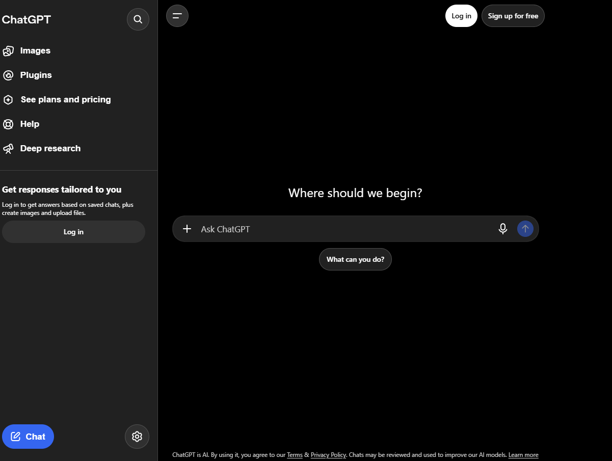
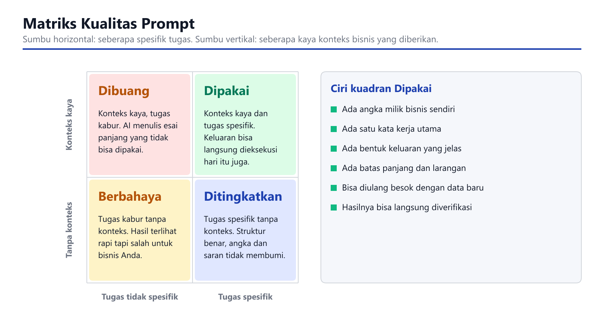

# Panduan Lengkap Data Analytics untuk UMKM Indonesia

---

## Daftar Isi

**BAGIAN 1: FONDASI DATA ANALYTICS**

- Bab 1: Mengapa Data Analytics Bukan Lagi Pilihan untuk UMKM
- Bab 2: Jenis-Jenis Data dan Sumbernya
- Bab 3: Pengumpulan dan Penyimpanan Data
- Bab 4: Data Cleaning dan Preparation
- Bab 5: Visualisasi Data yang Efektif

**BAGIAN 2: ANALISIS DAN INSIGHT**

- Bab 6: Statistik Dasar untuk Bisnis
- Bab 7: Tools dan Software Analytics
- Bab 8: Building Dashboard dan Reporting
- Bab 9: Predictive Analytics dan Forecasting
- Bab 10: Customer Analytics dan Segmentation
- Bab 11: Sales dan Marketing Analytics
- Bab 12: Operational Analytics

**BAGIAN 3: IMPLEMENTASI DAN SCALE**

- Bab 13: Integrasi dengan Sistem Bisnis
- Bab 14: Otomasi dan Advanced Analytics
- Bab 15: Studi Kasus Nyata UMKM Indonesia
- Bab 16: Roadmap 30 Hari dan Next Steps

---

# BAGIAN 1: FONDASI DATA ANALYTICS

---

## Bab 1: Mengapa Data Analytics Bukan Lagi Pilihan untuk UMKM

Bayangkan Anda punya warung kopi kecil di Yogyakarta. Setiap pagi Anda mencatat berapa gelas kopi yang terjual, rasa apa yang paling laris, dan jam berapa pelanggan ramai. Catatan sederhana itu sebenarnya sudah merupakan bentuk data analytics. Yang membedakan warung kopi yang bertahan lima tahun dengan yang tutup dalam enam bulan seringkali bukan soal rasa kopi, tapi seberapa baik pemiliknya membaca pola dari data yang mereka kumpulkan.

UMKM di Indonesia menghadapi tekanan yang semakin kompleks. Kompetisi bukan lagi hanya dengan toko sebelah, tapi dengan seller online dari kota lain, bahkan dari luar negeri. Konsumen semakin menuntut pengalaman personal. Margin keuntungan tipis, dan setiap keputusan bisnis yang salah bisa berakibat fatal. Dalam konteks inilah data analytics berubah dari kemewahan menjadi kebutuhan.

Data analytics memberikan Anda kemampuan untuk mengambil keputusan berdasarkan fakta, bukan intuisi semata. Intuisi bisnis memang berharga, apalagi untuk pengusaha yang sudah berpengalaman puluhan tahun. Tapi intuisi punya batas. Ketika Anda menghadapi 500 SKU produk, 3.000 transaksi per bulan, dan 20 channel penjualan berbeda, otak manusia tidak cukup untuk memproses semua pola yang tersembunyi di dalamnya. Di sinilah data analytics masuk.

Mari kita lihat angka yang konkret. Sebuah survei terhadap 200 UMKM di Jawa Barat menunjukkan bahwa bisnis yang menerapkan data analytics dasar (setidaknya tracking penjualan dan inventory secara terstruktur) mengalami pertumbuhan revenue rata-rata 23% lebih tinggi dibandingkan yang tidak. Angka ini bukan kebetulan. Ketika Anda tahu produk mana yang margin-nya paling tebal dan paling cepat perputarannya, Anda bisa mengalokasikan modal dengan lebih efisien. Ketika Anda tahu jam berapa traffic website paling tinggi, Anda bisa mengatur jadwal promosi dengan presisi.

Banyak pemilik UMKM berpikir bahwa data analytics itu mahal dan rumit. Anggapan ini muncul dari gambaran bahwa analytics memerlukan tim data scientist dengan gaji puluhan juta per bulan. Realitanya berbeda. Tools gratis seperti Google Sheets, Google Analytics, dan dashboard bawaan platform e-commerce sudah cukup untuk memulai. Yang dibutuhkan bukan infrastruktur mahal, tapi pola pikir untuk menjadikan data sebagai dasar pengambilan keputusan.

Penerapan data analytics di UMKM Indonesia juga punya karakteristik unik. Berbeda dengan enterprise besar yang datanya sudah terstruktur rapi dalam sistem ERP, UMKM seringkali memulai dari data yang tersebar: catatan transaksi di buku, chat WhatsApp dengan pelanggan, laporan penjualan di Excel, dan review di marketplace. Tantangan utamanya bukan pada sofisticated algorithm, tapi pada kemampuan mengumpulkan, merapikan, dan membaca data yang sudah ada.

Ada tiga level kematangan data analytics yang perlu Anda pahami. Level pertama adalah descriptive analytics, yaitu kemampuan untuk menjawab pertanyaan "apa yang terjadi". Contoh sederhana: laporan penjualan bulanan, jumlah pelanggan baru per minggu, atau rata-rata nilai transaksi. Level kedua adalah diagnostic analytics, yaitu kemampuan untuk menjawab "mengapa ini terjadi". Misalnya, mengapa penjualan turun di minggu kedua bulan Maret? Apakah karena kampanye iklan berhenti, atau karena kompetitor launching produk baru? Level ketiga adalah predictive analytics, yaitu kemampuan untuk memperkirakan "apa yang akan terjadi". Ini melibatkan forecasting demand, memprediksi customer churn, atau mengestimasi revenue kuartal berikutnya.

Kabar baiknya, Anda tidak perlu langsung melompat ke level ketiga. Sebagian besar UMKM Indonesia masih berkutat di level pertama, dan itu sudah memberikan dampak signifikan. Membuat laporan penjualan yang konsisten, membandingkan performa antar periode, dan mengidentifikasi tren dasar sudah cukup untuk memberikan keunggulan kompetitif.

Pertanyaan yang sering muncul: "Bisnis saya masih kecil, apakah sudah perlu data analytics?" Jawabannya justru terbalik. Semakin dini Anda membangun kebiasaan berbasis data, semakin kuat fondasi bisnis Anda saat scale up. Menunggu sampai bisnis besar baru mulai mengumpulkan data sama seperti menunggu rumah roboh baru memeriksa pondasi.

Dalam buku ini, kita akan membangun pemahaman data analytics dari nol. Tidak perlu background matematika atau IT. Yang Anda butuhkan adalah kemauan untuk melihat bisnis melalui lensa data, dan kesabaran untuk membangun kebiasaan baru secara bertahap. Setiap bab dirancang untuk langsung bisa dipraktikkan, dengan contoh konkret dari konteks UMKM Indonesia.

Siapkan kopi Anda, buka laptop, dan mari kita mulai perjalanan ini.

---

## Bab 2: Jenis-Jenis Data dan Sumbernya

Sebelum kita mulai menganalisis, kita perlu memahami bahan mentahnya: data. Memahami jenis-jenis data dan dari mana mendapatkannya adalah langkah pertama yang menentukan kualitas seluruh proses analytics Anda.

Data dalam bisnis UMKM bisa dikategorikan menjadi beberapa tipe utama. Pemahaman ini bukan sekadar teori akademis, tapi membantu Anda memilih cara penyimpanan, tools analisis, dan teknik visualisasi yang tepat.

**Data Transaksional**

Ini adalah data yang paling familiar bagi setiap pebisnis. Setiap kali ada penjualan, pembelian, atau pertukaran nilai, tercipta data transaksional. Contoh: tanggal transaksi, item yang dibeli, jumlah, harga, metode pembayaran, dan identitas pelanggan. Data transaksional adalah tulang punggung analytics bisnis Anda. Dari sinilah Anda bisa menghitung revenue, margin, average order value, dan banyak metrik kunci lainnya.

Untuk UMKM yang sudah menggunakan POS (Point of Sale) system, data transaksional biasanya tersimpan otomatis. Tapi banyak yang masih mencatat manual di buku atau spreadsheet. Keduanya valid sebagai sumber data, asalkan konsisten dan lengkap. Yang perlu diwaspadai adalah data transaksional yang tidak tercatat, misalnya penjualan tunai yang lupa dicatat atau retur barang yang tidak didokumentasikan.

**Data Pelanggan**

Data pelanggan mencakup informasi demografis (nama, usia, lokasi, jenis kelamin), perilaku (frekuensi pembelian, preferensi produk, channel komunikasi), dan interaksi (keluhan, pertanyaan, review). Data ini memungkinkan Anda melakukan customer segmentation dan personalisasi, yang akan kita bahas mendalam di Bab 10.

Sumber data pelanggan bisa datang dari formulir pendaftaran di website, data pengiriman (alamat dan nomor telepon), interaksi di media sosial, program loyalty, atau bahkan percakapan langsung di WhatsApp. Setiap titik kontak dengan pelanggan menghasilkan data yang berharga.

**Data Produk dan Inventory**

Jumlah stok, harga pokok, kategori produk, supplier, tanggal masuk barang, tanggal kadaluarsa (untuk produk makanan), dan dimensi fisik (berat dan volume untuk perhitungan ongkir). Data produk dan inventory penting untuk mengoptimalkan pengadaan barang dan menghindari stockout atau overstock.

**Data Operasional**

Ini mencakup data yang lebih luas: jam operasional, jumlah karyawan yang bertugas, biaya listrik dan sewa, waktu produksi, tingkat cacat produk, dan sebagainya. Data operasional membantu Anda mengidentifikasi inefisiensi dan area perbaikan dalam proses bisnis sehari-hari.

**Data Marketing dan Digital**

Jika bisnis Anda memiliki kehadiran online, ada banyak data yang bisa dikumpulkan: traffic website (jumlah pengunjung, sumber traffic, halaman yang dilihat, durasi kunjungan), performa iklan (impressions, clicks, cost per click, conversion rate), engagement media sosial (likes, shares, comments, reach), dan email marketing metrics (open rate, click-through rate, unsubscribe rate).

Google Analytics adalah sumber utama untuk data website. Setiap platform e-commerce (Shopee, Tokopedia, TikTok Shop) menyediakan dashboard analytics bawaan. Media sosial juga memiliki insight tersendiri. Tantangannya bukan kekurangan data, tapi bagaimana menggabungkan data dari berbagai sumber ini menjadi satu pandangan yang koheren.

**Data Keuangan**

Arus kas, piutang, hutang, biaya tetap, biaya variabel, laba rugi, dan neraca. Data keuangan memberikan gambaran kesehatan bisnis secara keseluruhan. Banyak UMKM yang omzet-nya terlihat besar tapi sebenarnya merugi karena tidak mencatat biaya dengan lengkap.

**Data Eksternal**

Selain data internal, ada data dari luar bisnis yang juga berpengaruh: kondisi ekonomi makro, tren industri, cuaca (untuk bisnis tertentu seperti F&B dan pertanian), kebijakan pemerintah, dan aktivitas kompetitor. Data eksternal tidak selalu bisa dikuantifikasi dengan mudah, tapi mengabaikannya bisa membuat analisis Anda bias.

Sekarang, dari mana semua data ini berasal? Berikut sumber-sumber yang paling relevan untuk UMKM Indonesia:

**Catatan Manual dan Spreadsheet.** Banyak UMKM masih mengandalkan buku catatan atau Excel. Ini bukan kelemahan, selama pencatatan dilakukan secara konsisten dan terstruktur. Spreadsheet bahkan bisa menjadi titik awal yang baik untuk membangun budaya data-driven.

**Sistem POS.** Jika Anda menggunakan aplikasi kasir seperti Majoo, Pawoon, atau Moka, data transaksi sudah tercatat otomatis. Manfaatkan fitur reporting yang disediakan.

**Platform E-commerce.** Shopee Seller Center, Tokopedia Seller, dan TikTok Shop menyediakan data penjualan, traffic, dan konversi yang cukup detail. Unduh laporan secara berkala.

**Google Analytics dan Google Search Console.** Untuk bisnis yang punya website, dua tools gratis ini memberikan data yang sangat kaya tentang perilaku pengunjung.

**Media Sosial.** Instagram Insights, Facebook Page Insights, dan TikTok Analytics memberikan data engagement dan demografi audiens.

**Survei dan Feedback.** Jangan remehkan kekuatan survei langsung. Google Forms bisa digunakan untuk mengumpulkan feedback pelanggan secara gratis.

Kunci utama dalam pengumpulan data adalah konsistensi. Lebih baik memiliki data sederhana yang tercatat rutin setiap hari daripada data kompleks yang hanya dikumpulkan sesekali. Mulailah dari data yang paling mudah diakses dan paling berdampak pada keputusan bisnis Anda.

---

## Bab 3: Pengumpulan dan Penyimpanan Data

Mengumpulkan data adalah satu hal. Menyimpannya dengan cara yang terstruktur dan aman adalah hal lain yang sama pentingnya. Banyak UMKM yang sebenarnya punya data cukup untuk membuat keputusan bisnis yang lebih baik, tapi data tersebut tersebar di berbagai tempat, tidak terformat konsisten, atau bahkan hilang karena tidak ada sistem penyimpanan yang memadai.

Mari kita mulai dengan prinsip dasar: setiap data yang Anda kumpulkan harus punya tempat penyimpanan yang jelas, format yang konsisten, dan seseorang yang bertanggung jawab atasnya. Tanpa tiga hal ini, data Anda akan menjadi sampah digital yang lebih membingungkan daripada membantu.

**Menentukan Apa yang Perlu Dikumpulkan**

Kesalahan umum UMKM adalah mengumpulkan terlalu banyak data tanpa tujuan yang jelas. Sebelum mulai mencatat, tentukan pertanyaan bisnis yang ingin Anda jawab. Contoh:

- "Produk apa yang paling menguntungkan?" maka Anda perlu data penjualan per produk dan harga pokok per produk.
- "Kapan waktu terbaik untuk menjalankan kampanye iklan?" maka Anda perlu data traffic dan konversi per jam/hari.
- "Pelanggan mana yang paling bernilai?" maka Anda perlu data frekuensi pembelian dan total spending per pelanggan.

Setiap pertanyaan bisnis ini menentukan jenis data yang perlu dikumpulkan. Tanpa pertanyaan yang jelas, Anda akan tenggelam dalam data yang tidak actionable.

**Metode Pengumpulan Data**

Untuk data transaksional, cara paling efisien adalah menggunakan sistem POS atau aplikasi kasir digital. Jika bisnis Anda masih menggunakan pencatatan manual, pertimbangkan untuk beralih ke spreadsheet terstruktur minimal. Buat kolom-kolom yang konsisten: tanggal, nama produk, jumlah, harga satuan, total, metode pembayaran, dan nama pelanggan (jika ada).

Untuk data pelanggan, formulir pendaftaran online bisa digunakan. Jika pelanggan berbelanja di toko fisik, cukup minta nama dan nomor telepon saat transaksi. Untuk data digital marketing, pastikan tracking code (seperti Google Analytics tracking ID atau UTM parameters) sudah terpasang di semua channel online Anda.

Untuk data inventory, lakukan stock opname secara berkala dan catat setiap masuk-keluar barang. Aplikasi inventory sederhana seperti Sortir atau Juragan bisa membantu, atau minimal gunakan spreadsheet dengan update harian.

**Struktur Penyimpanan Data**

Penyimpanan data yang baik mengikuti beberapa prinsip:

**Konsistensi format.** Jika Anda menggunakan spreadsheet, pastikan format tanggal sama di semua sheet (misalnya DD/MM/YYYY), format angka konsisten (gunakan titik untuk desimal dan koma untuk ribuan, atau sebaliknya, tapi pilih satu dan patuhi), dan nama kolom tidak berubah-ubah.

**Pemisahan berdasarkan fungsi.** Buat folder atau sheet terpisah untuk data transaksional, data pelanggan, data inventory, dan data marketing. Pencampuran semua data dalam satu file akan menyulitkan saat Anda perlu menganalisis.

**Backup rutin.** Data yang hilang karena hardisk rusak atau file terhapus adalah mimpi buruk yang nyata. Gunakan cloud storage seperti Google Drive atau Dropbox untuk backup otomatis. Google Sheets bahkan lebih baik karena setiap perubahan tersimpan otomatis dan Anda bisa melihat riwayat versi sebelumnya.

**Keamanan data.** Data pelanggan mengandung informasi pribadi yang harus dilindungi. Pastikan file penyimpanan Anda dipassword atau dibatasi aksesnya. Untuk bisnis yang memiliki lebih dari satu karyawan, tentukan siapa yang boleh melihat dan mengedit data tertentu.

**Tools Penyimpanan untuk Berbagai Skala**

Untuk UMKM yang baru memulai, Google Sheets sudah sangat memadai. Keunggulannya: gratis, bisa diakses dari mana saja, kolaborasi real-time, dan terintegrasi dengan tools Google lainnya. Batasnya sekitar 5 juta cell per spreadsheet, yang lebih dari cukup untuk sebagian besar UMKM.

Ketika volume data mulai melebihi kapasitas spreadsheet (biasanya di atas 100.000 baris transaksi), pertimbangkan untuk beralih ke database sederhana. MySQL atau PostgreSQL bisa di-hosting di server murah (mulai dari Rp 50.000 per bulan di penyedia cloud lokal). Alternatifnya, gunakan Airtable yang menyediakan antarmuka spreadsheet dengan kekuatan database relational, dengan paket gratis hingga 1.200 record.

Untuk bisnis yang sudah menggunakan multiple platform penjualan (offline store, Shopee, Tokopedia, website sendiri), pertimbangkan tools integrasi seperti Zapier atau Make (dulu Integromat) untuk mengumpulkan data dari berbagai sumber ke satu tempat secara otomatis.

**Membangun Kebiasaan Pengumpulan Data**

Teknologi saja tidak cukup. Yang membedakan bisnis data-driven dari yang bukan adalah kebiasaan. Tetapkan prosedur standar: kapan data dicatat, siapa yang bertanggung jawab, dan bagaimana cara memverifikasi kelengkapannya.

Contoh prosedur sederhana untuk toko online: setiap pagi, admin mengunduh laporan penjualan hari sebelumnya dari semua marketplace, memasukkan ke spreadsheet master, memverifikasi bahwa jumlah transaksi sesuai dengan notifikasi pembayaran, dan mencatat stok yang perlu di-reorder. Proses ini mungkin memakan waktu 30 menit per hari, tapi dampaknya terhadap kualitas keputusan bisnis sangat besar.

Satu hal lagi yang sering diabaikan: dokumentasi. Catat definisi setiap kolom data, sumber datanya, dan frekuensi update-nya. Ketika bisnis Anda berkembang dan ada karyawan baru yang menangani data, dokumentasi ini akan menghemat waktu berhari-hari.

---

## Bab 4: Data Cleaning dan Preparation

Data yang baru dikumpulkan jarang sekali langsung siap dianalisis. Selalu ada masalah: angka yang salah ketik, format tanggal yang tidak konsisten, data duplikat, kolom yang kosong, atau nama pelanggan yang ditulis berbeda-beda untuk orang yang sama. Proses merapikan data ini disebut data cleaning, dan ini memakan waktu sekitar 60-80% dari total waktu proyek analytics. Angka ini terdengar mengejutkan, tapi siapa pun yang pernah bekerja dengan data nyata akan mengonfirmasi.

Mengapa data cleaning begitu krusial? Karena analisis yang bagus dengan data yang kotor akan menghasilkan insight yang salah. Dan keputusan bisnis yang didasarkan pada insight yang salah bisa lebih berbahaya daripada tidak menggunakan data sama sekali. Bayangkan Anda menghitung rata-rata nilai transaksi, tapi ada satu transaksi yang salah input (misalnya Rp 10.000.000 seharusnya Rp 100.000). Rata-rata Anda akan melonjak drastis dan memberikan gambaran yang tidak akurat tentang perilaku pelanggan.

**Jenis-Jenis Masalah Data yang Umum di UMKM**

**Data duplikat.** Pelanggan yang sama tercatat dua kali karena nama ditulis berbeda: "Budi Santoso" dan "budi santoso" atau "Budi S.". Transaksi yang sama tercatat dua kali karena kelalaian admin. Produk yang sama masuk ke inventory dengan kode yang berbeda.

**Format tidak konsisten.** Tanggal ditulis dalam berbagai format: "01/02/2025", "1 Feb 2025", "2025-02-01". Nomor telepon ada yang menggunakan 08 dan ada yang menggunakan +62. Nama kota: "JKT", "Jakarta", "DKI Jakarta", "jakarta pusat".

**Data kosong.** Kolom yang seharusnya terisi tapi dibiarkan blank. Misalnya, alamat pelanggan tidak diisi, atau kategori produk tidak ditentukan. Data kosong bisa menyebabkan error dalam perhitungan atau bias dalam analisis.

**Outlier atau anomali.** Nilai yang secara ekstrem berbeda dari pola umum. Bisa karena kesalahan input (harga produk Rp 999.999.999 seharusnya Rp 99.999), atau bisa juga kejadian nyata yang luar biasa (satu transaksi grosir yang nilainya 10 kali lipat dari transaksi biasa).

**Data yang sudah kadaluarsa.** Informasi pelanggan yang sudah tidak valid (nomor telepon yang berubah, alamat yang sudah pindah), harga produk yang sudah diupdate tapi data lama belum dihapus, atau data inventory yang tidak mencerminkan kondisi aktual.

**Teknik Data Cleaning Praktis**

Mari kita bahas teknik-teknik yang bisa langsung Anda terapkan, terutama menggunakan Google Sheets atau Excel.

**Menghapus duplikat.** Di Google Sheets, gunakan menu Data > Data cleanup > Remove duplicates. Di Excel, gunakan fitur Remove Duplicates di tab Data. Tapi sebelum menghapus, periksa dulu apakah data yang terlihat duplikat benar-benar identik atau hanya mirip. "Budi Santoso" dan "Budi Santosa" mungkin orang yang sama, tapi bisa juga berbeda.

**Standardisasi format.** Buat aturan format yang konsisten dan terapkan ke seluruh data. Untuk tanggal, pilih satu format (disarankan ISO format: YYYY-MM-DD untuk menghindari ambiguitas antara DD/MM dan MM/DD). Untuk nomor telepon, konversi semua ke format yang sama. Di Excel, Anda bisa menggunakan fungsi TEXT untuk mengubah format tanggal, dan SUBSTITUTE atau REPLACE untuk membersihkan nomor telepon.

**Mengisi data kosong.** Ada beberapa pendekatan: biarkan kosong (jika analisis yang akan dilakukan tidak terganggu oleh missing values), isi dengan nilai rata-rata atau median (imputasi), atau hapus baris yang memiliki data kosong terlalu banyak. Pilihan tergantung pada konteks dan proporsi data kosong. Jika hanya 2% dari 1.000 baris yang kosong di satu kolom, menghapus atau mengimputasi tidak akan mengubah hasil secara signifikan. Jika 30% yang kosong, Anda perlu lebih hati-hati.

**Menangani outlier.** Identifikasi outlier dengan menghitung rata-rata dan standar deviasi, lalu tandai data yang berada di luar 3 standar deviasi dari rata-rata. Atau gunakan pendekatan yang lebih sederhana: buat box plot dan lihat titik-titik yang berada jauh di luar whisker. Setelah outlier teridentifikasi, putuskan apakah akan dihapus, dikoreksi (jika jelas kesalahan input), atau dipertahankan (jika merepresentasikan kejadian nyata yang valid).

**Validasi silang.** Bandingkan data dari satu sumber dengan sumber lain untuk memastikan konsistensi. Total penjualan di spreadsheet harus sama dengan total di laporan POS. Jumlah stok di database inventory harus cocok dengan hasil stock opname fisik. Jika ada selisih, telusuri penyebabnya sebelum melanjutkan analisis.

**Membangun Pipeline Data Preparation**

Untuk UMKM yang mulai serius dengan data analytics, ada baiknya membangun proses data preparation yang terstruktur. Proses ini terdiri dari langkah-langkah yang dijalankan secara berurutan setiap kali Anda准备 menganalisis data baru.

Langkah pertama adalah ekstraksi: ambil data dari berbagai sumber (POS, marketplace, spreadsheet manual) dan gabungkan ke dalam satu file master. Langkah kedua adalah transformasi: standardisasi format, hitung kolom baru yang diperlukan (misalnya total harga = jumlah x harga satuan), dan kategorikan data (misalnya kelompokkan produk berdasarkan kategori). Langkah ketiga adalah pembersihan: hilangkan duplikat, isi data kosong, dan koreksi outlier. Langkah keempat adalah verifikasi: pastikan total dan jumlah record sesuai dengan ekspektasi, dan lakukan sanity check terhadap angka-angka kunci.

Proses ini mungkin terdengar merepotkan untuk dilakukan manual. Kabar baiknya, banyak langkah ini bisa diotomasi. Google Sheets memiliki fitur FILTER, QUERY, dan ARRAYFORMULA yang bisa melakukan transformasi data secara otomatis. Excel memiliki Power Query untuk hal yang sama. Kita akan membahas otomasi lebih lanjut di Bab 14.

**Dokumentasi Data Cleaning**

Setiap kali Anda melakukan data cleaning, catat apa yang Anda lakukan dan mengapa. Dokumentasi ini berguna untuk dua hal: pertama, ketika Anda perlu mengulangi proses yang sama di bulan berikutnya, Anda tinggal mengikuti catatan yang sudah ada. Kedua, ketika ada orang lain yang mengambil alih, mereka bisa memahami logika di balik keputusan cleaning yang Anda buat.

Catatan tidak perlu formal. Cukup tulis dalam format sederhana: "Tanggal 15 Maret 2025: Menghapus 23 baris duplikat dari data penjualan Februari. Mengisi 15 kolom alamat kosong dengan data dari formulir pendaftaran online. Mengoreksi 2 harga produk yang salah input (dari Rp 500.000 menjadi Rp 50.000 dan dari Rp 1.500 menjadi Rp 150.000)."

Data cleaning bukan pekerjaan yang glamor, tapi ini adalah fondasi dari semua analisis yang akan Anda lakukan. Menginvestasikan waktu untuk membersihkan data dengan benar akan menghemat waktu dan mencegah kesalahan di tahap-tahap selanjutnya.

---

## Bab 5: Visualisasi Data yang Efektif

Data yang sudah dibersihkan dan terstruktur masih belum banyak gunanya jika tidak bisa dipahami dengan cepat. Di sinilah visualisasi data berperan: mengubah angka-angka mentah menjadi gambar yang langsung bisa dibaca dan dipahami oleh otak manusia. Otak kita memproses informasi visual 60.000 kali lebih cepat daripada teks, dan pola yang tersembunyi dalam ribuan baris data bisa langsung terlihat ketika divisualisasikan dengan tepat.

Visualisasi data bukan sekadar membuat grafik yang cantik. Visualisasi yang efektif harus menjawab pertanyaan bisnis spesifik dalam waktu kurang dari 5 detik. Jika orang yang melihat dashboard Anda perlu lebih dari 5 detik untuk memahami apa yang terjadi, maka visualisasi tersebut gagal.

**Prinsip Dasar Visualisasi Data**

**Pilih chart yang sesuai dengan pesan.** Line chart untuk menunjukkan tren over time. Bar chart untuk membandingkan kategori. Pie chart untuk menunjukkan proporsi (tapi gunakan hanya jika kategorinya sedikit, maksimal 5-6). Scatter plot untuk melihat korelasi antara dua variabel. Heatmap untuk melihat pola dalam data dua dimensi. Tabel untuk menampilkan data detail yang perlu dibaca secara presisi.

**Hindari chart yang menyesatkan.** Sumbu Y yang tidak dimulai dari nol bisa membuat perbedaan kecil terlihat dramatis. Pie chart 3D mendistorsi proporsi. Menggunakan area (luas) untuk membandingkan nilai tunggal (mata manusia lebih akurat membandingkan panjang daripada luas). Selalu pastikan visualisasi Anda merepresentasikan data secara jujur.

**Gunakan warna dengan tujuan.** Warna bukan dekorasi. Gunakan warna berbeda untuk kategori berbeda, warna konsisten untuk metrik yang sama di seluruh dashboard, dan warna kontras untuk menyoroti data yang perlu perhatian (misalnya merah untuk target yang tidak tercapai, hijau untuk yang tercapai). Hindari menggunakan lebih dari 7 warna dalam satu chart.

**Sertakan konteks.** Angka 500 transaksi per bulan tidak berarti banyak tanpa konteks. Bandingkan dengan bulan sebelumnya (naik atau turun?), dengan target (tercapai atau tidak?), dengan rata-rata industri (di atas atau di bawah?). Konteks mengubah data mentah menjadi insight yang actionable.

**Tools Visualisasi untuk UMKM**

**Google Sheets dan Excel.** Keduanya memiliki fitur chart bawaan yang cukup untuk sebagian besar kebutuhan visualisasi UMKM. Kelebihan utamanya: Anda sudah familiar dengan tools ini, data sudah ada di spreadsheet, dan chart bisa diupdate otomatis ketika data berubah. Kekurangannya: pilihan chart terbatas dan kustomisasi visual tidak sefleksibel tools dedicated.

**Google Data Studio (sekarang Looker Studio).** Tool gratis dari Google yang terhubung langsung dengan Google Sheets, Google Analytics, dan berbagai sumber data lainnya. Anda bisa membuat dashboard interaktif yang bisa diakses melalui browser. Cocok untuk UMKM yang ingin dashboard profesional tanpa biaya lisensi.

**Tableau Public.** Versi gratis dari Tableau yang sangat powerful. Kelemahannya: data Anda akan bersifat publik (tidak cocok untuk data sensitif), dan ada batasan jumlah row yang bisa di-handle. Tapi untuk visualisasi dan eksplorasi data, ini adalah salah satu tool terbaik yang tersedia gratis.

**Power BI.** Microsoft Power BI memiliki versi gratis (Power BI Desktop) yang cukup untuk penggunaan individual. Keunggulannya: integrasi yang mulus dengan ekosistem Microsoft (Excel, Azure, SQL Server), kemampuan handling data yang besar, dan visualisasi yang sangat kustomizable. Untuk UMKM yang sudah menggunakan Microsoft 365, ini pilihan yang natural.

**Metabase.** Tool open-source yang bisa di-self-host. Cocok untuk UMKM yang memiliki akses ke server dan ingin dashboard analytics tanpa biaya lisensi. Metabase terhubung ke database dan memungkinkan non-technical user untuk membuat query dan visualisasi sederhana.

**Membuat Dashboard Pertama Anda**

Dashboard yang baik menjawab tiga pertanyaan dalam 5 detik: (1) Bagaimana performa bisnis secara keseluruhan? (2) Area mana yang perlu perhatian? (3) Apa tren yang sedang terjadi?

Mulailah dengan menentukan Key Performance Indicators (KPI) yang paling relevan untuk bisnis Anda. Untuk UMKM retail, KPI umum meliputi: total penjualan harian/mingguan/bulanan, jumlah transaksi, rata-rata nilai transaksi (average order value), produk terlaris, dan margin keuntungan. Untuk bisnis jasa, tambahkan: jumlah leads, conversion rate, customer satisfaction score, dan repeat customer rate.

Susun KPI ini dalam hierarki visual: angka paling penting di bagian atas dashboard (biasanya dalam bentuk scorecard atau big number), detail breakdown di tengah (chart dan grafik), dan informasi pendukung di bawah (tabel detail atau catatan).

Satu kesalahan yang sering dilakukan UMKM adalah membuat dashboard yang terlalu padat. Lebih baik memiliki 3-5 chart yang masing-masing menjawab satu pertanyaan bisnis dengan jelas daripada 15 chart yang membuat viewer bingung. Kurasi adalah kunci.

**Visualisasi untuk Audiens Berbeda**

Dashboard untuk pemilik bisnis berbeda dengan dashboard untuk manajer operasional atau staf pemasaran. Pemilik bisnis biasanya ingin melihat big picture: revenue, profit, growth trend. Manajer operasional butuh detail: inventory levels, order fulfillment times, defect rates. Staf pemasaran fokus pada: campaign performance, channel effectiveness, customer acquisition cost.

Buat dashboard terpisah untuk audiens berbeda, atau buat satu dashboard dengan lapisan detail yang bisa di-drill-down. Looker Studio dan Power BI sama-sama mendukung fitur ini.

**Tips Praktis Visualisasi Data UMKM**

Gunakan perbandingan periode (month-over-month, year-over-year) untuk menunjukkan apakah bisnis sedang membaik atau memburuk. Sertakan target line pada chart untuk menunjukkan apakah performa sudah sesuai ekspektasi. Gunakan conditional formatting di spreadsheet untuk menyoroti angka yang di atas atau di bawah threshold tertentu tanpa perlu membuat chart terpisah. Dan yang paling utama: update dashboard secara rutin. Dashboard yang tidak diupdate adalah dashboard yang tidak dipercaya, dan ketika kepercayaan hilang, orang akan kembali ke intuisi.

Visualisasi data yang efektif adalah jembatan antara kompleksitas data dan kecepatan pengambilan keputusan. Ketika Anda bisa melihat tren penjualan dalam satu glance, ketika anomali langsung terlihat mencolok, ketika perbandingan performa antar produk bisa dipahami tanpa membaca tabel angka, di situlah visualisasi data menjalankan fungsinya dengan baik.

---

# BAGIAN 2: ANALISIS DAN INSIGHT

---

## Bab 6: Statistik Dasar untuk Bisnis

Banyak UMKM yang mendengar kata "statistik" langsung merasa tidak mampu. Bayangan tentang rumus rumit dan perhitungan kompleks membuat mereka mundur sebelum mencoba. Padahal, statistik yang dibutuhkan untuk bisnis sehari-hari jauh lebih sederhana dari yang dibayangkan. Anda tidak perlu gelar matematika untuk memahami dan menerapkan konsep-konsep dasar yang bisa langsung meningkatkan kualitas keputusan bisnis Anda.

**Rata-rata (Mean), Median, dan Modus**

Tiga ukuran pemusatan data ini adalah fondasi dari semua analisis statistik. Masing-masing punya kegunaan berbeda tergantung konteks bisnis.

Rata-rata (mean) adalah total semua nilai dibagi jumlah data. Gunakan untuk menghitung rata-rata nilai transaksi, rata-rata penjualan per hari, atau rata-rata biaya per unit produksi. Kelemahan mean: sangat sensitif terhadap outlier. Jika 9 transaksi bernilai Rp 50.000 dan 1 transaksi bernilai Rp 5.000.000, rata-ratanya menjadi Rp 545.000, yang tidak merepresentasikan mayoritas transaksi.

Median adalah nilai tengah ketika semua data diurutkan. Gunakan ketika data Anda memiliki outlier yang signifikan. Median nilai transaksi lebih akurat menggambarkan "typical customer spending" dibandingkan mean. Dalam contoh di atas, mediannya adalah Rp 50.000, yang jauh lebih representatif.

Modus adalah nilai yang paling sering muncul. Gunakan untuk mengidentifikasi produk terlaris, jam tersibuk, atau kategori pelanggan terbanyak. Modus tidak terpengaruh outlier dan mudah dipahami.

**Standar Deviasi dan Variabilitas**

Standar deviasi mengukur seberapa tersebar data dari rata-ratanya. Dalam konteks bisnis, ini membantu Anda memahami konsistensi. Jika rata-rata penjualan harian Anda Rp 2 juta dengan standar deviasi Rp 200.000, penjualan Anda sangat konsisten. Jika standar deviasinya Rp 800.000, penjualan Anda fluktuatif, dan Anda perlu menginvestigasi penyebabnya.

Standar deviasi juga membantu mengidentifikasi anomali. Aturan praktis: data yang berada lebih dari 2 standar deviasi dari mean patut dicurigai sebagai outlier. Dalam konteks inventory, ini bisa berarti ada produk yang penjualannya tidak normal (sangat tinggi atau sangat rendah) yang perlu diteliti lebih lanjut.

**Persentil dan Distribusi**

Persentil membagi data menjadi 100 bagian yang sama besar. Persentil ke-80 berarti 80% data berada di bawah nilai tersebut. Dalam bisnis, persentil berguna untuk segmentasi pelanggan: pelanggan di persentil atas (top 20% berdasarkan spending) biasanya menyumbang proporsi revenue yang tidak proporsional (prinsip Pareto: 20% pelanggan menyumbang 80% revenue).

**Korelasi dan Hubungan Sebab-Akibat**

Korelasi mengukur kekuatan dan arah hubungan antara dua variabel. Koefisien korelasi berkisar antara -1 (hubungan negatif sempurna) hingga +1 (hubungan positif sempurna), dengan 0 berarti tidak ada hubungan linear.

Contoh bisnis: Anda mungkin menemukan korelasi positif antara spending iklan dan jumlah penjualan. Ini berarti ketika iklan naik, penjualan cenderung naik. Tapi hati-hati: korelasi bukan kausalitas. Bisa jadi ada variabel ketiga yang mempengaruhi keduanya (misalnya, musim liburan meningkatkan baik spending iklan maupun penjualan, karena banyak bisnis lain juga meningkatkan iklan mereka).

Meskipun korelasi tidak membuktikan sebab-akibat, ia tetap berguna untuk identifikasi pola dan pembuatan hipotesis. Jika Anda menemukan bahwa customer satisfaction score berkorelasi kuat dengan repeat purchase rate, itu layak diinvestigasi lebih lanjut, meskipun Anda perlu eksperimen tambahan untuk memastikan kausalitas.

**Tren dan Seasonality**

Tren adalah arah umum pergerakan data over time. Bisa naik (pertumbuhan), turun (penurunan), atau datar (stagnasi). Identifikasi tren membantu Anda memahami apakah bisnis sedang dalam trajectory yang sehat atau perlu intervensi.

Seasonality adalah pola berulang yang terkait dengan periode tertentu: harian (penjualan lunch lebih tinggi dari dinner di restoran), mingguan (weekend lebih ramai dari weekday), bulanan (tanggal muda lebih ramai karena gajian), atau tahunan (Lebaran dan Natal meningkatkan penjualan retail). Memahami seasonality membantu Anda merencanakan inventory, staffing, dan promosi dengan lebih efektif.

**Margin of Error dan Confidence Level**

Ketika Anda melakukan survei pelanggan atau A/B testing, hasilnya tidak pernah 100% akurat. Margin of error mengukur seberapa besar kemungkinan hasil sampel berbeda dari populasi sebenarnya. Confidence level (biasanya 95%) mengukur seberapa yakin Anda bahwa hasil sebenarnya berada dalam margin of error tersebut.

Untuk UMKM yang ingin melakukan survei pelanggan, memahami konsep ini membantu menentukan berapa banyak responden yang dibutuhkan. Survei terhadap 50 pelanggan dengan margin of error 14% memberikan gambaran kasar. Survei terhadap 200 pelanggan menurunkan margin of error menjadi 7%, yang lebih bisa diandalkan untuk pengambilan keputusan.

**Aplikasi Praktis Statistik dalam Keputusan Bisnis**

Mari kita lihat bagaimana konsep-konsep ini diterapkan dalam skenario nyata UMKM.

Skenario 1: Anda punya toko online sepatu. Rata-rata nilai transaksi Rp 350.000 dengan median Rp 280.000. Fakta bahwa mean lebih tinggi dari median menunjukkan ada sebagian kecil transaksi bernilai sangat tinggi (mungkin pembelian grosir atau produk premium). Strategi bisnisnya: pertimbangkan untuk membuat program khusus untuk high-value customers ini.

Skenario 2: Anda menjalankan kafe. Standar deviasi penjualan harian sangat tinggi di hari kerja tapi rendah di weekend. Ini menunjukkan bahwa penjualan weekday tidak konsisten, mungkin tergantung cuaca, event di sekitar, atau faktor lain. Strategi bisnisnya: fokuskan promosi weekday untuk menstabilkan revenue, misalnya dengan program loyalty atau happy hour.

Skenario 3: Anda menjual produk skincare online. Setelah menjalankan kampanye Instagram Ads selama 3 bulan, Anda ingin tahu apakah ada korelasi antara spending iklan dan penjualan. Hitung koefisien korelasi: jika hasilnya di atas 0.7, ada hubungan positif yang kuat, dan Anda bisa mempertimbangkan untuk meningkatkan budget iklan. Jika di bawah 0.3, spending iklan bukan driver utama penjualan, dan Anda perlu mencari channel lain.

Statistik bukan tentang menghafal rumus. Statistik adalah tentang memahami pola dalam data Anda dan menggunakan pemahaman itu untuk membuat keputusan yang lebih baik. Mulailah dari konsep sederhana, terapkan secara konsisten, dan tingkatkan kompleksitas seiring kebutuhan bisnis Anda berkembang.

---

## Bab 7: Tools dan Software Analytics

Pilihan tools analytics untuk UMKM Indonesia sangat beragam, dari yang gratis hingga yang berbayar, dari yang sangat sederhana hingga yang sangat kompleks. Kunci memilih tools yang tepat bukan mencari yang paling canggih, tapi yang paling sesuai dengan kebutuhan, kapasitas tim, dan budget bisnis Anda.

**Spreadsheet: Google Sheets dan Microsoft Excel**

Spreadsheet tetap menjadi tulang punggung analytics untuk sebagian besar UMKM Indonesia. Alasannya sederhana: familiar, fleksibel, dan gratis (Google Sheets) atau sudah termasuk dalam paket Microsoft 365 (Excel).

Google Sheets unggul dalam kolaborasi. Beberapa orang bisa mengedit spreadsheet yang sama secara bersamaan, perubahan tersimpan otomatis di cloud, dan Anda bisa mengakses dari perangkat apa pun dengan browser. Fitur QUERY di Google Sheets memungkinkan Anda melakukan operasi database dasar (filter, sort, aggregate) langsung dalam spreadsheet, yang sangat powerful untuk analisis data tanpa perlu tools tambahan.

Excel unggul dalam pengolahan data berat. Jika Anda memiliki dataset di atas 100.000 baris, Excel akan lebih responsif daripada Google Sheets. Power Query (built-in di Excel 2016 ke atas) memungkinkan Anda melakukan data cleaning dan transformation secara otomatis. PivotTable di Excel juga lebih fleksibel dan powerful dibandingkan Google Sheets untuk analisis interaktif.

Kapan menggunakan spreadsheet: untuk analisis ad-hoc, dataset kecil hingga menengah, reporting sederhana, dan ketika tim Anda belum memiliki skill analytics yang lebih advanced.

**Google Analytics**

Untuk UMKM yang memiliki website, Google Analytics adalah tool wajib. Versi gratisnya (Google Analytics 4) sudah sangat powerful. Anda bisa melacak: berapa banyak pengunjung website Anda, dari mana mereka datang (organic search, social media, paid ads, direct), halaman apa yang mereka kunjungi, berapa lama mereka tinggal, dan apakah mereka melakukan aksi yang diinginkan (pembelian, formulir kontak, download katalog).

Implementasi Google Analytics membutuhkan pemasangan tracking code di website Anda. Jika menggunakan WordPress, plugin seperti Site Kit by Google memudahkan proses ini. Jika menggunakan website builder seperti Wix atau Shopify, integrasi Google Analytics biasanya tersedia di settings.

Data dari Google Analytics membantu Anda menjawab pertanyaan seperti: channel marketing mana yang paling efektif mendatangkan pelanggan? Halaman produk mana yang paling banyak dilihat tapi tidak menghasilkan penjualan (indikasi ada masalah di pricing atau trust)? Dari kota mana saja pengunjung website Anda berasal?

**Google Search Console**

Tool gratis lainnya dari Google yang melengkapi Google Analytics. Search Console fokus pada performa website Anda di hasil pencarian Google. Anda bisa melihat: kata kunci apa yang digunakan orang untuk menemukan website Anda, di posisi berapa website Anda muncul untuk kata kunci tertentu, dan berapa click-through rate dari hasil pencarian ke website Anda.

Untuk UMKM yang mengandalkan organic traffic (yang seharusnya semua bisnis online), data dari Search Console sangat berharga untuk mengoptimalkan SEO. Jika Anda menemukan bahwa website Anda muncul di halaman kedua Google untuk kata kunci "sepatu kulit handmade", Anda tahu persis di mana harus fokus: optimalkan halaman tersebut untuk kata kunci itu, dan dorong ranking-nya ke halaman pertama.

**Dashboard dan Business Intelligence Tools**

Ketika bisnis Anda berkembang dan kebutuhan analytics meningkat, spreadsheet saja tidak cukup. Di sinilah tools BI (Business Intelligence) masuk.

**Looker Studio (dulu Google Data Studio).** Tool gratis dari Google yang memungkinkan Anda membuat dashboard interaktif dari berbagai sumber data. Keunggulan utamanya: gratis, mudah digunakan (drag-and-drop), dan terintegrasi dengan Google Sheets, Google Analytics, Google Ads, dan banyak sumber data lainnya. Cocok untuk UMKM yang ingin dashboard profesional tanpa investasi besar.

**Tableau Public.** Versi gratis dari Tableau, salah satu tool visualisasi data paling populer di dunia. Anda bisa membuat visualisasi yang sangat menarik dan interaktif. Kekurangannya: data Anda harus publik (bisa dilihat orang lain), dan ada batasan jumlah baris data. Tapi untuk belajar dan eksplorasi, ini tool yang excellent.

**Microsoft Power BI.** Power BI Desktop gratis untuk penggunaan individual. Kekuatannya: kemampuan handling data yang sangat besar, integrasi dengan ekosistem Microsoft, dan visualisasi yang sangat kustomizable. Untuk UMKM yang sudah menggunakan Microsoft 365, Power BI adalah pilihan natural. Versi berbayarnya (Power BI Pro, mulai dari USD 10 per user per bulan) menambahkan fitur kolaborasi dan sharing.

**Metabase.** Open-source business intelligence tool yang bisa di-host di server sendiri. Cocok untuk UMKM yang memiliki akses teknis (atau bisa menyewa freelancer untuk setup awal) dan ingin dashboard analytics tanpa biaya lisensi. Metabase terhubung ke berbagai database dan memungkinkan user non-teknis untuk membuat query dan visualisasi sederhana.

**Tools Khusus untuk E-commerce**

Jika bisnis Anda beroperasi di marketplace, manfaatkan tools analytics bawaan platform:

**Shopee Seller Center.** Menyediakan data penjualan, traffic toko, konversi, dan performa produk. Fitur "Business Insights" memberikan analisis tren dan rekomendasi.

**Tokopedia Seller.** Dashboard penjual menyediakan data omzet, jumlah pesanan, tingkat pembatalan, dan rating toko. Gunakan data ini untuk mengidentifikasi produk yang perlu di-optimasi atau di-discontinue.

**TikTok Shop Seller Center.** Analytics mencakup data video performance, live streaming metrics, dan penjualan produk. Untuk bisnis yang mengandalkan TikTok sebagai channel utama, data ini sangat berharga.

**Tools untuk Social Media Analytics**

**Instagram Insights.** Tersedia untuk akun bisnis/kreator. Data mencakup reach, impressions, engagement rate, demografi followers, dan performa per posting.

**Facebook Page Insights.** Mirip dengan Instagram, plus data tentang page likes, post reach, dan video views.

**TikTok Analytics.** Data video performance, follower growth, dan audience demographics.

**Tools untuk Customer Analytics**

**WhatsApp Business API.** Untuk UMKM yang menggunakan WhatsApp sebagai channel komunikasi utama dengan pelanggan, tools seperti Woko, Qontak, atau Wablas menyediakan fitur tracking percakapan, auto-reply analytics, dan customer segmentation.

**CRM (Customer Relationship Management) Tools.** HubSpot CRM (gratis untuk fitur dasar), Zoho CRM (mulai dari USD 14 per user per bulan), atau Mekari Qontak (lokal Indonesia) membantu Anda melacak interaksi pelanggan secara terstruktur dan menganalisis pola pembelian.

**Memilih Tools yang Tepat**

Pertimbangan utama dalam memilih tools: (1) Budget, (2) Kapasitas tim (apakah ada yang bisa mengoperasikan tool tersebut?), (3) Kebutuhan spesifik (apa pertanyaan bisnis yang ingin dijawab?), dan (4) Skalabilitas (apakah tool ini bisa tumbuh bersama bisnis Anda?).

Jangan terjebak dalam analisis paralysis. Mulailah dengan tools yang sudah Anda punya (kemungkinan besar spreadsheet), kuasai fitur-fitur dasarnya, dan upgrade ketika Anda benar-benar membutuhkan kemampuan yang tidak bisa disediakan oleh tool saat ini.

---

## Bab 8: Building Dashboard dan Reporting

Dashboard yang baik adalah mirror dari bisnis Anda. Dalam satu layar, Anda bisa melihat kesehatan bisnis secara keseluruhan, mengidentifikasi area yang bermasalah, dan menemukan peluang yang tersembunyi. Tapi membangun dashboard yang efektif bukan soal menumpuk sebanyak mungkin chart dalam satu halaman. Ini soal kurasi, hierarki visual, dan kejelasan pesan.

**Prinsip Desain Dashboard**

**Less is more.** Batasi dashboard Anda pada 5-7 elemen visual utama. Lebih dari itu, viewer akan mengalami cognitive overload dan justru tidak bisa mengambil insight. Setiap chart atau angka di dashboard harus punya tujuan: menjawab pertanyaan bisnis spesifik.

**Hierarki informasi.** Letakkan metrik paling penting di posisi paling prominent (biasanya pojok kiri atas, karena mata orang membaca dari kiri ke kanan, atas ke bawah). Gunakan big number (angka besar) untuk KPI utama, chart untuk tren dan perbandingan, dan tabel detail di bagian bawah untuk drill-down.

**Konsistensi visual.** Gunakan palet warna yang sama di seluruh dashboard. Warna harus punya makna: misalnya hijau untuk metrik yang di atas target, merah untuk yang di bawah, abu-abu untuk netral. Jangan menggunakan warna berbeda untuk metrik yang sama di chart yang berbeda.

**Konteks dan perbandingan.** Angka tunggal tanpa konteks tidak bermakna. "Penjualan bulan ini: Rp 150 juta" tidak memberitahu Anda apakah ini bagus atau buruk. Tambahkan perbandingan: "naik 12% dari bulan lalu" atau "di bawah target 8%". Ini memberikan konteks yang langsung actionable.

**Membangun Dashboard dengan Looker Studio**

Looker Studio adalah pilihan terbaik untuk UMKM Indonesia karena gratis, mudah digunakan, dan terintegrasi dengan banyak sumber data. Berikut langkah-langkah membangun dashboard pertama Anda:

Langkah 1: Siapkan sumber data. Jika data Anda ada di Google Sheets, pastikan struktur sheet-nya rapi: satu sheet untuk satu jenis data, kolom memiliki header yang jelas, dan data diupdate secara rutin. Untuk menghubungkan Google Sheets ke Looker Studio, gunakan menu "Add data" > "Google Sheets" dan pilih spreadsheet yang diinginkan.

Langkah 2: Tentukan layout. Buat wireframe sederhana di kertas: di mana big number KPI akan diletakkan, chart apa saja yang dibutuhkan, dan bagaimana flow informasinya. Layout yang umum: baris atas untuk 3-4 scorecard KPI utama, baris tengah untuk 2-3 chart tren dan perbandingan, baris bawah untuk tabel detail atau chart pendukung.

Langkah 3: Tambahkan scorecard. Scorecard menampilkan satu angka kunci dengan perubahannya. Contoh: "Total Penjualan: Rp 150.000.000 (+12% vs bulan lalu)". Di Looker Studio, gunakan komponen "Scorecard" dan pilih metrik yang diinginkan.

Langkah 4: Tambahkan chart. Pilih jenis chart yang sesuai dengan pesan yang ingin disampaikan. Line chart untuk tren waktu, bar chart untuk perbandingan kategori, pie chart untuk komposisi (gunakan sparing), dan tabel untuk data detail. Di Looker Studio, drag-and-drop komponen chart dari panel kanan ke canvas.

Langkah 5: Tambahkan filter interaktif. Filter memungkinkan viewer untuk mempersempit data berdasarkan periode waktu, kategori produk, atau segmen pelanggan. Di Looker Studio, gunakan komponen "Drop-down list" atau "Date range control" dan hubungkan dengan chart yang relevan.

Langkah 6: Test dan iterasi. Buka dashboard dari sudut pandang orang yang tidak familiar dengan bisnis Anda. Apakah mereka bisa memahami apa yang terjadi dalam 5 detik? Apakah ada chart yang membingungkan? Mintalah feedback dan perbaiki.

**Jenis-Jenis Dashboard untuk UMKM**

**Dashboard Penjualan.** Metrik utama: total revenue, jumlah transaksi, average order value, revenue per channel, revenue per kategori produk, dan tren harian/mingguan/bulanan. Gunakan line chart untuk tren, bar chart untuk perbandingan kategori, dan scorecard untuk angka kunci.

**Dashboard Inventory.** Metrik utama: total SKU, stock level per produk, produk dengan stok terendah (perlu reorder), produk dengan perputaran tercepat dan terlambat, nilai inventory total, dan forecast kebutuhan stok berdasarkan tren penjualan.

**Dashboard Marketing.** Metrik utama: traffic per channel, cost per acquisition, conversion rate per campaign, return on ad spend (ROAS), engagement rate media sosial, dan email marketing metrics. Dashboard ini membantu mengalokasikan budget marketing ke channel yang paling efektif.

**Dashboard Keuangan.** Metrik utama: revenue, COGS (Cost of Goods Sold), gross margin, operating expenses, net profit, cash flow, accounts receivable, dan accounts payable. Dashboard keuangan memberikan gambaran kesehatan finansial bisnis secara real-time.

**Dashboard Operasional.** Metrik utama: order fulfillment time, defect rate, customer complaint rate, employee productivity, dan supplier performance. Dashboard ini membantu mengidentifikasi bottleneck dalam operasi sehari-hari.

**Reporting: Dari Dashboard ke Keputusan**

Dashboard tanpa proses review yang konsisten tidak banyak gunanya. Tetapkan jadwal review: harian untuk metrik operasional (stok, pesanan), mingguan untuk metrik marketing (traffic, konversi), dan bulanan untuk metrik strategis (revenue, profit, growth).

Setiap sesi review harus menghasilkan action items. Bukan hanya "penjualan turun 5%", tapi "penjualan turun 5% karena produk A kehabisan stok selama 3 hari, perlu improve reorder point". Catat action items ini dan follow up di review berikutnya.

**Otomasi Reporting**

Looker Studio bisa di-schedule untuk mengirim snapshot dashboard via email pada waktu tertentu (harian, mingguan, bulanan). Ini memastikan stakeholder selalu mendapat update tanpa harus membuka dashboard secara manual. Untuk reporting yang lebih kompleks, pertimbangkan Google Apps Script untuk mengotomasi proses pengambilan data, kalkulasi, dan pengiriman laporan.

Satu prinsip yang perlu dipegang: dashboard dan reporting bukan tujuan akhir. Tujuannya adalah mempercepat siklus keputusan. Semakin cepat Anda melihat masalah atau peluang, semakin cepat Anda bisa merespons. Dashboard yang baik memangkas waktu dari "data tersedia" menjadi "keputusan diambil" dari hitungan minggu menjadi hitungan menit.

---

## Bab 9: Predictive Analytics dan Forecasting

Predictive analytics terdengar seperti konsep yang hanya relevan untuk perusahaan besar dengan tim data scientist. Padahal, prinsip dasarnya bisa diterapkan oleh UMKM dengan tools yang sudah Anda kenal. Inti dari predictive analytics adalah menggunakan data historis untuk memperkirakan apa yang akan terjadi di masa depan. Jika Anda pernah berpikir, "Berdasarkan penjualan tiga bulan terakhir, kira-kira berapa yang akan terjual bulan depan?", Anda sudah melakukan predictive analytics secara manual.

**Mengapa Forecasting Penting untuk UMKM**

UMKM di Indonesia sering menghadapi masalah cash flow karena perencanaan yang kurang akurat. Overstock mengikat modal yang seharusnya bisa diputar untuk produk lain. Stockout membuat pelanggan kecewa dan pindah ke kompetitor. Kekurangan karyawan di hari sibuk menurunkan kualitas layanan. Kelebihan kapasitas di hari sepi memboroskan biaya operasional. Semua masalah ini bisa dikurangi dengan forecasting yang lebih baik.

Forecasting tidak perlu sempurna untuk berguna. Perkiraan yang 80% akurat sudah jauh lebih baik daripada tebakan tanpa dasar. Dan seiring Anda mengumpulkan lebih banyak data dan memperbaiki metode, akurasi forecast akan meningkat.

**Metode Forecasting untuk UMKM**

**Moving Average.** Metode paling sederhana: rata-ratakan data dari N periode terakhir untuk memperkirakan periode berikutnya. Misalnya, untuk meramalkan penjualan minggu depan, rata-ratakan penjualan 4 minggu terakhir. Metode ini cocok untuk produk dengan permintaan yang relatif stabil dan tidak banyak fluktuasi musiman.

Contoh: Penjualan kopi latte per hari selama 7 hari terakhir: 45, 50, 48, 52, 47, 55, 50. Moving average 7 hari = 49,6. Perkiraan penjualan besok: sekitar 50 cup. Sederhana, tapi cukup akurat untuk perencanaan harian.

**Weighted Moving Average.** Variasi dari moving average yang memberikan bobot lebih besar pada data terbaru. Logikanya: data minggu lalu lebih relevan untuk meramalkan minggu ini dibandingkan data 4 minggu lalu. Bobot yang umum: 50% untuk minggu terakhir, 30% untuk minggu sebelumnya, 20% untuk dua minggu lalu.

**Exponential Smoothing.** Metode yang lebih sophisticated tapi masih bisa dihitung di spreadsheet. Prinsipnya mirip weighted moving average, tapi bobot menurun secara eksponensial untuk data yang semakin lama. Excel dan Google Sheets memiliki fungsi built-in untuk exponential smoothing (FORECAST.ETS di Excel).

**Seasonal Decomposition.** Jika bisnis Anda memiliki pola musiman yang kuat (misalnya penjualan baju meningkat menjelang Lebaran, atau penjualan es meningkat di musim panas), metode ini memisahkan data menjadi tiga komponen: tren (arah umum), seasonality (pola berulang), dan residual (variasi acak). Setelah komponen-komponen ini diidentifikasi, Anda bisa membuat forecast yang memperhitungkan seasonality.

Di Google Sheets, Anda bisa menggunakan fungsi FORECAST.ETS yang secara otomatis mendeteksi seasonality dan menghitung forecast. Syntax-nya: =FORECAST.ETS(target_date, values, timeline). Fungsi ini menggunakan Triple Exponential Smoothing yang menangani trend dan seasonality secara simultan.

**Regression Analysis.** Jika Anda ingin memahami bagaimana variabel tertentu mempengaruhi penjualan (misalnya, bagaimana spending iklan mempengaruhi jumlah pesanan), regression analysis adalah tool-nya. Regresi linear sederhana menghasilkan persamaan: Y = a + bX, di mana Y adalah variabel yang diprediksi (penjualan), X adalah variabel prediktor (spending iklan), a adalah intercept, dan b adalah koefisien yang menunjukkan seberapa kuat X mempengaruhi Y.

Excel memiliki fitur "Regression" di Data Analysis Toolpak yang bisa menghitung ini secara otomatis. Google Sheets bisa menggunakan fungsi SLOPE dan INTERCEPT untuk regresi sederhana.

**Aplikasi Praktis Predictive Analytics**

**Forecasting Penjualan.** Gunakan untuk merencanakan pengadaan inventory, menyusun budget, dan menetapkan target penjualan. Forecast bulanan berdasarkan data 6-12 bulan terakhir dengan metode moving average atau exponential smoothing. Review akurasi forecast setiap bulan dan sesuaikan metode jika diperlukan.

**Forecasting Demand per Produk.** Lebih granular dari forecast penjualan total. Lakukan per kategori produk atau per SKU individual. Ini membantu menentukan reorder point dan safety stock untuk setiap produk, sehingga Anda tidak kehabisan stok untuk produk yang laris dan tidak overstock untuk yang lambat.

**Customer Churn Prediction.** Identifikasi pelanggan yang berpotensi berhenti berbelanja. Pendekatan sederhana: analisis RFM (Recency, Frequency, Monetary). Pelanggan yang terakhir belanja sudah lama (Recency tinggi), frekuensi belanjanya rendah (Frequency rendah), dan total spending-nya kecil (Monetary rendah) memiliki risiko churn tinggi. Anda bisa membuat skor RFM di spreadsheet dan men-flag pelanggan dengan skor rendah untuk diberikan program retensi.

**Cash Flow Forecasting.** Proyeksikan arus kas masuk dan keluar untuk 1-3 bulan ke depan. Gunakan data historis untuk memperkirakan revenue berdasarkan pola musiman, dan jadwal pengeluaran tetap (gaji, sewa, supplier) untuk memproyeksikan cash outflow. Ini membantu Anda mengantisipasi periode cash flow negatif dan mengambil tindakan preventif (misalnya, menunda pembelian inventory non-esensial atau mengajukan fasilitas kredit).

**Keterbatasan Predictive Analytics untuk UMKM**

Predictive analytics bukan bola kristal. Forecast selalu mengandung ketidakpastian, terutama untuk UMKM yang datanya terbatas. Beberapa hal yang perlu diingat:

Data historis tidak selalu memprediksi masa depan dengan akurat. Perubahan drastis (pandemi, regulasi baru, masuknya kompetitor besar) bisa membuat pola historis tidak relevan. Selalu pertimbangkan faktor kualitatif di luar data.

Semakin jauh ke depan Anda memprediksi, semakin tidak akurat forecast-nya. Forecast mingguan lebih akurat dari forecast bulanan, yang lebih akurat dari forecast kuartalan. Gunakan horizon prediksi yang sesuai dengan siklus keputusan bisnis Anda.

Model forecast perlu di-review dan di-update secara berkala. Bandingkan hasil prediksi dengan realisasi setiap periode. Jika selisihnya konsisten terlalu besar, perbaiki model atau ganti metode.

Mulailah dari yang sederhana. Moving average atau exponential smoothing di spreadsheet sudah cukup untuk sebagian besar kebutuhan forecasting UMKM. Jangan terjebak dalam model yang terlalu kompleks jika data dan kebutuhan bisnis Anda tidak mengharuskannya.

---

## Bab 10: Customer Analytics dan Segmentation

Setiap pelanggan berbeda. Ada yang belanja setiap minggu dengan nilai transaksi tinggi, ada yang hanya datang sekali lalu tidak pernah kembali, ada yang hanya membeli produk diskon, dan ada yang selalu membeli produk premium. Memperlakukan semua pelanggan secara sama adalah kesalahan yang banyak dilakukan UMKM. Customer analytics membantu Anda memahami perbedaan ini dan meresponsnya dengan strategi yang tepat.

**Mengapa Customer Analytics Berbeda untuk UMKM Indonesia**

Konteks UMKM Indonesia punya karakteristik khusus. Banyak transaksi terjadi melalui WhatsApp, bukan melalui sistem terintegrasi. Data pelanggan seringkali tersimpan di kontak HP atau buku catatan, bukan di database. Pelanggan setia mungkin hanya puluhan orang, bukan ribuan. Tapi justru karena jumlahnya kecil, setiap pelanggan sangat berharga, dan memahami mereka secara personal memberikan keunggulan kompetitif yang signifikan.

**Metrik Kunci Customer Analytics**

**Customer Acquisition Cost (CAC).** Total biaya yang Anda keluarkan untuk mendapatkan satu pelanggan baru. Hitung dengan membagi total spending marketing dalam satu periode dengan jumlah pelanggan baru yang didapat di periode yang sama. Contoh: Anda menghabiskan Rp 2 juta untuk iklan Instagram dalam sebulan dan mendapatkan 40 pelanggan baru. CAC = Rp 2.000.000 / 40 = Rp 50.000 per pelanggan.

**Customer Lifetime Value (CLV).** Total revenue yang dihasilkan satu pelanggan selama mereka berbisnis dengan Anda. Rumus sederhana: (rata-rata nilai transaksi) x (rata-rata frekuensi transaksi per bulan) x (rata-rata lama hubungan dalam bulan). Contoh: pelanggan belanja rata-rata Rp 200.000 per transaksi, 2 kali per bulan, selama rata-rata 12 bulan. CLV = 200.000 x 2 x 12 = Rp 4.800.000.

Rasio CLV terhadap CAC menunjukkan kesehatan bisnis Anda. Jika CLV jauh lebih besar dari CAC (misalnya 5x atau lebih), bisnis Anda sustainable. Jika CLV lebih kecil atau sama dengan CAC, Anda rugi di setiap pelanggan baru.

**Repeat Purchase Rate.** Persentase pelanggan yang melakukan pembelian lebih dari satu kali. Rumus: (jumlah pelanggan yang beli lebih dari sekali) / (total pelanggan) x 100%. Repeat purchase rate yang tinggi menunjukkan kepuasan pelanggan dan efektivitas retensi.

**Average Order Value (AOV).** Rata-rata nilai setiap transaksi. Tingkatkan AOV dengan upselling (menawarkan versi lebih mahal), cross-selling (menawarkan produk pelengkap), atau bundling (paket produk dengan harga khusus).

**Churn Rate.** Persentase pelanggan yang berhenti berbelanja dalam periode tertentu. Untuk bisnis dengan transaksi rutin (misalnya langganan katering), churn rate mudah dihitung. Untuk bisnis dengan transaksi tidak rutin, definisikan "churn" sebagai tidak ada transaksi dalam periode tertentu (misalnya 90 hari).

**Segmentasi Pelanggan**

Segmentasi pelanggan adalah proses membagi basis pelanggan Anda menjadi kelompok-kelompok yang memiliki karakteristik serupa. Tujuannya: memperlakukan setiap kelompok dengan cara yang paling efektif untuk meningkatkan revenue dan retensi.

**Segmentasi RFM (Recency, Frequency, Monetary).** Ini adalah metode segmentasi yang paling praktis untuk UMKM. Setiap pelanggan dinilai berdasarkan tiga dimensi:

Recency: Kapan terakhir kali pelanggan berbelanja? Pelanggan yang baru saja belanja lebih mungkin untuk belanja lagi dibandingkan yang sudah lama tidak muncul.

Frequency: Seberapa sering pelanggan berbelanja dalam periode tertentu? Pelanggan yang belanja setiap minggu lebih engaged dibandingkan yang belanja setahun sekali.

Monetary: Berapa total spending pelanggan? Pelanggan dengan spending tinggi lebih berharga dibandingkan yang hanya membeli produk murah.

Beri skor 1-5 untuk setiap dimensi (5 = terbaik), lalu gabungkan menjadi skor RFM. Pelanggan dengan skor tinggi di ketiga dimensi adalah "Champions" (pelanggan terbaik Anda). Pelanggan dengan Recency rendah tapi Frequency dan Monetary tinggi adalah "At Risk" (dulu pelanggan setia, tapi sudah lama tidak belanja). Pelanggan dengan skor rendah di ketiga dimensi adalah "Lost" (sudah tidak aktif dan tidak mungkin kembali tanpa intervensi khusus).

**Segmentasi Berdasar Perilaku.** Selain RFM, Anda bisa mengelompokkan pelanggan berdasarkan perilaku mereka:

Price-sensitive buyers: Hanya belanja saat ada diskon atau promo. Strategi: gunakan flash sale untuk mendorong pembelian, tapi jangan terlalu sering agar tidak merusak persepsi nilai produk.

Premium buyers: Selalu memilih produk atau varian termahal. Strategi: tawarkan produk eksklusif, early access, atau loyalty tier khusus.

Category loyalists: Setia pada satu kategori produk tapi tidak pernah mencoba kategori lain. Strategi: cross-sell dengan rekomendasi produk dari kategori lain yang relevan.

New customers: Baru melakukan pembelian pertama. Strategi: onboarding sequence (email atau WhatsApp) untuk memperkenalkan produk lain dan membangun hubungan.

**Segmentasi Berdasar Demografi.** Untuk bisnis B2C, segmentasi berdasarkan usia, gender, lokasi, dan pendapatan bisa berguna untuk targeting iklan dan pengembangan produk. Data ini bisa dikumpulkan dari formulir pendaftaran, profil media sosial, atau survei pelanggan.

**Menerapkan Customer Analytics di UMKM**

Langkah pertama: kumpulkan data pelanggan dari semua sumber. Gabungkan data dari POS, marketplace, WhatsApp, dan website ke dalam satu spreadsheet master. Setiap baris adalah satu pelanggan, dengan kolom: nama, nomor telepon/WhatsApp, tanggal transaksi pertama, tanggal transaksi terakhir, jumlah transaksi, total spending, dan rata-rata nilai transaksi.

Langkah kedua: hitung skor RFM untuk setiap pelanggan. Di Google Sheets, Anda bisa menggunakan fungsi RANK atau NTILE untuk membagi pelanggan ke dalam quintile (5 kelompok) berdasarkan setiap dimensi.

Langkah ketiga: identifikasi segmen dan tentukan strategi untuk masing-masing. Champions perlu dipertahankan dengan pelayanan premium dan appreciation. At Risk perlu win-back campaign (diskon khusus atau pesan personal). Lost mungkin tidak worth di-invest, kecuali jika CLV potensial mereka tinggi.

Langkah keempat: eksekusi dan monitor. Kirim pesan yang dipersonalisasi ke setiap segmen. Ukur respons rate dan conversion rate. Iterasi berdasarkan hasil.

**Personalisasi untuk UMKM**

Kekuatan UMKM dibanding perusahaan besar adalah kedekatan personal dengan pelanggan. Anda bisa mengenal nama pelanggan, mengingat preferensi mereka, dan memberikan sentuhan personal yang tidak bisa di-scale oleh korporasi. Data analytics memperkuat kemampuan ini dengan memberikan informasi yang tepat tentang pelanggan yang tepat di waktu yang tepat.

Bayangkan Anda punya toko kue. Data menunjukkan bahwa pelanggan A selalu memesan birthday cake di bulan Maret (untuk ulang tahun anaknya). Mengirim pesan personal di akhir Februari: "Halo Bu A, tahun ini kakak ulang tahun lagi ya? Kami punya desain baru yang mungkin cocok!" jauh lebih efektif daripada blast promosi umum.

Itulah kekuatan customer analytics untuk UMKM: bukan untuk menggantikan sentuhan personal, tapi untuk memperkuatnya.

---

## Bab 11: Sales dan Marketing Analytics

Sales dan marketing adalah dua fungsi bisnis yang paling langsung terukur melalui data. Setiap rupiah yang dikeluarkan untuk iklan, setiap kampanye yang dijalankan, dan setiap transaksi yang terjadi meninggalkan jejak digital yang bisa dianalisis. Bagi UMKM, kemampuan untuk mengukur efektivitas marketing bukan hanya soal optimasi budget, tapi soal survival.

**Sales Analytics: Melampaui Total Penjualan**

Sebagian besar UMKM hanya melihat satu metrik penjualan: total revenue. Angka ini memang penting, tapi tidak cukup untuk membuat keputusan yang nuanced. Mari kita perluas perspektif.

**Revenue per Channel.** Jika Anda menjual di toko fisik, Shopee, Tokopedia, dan Instagram, berapa kontribusi masing-masing channel terhadap total revenue? Lebih penting lagi, berapa margin keuntungan per channel? Marketplace mengenakan fee 5-15%, iklan di platform tersebut mengurangi margin, dan biaya pengemasan serta pengiriman mempengaruhi profitabilitas. Revenue per channel yang terlihat besar bisa jadi kurang profitable dibandingkan channel yang revenue-nya lebih kecil tapi biayanya rendah.

**Revenue per Produk/Kategori.** Analisis Pareto (80/20 rule) sangat relevan di sini. Biasanya, 20% dari produk Anda menyumbang 80% dari revenue. Identifikasi produk-produk ini dan pastikan mereka selalu tersedia, dipromosikan dengan baik, dan memiliki margin yang sehat. Di sisi lain, identifikasi produk yang tidak berkontribusi signifikan dan pertimbangkan untuk di-discontinue atau di-clearance.

**Sales Velocity.** Seberapa cepat produk terjual setelah dipajang? Produk dengan velocity tinggi (cepat habis) membutuhkan strategi restock yang berbeda dengan produk yang perputarannya lambat. Sales velocity juga membantu menentukan pricing: jika produk habis dalam hitungan jam, mungkin harganya terlalu rendah.

**Conversion Funnel.** Setiap penjualan adalah hasil dari serangkaian langkah: orang melihat produk Anda (awareness), mengunjungi toko atau website (traffic), melihat detail produk (product view), menambahkan ke keranjang (add to cart), dan menyelesaikan pembelian (checkout). Di setiap langkah, ada orang yang keluar. Conversion funnel membantu Anda mengidentifikasi di mana kebocoran terbesar terjadi.

Contoh: dari 1.000 orang yang melihat iklan Anda, 200 mengklik (click-through rate 20%), 100 melihat detail produk (conversion dari klik ke view 50%), 30 menambahkan ke keranjang (add to cart rate 30%), dan 15 menyelesaikan pembelian (checkout conversion 50%). Total conversion rate: 15/1.000 = 1,5%. Jika Anda ingin meningkatkan penjualan, analisis funnel menunjukkan bahwa bottleneck ada di tahap klik ke view (50% orang yang klik tidak melihat produk). Mungkin halaman produk lambat dimuat, atau informasi di iklan tidak sinkron dengan halaman produk.

**Marketing Analytics: Mengukur ROI Setiap Channel**

**Return on Ad Spend (ROAS).** Metrik paling dasar untuk mengukur efektivitas iklan. ROAS = revenue dari iklan / biaya iklan. ROAS 5x berarti setiap Rp 1 yang dikeluarkan untuk iklan menghasilkan Rp 5 revenue. Apakah ROAS 5x bagus? Tergantung margin keuntungan Anda. Jika margin 20%, ROAS 5x berarti Anda untung Rp 1.000.000 dari iklan Rp 1.000.000 (revenue Rp 5.000.000 x margin 20% = Rp 1.000.000 profit, dikurangi biaya iklan Rp 1.000.000 = impas). Untuk profit, Anda butuh ROAS yang lebih tinggi dari break-even ROAS (1 / margin).

**Cost per Acquisition (CPA).** Berapa biaya untuk mendapatkan satu pelanggan yang melakukan pembelian? CPA = total biaya marketing / jumlah pelanggan baru. Bandingkan CPA dengan CLV (Customer Lifetime Value). Jika CPA lebih kecil dari CLV (idealnya CPA < 30% CLV), akuisisi pelanggan tersebut profitable.

**Engagement Metrics.** Untuk social media marketing, metrik engagement (likes, comments, shares, saves) menunjukkan seberapa resonan konten Anda dengan audiens. Tapi engagement bukan tujuan akhir. Engagement yang tinggi harus berkorelasi dengan traffic ke toko dan konversi penjualan. Jika engagement tinggi tapi penjualan tidak meningkat, konten Anda mungkin menghibur tapi tidak efektif secara komersial.

**Email dan WhatsApp Marketing Metrics.** Open rate (persentase penerima yang membuka pesan), click-through rate (persentase yang mengklik link dalam pesan), conversion rate (persentase yang melakukan pembelian setelah mengklik), dan unsubscribe rate (persentase yang berhenti berlangganan). Untuk WhatsApp, metriknya sedikit berbeda: response rate, response time, dan conversion dari chat ke penjualan.

**A/B Testing untuk Optimasi**

A/B testing adalah metode membandingkan dua versi dari sesuatu (iklan, halaman produk, email, harga) untuk menentukan mana yang lebih efektif. Prinsipnya: ubah satu variabel saja, pertahankan sisanya konstan, dan ukur perbedaannya.

Contoh A/B testing untuk UMKM: Anda ingin meningkatkan penjualan produk sepatu. Buat dua versi iklan Instagram: Versi A menggunakan foto produk dengan background putih, Versi B menggunakan foto model memakai sepatu di setting casual. Jalankan kedua iklan secara bersamaan dengan budget yang sama (masing-masing Rp 100.000) selama 3 hari. Bandingkan metrik: mana yang memiliki CTR lebih tinggi, CPA lebih rendah, dan ROAS lebih baik? Versi pemenang menjadi iklan utama Anda.

A/B testing tidak memerlukan tools mahal. Anda bisa melakukannya secara manual dengan spreadsheet. Yang penting adalah disiplin dalam metodologi: satu variabel yang diubah, sample size yang cukup, dan durasi yang memadai untuk mendapatkan hasil yang signifikan secara statistik.

**Attribution: Memahami Customer Journey**

Customer rarely membeli di first touch. Seseorang mungkin melihat iklan Anda di Instagram, kemudian mencari produk Anda di Google, mengunjungi website, lalu pergi tanpa membeli. Tiga hari kemudian, mereka melihat retargeting ad, klik, dan akhirnya membeli. Pertanyaannya: channel mana yang paling berjasa dalam konversi ini? Instagram ad yang pertama kali memperkenalkan brand? Google search yang memvalidasi minat? Atau retargeting ad yang menutup penjualan?

Untuk UMKM, full attribution modeling mungkin terlalu kompleks. Tapi memahami bahwa customer journey melibatkan multiple touchpoints sudah cukup untuk membuat keputusan marketing yang lebih baik. Jangan matikan channel yang tidak langsung menghasilkan konversi tapi berperan dalam membangun awareness.

**Membangun Marketing Dashboard**

Gabungkan semua metrik di atas ke dalam satu dashboard marketing yang memberikan pandangan holistik. Komponen utama: overview revenue dan target, performance per channel (dengan ROAS dan CPA), conversion funnel metrics, top performing campaigns, dan customer acquisition trend. Review dashboard ini mingguan untuk mengoptimalkan taktik, dan bulanan untuk mengevaluasi strategi.

---

## Bab 12: Operational Analytics

Sales dan marketing mendapat banyak perhatian karena hasilnya langsung terukur dalam revenue. Tapi operational analytics, yang sering diabaikan, sama pentingnya. Efisiensi operasional menentukan apakah revenue yang Anda hasilkan benar-benar menjadi profit, atau tergerus oleh pemborosan yang tidak terlihat.

**Apa Itu Operational Analytics?**

Operational analytics adalah penggunaan data untuk mengoptimalkan proses bisnis sehari-hari. Ini mencakup: manajemen inventory, efisiensi produksi, manajemen waktu karyawan, kualitas produk, logistik dan pengiriman, serta manajemen supplier. Tujuannya: mengurangi biaya, meningkatkan kecepatan, dan mempertahankan atau meningkatkan kualitas.

**Inventory Analytics**

Inventory adalah salah satu area di mana data analytics memberikan dampak paling langsung bagi UMKM retail dan manufaktur.

**Inventory Turnover Ratio.** Berapa kali inventory Anda terjual dan diganti dalam satu periode. Rumus: COGS / rata-rata nilai inventory. Turnover yang tinggi berarti produk cepat terjual (bagus, tapi hati-hati terhadap stockout). Turnover yang rendah berarti produk lambat bergerak (buruk, modal tertahan di gudang).

Contoh: COGS tahunan Rp 600 juta, rata-rata nilai inventory Rp 100 juta. Turnover = 6x per tahun, atau sekali setiap 2 bulan. Bandingkan dengan rata-rata industri Anda. Jika rata-rata industri 8x, Anda perlu mempercepat perputaran.

**Days Sales of Inventory (DSI).** Berapa hari rata-rata produk berada di gudang sebelum terjual. Rumus: 365 / inventory turnover. Dari contoh di atas: DSI = 365 / 6 = 61 hari. Artinya, rata-rata produk duduk di gudang selama 61 hari sebelum terjual.

**Reorder Point.** Kapan harus memesan ulang stok? Reorder point = (rata-rata penjualan harian x lead time dalam hari) + safety stock. Safety stock adalah buffer untuk mengantisipasi fluktuasi demand atau keterlambatan supplier. Jika rata-rata penjualan 10 unit per hari, lead time supplier 7 hari, dan safety stock 20 unit, maka reorder point = (10 x 7) + 20 = 90 unit. Ketika stok mencapai 90 unit, saatnya reorder.

**ABC Analysis.** Tidak semua produk sama pentingnya. ABC analysis mengelompokkan produk berdasarkan kontribusinya terhadap revenue atau profit:

Kategori A: 20% produk yang menyumbang 80% revenue. Produk ini perlu monitoring ketat, safety stock lebih tinggi, dan reorder point yang akurat.

Kategori B: 30% produk yang menyumbang 15% revenue. Monitoring standar, safety stock moderat.

Kategori C: 50% produk yang menyumbang 5% revenue. Monitoring minimal, pertimbangkan untuk di-discontinue jika tidak strategis.

**Produksi dan Kualitas**

Untuk UMKM yang memproduksi barang sendiri (makanan, kerajinan, pakaian), operational analytics mencakup efisiensi produksi dan kontrol kualitas.

**Cycle Time.** Waktu yang dibutuhkan untuk memproduksi satu unit produk, dari bahan mentah sampai barang jadi. Track cycle time per tahap produksi untuk mengidentifikasi bottleneck. Jika tahap pemotongan bahan memakan waktu 2 jam tapi pengemasan hanya 30 menit, ada ketidakseimbangan yang bisa dioptimasi.

**Defect Rate.** Persentase produk yang tidak memenuhi standar kualitas. Rumus: (jumlah produk cacat / total produk yang diproduksi) x 100%. Track defect rate per jenis cacat (ukuran salah, warna luntur, jahitan lepas, dll.) untuk mengidentifikasi akar masalah. Jika 60% cacat berasal dari satu jenis masalah, fokuskan perbaikan di situ.

**Yield.** Persentase bahan baku yang berhasil menjadi produk jadi. Jika Anda membuat kue dan dari 10 kg tepung menghasilkan 40 kue (masing-masing membutuhkan 0,2 kg tepung), yield-nya adalah 40 x 0,2 / 10 = 80%. Yield yang rendah menunjukkan pemborosan bahan yang perlu diinvestigasi.

**Logistik dan Pengiriman**

**Order Fulfillment Time.** Waktu dari pelanggan memesan sampai barang diterima. Ini mencakup: waktu pemrosesan pesanan, waktu pengemasan, dan waktu pengiriman. Track setiap komponen secara terpisah untuk mengidentifikasi di mana perlambatan terjadi.

**Shipping Cost per Order.** Rata-rata biaya pengiriman per pesanan. Analisis apakah ada korelasi antara jarak, berat, kurir, dan biaya. Mungkin ada pola di mana kurir tertentu lebih ekonomis untuk rute tertentu, atau packaging yang lebih efisien bisa mengurangi biaya volumetrik.

**Return Rate.** Persentase pesanan yang diretur oleh pelanggan. Track alasan retur (produk rusak, ukuran salah, tidak sesuai deskripsi) untuk mengidentifikasi masalah yang bisa diperbaiki. Return rate yang tinggi di satu kategori produk menunjukkan masalah kualitas atau deskripsi yang perlu ditangani.

**Manajemen Supplier**

**Supplier Lead Time.** Waktu rata-rata dari pemesanan ke supplier sampai barang diterima. Track konsistensi lead time: supplier yang selalu tepat waktu lebih bisa diandalkan daripada yang kadang cepat kadang lambat, meskipun rata-ratanya sama.

**Supplier Defect Rate.** Persentase bahan dari supplier yang tidak memenuhi standar. Ini mempengaruhi biaya produksi Anda (bahan cacat = waste = kerugian). Jika satu supplier memiliki defect rate jauh lebih tinggi dari yang lain, pertimbangkan untuk beralih atau negosiasi kualitas.

**Membangun Operational Dashboard**

Dashboard operasional yang efektif mencakup: inventory levels dan alert untuk stok rendah, order fulfillment metrics (waktu dan akurasi), production metrics (cycle time, defect rate, yield), dan cost metrics (biaya per unit, shipping cost, waste cost). Review dashboard ini harian untuk operasional, dan mingguan untuk identifikasi tren dan area perbaikan.

Operational analytics mungkin tidak se-sexy sales analytics, tapi dampaknya terhadap bottom line bisa sangat besar. Mengurangi defect rate dari 5% menjadi 2% bisa meningkatkan profit secara signifikan. Mempercepat fulfillment time dari 3 hari menjadi 1 hari bisa meningkatkan customer satisfaction dan repeat purchase. Inilah mengapa operational analytics layak mendapat perhatian serius dari setiap UMKM yang ingin bertumbuh secara sustainable.

---

# BAGIAN 3: IMPLEMENTASI DAN SCALE

---

## Bab 13: Integrasi dengan Sistem Bisnis

Data analytics yang terpisah dari sistem operasional bisnis Anda seperti peta yang tidak terhubung dengan GPS. Anda punya informasi yang berharga, tapi tidak bisa menggunakannya secara real-time untuk navigasi. Integrasi menghubungkan data analytics dengan sistem bisnis Anda (POS, inventory, accounting, CRM, e-commerce) sehingga insight yang dihasilkan bisa langsung ditindaklanjuti.

**Realitas Sistem Informasi di UMKM Indonesia**

Mayoritas UMKM Indonesia menjalankan bisnisnya dengan kombinasi tools yang tidak terintegrasi: POS untuk transaksi, Excel untuk inventory, WhatsApp untuk komunikasi pelanggan, dan catatan manual untuk keuangan. Masing-masing tools menyimpan data yang berharga, tapi data tersebut terisolasi dalam silo-silo yang tidak saling bicara.

Akibatnya, pemilik bisnis harus secara manual mengumpulkan data dari berbagai sumber untuk mendapatkan gambaran utuh. Proses ini memakan waktu, rawan kesalahan, dan seringkali tidak dilakukan karena terlalu merepotkan. Ketika data tidak dikumpulkan, analisis tidak dilakukan. Ketika analisis tidak dilakukan, keputusan kembali ke intuisi.

**Level Integrasi**

**Level 1: Manual Consolidation.** Data dari berbagai sumber dikumpulkan secara manual ke dalam satu spreadsheet master. Ini adalah level integrasi paling dasar, tapi sudah memberikan nilai yang signifikan. Kekurangannya: memakan waktu, rawan human error, dan data tidak real-time.

**Level 2: Semi-Automated.** Menggunakan fitur impor/ekspor data antar sistem. Misalnya, POS Anda bisa mengekspor data penjualan ke CSV, yang kemudian diimpor ke spreadsheet untuk dianalisis. Atau Google Sheets bisa di-connect langsung ke database POS menggunakan API. Prosesnya lebih cepat dan akurat dibanding manual, tapi masih memerlukan intervensi manusia untuk menjadwalkan dan memonitor.

**Level 3: Full Integration.** Semua sistem terhubung secara real-time melalui API atau middleware. Data penjualan dari POS otomatis masuk ke database analytics, inventory ter-update otomatis setiap ada transaksi, dan dashboard menampilkan informasi real-time. Ini adalah level ideal, tapi membutuhkan investasi dalam infrastruktur dan keahlian teknis.

**Strategi Integrasi untuk UMKM**

Untuk UMKM dengan budget terbatas, pendekatan bertahap adalah yang paling realistis.

**Tahap 1: Standardisasi format data.** Sebelum mengintegrasikan sistem, pastikan semua sistem menggunakan format data yang konsisten. Nama produk di POS harus sama dengan di inventory. Format tanggal harus seragam. Kode pelanggan harus konsisten. Standardisasi ini adalah fondasi yang sering diabaikan tapi sangat krusial.

**Tahap 2: Central data repository.** Buat satu tempat untuk mengumpulkan semua data. Untuk UMKM, Google Sheets atau Airtable bisa berfungsi sebagai central repository yang sederhana tapi efektif. Setiap sistem mengekspor data ke repository ini secara berkala (harian atau mingguan).

**Tahap 3: Automated data pipeline.** Gunakan tools otomasi untuk mengalirkan data dari sumber ke repository tanpa intervensi manual. Zapier (mulai dari USD 20 per bulan) atau Make (mulai dari USD 9 per bulan) bisa menghubungkan ratusan aplikasi tanpa coding. Contoh workflow: setiap ada transaksi baru di POS, Zapier otomatis menambahkan baris baru di Google Sheets dengan data transaksi tersebut.

**Tahap 4: Unified dashboard.** Setelah semua data terkumpul di satu tempat, buat dashboard terintegrasi yang menampilkan metrik dari berbagai aspek bisnis secara bersamaan. Looker Studio bisa menghubungkan ke Google Sheets dan menampilkan data dari POS, inventory, dan marketing dalam satu layar.

**Integrasi dengan Sistem Akuntansi**

Salah satu integrasi yang paling berdampak adalah antara data penjualan dan sistem akuntansi. Banyak UMKM yang kesulitan menghitung profit karena data penjualan (dari POS/marketplace) tidak terkoneksi dengan data biaya (dari accounting). Akibatnya, mereka tahu omzet tapi tidak tahu margin.

Beberapa software akuntansi populer di Indonesia seperti Jurnal (Mekari), Kledo, dan BukuWarung sudah memiliki fitur untuk import data transaksi dari sumber eksternal. Jika Anda menggunakan spreadsheet untuk accounting, pastikan setiap transaksi penjualan terhubung dengan harga pokok dan biaya operasional yang relevan, sehingga Anda bisa menghitung profit per produk dan per periode secara otomatis.

**Integrasi dengan E-commerce**

Bagi UMKM yang menjual di multiple marketplace, integrasi data penjualan dari berbagai platform adalah tantangan tersendiri. Masing-masing marketplace (Shopee, Tokopedia, TikTok Shop, Lazada) memiliki format laporan yang berbeda. Tools seperti Sirclo, Ginee, atau BigSeller bisa membantu mengagregasi data dari berbagai marketplace ke satu dashboard.

Jika Anda memilih untuk tidak menggunakan tool agregator, buat template spreadsheet standar yang menyamakan format data dari semua marketplace. Setiap minggu (atau hari), copy data dari laporan masing-masing platform ke template ini, dan biarkan formula di template yang melakukan kalkulasi.

**Integrasi CRM dan Customer Data**

Data pelanggan yang tersebar di WhatsApp, Instagram DM, email, dan POS perlu dikonsolidasikan untuk customer analytics yang efektif. CRM sederhana bisa dibangun di Airtable atau Google Sheets: satu tabel untuk data master pelanggan (nama, kontak, alamat), satu tabel untuk riwayat transaksi, dan satu tabel untuk catatan interaksi.

Beberapa tools CRM lokal seperti Mekari Qontak dan SleekFlow sudah menyediakan integrasi WhatsApp yang memungkinkan Anda melacak seluruh interaksi dengan pelanggan dari satu platform. Data dari CRM ini kemudian bisa dianalisis untuk customer segmentation, churn prediction, dan personalized marketing.

**Tantangan Integrasi dan Cara Mengatasinya**

**Keterbatasan API.** Tidak semua sistem yang digunakan UMKM menyediakan API untuk integrasi. Solusi: gunakan tools seperti Zapier yang memiliki connector siap pakai untuk ratusan aplikasi, atau gunakan metode import/export file CSV/Excel sebagai alternatif.

**Data quality.** Integrasi hanya berguna jika data yang mengalir berkualitas. Garbage in, garbage out. Pastikan data di setiap sistem sumber sudah bersih dan konsisten sebelum diintegrasikan.

**Biaya.** Beberapa tools integrasi memiliki biaya bulanan yang mungkin berat untuk UMKM. Prioritaskan integrasi yang memberikan dampak terbesar dulu (biasanya POS ke accounting dan marketplace aggregation), lalu tambahkan integrasi lain seiring pertumbuhan bisnis.

**Keamanan data.** Ketika data mengalir antar sistem, pastikan transfer data terenkripsi dan akses ke sistem dibatasi. Gunakan password yang kuat dan two-factor authentication untuk semua sistem yang menyimpan data sensitif.

Integrasi bukan tujuan akhir. Integrasi adalah enabler yang membuat data analytics Anda lebih akurat, lebih cepat, dan lebih actionable. Mulailah dari yang sederhana, tingkatkan secara bertahap, dan fokus pada value yang dihasilkan, bukan pada sophistication teknologinya.

---

## Bab 14: Otomasi dan Advanced Analytics

Setelah fondasi data analytics Anda terbangun (data terkumpul, bersih, terintegrasi, dan divisualisasikan), langkah selanjutnya adalah mengotomasi proses-proses yang sebelumnya manual dan mengeksplorasi teknik analytics yang lebih advanced. Otomasi membebaskan waktu Anda dari tugas-tugas repetitif, sementara advanced analytics memberikan insight yang lebih dalam dan prediktif.

**Otomasi Data Collection dan Reporting**

Otomasi yang paling mudah dimulai adalah pelaporan rutin. Jika setiap Senin pagi Anda menghabiskan 30 menit untuk mengumpulkan data penjualan minggu lalu dari berbagai sumber dan membuat laporan, proses ini bisa diotomasi.

**Google Apps Script untuk Google Sheets.** Dengan sedikit coding (atau menggunakan template yang sudah ada), Anda bisa membuat script yang otomatis mengambil data dari sumber tertentu, memprosesnya, dan memperbarui spreadsheet Anda. Contoh: setiap hari jam 6 pagi, script mengambil data penjualan dari Google Analytics API, menghitung metrik kunci, dan update dashboard di Google Sheets. Anda bangun tidur, data sudah siap.

**Zapier dan Make untuk workflow otomasi.** Kedua tools ini memungkinkan Anda membuat "recipe" atau "scenario" yang menghubungkan berbagai aplikasi. Contoh workflow: setiap ada order baru di Shopify, Zapier otomatis menambahkannya ke Google Sheets, mengirim notifikasi ke Slack/WhatsApp tim operasional, dan update inventory count. Semua tanpa campur tangan manusia.

**Scheduled reports dari Looker Studio.** Dashboard Looker Studio bisa di-schedule untuk di-email ke stakeholder tertentu pada waktu tertentu. Setup sekali, dan laporan akan terkirim otomatis setiap hari/minggu/bulan. Ini memastikan semua orang memiliki informasi yang sama dan up-to-date tanpa perlu meminta laporan secara manual.

**Alert dan Notifikasi Otomatis**

Otomasi bukan hanya soal laporan rutin, tapi juga soal alert ketika ada yang perlu perhatian. Bayangkan sistem yang otomatis memberitahu Anda ketika: stok produk tertentu di bawah threshold, penjualan harian turun lebih dari 20% dari rata-rata, ada review negatif baru di marketplace, atau spending iklan harian melebihi budget.

Google Apps Script bisa dikombinasikan dengan Google Sheets untuk membuat alert sederhana: script berjalan setiap jam, memeriksa kondisi tertentu, dan mengirim email atau notifikasi WhatsApp (via API) jika kondisi terpenuhi. Untuk alert yang lebih sophisticated, tools seperti PagerDuty atau Opsgenie bisa digunakan, meskipun ini mungkin overkill untuk sebagian besar UMKM.

**Advanced Analytics: Melampaui Dasar**

Setelah menguasai analytics dasar, ada beberapa teknik advanced yang bisa memberikan keunggulan kompetitif signifikan.

**Cohort Analysis.** Analisis kohort mengelompokkan pelanggan berdasarkan kapan mereka pertama kali berinteraksi dengan bisnis Anda, lalu melacak perilaku mereka over time. Contoh: pelanggan yang didapat dari kampanye Januari memiliki repeat purchase rate 30% dalam 3 bulan pertama, sementara yang didapat dari kampanye Februari hanya 15%. Insight ini membantu Anda mengevaluasi efektivitas kampanye yang berbeda dan mengalokasikan budget ke channel yang menghasilkan kohort paling berkualitas.

**RFM Scoring Otomatis.** Di Bab 10 kita membahas segmentasi RFM secara manual. Dengan otomasi, skor RFM bisa dihitung otomatis setiap hari atau minggu, dan pelanggan berpindah segmen secara dinamis. Pelanggan yang tadinya "Champions" bisa turun ke "At Risk" jika tidak ada transaksi dalam 30 hari, dan sistem otomatis men-trigger win-back campaign.

**Market Basket Analysis.** Analisis ini mengidentifikasi produk yang sering dibeli bersama. "Pelanggan yang membeli A juga membeli B." Insight ini berguna untuk: bundling produk (gabungkan A dan B dalam paket dengan harga khusus), cross-selling recommendation (tampilkan produk B di halaman produk A), dan tata letak toko (letakkan produk yang sering dibeli bersama di area yang berdekatan).

Untuk UMKM, market basket analysis bisa dilakukan sederhana di spreadsheet. Buat tabel transaksi dengan kolom: ID transaksi dan nama produk. Gunakan pivot table untuk menghitung frekuensi setiap pasangan produk muncul dalam transaksi yang sama. Pasangan dengan frekuensi tertinggi adalah kandidat untuk bundling atau cross-selling.

**Sentiment Analysis.** Teknik ini menganalisis teks (review pelanggan, komentar media sosial, chat) untuk menentukan sentimen: positif, negatif, atau netral. Untuk UMKM, sentiment analysis bisa dilakukan secara manual untuk volume kecil (baca review satu per satu dan kategorikan), atau menggunakan tools untuk volume besar.

Google Sheets bisa dihubungkan dengan API sentiment analysis (seperti Google Cloud Natural Language API atau Aylien) untuk secara otomatis menganalisis review pelanggan yang masuk. Hasilnya bisa divisualisasikan dalam dashboard untuk melacak tren sentimen pelanggan over time.

**Predictive Analytics yang Lebih Kompleks**

Di Bab 9 kita membahas forecasting dasar. Advanced predictive analytics mencakup teknik-teknik yang lebih sophisticated:

**Regression multiple variable.** Memprediksi penjualan tidak hanya berdasarkan satu variabel (misalnya spending iklan), tapi berdasarkan beberapa variabel sekaligus (spending iklan, musim, hari dalam minggu, apakah ada promo, dll.). Excel memiliki fitur multiple regression di Data Analysis Toolpak.

**Time series analysis yang lebih advanced.** Metode seperti ARIMA (AutoRegressive Integrated Moving Average) atau Prophet (dari Facebook) bisa menangani data time series dengan trend dan multiple seasonality. Prophet tersedia sebagai package Python atau R, tapi ada juga versi online yang bisa diakses tanpa coding.

**Clustering untuk segmentasi otomatis.** Algoritma seperti K-Means clustering bisa mengelompokkan pelanggan ke dalam segmen-segmen berdasarkan perilaku mereka secara otomatis, tanpa perlu mendefinisikan segmen terlebih dahulu. Ini bisa mengungkap pola yang tidak terlihat oleh analisis manual.

**Membangun Culture Data-Driven**

Teknologi dan teknik analytics hanyalah alat. Yang membedakan UMKM yang sukses memanfaatkan data dari yang tidak adalah budaya organisasi. Budaya data-driven berarti setiap keputusan, dari yang strategis sampai yang operasional, dipertimbangkan berdasarkan data.

Untuk membangun budaya ini, mulailah dari leadership. Pemilik atau manajer harus secara konsisten menggunakan data dalam diskusi bisnis. "Menurut data, produk A performanya turun 15% bulan ini. Apa yang terjadi?" lebih efektif daripada "Sepertinya penjualan bulan ini kurang bagus ya."

Libatkan tim dalam proses data. Jangan biarkan data analytics menjadi domain satu orang saja. Ketika staf marketing ikut melihat dashboard marketing mereka sendiri, mereka akan lebih engaged dan proaktif mencari insight. Ketika staf gudang bisa melihat data inventory turnover, mereka akan lebih careful dalam mengelola stok.

Rayakan kemenangan berbasis data. Ketika keputusan yang didasarkan pada data menghasilkan outcome yang lebih baik, acknowledge itu secara publik. "Berkita analisis data customer segmentation, kita berhasil meningkatkan repeat purchase rate 20% bulan ini. Great job, tim!" Ini memperkuat perilaku data-driven dan memotivasi tim untuk terus menggunakannya.

---

## Bab 15: Studi Kasus Nyata UMKM Indonesia

Teori dan framework hanya berguna ketika diterapkan dalam praktik. Bab ini menyajikan tiga studi kasus nyata dari UMKM Indonesia yang berhasil mentransformasi bisnis mereka melalui data analytics. Setiap kasus memiliki konteks, tantangan, pendekatan, dan hasil yang berbeda, mencerminkan keragaman situasi yang dihadapi UMKM di Indonesia.

---

**Studi Kasus 1: Toko Online Fashion Bandung**

**Profil Bisnis.** Bisnis ini adalah toko online fashion berbasis di Bandung dengan 15 karyawan dan lebih dari 1.000 SKU. Channel penjualan meliputi website sendiri, Shopee, Tokopedia, dan Instagram. Sebelum mengimplementasikan data analytics, bisnis ini menghadapi dua masalah utama: overstock di produk yang kurang diminati dan stockout di produk terlaris. Modal tertahan di inventory yang tidak bergerak, sementara peluang penjualan hilang karena produk populer tidak tersedia.

**Tantangan.** Dengan 1.000+ SKU yang tersebar di 4 channel penjualan, pemilik bisnis tidak memiliki visibilitas yang jelas tentang produk mana yang performanya bagus dan mana yang buruk. Keputusan restock berdasarkan intuisi, bukan data. Hasilnya: sekitar 30% dari inventory adalah produk slow-moving yang menghabiskan modal, sementara 15% dari produk terlaris sering kehabisan stok.

**Pendekatan Data Analytics.**

Langkah pertama yang dilakukan adalah mengonsolidasikan data penjualan dari keempat channel ke dalam satu Google Sheets master. Setiap hari, data transaksi dari Shopee, Tokopedia, website, dan Instagram digabungkan ke dalam sheet ini menggunakan template yang sudah distandardisasi.

Setelah data terkumpul selama 3 bulan, analisis ABC dilakukan. Produk dikategorikan berdasarkan kontribusi revenue: Kategori A (top 20% produk yang menyumbang 80% revenue), Kategori B (30% berikutnya, menyumbang 15%), dan Kategori C (50% sisanya, menyumbang 5%).

Hasil analisis ABC mengejutkan: 150 produk di Kategori C ternyata hanya menyumbang 5% revenue tapi memakan 40% dari total modal inventory. Keputusan: secara bertahap kurangi stok Kategori C dan alihkan modal ke Kategori A.

Langkah kedua: analisis inventory turnover per produk. Produk dengan turnover di bawah 2x per tahun (artinya butuh lebih dari 6 bulan untuk terjual) diidentifikasi untuk clearance sale atau bundle dengan produk populer.

Langkah ketiga: forecasting demand untuk produk Kategori A. Menggunakan data penjualan 6 bulan terakhir dengan metode moving average dan penyesuaian seasonality (tren meningkat menjelang Lebaran dan akhir tahun), bisnis ini membuat rencana restock yang lebih akurat.

Langkah keempat: analisis marketing. Data dari Google Analytics dan dashboard marketplace menunjukkan bahwa Instagram adalah channel yang paling efektif dalam mengkonversi visitor menjadi pembeli untuk produk fashion. Budget marketing dialihkan dari Facebook Ads (yang ROAS-nya hanya 2x) ke Instagram Ads (ROAS 6x) dan influencer collaboration.

**Hasil Setelah 12 Bulan.**

Sales meningkat 250% dibandingkan tahun sebelumnya. Peningkatan ini didorong oleh kombinasi: produk terlaris selalu tersedia (menghilangkan lost sales akibat stockout), marketing budget dialokasikan ke channel paling efektif, dan pricing dioptimasi berdasarkan analisis elastisitas harga.

Overstock berkurang 60%. Modal yang sebelumnya tertahan di inventory slow-moving sekarang berputar lebih cepat. Cash flow membaik secara signifikan, memungkinkan bisnis untuk menginvestasikan lebih banyak dalam produk baru dan marketing.

Return rate turun dari 8% menjadi 3%. Analisis data review pelanggan menunjukkan bahwa penyebab utama retur adalah ketidaksesuaian ukuran. Solusi: tambahkan panduan ukuran yang lebih detail di halaman produk, berdasarkan data ukuran yang paling sering dibeli dan dikeluhkan.

---

**Studi Kasus 2: Restoran Chain Medan**

**Profil Bisnis.** Jaringan restoran dengan 5 cabang di Medan dan 100 karyawan. Menu mencakup masakan Indonesia dan Asia dengan 80+ item menu. Sebelum implementasi analytics, restoran ini mengandalkan intuisi manajer untuk keputusan menu dan promosi.

**Tantangan.** Repeat customer rate stagnan di sekitar 25%, dan average spend per kunjungan tidak bertambah selama 2 tahun. Manajemen merasa ada yang salah tapi tidak tahu persis apa. Data transaksi ada di sistem POS, tapi tidak pernah dianalisis secara sistematis. Data pelanggan hampir tidak ada: pelanggan datang, makan, bayar, dan pergi tanpa留下 informasi apapun.

**Pendekatan Data Analytics.**

Langkah pertama: implementasi program loyalty sederhana. Setiap pelanggan yang mendaftar (via formulir di meja atau QR code) mendapat poin 1x dari setiap Rp 10.000 spending. Poin bisa ditukar dengan diskon atau menu gratis. Tujuan utama bukan memberi reward, tapi mengumpulkan data pelanggan.

Dalam 3 bulan, database pelanggan terkumpul 8.000 orang. Data mencakup: nama, nomor telepon, tanggal lahir (opsional), riwayat transaksi (tanggal, cabang, item yang dipesan, total spending).

Langkah kedua: analisis RFM. Pelanggan dibagi ke dalam segmen berdasarkan Recency (kapan terakhir berkunjung), Frequency (berapa kali berkunjung dalam 3 bulan terakhir), dan Monetary (total spending).

Hasilnya mengungkap pola yang menarik: 15% pelanggan masuk segmen "Champions" (sering berkunjung dan spending tinggi), tapi mereka hanya 10% dari total pelanggan. Di sisi lain, 40% pelanggan hanya datang sekali dan tidak pernah kembali ("One-timers").

Langkah ketiga: analisis menu. Data POS menunjukkan bahwa 20% dari item menu menyumbang 70% dari total penjualan. Lebih menarik lagi, analisis market basket (produk yang sering dipesan bersama) mengungkap kombinasi populer: nasi goreng spesial + es teh manis (dipesan bersama dalam 35% dari transaksi yang melibatkan nasi goreng), dan mie ayam + pangsit goreng (28%).

Langkah keempat: personalisasi promosi berdasarkan segmen pelanggan. Champions mendapat pesan WhatsApp personal: "Halo Budi, sudah 2 minggu tidak mampir! Menu favorit Anda, nasi goreng spesial, hari ini ada variasi baru dengan topping ayam geprek. Mau coba?" One-timers mendapat promo welcome back: diskon 20% untuk kunjungan berikutnya. Pelanggan yang belum pernah datang sejak mendaftar mendapat onboarding sequence: pengenalan menu signature dan promo first visit.

Langkah kelima: optimasi menu berdasarkan data. Item yang masuk dalam kombinasi populer di-bundle sebagai paket dengan harga slightly lebih murah (meningkatkan average spend). Item yang tidak populer (bottom 15%) di-evaluate: apakah perlu di-reformulasi, di-rebranding, atau di-discontinue.

**Hasil Setelah 9 Bulan.**

Repeat customer rate meningkat dari 25% menjadi 36% (kenaikan 45% relatif). Program loyalty dan komunikasi personal berhasil mengubah banyak "One-timers" menjadi "Regulars". Champions segment tumbuh 30% dalam jumlah.

Average spend per kunjungan meningkat 30%, dari rata-rata Rp 45.000 menjadi Rp 58.500. Bundle menu dan upselling melalui pesan personal terbukti efektif. Pelanggan tidak hanya membeli lebih sering, tapi juga membeli lebih banyak per kunjungan.

Food cost ratio turun dari 38% menjadi 33%. Analisis data menu memungkinkan restoran untuk fokus pada item dengan margin terbaik, mengurangi waste dari item yang tidak populer, dan negotiate volume discount dengan supplier untuk bahan yang paling banyak digunakan.

Customer satisfaction score (diukur melalui survei WhatsApp sederhana) naik dari 3,8 menjadi 4,3 dari skala 5. Pelanggan merasa lebih dihargai karena komunikasi yang personal dan relevan.

---

**Studi Kasus 3: Distributor Elektronik Surabaya**

**Profil Bisnis.** Distributor elektronik dengan 30 karyawan, melayani 500+ produk dari 50 brand berbeda. Pelanggan meliputi toko-toko elektronik retail di Jawa Timur dan toko online. Bisnis ini beroperasi di margin tipis (5-15%) dengan volume tinggi, sehingga efisiensi inventory dan cash flow adalah masalah hidup-mati.

**Tantangan.** Stockout terjadi rata-rata 12% dari total SKU setiap bulan, menyebabkan estimated lost sales Rp 150 juta per bulan. Di sisi lain, 20% dari inventory adalah produk yang tidak bergerak selama lebih dari 3 bulan, mengikat modal sekitar Rp 800 juta. Cash flow sering ketat karena modal tertahan di dead stock sementara produk fast-moving kehabisan.

Tim purchasing membuat keputusan restock berdasarkan "feeling" dan hubungan dengan supplier, bukan berdasarkan data demand. Lead time supplier bervariasi (7-30 hari) dan tidak diprediksi secara sistematis. Tidak ada forecasting formal; setiap kali ada pesanan besar mendadak, tim kebingungan apakah stok cukup.

**Pendekatan Data Analytics.**

Langkah pertama: audit data. Data dari sistem inventory diekspor dan dibersihkan. Ternyata ada 15% dari SKU yang memiliki data tidak konsisten (nama berbeda antara sistem dan fisik, harga tidak diupdate, kategori tidak jelas). Proses cleaning memakan waktu 2 minggu tapi ini investasi yang krusial.

Langkah kedua: klasifikasi produk. Semua 500+ produk dikategorikan berdasarkan dua dimensi: volume penjualan (fast, medium, slow movers) dan margin keuntungan (high, medium, low). Ini menghasilkan matriks 9 kuadran yang menentukan strategi inventory untuk setiap produk.

Fast mover dengan high margin (Kuadran A): prioritas tertinggi, safety stock paling besar, reorder point paling agresif. Fast mover dengan low margin (Kuadran B): volume tinggi tapi margin tipis, perlu negosiasi payment term dengan supplier untuk menjaga cash flow. Slow mover dengan high margin (Kuadran C): pertahankan stok tapi jangan berlebihan. Slow mover dengan low margin (Kuadran I): kandidat untuk clearance atau discontinuation.

Langkah ketiga: demand forecasting. Untuk produk Kuadran A dan B, dibangun model forecast menggunakan data penjualan 12 bulan terakhir. Metode yang digunakan: exponential smoothing dengan penyesuaian seasonality (Q4 biasanya lebih tinggi karena permintaan holiday season). Forecast di-review mingguan dan dibandingkan dengan realisasi untuk mengukur akurasi.

Langkah keempat: optimasi reorder point dan safety stock. Untuk setiap produk, dihitung reorder point berdasarkan: rata-rata penjualan harian x lead time rata-rata supplier + safety stock. Safety stock ditentukan berdasarkan variabilitas demand dan variabilitas lead time. Produk dengan demand dan lead time yang paling volatil mendapat safety stock lebih besar.

Langkah kelima: supplier analytics. Setiap supplier dinilai berdasarkan: ketepatan waktu pengiriman (on-time delivery rate), kualitas barang (defect rate), dan fleksibilitas (kemampuan memenuhi pesanan mendadak). Data ini digunakan untuk negosiasi dan keputusan alokasi pesanan. Supplier dengan on-time delivery rate di bawah 80% diberi warning dan alternatif supplier dicari.

Langkah keenam: cash flow forecasting. Berdasarkan forecast demand, rencana restock, dan payment terms dengan supplier dan pelanggan, dibangun proyeksi cash flow 60 hari ke depan. Ini memungkinkan manajemen untuk mengantisipasi periode cash flow negatif dan mengambil tindakan preventif (mempercepat penagihan piutang, menunda pembelian non-esensial, atau mengatur fasilitas kredit).

**Hasil Setelah 12 Bulan.**

Stockout berkurang 70%, dari 12% SKU per bulan menjadi rata-rata 3,5%. Lost sales yang sebelumnya diperkirakan Rp 150 juta per bulan turun menjadi sekitar Rp 45 juta. Ini adalah dampak langsung dari forecasting yang lebih akurat dan reorder point yang teroptimasi.

Dead stock berkurang 55%. Produk yang teridentifikasi sebagai slow mover dengan margin rendah di-clearance dengan diskon progresif (semakin lama di gudang, semakin besar diskon). Modal Rp 440 juta yang sebelumnya tertahan di dead stock sekarang bisa diputar untuk produk yang lebih profitable.

Cash flow membaik 40%. Cash flow forecasting memungkinkan manajemen untuk merencanakan pengeluaran dan pemasukan dengan lebih baik. Payment terms dengan supplier dinegosiasikan ulang berdasarkan data volume pembelian. Piutang ditagih lebih proaktif berdasarkan analisis aging report.

Gross margin meningkat dari rata-rata 8% menjadi 11%. Peningkatan ini berasal dari kombinasi: lebih sedikit lost sales (revenue lebih tinggi dengan biaya tetap yang sama), dead stock yang di-clearance (mengurangi carrying cost), dan purchasing yang lebih strategis (negosiasi berdasarkan data volume dan supplier performance).

---

**Pelajaran dari Ketiga Studi Kasus**

Ketiga bisnis ini memiliki kesamaan dalam pendekatan: mereka memulai dari data yang sudah ada (tidak perlu sistem mahal), fokus pada pertanyaan bisnis yang spesifik (bukan analytics untuk kepentingan analytics), dan iterasi secara bertahap (tidak mencoba melakukan semuanya sekaligus).

Perbedaan konteks (online retail, F&B, distribusi) menunjukkan bahwa prinsip data analytics universal, meskipun implementasi spesifiknya berbeda. Yang membedakan sukses dan gagal bukan sophistication tools, tapi konsistensi dalam mengumpulkan data, keberanian untuk membuat keputusan berbasis data, dan disiplin untuk mengevaluasi hasil.

---

## Bab 16: Roadmap 30 Hari dan Next Steps

Memulai implementasi data analytics bisa terasa overwhelming. Ada begitu banyak hal yang bisa dilakukan, begitu banyak tools yang bisa digunakan, dan begitu banyak data yang bisa dianalisis. Bab ini memberikan panduan langkah demi langkah untuk 30 hari pertama, sehingga Anda bisa mulai menghasilkan insight yang actionable dalam waktu kurang dari sebulan.

**Roadmap 30 Hari: Dari Nol ke Insight**

**Minggu 1 (Hari 1-7): Data Audit dan Setup Tools**

Hari 1-2: Data Audit. Inventarisasi semua data yang sudah dimiliki bisnis Anda. Cek sumber-sumber berikut: catatan transaksi (POS, spreadsheet manual, laporan marketplace), data pelanggan (database CRM, kontak WhatsApp, formulir pendaftaran), data inventory (spreadsheet, catatan gudang), data marketing (Google Analytics, insight media sosial, laporan iklan), dan data keuangan (laporan laba rugi, catatan kas, invoice).

Catat untuk setiap sumber: di mana data disimpan, dalam format apa, seberapa lengkap, dan seberapa rutin diupdate. Audit ini memberikan gambaran realistis tentang starting point Anda.

Hari 3-4: Tentukan prioritas. Berdasarkan audit, identifikasi 3 pertanyaan bisnis paling kritis yang ingin Anda jawab dengan data. Contoh: "Produk apa yang paling profitable?", "Kapan waktu terbaik untuk restock?", "Pelanggan mana yang paling bernilai?". Pertanyaan-pertanyaan ini menentukan data apa yang perlu dikumpulkan dan dianalisis pertama kali.

Hari 5-7: Setup tools. Pilih dan setup tool utama untuk analytics. Untuk sebagian besar UMKM, kombinasi Google Sheets (untuk data storage dan analisis dasar) dan Looker Studio (untuk dashboard visualisasi) sudah sangat memadai. Buat struktur folder di Google Drive: satu folder untuk data mentah, satu untuk data yang sudah dibersihkan, satu untuk laporan dan dashboard.

Setup juga sumber data yang belum terkoneksi. Jika Anda belum memiliki Google Analytics di website, pasang sekarang. Jika POS Anda bisa ekspor data otomatis ke Google Sheets, setup koneksinya. Jika belum, buat jadwal manual untuk transfer data (setiap pagi, 15 menit).

**Minggu 2 (Hari 8-14): Data Collection dan Cleaning**

Hari 8-10: Kumpulkan data historis. Untuk analisis yang bermakna, Anda membutuhkan minimal 3 bulan data historis (idealnya 6-12 bulan). Kumpulkan data dari semua sumber yang teridentifikasi di Minggu 1 dan masukkan ke dalam format yang konsisten di Google Sheets.

Hari 11-12: Data cleaning. Terapkan teknik-teknik dari Bab 4: hapus duplikat, standardisasi format, isi data kosong, identifikasi dan koreksi outlier, dan validasi silang antar sumber. Dokumentasikan setiap langkah cleaning yang Anda lakukan.

Hari 13-14: Bangun data model sederhana. Buat sheet terpisah untuk: master produk (kode, nama, kategori, harga pokok, harga jual), master pelanggan (ID, nama, kontak, tanggal pertama belanja), dan transaksi (tanggal, ID pelanggan, ID produk, jumlah, total). Hubungkan sheet-sheet ini dengan formula VLOOKUP atau INDEX-MATCH.

**Minggu 3 (Hari 15-21): Build Dashboard dan First Insights**

Hari 15-16: Buat dashboard pertama di Looker Studio. Mulai dengan 3-5 metrik utama yang menjawab pertanyaan prioritas dari Minggu 1. Jangan mencoba membuat dashboard yang sempurna; yang penting fungsional dan informatif.

Hari 17-19: Analisis pertama. Gunakan data yang sudah dibersihkan untuk menjawab pertanyaan prioritas. Hitung metrik-metrik dasar: revenue per produk, customer segmentation (RFM sederhana), inventory turnover, conversion rate per channel. Cari pola dan anomali.

Hari 20-21: Dokumentasikan temuan. Tulis insight yang ditemukan dalam format sederhana: "Apa yang terjadi" (fakta dari data), "Mengapa ini terjadi" (hipotesis berdasarkan analisis), dan "Apa yang harus dilakukan" (rekomendasi aksi). Bagikan temuan ini dengan tim atau partner bisnis Anda.

**Minggu 4 (Hari 22-30): Implementasi Insights dan Optimasi**

Hari 22-24: Pilih 2-3 insight dengan potensi dampak terbesar dan buat rencana aksi. Contoh: jika analisis menunjukkan bahwa 20% produk menyumbang 80% revenue tapi sering stockout, aksi-nya adalah meningkatkan safety stock untuk produk-produk tersebut dan negotiate lead time yang lebih pendek dengan supplier.

Hari 25-27: Eksekusi rencana aksi. Implementasikan perubahan yang didasarkan pada insight data. Ini bisa berupa perubahan pricing, realokasi budget marketing, optimasi inventory, atau perbaikan proses operasional.

Hari 28-29: Setup monitoring. Buat jadwal rutin untuk review dashboard: harian untuk metrik operasional, mingguan untuk marketing, bulanan untuk strategi. Tetapkan alert untuk kondisi yang perlu perhatian segera (stok di bawah threshold, penjualan turun drastis, dll.).

Hari 30: Review dan rencana ke depan. Evaluasi apa yang sudah dicapai dalam 30 hari. Insight apa yang paling berharga? Aksi apa yang sudah memberikan hasil? Apa yang perlu diperbaiki? Buat rencana untuk bulan kedua: biasanya ini melibatkan penambahan metrik, perbaikan kualitas data, atau eksplorasi teknik analisis yang lebih advanced.

---

**ROI Calculator: Menghitung Nilai Investasi Data Analytics**

Investasi dalam data analytics perlu dipertimbangkan seperti investasi bisnis lainnya: berapa yang dikeluarkan, dan berapa yang akan didapat. Berikut template perhitungan ROI yang bisa Anda adaptasi.

**Komponen Investasi (Cost)**

**Tools dan Software.** Rincian biaya bulanan untuk tools analytics yang digunakan. Contoh untuk UMKM khas:

- Google Sheets dan Looker Studio: Rp 0 (gratis)
- Google Analytics: Rp 0 (gratis)
- Tool integrasi (Zapier/Make): Rp 150.000 per bulan
- Tool POS dengan reporting: Rp 300.000 per bulan
- Total tools: Rp 450.000 per bulan atau Rp 5.400.000 per tahun

**Training dan Learning.** Biaya untuk meningkatkan kapabilitas tim:

- Kursus online (Coursera, Udemy): Rp 500.000 (one-time)
- Workshop atau seminar: Rp 1.500.000 per tahun
- Konsultan (opsional, untuk setup awal): Rp 3.000.000 (one-time)
- Total training: Rp 5.000.000 (tahun pertama)

**Waktu Tim.** Waktu yang dialokasikan untuk data analytics memiliki opportunity cost. Estimasi: 5 jam per minggu x 52 minggu = 260 jam per tahun. Jika nilai waktu staf Rp 50.000 per jam, biaya waktu = Rp 13.000.000 per tahun.

**Total Investasi Tahun Pertama.** Rp 5.400.000 (tools) + Rp 5.000.000 (training) + Rp 13.000.000 (waktu tim) = Rp 23.400.000. Bulatkan menjadi Rp 20-25 juta untuk kemudahan perhitungan.

**Komponen Return (Benefit)**

**Revenue Growth.** Peningkatan penjualan yang dihasilkan dari keputusan berbasis data. Contoh benefit:

- Pengurangan stockout pada produk terlaris: tambahan revenue Rp 50.000.000 per tahun
- Optimasi marketing berdasarkan data channel performance: tambahan revenue Rp 30.000.000 per tahun
- Personalisasi promosi berdasarkan customer segmentation: tambahan revenue Rp 20.000.000 per tahun
- Total revenue growth: Rp 100.000.000 per tahun

**Cost Reduction.** Penghematan biaya dari efisiensi berbasis data:

- Pengurangan dead stock (inventory yang tidak bergerak): penghematan Rp 15.000.000 per tahun
- Optimasi purchasing berdasarkan demand forecasting: penghematan Rp 10.000.000 per tahun
- Pengurangan waste (untuk bisnis F&B/manufaktur): penghematan Rp 5.000.000 per tahun
- Total cost reduction: Rp 30.000.000 per tahun

**Decision Speed.** Manfaat yang sulit diukur secara langsung tapi sangat nyata. Keputusan yang dulu membutuhkan waktu berminggu-minggu (karena data harus dikumpulkan manual) sekarang bisa diambil dalam hitungan jam. Ini berarti respons yang lebih cepat terhadap perubahan pasar, masalah operasional, atau peluang bisnis.

**Customer Retention.** Pelanggan yang bertahan lebih lama menghasilkan lebih banyak revenue. Jika customer retention rate meningkat dari 30% menjadi 40% berkat program loyalty berbasis data, dan rata-rata CLV pelanggan adalah Rp 2.000.000, maka tambahan revenue dari retensi = (40% - 30%) x total pelanggan x Rp 2.000.000.

**Perhitungan ROI**

Contoh kasus konkret: UMKM dengan investasi Rp 20.000.000 di tahun pertama.

Total benefit tahun pertama: Rp 100.000.000 (revenue growth) + Rp 30.000.000 (cost reduction) = Rp 130.000.000.

Net benefit: Rp 130.000.000 - Rp 20.000.000 = Rp 110.000.000.

ROI: (Rp 110.000.000 / Rp 20.000.000) x 100% = 550%.

Artinya, setiap Rp 1 yang diinvestasikan dalam data analytics menghasilkan Rp 5,50 dalam return. Angka ini sejalan dengan temuan berbagai studi industri yang menunjukkan ROI rata-rata 400-600% untuk implementasi data analytics di bisnis kecil dan menengah.

Perlu dicatat bahwa benefit ini tidak selalu langsung terasa di bulan pertama. Ada ramp-up period: bulan 1-3 biasanya fokus pada setup dan data collection, bulan 4-6 mulai menghasilkan insight pertama, dan bulan 7-12 baru terlihat dampak finansial yang signifikan. Bersabarlah dan tetap konsisten.

**Metrik untuk Mengukur Progress**

Setelah 30 hari implementasi pertama, ukur progress Anda terhadap baseline:

- Revenue growth: bandingkan revenue bulan ini dengan bulan sebelum implementasi analytics
- Inventory turnover: hitung apakah perputaran stok membaik
- Customer retention rate: apakah lebih banyak pelanggan yang kembali berbelanja
- Marketing ROAS: apakah return per iklan meningkat setelah optimasi berbasis data
- Decision time: seberapa cepat keputusan bisnis bisa diambil (estimasi subjektif)
- Data quality score: persentase data yang lengkap, konsisten, dan akurat

Track metrik-metrik ini secara bulanan dan plot dalam dashboard untuk melihat tren perbaikan over time.

---

**Next Steps: Setelah 30 Hari Pertama**

Roadmap 30 hari memberikan fondasi. Tapi data analytics adalah perjalanan berkelanjutan, bukan proyek sekali selesai. Berikut langkah-langkah untuk membawa analytics bisnis Anda ke level berikutnya setelah bulan pertama.

**Bulan 2-3: Deepen Analysis.** Tambahkan dimensi analisis baru. Jika bulan pertama fokus pada sales dan inventory, bulan kedua mulai analisis marketing (campaign performance, channel attribution) dan customer (segmentation, churn analysis). Bangun dashboard tambahan untuk area-area ini.

**Bulan 4-6: Automate and Scale.** Otomasi proses-proses yang masih manual. Setup automated data pipeline dari POS ke spreadsheet, dari marketplace ke dashboard. Buat alert otomatis untuk kondisi kritis. Standarisasi prosedur data cleaning dan reporting agar bisa dijalankan oleh siapa saja di tim.

**Bulan 7-12: Predict and Optimize.** Mulai gunakan teknik predictive analytics untuk forecasting demand, mengidentifikasi tren customer, dan mengoptimalkan pricing. Eksperimen dengan A/B testing untuk marketing campaigns. Bangun model yang semakin sophisticated seiring bertambahnya data historis.

**Tahun 2 dan seterusnya: Integrate and Innovate.** Integrasi penuh antar sistem bisnis. Eksplorasi teknik advanced seperti market basket analysis, customer lifetime value prediction, dan supply chain optimization. Pertimbangkan investasi dalam tools yang lebih powerful (database, BI platform) jika volume data membutuhkannya.

**Membangun Tim Data**

Seiring bisnis bertumbuh, Anda mungkin perlu dedicated resources untuk data analytics. Ini tidak berarti harus merekrut data scientist full-time. Opsi yang realistis untuk UMKM:

Train existing staff. Identifikasi karyawan yang memiliki aptitude untuk analytics dan berikan training. Seringkali, staf yang sudah memahami bisnis jauh lebih efektif sebagai analyst daripada hire eksternal yang perlu waktu lama untuk memahami konteks.

Hire part-time consultant. Untuk setup awal atau proyek spesifik (misalnya, membangun dashboard atau mengimplementasikan forecasting model), konsultan paruh waktu bisa memberikan expertise yang dibutuhkan tanpa biaya full-time salary.

Outsource ke agency. Beberapa agency di Indonesia menawarkan layanan data analytics untuk UMKM dengan biaya bulanan yang lebih terjangkau daripada merekrum tim internal.

**Resource untuk Belajar Lanjutan**

Data analytics adalah bidang yang terus berkembang. Untuk tetap update dan meningkatkan skill, manfaatkan resource berikut:

Google Analytics Academy (gratis) untuk mendalami web analytics. Coursera dan edX menawarkan kursus data analytics dari universitas ternama (banyak yang bisa diaudit gratis). Channel YouTube seperti "Alex The Analyst" menyediakan tutorial praktis. Komunitas lokal seperti Indonesia Data Science atau Google Developer Groups sering mengadakan meetup dan workshop.

Yang paling berharga: praktik langsung di bisnis Anda sendiri. Setiap dataset yang Anda analisis, setiap dashboard yang Anda bangun, dan setiap insight yang Anda implementasikan adalah pembelajaran yang tidak bisa digantikan oleh kursus manapun.

---

**Penutup**

Data analytics untuk UMKM Indonesia bukan tentang mengikuti tren atau mengadopsi teknologi karena semua orang melakukannya. Ini tentang membangun kebiasaan membuat keputusan berdasarkan fakta, bukan asumsi. Tentang memahami bisnis Anda secara lebih dalam melalui pola-pola yang tersembunyi dalam data. Tentang mengoptimalkan sumber daya yang terbatas dengan informasi yang tepat.

Perjalanan ini tidak membutuhkan investasi besar di awal. Google Sheets gratis. Google Analytics gratis. Looker Studio gratis. Yang dibutuhkan adalah konsistensi: mencatat data setiap hari, menganalisis setiap minggu, dan mengimplementasikan insight setiap bulan.

Mulailah dari pertanyaan bisnis yang paling mendesak. Kumpulkan data yang relevan. Bersihkan dan strukturkan. Visualisasikan. Analisis. Implementasikan. Evaluasi. Ulangi.

Dalam 30 hari, Anda akan memiliki fondasi yang solid. Dalam 6 bulan, Anda akan membuat keputusan yang lebih baik. Dalam 1 tahun, bisnis Anda akan beroperasi di level yang berbeda. Dan semua ini dimulai dari langkah pertama: membuka spreadsheet dan mulai mencatat.

Selamat memulai perjalanan data analytics Anda.

---

**Panduan Lengkap Data Analytics untuk UMKM Indonesia**
Product 61 - Content Production System
