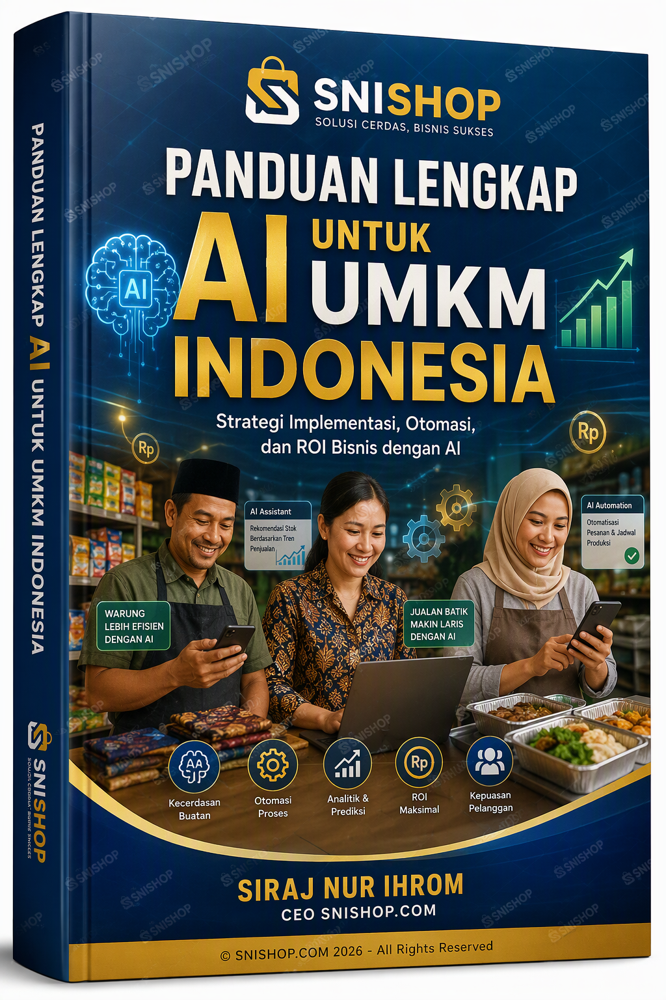
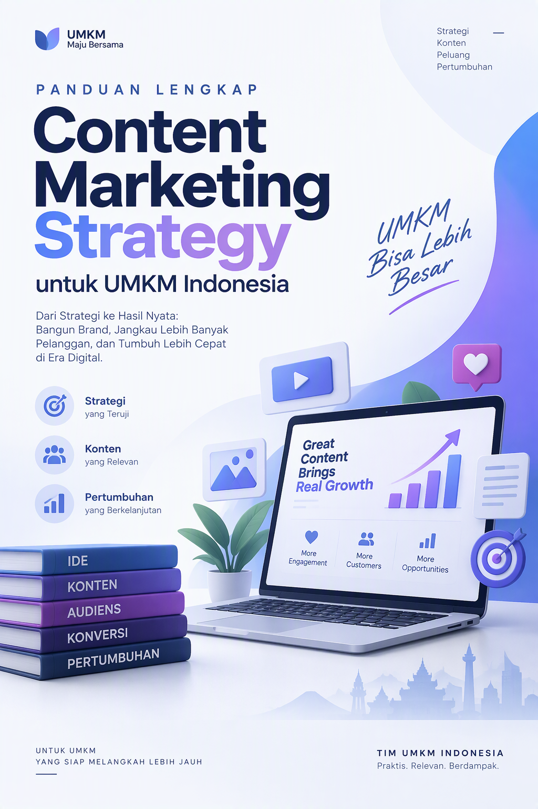

# Panduan Lengkap Digital Marketing Analytics untuk UMKM Indonesia

## Produk 46: SNISHOP Digital Product Series

**Penulis:** Tim SNISHOP Content Production
**Target Pembaca:** Pemilik UMKM di Indonesia yang ingin menguasai digital marketing analytics
**Level:** Pemula hingga Menengah
**Edisi:** Desember 2025

---

## Daftar Isi

### BAGIAN 1: FONDASI ANALITIK DIGITAL

- Bab 1: Mengapa Data Adalah Raja - Pentingnya Analytics untuk UMKM
- Bab 2: Memahami Metrik Digital - Traffic, Conversion, Engagement, Revenue
- Bab 3: Setup Google Analytics 4 - Dari Nol hingga Mahir
- Bab 4: Facebook Business Suite Insights - Memahami Audiens Media Sosial
- Bab 5: Setting Up Tracking - UTM, Event, dan Goal

### BAGIAN 2: ANALISIS DAN OPTIMASI

- Bab 6: Analisis Perilaku User - Heatmap, Session Recording, User Journey
- Bab 7: Conversion Rate Optimization - Dari Visitor Menjadi Customer
- Bab 8: ROI Marketing - Mengukur Return on Investment Setiap Channel
- Bab 9: A/B Testing - Membuktikan Hipotesis dengan Data
- Bab 10: Customer Segmentation - Mengelompokkan Audiens untuk Strategi Tepat
- Bab 11: Attribution Modeling - Memahami Path to Purchase
- Bab 12: Dashboard dan Reporting - Membuat Laporan yang Actionable

### BAGIAN 3: ADVANCED DAN SCALE UP

- Bab 13: Predictive Analytics - Memprediksi Tren dan Perilaku
- Bab 14: Marketing Automation Analytics - Mengukur Efektivitas Automasi
- Bab 15: Studi Kasus - 3 UMKM Indonesia yang Data-Driven
- Bab 16: Roadmap 30 Hari - Membangun Kultur Data-Driven di Bisnis Anda

### LAMPIRAN

- Kalkulator ROI Marketing Digital
- Glosarium Istilah Analytics
- Kode Referral Eksklusif SNISHOP

---

## Tentang Buku Ini

Buku ini ditulis khusus untuk pemilik UMKM di Indonesia yang ingin mengambil keputusan bisnis berdasarkan data, bukan sekadar insting. Di era digital yang semakin kompetitif, kemampuan membaca dan menganalisis data marketing bukan lagi kemewahan, melainkan kebutuhan fundamental.

Anda tidak perlu menjadi ahli statistik atau programmer untuk menguasai analytics. Buku ini dirancang dengan pendekatan praktis, menggunakan contoh-contoh nyata dari bisnis UMKM Indonesia, dan panduan langkah demi langkah yang mudah diikuti. Setiap bab dilengkapi dengan ilustrasi referensi yang akan membantu Anda memvisualisasikan konsep yang dibahas.

Setelah menyelesaikan buku ini, Anda akan mampu memasang tools analytics, membaca data dengan benar, membuat keputusan berbasis bukti, dan pada akhirnya meningkatkan profitabilitas bisnis digital Anda secara signifikan.

---

# BAGIAN 1: FONDASI ANALITIK DIGITAL

---

## Bab 1: Mengapa Data Adalah Raja - Pentingnya Analytics untuk UMKM



### Membuka Mata: Realitas Bisnis Digital Hari Ini

Bayangkan Anda membuka toko di pinggir jalan raya yang ramai. Setiap hari, ratusan orang lewat di depan toko Anda. Beberapa masuk, melihat-lihat, lalu keluar tanpa membeli. Tanpa data, Anda tidak tahu berapa orang yang masuk, dari mana mereka datang, apa yang mereka lihat pertama kali, atau mengapa mereka memutuskan untuk tidak membeli. Anda hanya bisa menebak-nebak.

Sekarang bayangkan jika Anda memiliki kemampuan untuk mengetahui secara persis: berapa orang yang melewati toko Anda setiap hari, persentase yang masuk ke dalam toko, produk mana yang paling sering mereka pegang, berapa lama mereka berada di toko, dan alasan utama mengapa mereka tidak jadi membeli. Dengan informasi tersebut, Anda bisa melakukan perubahan yang tepat untuk meningkatkan penjualan.

Itulah kekuatan analytics dalam dunia digital. Dan kabar baiknya, semua informasi ini tersedia secara gratis atau dengan biaya yang sangat terjangkau untuk UMKM.

### Mengapa Banyak UMKM Mengabaikan Data?

Ada beberapa alasan mengapa pemilik UMKM di Indonesia sering mengabaikan pentingnya analytics. Pertama, anggapan bahwa analytics hanya untuk perusahaan besar dengan tim data khusus. Kedua, persepsi bahwa tools analytics terlalu rumit dan membutuhkan keahlian teknis. Ketiga, ketidaktahuan tentang keberadaan tools gratis yang mudah digunakan.

Padahal, kenyataannya sangat berbeda. Google Analytics, Facebook Business Suite Insights, dan berbagai tools lainnya tersedia gratis dan dirancang untuk pengguna non-teknis. Anda tidak perlu memahami pemrograman atau statistik lanjutan untuk mulai menggunakan data dalam pengambilan keputusan bisnis.

### Data vs Insting: Mengapa Keduanya Penting, Tapi Data Lebih Andal

Insting bisnis memang berharga. Pengalaman bertahun-tahun di industri memberikan sixth sense yang tidak bisa digantikan sepenuhnya. Namun, insting memiliki keterbatasan. Insting tidak bisa memberi tahu Anda dengan presisi berapa persen pengunjung website yang berasal dari Instagram versus Google. Insting tidak bisa menunjukkan pada Anda bahwa pengunjung dari kota tertentu memiliki conversion rate tiga kali lipat lebih tinggi dari kota lainnya.

Data melengkapi insting. Dengan data, Anda bisa memvalidasi intuisi bisnis Anda. Jika insting Anda mengatakan bahwa promosi di Instagram lebih efektif daripada di Facebook, data bisa membuktikan atau membantah hal tersebut dengan angka yang konkret.

### Tiga Pilar Utama Digital Marketing Analytics

Pilar pertama adalah pengukuran. Anda tidak bisa memperbaiki apa yang tidak Anda ukur. Pengukuran berarti mengumpulkan data dari berbagai channel marketing Anda secara konsisten dan akurat.

Pilar kedua adalah analisis. Data mentah tanpa analisis tidak memberikan insight. Analisis berarti mencari pola, tren, dan anomali dalam data yang bisa menjelaskan mengapa sesuatu terjadi.

Pilar ketiga adalah tindakan. Insight tanpa tindakan hanya menjadi informasi yang mengendap. Tindakan berarti menggunakan insight dari analisis data untuk membuat perubahan konkret dalam strategi marketing Anda, kemudian mengukur dampaknya.

### Contoh Nyata: Bagaimana Analytics Mengubah Bisnis UMKM

Seorang pemilik toko online sepatu di Bandung awalnya menghabiskan Rp 5 juta per bulan untuk iklan di berbagai platform. Tanpa analytics, ia tidak tahu channel mana yang paling efektif. Setelah memasang Google Analytics dan Facebook Pixel, ia menemukan bahwa 70 persen penjualan datang dari iklan Instagram yang ditargetkan pada wanita usia 25 sampai 35 tahun di Jawa Barat. Dengan informasi ini, ia mengalokasikan 80 persen budget iklannya ke channel tersebut dan melihat penjualan meningkat 150 persen dengan budget yang sama.

Contoh lain datang dari seorang pemilik restoran di Yogyakarta yang menggunakan Google My Business analytics untuk memahami bagaimana pelanggan menemukan restorannya. Ia mendapati bahwa 60 persen pencarian datang dari kata kunci "restoran keluarga dekat sini" dan "makan malam enak di Yogyakarta". Dengan insight ini, ia mengoptimalkan deskripsi bisnis dan konten media sosialnya dengan kata kunci tersebut, sehingga traffic ke Google My Business-nya meningkat 200 persen dalam dua bulan.

### ROI dari Menerapkan Analytics

Banyak UMKM khawatir tentang biaya dan waktu yang dibutuhkan untuk menerapkan analytics. Mari kita lihat angka-angkanya.

Untuk setup awal Google Analytics 4, Anda membutuhkan waktu sekitar dua hingga empat jam. Facebook Business Suite Insights sudah tersedia secara otomatis begitu Anda memiliki business page. Hotjar free plan bisa dipasang dalam lima belas menit. Total investasi waktu di bawah satu hari kerja.

Dari sisi biaya, sebagian besar tools analytics dasar tersedia gratis. Google Analytics 4 gratis tanpa batasan traffic. Facebook Business Suite Insights gratis untuk semua page. Hotjar free plan menyediakan hingga 35 session recording per hari. Mixpanel free plan mencakup hingga 20 juta event per bulan.

Sekarang bandingkan dengan potensi peningkatan revenue. Berdasarkan studi kasus yang akan kita bahas di Bab 15, UMKM yang menerapkan analytics secara rata-rata mengalami peningkatan conversion rate sebesar 50 sampai 85 persen dan penurunan cost per acquisition sebesar 40 sampai 70 persen. Untuk bisnis dengan revenue Rp 50 juta per bulan, peningkatan conversion rate 50 persen berarti tambahan revenue Rp 25 juta per bulan, atau Rp 300 juta per tahun.

### Hambatan Umum dan Cara Mengatasinya

Hambatan pertama adalah overwhelming data. Ketika pertama kali membuka dashboard analytics, Anda mungkin merasa kewalahan dengan banyaknya angka dan grafik. Solusinya adalah mulai dengan tiga sampai lima metrik kunci yang paling relevan dengan bisnis Anda, lalu perlahan-lahan tambahkan metrik lain seiring pemahaman Anda berkembang.

Hambatan kedua adalah kualitas data. Data yang tidak akurat bisa menyesatkan keputusan. Pastikan tracking code terpasang dengan benar, filter traffic internal, dan lakukan audit data secara berkala.

Hambatan ketiga adalah konsistensi. Banyak UMKM semangat di awal, lalu berhenti memantau data setelah beberapa minggu. Buat jadwal rutin, misalnya setiap Senin pagi selama tiga puluh menit, untuk memeriksa dashboard analytics Anda.

### Peta Jalan Buku Ini

Buku ini dirancang sebagai perjalanan learning yang terstruktur. Bagian pertama (Bab 1 sampai 5) akan membangun fondasi pemahaman Anda tentang analytics dan cara setup tools-tool utama. Bagian kedua (Bab 6 sampai 12) akan mengajarkan Anda cara menganalisis data dan mengoptimasi marketing berdasarkan insight yang ditemukan. Bagian ketiga (Bab 13 sampai 16) akan membawa Anda ke level advanced dengan predictive analytics, automation, studi kasus nyata, dan roadmap implementasi 30 hari.

Setiap bab berdiri sendiri sebagai unit pembelajaran yang lengkap, namun juga saling terhubung dengan bab-bab lainnya. Anda bisa membaca secara berurutan untuk pemahaman komprehensif, atau melompat ke bab yang paling relevan dengan kebutuhan bisnis Anda saat ini.

### Kode Referral Eksklusif: Mulai Perjalanan Analytics Anda

Sebagai pembaca buku ini, Anda mendapatkan akses ke kode referral eksklusif yang memberikan benefit tambahan untuk tools analytics yang akan kita gunakan sepanjang buku ini.

Gunakan kode referral **SNISHOPGA** saat mendaftar Google Analytics melalui partner link kami untuk mendapatkan free premium training senilai Rp 2 juta. Training ini mencakup setup lengkap, interpretasi data, dan cara membuat dashboard custom untuk bisnis UMKM.

Kode referral ini akan berlaku selama enam bulan sejak buku ini diterbitkan. Segera manfaatkan sebelum kedaluwarsa.

---

## Bab 2: Memahami Metrik Digital - Traffic, Conversion, Engagement, Revenue


### Empat Kategori Metrik yang Harus Anda Kuasai

Dalam dunia digital marketing analytics, ada ribuan metrik yang bisa Anda pantau. Namun, untuk UMKM, semuanya bisa dikelompokkan menjadi empat kategori utama yang saling terhubung: Traffic, Conversion, Engagement, dan Revenue. Memahami keempat kategori ini dan hubungannya adalah kunci untuk membuat keputusan marketing yang efektif.

Bayangkan keempat metrik ini sebagai corong (funnel). Traffic adalah bagian teratas corong, mewakili semua orang yang mengunjungi aset digital Anda. Engagement adalah bagian tengah corong, mewakili orang-orang yang berinteraksi dengan konten Anda. Conversion adalah bagian bawah corong, mewakili orang-orang yang melakukan tindakan yang Anda inginkan. Revenue adalah hasil akhir dari conversion tersebut.

### Metrik Traffic: Mengukur Kunjungan dan Sumbernya

Traffic adalah jumlah kunjungan ke website, halaman media sosial, atau platform digital Anda. Namun, tidak semua traffic diciptakan sama. Memahami jenis dan sumber traffic sangat penting untuk mengoptimasi strategi marketing.

Organic traffic adalah kunjungan yang datang dari mesin pencari seperti Google tanpa melalui iklan berbayar. Traffic ini menunjukkan seberapa baik SEO (Search Engine Optimization) Anda. Jika organic traffic Anda tinggi, berarti konten Anda relevan dan teroptimasi dengan baik di mata mesin pencari.

Paid traffic adalah kunjungan yang datang dari iklan berbayar, seperti Google Ads, Facebook Ads, atau Instagram Ads. Metrik ini penting untuk mengukur efektivitas spending iklan Anda.

Direct traffic adalah kunjungan yang datang ketika seseorang mengetik alamat website Anda langsung di browser atau melalui bookmark. Traffic ini menunjukkan brand awareness yang kuat.

Referral traffic adalah kunjungan yang datang dari link di website lain. Ini menunjukkan seberapa baik upaya partnership dan PR digital Anda.

Social traffic adalah kunjungan yang datang dari platform media sosial. Metrik ini mengukur efektivitas konten media sosial Anda dalam mendorong orang ke website.

Beberapa metrik traffic spesifik yang perlu Anda perhatikan meliputi sessions (jumlah kunjungan dalam periode tertentu), users (jumlah orang unik yang mengunjungi), pageviews (jumlah halaman yang dilihat), dan pages per session (rata-rata halaman yang dilihat per kunjungan).

Untuk UMKM di Indonesia, benchmark traffic yang sehat bervariasi tergantung industri dan ukuran bisnis. Toko online kecil biasanya mendapatkan 500 sampai 2.000 sessions per bulan. Restoran dengan website ordering mungkin mendapatkan 1.000 sampai 5.000 sessions per bulan. Kursus online bisa mendapatkan 2.000 sampai 10.000 sessions per bulan.

### Metrik Conversion: Mengukur Tindakan yang Berarti

Conversion terjadi ketika pengunjung melakukan tindakan yang Anda inginkan. Tindakan ini bisa berupa pembelian, pendaftaran newsletter, pengisian formulir kontak, download katalog produk, atau telepon ke nomor bisnis Anda.

Conversion rate adalah persentase pengunjung yang melakukan conversion. Rumusnya sederhana: jumlah conversion dibagi jumlah total pengunjung, dikali 100 persen. Jika website Anda mendapat 1.000 pengunjung dan 30 di antaranya melakukan pembelian, maka conversion rate Anda adalah 3 persen.

Benchmark conversion rate untuk UMKM di Indonesia berkisar antara 1 sampai 5 persen untuk e-commerce, 3 sampai 8 persen untuk lead generation, dan 5 sampai 15 persen untuk newsletter signup. Angka ini bervariasi tergantung industri, jenis produk, harga, dan kualitas website.

Cost per acquisition (CPA) adalah biaya yang Anda keluarkan untuk mendapatkan satu customer baru melalui channel marketing tertentu. Rumusnya: total biaya marketing dibagi jumlah customer baru yang didapat. Jika Anda menghabiskan Rp 2 juta untuk iklan Facebook dan mendapatkan 40 customer baru, maka CPA Anda adalah Rp 50.000 per customer.

Shopping cart abandonment rate adalah persentase orang yang menambahkan produk ke keranjang belanja tetapi tidak menyelesaikan pembelian. Rata-rata global untuk e-commerce adalah sekitar 70 persen, yang berarti hanya 30 persen orang yang benar-benar menyelesaikan checkout. Angka ini bisa lebih tinggi di Indonesia karena faktor seperti ongkos kirim yang tidak transparan di awal dan preferensi untuk bertanya via chat sebelum membeli.

### Metrik Engagement: Mengukur Interaksi dan Minat

Engagement metrics mengukur seberapa dalam pengunjung berinteraksi dengan konten dan platform digital Anda.

Bounce rate adalah persentase pengunjung yang meninggalkan website setelah melihat satu halaman saja tanpa berinteraksi lebih lanjut. Bounce rate yang tinggi (di atas 70 persen) biasanya menunjukkan bahwa halaman landing Anda tidak sesuai dengan ekspektasi pengunjung atau tidak menarik secara visual. Namun, untuk blog atau halaman informasi, bounce rate yang lebih tinggi bisa jadi wajar karena pengunjung memang hanya mencari satu informasi spesifik.

Average session duration adalah rata-rata waktu yang dihabiskan pengunjung di website Anda per kunjungan. Untuk e-commerce, rata-rata yang baik adalah dua sampai empat menit. Untuk blog atau konten edukasi, tiga sampai enam menit dianggap baik.

Scroll depth mengukur seberapa jauh pengunjung menggulir halaman Anda. Jika rata-rata scroll depth hanya 30 persen, berarti mayoritas pengunjung tidak melihat konten di bagian bawah halaman Anda. Ini adalah sinyal bahwa Anda perlu memindahkan informasi penting ke bagian atas.

Click-through rate (CTR) adalah persentase orang yang mengklik link atau tombol dibandingkan dengan jumlah orang yang melihatnya. CTR digunakan baik untuk iklan (berapa persen orang yang mengklik iklan Anda) maupun untuk elemen website (berapa persen pengunjung yang mengklik tombol call-to-action).

Untuk media sosial, engagement rate adalah metrik kunci. Ini mengukur interaksi (like, comment, share, save) relatif terhadap jumlah follower atau reach. Engagement rate yang baik di Instagram berkisar antara 1 sampai 5 persen, di Facebook antara 0.5 sampai 2 persen, dan di TikTok antara 3 sampai 10 persen.

### Metrik Revenue: Mengukur Hasil Finansial

Revenue metrics adalah metrik yang paling langsung berkaitan dengan bottom line bisnis Anda.

Average order value (AOV) adalah rata-rata nilai transaksi per order. Rumusnya: total revenue dibagi jumlah order. Jika revenue Anda Rp 30 juta dari 200 order, maka AOV Anda adalah Rp 150.000. Meningkatkan AOV seringkali lebih mudah dan lebih murah daripada meningkatkan jumlah customer.

Customer lifetime value (CLV atau LTV) adalah total revenue yang diharapkan dari seorang customer selama seluruh hubungan bisnis Anda dengan mereka. Rumus sederhana: AOV dikali frekuensi pembelian per tahun dikali rata-rata lama hubungan dalam tahun. Jika AOV Rp 150.000, customer membeli rata-rata empat kali per tahun, dan rata-rata bertahan selama dua tahun, maka CLV adalah Rp 1.200.000.

Return on ad spend (ROAS) mengukur revenue yang dihasilkan untuk setiap rupiah yang dihabiskan untuk iklan. Rumusnya: revenue dari iklan dibagi biaya iklan. Jika Anda menghabiskan Rp 1 juta untuk iklan dan menghasilkan Rp 5 juta revenue, maka ROAS Anda adalah 5x. ROAS yang sehat untuk UMKM di Indonesia minimal 3x, idealnya 5x atau lebih.

Marketing ROI adalah persentase return dari total investasi marketing Anda. Rumusnya: (revenue dari marketing minus biaya marketing) dibagi biaya marketing, dikali 100 persen. Jika Anda menghabiskan Rp 5 juta untuk semua aktivitas marketing dan menghasilkan Rp 25 juta revenue, maka ROI Anda adalah 400 persen.

### Menghubungkan Keempat Kategori Metrik

Keempat kategori metrik ini tidak berdiri sendiri. Mereka terhubung dalam sebuah rantai sebab-akibat. Peningkatan traffic berkualitas akan meningkatkan engagement. Peningkatan engagement akan meningkatkan conversion. Peningkatan conversion akan meningkatkan revenue.

Namun, hubungannya tidak selalu linear. Traffic yang sangat tinggi dengan engagement yang rendah bisa jadi sinyal bahwa Anda menarik audiens yang salah. Conversion rate yang tinggi dengan AOV yang rendah mungkin berarti Anda perlu strategi upselling. Revenue yang tinggi dengan CLV yang rendah menunjukkan bahwa customer tidak kembali untuk pembelian berulang.

Tugas Anda sebagai pemilik UMKM adalah memantau keempat kategori ini secara bersamaan dan mencari keseimbangan yang optimal untuk bisnis Anda.

### Tabel Ringkasan Metrik Kunci

| Kategori | Metrik Utama | Cara Hitung | Benchmark UMKM Indonesia |
|----------|-------------|-------------|--------------------------|
| Traffic | Monthly Sessions | Total kunjungan per bulan | 500 - 10.000 |
| Traffic | Traffic Source Mix | Persentase per sumber | Organic 30-50%, Paid 20-40% |
| Conversion | Conversion Rate | Conversion / Visitors x 100% | 1-5% (e-commerce) |
| Conversion | CPA | Biaya Marketing / Customer Baru | Tergantung industri |
| Engagement | Bounce Rate | Single page visits / Total visits | 40-60% |
| Engagement | Avg Session Duration | Rata-rata waktu per sesi | 2-4 menit |
| Revenue | AOV | Total Revenue / Jumlah Order | Rp 100.000 - Rp 500.000 |
| Revenue | ROAS | Revenue Iklan / Biaya Iklan | Minimal 3x |
| Revenue | CLV | AOV x Frekuensi x Durasi | Minimal 3x CPA |

### Langkah Praktis: Tentukan Metrik Kunci Bisnis Anda

Ambil kertas atau buka spreadsheet, lalu jawab pertanyaan berikut untuk bisnis Anda. Pertama, apa tiga metrik yang paling langsung mempengaruhi revenue bisnis Anda? Kedua, di mana posisi Anda saat ini untuk ketiga metrik tersebut? Ketiga, apa target realistis untuk tiga bulan ke depan? Keempat, tools apa yang akan Anda gunakan untuk mengukur metrik tersebut?

Jawaban atas pertanyaan-pertanyaan ini akan menjadi fondasi untuk seluruh perjalanan analytics Anda. Jangan khawatir jika angkanya masih perkiraan. Yang penting adalah Anda mulai berpikir dalam kerangka data.

### Kode Referral Eksklusif

Gunakan kode referral **SNISHOPGA** saat mendaftar Google Analytics untuk mendapatkan free premium training senilai Rp 2 juta yang akan membantu Anda mengukur semua metrik yang dibahas di bab ini.

---

## Bab 3: Setup Google Analytics 4 - Dari Nol hingga Mahir


### Apa Itu Google Analytics 4 dan Mengapa Penting

Google Analytics 4 (GA4) adalah versi terbaru dari platform analytics gratis Google yang menggunakan pendekatan event-based tracking. Berbeda dengan Universal Analytics yang berfokus pada session dan pageview, GA4 merekam setiap interaksi pengguna sebagai sebuah event. Pendekatan ini memberikan gambaran yang lebih lengkap dan akurat tentang perilaku pengguna di website dan aplikasi Anda.

Untuk UMKM di Indonesia, GA4 adalah tools analytics yang paling penting untuk dikuasai karena tiga alasan. Pertama, GA4 gratis tanpa batasan traffic atau jumlah data. Kedua, GA4 terintegrasi secara native dengan Google Ads, Google Search Console, dan berbagai platform Google lainnya. Ketiga, GA4 memiliki kemampuan machine learning yang bisa memberikan insight otomatis tentang tren dan anomali dalam data Anda.

### Persiapan Sebelum Setup

Sebelum memulai setup GA4, pastikan Anda memiliki beberapa hal berikut. Pertama, akun Google (Gmail) yang akan digunakan untuk mengakses GA4. Kedua, akses ke website Anda, baik melalui CMS seperti WordPress, Shopify, atau platform website builder lainnya, maupun melalui akses langsung ke source code jika website Anda custom-built. Ketiga, Google Tag Manager (opsional tapi sangat direkomendasikan) untuk memudahkan manajemen tracking code.

### Langkah 1: Membuat Akun dan Property GA4

Buka analytics.google.com dan login dengan akun Google Anda. Klik tombol "Start Measuring" atau "Mulai Pengukuran". Masukkan nama akun Anda, sebaiknya menggunakan nama bisnis Anda. Pilih opsi data sharing sesuai preferensi Anda. Untuk UMKM, tidak ada salahnya untuk mengaktifkan semua opsi data sharing karena ini membantu Google memberikan benchmark data yang relevan.

Selanjutnya, buat property baru. Masukkan nama property (nama bisnis Anda), pilih zona waktu Indonesia (GMT+7), dan pilih mata uang Rupiah (IDR). Pemilihan zona waktu dan mata uang yang benar sangat penting agar laporan Anda akurat dan mudah dipahami.

Setelah property dibuat, buat data stream. Untuk website, pilih "Web" dan masukkan URL website Anda serta nama stream. GA4 akan memberikan Anda Measurement ID yang dimulai dengan "G-" dan Measurement Tag (gtag.js) yang perlu dipasang di website Anda.

### Langkah 2: Memasang Tracking Code

Ada beberapa cara untuk memasang tracking code GA4 di website Anda, tergantung platform yang digunakan.

Untuk website WordPress, cara termudah adalah menggunakan plugin Site Kit by Google atau plugin GTM4WP (Google Tag Manager for WordPress). Install plugin, hubungkan dengan akun Google Anda, dan tracking code akan otomatis terpasang di semua halaman.

Untuk website Shopify, masuk ke Settings, lalu Preferences, dan paste Measurement ID Anda di kolom Google Analytics. Shopify akan otomatis memasang tracking code di semua halaman.

Untuk website yang menggunakan Google Tag Manager, buat tag baru dengan tipe "Google Analytics: GA4 Configuration", masukkan Measurement ID Anda, dan set trigger ke "All Pages". Publish container GTM Anda.

Untuk website custom, paste kode gtag.js yang diberikan GA4 di bagian head dari setiap halaman HTML website Anda. Pastikan kode tersebut muncul sebelum tag penutup head.

### Langkah 3: Verifikasi Tracking

Setelah kode terpasang, verifikasi bahwa data mulai masuk. Buka GA4, navigasi ke Reports, lalu Realtime. Buka website Anda di tab browser baru dan lakukan beberapa navigasi. Dalam beberapa detik, Anda seharusnya melihat aktivitas Anda muncul di laporan Realtime GA4.

Jika data tidak muncul setelah lima menit, ada beberapa hal yang perlu diperiksa. Pastikan tracking code terpasang dengan benar tanpa typo. Pastikan tidak ada ad blocker atau browser extension yang memblokir tracking. Gunakan Google Tag Assistant (Chrome extension) untuk mendiagnosis masalah tracking.

### Langkah 4: Konfigurasi Dasar yang Wajib Dilakukan

Setelah tracking terverifikasi, lakukan konfigurasi dasar berikut untuk memaksimalkan manfaat GA4.

Pertama, setup Enhanced Measurement. Di menu Data Streams, klik pada stream website Anda dan aktifkan Enhanced Measurement. Fitur ini secara otomatis melacak scroll, outbound clicks, site search, video engagement, file downloads, dan form interactions tanpa perlu coding tambahan.

Kedua, buat events custom. Meskipun Enhanced Measurement sudah mencakup banyak interaksi, Anda mungkin perlu membuat event custom untuk tindakan spesifik bisnis Anda, seperti klik tombol WhatsApp, klik tombol telepon, atau submit formulir pemesanan.

Ketiga, setup conversions. Di menu Admin, lalu Conversions, tandai event-event yang paling penting bagi bisnis Anda sebagai conversion events. Untuk e-commerce, conversion utama tentu saja purchase. Untuk bisnis jasa, conversion bisa berupa form submission atau WhatsApp click.

Keempat, filter internal traffic. Di menu Admin, lalu Data Settings, lalu Data Filters, buat filter untuk mengecualikan traffic dari IP address kantor atau rumah Anda sendiri. Traffic internal bisa mendistorsi data analytics Anda.

Kelima, setup Google Search Console integration. Hubungkan GA4 dengan Google Search Console untuk mendapatkan data organik search yang lebih detail, termasuk query apa yang digunakan orang untuk menemukan website Anda.

### Langkah 5: Memahami Laporan GA4

GA4 memiliki beberapa laporan utama yang perlu Anda pahami.

Laporan Realtime menunjukkan aktivitas pengguna di website Anda saat ini, termasuk halaman yang sedang dilihat, event yang dipicu, dan sumber traffic.

Laporan Acquisition menunjukkan dari mana pengguna Anda datang. Ada dua sub-laporan: User Acquisition (bagaimana pengguna pertama kali menemukan Anda) dan Traffic Acquisition (dari mana sesi pengguna berasal).

Laporan Engagement menunjukkan apa yang dilakukan pengguna di website Anda. Sub-laporan termasuk Events (daftar semua event yang dilacak), Conversions (daftar conversion events), dan Pages and Screens (halaman mana yang paling populer).

Laporan Monetization (jika e-commerce tracking diaktifkan) menunjukkan data revenue, termasuk total revenue, purchase count, dan average revenue per user.

Laporan Retention menunjukkan seberapa sering pengguna kembali ke website Anda dan berapa lama mereka bertahan.

Laporan Demographics menunjukkan data tentang usia, gender, lokasi, bahasa, dan perangkat pengguna Anda.

### Langkah 6: Setup E-commerce Tracking (Untuk Toko Online)

Jika Anda menjalankan toko online, setup e-commerce tracking di GA4 sangat direkomendasikan. E-commerce tracking memungkinkan Anda melacak seluruh customer journey dari melihat produk, menambahkan ke keranjang, memulai checkout, hingga menyelesaikan pembelian.

Untuk mengaktifkan e-commerce tracking, Anda perlu mengirim data produk dan transaksi ke GA4. Jika menggunakan Shopify, WooCommerce, atau platform e-commerce populer lainnya, biasanya ada plugin atau app yang bisa melakukan ini secara otomatis. Untuk website custom, developer Anda perlu mengimplementasikan data layer sesuai spesifikasi GA4 e-commerce.

Data yang bisa Anda dapatkan dari e-commerce tracking GA4 meliputi product views, add to cart events, checkout steps, purchase transactions, revenue per product, revenue per category, average order value, dan purchase conversion rate.

### Tips Pro untuk GA4

Gunakan Explorations untuk membuat analisis custom. Fitur ini memungkinkan Anda membuat funnel analysis, path analysis, cohort analysis, dan segment overlap analysis yang jauh lebih mendalam dari laporan standar.

Buat custom alerts untuk metrik-metrik penting. Misalnya, alert jika conversion rate turun di bawah 1 persen atau jika traffic dari organic search meningkat lebih dari 50 persen dalam sehari.

Integrasikan GA4 dengan Google Ads untuk mendapatkan data atribusi yang lebih lengkap dan untuk mengoptimasi bidding berdasarkan conversion data.

Export laporan GA4 ke Google Sheets secara otomatis menggunakan Google Sheets add-on atau Google Analytics API untuk membuat dashboard custom yang sesuai dengan kebutuhan bisnis Anda.

### Kode Referral Eksklusif

Gunakan kode referral **SNISHOPGA** saat mendaftar melalui partner link kami untuk mendapatkan free premium training senilai Rp 2 juta. Training ini mencakup setup GA4 dari nol hingga advanced, termasuk e-commerce tracking dan custom dashboard.

---

## Bab 4: Facebook Business Suite Insights - Memahami Audiens Media Sosial


### Mengapa Facebook Business Suite Penting untuk UMKM Indonesia

Facebook dan Instagram tetap menjadi dua platform media sosial paling dominan di Indonesia, dengan lebih dari 167 juta pengguna Facebook dan lebih dari 90 juta pengguna Instagram aktif. Untuk UMKM, kedua platform ini bukan hanya tempat berinteraksi dengan pelanggan, tetapi juga channel marketing dan penjualan yang sangat penting.

Facebook Business Suite (sekarang dikenal sebagai Meta Business Suite) adalah pusat komando untuk mengelola kehadiran bisnis Anda di Facebook dan Instagram. Salah satu fitur paling berharga dari Business Suite adalah Insights, yang memberikan data mendalam tentang performa konten, demografi audiens, dan efektivitas iklan Anda.

Yang membuat Business Suite Insights sangat powerful untuk UMKM adalah fakta bahwa semua data ini tersedia gratis. Anda tidak perlu berlangganan tools analytics pihak ketiga untuk mendapatkan insight tentang audiens media sosial Anda.

### Mengakses Facebook Business Suite Insights

Untuk mengakses Insights, pertama-tama pastikan Anda memiliki Facebook Business Page (bukan profil personal) dan Instagram Business Account yang terhubung. Masuk ke business.facebook.com menggunakan akun Facebook yang memiliki akses admin ke page bisnis Anda.

Di sidebar kiri, klik "Insights" untuk melihat dashboard overview. Dashboard ini memberikan ringkasan tentang performa page Anda dalam periode waktu tertentu. Anda bisa melihat data tentang overview, audience, content, messaging, dan ad performance.

### Memahami Metrik Audience (Audiens)

Metrik audiens memberikan informasi tentang siapa yang mengikuti dan berinteraksi dengan page bisnis Anda.

Total followers menunjukkan jumlah orang yang mengikuti page Anda. Pertumbuhan follower dari waktu ke waktu menunjukkan apakah strategi konten Anda efektif dalam menarik audiens baru.

Top cities dan top countries menunjukkan dari mana follower Anda berasal. Informasi ini sangat berguna untuk menentukan target geografis iklan Anda. Jika mayoritas follower Anda berasal dari Jakarta, Surabaya, dan Medan, maka Anda bisa menyesuaikan strategi konten dan iklan Anda untuk kota-kota tersebut.

Age dan gender distribution menunjukkan demografi follower Anda. Jika target market Anda adalah wanita usia 25 sampai 34 tahun tetapi mayoritas follower Anda adalah pria usia 18 sampai 24 tahun, ada ketidaksesuaian yang perlu diperbaiki.

Active times menunjukkan kapan follower Anda paling aktif di Facebook dan Instagram. Informasi ini sangat berharga untuk menentukan waktu posting optimal. Jika follower Anda paling aktif pada pukul 12 siang dan 7 malam, maka posting di waktu-waktu tersebut akan memberikan reach dan engagement yang lebih tinggi.

### Memahami Metrik Content (Konten)

Metrik konten memberikan informasi tentang performa setiap posting yang Anda buat.

Reach adalah jumlah orang unik yang melihat konten Anda. Reach bisa organik (tanpa bayar) atau berbayar (melalui iklan). Bandingkan reach organik dan berbayar untuk memahami seberapa besar ketergantungan Anda pada iklan.

Engagement mencakup like, comment, share, click, dan save. Engagement rate adalah total engagement dibagi total reach, dikali 100 persen. Engagement rate yang tinggi menunjukkan bahwa konten Anda resonan dengan audiens.

Post type performance menunjukkan jenis konten mana yang paling efektif: foto, video, carousel, story, reel, atau link post. Untuk UMKM di Indonesia, video pendek (Reels) dan carousel biasanya memberikan engagement tertinggi.

Top posts menunjukkan konten-konten dengan performa terbaik dalam periode tertentu. Analisis apa yang membuat konten-konten ini berhasil: apakah formatnya, topiknya, waktu postingnya, atau call-to-action-nya.

### Memahami Metrik Messaging (Pesan)

Metrik messaging memberikan informasi tentang interaksi pesan di page Anda.

New conversations menunjukkan jumlah percakapan baru yang dimulai melalui Messenger atau Instagram Direct. Tren dari waktu ke waktu menunjukkan apakah strategi Anda dalam mendorong orang untuk mengirim pesan efektif.

Response rate dan response time menunjukkan seberapa cepat dan seberapa sering Anda membalas pesan. Facebook memberikan badge "Very responsive to messages" jika response rate Anda tinggi dan response time Anda cepat. Badge ini meningkatkan kepercayaan calon pelanggan.

### Memahami Metrik Iklan (Ad Performance)

Jika Anda menjalankan iklan di Facebook atau Instagram, bagian Ad Performance memberikan data yang sangat detail.

Ad spend menunjukkan total biaya iklan Anda dalam periode tertentu. Bandingkan dengan revenue yang dihasilkan untuk menghitung ROAS.

Results menunjukkan jumlah conversion yang dihasilkan iklan Anda, baik itu pembelian, lead, traffic ke website, atau objective lainnya.

Cost per result menunjukkan biaya rata-rata untuk setiap conversion. Ini adalah CPA (cost per acquisition) yang dibahas di Bab 2.

Frequency menunjukkan berapa kali rata-rata orang melihat iklan Anda. Frequency yang terlalu tinggi (di atas 3) bisa menyebabkan ad fatigue, di mana audiens bosan melihat iklan yang sama berulang-ulang.

CTR (click-through rate) menunjukkan persentase orang yang mengklik iklan setelah melihatnya. CTR di atas 1 persen untuk Facebook Ads umumnya dianggap baik.

### Strategi Menggunakan Insights untuk Optimasi

Setelah memahami metrik-metrik di atas, berikut adalah strategi praktis untuk mengoptimasi performa media sosial bisnis Anda berdasarkan data.

Pertama, optimasi waktu posting. Lihat data Active Times di Insights dan jadwalkan posting Anda di waktu-waktu ketika follower Anda paling aktif. Biasanya, waktu optimal untuk UMKM di Indonesia adalah pukul 7 sampai 9 pagi (saat orang membuka HP sebelum beraktivitas), 12 sampai 1 siang (saat istirahat makan siang), dan 7 sampai 9 malam (saat santai setelah bekerja).

Kedua, duplikasi formula konten terbaik. Identifikasi lima posting dengan engagement tertinggi dalam tiga bulan terakhir. Analisis kesamaan di antara mereka: format, topik, gaya bahasa, warna, atau jenis call-to-action. Gunakan pola ini sebagai template untuk konten-konten berikutnya.

Ketiga, perbaiki demografi audiens. Jika audiens Anda saat ini tidak sesuai dengan target market ideal, pertimbangkan untuk mengubah strategi konten. Buat konten yang lebih menarik bagi demografi target Anda, gunakan hashtag yang relevan, dan kolaborasi dengan akun-akun yang diikuti oleh target market Anda.

Keempat, tingkatkan response rate. Tetapkan target untuk membalas semua pesan dalam waktu kurang dari satu jam selama jam operasional. Gunakan fitur Automated Response di Messenger untuk memberikan jawaban instan di luar jam operasional.

Kelima, evaluasi dan realokasi budget iklan. Setiap dua minggu, lihat data Ad Performance. Matikan iklan dengan CPA di atas target dan alokasikan budget ke iklan dengan performa terbaik.

### Integrasi Facebook Insights dengan Google Analytics

Untuk mendapatkan gambaran yang lebih lengkap, integrasikan data Facebook Insights dengan Google Analytics. Caranya adalah dengan menggunakan UTM parameters pada setiap link yang Anda share di Facebook dan Instagram. Dengan UTM parameters, Anda bisa melacak di GA4 berapa banyak traffic, engagement, dan conversion yang datang dari Facebook versus Instagram, dari posting organik versus iklan berbayar.

Kita akan membahas UTM parameters secara detail di Bab 5. Untuk sekarang, yang penting dipahami adalah bahwa integrasi kedua platform analytics ini memberikan data yang jauh lebih berharga daripada melihat masing-masing secara terpisah.

### Kode Referral Eksklusif

Gunakan kode referral **SNISHOPFB** saat mendaftar Facebook Business Suite melalui partner link kami untuk mendapatkan free ad credit senilai Rp 500.000. Credit ini bisa langsung digunakan untuk menjalankan iklan pertama Anda atau untuk testing strategi iklan baru berdasarkan insight yang sudah Anda pelajari.

---

## Bab 5: Setting Up Tracking - UTM, Event, dan Goal



### Mengapa Tracking yang Benar Sangat Krusial

Bayangkan Anda menjalankan kampanye marketing di lima channel berbeda: Facebook Ads, Instagram organic, Google Ads, email marketing, dan influencer partnership. Total budget Anda Rp 10 juta per bulan. Di akhir bulan, Anda mendapat 200 penjualan baru. Pertanyaannya: channel mana yang paling berkontribusi terhadap 200 penjualan tersebut?

Tanpa tracking yang benar, Anda tidak bisa menjawab pertanyaan ini. Anda hanya bisa menebak. Dan berdasarkan tebakan, Anda akan mengalokasikan budget bulan berikutnya secara tidak optimal, mungkin membuang uang di channel yang tidak efektif dan underinvest di channel yang paling menghasilkan.

Tracking yang benar menjawab tiga pertanyaan fundamental: dari mana pengunjung Anda datang (acquisition tracking), apa yang mereka lakukan di website Anda (behavior tracking), dan apakah mereka melakukan tindakan yang Anda inginkan (conversion tracking).

### UTM Parameters: Memberi Label pada Setiap Link Marketing

UTM (Urchin Tracking Module) parameters adalah tag yang ditambahkan di akhir URL untuk melacak sumber, medium, dan kampanye dari setiap link yang Anda share. Ketika seseorang mengklik link ber-UTM tersebut, Google Analytics akan merekam informasi UTM dan mengaitkan kunjungan tersebut dengan kampanye marketing spesifik.

Ada lima parameter UTM yang perlu Anda pahami.

Parameter utm_source menunjukkan dari mana traffic berasal. Contoh: facebook, instagram, google, email, tiktok, whatsapp.

Parameter utm_medium menunjukkan jenis channel. Contoh: cpc (untuk iklan berbayar), organic (untuk konten organik), email (untuk email marketing), referral (untuk link dari website lain), social (untuk media sosial secara umum).

Parameter utm_campaign menunjukkan nama kampanye spesifik. Contoh: promo-lebaran-2025, diskon-akhir-tahun, peluncuran-produk-baru.

Parameter utm_term digunakan terutama untuk iklan berbayar untuk melacak kata kunci yang ditargetkan. Contoh: sepatu-wanita-murah, kursus-online-desain.

Parameter utm_content digunakan untuk membedakan variasi konten dalam kampanye yang sama. Contoh: foto-produk-1, video-testimoni, carousel-promo.

Berikut contoh URL dengan UTM parameters:

```
https://tokoanda.com/produk/sepatu-lari?utm_source=facebook&utm_medium=cpc&utm_campaign=promo-akhir-tahun&utm_content=video-testimonial-30s
```

URL ini memberi tahu Google Analytics bahwa kunjungan ini datang dari Facebook (source), melalui iklan berbayar (medium), dalam kampanye promo akhir tahun (campaign), dan spesifik dari konten video testimonial durasi 30 detik (content).

### Cara Membuat UTM Parameters

Cara manual adalah dengan menambahkan parameter langsung di URL. Namun, cara ini rawan kesalahan penulisan dan tidak efisien untuk kampanye dengan banyak link.

Cara yang direkomendasikan adalah menggunakan Google Campaign URL Builder (ga-dev-tools.google/campaign-url-builder). Masukkan source, medium, campaign name, dan parameter opsional lainnya, lalu tool ini akan generate URL lengkap dengan UTM parameters yang benar.

Untuk skala yang lebih besar, buat spreadsheet template UTM yang standar untuk seluruh tim marketing Anda. Spreadsheet ini harus mencantumkan semua kombinasi source dan medium yang digunakan, format penamaan campaign yang konsisten, dan URL builder yang sudah terintegrasi dengan rumus.

### Best Practices untuk UTM Parameters

Konsistensi adalah kunci. Selalu gunakan huruf kecil untuk semua parameter. Gunakan underscore atau tanda hubung untuk memisahkan kata, bukan spasi. Buat konvensi penamaan yang jelas dan dokumentasikan dalam tim Anda.

Jangan gunakan UTM untuk link internal website. UTM hanya untuk link yang mengarah ke website Anda dari sumber eksternal.

Jangan gunakan data sensitif atau informasi pribadi di UTM parameters karena data ini akan terlihat di URL dan bisa tercatat di berbagai log server.

Batasi panjang URL. URL dengan UTM yang terlalu panjang bisa terlihat mencurigakan dan tidak estetik. Fokus pada tiga parameter utama: source, medium, dan campaign.

### Event Tracking: Merekam Setiap Interaksi Penting

Jika UTM parameters melacak dari mana pengunjung datang, event tracking merekam apa yang mereka lakukan setelah sampai di website Anda.

GA4 secara otomatis melacak beberapa event dasar seperti page_view, scroll, click (outbound link), view_search_results, file_download, dan video_start. Namun, untuk bisnis Anda, ada banyak event custom yang perlu dilacak.

Event-event custom yang penting untuk UMKM meliputi:

Click WhatsApp button, yang merekam setiap kali pengunjung mengklik tombol chat WhatsApp di website Anda. Event ini penting karena WhatsApp seringkali menjadi channel konversi utama untuk UMKM Indonesia.

Click call button, yang merekam setiap kali pengunjung mengklik tombol telepon.

Add to cart, yang merekam setiap kali pengunjung menambahkan produk ke keranjang belanja.

Begin checkout, yang merekam setiap kali pengunjung memulai proses checkout.

Form submission, yang merekam setiap kali pengunjung mengisi dan mengirim formulir.

Video play, yang merekam setiap kali pengunjung memutar video di website Anda.

Newsletter signup, yang merekam setiap kali pengunjung berlangganan newsletter.

Untuk memasang event tracking, Anda bisa menggunakan Google Tag Manager (GTM) yang memungkinkan Anda membuat trigger dan tag tanpa mengedit kode website. Di GTM, buat trigger yang mendeteksi interaksi spesifik (misalnya, klik pada elemen dengan class "whatsapp-button"), lalu buat tag GA4 Event yang terhubung dengan trigger tersebut.

### Goal dan Conversion Tracking

Di GA4, konsep "Goal" dari Universal Analytics digantikan oleh "Conversion Events". Setiap event yang Anda tandai sebagai conversion akan dihitung sebagai conversion.

Langkah-langkah untuk setup conversion tracking di GA4:

Pertama, identifikasi tindakan-tindakan yang paling bernilai bagi bisnis Anda. Untuk e-commerce, ini adalah purchase. Untuk bisnis jasa, ini bisa berupa form submission, WhatsApp click, atau telepon. Untuk bisnis konten, ini bisa berupa newsletter signup atau account registration.

Kedua, pastikan event untuk tindakan-tindakan tersebut sudah dilacak. Jika belum, buat event tracking sesuai panduan di bagian sebelumnya.

Ketiga, masuk ke menu Admin di GA4, lalu Events. Temukan event yang ingin Anda tandai sebagai conversion, dan aktifkan toggle "Mark as conversion".

Keempat, verifikasi bahwa conversion mulai tercatat. Buka Reports, lalu Engagement, lalu Conversions untuk melihat data conversion Anda.

### Setup E-commerce Events

Untuk toko online, GA4 menyediakan skema e-commerce events yang sudah terstandarisasi. Event-event ini meliputi:

view_item, yang dipicu ketika pengunjung melihat detail produk.

add_to_cart, yang dipicu ketika pengunjung menambahkan produk ke keranjang.

remove_from_cart, yang dipicu ketika pengunjung menghapus produk dari keranjang.

begin_checkout, yang dipicu ketika pengunjung memulai proses checkout.

add_payment_info, yang dipicu ketika pengunjung memasukkan informasi pembayaran.

purchase, yang dipicu ketika transaksi berhasil diselesaikan.

Setiap event ini harus mengirim parameter spesifik seperti item_id, item_name, price, quantity, dan currency. Data ini memungkinkan GA4 membuat laporan e-commerce yang sangat detail, termasuk revenue per produk, conversion funnel, dan shopping behavior analysis.

### Tracking Cross-Platform

Banyak UMKM Indonesia menggunakan kombinasi website dan marketplace (Shopee, Tokopedia, TikTok Shop) untuk berjualan. Meskipun Anda tidak bisa memasang GA4 tracking di platform marketplace, Anda tetap bisa melacak performa marketing Anda yang mengarah ke marketplace.

Caranya adalah dengan menggunakan UTM parameters pada link yang mengarah ke toko marketplace Anda. Meskipun GA4 tidak bisa melacak apa yang terjadi di dalam marketplace, Anda bisa melacak berapa banyak klik yang dihasilkan setiap kampanye. Untuk data penjualan di marketplace, gunakan dashboard analytics masing-masing platform dan gabungkan dengan data GA4 secara manual di spreadsheet Anda.

### Audit dan Maintenance Tracking

Tracking bukan sesuatu yang Anda setup sekali lalu lupakan. Lakukan audit tracking secara berkala, minimal setiap tiga bulan, untuk memastikan data yang dikumpulkan masih akurat dan relevan.

Checklist audit tracking meliputi: verifikasi bahwa semua UTM parameters mengikuti konvensi yang konsisten, periksa bahwa semua event custom masih terpicu dengan benar, pastikan conversion events masih relevan dengan tujuan bisnis, cek bahwa tidak ada duplikasi tracking code yang bisa menyebabkan data ganda, dan tinjau apakah ada interaksi baru di website yang perlu dilacak sebagai event.

### Template UTM untuk UMKM Indonesia

Berikut adalah template UTM parameters yang bisa langsung Anda gunakan untuk bisnis UMKM Anda.

Untuk posting organik Instagram: utm_source=instagram, utm_medium=organic, utm_campaign=[nama-konten].

Untuk iklan Facebook: utm_source=facebook, utm_medium=cpc, utm_campaign=[nama-kampanye], utm_content=[variasi-iklan].

Untuk email marketing: utm_source=email, utm_medium=email, utm_campaign=[nama-kampanye-email], utm_content=[bagian-email].

Untuk influencer partnership: utm_source=[nama-influencer], utm_medium=referral, utm_campaign=[nama-kampanye].

Untuk WhatsApp marketing: utm_source=whatsapp, utm_medium=message, utm_campaign=[nama-kampanye].

Untuk Google Ads: utm_source=google, utm_medium=cpc, utm_campaign=[nama-kampanye], utm_term=[kata-kunci].

### Kode Referral Eksklusif

Gunakan kode referral **SNISHOPGA** untuk mendapatkan free premium training senilai Rp 2 juta yang mencakup template UTM lengkap, panduan setup event tracking, dan workshop praktis implementasi conversion tracking untuk bisnis UMKM Anda.

---

# BAGIAN 2: ANALISIS DAN OPTIMASI

---

## Bab 6: Analisis Perilaku User - Heatmap, Session Recording, User Journey


### Melampaui Angka: Memahami Mengapa Pengguna Bertindak Demikian

Google Analytics memberi tahu Anda apa yang terjadi di website Anda: berapa pengunjung, dari mana mereka datang, halaman mana yang mereka lihat, dan apakah mereka melakukan conversion. Namun, GA tidak memberi tahu Anda mengapa hal-hal tersebut terjadi. Mengapa pengunjung meninggalkan halaman checkout di langkah kedua? Mengapa tidak ada yang mengklik tombol "Beli Sekarang" yang sudah Anda taruh di bagian atas? Mengapa bounce rate di halaman produk sangat tinggi?

Untuk menjawab pertanyaan "mengapa", Anda memerlukan tools analisis perilaku user. Tiga jenis analisis yang paling powerful adalah heatmap, session recording, dan user journey mapping.

### Heatmap: Visualisasi Interaksi Pengguna

Heatmap adalah representasi visual dari data interaksi pengguna di halaman website Anda. Ada beberapa jenis heatmap yang masing-masing memberikan insight berbeda.

Click heatmap menunjukkan area mana di halaman yang paling sering diklik oleh pengunjung. Area dengan warna panas (merah, oranye) menunjukkan banyak klik, sementara area dengan warna dingin (biru, hijau) menunjukkan sedikit klik. Click heatmap sangat berguna untuk mengoptimasi penempatan tombol call-to-action, link navigasi, dan elemen interaktif lainnya.

Scroll heatmap menunjukkan seberapa jauh pengunjung menggulir halaman Anda. Jika scroll heatmap menunjukkan bahwa 50 persen pengunjung berhenti menggulir pada titik tertentu, maka konten di bawah titik tersebut tidak dilihat oleh setengah pengunjung Anda. Ini adalah informasi yang sangat berharga untuk menentukan penempatan konten penting.

Move heatmap (atau hover heatmap) menunjukkan area mana di halaman yang paling sering di-hover oleh mouse pengguna. Meskipun bukan indikator pasti perhatian pengguna, research menunjukkan korelasi yang kuat antara posisi mouse dan posisi mata.

Attention heatmap menggabungkan data click, scroll, dan move menjadi satu visualisasi komprehensif yang menunjukkan area mana yang paling mendapat perhatian pengguna.

Untuk UMKM di Indonesia, insight dari heatmap bisa sangat actionable. Sebagai contoh, sebuah toko online menemukan melalui click heatmap bahwa banyak pengunjung mengklik gambar produk yang tidak memiliki link. Dari insight ini, mereka menambahkan fitur "klik gambar untuk melihat detail" yang meningkatkan engagement rate sebesar 40 persen.

### Session Recording: Merekam Perilaku Pengguna Secara Individual

Jika heatmap memberikan agregasi data dari banyak pengguna, session recording merekam perilaku individual setiap pengunjung. Anda bisa memutar ulang rekaman sesi browsing seseorang persis seperti mereka mengalaminya: mouse movement, scroll, klik, typing, navigasi antar halaman, dan bahkan error yang mereka temui.

Session recording memberikan insight kualitatif yang tidak bisa diberikan oleh data kuantitatif. Anda bisa melihat langsung di titik mana pengunjung mengalami kebingungan, frustrasi, atau kehilangan minat. Anda bisa mengamati bagaimana pengunjung menavigasi formulir pemesanan, di field mana mereka berhenti mengisi data, dan apakah mereka mencoba mengirim formulir beberapa kali karena error.

Beberapa pola yang sering ditemukan dalam session recording yang bermasalah meliputi rage clicks (pengguna mengklik berulang kali pada elemen yang tidak responsif), excessive scrolling (pengguna menggulir naik-turun mencari informasi yang tidak ditemukan), form abandonment (pengguna mulai mengisi formulir tetapi berhenti di tengah jalan), dan quick bounce (pengguna membuka halaman dan langsung menutup dalam waktu kurang dari lima detik).

### User Journey Mapping: Memahami Path to Conversion

User journey map adalah visualisasi dari seluruh perjalanan pengguna dari pertama kali mengenal bisnis Anda hingga melakukan conversion dan seterusnya. Journey map membantu Anda memahami konteks di balik data analytics.

Ada beberapa jenis user journey yang perlu Anda petakan.

Pre-purchase journey adalah perjalanan dari pertama kali pengguna melihat iklan atau konten Anda hingga mereka melakukan pembelian pertama. Peta ini membantu Anda mengidentifikasi touchpoint-titik kritis dan hambatan yang perlu dihilangkan.

Post-purchase journey adalah perjalanan setelah pembelian pertama, termasuk penggunaan produk, interaksi dengan layanan pelanggan, dan pembelian berulang. Peta ini membantu Anda merancang strategi retensi pelanggan.

Churn journey adalah perjalanan yang mengarah pada penghentian hubungan dengan bisnis Anda. Peta ini membantu Anda mengidentifikasi early warning signs dan merancang strategi pencegahan churn.

### Tool Rekomendasi: Hotjar

Untuk heatmap, session recording, dan basic user journey mapping, Hotjar adalah salah satu tool terbaik yang tersedia untuk UMKM. Hotjar menawarkan free plan yang mencakup tiga heatmap, 35 session recordings per hari, dan basic feedback tools.

Setup Hotjar sangat sederhana. Daftar akun di hotjar.com, buat organization dan site baru, pasang tracking code di website Anda (bisa melalui Google Tag Manager atau langsung di HTML), dan dalam beberapa menit data mulai terkumpul.

Setelah data terkumpul minimal satu minggu, mulailah analisis dengan membuka heatmap untuk halaman-halaman terpenting website Anda: homepage, halaman produk utama, halaman checkout, dan halaman landing kampanye. Perhatikan pola click, scroll, dan movement yang muncul.

Selanjutnya, tonton minimal sepuluh session recording per hari. Fokus pada session yang berakhir tanpa conversion. Identifikasi di titik mana pengguna mengalami kesulitan atau kehilangan minat. Catat temuan Anda dan buat daftar perubahan yang perlu dilakukan.

### Menggabungkan Insight dari Berbagai Sumber

Kekuatan sesungguhnya dari analisis perilaku user muncul ketika Anda menggabungkan data dari berbagai sumber. Gabungkan heatmap data dari Hotjar dengan analytics data dari GA4. Misalnya, jika GA4 menunjukkan bahwa halaman produk memiliki bounce rate tinggi, lihat heatmap dan session recording untuk halaman tersebut untuk memahami mengapa.

Buat hipotesis berdasarkan data, lalu validasi dengan observasi kualitatif. Contoh: GA4 menunjukkan bahwa 70 persen pengguna meninggalkan checkout di halaman shipping. Hipotesis: formulir shipping terlalu panjang atau membingungkan. Validasi: tonton session recording pengguna yang mencapai halaman shipping dan perhatikan interaksi mereka dengan formulir.

### Implementasi Perbaikan Berbasis Data

Setelah mengidentifikasi masalah perilaku pengguna, langkah selanjutnya adalah implementasi perbaikan. Prioritaskan perbaikan berdasarkan dampak potensial dan kemudahan implementasi.

Quick wins adalah perbaikan yang mudah diimplementasikan dan memiliki dampak tinggi. Contoh: memindahkan tombol CTA ke area yang lebih terlihat berdasarkan click heatmap, atau memperpendek formulir berdasarkan analisis session recording.

Long-term improvements adalah perubahan yang membutuhkan waktu dan effort lebih besar tetapi memberikan dampak fundamental. Contoh: redesign halaman checkout berdasarkan user journey mapping, atau penambahan fitur live chat berdasarkan pola pertanyaan yang muncul di session recording.

### Kode Referral Eksklusif

Gunakan kode referral **SNISHOPHOT** saat mendaftar Hotjar melalui partner link kami untuk mendapatkan 30 hari free trial Hotjar Plus plan. Plan ini memberikan unlimited heatmap, 100 session recording per hari, dan akses ke fitur survey dan feedback yang lebih advanced.

---

## Bab 7: Conversion Rate Optimization - Dari Visitor Menjadi Customer


### Apa Itu Conversion Rate Optimization (CRO)?

Conversion Rate Optimization adalah proses sistematis untuk meningkatkan persentase pengunjung website yang melakukan tindakan yang Anda inginkan. Jika saat ini dari 1.000 pengunjung website, 20 orang melakukan pembelian (conversion rate 2 persen), maka upaya CRO bertujuan untuk meningkatkan angka tersebut menjadi 30, 40, atau bahkan 50 pembelian dari 1.000 pengunjung yang sama.

Mengapa CRO sangat penting untuk UMKM? Karena meningkatkan conversion rate dari traffic yang sudah ada jauh lebih efisien daripada menambah traffic baru. Anda tidak perlu menambah budget marketing. Anda hanya perlu membuat website dan funnel Anda lebih efektif dalam mengkonversi pengunjung yang sudah datang.

### Framework CRO: Research, Hypothesize, Test, Learn

Proses CRO yang efektif mengikuti framework empat langkah yang iteratif.

Langkah pertama adalah Research. Kumpulkan data kuantitatif dari GA4 (conversion funnel, bounce rate, exit pages) dan data kualitatif dari Hotjar (heatmap, session recording, user feedback). Identifikasi di mana dan mengapa pengguna meninggalkan funnel Anda.

Langkah kedua adalah Hypothesize. Berdasarkan data research, buat hipotesis yang jelas dan terukur. Format hipotesis yang baik: "Jika kita [perubahan X] pada [halaman Y], maka [metrik Z] akan [meningkat/urun] sebesar [angka] persen karena [alasan]."

Langkah ketiga adalah Test. Uji hipotesis Anda melalui A/B testing atau multivariate testing. Jalankan test selama waktu yang cukup untuk mendapatkan data yang signifikan secara statistik (minimal satu sampai dua minggu, atau hingga mencapai minimal 100 conversion per variasi).

Langkah keempat adalah Learn. Analisis hasil test. Jika hipotesis terbukti benar, implementasi perubahan secara permanen. Jika hipotesis terbukti salah, dokumentasi insight yang didapat dan buat hipotesis baru.

### Optimasi Landing Page

Landing page adalah halaman pertama yang dilihat pengunjung dari kampanye marketing Anda. Optimasi landing page memiliki dampak langsung terhadap conversion rate.

Elemen-elemen kunci yang perlu dioptimasi meliputi headline yang harus jelas, spesifik, dan relevan dengan iklan yang membawa pengunjung ke halaman tersebut. Sub-headline yang menjelaskan value proposition secara singkat. Social proof berupa testimonial, rating, jumlah pelanggan, atau logo media yang pernah meliput bisnis Anda. Visual produk yang berkualitas tinggi dan menunjukkan produk dalam konteks penggunaan. Call-to-action yang menonjol, menggunakan kata kerja aktif, dan memberikan kesan urgensi atau benefit. Trust signals seperti garansi, sertifikasi, metode pembayaran yang aman, dan kebijakan retur yang jelas.

Untuk UMKM di Indonesia, beberapa best practice tambahan adalah menyediakan informasi harga yang transparan sejak awal, menampilkan opsi pembayaran yang familiar (transfer bank, e-wallet, COD), menyertakan tombol WhatsApp untuk konsultasi langsung, dan menggunakan bahasa yang sesuai dengan target market Anda.

### Optimasi Conversion Funnel

Conversion funnel adalah serangkaian langkah yang harus dilalui pengunjung untuk mencapai conversion. Setiap langkah adalah titik di mana pengunjung bisa meninggalkan funnel.

Langkah pertama dalam optimasi funnel adalah memetakan funnel Anda secara detail. Untuk e-commerce, funnel biasanya terdiri dari: homepage, category page, product page, add to cart, cart page, checkout page (informasi pengiriman), checkout page (pembayaran), dan confirmation page.

Langkah kedua adalah mengidentifikasi drop-off points. Buka GA4, navigasi ke Explore, lalu buat Funnel Exploration. Anda akan melihat berapa persen pengunjung yang melanjutkan ke langkah berikutnya dan berapa persen yang berhenti di setiap langkah.

Langkah ketiga adalah menganalisis mengapa pengunjung berhenti di titik-titik tersebut. Gunakan session recording dari Hotjar untuk mengamati perilaku pengunjung di halaman-halaman dengan drop-off rate tinggi.

Langkah keempat adalah implementasi perbaikan. Beberapa perbaikan yang terbukti efektif untuk funnel e-commerce UMKM Indonesia meliputi: menyederhanakan proses checkout menjadi maksimal tiga langkah, menyediakan guest checkout tanpa wajib registrasi, menampilkan estimasi ongkos kirim di halaman produk (bukan baru di checkout), menampilkan progress indicator selama proses checkout, menawarkan multiple payment options termasuk cicilan, dan mengirim cart abandonment reminder via WhatsApp atau email.

### Optimasi Form dan Checkout

Form dan checkout page adalah area kritis di mana banyak conversion hilang. Setiap field tambahan dalam formulir meningkatkan friksi dan menurunkan completion rate.

Prinsip-prinsip optimasi form meliputi: hanya minta informasi yang benar-benar diperlukan, gunakan auto-fill dan autocomplete untuk mengurangi effort pengguna, pecah formulir panjang menjadi beberapa langkah yang lebih kecil (multi-step form), tampilkan progress indicator untuk formulir multi-langkah, berikan validasi real-time sehingga pengguna tahu segera jika ada kesalahan pengisian, dan desain form yang mobile-friendly karena mayoritas pengguna UMKM Indonesia mengakses website melalui smartphone.

### Optimasi Kecepatan Website

Kecepatan website berdampak langsung terhadap conversion rate. Research dari Google menunjukkan bahwa setiap penambahan satu detik dalam loading time bisa menurunkan conversion rate hingga 20 persen.

Untuk mengukur kecepatan website, gunakan Google PageSpeed Insights. Masukkan URL website Anda dan tool ini akan memberikan skor performa serta rekomendasi perbaikan.

Beberapa langkah praktis untuk meningkatkan kecepatan website meliputi: kompres semua gambar sebelum diupload (gunakan format WebP jika memungkinkan), aktifkan browser caching, gunakan Content Delivery Network (CDN), minify CSS dan JavaScript, hapus plugin atau script yang tidak diperlukan, pilih hosting yang berkualitas, dan implementasi lazy loading untuk gambar dan video.

### Optimasi Mobile Experience

Lebih dari 80 persen pengguna internet di Indonesia mengakses melalui smartphone. Jika website Anda tidak optimal di mobile, Anda kehilangan mayoritas potensi customer.

Checklist optimasi mobile meliputi: tombol dan link yang cukup besar untuk di-tap dengan jari (minimal 44x44 piksel), teks yang bisa dibaca tanpa zoom, formulir yang mudah diisi di layar kecil, gambar yang dimuat dengan cepat bahkan di koneksi 3G, navigasi yang sederhana dan intuitif, dan tidak ada elemen yang overlapping atau keluar dari viewport.

### Social Proof dan Urgency

Dua prinsip psikologi yang sangat efektif dalam CRO adalah social proof dan urgency.

Social proof bisa ditampilkan dalam bentuk testimonial pelanggan dengan foto dan nama asli, rating dan review produk, jumlah pelanggan yang sudah membeli ("Sudah 5.000+ pelanggan percaya"), logo brand atau media partner, sertifikasi dan penghargaan, dan user-generated content (foto pelanggan menggunakan produk).

Urgency bisa diciptakan melalui countdown timer untuk promo terbatas, indikator stok rendah ("Tinggal 3 item!"), batas waktu pengiriman gratis, dan harga coret yang menunjukkan diskon.

### Mengukur Keberhasilan CRO

Setiap upaya CRO harus diukur dampaknya terhadap metrik-metrik berikut: conversion rate (persentase pengunjung yang melakukan conversion), average order value (nilai rata-rata per transaksi), revenue per visitor (pendapatan per pengunjung), cart abandonment rate (persentase keranjang yang ditinggalkan), dan form completion rate (persentase formulir yang diselesaikan).

Buat dashboard CRO yang memantau metrik-metrik ini secara harian atau mingguan. Bandingkan performa sebelum dan sesudah setiap perubahan yang Anda implementasikan. Dokumentasi semua test dan hasilnya dalam log CRO agar Anda bisa membangun knowledge base tentang apa yang bekerja dan apa yang tidak untuk bisnis Anda.

---

## Bab 8: ROI Marketing - Mengukur Return on Investment Setiap Channel


### Mengapa Mengukur ROI Marketing Itu Penting

Banyak UMKM di Indonesia menjalankan marketing tanpa mengukur ROI secara rigor. Mereka menghabiskan budget untuk iklan Facebook, endorsement influencer, promo marketplace, dan berbagai channel lainnya, tetapi tidak tahu secara pasti berapa return yang didapat dari setiap rupiah yang dikeluarkan.

Mengukur ROI marketing penting karena tiga alasan utama. Pertama, tanpa ROI, Anda tidak tahu apakah marketing Anda menghasilkan uang atau justru membakar uang. Kedua, dengan ROI per channel, Anda bisa mengalokasikan budget ke channel yang paling efektif. Ketiga, pengukuran ROI memungkinkan Anda membuat business case untuk menambah budget marketing di masa depan.

### Formula Dasar ROI Marketing

ROI (Return on Investment) marketing dihitung dengan formula sederhana:

ROI = ((Revenue dari Marketing - Biaya Marketing) / Biaya Marketing) x 100%

Contoh: Anda menghabiskan Rp 5 juta untuk kampanye Facebook Ads dalam satu bulan. Kampanye tersebut menghasilkan revenue Rp 20 juta. ROI Anda adalah ((20.000.000 - 5.000.000) / 5.000.000) x 100% = 300%.

Namun, perhitungan ini terlalu disederhanakan karena tidak memperhitungkan semua biaya. Untuk perhitungan yang lebih akurat, Anda perlu memasukkan semua biaya terkait: biaya iklan (ad spend), biaya tools (analytics, design, automation), biaya SDM (gaji atau honor freelancer yang terlibat), biaya produksi konten (fotografi, videografi, copywriting), dan biaya overhead lainnya yang terkait langsung dengan kampanye.

### Mengukur ROI per Channel Marketing

Setiap channel marketing memiliki cara pengukuran ROI yang sedikit berbeda karena karakteristik dan data yang tersedia.

Untuk Facebook dan Instagram Ads, ROI diukur melalui Facebook Ads Manager. Pastikan Facebook Pixel terpasang di website Anda sehingga setiap conversion dari iklan bisa dilacak. Metrik kunci meliputi ROAS (Return on Ad Spend), CPA (Cost per Acquisition), dan total revenue yang diatribusi ke iklan.

Untuk Google Ads, ROI diukur melalui Google Ads dashboard dengan mengintegrasikan conversion tracking dari GA4. Metrik kunci meliputi ROAS, cost per conversion, dan conversion value.

Untuk SEO dan organic search, ROI lebih sulit diukur secara langsung karena tidak ada biaya iklan per klik. Namun, Anda bisa menghitung nilai organic traffic dengan membandingkannya dengan equivalent cost jika traffic tersebut didapat melalui Google Ads. Metrik kunci meliputi organic traffic value (estimated), organic conversions, dan cost of SEO efforts (tools, content creation, link building).

Untuk email marketing, ROI dihitung dari revenue yang dihasilkan kampanye email dibagi total biaya email marketing (tools, design, copywriting). Email marketing biasanya memiliki ROI tertinggi di antara semua channel digital, rata-rata Rp 50.000 sampai Rp 60.000 untuk setiap Rp 1.500 yang diinvestasikan.

Untuk content marketing dan social media organic, ROI diukur secara tidak langsung melalui kontribusi konten terhadap conversion. Gunakan GA4 untuk mel atribuisi conversion ke konten tertentu.

Untuk influencer marketing, ROI dihitung dari revenue yang dihasilkan melalui kode promo atau link khusus influencer dibagi total biaya endorsement.

### Kalkulator ROI Marketing Digital

Berikut adalah framework kalkulator ROI yang bisa Anda gunakan untuk menghitung efektivitas marketing Anda secara keseluruhan.

Langkah pertama, daftar semua channel marketing yang Anda gunakan. Langkah kedua, untuk setiap channel, catat total biaya (ad spend, tools, SDM, produksi). Langkah ketiga, untuk setiap channel, catat total revenue yang diatribusi ke channel tersebut. Langkah keempat, hitung ROI per channel menggunakan formula di atas. Langkah kelima, hitung total biaya dan total revenue untuk mendapatkan ROI keseluruhan.

Contoh perhitungan untuk UMKM toko online:

| Channel | Biaya | Revenue | ROI |
|---------|-------|---------|-----|
| Facebook Ads | Rp 3.000.000 | Rp 12.000.000 | 300% |
| Instagram Organic | Rp 1.000.000 | Rp 3.000.000 | 200% |
| Google Ads | Rp 2.000.000 | Rp 8.000.000 | 300% |
| Email Marketing | Rp 500.000 | Rp 4.000.000 | 700% |
| Influencer | Rp 1.500.000 | Rp 3.500.000 | 133% |
| SEO/Content | Rp 2.000.000 | Rp 5.000.000 | 150% |
| TOTAL | Rp 10.000.000 | Rp 35.500.000 | 255% |

Dari tabel ini, Anda bisa melihat bahwa email marketing memiliki ROI tertinggi (700%), diikuti oleh Facebook Ads dan Google Ads (300%). Insight ini bisa digunakan untuk mengalokasikan budget lebih besar ke email marketing dan mempertahankan spending di Facebook dan Google Ads.

###Attribusi Multi-Channel: Memahami Kontribusi Nyata

Salah satu tantangan terbesar dalam mengukur ROI marketing adalah atribusi. Seorang pelanggan mungkin pertama kali melihat brand Anda dari iklan Instagram, kemudian mencari brand Anda di Google, mengklik iklan Google Ads, lalu mendaftar newsletter, dan akhirnya melakukan pembelian setelah mengklik link di email newsletter. Channel mana yang harus mendapat kredit atas penjualan tersebut?

Ada beberapa model atribusi yang bisa Anda gunakan.

Last click attribution memberikan 100 persen kredit ke channel terakhir sebelum conversion. Model ini sederhana tetapi mengabaikan peran channel-channel sebelumnya dalam membangun awareness dan pertimbangan.

First click attribution memberikan 100 persen kredit ke channel pertama yang memperkenalkan pelanggan ke brand Anda. Model ini menghargai peran awareness tetapi mengabaikan nurturing yang dilakukan channel-channel berikutnya.

Linear attribution membagi kredit secara merata ke semua channel yang berinteraksi dengan pelanggan sebelum conversion. Model ini lebih adil tetapi tidak membedakan peran penting channel tertentu.

Time decay attribution memberikan kredit lebih besar ke channel yang berinteraksi lebih dekat dengan waktu conversion. Model ini mengakui bahwa interaksi terakhir memang lebih berpengaruh.

Data-driven attribution menggunakan machine learning untuk menentukan bobot kredit setiap channel berdasarkan data aktual. Ini adalah model paling akurat tetapi membutuhkan data yang cukup banyak dan tersedia di Google Analytics 4 dan Google Ads.

Untuk UMKM di Indonesia, rekomendasi saya adalah memulai dengan last click attribution untuk kesederhanaan, kemudian beralih ke data-driven attribution setelah data terkumpul cukup banyak (minimal 300 conversion per bulan).

### Benchmark ROI untuk UMKM Indonesia

Sebagai referensi, berikut adalah benchmark ROI marketing untuk berbagai channel di UMKM Indonesia berdasarkan data industri.

Facebook dan Instagram Ads: ROAS rata-rata 3x sampai 5x untuk e-commerce, 2x sampai 4x untuk jasa. Google Ads: ROAS rata-rata 4x sampai 8x untuk search ads, 1x sampai 3x untuk display ads. Email marketing: ROI rata-rata 30x sampai 50x (atau 3.000% sampai 5.000%). SEO: ROI rata-rata 5x sampai 15x dalam jangka panjang (6 sampai 12 bulan). Influencer marketing: ROAS rata-rata 2x sampai 6x tergantung tier influencer.

Perlu diingat bahwa angka-angka ini adalah benchmark umum. ROI aktual Anda bisa lebih tinggi atau lebih rendah tergantung industri, kualitas eksekusi, dan faktor-faktor lainnya.

### Membuat Laporan ROI Marketing

Buat laporan ROI marketing secara bulanan dengan struktur berikut: ringkasan eksekutif (total spend, total revenue, overall ROI), breakdown per channel (spend, revenue, ROI, dan tren month-over-month), insight dan rekomendasi (channel mana yang perlu ditambah budgetnya, channel mana yang perlu dioptimasi, dan channel mana yang perlu dihentikan), serta rencana aksi untuk bulan berikutnya.

Laporan ini bisa dibuat di Google Sheets atau Excel dengan data yang di-export dari berbagai platform analytics. Otomatisasi proses ini menggunakan Google Data Studio (Looker Studio) untuk membuat dashboard real-time yang terintegrasi.

### Kode Referral Eksklusif

Gunakan kode referral **SNISHOPSEM** saat mendaftar SEMrush melalui partner link kami untuk mendapatkan 14 hari free trial Pro plan. SEMrush akan membantu Anda menganalisis ROI SEO dan konten marketing Anda dengan data kompetitor yang komprehensif.

---

## Bab 9: A/B Testing - Membuktikan Hipotesis dengan Data


### Apa Itu A/B Testing dan Mengapa Anda Membutuhkannya

A/B testing adalah metode eksperimen di mana Anda membandingkan dua versi dari sebuah elemen (halaman website, email, iklan, atau tombol) untuk menentukan mana yang lebih efektif dalam mencapai tujuan Anda. Versi A (kontrol) adalah versi yang sudah ada, sementara Versi B (variasi) adalah versi yang dimodifikasi dengan satu perubahan spesifik.

Tanpa A/B testing, Anda membuat keputusan berdasarkan opini, preferensi pribadi, atau tebakan. Dengan A/B testing, Anda membuat keputusan berdasarkan bukti data. Perbedaan ini bisa sangat signifikan dampaknya terhadap bottom line bisnis Anda.

Contoh nyata: sebuah UMKM toko online di Surabaya ingin meningkatkan jumlah pembelian. Tim marketing berpendapat bahwa tombol "Beli Sekarang" berwarna merah akan lebih efektif daripada tombol berwarna hijau yang sudah ada. Tanpa A/B testing, mereka mungkin langsung mengganti semua tombol menjadi merah. Dengan A/B testing, mereka menjalankan kedua versi secara bersamaan, membagi traffic 50/50, dan setelah dua minggu data menunjukkan bahwa tombol merah memang menghasilkan conversion rate 23% lebih tinggi. Keputusan berdasarkan data, bukan opini.

### Jenis-Jenis A/B Testing

A/B testing sederhana membandingkan dua variasi dari satu elemen. Contoh: membandingkan dua headline, dua warna tombol, atau dua gambar produk.

Multivariate testing menguji beberapa variasi dari beberapa elemen secara bersamaan. Contoh: menguji kombinasi headline (2 variasi), gambar (3 variasi), dan tombol CTA (2 variasi), menghasilkan total 12 kombinasi. Multivariate testing membutuhkan traffic yang jauh lebih besar untuk mencapai signifikansi statistik.

Split URL testing mengarahkan pengunjung ke URL yang benar-benar berbeda. Ini cocok untuk testing perubahan besar seperti redesign halaman keseluruhan.

### Langkah-Langkah Menjalankan A/B Testing

Langkah pertama adalah identifikasi area yang perlu dioptimasi. Lihat data analytics Anda untuk menemukan halaman atau elemen dengan performa di bawah ekspektasi. Halaman dengan traffic tinggi tetapi conversion rate rendah adalah kandidat ideal untuk A/B testing karena perubahan kecil bisa berdampak besar.

Langkah kedua adalah buat hipotesis yang jelas. Hipotesis harus spesifik dan terukur. Contoh: "Mengubah headline dari 'Sepatu Berkualitas Tinggi' menjadi 'Sepatu Nyaman untuk Aktivitas Sehari-hari' akan meningkatkan click-through rate ke halaman produk sebesar 15% karena headline baru lebih relevan dengan kebutuhan target market."

Langkah ketiga adalah buat variasi. Gunakan tool A/B testing untuk membuat versi B dari elemen yang ingin diuji. Pastikan hanya satu elemen yang diubah dalam setiap test untuk mengisolasi dampak perubahan.

Langkah keempat adalah jalankan test. Bagi traffic secara acak antara versi A dan versi B. Jalankan test selama waktu yang cukup untuk mengumpulkan data yang signifikan. Sebagai aturan umum, jalankan test minimal selama satu minggu penuh (untuk mengakomodasi variasi hari kerja vs akhir pekan) dan hingga mencapai minimal 100 conversion per variasi.

Langkah kelima adalah analisis hasil. Hitung conversion rate masing-masing variasi dan gunakan kalkulator signifikansi statistik untuk menentukan apakah perbedaan yang diamati signifikan secara statistik atau hanya kebetulan. Signifikansi statistik biasanya diukur pada level 95% confidence, yang berarti ada probabilitas 95% bahwa perbedaan yang diamati bukan karena kebetulan.

Langkah keenam adalah implementasi pemenang. Jika variasi B terbukti secara signifikan lebih baik, implementasikan secara permanen. Jika tidak ada perbedaan signifikan, pertahankan versi A dan buat hipotesis baru untuk diuji.

### Tool A/B Testing untuk UMKM

Beberapa tool A/B testing yang cocok untuk UMKM dengan budget terbatas meliputi:

Google Optimize (sekarang sudah diintegrasikan ke GA4) adalah tool gratis dari Google yang memungkinkan Anda menjalankan A/B test langsung di website Anda. Meskipun Google telah menghentikan versi standalone, fungsionalitas A/B testing tetap tersedia melalui integrasi GA4 dan Google Ads.

Hotjar memiliki fitur basic yang bisa digunakan untuk mengidentifikasi area yang perlu dioptimasi melalui heatmap dan session recording, meskipun bukan tool A/B testing secara langsung.

VWO (Visual Website Optimizer) menawarkan free plan terbatas yang mencakup A/B testing untuk satu website dengan traffic hingga 10.000 visitors per bulan.

Untuk email A/B testing, sebagian besar email marketing platform seperti Mailchimp, ConvertKit, dan Brevo sudah memiliki fitur A/B testing bawaan.

Untuk iklan A/B testing, Facebook Ads Manager dan Google Ads sudah memiliki fitur split testing bawaan yang sangat memadai.

### Elemen-Elemen yang Bisa Diuji

Hampir semua elemen di website dan marketing Anda bisa diuji melalui A/B testing. Berikut adalah elemen-elemen dengan dampak tertinggi yang sebaiknya diprioritaskan.

Headline dan copywriting: kata-kata yang Anda gunakan sangat mempengaruhi persepsi dan tindakan pengunjung. Uji headline utama, sub-headline, deskripsi produk, dan call-to-action copy.

Visual: gambar produk, warna background, ukuran dan posisi gambar, serta penggunaan video versus gambar statis.

Layout dan desain: posisi elemen-elemen di halaman, panjang halaman (short form vs long form), jumlah kolom, dan white space.

Call-to-action: teks tombol, warna tombol, ukuran tombol, posisi tombol, dan bentuk tombol.

Pricing presentation: cara menampilkan harga (dengan atau tanpa diskon, dengan atau tanpa perbandingan harga kompetitor), posisi informasi harga di halaman.

Social proof: jenis testimonial (teks vs video), posisi testimonial di halaman, jumlah testimonial yang ditampilkan.

Form fields: jumlah field dalam formulir, urutan field, label field, dan posisi tombol submit.

### Menghindari Kesalahan Umum dalam A/B Testing

Kesalahan pertama adalah menghentikan test terlalu cepat. Banyak pemula yang melihat satu variasi unggul setelah dua atau tiga hari dan langsung menghentikan test. Ini berbahaya karena data awal bisa fluktuatif. Jalankan test hingga mencapai signifikansi statistik yang memadai.

Kesalahan kedua adalah menguji terlalu banyak perubahan sekaligus. Jika Anda mengubah headline, gambar, dan tombol secara bersamaan, Anda tidak tahu perubahan mana yang menyebabkan peningkatan atau penurunan performa. Ubah satu elemen per test.

Kesalahan ketiga adalah menguji elemen yang tidak signifikan. Mengubah warna tombol dari merah ke oranye mungkin tidak memberikan dampak yang terukur. Fokus pada perubahan yang benar-benar bisa mempengaruhi perilaku pengguna.

Kesalahan keempat adalah tidak mendokumentasikan hasil. Setiap test, baik yang berhasil maupun gagal, memberikan insight berharga. Catat semua hasil dalam spreadsheet yang terorganisir.

Kesalahan kelima adalah mengabaikan segmentasi. Hasil A/B test bisa berbeda untuk segment pengunjung yang berbeda. Pengunjung mobile mungkin merespons berbeda dari pengunjung desktop. Pengunjung baru mungkin berperilaku berbeda dari pengunjung yang kembali.

### Membuat Kultur Testing di Tim UMKM Anda

A/B testing bukan sekadar tools atau teknik. Ini adalah pola pikir (mindset). Kultur testing berarti setiap anggota tim terbiasa mengajukan hipotesis, menguji asumsi, dan membuat keputusan berdasarkan data.

Untuk membangun kultur ini di UMKM Anda, mulailah dari hal kecil. Jadikan A/B testing sebagai bagian dari rutinitas mingguan tim marketing. Rayakan temuan dari test yang berhasil, dan yang sama pentingnya, rayakan pelajaran dari test yang gagal. Buat shared document yang berisi semua hipotesis, test, dan hasilnya agar seluruh tim bisa belajar.

---

## Bab 10: Customer Segmentation - Mengelompokkan Audiens untuk Strategi Tepat


### Apa Itu Customer Segmentation dan Mengapa Penting

Customer segmentation adalah proses membagi basis pelanggan Anda menjadi kelompok-kelompok yang lebih kecil berdasarkan karakteristik, perilaku, atau atribut tertentu. Tujuannya adalah agar Anda bisa menyesuaikan strategi marketing, messaging, dan penawaran untuk setiap kelompok secara spesifik, sehingga lebih relevan dan lebih efektif.

Bayangkan Anda memiliki toko baju. Pelanggan Anda terdiri dari mahasiswa yang mencari baju trendy dengan budget terbatas, profesional muda yang mencari baju kerja berkualitas, dan ibu-ibu yang mencari baju nyaman untuk aktivitas sehari-hari. Jika Anda mengirim email promosi yang sama ke ketiga kelompok ini, hasilnya akan jauh lebih rendah dibandingkan jika Anda mengirim pesan yang disesuaikan untuk masing-masing kelompok.

### Jenis-Jenis Segmentasi

Segmentasi demografis membagi pelanggan berdasarkan usia, gender, pendapatan, pendidikan, pekerjaan, status pernikahan, dan lokasi geografis. Ini adalah bentuk segmentasi paling dasar dan data ini biasanya tersedia di Google Analytics dan Facebook Insights.

Segmentasi psikografis membagi pelanggan berdasarkan gaya hidup, nilai-nilai, kepribadian, minat, dan opini. Segmentasi ini lebih sulit diukur tetapi sangat powerful untuk crafting messaging yang resonan.

Segmentasi perilaku membagi pelanggan berdasarkan pola interaksi mereka dengan bisnis Anda: frekuensi pembelian, nilai transaksi, produk yang dibeli, channel yang digunakan, dan tahap dalam customer journey.

Segmentasi berdasarkan nilai (value-based) membagi pelanggan berdasarkan nilai ekonomi mereka untuk bisnis: high-value customers, medium-value customers, dan low-value customers.

### RFM Analysis: Framework Segmentasi Paling Praktis

RFM (Recency, Frequency, Monetary) analysis adalah framework segmentasi yang sangat efektif dan relatif mudah diimplementasikan untuk UMKM.

Recency mengukur seberapa baru pelanggan melakukan pembelian terakhir. Pelanggan yang baru saja membeli lebih mungkin untuk membeli lagi dibandingkan pelanggan yang sudah lama tidak berinteraksi.

Frequency mengukur seberapa sering pelanggan melakukan pembelian dalam periode tertentu. Pelanggan yang sering membeli memiliki loyalitas lebih tinggi.

Monetary mengukur berapa total uang yang dihabiskan pelanggan. Pelanggan dengan spending tinggi memberikan revenue lebih besar.

Dengan menggabungkan ketiga dimensi ini, Anda bisa membagi pelanggan menjadi beberapa segmen yang actionable.

Champions adalah pelanggan dengan recency tinggi, frequency tinggi, dan monetary tinggi. Mereka adalah pelanggan terbaik Anda yang baru saja membeli, sering membeli, dan menghabiskan banyak. Strategi: reward mereka dengan program loyalitas eksklusif dan minta mereka menjadi brand advocate.

Loyal Customers adalah pelanggan dengan frequency tinggi dan monetary tinggi, tetapi recency sedang. Mereka pelanggan setia yang sudah lama tidak membeli baru-baru ini. Strategi: re-engage mereka dengan penawaran khusus dan reminder.

Potential Loyalist adalah pelanggan dengan recency tinggi dan frequency sedang, tetapi monetary sedang. Mereka baru mulai membeli dan menunjukkan potensi untuk menjadi pelanggan setia. Strategi: nurture mereka dengan onboarding sequence dan cross-sell produk lain.

At Risk adalah pelanggan dengan frequency tinggi dan monetary tinggi di masa lalu, tetapi recency rendah. Mereka dulunya pelanggan setia tetapi sudah lama tidak membeli. Strategi: win-back campaign dengan penawaran yang sangat menarik.

Lost adalah pelanggan dengan recency rendah, frequency rendah, dan monetary rendah. Mereka sudah lama tidak berinteraksi dan tidak pernah menjadi pelanggan besar. Strategi: minimal effort, fokus pada segmen yang lebih potensial.

### Implementasi Segmentasi dengan Tools yang Tersedia

Untuk UMKM dengan sumber daya terbatas, segmentasi bisa diimplementasikan menggunakan kombinasi tools gratis atau terjangkau.

Google Analytics 4 menyediakan data segmentasi berdasarkan demografi, geografis, perangkat, sumber traffic, dan perilaku. Anda bisa membuat custom segment di GA4 untuk menganalisis perilaku setiap segmen secara terpisah.

Facebook Custom Audiences memungkinkan Anda membuat segmen audiens berdasarkan data pelanggan Anda. Upload daftar email atau nomor telepon pelanggan, dan Facebook akan mencocokkannya dengan akun Facebook mereka untuk membuat custom audience. Anda juga membuat lookalike audience berdasarkan segmen pelanggan terbaik Anda.

Email marketing platform seperti Mailchimp atau Brevo memungkinkan Anda membuat segmen berdasarkan perilaku pembelian, interaksi email, dan data profil pelanggan. Gunakan segmen ini untuk mengirim email yang dipersonalisasi.

Untuk analisis RFM, Anda bisa menggunakan spreadsheet (Google Sheets atau Excel) dengan data transaksi Anda. Hitung skor R, F, dan M untuk setiap pelanggan, lalu buat formula untuk mengklasifikasikan mereka ke dalam segmen yang sesuai.

### Strategi Marketing per Segmen

Setelah pelanggan Anda tersegmentasi, rancang strategi marketing yang berbeda untuk setiap segmen.

Untuk segmen Champions: berikan akses eksklusif ke produk baru, program referral dengan reward premium, dan personal thank-you message. Tujuannya adalah mempertahankan loyalitas mereka dan menjadikan mereka brand ambassador.

Untuk segmen Loyal Customers: kirimkan win-back email dengan penawaran khusus, berikan sneak peek produk yang akan datang, dan tanyakan feedback mereka tentang pengalaman berbelanja. Tujuannya adalah meningkatkan recency mereka.

Untuk segmen Potential Loyalist: kirimkan produk recommendations berdasarkan pembelian pertama mereka, berikan diskon untuk pembelian kedua, dan edukasi mereka tentang value proposition bisnis Anda. Tujuannya adalah meningkatkan frequency dan monetary mereka.

Untuk segmen At Risk: kirimkan penawaran win-back yang sangat menarik, tanyakan alasan mereka tidak membeli lagi, dan berikan insentif untuk kembali. Tujuannya adalah mengaktifkan kembali hubungan mereka dengan bisnis Anda.

Untuk segmen Lost: jangan habiskan banyak resource di segmen ini. Fokus pada akuisisi pelanggan baru yang memiliki profil mirip dengan segmen Champions.

### Mengukur Keberhasilan Segmentasi

Segmentasi yang efektif harus menghasilkan peningkatan dalam metrik-metrik berikut: open rate dan click-through rate email marketing (karena pesan lebih relevan), conversion rate per segmen (karena penawaran lebih tepat sasaran), customer retention rate (karena engagement lebih personal), dan customer lifetime value (karena strategi nurturing lebih efektif).

Bandingkan metrik-metrik ini sebelum dan sesudah implementasi segmentasi untuk mengukur dampaknya. Jika tidak ada peningkatan signifikan, evaluasi apakah segmen Anda terlalu luas atau apakah strategi marketing per segmen belum cukup berbeda.

---

## Bab 11: Attribution Modeling - Memahami Path to Purchase


### Mengapa Attribution Modeling Penting

Dalam dunia marketing modern, pelanggan jarang berinteraksi dengan brand Anda hanya sekali sebelum membeli. Rata-rata, seorang pelanggan membutuhkan lima sampai delapan touchpoint (titik interaksi) sebelum melakukan pembelian pertama. Touchpoint ini bisa berupa melihat iklan Facebook, membaca blog post, menerima email, mengunjungi website dari hasil pencarian Google, atau melihat posting Instagram dari teman.

Attribution modeling adalah cara Anda menentukan berapa kredit yang diberikan ke setiap touchpoint dalam menghasilkan conversion. Model atribusi yang Anda pilih mempengaruhi bagaimana Anda mengalokasikan budget marketing, karena model yang berbeda akan menunjukkan channel yang berbeda sebagai yang paling efektif.

### Model-Model Atribusi Utama

Last Click Attribution memberikan 100 persen kredit ke touchpoint terakhir sebelum conversion. Jika seorang pelanggan mengklik iklan Google Ads sebagai interaksi terakhir sebelum membeli, maka Google Ads mendapat semua kredit. Model ini mudah dipahami dan diimplementasikan, tetapi mengabaikan peran channel-channel sebelumnya dalam membangun awareness dan pertimbangan.

First Click Attribution memberikan 100 persen kredit ke touchpoint pertama. Jika pelanggan pertama kali menemukan brand Anda dari posting Instagram, maka Instagram mendapat semua kredit. Model ini menghargai peran awareness tetapi mengabaikan nurturing yang dilakukan channel-channel berikutnya.

Linear Attribution membagi kredit secara merata ke semua touchpoint. Jika ada empat touchpoint sebelum conversion, masing-masing mendapat 25 persen kredit. Model ini lebih adil tetapi tidak membedakan peran yang berbeda dari setiap touchpoint.

Time Decay Attribution memberikan kredit lebih besar ke touchpoint yang lebih dekat dengan waktu conversion. Touchpoint yang terjadi satu hari sebelum conversion mendapat kredit lebih besar daripada touchpoint yang terjadi satu bulan sebelumnya. Model ini mengakui bahwa interaksi terakhir memang lebih berpengaruh terhadap keputusan pembelian.

Position-Based (U-Shaped) Attribution memberikan 40 persen kredit ke touchpoint pertama, 40 persen ke touchpoint terakhir, dan 20 persen dibagi rata ke touchpoint di antaranya. Model ini menghargai baik awareness (first touch) maupun conversion (last touch) sambil tetap mengakui peran nurturing di tengah perjalanan.

Data-Driven Attribution menggunakan algoritma machine learning untuk menentukan bobot kredit setiap touchpoint berdasarkan data aktual. Ini adalah model paling akurat dan adil, tetapi membutuhkan volume data yang cukup besar (minimal 300 conversion per bulan) untuk menghasilkan hasil yang reliable.

### Memahami Path to Purchase Pelanggan UMKM Indonesia

Perilaku pelanggan UMKM di Indonesia memiliki karakteristik unik yang mempengaruhi bagaimana attribution modeling harus diterapkan.

Pertama, WhatsApp memainkan peran yang sangat besar dalam customer journey Indonesia. Banyak pelanggan yang setelah melihat produk di website atau marketplace, menghubungi penjual via WhatsApp untuk bertanya sebelum akhirnya melakukan pembelian. Interaksi WhatsApp ini sering kali menjadi touchpoint kritis yang tidak ter-track oleh tools analytics standar.

Kedua, social proof dari media sosial sangat berpengaruh. Seorang pelanggan mungkin melihat review produk di TikTok, kemudian mencari produk tersebut di Google, melihat iklan retargeting di Facebook, dan akhirnya membeli melalui link di Instagram. Journey ini melibatkan empat platform berbeda sebelum conversion terjadi.

Ketiga, harga dan ongkos kirim sering menjadi faktor penentu di tahap akhir. Pelanggan bisa saja sudah sangat tertarik, tetapi membatalkan pembelian ketika melihat total biaya termasuk ongkos kirim. Ini berarti touchpoint di tahap pertengahan (product page) mendapat kredit yang tidak proporsional jika menggunakan last click attribution.

### Implementasi Attribution Modeling di GA4

Google Analytics 4 menyediakan beberapa model atribusi secara built-in. Untuk mengakses laporan atribusi di GA4, navigasi ke menu Advertising, lalu Attribution, lalu Model Comparison.

Di sini Anda bisa membandingkan bagaimana setiap channel perform di bawah model atribusi yang berbeda. Misalnya, Anda mungkin menemukan bahwa di bawah last click attribution, Google Ads terlihat sebagai channel paling efektif. Namun di bawah data-driven attribution, Facebook Ads dan email marketing ternyata memainkan peran yang sama pentingnya dalam nurturing pelanggan.

Untuk mengaktifkan data-driven attribution di GA4, pastikan Anda memiliki data yang cukup (minimal 300 conversion per bulan) dan aktifkan fitur ini di menu Admin, lalu Attribution Settings.

### Menggabungkan Data Multi-Platform

Tantangan terbesar dalam attribution modeling untuk UMKM Indonesia adalah data yang tersebar di banyak platform. Pelanggan berinteraksi dengan brand Anda di Facebook, Instagram, Google, WhatsApp, marketplace, dan mungkin juga offline. Masing-masing platform memiliki data sendiri-sendiri yang tidak terintegrasi secara otomatis.

Untuk mengatasi tantangan ini, gunakan pendekatan berikut. Pertama, terapkan UTM parameters secara konsisten di semua link yang Anda share di semua platform. Kedua, gunakan Facebook Pixel dan Google Ads conversion tracking untuk melacak conversion dari platform-platform tersebut. Ketiga, untuk interaksi WhatsApp, gunakan WhatsApp Business API atau minimal catat secara manual sumber referral setiap customer yang menghubungi via WhatsApp. Keempat, gabungkan semua data ini di satu tempat, bisa menggunakan Google Sheets, Google Data Studio (Looker Studio), atau spreadsheet lainnya.

### Actionable Insight dari Attribution Modeling

Setelah Anda memahami path to purchase pelanggan melalui attribution modeling, gunakan insight ini untuk membuat keputusan marketing yang lebih baik.

Jika data menunjukkan bahwa email marketing memainkan peran penting di tahap nurturing (meskipun bukan last click), maka tingkatkan investasi di email marketing dan optimasi email sequence Anda.

Jika data menunjukkan bahwa social media lebih berperan di tahap awareness (first touch) sementara Google Ads lebih berperan di tahap conversion (last touch), maka alokasikan budget social media untuk konten awareness dan budget Google Ads untuk menangkap demand yang sudah terbentuk.

Jika data menunjukkan bahwa WhatsApp interaction adalah touchpoint kritis yang sering terlewat, maka integrasikan WhatsApp lebih baik dalam funnel marketing Anda dan track interaksinya secara lebih sistematis.

---

## Bab 12: Dashboard dan Reporting - Membuat Laporan yang Actionable


### Mengapa Dashboard dan Reporting Penting

Data analytics tanpa reporting yang baik seperti perpustakaan tanpa katalog. Anda memiliki semua informasi yang dibutuhkan, tetapi tidak bisa menemukannya dengan cepat ketika diperlukan. Dashboard dan reporting yang baik mengubah data mentah menjadi insight yang bisa ditindaklanjuti, memungkinkan Anda membuat keputusan bisnis yang lebih cepat dan lebih tepat.

Untuk UMKM, reporting tidak perlu rumit atau memakan waktu berjam-jam. Yang Anda butuhkan adalah dashboard yang menampilkan metrik-metrik kunci secara real-time, laporan mingguan yang ringkas, dan laporan bulanan yang komprehensif untuk evaluasi strategi.

### Prinsip-Prinsip Dashboard yang Efektif

Dashboard yang efektif mengikuti beberapa prinsip dasar.

Prinsip pertama adalah fokus. Jangan mencoba menampilkan semua metrik di satu dashboard. Pilih lima sampai sepuluh metrik kunci yang paling langsung berkaitan dengan tujuan bisnis Anda. Metrik tambahan bisa diakses di dashboard terpisah atau di drill-down view.

Prinsip kedua adalah hierarki visual. Metrik yang paling penting harus paling menonjol secara visual. Gunakan ukuran, warna, dan posisi untuk menunjukkan prioritas.

Prinsip ketiga adalah konteks. Angka tanpa konteks tidak bermakna. Setiap metrik harus disertai perbandingan: versus periode sebelumnya (week-over-week, month-over-month), versus target, atau versus benchmark industri.

Prinsip keempat adalah actionability. Setiap elemen di dashboard harus mengarah pada tindakan yang jelas. Jika Anda melihat metrik yang tidak bisa Anda tindaklanjuti, pertimbangkan untuk menghapusnya dari dashboard.

### Membuat Dashboard di Looker Studio (Google Data Studio)

Looker Studio (sebelumnya Google Data Studio) adalah tool dashboard gratis dari Google yang terintegrasi sempurna dengan GA4, Google Ads, Google Search Console, dan Google Sheets. Ini adalah pilihan terbaik untuk UMKM yang ingin membuat dashboard profesional tanpa biaya tambahan.

Langkah-langkah membuat dashboard di Looker Studio:

Pertama, buka lookerstudio.google.com dan login dengan akun Google Anda. Klik "Create" lalu "Report". Pilih connector data yang Anda butuhkan: Google Analytics untuk data website, Google Ads untuk data iklan, Google Sheets untuk data manual atau data dari platform lain.

Kedua, pilih template atau mulai dari canvas kosong. Looker Studio menyediakan banyak template gratis yang bisa Anda custom sesuai kebutuhan. Untuk UMKM e-commerce, template yang mencakup traffic overview, conversion funnel, dan revenue tracking adalah starting point yang baik.

Ketiga, tambahkan visualisasi. Pilih jenis chart yang sesuai dengan data Anda: time series chart untuk tren dari waktu ke waktu, scorecard untuk menampilkan metrik tunggal dengan perbandingan periode, pie chart atau donut chart untuk komposisi, bar chart untuk perbandingan antar kategori, dan table untuk data detail.

Keempat, atur layout dan desain. Kelompokkan metrik-metrik terkait dalam section yang jelas. Gunakan warna secara konsisten (misalnya, hijau untuk metrik positif, merah untuk metrik negatif). Tambahkan filter interaktif untuk memungkinkan drill-down berdasarkan tanggal, channel, atau segment lainnya.

Kelima, share dashboard dengan tim. Looker Studio memungkinkan Anda share dashboard melalui link atau email. Anda bisa mengatur permission: viewer (hanya lihat), editor (bisa edit), atau owner (kontrol penuh).

### Struktur Dashboard UMKM yang Direkomendasikan

Dashboard utama untuk UMKM sebaiknya mencakup empat section.

Section pertama adalah Executive Summary. Tampilkan empat sampai enam scorecard metrik kunci: total revenue bulan ini (dengan perbandingan bulan lalu), total visitors bulan ini (dengan perbandingan bulan lalu), conversion rate bulan ini (dengan perbandingan bulan lalu), ROAS bulan ini (dengan perbandingan bulan lalu), dan total customer baru bulan ini.

Section kedua adalah Traffic dan Acquisition. Tampilkan time series chart untuk daily sessions, pie chart untuk traffic source distribution, bar chart untuk top landing pages, dan table untuk top referral sources.

Section ketiga adalah Conversion dan Revenue. Tampilkan conversion funnel visualization, time series chart untuk daily revenue, bar chart untuk revenue by channel, dan table untuk top selling products.

Section keempat adalah Marketing Performance. Tampilkan ROAS by channel, CPA by channel, CTR by campaign, dan engagement rate by platform.

### Membuat Laporan Mingguan yang Efisien

Laporan mingguan adalah alat monitoring operasional yang membantu Anda tetap aware dengan performa bisnis tanpa tenggelam dalam data. Laporan ini sebaiknya dibuat setiap Senin pagi untuk mengevaluasi minggu sebelumnya dan merencanakan aksi minggu ini.

Struktur laporan mingguan yang efektif meliputi ringkasan performa (tiga sampai lima metrik kunci dengan indikator hijau/kuning/merah berdasarkan target), highlight minggu ini (pencapaian notable atau masalah yang perlu perhatian), insight dari data (satu sampai tiga temuan menarik dari analisis data minggu ini), dan rencana aksi minggu ini (tiga sampai lima tindakan spesifik yang akan diambil berdasarkan insight).

Laporan mingguan sebaiknya ringkas, maksimal satu halaman. Tujuannya bukan untuk memberikan analisis mendalam, tetapi untuk menjaga tim tetap aligned dan focused pada prioritas.

### Membuat Laporan Bulanan yang Komprehensif

Laporan bulanan adalah alat evaluasi strategis yang memberikan gambaran lengkap tentang performa marketing Anda. Laporan ini sebaiknya dibuat pada minggu pertama setiap bulan untuk mengevaluasi bulan sebelumnya.

Struktur laporan bulanan meliputi executive summary (ringkasan performa keseluruhan dengan highlight pencapaian dan area yang perlu perbaikan), detailed performance by channel (breakdown metrik untuk setiap channel marketing), customer analysis (segmentasi pelanggan baru, perilaku pembelian, dan tren), competitive analysis (perbandingan performa Anda dengan kompetitor berdasarkan data yang tersedia), insight dan lessons learned (pelajaran penting dari data bulan ini), dan rencana dan budget untuk bulan berikutnya (berdasarkan insight dari laporan).

### Otomatisasi Reporting

Untuk menghemat waktu, otomatisasi proses reporting sebisa mungkin. Looker Studio bisa di-schedule untuk mengirim snapshot dashboard via email secara otomatis (harian, mingguan, atau bulanan). Google Sheets bisa digunakan dengan add-on seperti Supermetrics atau Zapier untuk menarik data dari berbagai platform secara otomatis.

Untuk UMKM dengan budget sangat terbatas, kombinasi Looker Studio (gratis) dan Google Sheets (gratis) sudah lebih dari cukup untuk membuat sistem reporting yang otomatis dan profesional.

### Kode Referral Eksklusif

Gunakan kode referral **SNISHOPMIX** saat mendaftar Mixpanel melalui partner link kami untuk mendapatkan free Growth plan selama 3 bulan. Mixpanel menyediakan fitur dashboard dan reporting yang lebih advanced dari GA4, termasuk cohort analysis, funnel visualization, dan custom event tracking yang sangat powerful.

---

# BAGIAN 3: ADVANCED DAN SCALE UP

---

## Bab 13: Predictive Analytics - Memprediksi Tren dan Perilaku


### Apa Itu Predictive Analytics dan Mengapa UMKM Perlu Perhatian

Predictive analytics adalah penggunaan data historis dan teknik statistik (termasuk machine learning) untuk memprediksi kejadian di masa depan. Terdengar canggih dan hanya untuk perusahaan besar? Tidak lagi. Tools predictive analytics sekarang tersedia untuk UMKM, baik dalam bentuk fitur built-in di platform analytics maupun dalam bentuk tools terpisah yang terjangkau.

Bayangkan Anda bisa memprediksi bahwa pelanggan yang membeli produk A dalam minggu pertama setelah signup memiliki probabilitas 80 persen untuk menjadi pelanggan setia dengan CLV di atas Rp 2 juta. Dengan prediksi ini, Anda bisa fokuskan upaya onboarding Anda untuk mendorong pembelian produk A tersebut di minggu pertama.

Atau bayangkan Anda bisa memprediksi bahwa traffic website Anda akan meningkat 40 persen dua minggu sebelum hari raya, berdasarkan data tahun-tahun sebelumnya. Dengan prediksi ini, Anda bisa mempersiapkan stok, menjalankan kampanye lebih awal, dan mengoptimasi website untuk menangani traffic yang lebih tinggi.

### Jenis-Jenis Predictive Analytics untuk UMKM

Predictive scoring menggunakan data historis untuk memberikan skor numerik yang memprediksi probabilitas suatu kejadian. Contoh: lead scoring yang memprediksi probabilitas seorang prospek menjadi customer berdasarkan perilaku mereka (mengunjungi halaman harga, download katalog, membuka email, dll).

Predictive segmentation menggunakan algoritma clustering untuk mengelompokkan pelanggan berdasarkan pola perilaku yang diprediksi. Contoh: mengidentifikasi kelompok pelanggan yang memiliki risiko tinggi untuk churn dalam 30 hari ke depan.

Time series forecasting menggunakan data historis untuk memprediksi nilai metrik di masa depan. Contoh: memprediksi revenue bulan depan berdasarkan tren musiman dan pola historis.

Recommendation engine menggunakan data perilaku untuk merekomendasikan produk atau konten yang paling mungkin diminati. Contoh: "pelanggan yang membeli produk ini juga membeli produk tersebut."

### Implementasi Predictive Analytics dengan GA4

Google Analytics 4 memiliki beberapa fitur predictive analytics built-in yang bisa langsung Anda gunakan tanpa keahlian statistik.

Purchase probability memprediksi probabilitas seorang user yang aktif dalam 28 hari terakhir akan melakukan pembelian dalam 7 hari ke depan. Anda bisa membuat audience dari user dengan purchase probability tinggi dan menargetkan mereka dengan kampanye retargeting.

Churn probability memprediksi probabilitas seorang user yang aktif dalam 7 hari terakhir tidak akan kembali dalam 7 hari ke depan. Gunakan ini untuk mengidentifikasi pelanggan yang berisiko churn dan menjalankan win-back campaign.

Predicted lifetime value memprediksi total revenue yang akan dihasilkan seorang user selama seluruh hubungan mereka dengan bisnis Anda. Gunakan ini untuk mengidentifikasi pelanggan high-value dan menyesuaikan strategi akuisisi dan retensi.

Untuk mengakses predictive audiences di GA4, navigasi ke menu Admin, lalu Audiences, lalu New Audience, lalu Create from scratch. Di sana Anda akan menemukan opsi untuk menggunakan predictive metrics sebagai kriteria audience.

### Predictive Analytics dengan Mixpanel

Mixpanel menawarkan fitur predictive analytics yang lebih advanced dibandingkan GA4. Dengan Mixpanel, Anda bisa membangun model prediksi custom berdasarkan event-event spesifik yang Anda track.

Salah satu fitur powerful di Mixpanel adalah Signal, yang secara otomatis mengidentifikasi perilaku-perilaku yang berkorelasi kuat dengan conversion atau retention. Misalnya, Signal mungkin menemukan bahwa pengguna yang menambahkan tiga atau lebih produk ke wishlist dalam minggu pertama memiliki retention rate 60 persen lebih tinggi. Insight ini bisa langsung ditindaklanjuti dengan mendorong new users untuk menambahkan produk ke wishlist.

Mixpanel juga menyediakan cohort analysis yang memungkinkan Anda membandingkan perilaku kelompok pengguna yang berbeda dari waktu ke waktu. Misalnya, Anda bisa membandingkan retention rate antara pengguna yang datang dari iklan Facebook versus pengguna yang datang dari organic search.

### Forecasting dengan Tools Sederhana

Tidak semua predictive analytics membutuhkan tools mahal atau keahlian statistik tinggi. Anda bisa melakukan forecasting sederhana menggunakan Google Sheets atau Excel.

Moving average adalah teknik paling sederhana untuk memprediksi tren. Hitung rata-rata metrik Anda dalam beberapa periode terakhir (misalnya, rata-rata revenue 4 minggu terakhir) dan gunakan sebagai prediksi untuk minggu berikutnya.

Linear trend projection adalah teknik yang sedikit lebih sophisticated. Plot data historis Anda di chart, tambahkan trendline linear, dan gunakan persamaan trendline untuk memprediksi nilai di masa depan. Di Google Sheets, gunakan fungsi FORECAST atau TREND untuk melakukan ini secara otomatis.

Seasonal adjustment memperhitungkan pola musiman dalam data Anda. Jika revenue Anda selalu meningkat 30 persen di bulan Ramadan dan menurun 20 persen di bulan Januari, Anda bisa menyesuaikan prediksi dengan faktor musiman ini.

### Studi Kasus Singkat: Prediksi untuk Bisnis Kuliner

Sebuah restoran di Bali menggunakan data historis penjualan mereka selama 12 bulan untuk memprediksi permintaan di bulan-bulan mendatang. Mereka menemukan pola yang konsisten: penjualan meningkat 40 persen di bulan Juli-Agustus (peak tourist season), menurun 25 persen di bulan Januari-Februari (low season), dan meningkat 60 persen di minggu-minggu menjelang hari raya Galungan dan Kuningan.

Berdasarkan prediksi ini, mereka menyesuaikan strategi marketing mereka: meningkatkan budget iklan di Juni untuk menangkap wave wisatawan yang datang di Juli, menjalankan promo khusus di Januari-Februari untuk mendorong kunjungan di low season, dan mempersiapkan kapasitas ekstra menjelang hari raya. Hasilnya, revenue mereka meningkat 35 persen year-over-year dibandingkan tahun sebelumnya ketika mereka belum menggunakan prediksi.

### Etika dan Limitasi Predictive Analytics

Predictive analytics bukan bola kristal. Prediksi selalu mengandung ketidakpastian dan bisa salah. Penting untuk memahami limitasi ini dan tidak membuat keputusan bisnis kritis semata-mata berdasarkan prediksi tanpa mempertimbangkan faktor-faktor lain.

Selain itu, ada pertimbangan etika dalam penggunaan predictive analytics. Jangan menggunakan prediksi untuk mendiskriminasi pelanggan atau memanipulasi perilaku mereka secara tidak etis. Gunakan prediksi untuk memberikan pengalaman yang lebih baik dan lebih relevan bagi pelanggan Anda.

---

## Bab 14: Marketing Automation Analytics - Mengukur Efektivitas Automasi


### Apa Itu Marketing Automation dan Mengapa Analytics-nya Berbeda

Marketing automation adalah penggunaan software dan tools untuk mengotomatisasi tugas-tugas marketing yang berulang. Ini mencakup email sequences otomatis, social media scheduling, chatbot responses, lead nurturing workflows, dan bahkan personalized product recommendations.

Untuk UMKM di Indonesia, marketing automation bukan lagi kemewahan. Dengan sumber daya terbatas (waktu, budget, dan SDM), automasi memungkinkan Anda menjalankan marketing yang konsisten dan personal tanpa harus melakukannya secara manual setiap hari.

Namun, automasi tanpa analytics adalah autopilot tanpa dashboard. Anda menjalankan segala sesuatu secara otomatis tetapi tidak tahu apakah itu efektif. Analytics untuk marketing automation memiliki dimensi tambahan dibandingkan analytics marketing tradisional karena Anda perlu mengukur tidak hanya hasil akhir, tetapi juga efisiensi proses otomatis itu sendiri.

### Metrik Kunci Marketing Automation

Berikut adalah metrik-metrik kunci yang perlu Anda pantau untuk setiap automation workflow.

Delivery rate adalah persentase pesan (email, notifikasi, dll) yang berhasil dikirimkan ke penerima. Delivery rate yang rendah bisa menunjukkan masalah dengan daftar kontak Anda (email tidak valid, nomor telepon salah) atau masalah teknis dengan platform automation.

Open rate adalah persentase email yang dibuka oleh penerima. Metrik ini mengukur efektivitas subject line Anda. Open rate rata-rata untuk email marketing di Indonesia berkisar antara 15 sampai 25 persen.

Click-through rate (CTR) adalah persentase penerima yang mengklik link di dalam pesan. Metrik ini mengukur efektivitas konten dan call-to-action Anda. CTR rata-rata untuk email marketing berkisar antara 2 sampai 5 persen.

Conversion rate dari automation adalah persentase penerima yang melakukan tindakan yang diinginkan setelah berinteraksi dengan automation Anda. Ini adalah metrik ultimate yang mengukur apakah automation workflow Anda efektif dalam mencapai tujuan bisnis.

Time to conversion mengukur berapa lama waktu yang dibutuhkan dari pertama kali seseorang masuk ke automation workflow hingga mereka melakukan conversion. Metrik ini penting untuk mengoptimasi panjang dan frekuensi automation sequence.

Unsubscribe rate dan spam complaint rate mengukur persentase penerima yang berhenti berlangganan atau menandai pesan Anda sebagai spam. Metrik ini adalah indikator negatif yang menunjukkan bahwa konten Anda tidak relevan atau terlalu sering dikirim.

Automation ROI mengukur revenue yang dihasilkan dari automation dibandingkan dengan biaya tools dan effort yang diinvestasikan.

### Mengukur Efektivitas Email Automation

Email automation adalah bentuk marketing automation yang paling umum dan paling mudah diimplementasikan untuk UMKM. Beberapa email automation sequence yang paling efektif meliputi welcome series (email otomatis yang dikirim ke subscriber baru), abandoned cart sequence (email otomatis yang dikirim ketika pelanggan meninggalkan keranjang tanpa checkout), post-purchase follow-up (email otomatis setelah pembelian untuk meminta review atau merekomendasikan produk terkait), re-engagement sequence (email otomatis untuk pelanggan yang sudah lama tidak berinteraksi), dan birthday/anniversary sequence (email otomatis di tanggal spesial pelanggan).

Untuk mengukur efektivitas setiap sequence, bandingkan metrik-metrik kunci (open rate, CTR, conversion rate) antara email yang dikirim melalui automation dan email yang dikirim secara manual. Secara umum, email automation menghasilkan metrik yang lebih tinggi karena dikirim pada waktu yang optimal dan konten yang lebih relevan berdasarkan perilaku penerima.

### Mengukur Efektivitas Chatbot Automation

Banyak UMKM di Indonesia menggunakan chatbot untuk menangani pertanyaan pelanggan secara otomatis, terutama di WhatsApp dan Facebook Messenger. Untuk mengukur efektivitas chatbot, pantau metrik-metrik berikut.

Resolution rate adalah persentase pertanyaan yang berhasil dijawab oleh chatbot tanpa perlu eskalasi ke agen manusia. Chatbot yang baik memiliki resolution rate di atas 70 persen.

Average response time adalah rata-rata waktu yang dibutuhkan chatbot untuk merespons. Ini harus jauh lebih cepat daripada respons manusia, idealnya di bawah lima detik.

Customer satisfaction score (CSAT) untuk interaksi chatbot. Ukur ini melalui survey singkat setelah interaksi chatbot selesai.

Conversion rate dari chatbot, yaitu persentase interaksi chatbot yang menghasilkan tindakan yang diinginkan (pembelian, lead, booking, dll).

Cost savings dari chatbot dibandingkan dengan menangani semua pertanyaan secara manual.

### Mengukur Efektivitas Social Media Automation

Social media automation mencakup auto-posting konten, auto-reply ke komentar dan pesan, dan auto-scheduling kampanye. Metrik yang perlu diukur meliputi engagement rate per post (bandingkan post yang di-automate vs post manual), reach dan impressions dari konten yang di-automate, follower growth rate selama periode automasi, dan conversion dari link yang di-share melalui automation.

### Mengintegrasikan Data Automation ke Dashboard Utama

Semua data automation dari berbagai tools sebaiknya diintegrasikan ke dalam satu dashboard terpadu yang dibahas di Bab 12. Ini memberikan Anda pandangan holistik tentang performa marketing secara keseluruhan, termasuk kontribusi dari automation.

Gunakan Zapier, Make (sebelumnya Integromat), atau integrasi native antar tools untuk menarik data dari platform automation ke Google Sheets atau database Anda. Kemudian hubungkan Google Sheets tersebut ke Looker Studio untuk visualisasi.

### Optimasi Continuous Automation Workflows

Marketing automation bukan set-and-forget. Automation workflows perlu dioptimasi secara berkelanjutan berdasarkan data.

Lakukan A/B testing pada subject line email, waktu pengiriman, konten, dan call-to-action dalam automation sequences Anda. Analisis di step mana dalam sequence drop-off terjadi dan optimasi step tersebut. Monitor perubahan perilaku pelanggan dan sesuaikan trigger automation accordingly.

Buat jadwal review automation workflows, minimal sebulan sekali, untuk memastikan semuanya masih berjalan optimal dan relevan.

### Kode Referral Eksklusif

Gunakan kode referral **SNISHOPMIX** saat mendaftar Mixpanel melalui partner link kami untuk mendapatkan free Growth plan selama 3 bulan. Mixpanel memiliki fitur automation analytics yang sangat detail, memungkinkan Anda melacak setiap langkah dalam automation workflow dan mengoptimasi berdasarkan data perilaku pengguna yang sebenarnya.

---

## Bab 15: Studi Kasus - 3 UMKM Indonesia yang Data-Driven


### Pendahuluan

Teori tanpa praktik adalah setengah pendidikan. Di bab ini, kita akan menyelami tiga studi kasus nyata dari UMKM Indonesia yang berhasil mentransformasi bisnis mereka melalui penerapan digital marketing analytics. Setiap studi kasus menyajikan konteks bisnis, tantangan yang dihadapi, solusi analytics yang diimplementasikan, hasil yang dicapai, dan pelajaran yang bisa Anda terapkan di bisnis Anda sendiri.

### Studi Kasus 1: Toko Online Sepatu Kita - Optimasi Iklan dengan Google Analytics dan Facebook Insights

#### Latar Belakang Bisnis

Sepatu Kita adalah toko online sepatu wanita yang berbasis di Bandung, didirikan pada tahun 2021. Bisnis ini dijalankan oleh dua orang bersaudara dengan tim kecil beranggotakan lima orang. Mereka menjual produk melalui website sendiri (Shopify) dan marketplace (Shopee dan Tokopedia), dengan fokus pada sepatu wanita trendy dengan harga terjangkau (Rp 150.000 sampai Rp 450.000).

#### Tantangan yang Dihadapi

Pada awal 2024, Sepatu Kita menghadapi masalah efisiensi marketing. Mereka menghabiskan Rp 15 juta per bulan untuk iklan di Facebook, Instagram, dan Google Ads, tetapi ROAS mereka hanya sekitar 2x. Artinya, setiap Rp 1 yang diinvestasikan dalam iklan hanya menghasilkan Rp 2 revenue. Dengan margin keuntungan 30 persen, mereka hampir impas dari sisi marketing.

Selain itu, mereka tidak tahu channel mana yang paling efektif. Mereka menjalankan iklan di ketiga platform tersebut dengan budget yang hampir sama, tanpa data yang jelas tentang alokasi optimal.

#### Solusi Analytics yang Diimplementasikan

Langkah pertama, mereka memasang Google Analytics 4 di website Shopify mereka dengan e-commerce tracking yang lengkap. Ini memungkinkan mereka melacak seluruh customer journey dari first visit hingga purchase.

Langkah kedua, mereka memasang Facebook Pixel di website dan mengintegrasikannya dengan Conversions API untuk tracking yang lebih akurat. Mereka juga mengaktifkan Facebook Business Suite Insights untuk mendapatkan data demografi dan perilaku audiens mereka di Facebook dan Instagram.

Langkah ketiga, mereka mengimplementasikan UTM parameters yang konsisten untuk semua link marketing mereka. Setiap kampanye, setiap ad set, dan setiap variasi iklan memiliki UTM yang unik dan terdokumentasi.

Langkah keempat, mereka membuat dashboard Looker Studio yang menggabungkan data dari GA4, Facebook Ads, Google Ads, dan Shopify untuk memberikan pandangan holistik tentang performa marketing.

#### Insight yang Ditemukan

Setelah tiga bulan mengumpulkan data, insight yang mereka temukan sangat mengejutkan.

Pertama, 70 persen penjualan website datang dari wanita usia 25 sampai 34 tahun di Jawa Barat dan DKI Jakarta. Segment ini memiliki conversion rate 4,5 persen, jauh di atas rata-rata website mereka yang hanya 1,8 persen.

Kedua, dari segi channel, Facebook Ads menghasilkan ROAS 2,8x, Instagram Ads menghasilkan ROAS 3,2x, dan Google Ads menghasilkan ROAS 1,5x. Namun, analisis atribusi menunjukkan bahwa banyak conversion dari Google Ads sebenarnya didahului oleh interaksi dengan iklan Facebook atau Instagram. Dengan kata lain, Facebook dan Instagram membangun awareness, dan Google Ads menangkap demand yang sudah terbentuk.

Ketiga, dari segi konten iklan, video pendek (15 sampai 30 detik) yang menampilkan testimoni pelanggan memiliki CTR 3,2 persen, jauh di atas iklan gambar statis yang hanya 1,1 persen.

Keempat, waktu posting dan iklan optimal adalah pukul 12 sampai 1 siang dan 7 sampai 9 malam WIB, sesuai dengan data Active Times dari Facebook Insights.

#### Tindakan yang Diambil

Berdasarkan insight ini, Sepatu Kita melakukan beberapa perubahan strategis.

Mereka mengalokasikan 60 persen budget iklan ke Facebook dan Instagram (terutama menargetkan wanita 25-34 tahun di Jabodetabek dan Bandung), 20 persen ke Google Ads (fokus pada branded keywords dan high-intent keywords), dan 20 persen untuk testing channel baru (TikTok Ads).

Mereka menghentikan semua iklan gambar statis dan beralih ke format video pendek dengan testimoni pelanggan. Mereka membuat konten video baru setiap minggu dengan pelanggan yang bersedia memberikan testimonial.

Mereka mengoptimasi jadwal posting dan iklan berdasarkan data Active Times, memusatkan aktivitas di pukul 12-1 siang dan 7-9 malam WIB.

Mereka membuat email automation sequence untuk cart abandonment yang mengirim reminder via WhatsApp (bukan email) setelah dua jam, karena data menunjukkan bahwa pelanggan Indonesia lebih responsif terhadap WhatsApp.

#### Hasil yang Dicapai

Dalam enam bulan setelah implementasi, hasil yang dicapai sangat signifikan. ROAS meningkat dari 2x menjadi 5x secara keseluruhan. Cost per acquisition turun 60 persen, dari Rp 75.000 menjadi Rp 30.000 per customer baru. Revenue bulanan meningkat 180 persen, dari Rp 30 juta menjadi Rp 84 juta. Budget iklan total tetap di Rp 15 juta per bulan, hanya alokasi yang berubah.

#### Pelajaran untuk UMKM Anda

Dari studi kasus Sepatu Kita, ada beberapa pelajaran kunci. Pertama, data bisa mengungkap insight yang berlawanan dengan intuisi. Siapa sangka bahwa Google Ads, yang biasanya dianggap channel paling efektif untuk e-commerce, ternyata memiliki ROAS terendah dalam kasus ini. Kedua, analisis atribusi multi-channel memberikan gambaran yang lebih akurat daripada last-click attribution. Ketiga, format konten yang tepat (video testimonial) bisa membuat perbedaan yang sangat besar dalam performa iklan. Keempat, memahami perilaku lokal (preferensi WhatsApp) sangat penting untuk bisnis di Indonesia.

Gunakan kode referral **SNISHOPGA** untuk mendapatkan free premium training senilai Rp 2 juta dan **SNISHOPFB** untuk free ad credit Rp 500.000 agar Anda bisa mengimplementasikan pelajaran dari studi kasus ini di bisnis Anda sendiri.

### Studi Kasus 2: Restaurant Nusantara - Optimasi Website Ordering dengan Hotjar dan Google Analytics

#### Latar Belakang Bisnis

Restaurant Nusantara adalah jaringan restoran casual dining dengan tiga lokasi di Yogyakarta. Didirikan pada tahun 2019, mereka berkembang pesat dan pada tahun 2023 memutuskan untuk membangun website ordering sendiri untuk mengurangi ketergantungan pada platform delivery pihak ketiga yang memotong komisi 20 sampai 30 persen.

#### Tantangan yang Dihadapi

Website ordering mereka diluncurkan pada Januari 2024 dengan harapan bisa menangkap 30 persen dari total order melalui channel ini. Namun setelah tiga bulan, hanya 8 persen order yang datang melalui website. Conversion rate website sangat rendah: dari 3.000 visitor per bulan, hanya 45 yang menyelesaikan pesanan (conversion rate 1,5 persen).

Mereka tidak tahu mengapa pengunjung tidak menyelesaikan pesanan. Apakah karena harga? Apakah karena proses ordering yang membingungkan? Apakah karena masalah teknis? Tanpa data perilaku pengguna, mereka hanya bisa menebak-nebak.

#### Solusi Analytics yang Diimplementasikan

Langkah pertama, mereka memasang Hotjar di website ordering mereka untuk mendapatkan heatmap dan session recording. Dalam dua minggu, data mulai terkumpul.

Langkah kedua, mereka mengoptimalkan e-commerce tracking di GA4 untuk melacak setiap langkah dalam ordering funnel: view menu, add to cart, begin checkout, enter shipping info, select payment, dan complete order.

Langkah ketiga, mereka menambahkan event tracking untuk interaksi-interaksi spesifik: klik tombol WhatsApp (untuk pertanyaan), klik menu kategori, filter pencarian, dan scroll depth di halaman menu.

#### Insight yang Ditemukan

Data dari Hotjar dan GA4 mengungkap beberapa masalah kritis.

Pertama, scroll heatmap menunjukkan bahwa 65 persen pengunjung tidak menggulir melewati fold pertama halaman menu. Padahal, daftar menu lengkap dan informasi promo berada di bawah fold. Pengunjung hanya melihat tiga sampai empat item pertama dan menganggap pilihan mereka terbatas.

Kedua, session recording mengungkap bahwa 40 persen pengunjung yang mencapai halaman checkout mengalami kebingungan di field "alamat pengiriman". Field ini memerlukan input yang panjang (alamat, RT/RW, kelurahan, kecamatan, kota, kode pos) dan tidak ada auto-complete. Banyak pengunjung yang mencoba mengisi, menghapus, mencoba lagi, dan akhirnya menyerah.

Ketiga, click heatmap pada halaman menu menunjukkan bahwa pengunjung sering mengklik foto makanan yang tidak memiliki link ke halaman detail produk. Ini menunjukkan ekspektasi pengguna yang tidak terpenuhi.

Keempat, GA4 funnel analysis menunjukkan bahwa drop-off terbesar terjadi di step "select payment method". Banyak pengunjung yang meninggalkan pesanan ketika melihat bahwa opsi pembayaran hanya transfer bank dan e-wallet, tanpa opsi COD (Cash on Delivery) atau Pay at Restaurant.

#### Tindakan yang Diambil

Berdasarkan insight ini, Restaurant Nusantara melakukan beberapa perubahan besar.

Mereka redesign halaman menu dengan memindahkan item-item populer dan promo ke bagian atas (di atas fold). Mereka menambahkan section "Best Sellers" dan "Today's Special" yang langsung terlihat tanpa scroll.

Mereka menyederhanakan formulir alamat dengan menambahkan Google Maps auto-complete. Pengunjung cukup mengetik alamat mereka dan sistem akan mengisi field-field lainnya secara otomatis. Mereka juga menghapus field RT/RW yang tidak esensial.

Mereka menambahkan fitur "klik foto untuk melihat detail" pada setiap item menu, sehingga ekspektasi pengguna terpenuhi.

Mereka menambahkan opsi pembayaran COD dan Pay at Restaurant, yang merupakan preferensi utama pelanggan di Indonesia berdasarkan data yang mereka kumpulkan.

Mereka menambahkan progress bar di bagian atas halaman checkout sehingga pengunjung tahu berapa langkah lagi yang harus mereka selesaikan.

#### Hasil yang Dicapai

Dalam tiga bulan setelah implementasi perubahan, hasil yang dicapai sangat dramatis. Conversion rate naik dari 1,5 persen menjadi 2,8 persen (peningkatan 85 persen). Average order value naik dari Rp 85.000 menjadi Rp 115.000 (peningkatan 35 persen), karena penambahan fitur upselling "Add drink" dan "Add dessert" di halaman checkout. Persentase order melalui website naik dari 8 persen menjadi 22 persen dari total order. Bounce rate halaman menu turun dari 72 persen menjadi 45 persen. Cart abandonment rate turun dari 78 persen menjadi 52 persen.

#### Pelajaran untuk UMKM Anda

Dari studi kasus Restaurant Nusantara, pelajaran utamanya adalah bahwa data perilaku pengguna (dari Hotjar) memberikan insight yang tidak bisa ditemukan di analytics kuantitatif (GA4) saja. GA4 menunjukkan di mana drop-off terjadi, tetapi Hotjar menunjukkan mengapa drop-off terjadi. Kombinasi keduanya sangat powerful.

Pelajaran kedua adalah bahwa detail kecil dalam UX bisa memiliki dampak besar pada conversion. Penyederhanaan formulir alamat saja berkontribusi pada penurunan cart abandonment rate sebesar 15 poin persentase.

Pelajaran ketiga adalah memahami preferensi lokal. Opsi pembayaran COD dan Pay at Restaurant mungkin tidak relevan di negara lain, tetapi sangat penting untuk bisnis di Indonesia.

Gunakan kode referral **SNISHOPHOT** untuk mendapatkan 30 hari free trial Hotjar Plus plan agar Anda bisa mengimplementasikan analisis perilaku pengguna yang sama di bisnis Anda.

### Studi Kasus 3: Kursus Online Pintar - Product Analytics dan SEO dengan Mixpanel dan SEMrush

#### Latar Belakang Bisnis

Kursus Online Pintar adalah platform edukasi digital yang menawarkan kursus-kursus keterampilan praktis untuk profesional muda Indonesia. Didirikan pada tahun 2022, mereka memiliki 50 kursus di bidang digital marketing, desain grafis, programming, dan bisnis. Model bisnis mereka adalah freemium: materi dasar gratis, materi premium berbayar (Rp 299.000 sampai Rp 1.500.000 per kursus).

#### Tantangan yang Dihadapi

Pada pertengahan 2024, Kursus Online Pintar menghadapi dua tantangan besar. Pertama, customer acquisition cost (CAC) mereka terus meningkat, mencapai Rp 200.000 per student baru melalui iklan berbayar. Ini tidak sustainable mengingat harga rata-rata kursus mereka hanya Rp 500.000. Kedua, organic traffic mereka stagnan di sekitar 5.000 visitor per bulan, padahal potensi pasar mereka sangat besar.

Mereka tidak tahu mengapa CAC terus meningkat atau bagaimana menurunkannya. Mereka juga tidak tahu kata kunci apa yang harus ditargetkan untuk meningkatkan organic traffic secara efektif.

#### Solusi Analytics yang Diimplementasikan

Untuk product analytics, mereka memasang Mixpanel di platform mereka. Mixpanel memungkinkan mereka melacak setiap interaksi pengguna dengan kursus: pendaftaran, mulai belajar, selesai modul, pause, replay video, download materi, dan pembelian kursus premium.

Untuk SEO analytics, mereka berlangganan SEMrush untuk melakukan keyword research, competitive analysis, site audit, dan rank tracking.

Mereka juga mengintegrasikan Mixpanel dengan SEMrush data melalui Google Sheets untuk mendapatkan gambaran holistik tentang bagaimana organic search behavior berkorelasi dengan product engagement.

#### Insight yang Ditemukan

Dari Mixpanel, mereka menemukan beberapa insight kritis tentang perilaku pengguna.

Pertama, "Aha moment" mereka adalah ketika seorang student menyelesaikan minimal tiga video dalam satu kursus pada hari pertama pendaftaran. Student yang mencapai aha moment ini memiliki probabilitas 75 persen untuk membeli kursus premium dalam 30 hari, dibandingkan hanya 8 persen untuk yang tidak mencapai aha moment.

Kedua, mereka menemukan bahwa student yang berinteraksi dengan forum diskusi memiliki retention rate 50 persen lebih tinggi daripada yang tidak. Namun, hanya 12 persen student yang berpartisipasi di forum.

Ketiga, mereka mengidentifikasi bahwa kursus "Digital Marketing untuk Pemula" adalah gateway product terbaik. 60 persen premium subscribers memulai perjalanan mereka dari kursus ini, meskipun kursus ini bukan yang paling populer secara overall.

Dari SEMrush, mereka menemukan insight SEO yang sangat berharga.

Pertama, mereka menemukan bahwa kata kunci "kursus digital marketing online" memiliki volume pencarian 12.000 per bulan dengan difficulty score 35 (medium). Namun, kata kunci "belajar digital marketing dari nol gratis" memiliki volume 8.500 per bulan dengan difficulty score 18 (easy). Ini adalah peluang yang terlewatkan.

Kedua, competitive analysis menunjukkan bahwa kompetitor utama mereka memiliki 250 backlink dari blog-blog edukasi, sementara mereka hanya memiliki 30. Ini menjelaskan mengapa kompetitor mereka ranking lebih tinggi untuk banyak kata kunci.

Ketiga, site audit dari SEMrush mengungkap 47 masalah teknis di website mereka, termasuk 15 halaman dengan duplicate content, 8 halaman dengan missing meta description, dan 12 broken links. Masalah-masalah ini menghambat crawling dan indexing oleh Google.

#### Tindakan yang Diambil

Berdasarkan insight dari Mixpanel, mereka meredesain onboarding experience untuk mendorong new students mencapai aha moment secepat mungkin. Mereka membuat "quick start path" yang memandu student baru untuk menyelesaikan tiga video pertama dalam satu sesi. Mereka menambahkan gamifikasi: badge "Fast Starter" untuk student yang menyelesaikan tiga video di hari pertama.

Mereka mengintegrasikan forum diskusi lebih prominent ke dalam learning path. Setiap modul sekarang diakhiri dengan pertanyaan diskusi yang mendorong partisipasi di forum. Mereka juga memberikan reward points untuk setiap kontribusi di forum.

Mereka menjadikan kursus "Digital Marketing untuk Pemula" sebagai flagship course yang dipromosikan di semua channel marketing. Kursus ini dioptimasi untuk conversion ke premium dengan menambahkan preview materi premium di tengah kursus gratis.

Berdasarkan insight dari SEMrush, mereka membuat konten blog yang ditargetkan pada kata kunci easy-difficulty dan high-volume. Dalam tiga bulan, mereka mempublikasikan 30 artikel blog yang mengoptimasi kata kunci-kata kunci tersebut.

Mereka menjalankan kampanye outreach untuk mendapatkan backlink dari blog-blog edukasi Indonesia. Mereka menawarkan guest post dan kolaborasi konten dengan imbalan backlink.

Mereka memperbaiki semua 47 masalah teknis yang teridentifikasi oleh SEMrush site audit, termasuk menghapus duplicate content, menambahkan meta description, dan memperbaiki broken links.

#### Hasil yang Dicapai

Dalam enam bulan setelah implementasi, hasilnya sangat impressive. Student acquisition cost turun 70 persen, dari Rp 200.000 menjadi Rp 60.000 per student baru. Organic traffic naik 300 persen, dari 5.000 menjadi 20.000 visitor per bulan. Premium conversion rate naik dari 8 persen menjadi 15 persen untuk student yang mencapai aha moment melalui quick start path. Forum participation naik dari 12 persen menjadi 35 persen student aktif. Revenue bulanan naik 180 persen, dari Rp 80 juta menjadi Rp 224 juta.

#### Pelajaran untuk UMKM Anda

Dari studi kasus Kursus Online Pintar, pelajaran utamanya adalah bahwa product analytics (Mixpanel) dan SEO analytics (SEMrush) adalah dua sisi dari mata uang yang sama untuk bisnis digital. Product analytics membantu Anda mengoptimasi pengalaman pengguna dan conversion setelah mereka sampai di platform Anda. SEO analytics membantu Anda mendatangkan lebih banyak pengguna berkualitas ke platform Anda.

Pelajaran kedua adalah kekuatan "aha moment". Mengidentifikasi dan mengoptimasi momen ketika pengguna pertama kali merasakan value dari produk Anda adalah salah satu strategi paling efektif untuk meningkatkan conversion dan retention.

Pelajaran ketiga adalah bahwa SEO untuk bisnis digital di Indonesia masih memiliki peluang yang sangat besar. Banyak kata kunci dengan volume pencarian tinggi tetapi kompetisi rendah yang bisa dimanfaatkan oleh UMKM yang sabar dan konsisten.

Gunakan kode referral **SNISHOPMIX** untuk mendapatkan free Growth plan Mixpanel selama 3 bulan dan **SNISHOPSEM** untuk 14 hari free trial SEMrush Pro agar Anda bisa mengimplementasikan strategi yang sama.

---

## Bab 16: Roadmap 30 Hari - Membangun Kultur Data-Driven di Bisnis Anda


### Mengapa Anda Membutuhkan Roadmap 30 Hari

Membaca buku ini adalah langkah pertama yang luar biasa. Namun, pengetahuan tanpa implementasi tidak menghasilkan perubahan. Bab ini dirancang sebagai panduan langkah demi langkah untuk mengimplementasikan semua yang telah Anda pelajari dalam 30 hari.

Roadmap ini dibagi menjadi empat minggu, masing-masing dengan fokus yang jelas. Minggu pertama adalah fondasi: memasang tools dan mengumpulkan data dasar. Minggu kedua adalah analisis: memahami data yang sudah terkumpul. Minggu ketiga adalah optimasi: membuat perubahan berdasarkan insight. Minggu keempat adalah scale up: memperluas dan mengotomatisasi.

### Minggu 1: Fondasi (Hari 1 sampai 7)

Hari 1: Audit dan perencanaan. Luangkan waktu dua jam untuk melakukan audit atas kehadiran digital Anda saat ini. Daftar semua aset digital: website, social media accounts, marketplace stores, email list. Catat tools analytics yang sudah digunakan (jika ada). Tetapkan tiga tujuan bisnis yang ingin Anda capai melalui analytics dalam 90 hari ke depan. Tujuan harus spesifik dan terukur, misalnya "meningkatkan conversion rate website dari 1,5% menjadi 3%" atau "menurunkan cost per acquisition dari Rp 75.000 menjadi Rp 40.000."

Hari 2: Setup Google Analytics 4. Daftar akun GA4 dan buat property untuk website Anda. Pasang tracking code menggunakan panduan di Bab 3. Aktifkan Enhanced Measurement. Verifikasi bahwa data mulai masuk di laporan Realtime. Gunakan kode referral **SNISHOPGA** untuk mendapatkan free premium training senilai Rp 2 juta.

Hari 3: Setup Facebook Business Suite Insights. Pastikan Facebook Page dan Instagram Business Account Anda terhubung di Business Suite. Jelajahi semua bagian Insights: Audience, Content, Messaging. Catat baseline metrics untuk referensi di minggu-minggu berikutnya. Gunakan kode referral **SNISHOPFB** untuk mendapatkan free ad credit Rp 500.000.

Hari 4: Setup UTM tracking system. Buat spreadsheet template UTM parameters sesuai panduan di Bab 5. Terapkan UTM parameters pada semua link marketing yang sudah ada. Buat SOP untuk penggunaan UTM di semua kampanye marketing ke depan.

Hari 5: Setup Hotjar. Daftar akun Hotjar dan pasang tracking code di website Anda. Aktifkan heatmap untuk lima halaman terpenting. Aktifkan session recording dengan kuota harian. Gunakan kode referral **SNISHOPHOT** untuk mendapatkan 30 hari free trial Plus plan.

Hari 6: Setup event tracking. Identifikasi lima sampai sepuluh event custom yang penting untuk bisnis Anda (WhatsApp click, form submission, add to cart, dll). Pasang event tracking melalui Google Tag Manager atau langsung di kode website. Tandai event-event yang merupakan conversion di GA4.

Hari 7: Review dan verifikasi. Periksa semua tools yang sudah dipasang. Pastikan data mengalir dengan benar ke semua dashboard. Buat catatan tentang hal-hal yang perlu diperbaiki atau ditambahkan di minggu-minggu berikutnya.

### Minggu 2: Analisis (Hari 8 sampai 14)

Hari 8: Analisis traffic sources. Buka GA4 dan analisis laporan Acquisition. Identifikasi sumber traffic terbesar dan trennya. Bandingkan kualitas traffic dari berbagai sumber berdasarkan bounce rate, session duration, dan conversion rate.

Hari 9: Analisis conversion funnel. Buat Funnel Exploration di GA4. Identifikasi step mana dalam funnel yang memiliki drop-off rate tertinggi. Catat insight untuk dioptimasi di minggu ketiga.

Hari 10: Analisis Hotjar data. Buka heatmap untuk halaman-halaman utama. Tonton minimal 20 session recording. Identifikasi pola masalah: area yang tidak diklik, scroll yang berhenti terlalu dini, kebingungan dalam formulir.

Hari 11: Analisis audience. Di GA4, pelajari demografi pengguna Anda: usia, gender, lokasi, perangkat. Di Facebook Insights, pelajari demografi follower Anda. Bandingkan dan identifikasi kesenjangan antara audiens aktual dan target market ideal.

Hari 12: Analisis konten. Di Facebook/Instagram Insights, identifikasi konten dengan engagement tertinggi dan terendah. Di GA4, identifikasi halaman dengan performa terbaik dan terburuk. Cari pola: format apa, topik apa, dan gaya apa yang paling resonan dengan audiens.

Hari 13: Analisis ROI per channel. Gunakan framework di Bab 8 untuk menghitung ROI setiap channel marketing Anda. Buat tabel perbandingan yang jelas.

Hari 14: Sintesis insight. Gabungkan semua temuan dari hari 8 sampai 13. Buat dokumen ringkasan yang mencantumkan tiga sampai lima insight paling penting dan tiga sampai lima area prioritas untuk optimasi.

### Minggu 3: Optimasi (Hari 15 sampai 21)

Hari 15: Optimasi website berdasarkan Hotjar insight. Implementasi quick wins: pindahkan elemen penting ke area yang lebih visible, perbaiki masalah UX yang teridentifikasi di session recording, dan tambahkan elemen yang diharapkan pengguna.

Hari 16: Optimasi conversion funnel. Berdasarkan analisis funnel di hari 9, buat perubahan untuk mengurangi drop-off. Jika drop-off di halaman checkout, sederhanakan proses. Jika drop-off di halaman produk, perbaiki informasi produk dan CTA.

Hari 17: Optimasi konten media sosial. Berdasarkan analisis di hari 12, buat rencana konten yang menduplikasi formula konten terbaik. Jadwalkan konten untuk dua minggu ke depan dengan format, topik, dan waktu posting yang dioptimasi.

Hari 18: Optimasi alokasi budget iklan. Berdasarkan analisis ROI di hari 13, realokasi budget dari channel dengan ROI rendah ke channel dengan ROI tinggi. Buat rencana testing untuk channel baru yang potensial.

Hari 19: Setup email automation. Buat minimal satu automation sequence (welcome series atau cart abandonment) berdasarkan insight yang sudah dikumpulkan. Gunakan data segmentasi dari Bab 10 untuk personalisasi.

Hari 20: Implementasi customer segmentation. Bagi database pelanggan Anda ke dalam segmen-segmen berdasarkan framework RFM. Rancang strategi komunikasi yang berbeda untuk setiap segmen utama.

Hari 21: Launch A/B test pertama. Pilih satu elemen di website atau satu variasi konten untuk diuji melalui A/B test. Setup test sesuai panduan di Bab 9. Biarkan test berjalan selama minimal satu minggu.

### Minggu 4: Scale Up (Hari 22 sampai 30)

Hari 22: Buat dashboard Looker Studio. Ikuti panduan di Bab 12 untuk membuat dashboard terpadu yang menggabungkan data dari GA4, Facebook Insights, dan sumber data lainnya.

Hari 23: Setup reporting routine. Buat jadwal untuk laporan mingguan (setiap Senin, 30 menit) dan laporan bulanan (hari pertama setiap bulan, dua jam). Otomasi pengiriman laporan melalui email menggunakan fitur schedule di Looker Studio.

Hari 24: Evaluasi A/B test. Analisis hasil A/B test yang dimulai di hari 21. Jika hasilnya signifikan, implementasi pemenang. Jika belum signifikan, lanjutkan test atau buat hipotesis baru.

Hari 25: Eksplorasi predictive analytics. Gunakan fitur predictive audiences di GA4 (Bab 13) untuk membuat segment pelanggan yang diprediksi memiliki konversi tinggi. Jalankan kampanye targeting segment ini.

Hari 26: Optimasi SEO dasar. Gunakan SEMrush atau Google Search Console untuk mengidentifikasi kata kunci yang relevan dengan bisnis Anda. Optimasi meta title, meta description, dan konten halaman utama berdasarkan kata kunci tersebut. Gunakan kode referral **SNISHOPSEM** untuk 14 hari free trial Pro.

Hari 27: Setup Mixpanel (opsional untuk advanced users). Jika bisnis Anda memiliki platform digital yang kompleks (marketplace, SaaS, learning management system), pertimbangkan untuk memasang Mixpanel untuk product analytics yang lebih mendalam. Gunakan kode referral **SNISHOPMIX** untuk free Growth plan 3 bulan.

Hari 28: Dokumentasi dan SOP. Buat dokumentasi lengkap tentang semua tools yang dipasang, konvensi yang digunakan, dan proses yang dijalankan. Buat SOP untuk tim Anda agar praktik analytics ini berkelanjutan.

Hari 29: Rencana 90 hari ke depan. Berdasarkan 28 hari implementasi, buat rencana untuk 90 hari ke depan. Tetapkan target metrik yang lebih spesifik, identifikasi area optimasi tambahan, dan rencanakan eksperimen-eksperimen baru.

Hari 30: Rayakan dan evaluasi. Evaluasi pencapaian Anda dalam 30 hari terakhir. Bandingkan metrik sebelum dan sesudah implementasi. Rayakan kemajuan yang sudah dibuat, sekecil apapun. Ingat bahwa membangun kultur data-driven adalah perjalanan maraton, bukan sprint.

### Checklist Kesiapan 30 Hari

Gunakan checklist ini untuk memonitor kemajuan Anda setiap hari.

| Hari | Tugas | Status |
|------|-------|--------|
| 1 | Audit aset digital dan tetapkan 3 tujuan | [ ] |
| 2 | Setup GA4 dan verifikasi tracking | [ ] |
| 3 | Setup Facebook Business Suite Insights | [ ] |
| 4 | Buat template UTM dan terapkan | [ ] |
| 5 | Setup Hotjar dan aktifkan heatmap | [ ] |
| 6 | Setup event tracking untuk 5-10 event | [ ] |
| 7 | Review semua tools dan verifikasi data | [ ] |
| 8 | Analisis traffic sources di GA4 | [ ] |
| 9 | Analisis conversion funnel | [ ] |
| 10 | Analisis Hotjar heatmap dan session recording | [ ] |
| 11 | Analisis demografi audiens | [ ] |
| 12 | Analisis performa konten | [ ] |
| 13 | Hitung ROI per channel | [ ] |
| 14 | Sintesis semua insight | [ ] |
| 15 | Optimasi website berdasarkan Hotjar | [ ] |
| 16 | Optimasi conversion funnel | [ ] |
| 17 | Optimasi konten media sosial | [ ] |
| 18 | Realokasi budget iklan | [ ] |
| 19 | Setup email automation | [ ] |
| 20 | Implementasi customer segmentation | [ ] |
| 21 | Launch A/B test pertama | [ ] |
| 22 | Buat dashboard Looker Studio | [ ] |
| 23 | Setup reporting routine | [ ] |
| 24 | Evaluasi A/B test | [ ] |
| 25 | Eksplorasi predictive analytics | [ ] |
| 26 | Optimasi SEO dasar | [ ] |
| 27 | Setup Mixpanel (opsional) | [ ] |
| 28 | Dokumentasi dan SOP | [ ] |
| 29 | Rencana 90 hari ke depan | [ ] |
| 30 | Evaluasi dan perayaan | [ ] |

---

# LAMPIRAN

---

## Kalkulator ROI Marketing Digital

Kalkulator ini membantu Anda menghitung ROI dari setiap channel marketing Anda. Gunakan spreadsheet atau hitung manual menggunakan formula di bawah ini.

### Formula Dasar

```
ROI (%) = ((Revenue dari Marketing - Biaya Marketing) / Biaya Marketing) x 100%

ROAS = Revenue dari Iklan / Biaya Iklan

CPA = Total Biaya Marketing / Jumlah Customer Baru

CLV = AOV x Frekuensi Pembelian per Tahun x Rata-rata Lama Hubungan (tahun)

LTV:CAC Ratio = CLV / CPA (idealnya di atas 3:1)
```

### Template Kalkulator per Channel

Untuk setiap channel marketing Anda, isi tabel berikut:

| Metrik | Facebook Ads | Instagram Ads | Google Ads | Email | SEO/Organic | Influencer |
|--------|-------------|--------------|------------|-------|-------------|------------|
| Biaya (Rp) | | | | | | |
| Revenue (Rp) | | | | | | |
| ROI (%) | | | | | | |
| ROAS | | | | | | |
| Impressions | | | | | | |
| Clicks | | | | | | |
| CTR (%) | | | | | | |
| Conversions | | | | | | |
| CPA (Rp) | | | | | | |
| Conversion Rate (%) | | | | | | |

### Cara Menggunakan Kalkulator

Langkah pertama, isi kolom biaya untuk setiap channel. Include semua biaya terkait: ad spend, biaya tools, biaya produksi konten, dan biaya SDM.

Langkah kedua, isi kolom revenue. Gunakan data dari GA4, Facebook Ads Manager, Google Ads, dan platform lainnya. Pastikan Anda menggunakan model atribusi yang konsisten.

Langkah ketiga, hitung ROI dan ROAS untuk setiap channel. Bandingkan hasilnya.

Langkah keempat, identifikasi channel dengan ROI tertinggi dan channel dengan ROI terendah. Pertimbangkan untuk mengalokasikan lebih banyak budget ke channel dengan ROI tinggi dan mengurangi atau mengoptimasi channel dengan ROI rendah.

Langkah kelima, ulangi kalkulasi ini setiap bulan untuk memantau tren dan membuat penyesuaian strategis.

### Contoh Perhitungan

Sebagai ilustrasi, berikut contoh perhitungan ROI untuk toko online UMKM:

Total biaya Facebook Ads: Rp 3.000.000 (ad spend Rp 2.500.000 + biaya desain Rp 500.000). Revenue dari Facebook Ads: Rp 12.000.000. ROI = ((12.000.000 - 3.000.000) / 3.000.000) x 100% = 300%. ROAS = 12.000.000 / 3.000.000 = 4x.

Total biaya Email Marketing: Rp 500.000 (subscription tool Rp 300.000 + biaya desain template Rp 200.000). Revenue dari Email Marketing: Rp 4.000.000. ROI = ((4.000.000 - 500.000) / 500.000) x 100% = 700%. ROAS = 4.000.000 / 500.000 = 8x.

Dari contoh ini, email marketing memberikan ROI yang jauh lebih tinggi (700% vs 300%), meskipun absolute revenue-nya lebih kecil. Ini menunjukkan bahwa email marketing adalah channel yang sangat efisien dan layak untuk ditambah investasinya.

---

## Glosarium Istilah Analytics

Berikut adalah daftar istilah-istilah penting yang digunakan dalam buku ini beserta definisinya.

**A/B Testing** - Metode eksperimen membandingkan dua versi dari sebuah elemen untuk menentukan mana yang lebih efektif.

**Attribution Model** - Framework untuk menentukan bagaimana kredit conversion dibagi di antara berbagai touchpoint dalam customer journey.

**Bounce Rate** - Persentase pengunjung yang meninggalkan website setelah melihat satu halaman saja.

**Conversion Rate** - Persentase pengunjung yang melakukan tindakan yang diinginkan (pembelian, pendaftaran, dll).

**CPA (Cost per Acquisition)** - Biaya rata-rata yang dikeluarkan untuk mendapatkan satu customer baru.

**CTR (Click-Through Rate)** - Persentase orang yang mengklik link atau iklan setelah melihatnya.

**CLV/LTV (Customer Lifetime Value)** - Total revenue yang diprediksi dari seorang pelanggan selama seluruh hubungan bisnis.

**Dashboard** - Tampilan visual dari metrik-metrik kunci yang memungkinkan monitoring performa secara real-time.

**Data-Driven** - Pendekatan pengambilan keputusan yang didasarkan pada analisis data, bukan hanya intuisi.

**Event Tracking** - Pencatatan interaksi spesifik pengguna di website atau aplikasi.

**Funnel** - Serangkaian langkah yang dilalui pengguna dari pertama kali mengenal brand hingga melakukan pembelian.

**Heatmap** - Visualisasi data yang menunjukkan area mana di halaman yang paling banyak mendapat perhatian atau interaksi.

**KPI (Key Performance Indicator)** - Metrik kunci yang digunakan untuk mengukur keberhasilan strategi marketing.

**Organic Traffic** - Kunjungan ke website yang datang dari hasil pencarian organik (non-berbayar).

**Paid Traffic** - Kunjungan ke website yang datang dari iklan berbayar.

**Predictive Analytics** - Penggunaan data historis dan teknik statistik untuk memprediksi kejadian di masa depan.

**ROAS (Return on Ad Spend)** - Revenue yang dihasilkan untuk setiap rupiah yang dihabiskan untuk iklan.

**ROI (Return on Investment)** - Persentase return dari total investasi marketing.

**Segmentation** - Proses membagi pelanggan menjadi kelompok-kelompok berdasarkan karakteristik tertentu.

**Session Recording** - Rekaman perilaku individual pengguna saat menavigasi website.

**UTM Parameters** - Tag yang ditambahkan pada URL untuk melacak sumber dan kampanye marketing.

---

## Kode Referral Eksklusif SNISHOP

Sebagai bonus untuk pembaca buku ini, berikut adalah ringkasan semua kode referral eksklusif yang bisa Anda gunakan.

| Tool | Kode Referral | Benefit | Cara Klaim |
|------|--------------|---------|------------|
| Google Analytics | SNISHOPGA | Free premium training senilai Rp 2 juta | Daftar melalui partner link SNISHOP dan masukkan kode saat registrasi |
| Facebook Business | SNISHOPFB | Free ad credit Rp 500.000 | Daftar melalui partner link SNISHOP dan masukkan kode di Ads Manager |
| Hotjar | SNISHOPHOT | 30 hari free trial Plus plan | Daftar melalui partner link SNISHOP dan masukkan kode saat registrasi |
| Mixpanel | SNISHOPMIX | Free Growth plan 3 bulan | Daftar melalui partner link SNISHOP dan masukkan kode saat registrasi |
| SEMrush | SNISHOPSEM | 14 hari free trial Pro | Daftar melalui partner link SNISHOP dan masukkan kode saat registrasi |

Semua kode referral ini berlaku selama enam bulan sejak buku ini diterbitkan. Manfaatkan segera untuk memaksimalkan value yang Anda dapatkan dari buku ini.

---

## Penutup

Selamat! Anda telah menyelesaikan perjalanan belajar digital marketing analytics yang komprehensif. Dari memahami mengapa data penting, menguasai metrik-metrik kunci, setup tools-tools utama, menganalisis data untuk insight, mengoptimasi marketing berdasarkan bukti, hingga membangun roadmap implementasi 30 hari.

Pengetahuan yang Anda dapatkan dari buku ini bukan sekadar teori. Ini adalah framework dan tools yang digunakan oleh ribuan bisnis sukses di seluruh dunia, sekarang diadaptasi khusus untuk konteks UMKM Indonesia.

Tiga hal yang saya minta Anda lakukan setelah menyelesaikan buku ini. Pertama, mulai hari ini, pilih satu bab yang paling relevan dengan kebutuhan bisnis Anda saat ini dan implementasikan isinya. Kedua, gunakan kode referral eksklusif yang disediakan untuk mengakses tools-tools analytics dengan benefit tambahan. Ketiga, bergabunglah dengan komunitas pembaca SNISHOP untuk berbagi pengalaman dan belajar dari sesama pemilik UMKM.

Ingat, perjalanan data-driven bukanlah destination, melainkan journey. Setiap hari Anda akan menemukan insight baru, setiap minggu Anda akan membuat optimasi baru, dan setiap bulan bisnis Anda akan menjadi lebih efisien dan lebih profitable.

Data adalah raja, tetapi tindakan berdasarkan data adalah kerajaan yang sesungguhnya.

Selamat membangun kerajaan data Anda!

---

## Daftar Pustaka dan Referensi

Google Analytics Documentation - support.google.com/analytics

Meta Business Suite Help Center - www.facebook.com/business/help

Hotjar Documentation - help.hotjar.com

Mixpanel Documentation - docs.mixpanel.com

SEMrush Academy - www.semrush.com/academy

Looker Studio Documentation - support.google.com/looker-studio

Avinash Kaushik, "Web Analytics 2.0" - Sybex, 2010

Russell Savage, "The Digital Marketing Handbook" - Optify, 2013

Data APJII (Asosiasi Penyelenggara Jasa Internet Indonesia) 2024

Data We Are Social & Hootsuite Digital Report Indonesia 2024

---

## Tentang SNISHOP

SNISHOP adalah platform digital yang berkomitmen untuk memberdayakan UMKM Indonesia melalui edukasi dan tools digital marketing yang praktis dan terjangkau. Produk-produk SNISHOP dirancang berdasarkan pengalaman langsung membantu ribuan UMKM Indonesia tumbuh dan berkembang di era digital.

Untuk informasi lebih lanjut tentang produk dan layanan SNISHOP, kunjungi website resmi kami atau hubungi tim customer support kami melalui WhatsApp.

---

Hak cipta 2025 SNISHOP. Seluruh hak cipta dilindungi undang-undang. Dilarang memperbanyak, mendistribusikan, atau menggunakan sebagian atau seluruh isi buku ini tanpa izin tertulis dari penerbit.
