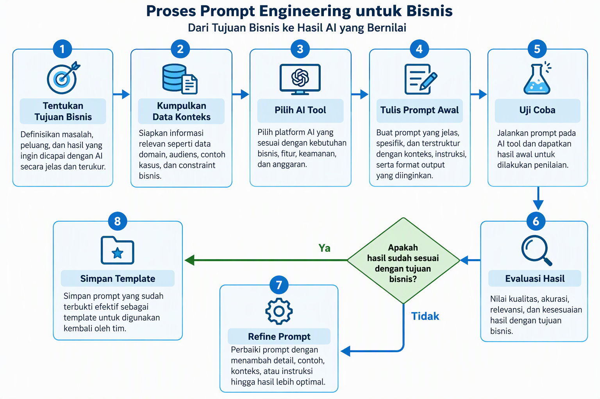
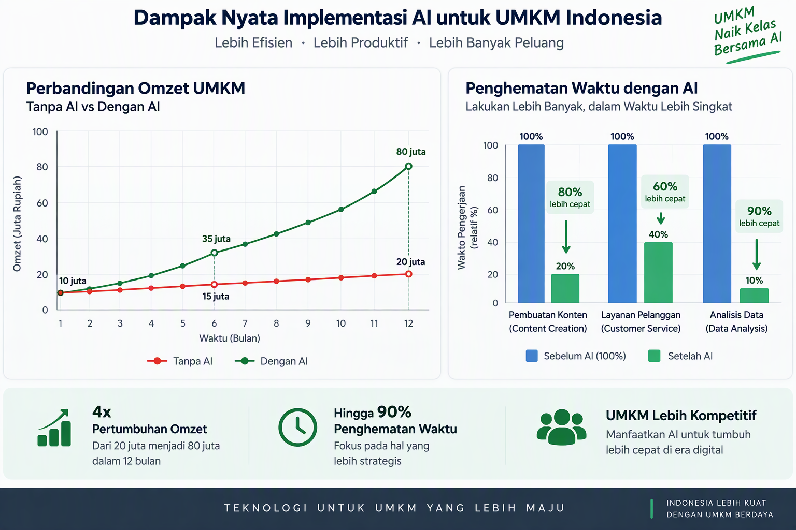

# Panduan Lengkap Digital Marketing Strategy untuk UMKM Indonesia


---

## Daftar Isi

**BAGIAN 1: FONDASI DIGITAL MARKETING**

- Bab 1: Mengapa Digital Marketing Bukan Pilihan, Tapi Keharusan
- Bab 2: Riset Pasar dan Customer Persona
- Bab 3: Menyusun Strategi Digital Marketing
- Bab 4: Content Marketing Strategy
- Bab 5: SEO untuk UMKM

**BAGIAN 2: CHANNEL DAN TAKTIK**

- Bab 6: Social Media Marketing (Instagram, TikTok, Facebook)
- Bab 7: Email Marketing dan Newsletter
- Bab 8: Paid Advertising (Google Ads, Facebook Ads, TikTok Ads)
- Bab 9: Analytics dan Measurement
- Bab 10: Marketing Automation
- Bab 11: Budgeting dan Resource Allocation
- Bab 12: Tools dan Platform Digital Marketing

**BAGIAN 3: OPTIMASI DAN SCALE**

- Bab 13: Integrasi dengan Sales dan CRM
- Bab 14: Advanced Strategies dan Growth Hacking
- Bab 15: Studi Kasus Nyata UMKM Indonesia
- Bab 16: Roadmap 30 Hari dan Next Steps

---
---

# BAGIAN 1: FONDASI DIGITAL MARKETING

---

## Bab 1: Mengapa Digital Marketing Bukan Pilihan, Tapi Keharusan


Lima tahun lalu, seorang pemilik warung kopi di Yogyakarta bisa mengandalkan pelanggan yang lewat di depan tokonya. Hari ini, warung kopi di sebelahannya sudah punya akun Instagram dengan 15.000 followers, aktif di TikTok, dan menerima pesanan melalui GoFood serta GrabFood. Warung pertama tetap ramai, tapi pertumbuhan pelanggan barunya stagnan.

Ini bukan cerita tentang kalah atau menang. Ini tentang perubahan cara konsumen Indonesia menemukan, menilai, dan membeli produk.

Data dari Asosiasi Penyelenggara Jasa Internet Indonesia menunjukkan jumlah pengguna internet di Indonesia sudah melampaui 220 juta jiwa. Dari jumlah tersebut, lebih dari 70 persen menggunakan internet setiap hari. Perilaku belanja mereka berubah. Mereka mencari review di Google sebelum masuk ke toko. Mereka membandingkan harga di marketplace sebelum memutuskan beli. Mereka melihat konten Instagram atau TikTok sebelum percaya pada sebuah brand.

### Evolusi Lanskap Digital Indonesia

Perubahan ini tidak terjadi dalam semalam. Lima belas tahun lalu, ketika internet masih mahal dan lambat, memiliki website saja sudah dianggap canggih. Sepuluh tahun lalu, media sosial mulai populer tapi masih dianggap sebagai alat hiburan, bukan alat bisnis. Lima tahun lalu, e-commerce mulai booming tapi banyak UMKM yang ragu untuk bergabung.

Hari ini, situasinya berbeda total. Smartphone murah dan paket data terjangkau membuat internet bisa diakses oleh hampir semua lapisan masyarakat. Ibu rumah tangga di desa mencari resep masakan di YouTube. Petani muda mengecek harga komoditas di aplikasi. Remaja menemukan brand fashion lokal dari TikTok. Konsumen dari segala usia dan latar belakang sudah terintegrasi dengan dunia digital.

Pandemi tahun 2020 mempercepat transformasi ini secara dramatis. Ketika physical distancing menjadi keharusan, bisnis yang sudah punya kanal digital bisa bertahan dan bahkan tumbuh. Bisnis yang belum punya kanal digital kehilangan hampir seluruh revenue mereka dalam semalam. Pelajaran ini tidak akan dilupakan.

### Pertanyaannya bukan lagi "apakah UMKM perlu go digital." Pertanyaannya adalah "bagaimana cara UMKM go digital yang efektif tanpa membuang budget percuma."

### Realita UMKM Indonesia Hari Ini

Dari 64 juta unit usaha mikro, kecil, dan menengah di Indonesia, sebagian besar masih mengandalkan metode pemasaran konvensional. Brosur, word of mouth, dan spanduk depan toko masih menjadi andalan. Metode-metode ini bukan buruk. Mereka tetap relevan. Tapi jangkauannya terbatas pada radius fisik toko.

Bayangkan Anda punya toko batik di Solo. Pelanggan yang lewat depan toko mungkin 200 orang per hari. Tapi ketika Anda posting foto koleksi batik terbaru di Instagram, potensi yang melihat bisa mencapai ribuan, bahkan puluhan ribu orang. Dan mereka tidak harus berada di Solo. Mereka bisa di Surabaya, Bandung, Jakarta, atau bahkan di luar negeri.

Perubahan perilaku konsumen ini terjadi cepat. Laporan e-Conomy SEA dari Google, Temasek, dan Bain & Company mencatat ekonomi digital Indonesia tumbuh konsisten di atas 20 persen per tahun. Konsumen tidak hanya browsing, mereka membeli. Volume transaksi e-commerce Indonesia terus memecahkan rekor setiap tahunnya.

### Tiga Alasan Digital Marketing Bukan Sekadar Tren

**Alasan pertama: Konsumen Anda sudah ada di sana.**

Rata-rata orang Indonesia menghabiskan lebih dari 7 jam per hari di internet. Waktu itu dihabiskan di media sosial, mesin pencari, aplikasi pesan, dan platform belanja online. Jika bisnis Anda tidak muncul di tempat-tempat itu, Anda tidak terlihat oleh konsumen.

Coba ingat kembali kapan terakhir kali Anda mencari restoran untuk makan malam. Kemungkinan besar Anda buka Google Maps atau Instagram, cari "restoran dekat saya," lihat rating dan review, lalu pilih. Konsumen melakukan hal yang sama untuk hampir semua kategori produk dan jasa.

**Alasan kedua: Biaya digital marketing jauh lebih terjangkau daripada pemasaran tradisional.**

Satu billboard di jalan utama Jakarta bisa menghabiskan Rp 50-100 juta per bulan. Satu iklan TV berdurasi 30 detik di stasiun televisi nasional bisa menghabiskan ratusan juta rupiah. Sementara itu, dengan budget Rp 5 juta per bulan, sebuah UMKM sudah bisa menjalankan kampanye digital marketing yang menjangkau ribuan calon pelanggan potensial.

Facebook Ads memungkinkan Anda menargetkan iklan dengan budget mulai dari Rp 50.000 per hari. Google Ads bekerja dengan sistem pay-per-click, artinya Anda hanya bayar ketika seseorang benar-benar klik iklan Anda. Instagram memberikan fitur organik gratis untuk membangun brand awareness.

**Alasan ketiga: Digital marketing memberikan data yang tidak bisa diberikan pemasaran tradisional.**

Ketika Anda pasang billboard, Anda tidak tahu berapa orang yang benar-benar melihatnya, berapa yang tertarik, dan berapa yang akhirnya datang ke toko. Di dunia digital, Anda tahu persis berapa orang yang melihat iklan, klik iklan, masuk ke website, menambahkan produk ke keranjang, dan melakukan pembelian. Data ini memungkinkan Anda menghitung ROI secara presisi dan mengoptimalkan setiap rupiah yang Anda keluarkan.

### Mitos yang Menghambat UMKM

**"Bisnis saya terlalu kecil untuk digital marketing."**

Ukuran bisnis tidak menentukan efektivitas digital marketing. Justru UMKM sering kali lebih lincah dalam merespons tren dan berinteraksi dengan pelanggan secara personal. Brand besar butuh waktu berminggu-minggu untuk approval konten. Anda bisa membuat konten hari ini dan posting besok.

**"Target pasar saya tidak melek digital."**

Coba cek data penetrasi internet berdasarkan demografi. Kelompok usia 35-54 tahun, yang merupakan segmen konsumen dengan daya beli kuat, memiliki tingkat penetrasi internet di atas 80 persen. Bahkan kelompok 55 tahun ke atas semakin aktif di WhatsApp dan Facebook.

**"Saya sudah coba, tapi tidak berhasil."**

Kebanyakan UMKM yang "sudah coba" biasanya hanya membuat akun Instagram, posting beberapa foto, lalu berharap followers datang sendiri. Digital marketing bukan sekadar punya akun media sosial. Ini tentang strategi, konsistensi, dan pemahaman terhadap perilaku konsumen.

### Apa yang Akan Anda Dapatkan dari Buku Ini

Buku ini dirancang sebagai panduan praktis. Setiap bab memberikan kerangka kerja yang bisa langsung Anda terapkan, bukan teori yang hanya berlaku di textbook. Anda akan belajar cara meriset pasar, membangun customer persona, menyusun strategi konten, mengoptimalkan SEO, menjalankan iklan berbayar, hingga menganalisis hasil kampanye.

Di bagian akhir, Anda akan menemukan tiga studi kasus nyata dari UMKM Indonesia yang berhasil menerapkan strategi digital marketing. Mereka bukan startup dengan pendanaan miliaran rupiah. Mereka adalah bisnis biasa yang menggunakan pendekatan sistematis dan mendapatkan hasil luar biasa.

Mari mulai dari fondasi.

---

## Bab 2: Riset Pasar dan Customer Persona


Sebelum Anda menulis satu kata konten, sebelum Anda membuat satu iklan, sebelum Anda memilih platform mana yang akan digunakan, ada satu langkah yang tidak boleh dilewati: riset pasar.

Riset pasar bukan aktivitas mewah yang hanya dilakukan perusahaan besar. Riset pasar adalah fondasi yang menentukan apakah strategi digital marketing Anda akan tepat sasaran atau meleset. Tanpa riset, Anda seperti pemanah yang menembakkan anak panah dalam gelap. Mungkin kena, tapi kemungkinannya kecil.

### Memahami Pasar Anda

Riset pasar untuk UMKM tidak perlu rumit. Anda tidak perlu menyewa lembaga riset atau membeli laporan seharga ratusan juta rupiah. Yang Anda butuhkan adalah pemahaman mendalam tentang tiga hal: siapa pelanggan Anda, apa masalah mereka, dan di mana mereka menghabiskan waktu online.

**Langkah pertama: Analisis kompetitor.**

Mulai dari mengamati kompetitor langsung Anda. Buka Instagram mereka, TikTok mereka, website mereka. Perhatikan beberapa hal:

- Konten seperti apa yang mereka posting? Format foto, video, carousel, atau Reels?
- Berapa engagement rate mereka? Bukan hanya jumlah likes, tapi juga komentar dan share.
- Apa yang dikeluhkan pelanggan mereka di kolom komentar? Ini adalah celah yang bisa Anda isi.
- Di jam berapa mereka posting?
- Kata kunci apa yang mereka gunakan di caption dan bio?

Tools seperti Social Blade bisa membantu Anda melihat pertumbuhan followers kompetitor. SimilarWeb memberikan gambaran traffic website mereka. Google Trends menunjukkan apakah minat terhadap kategori produk Anda naik atau turun.

**Langkah kedua: Identifikasi celah pasar.**

Setelah memahami apa yang dilakukan kompetitor, cari apa yang belum mereka lakukan dengan baik. Mungkin kompetitor Anda aktif di Instagram tapi tidak punya presence di TikTok. Mungkin mereka punya website tapi tidak pernah update blog. Mungkin customer service mereka lambat merespons di WhatsApp.

Celah-celah ini adalah peluang Anda. Anda tidak perlu meniru kompetitor secara mentah-mentah. Anda perlu menemukan posisi berbeda yang membuat pelanggan memilih Anda.

**Langkah ketiga: Validasi dengan data langsung.**

Data dari kompetitor memberikan petunjuk, tapi data langsung dari calon pelanggan Anda jauh lebih berharga. Ada beberapa cara murah untuk mengumpulkan data ini:

Survei online menggunakan Google Forms atau Typeform. Bagikan ke jaringan WhatsApp, grup Facebook yang relevan, atau story Instagram Anda. Ajukan 10-15 pertanyaan tentang kebiasaan belanja, preferensi produk, dan tantangan yang mereka hadapi.

Wawancara langsung dengan 10-20 pelanggan atau calon pelanggan. Tidak perlu formal. Obrolan 15 menit via WhatsApp call atau tatap muka sudah cukup memberikan insight berharga.

Observasi di grup-grup komunitas online. Bergabunglah dengan grup Facebook atau Telegram yang anggotanya merupakan target pasar Anda. Perhatikan apa yang mereka diskusikan, keluhkan, dan rekomendasikan.

### Membangun Customer Persona

Setelah mengumpulkan data riset, langkah selanjutnya adalah merangkumnya menjadi customer persona. Customer persona adalah representasi fiktif dari pelanggan ideal Anda. Ini bukan sekadar demografi. Ini adalah profil lengkap yang mencakup motivasi, ketakutan, kebiasaan, dan pola pengambilan keputusan.

**Komponen customer persona yang efektif:**

**Profil demografi.** Nama (fiktif), usia, jenis kelamin, lokasi, pekerjaan, pendapatan per bulan, status pernikahan. Contoh: "Rina, 28 tahun, staf admin di perusahaan swasta di Bekasi, gaji Rp 6 juta per bulan, baru menikah."

**Perilaku digital.** Platform apa yang paling sering digunakan? Kapan waktu aktifnya? Apakah lebih suka menonton video atau membaca artikel? Apakah tipe yang riset dulu sebelum beli atau impulsif?

**Masalah dan kebutuhan.** Apa tantangan terbesar yang dihadapi Rina terkait produk yang Anda jual? Apa yang sudah dia coba sebelumnya? Kenapa solusi sebelumnya tidak memuaskan?

**Proses pembelian.** Bagaimana Rina mengambil keputusan? Apakah dia butuh rekomendasi teman? Apakah dia baca review dulu? Berapa lama proses dari tahu produk sampai beli?

**Hambatan pembelian.** Apa yang membuat Rina ragu untuk membeli? Harga? Kepercayaan? Pengiriman? Kualitas?

Contoh customer persona yang lengkap untuk sebuah bisnis katering sehat di Jakarta:

**Nama:** Dina, 32 tahun
**Pekerjaan:** Marketing manager di perusahaan FMCG, Jakarta Selatan
**Pendapatan:** Rp 15 juta per bulan
**Kondisi:** Sudah menikah, satu anak usia 3 tahun, sibuk bekerja
**Masalah:** Ingin makan sehat tapi tidak punya waktu masak. Sering pesan makanan online tapi khawatir tidak sehat.
**Perilaku digital:** Aktif di Instagram (scroll pagi dan malam), langganan newsletter, suka nonton YouTube resep masakan, aktif di grup WhatsApp ibu-ibu komplek
**Proses pembelian:** Lihat konten Instagram, cek website untuk menu dan harga, tanya teman yang sudah pernah pesan, coba order pertama dalam jumlah kecil
**Hambatan:** Takut makanan tidak enak, khawatir pengiriman terlambat, ragu dengan porsi untuk harga yang ditawarkan

Dengan persona sedetail ini, Anda bisa membuat konten yang langsung berbicara kepada Dina. Caption Instagram Anda bisa menyebutkan "makan sehat tanpa repot masak," timing posting di jam 7 pagi atau 9 malam, format video resep cepat, dan testimoni dari pelanggan lain yang sibuk bekerja.

### Teknik Riset Pasar Gratis

**Google Trends.** Ketik kata kunci terkait bisnis Anda dan lihat apakah minat masyarakat naik atau turun. Bandingkan beberapa kata kunci untuk melihat mana yang paling relevan.

**Facebook Audience Insights.** Meskipun Facebook terus mengubah fitur ini, Anda masih bisa mendapatkan data demografi dari orang-orang yang berinteraksi dengan Page Anda.

**Instagram Analytics.** Jika Anda sudah punya akun bisnis, Instagram memberikan data tentang followers Anda: usia, gender, lokasi, dan jam aktif.

**Google Search Console.** Jika Anda punya website, tools ini menunjukkan kata kunci apa yang diketik orang sebelum menemukan website Anda.

**Komentar dan review kompetitor.** Buka halaman produk kompetitor di marketplace atau Google Maps. Baca review bintang 3 dan 4. Review bintang 5 biasanya terlalu umum. Review bintang 1 biasanya terlalu emosional. Review bintang 3 dan 4 memberikan feedback paling konstruktif tentang apa yang bisa diperbaiki.

### Kesalahan Umum dalam Riset Pasar

**Terlalu mengandalkan asumsi.** "Saya yakin target pasar saya ibu-ibu usia 30-40 tahun." Mungkin benar, mungkin tidak. Data akan memberitahu Anda. Jangan berasumsi tanpa bukti.

**Sample terlalu kecil.** Wawancara 3 orang tidak cukup untuk menyimpulkan pola perilaku pasar. Minimal 15-20 responden untuk survei, atau 10 wawancara mendalam untuk mendapatkan gambaran yang representative.

**Hanya bertanya ke orang yang sudah kenal.** Teman dan keluarga cenderung memberikan jawaban yang membuat Anda senang, bukan jawaban yang jujur. Cari responden yang benar-benar merupakan target pasar potensial.

**Riset sekali, pakai selamanya.** Perilaku konsumen berubah. Lakukan riset ulang setiap 6 bulan atau ketika ada perubahan signifikan di pasar.

Riset pasar yang solid menghemat waktu, uang, dan energi. Anda tidak perlu menebak-nebak lagi. Setiap keputusan strategi Anda akan didasarkan pada data nyata, bukan firasat.

---

## Bab 3: Menyusun Strategi Digital Marketing


Setelah memahami pasar dan customer persona, tiba saatnya menyusun strategi. Strategi bukan daftar panjang taktik yang ingin Anda coba. Strategi adalah rencana terstruktur yang menghubungkan tujuan bisnis dengan tindakan konkret di dunia digital.

### Menetapkan Tujuan dengan Framework SMART

Sebelum memilih platform atau membuat konten, tetapkan dulu apa yang ingin Anda capai. Tujuan yang jelas menentukan arah strategi Anda.

Gunakan framework SMART:

**Specific.** "Meningkatkan penjualan" terlalu umum. "Meningkatkan penjualan paket katering sehat" lebih spesifik.

**Measurable.** "Meningkatkan penjualan paket katering sehat dari 50 paket per minggu menjadi 100 paket per minggu." Angka ini bisa diukur.

**Achievable.** Kenaikan 100 persen dalam satu bulan mungkin tidak realistis. Kenaikan 100 persen dalam 6 bulan dengan budget dan sumber daya yang tersedia lebih masuk akal.

**Relevant.** Tujuan harus selaras dengan tujuan bisnis secara keseluruhan. Jika prioritas bisnis adalah profitability, maka tujuan digital marketing harus fokus pada margin, bukan sekadar volume penjualan.

**Time-bound.** Tetapkan deadline. "Mencapai 100 paket per minggu dalam 6 bulan" memberikan kerangka waktu yang jelas.

Contoh tujuan digital marketing untuk berbagai jenis UMKM:

Toko online fashion: Meningkatkan penjualan bulanan dari Rp 30 juta menjadi Rp 75 juta dalam 4 bulan melalui Instagram Shopping dan TikTok Shop.

Klinik kecantikan: Mendapatkan 50 booking baru per bulan dari kanal digital dalam 3 bulan, dengan customer acquisition cost di bawah Rp 75.000.

Jasa fotografi: Meningkatkan inquiry dari website sebesar 80 persen dalam 6 bulan melalui SEO dan Google Ads.

### Memilih Channel yang Tepat

Tidak semua channel digital cocok untuk semua bisnis. Memilih channel yang tepat lebih penting daripada menguasai semua channel sekaligus.

Pertimbangan dalam memilih channel:

**Di mana target pasar Anda menghabiskan waktu?** Jika target pasar Anda Gen Z dan milenial muda, TikTok dan Instagram adalah prioritas. Jika target pasar Anda profesional usia 30-45 tahun, LinkedIn dan Instagram mungkin lebih relevan. Jika target pasar Anda ibu rumah tangga, Facebook Group dan WhatsApp bisa menjadi channel utama.

**Jenis produk atau jasa apa yang Anda jual?** Produk visual seperti fashion, makanan, dan dekorasi cocok untuk Instagram dan Pinterest. Jasa profesional seperti konsultan atau B2B services lebih cocok di LinkedIn dan website. Produk dengan proses pembelian panjang seperti properti atau otomotif membutuhkan kombinasi website, Google Ads, dan email marketing.

**Berapa budget yang tersedia?** Jika budget terbatas, fokus pada channel organik dulu: Instagram, TikTok, dan SEO. Ketika sudah ada revenue yang masuk, alokasikan sebagian untuk paid advertising.

**Berapa kapasitas tim Anda?** Satu orang yang mengelola lima channel akan menghasilkan konten mediocre di semua channel. Lebih baik menguasai dua channel dengan konten berkualitas daripada hadir di lima channel dengan konten seadanya.

### Kerangka Kerja Strategi: Piramida Digital Marketing

Bayangkan strategi digital marketing Anda sebagai piramida tiga tingkat.

**Tingkat dasar: Awareness.** Orang harus tahu Anda ada dulu sebelum mereka membeli. Channel untuk awareness: konten organik di media sosial, SEO, Google My Business, kolaborasi dengan influencer mikro.

**Tingkat tengah: Consideration.** Orang yang sudah tahu Anda ada mulai mempertimbangkan apakah produk Anda cocok untuk mereka. Channel untuk consideration: konten edukatif di blog atau YouTube, email newsletter, testimoni dan review, webinar atau live session.

**Tingkat atas: Conversion.** Orang yang sudah tertarik butuh dorongan terakhir untuk membeli. Channel untuk conversion: penawaran khusus via WhatsApp atau email, retargeting ads, landing page yang optimized, promo terbatas waktu.

Setiap tingkat piramida membutuhkan pendekatan konten yang berbeda. Di tingkat awareness, konten Anda bersifat menghibur atau mengedukasi. Di tingkat consideration, konten Anda menunjukkan keahlian dan kepercayaan. Di tingkat conversion, konten Anda fokus pada urgensi dan kemudahan transaksi.

### Menyusun Marketing Funnel

Marketing funnel adalah representasi perjalanan pelanggan dari pertama kali mengenal brand sampai melakukan pembelian dan menjadi pelanggan setia.

**Tahap 1: Awareness (Kesadaran).** Calon pelanggan menemukan brand Anda untuk pertama kali. Mereka melihat postingan Instagram, menemukan website Anda di Google, atau melihat iklan TikTok. Tujuan Anda di tahap ini adalah menarik perhatian dan membuat mereka ingin tahu lebih lanjut.

**Tahap 2: Interest (Minat).** Calon pelanggan mulai mengikuti akun Anda, membaca blog Anda, atau mendaftar newsletter. Mereka belum siap membeli, tapi mereka tertarik. Tujuan Anda adalah memberikan konten yang relevan dan berharga sehingga mereka terus mengingat brand Anda.

**Tahap 3: Desire (Keinginan).** Calon pelanggan mulai mempertimbangkan produk Anda secara serius. Mereka membandingkan dengan kompetitor, membaca testimoni, mengecek harga. Tujuan Anda adalah menunjukkan diferensiasi dan membangun kepercayaan.

**Tahap 4: Action (Tindakan).** Calon pelanggan siap membeli. Tujuan Anda adalah mempermudah proses pembelian. Tombol beli yang jelas, checkout yang simpel, opsi pembayaran yang lengkap, dan customer service yang responsif.

**Tahap 5: Loyalty (Kesetiaan).** Pelanggan sudah membeli dan Anda ingin mereka kembali. Follow up via email atau WhatsApp, minta feedback, berikan penawaran eksklusif untuk pelanggan lama, dan buat mereka merasa dihargai.

Untuk setiap tahap funnel, tentukan:
- Channel apa yang digunakan
- Jenis konten apa yang disampaikan
- Call to action apa yang diharapkan
- Metrik apa yang diukur

### Dokumentasi Strategi

Strategi yang tidak didokumentasikan adalah keinginan, bukan strategi. Buat dokumen strategi yang bisa diakses seluruh tim. Dokumen ini tidak perlu panjang. Satu halaman yang jelas sudah cukup untuk UMKM.

Komponen minimum dokumen strategi:
- Tujuan bisnis dan target angka
- Customer persona (ringkasan 1 halaman)
- Channel prioritas dan alasan pemilihan
- Marketing funnel dan konten untuk setiap tahap
- Budget bulanan dan alokasinya
- Timeline dan milestone
- KPI dan cara pengukurannya

Review dokumen ini setiap bulan. Adjust berdasarkan data dan perubahan kondisi pasar.

---

## Bab 4: Content Marketing Strategy



Content marketing adalah jantung dari digital marketing. Tanpa konten yang relevan dan berharga, semua channel yang Anda pilih tidak akan menghasilkan apa-apa. Konten adalah alasan orang mengikuti akun Anda, mengunjungi website Anda, dan akhirnya membeli produk Anda.

### Apa Itu Content Marketing yang Efektif

Content marketing bukan sekadar posting foto produk dengan caption "DM untuk order." Content marketing adalah seni memberikan nilai kepada audiens sebelum meminta mereka membeli.

Contoh sederhana: Anda menjual peralatan gardening. Daripada setiap hari posting foto produk dengan harga, buat konten tentang "5 tanaman yang mudah dirawat untuk pemula," "Cara mengatasi hama kutu putih pada tanaman hias," atau "Jadwal penyiraman yang tepat untuk iklim tropis." Konten-konten ini menarik perhatian orang yang tertarik berkebun. Ketika mereka butuh peralatan gardening, brand Anda yang terlintas di pikiran.

### Content Pillar: Lima Kategori Konten

Untuk menjaga konsistensi dan variasi, bagi konten Anda ke dalam lima pilar:

**Pilar 1: Edukasi.** Konten yang mengajarkan sesuatu kepada audiens. Tutorial, tips, how-to, infografis. Contoh untuk bisnis kopi: "Cara menyeduh kopi manual brew yang benar," "Perbedaan arabica dan robusta," "Mengapa grinding size mempengaruhi rasa kopi."

**Pilar 2: Hiburan.** Konten yang membuat audiens tersenyum, tertawa, atau merasa relate. Meme yang relevan, video behind the scene yang lucu, tren TikTok yang diadaptasi. Contoh untuk bisnis fashion: Video transisi outfit sebelum dan sesudah, atau "Tipe-tipe orang saat fitting room."

**Pilar 3: Inspirasi.** Konten yang memotivasi audiens. Cerita sukses pelanggan, quotes yang relevan, pencapaian brand. Contoh untuk bisnis fitness: Transformasi member, cerita perjuangan menurunkan berat badan, milestone pencapaian.

**Pilar 4: Promosi.** Konten yang langsung menjual. Launching produk baru, diskon, penawaran khusus, testimonial pelanggan. Ini adalah pilar yang paling sering digunakan UMKM, dan seharusnya tidak lebih dari 20-30 persen total konten.

**Pilar 5: Interaksi.** Konten yang melibatkan audiens. Polling, Q&A, kuis, challenge, user-generated content. Contoh untuk bisnis makanan: "Menu baru mana yang harus kami launching? Vote di story!" atau "Share foto kamu makan di restoran kami dan tag kami."

### Content Calendar: Merencanakan Konten Satu Bulan ke Depan

Konten yang konsisten membutuhkan perencanaan. Content calendar adalah alat yang membantu Anda mengetahui apa yang akan diposting, kapan, di channel mana, dan oleh siapa.

Langkah membuat content calendar:

**Langkah 1: Tentukan frekuensi posting.** Untuk Instagram feed, 3-5 kali per minggu adalah angka yang realistis untuk UMKM. Untuk Instagram story, 3-7 kali per hari. Untuk TikTok, 4-7 video per minggu. Untuk blog, 2-4 artikel per bulan.

**Langkah 2: Tentukan hari dan jam posting.** Berdasarkan data Instagram Analytics atau TikTok Analytics, identifikasi jam ketika followers Anda paling aktif. Umumnya, jam 7-9 pagi, 12-1 siang, dan 7-10 malam adalah waktu aktif pengguna media sosial di Indonesia.

**Langkah 3: Assign pilar konten ke setiap hari.** Misalnya, Senin untuk edukasi, Rabu untuk hiburan, Jumat untuk interaksi, dan Sabtu untuk promosi. Ini memberikan struktur tanpa menghilangkan kreativitas.

**Langkah 4: Buat bank ide konten.** Sisihkan waktu 2 jam di akhir setiap bulan untuk brainstorming ide konten bulan berikutnya. Tulis semua ide di spreadsheet atau tools seperti Trello atau Notion. Ketika hari posting tiba, Anda tidak perlu bingung mau posting apa.

**Langkah 5: Batch production.** Daripada membuat konten satu per satu setiap hari, buat konten untuk satu minggu dalam satu sesi. Ambil semua foto produk sekaligus, edit sekaligus, tulis caption sekaligus, jadwalkan sekaligus. Ini jauh lebih efisien.

### Format Konten yang Bekerja untuk UMKM Indonesia

**Video pendek (Reels, TikTok, YouTube Shorts).** Algoritma platform saat ini sangat memprioritaskan video pendek. Video 15-60 detik yang informatif atau menghibur bisa menjangkau audiens yang jauh lebih luas dari followers Anda. Konten video pendek memiliki jangkauan organik tertinggi di Instagram dan TikTok saat ini.

**Carousel Instagram.** Postingan dengan 3-10 slide yang bisa di-swipe. Cocok untuk konten edukasi step-by-step. Engagement rate carousel cenderung lebih tinggi dari single image karena audiens menghabiskan waktu lebih lama di postingan Anda.

**Live streaming.** Instagram Live, TikTok Live, atau Facebook Live memungkinkan interaksi real-time dengan audiens. Cocok untuk Q&A, launching produk, demo produk, atau behind the scene. Algoritma juga memberikan boost untuk konten live.

**User-generated content.** Repost konten dari pelanggan yang menggunakan produk Anda. Ini sekaligus berfungsi sebagai testimonial dan membangun komunitas. Pelanggan merasa dihargai ketika konten mereka di-repost.

**Blog atau artikel.** Untuk SEO, konten tertulis tetap diperlukan. Artikel 800-1500 kata yang menjawab pertanyaan spesifik yang dicari target pasar Anda bisa mendatangkan traffic organik dari Google secara konsisten selama bertahun-tahun.

### Copywriting untuk Konten Digital

Menulis caption atau copy yang efektif bukan bakat lahir. Ini skill yang bisa dipelajari.

**Formula AIDA (Attention, Interest, Desire, Action).**

Attention: Kalimat pertama harus menghentikan scroll. "Stop buang uang untuk skincare yang tidak cocok!" lebih menarik perhatian daripada "Skincare terbaik untuk kulit sensitif."

Interest: Dua sampai tiga kalimat berikutnya membangun interest. Jelaskan masalah yang relate dengan pembaca. "Kamu sudah coba puluhan produk tapi kulit tetap breakout? Mungkin kamu belum tahu kalau urutan pemakaian skincare lebih penting dari jenis produknya."

Desire: Bangun keinginan dengan menunjukkan solusi dan hasilnya. "Dengan teknik layering yang benar, produk Rp 50 ribu bisa memberikan hasil yang sama dengan treatment jutaan di klinik."

Action: Tutup dengan instruksi jelas. "Save postingan ini untuk referensi rutinitas skincare kamu" atau "Klik link di bio untuk download panduan lengkap gratis."

**Formula PAS (Problem, Agitate, Solution).**

Problem: Identifikasi masalah. "Tagihan listrik setiap bulan makin membengkak?"

Agitate: Perbesar rasa tidak nyaman. "Bayangkan kalau kenaikan ini terus terjadi, berapa yang harus kamu bayar tahun depan? Jutaan rupiah habis untuk listrik yang sebenarnya bisa lebih efisien."

Solution: Tawarkan solusi. "Dengan panel surya mini, kamu bisa mengurangi tagihan listrik sampai 40 persen. Investasi awalnya terjangkau dan balik modal dalam 2 tahun."

### Teknik Produksi Konten dengan Sumber Daya Terbatas

Banyak UMKM berpikir mereka butuh tim produksi profesional untuk membuat konten berkualitas. Ini tidak benar. Smartphone yang Anda gunakan setiap hari sudah cukup untuk menghasilkan konten yang menarik.

**Fotografi produk menggunakan smartphone.** Gunakan cahaya natural dari jendela atau outdoor di pagi hari (jam 8-10) atau sore hari (jam 3-5). Hindari flash karena menghasilkan bayangan keras. Gunakan background polos: kertas putih, kain polos, atau meja kayu. Ambil foto dari beberapa angle: atas (flat lay), depan, samping, dan detail. Edit menggunakan Snapseed atau Lightroom mobile untuk menyesuaikan brightness, contrast, dan saturation.

**Video pendek menggunakan smartphone.** Rekam video dalam mode landscape untuk YouTube dan portrait untuk Reels dan TikTok. Gunakan tripod murah agar gambar stabil. Pencahayaan natural tetap yang terbaik. Rekam di tempat yang tenang tanpa kebisingan background. Untuk video produk, tunjukkan produk dari berbagai angle, demonstrasikan penggunaan, dan tunjukkan hasil akhir.

**Desain grafis menggunakan Canva.** Canva menyediakan ribuan template gratis untuk Instagram post, story, banner, dan lainnya. Anda tidak perlu skill desain. Pilih template, ganti teks dan gambar, download. Selesai. Untuk konsistensi visual, gunakan palet warna yang sama dan font yang sama di semua desain Anda.

**Batch production.** Daripada membuat konten satu per satu setiap hari, luangkan satu hari dalam sebulan untuk memproduksi semua konten. Ambil 30-40 foto produk dalam satu sesi. Rekam 8-10 video pendek dalam satu sesi. Desain 20-30 graphic dalam satu sesi. Kemudian jadwalkan semuanya untuk posting sepanjang bulan. Pendekatan ini menghemat waktu dan menjaga konsistensi kualitas.

### Mengatasi Writer's Block untuk Konten

Setiap pembisnis yang menjalankan konten marketing pasti mengalami masa-masa kehabisan ide. Ini normal dan bisa diatasi dengan beberapa teknik:

**Dokumentasikan, jangan ciptakan.** Konten terbaik sering kali datang dari mendokumentasikan apa yang sudah terjadi di bisnis Anda. Proses produksi, interaksi dengan pelanggan, tantangan sehari-hari, keberhasilan kecil. Orang suka melihat behind the scene karena memberikan kesan autentik.

**Jawab pertanyaan pelanggan.** Setiap kali pelanggan bertanya sesuatu, catat. Pertanyaan-pertanyaan ini adalah ide konten yang sudah terverifikasi. Jika satu pelanggan bertanya, kemungkinan besar banyak pelanggan lain punya pertanyaan yang sama.

**Amati tren dan adaptasi.** Buka TikTok atau Instagram Reels, lihat format konten apa yang sedang trending. Adaptasi ke niche bisnis Anda. Tidak perlu meniru persis. Ambil konsep dasarnya dan sesuaikan dengan brand Anda.

**Gunakan kalender editorial.** Hari-hari tertentu dalam setahun selalu memberikan ide konten: Hari Raya, tahun baru, hari kartini, hari kemerdekaan, back to school, tahun baru Imlek, dan banyak lagi. Buat kalender konten tahunan yang memanfaatkan momen-momen ini.

### Konten Lokal yang Resonate

Audiens Indonesia merespons konten yang terasa dekat dengan keseharian mereka. Gunakan bahasa yang sesuai dengan target pasar. Jika target Anda milenial urban, bahasa casual dengan sedikit slang cocok. Jika target Anda profesional B2B, bahasa yang lebih formal tapi tetap hangat lebih tepat.

Referensi budaya lokal, momen nasional, dan kebiasaan sehari-hari membuat konten lebih relatable. Konten tentang "susah move on dari warung nasi goreng langganan" akan lebih resonate dengan audiens Indonesia daripada konten generik tentang "street food."

Manfaatkan juga momentum hari raya, tahun baru, back to school, dan event-event lainnya untuk membuat konten yang timely.

---

## Bab 5: SEO untuk UMKM


Search Engine Optimization, atau SEO, adalah praktik mengoptimalkan website Anda agar muncul di halaman pertama Google ketika seseorang mencari kata kunci yang relevan dengan bisnis Anda. Bagi UMKM, SEO adalah channel marketing dengan ROI tertinggi dalam jangka panjang.

Mengapa? Karena traffic dari Google bersifat organik, artinya Anda tidak membayar per klik. Begitu website Anda ranking di halaman pertama untuk kata kunci tertentu, Anda akan terus mendapatkan pengunjung setiap hari tanpa biaya iklan tambahan.

### Bagaimana SEO Bekerja

Google menggunakan lebih dari 200 faktor untuk menentukan ranking sebuah website. Tapi secara sederhana, tiga pilar utama SEO adalah:

**Technical SEO.** Fondasi teknis website Anda. Kecepatan loading, mobile-friendliness, struktur URL, sitemap, dan keamanan (SSL/HTTPS). Jika website Anda lambat atau tidak bisa dibuka dengan baik di HP, Google tidak akan menampilkannya di posisi atas, sebagus apa pun kontennya.

**On-page SEO.** Optimasi di dalam halaman website. Riset kata kunci, penempatan kata kunci di judul, heading, dan body teks, kualitas konten, meta description, alt text gambar, dan internal linking.

**Off-page SEO.** Sinyal dari luar website yang menunjukkan kredibilitas Anda. Backlink dari website lain, review di Google My Business, dan social signals. Semakin banyak website terpercaya yang mengarah ke website Anda, semakin Google percaya bahwa konten Anda berkualitas.

### Riset Kata Kunci untuk UMKM

Riset kata kunci adalah langkah pertama dan paling krusial dalam SEO. Anda perlu mengetahui kata apa yang diketik calon pelanggan di Google sebelum mereka menemukan (atau tidak menemukan) website Anda.

**Tools gratis untuk riset kata kunci:**

Google Keyword Planner. Meskipun dirancang untuk Google Ads, tools ini memberikan data volume pencarian dan tingkat kompetisi untuk setiap kata kunci. Anda hanya perlu membuat akun Google Ads (tidak perlu menjalankan iklan).

Google Search Console. Menunjukkan kata kunci apa yang sudah digunakan orang untuk menemukan website Anda. Data ini sangat berharga untuk menemukan peluang optimasi.

Ubersuggest. Versi gratis memberikan data terbatas tapi cukup untuk memulai. Menampilkan volume pencarian, difficulty score, dan ide kata kunci terkait.

Google Suggest. Ketik kata kunci di kolom pencarian Google dan lihat saran yang muncul di dropdown. Ini adalah kata kunci yang benar-benar dicari orang.

**Strategi kata kunci untuk UMKM:**

Fokus pada long-tail keywords. Daripada menargetkan "sepatu" (terlalu kompetitif), targetkan "sepatu kulit handmade Bandung" atau "sepatu lari wanita murah ukuran 40." Long-tail keywords memiliki volume pencarian lebih kecil, tapi tingkat konversinya jauh lebih tinggi karena orang yang mencari sudah tahu persis apa yang mereka inginkan.

Targetkan kata kunci lokal. Jika bisnis Anda melayani area tertentu, tambahkan nama kota atau daerah. "Klinik gigi Jakarta Selatan," "jasa cuci sofa Bekasi," "toko bunga Surabaya." Konsumen yang mencari dengan kata kunci lokal biasanya sudah siap membeli.

Jawab pertanyaan. Banyak orang mengetik pertanyaan di Google. "Berapa biaya servis AC?" "Cara merawat tanaman monstera." "Rekomendasi katering sehat Jakarta." Buat konten yang menjawab pertanyaan-pertanyaan ini.

### Optimasi On-Page

Setelah memiliki daftar kata kunci, terapkan di website Anda.

**Judul halaman (Title Tag).** Ini adalah teks yang muncul sebagai link biru di hasil pencarian Google. Judul harus mengandung kata kunci utama dan menarik untuk diklik. Panjang ideal: 50-60 karakter. Contoh: "Jasa Cuci Sofa Jakarta Selatan | Bersih Total, Harga Mulai 150rb."

**Meta Description.** Teks singkat di bawah judul pada hasil pencarian. Meskipun bukan faktor ranking langsung, meta description yang menarik meningkatkan click-through rate. Panjang ideal: 150-160 karakter.

**Heading (H1, H2, H3).** Struktur konten dengan heading yang jelas. H1 adalah judul utama (satu per halaman). H2 adalah subjudul utama. H3 adalah sub-subjudul. Masukkan variasi kata kunci di heading-heading ini secara natural.

**Konten berkualitas.** Google memprioritaskan konten yang benar-benar menjawab kebutuhan pencari. Artikel 800-1500 kata yang komprehensif cenderung ranking lebih baik daripada artikel 300 kata yang dangkal. Pastikan konten Anda lebih lengkap, lebih detail, dan lebih berguna dari konten kompetitor di halaman pertama Google.

**Optimasi gambar.** Kompres ukuran gambar agar website loading cepat. Gunakan format WebP atau JPEG yang dikompres. Beri nama file yang deskriptif (bukan IMG_1234.jpg, tapi jasa-cuci-sofa-jakarta.jpg). Isi alt text dengan deskripsi yang mengandung kata kunci.

**Internal linking.** Hubungkan halaman-halaman di website Anda satu sama lain. Jika Anda menulis artikel tentang "cara merawat sepatu kulit," link ke halaman produk perawatan sepatu Anda. Ini membantu Google memahami struktur website dan mendistribusikan otoritas ke seluruh halaman.

### Google My Business: SEO Lokal

Untuk UMKM yang melayani area lokal, Google My Business (GMB) adalah tools SEO paling powerful yang gratis.

Profil GMB yang lengkap menampilkan nama bisnis, alamat, nomor telepon, jam operasional, foto, review, dan postingan di hasil pencarian Google dan Google Maps.

Langkah optimasi GMB:

Lengkapi semua informasi. Nama bisnis, alamat, nomor telepon, website, jam operasional, kategori bisnis, dan deskripsi. Pastikan informasi ini konsisten di semua platform.

Upload foto berkualitas. Foto interior, eksterior, produk, tim, dan suasana bisnis. Profil dengan foto mendapatkan 42 persen lebih banyak permintaan arah dan 35 persen lebih banyak klik ke website.

Kumpulkan review. Minta pelanggan untuk meninggalkan review di Google. Balas setiap review, baik positif maupun negatif, dengan respons yang profesional dan hangat.

Posting secara rutin. GMB memiliki fitur posting mirip media sosial. Gunakan untuk membagikan promo, event, atau update terbaru.

### Membangun Backlink

Backlink adalah link dari website lain ke website Anda. Google menganggap backlink sebagai "vote of confidence." Semakin banyak website berkualitas yang me-link ke Anda, semakin tinggi otoritas domain Anda.

Cara mendapatkan backlink untuk UMKM:

**Guest posting.** Tulis artikel untuk blog atau website lain di industri Anda. Sebagai imbalan, Anda bisa menyertakan link ke website Anda di dalam artikel atau di bio penulis.

**Kolaborasi dengan blogger atau influencer.** Banyak blogger yang senang menulis review tentang produk atau jasa lokal. Tawarkan produk gratis atau pengalaman gratis sebagai ganti review jujur yang menyertakan link ke website Anda.

**Daftar di direktori lokal.** Pastikan bisnis Anda terdaftar di direktori bisnis online seperti Yellow Pages Indonesia, Indotrading, atau direktori bisnis lokal kota Anda.

**HARO (Help a Reporter Out).** Platform ini menghubungkan jurnalis dengan sumber informasi. Jika ada jurnalis yang menulis artikel tentang topik yang Anda kuasai, Anda bisa memberikan kutipan yang disertai link ke website Anda.

### Kesalahan SEO yang Harus Dihindari

**Keyword stuffing.** Memasukkan kata kunci secara berlebihan dan tidak natural. "Jasa cuci sofa Jakarta, jasa cuci sofa terbaik Jakarta, cuci sofa Jakarta murah, jasa cuci sofa..." Google sudah sangat pintar mendeteksi praktik ini dan akan menurunkan ranking Anda.

**Duplicate content.** Konten yang sama persis di beberapa halaman atau copy-paste dari website lain. Google hanya akan menampilkan satu versi dan mengabaikan sisanya.

**Mengabaikan mobile.** Lebih dari 70 persen pencarian Google di Indonesia dilakukan dari mobile. Jika website Anda tidak mobile-friendly, Anda kehilangan mayoritas potensi traffic.

**Tidak sabar.** SEO adalah strategi jangka panjang. Butuh 3-6 bulan untuk melihat hasil signifikan dari upaya SEO. Jangan berhenti di bulan kedua karena belum melihat hasil. Konsistensi adalah kunci.

---
---

# BAGIAN 2: CHANNEL DAN TAKTIK

---

## Bab 6: Social Media Marketing (Instagram, TikTok, Facebook)


Media sosial adalah kanal tempat target pasar Anda menghabiskan waktu setiap hari. Bagi UMKM Indonesia, media sosial bukan sekadar tempat branding. Media sosial adalah etalase, ruang interaksi, dan mesin penjualan dalam satu paket.

### Instagram: Platform Visual untuk Brand Building

Instagram memiliki lebih dari 100 juta pengguna aktif di Indonesia. Platform ini cocok untuk bisnis yang mengandalkan visual: fashion, makanan, kecantikan, dekorasi, fotografi, dan travel.

**Optimasi profil Instagram.**

Username harus mudah dicari dan mencerminkan brand. Bio harus menjelaskan dalam satu kalimat apa yang Anda tawarkan dan mengapa orang harus peduli. Sertakan kata kunci relevan. Tambahkan link ke website atau WhatsApp menggunakan tools seperti Linktree atau langsung.

Gunakan highlight untuk menyimpan informasi penting: menu produk, harga, cara order, testimoni pelanggan, FAQ, dan behind the scene. Highlight berfungsi sebagai "menu" profil Anda.

**Strategi konten Instagram.**

Feed (foto dan carousel): Gunakan untuk konten berkualitas tinggi yang merepresentasikan brand. Konsisten dalam tone warna dan gaya visual. Carousel untuk konten edukasi.

Reels: Gunakan untuk menjangkau audiens baru. Algoritma Reels mendorong konten ke orang yang belum mengikuti Anda. Video 15-30 detik dengan musik trending, tips cepat, atau behind the scene bekerja sangat baik.

Stories: Gunakan untuk interaksi harian. Polling, Q&A, quiz, countdown, dan link sticker. Stories menjaga engagement dengan followers yang sudah ada.

Live: Gunakan untuk launching produk, flash sale, Q&A session, atau kolaborasi dengan akun lain.

**Instagram Shopping.**

Fitur ini memungkinkan Anda menandai produk langsung di foto dan video. Pengguna bisa melihat harga dan detail produk tanpa meninggalkan aplikasi. Untuk mengaktifkan, Anda perlu mengubah akun ke Business Account dan menghubungkan ke katalog produk.

**Engagement strategy.**

Balas setiap komentar dan DM. Jangan gunakan auto-reply generik. Respons yang personal membangun hubungan. Luangkan 15 menit sebelum dan sesudah posting untuk berinteraksi dengan akun-akun di niche Anda. Komen di postingan akun lain, reply stories mereka, dan bangun relasi yang genuine.

**Memahami algoritma Instagram.**

Instagram menggunakan beberapa sinyal untuk menentukan konten mana yang ditampilkan di feed dan Explore. Sinyal-sinyal utama: seberapa cepat konten Anda mendapat engagement setelah diposting (30 menit pertama sangat krusial), apakah konten tersebut disimpan (save) atau dibagikan (share), dan seberapa lama audiens menghabiskan waktu melihat konten Anda.

Strategi untuk mengoptimalkan setiap sinyal: Posting di jam ketika followers Anda paling aktif. Buat konten yang layak di-save, seperti tips, checklist, atau referensi. Buat konten yang layak di-share, seperti konten yang membuat orang merasa relate. Gunakan caption yang cukup panjang untuk membuat orang menghabiskan waktu membaca.

**Hashtag strategy.** Gunakan 15-25 hashtag per postingan. Campuran hashtag besar (lebih dari 1 juta post), hashtag medium (100.000-1 juta post), dan hashtag kecil (di bawah 100.000 post). Hashtag besar memberikan potensi jangkauan luas, hashtag kecil memberikan peluang ranking lebih tinggi. Riset hashtag kompetitor dan hashtag yang digunakan oleh akun sukses di niche Anda.

### TikTok: Mesin Viralitas untuk UMKM

TikTok memiliki lebih dari 125 juta pengguna di Indonesia. Platform ini unik karena algoritmanya tidak memprioritaskan jumlah followers. Video dari akun dengan 0 followers bisa mendapatkan jutaan views jika kontennya menarik.

**Karakteristik konten TikTok yang berhasil.**

Konten TikTok harus terasa autentik dan tidak terlalu diproduksi. Video yang terlalu "iklan" cenderung di-skip. Konten yang berhasil adalah video yang menghibur, mengedukasi, atau membuat orang merasa relate.

Format yang bekerja:
- "Day in my life" sebagai pemilik bisnis
- Behind the scene proses produksi
- "Pack an order with me"
- Tips dan trik terkait industri Anda
- Storytime tentang pengalaman bisnis
- Duet atau stitch dengan video trending
- Transisi before-after

**TikTok untuk bisnis lokal.**

Gunakan hashtag lokal (#kulinerjakarta, #batiksolo, #wisatabandung) untuk menjangkau audiens di area Anda. TikTok memiliki fitur "Nearby" yang menunjukkan konten dari kreator di sekitar pengguna.

**TikTok Shop.**

Fitur e-commerce bawaan TikTok memungkinkan pengguna membeli produk langsung dari video atau live streaming tanpa meninggalkan aplikasi. Live shopping di TikTok sangat populer di Indonesia. Banyak UMKM yang mendapatkan penjualan jutaan rupiah dari satu sesi live streaming.

### Facebook: Platform dengan Jangkauan Terluas

Facebook mungkin tidak "sekeren" TikTok atau Instagram, tapi dengan lebih dari 190 juta pengguna di Indonesia, Facebook tetap menjadi platform dengan jangkauan terluas, terutama untuk demografi usia 30-55 tahun.

**Facebook Page.**

Page adalah kehadiran resmi bisnis Anda di Facebook. Lengkapi semua informasi, upload foto cover dan profil yang profesional, dan posting secara konsisten.

**Facebook Group.**

Group adalah fitur Facebook yang sangat powerful untuk membangun komunitas. Buat group yang relevan dengan bisnis Anda. Jika Anda jual peralatan fitness, buat group "Komunitas Fitness Pemula Indonesia." Bagikan tips, motivasi, dan sesekali promosikan produk Anda. Group yang aktif bisa menjadi sumber traffic dan penjualan yang konsisten.

**Facebook Marketplace.**

Fitur ini memungkinkan Anda menjual produk langsung ke orang di sekitar Anda. Sangat efektif untuk bisnis yang melayani area tertentu. Upload foto berkualitas, tulis deskripsi yang jelas, dan respons cepat setiap inquiry.

**Facebook Ads.**

Facebook Ads akan dibahas lebih detail di Bab 8. Tapi sebagai pengantar, Facebook Ads memungkinkan Anda menargetkan iklan berdasarkan demografi, minat, perilaku, dan bahkan orang yang pernah mengunjungi website Anda. Budget minimum sangat terjangkau untuk UMKM.

### Cross-Platform Strategy

Anda tidak perlu membuat konten yang berbeda untuk setiap platform. Buat satu konten inti, lalu adaptasi ke berbagai format:

Satu foto produk berkualitas tinggi bisa menjadi: postingan Instagram feed, thumbnail video TikTok, gambar di Facebook Marketplace, ilustrasi artikel blog, dan konten newsletter.

Satu video panjang 10 menit bisa dipotong menjadi: 3-4 video pendek untuk Reels dan TikTok, 1 video penuh untuk YouTube, cuplikan untuk Stories, dan transkrip untuk artikel blog.

Pendekatan ini disebut content repurposing. Efisiensi waktu dan tenaga, tapi jangkauan tetap maksimal.

### Mengukur Performa Social Media

Untuk setiap platform, pantau metrik berikut:

**Engagement rate.** Persentase followers yang berinteraksi dengan konten Anda (likes, comments, shares, saves). Engagement rate di atas 3 persen di Instagram dianggap baik untuk UMKM.

**Reach dan impressions.** Berapa orang yang melihat konten Anda. Jika reach stagnan, variasi format konten dan gunakan fitur baru platform.

**Follower growth.** Pertumbuhan followers dari waktu ke waktu. Pertumbuhan organik yang stabil lebih berharga dari lonjakan tiba-tiba yang tidak berkelanjutan.

**Conversion.** Berapa banyak followers yang akhirnya membeli produk. Ini yang paling penting tapi paling sering diabaikan. Gunakan link tracking untuk mengukur konversi dari setiap platform.

---

## Bab 7: Email Marketing dan Newsletter


Email marketing mungkin terdengar kuno di era TikTok dan Instagram. Tapi data menunjukkan hal berbeda. Email marketing memiliki ROI rata-rata Rp 54.000 untuk setiap Rp 1.000 yang diinvestasikan. Angka ini jauh lebih tinggi dari channel marketing lainnya.

Mengapa email masih efektif? Karena email adalah channel yang Anda kendalikan sepenuhnya. Di media sosial, algoritma bisa berubah kapan saja dan membatasi jangkauan Anda. Di email, setiap subscriber yang Anda miliki adalah aset yang tidak bisa diambil oleh perubahan algoritma.

### Membangun Email List

Langkah pertama email marketing adalah membangun daftar subscriber. Jangan membeli email list. Email yang dibeli biasanya tidak relevan, tingkat bounce tinggi, dan bisa merusak reputasi domain Anda.

**Cara membangun email list secara organik:**

**Lead magnet.** Tawarkan sesuatu yang berharga secara gratis sebagai ganti alamat email. Contoh lead magnet: e-book "10 Resep Masakan Sehat untuk Ibu Bekerja," template budget planner, checklist persiapan wedding, atau diskon 10 persen untuk pembelian pertama.

**Form di website.** Pasang form signup di halaman utama, halaman blog, dan sebagai pop-up exit intent. Pop-up yang muncul ketika pengunjung hendak meninggalkan website bisa meningkatkan konversi signup secara signifikan.

**Di setiap transaksi.** Ketika pelanggan membeli produk, tanyakan apakah mereka ingin menerima email tentang tips, promo, atau update produk. Opt-in saat checkout memiliki conversion rate sangat tinggi karena pelanggan sudah dalam mode transaksi.

**Di media sosial.** Promosikan newsletter Anda di bio Instagram, di caption, atau di Stories. "Daftar newsletter kami untuk mendapatkan tips mingguan yang tidak kami bagikan di mana pun."

### Jenis-Jenis Email untuk Bisnis

**Welcome email.** Dikirim otomatis ketika seseorang mendaftar newsletter. Email ini memiliki open rate tertinggi (rata-rata 50-60 persen). Gunakan untuk memperkenalkan brand, memberikan lead magnet yang dijanjikan, dan menetapkan ekspektasi (seberapa sering Anda akan mengirim email dan apa isinya).

**Newsletter berkala.** Email rutin (mingguan atau bulanan) yang berisi campuran konten: tips, update produk, cerita di balik layar, dan penawaran. Newsletter menjaga brand Anda tetap top-of-mind.

**Promotional email.** Email yang fokus pada penjualan: diskon, flash sale, launching produk baru, atau penawaran spesial. Batasi frekuensi promotional email agar subscriber tidak merasa di-spam.

**Abandoned cart email.** Dikirim ketika seseorang menambahkan produk ke keranjang tapi tidak menyelesaikan pembelian. Email ini bisa dikirim dalam seri tiga email: pengingat setelah 1 jam, penawaran kecil setelah 24 jam, dan urgency message setelah 48 jam. Abandoned cart email rata-rata memulihkan 10-15 persen penjualan yang hilang.

**Re-engagement email.** Dikirim kepada subscriber yang sudah lama tidak membuka email Anda. "Kami rindu kamu! Ini penawaran khusus untuk kembali." Jika tidak ada respons, hapus dari list untuk menjaga deliverability.

### Menulis Email yang Dibaca

**Subject line adalah segalanya.** Subject line menentukan apakah email Anda dibuka atau dihapus. Subject line yang efektif: singkat (di bawah 50 karakter), spesifik, dan memicu rasa penasaran atau urgensi.

Contoh subject line yang buruk: "Newsletter Bulan Januari" (membosankan, tidak ada alasan untuk membuka).

Contoh subject line yang efektif: "5 menu diet yang ternyata salah kaprah" (spesifik, memicu penasaran).

**Struktur email.**

Opening: Satu kalimat yang langsung relevan dengan pembaca. "Kemarin salah satu pelanggan kami bertanya..."

Body: Sampaikan nilai utama email. Tips, cerita, atau penawaran. Gunakan paragraf pendek, bullet points, dan subheading untuk memudahkan scanning.

Call to action: Satu instruksi jelas. "Klik di sini untuk download panduan," "Gunakan kode DISKON20 sebelum tengah malam," atau "Balas email ini jika kamu punya pertanyaan."

**Personalisasi.** Gunakan nama subscriber di subject line atau opening. Segmentasi email berdasarkan minat atau perilaku pembelian. Subscriber yang pernah membeli produk skincare harus menerima email tentang skincare, bukan tentang produk cleaning.

### Tools Email Marketing untuk UMKM

**Mailchimp.** Platform email marketing paling populer. Versi gratis mendukung hingga 500 kontak dan 1.000 email per bulan. Fitur drag-and-drop editor memudahkan pembuatan email yang menarik.

**MailerLite.** Alternatif Mailchimp dengan antarmuka yang lebih simpel. Versi gratis mendukung hingga 1.000 subscriber. Cocok untuk UMKM yang baru memulai.

**ConvertKit.** Dirancang khusus untuk kreator konten. Fitur automasi yang powerful dan tagging system yang fleksibel. Cocok jika Anda juga menjalankan blog atau kursus online.

**WhatsApp Business.** Meskipun bukan email, WhatsApp memiliki fungsi serupa untuk pasar Indonesia. Banyak UMKM menggunakan WhatsApp broadcast atau WhatsApp catalog untuk berkomunikasi dengan pelanggan.

### Mengukur Keberhasilan Email Marketing

Metrik utama yang perlu dipantau:

**Open rate.** Persentase subscriber yang membuka email Anda. Open rate yang sehat: 20-30 persen. Jika di bawah 15 percent, perbaiki subject line.

**Click-through rate (CTR).** Persentase subscriber yang mengklik link di dalam email. CTR yang sehat: 2-5 persen. Jika rendah, perbaiki konten dan call to action.

**Conversion rate.** Persentase subscriber yang melakukan tindakan yang diinginkan setelah mengklik link (membeli, mendaftar, dll).

**Unsubscribe rate.** Persentase subscriber yang berhenti berlangganan. Di bawah 0,5 persen per email masih normal. Jika lebih, evaluasi frekuensi dan relevansi konten.

**Revenue per email.** Total revenue dibagi jumlah email yang dikirim. Metrik ini menunjukkan nilai monetisasi setiap email.

---

## Bab 8: Paid Advertising (Google Ads, Facebook Ads, TikTok Ads)


Organic reach itu bagus, tapi butuh waktu. Paid advertising memberikan hasil yang lebih cepat dan terukur. Dengan iklan berbayar, Anda bisa menjangkau ribuan calon pelanggan potensial dalam hitungan jam, bukan bulan.

### Google Ads: Menangkap Niat Beli

Google Ads bekerja berdasarkan kata kunci. Ketika seseorang mengetik "jasa cuci sofa Jakarta" di Google, iklan Anda bisa muncul di posisi teratas hasil pencarian. Anda hanya bayar ketika seseorang mengklik iklan tersebut (pay-per-click).

**Struktur Google Ads.**

Akun Google Ads Anda terdiri dari tiga level: Campaign, Ad Group, dan Keyword.

Campaign: Level tertinggi. Di sini Anda menetapkan budget, lokasi target, dan bahasa. Contoh campaign: "Jasa Cuci Sofa Jakarta."

Ad Group: Sub-kategori dalam campaign. Setiap ad group mengelompokkan kata kunci yang mirip. Contoh ad group: "cuci sofa Jakarta Selatan," "cuci sofa Jakarta Barat," "cuci sofa dekat saya."

Keyword: Kata kunci spesifik yang memicu iklan Anda. Pilih tiga jenis match type: broad match ("cuci sofa"), phrase match ("jasa cuci sofa"), dan exact match ("jasa cuci sofa Jakarta").

**Menulis iklan Google yang efektif.**

Headline 1: Mengandung kata kunci utama. "Jasa Cuci Sofa Jakarta"

Headline 2: Value proposition. "Bersih Total, Wangi Tahan Lama"

Headline 3: Call to action atau diferensiasi. "Booking Online, Gratis Antar Jemput"

Description: Detail penawaran dan CTA. "Layanan cuci sofa profesional dengan teknologi steam. Harga mulai Rp 150.000. Booking sekarang, teknisi datang hari ini juga. Hubungi kami!"

**Budget Google Ads untuk UMKM.**

Mulai dari budget kecil, Rp 50.000-100.000 per hari. Pantau performa selama dua minggu. Matikan kata kunci yang tidak menghasilkan klik atau konversi. Tingkatkan budget untuk kata kunci yang menghasilkan.

### Facebook Ads dan Instagram Ads: Targeting Berbasis Minat

Facebook Ads (yang juga mencakup Instagram Ads) memungkinkan Anda menargetkan iklan berdasarkan demografi, minat, perilaku, dan koneksi. Anda bisa menargetkan "wanita, usia 25-35, tinggal di Jakarta, tertarik pada skincare dan K-beauty" dengan presisi yang tidak mungkin dicapai iklan tradisional.

**Jenis-jenis Facebook/Instagram Ads.**

Image ads: Satu gambar dengan caption dan CTA. Simpel tapi efektif jika visualnya menarik.

Video ads: Video 15-60 detik. Video ads cenderung memiliki engagement lebih tinggi dari image ads.

Carousel ads: Beberapa gambar atau video yang bisa di-swipe. Cocok untuk menampilkan beberapa produk atau menceritakan sebuah proses.

Collection ads: Kombinasi video atau gambar utama dengan beberapa produk di bawahnya. Ketika diklik, membuka pengalaman belanja instan.

Stories ads: Iklan full-screen yang muncul di antara Stories. Format ini memiliki attention rate sangat tinggi.

**Facebook Pixel.**

Facebook Pixel adalah kode yang dipasang di website Anda. Pixel ini melacak perilaku pengunjung website: halaman yang dilihat, produk yang ditambahkan ke keranjang, pembelian yang dilakukan. Data ini digunakan untuk mengoptimalkan iklan dan membuat audience kustom untuk retargeting.

**Retargeting.**

Retargeting adalah menampilkan iklan kepada orang yang pernah berinteraksi dengan brand Anda tapi belum membeli. Seseorang yang mengunjungi website Anda, melihat produk, tapi tidak checkout akan melihat iklan produk tersebut saat membuka Instagram atau Facebook. Retargeting memiliki conversion rate 3-5 kali lebih tinggi dari cold ads.

**Budget Facebook/Instagram Ads untuk UMKM.**

Mulai dari Rp 50.000-150.000 per hari. Alokasikan 70 persen budget untuk audiens cold (orang yang belum kenal brand Anda) dan 30 persen untuk retargeting. Setelah menemukan winning combination, scale up budget secara bertahap.

### TikTok Ads: Platform dengan CPM Terendah

TikTok Ads saat ini menawarkan cost per thousand impressions (CPM) yang lebih rendah dibandingkan Facebook atau Google. Ini karena platform ini masih relatif baru dan belum banyak advertiser yang bersaing.

**Jenis-jenis TikTok Ads.**

In-feed ads: Video iklan yang muncul di For You Page. Format ini paling umum dan terjangkau.

TopView ads: Video iklan yang muncul ketika pengguna membuka aplikasi. Mahal tapi jangkauannya sangat luas.

Branded effects: Filter atau efek khusus yang bisa digunakan pengguna. Cocok untuk brand awareness.

**Tips TikTok Ads untuk UMKM.**

Gunakan video yang terasa organik, bukan produksi studio. Video yang terlalu "iklan" akan di-skip.

Manfaatkan trending sound dan format.

Targetkan audiens berdasarkan minat dan perilaku, bukan hanya demografi.

Mulai dari budget Rp 100.000 per hari untuk testing.

### Mengoptimalkan Iklan Berbayar

**A/B testing.** Selalu jalankan minimal dua variasi iklan secara bersamaan. Ubah satu variabel: headline, gambar, CTA, atau audience. Setelah mendapatkan data yang cukup (minimal 1.000 impressions per variasi), pilih yang performanya lebih baik.

Contoh A/B testing yang bisa Anda lakukan:
- Headline A: "Jasa Cuci Sofa Jakarta" vs Headline B: "Sofa Kotor? Kami Bersihkan dalam 2 Jam!"
- Gambar A: Foto produk saja vs Gambar B: Foto produk dengan model menggunakan
- CTA A: "Pelajari Lebih Lanjut" vs CTA B: "Dapatkan Diskon 20% Sekarang"
- Audience A: Wanita 25-34 vs Audience B: Wanita 25-34 + minat skincare

**Landing page.** Iklan yang bagus akan sia-sia jika landing page tidak mendukung. Pastikan landing page loading cepat (di bawah 3 detik), mobile-friendly, relevan dengan iklan, dan memiliki CTA yang jelas. Satu landing page harus memiliki satu tujuan: menjual, mengumpulkan email, atau mengarahkan ke WhatsApp. Jangan campurkan semua tujuan dalam satu halaman.

**Quality score.** Google memberikan skor kualitas untuk setiap iklan berdasarkan relevansi, pengalaman landing page, dan expected click-through rate. Skor tinggi berarti biaya per klik lebih rendah. Optimalkan quality score dengan memastikan kata kunci, iklan, dan landing page saling relevan.

**Lookalike audience.** Facebook dan Instagram memungkinkan Anda membuat audience baru yang memiliki karakteristik mirip dengan pelanggan terbaik Anda. Upload daftar email pelanggan Anda, dan sistem akan menemukan orang-orang dengan profil serupa yang mungkin tertarik pada produk Anda. Lookalike audience sering kali memiliki conversion rate lebih tinggi dari cold audience.

**Retargeting strategy yang canggih.** Jangan hanya menampilkan ulang iklan produk yang sama. Buat rangkaian retargeting yang berbeda berdasarkan perilaku:
- Pengunjung website yang belum melihat produk: tampilkan iklan brand awareness
- Pengunjung yang melihat produk tapi tidak add to cart: tampilkan iklan produk dengan testimonial
- Pengunjung yang add to cart tapi tidak checkout: tampilkan iklan produk dengan penawaran khusus
- Pelanggan yang sudah membeli: tampilkan iklan produk pelengkap atau penawaran repeat purchase

---

## Bab 9: Analytics dan Measurement


Tanpa pengukuran, Anda tidak tahu apakah strategi digital marketing Anda berhasil atau tidak. Analytics mengubah tebakan menjadi keputusan berbasis data. Bab ini membahas cara mengukur performa setiap channel dan menggunakan data untuk mengoptimalkan hasil.

### Tools Analytics yang Wajib Dikuasai

**Google Analytics 4 (GA4).**

GA4 adalah tools analytics gratis dari Google yang wajib dipasang di website Anda. GA4 melacak setiap interaksi pengunjung di website: halaman yang dilihat, waktu yang dihabiskan, tombol yang diklik, formulir yang diisi, dan transaksi yang dilakukan.

Metrik kunci di GA4:

Sessions: Jumlah kunjungan ke website Anda. Traffic source: Dari mana pengunjung datang (Google, Instagram, Facebook, email, dll). Bounce rate: Persentase pengunjung yang langsung meninggalkan website setelah membuka satu halaman. Conversion rate: Persentase pengunjung yang melakukan tindakan yang diinginkan. Average session duration: Rata-rata waktu yang dihabiskan pengunjung.

**Google Search Console.**

Tools ini memberikan data tentang performa website Anda di hasil pencarian Google. Kata kunci apa yang digunakan orang, posisi ranking Anda, berapa kali website Anda muncul di hasil pencarian (impressions), dan berapa kali diklik.

**Platform analytics bawaan.**

Instagram Insights, TikTok Analytics, Facebook Page Insights, dan YouTube Analytics memberikan data performa konten di masing-masing platform. Manfaatkan semua tools ini.

**UTM Parameters.**

UTM parameter adalah tag yang ditambahkan di akhir URL untuk melacak sumber traffic. Contoh: websiteanda.com?utm_source=instagram&utm_medium=story&utm_campaign=promodesember. Dengan UTM, Anda tahu persis kampanye mana yang menghasilkan traffic dan penjualan.

### Membangun Dashboard Measurement

Dashboard adalah satu tempat di mana Anda bisa melihat performa semua channel secara bersamaan. Anda bisa membuat dashboard sederhana menggunakan Google Sheets atau yang lebih advanced menggunakan Google Data Studio (sekarang Looker Studio).

Komponen dashboard yang efektif:

**Overview metrics.** Total revenue dari digital marketing, total traffic ke website, total leads yang masuk, dan customer acquisition cost secara keseluruhan.

**Channel breakdown.** Performa setiap channel: traffic, engagement, leads, dan revenue dari Instagram, TikTok, Facebook, Google Ads, email, dan SEO.

**Campaign performance.** Performa setiap kampanye individual. Berapa budget yang dihabiskan, berapa hasil yang dihasilkan, dan berapa ROI-nya.

**Funnel metrics.** Jumlah orang di setiap tahap funnel: awareness, consideration, conversion, dan retention.

### Metrik yang Harus Dipantau

**Customer Acquisition Cost (CAC).** Total biaya marketing dibagi jumlah pelanggan baru yang didapat. Jika Anda menghabiskan Rp 5 juta per bulan dan mendapatkan 50 pelanggan baru, CAC Anda adalah Rp 100.000 per pelanggan.

**Return on Ad Spend (ROAS).** Revenue dari iklan dibagi biaya iklan. Jika Anda menghabiskan Rp 2 juta untuk Facebook Ads dan menghasilkan Rp 10 juta penjualan, ROAS Anda adalah 5x.

**Conversion Rate.** Persentase orang yang melakukan tindakan yang diinginkan dari total orang yang melihat. Jika 1.000 orang melihat iklan dan 20 orang membeli, conversion rate Anda adalah 2 persen.

**Average Order Value (AOV).** Total revenue dibagi jumlah transaksi. Jika revenue Rp 20 juta dari 100 transaksi, AOV Anda adalah Rp 200.000.

**Customer Lifetime Value (CLV).** Total revenue yang dihasilkan satu pelanggan selama mereka berbisnis dengan Anda. Jika rata-rata pelanggan membeli 5 kali dengan nilai Rp 200.000 per transaksi, CLV mereka adalah Rp 1.000.000.

### Membuat Laporan Bulanan

Setiap bulan, buat laporan yang merangkum performa digital marketing Anda. Laporan ini tidak perlu panjang, tapi harus mencakup:

Ringkasan pencapaian vs target. Apa yang berhasil dan apa yang tidak. Insight utama. Apa yang dipelajari dari data bulan ini. Rencana aksi untuk bulan berikutnya. Berdasarkan data, apa yang akan diubah, ditingkatkan, atau dihentikan.

Laporan ini menjadi panduan untuk pengambilan keputusan strategis. Tanpa laporan, Anda akan mengulang kesalahan yang sama setiap bulan.

### Atribusi: Mengetahui Channel Mana yang Paling Berkontribusi

Salah satu tantangan dalam pengukuran digital marketing adalah atribusi. Ketika seorang pelanggan membeli produk Anda, bagaimana Anda tahu apakah mereka datang dari Instagram, Google, atau email?

**Model atribusi last-click.** Memberikan kredit penuh ke channel terakhir yang diklik pelanggan sebelum membeli. Model ini sederhana tapi tidak memberikan gambaran lengkap. Mungkin pelanggan sudah melihat brand Anda di Instagram selama dua minggu sebelum akhirnya mengklik iklan Google dan membeli.

**Model atribusi multi-touch.** Memberikan kredit ke beberapa channel yang berinteraksi dengan pelanggan sebelum konversi. Google Analytics 4 menyediakan data attribution yang menunjukkan jalur perjalanan pelanggan.

**UTM tracking untuk atribusi manual.** Setiap link yang Anda bagikan di channel berbeda harus memiliki UTM parameter yang unik. Ini memungkinkan Anda melacak dari channel mana setiap pengunjung datang.

Contoh UTM untuk berbagai channel:
- Instagram bio: websiteanda.com?utm_source=instagram&utm_medium=bio&utm_campaign=profile
- Instagram story: websiteanda.com?utm_source=instagram&utm_medium=story&utm_campaign=promodesember
- Email newsletter: websiteanda.com?utm_source=newsletter&utm_medium=email&utm_campaign=desember
- Google Ads: websiteanda.com?utm_source=google&utm_medium=cpc&utm_campaign=brand

Dengan tracking yang konsisten, Anda bisa melihat channel mana yang memberikan ROI tertinggi dan mengalokasikan budget secara lebih efektif.

---

## Bab 10: Marketing Automation


Marketing automation adalah penggunaan software untuk mengotomatiskan tugas-tugas marketing yang berulang. Bagi UMKM dengan tim terbatas, automation adalah kekuatan pengali. Satu orang bisa melakukan pekerjaan yang biasanya membutuhkan tiga atau empat orang.

### Apa yang Bisa Diotomatisasi

**Email sequences.** Rangkaian email yang dikirim secara otomatis berdasarkan trigger tertentu. Welcome series untuk subscriber baru, onboarding series untuk pelanggan baru, atau re-engagement series untuk pelanggan yang sudah lama tidak aktif.

**Social media scheduling.** Menjadwalkan postingan untuk beberapa minggu ke depan menggunakan tools seperti Buffer, Hootsuite, atau Later. Anda bisa membuat semua konten di hari Senin dan menjadwalkannya untuk posting otomatis sepanjang minggu.

**WhatsApp auto-reply.** WhatsApp Business memungkinkan Anda mengatur pesan otomatis untuk pertanyaan yang sering diajukan: jam operasional, daftar harga, atau cara order.

**Lead nurturing.** Ketika seseorang mengunduh lead magnet dari website Anda, sistem otomatis bisa mengirim rangkaian email edukasi yang secara bertahap mengarahkan mereka ke pembelian.

**Reporting.** Tools analytics bisa diatur untuk mengirim laporan otomatis ke email Anda setiap minggu atau bulan. Anda tidak perlu membuka dashboard secara manual.

### Tools Automation untuk UMKM

**Zapier.** Menghubungkan berbagai aplikasi dan mengotomatiskan workflow. Contoh: setiap ada order baru di Shopify, otomatis kirim email konfirmasi, tambahkan kontak ke Mailchimp, dan buat task di Trello.

**Make (dulu Integromat).** Alternatif Zapier dengan harga lebih terjangkau dan fitur yang lebih fleksibel untuk workflow yang kompleks.

**ManyChat.** Chatbot untuk Instagram DM dan WhatsApp. ManyChat bisa membalas komentar otomatis, mengirim DM ketika seseorang mengklik link tertentu, dan memandu pelanggan melalui proses pembelian via chat.

**Brevo (dulu Sendinblue).** Platform email marketing dengan fitur automation yang powerful. Versi gratis mendukung hingga 300 email per hari.

### Implementasi Automation Secara Bertahap

Jangan langsung mengotomatiskan semua proses. Mulailah dari satu atau dua workflow yang paling memakan waktu.

**Prioritas pertama:** Email welcome series. Ini adalah automation dengan dampak tertinggi dan effort terendah. Satu kali setup, hasilnya berjalan selamanya.

**Prioritas kedua:** Social media scheduling. Menghemat waktu harian yang signifikan.

**Prioritas ketiga:** Lead nurturing sequences. Mengubah subscriber menjadi pelanggan secara otomatis.

**Prioritas keempat:** Chatbot untuk pertanyaan umum. Mengurangi beban customer service.

Setiap automation yang Anda bangun harus tetap terasa personal. Otomatis bukan berarti robotik. Email automation yang baik tetap terasa seperti ditulis oleh manusia untuk manusia.

### Workflow Automation yang Bisa Langsung Diterapkan

Berikut adalah beberapa workflow automation yang bisa Anda setup dalam satu hari dan langsung memberikan dampak:

**Workflow 1: Welcome series otomatis.** Ketika seseorang mendaftar newsletter atau mengunduh lead magnet, sistem otomatis mengirim: Email 1 (segera): Ucapan terima kasih dan delivery lead magnet. Email 2 (hari ke-2): Cerita tentang brand Anda dan mengapa Anda memulai bisnis ini. Email 3 (hari ke-4): Tips atau konten edukatif yang relevan dengan minat subscriber. Email 4 (hari ke-7): Testimoni pelanggan dan social proof. Email 5 (hari ke-10): Penawaran khusus untuk subscriber baru.

**Workflow 2: Abandoned cart recovery.** Ketika seseorang menambahkan produk ke keranjang tapi tidak checkout: Email 1 (1 jam setelah): Pengingat lembut "Kamu meninggalkan sesuatu di keranjang." Email 2 (24 jam setelah): Tawarkan bantuan "Ada pertanyaan tentang produk? Kami siap membantu." Email 3 (48 jam setelah): Berikan insentif kecil "Selesaikan pembelianmu dan dapatkan gratis ongkir."

**Workflow 3: Post-purchase follow-up.** Setelah pelanggan membeli: Email 1 (segera): Konfirmasi order dan estimasi pengiriman. Email 2 (setelah produk diterima): "Bagaimana pengalamanmu dengan produk kami? Kami ingin mendengar feedbackmu." Email 3 (7 hari setelah): Tips menggunakan atau merawat produk yang baru dibeli. Email 4 (30 hari setelah): Penawaran produk pelengkap atau repeat purchase discount.

**Workflow 4: Re-engagement sequence.** Untuk subscriber yang tidak membuka email selama 60 hari: Email 1: "Kami rindu kamu! Ini yang kamu lewatkan." Email 2: "Masih tertarik? Ini penawaran khusus untukmu." Email 3: "Apakah kamu ingin berhenti menerima email dari kami? Klik di sini." Jika tidak ada respons, hapus dari list untuk menjaga deliverability.

---

## Bab 11: Budgeting dan Resource Allocation


Salah satu tantangan terbesar UMKM dalam digital marketing adalah keterbatasan budget dan sumber daya. Bagaimana mengalokasikan budget terbatas untuk mendapatkan hasil maksimal?

### Prinsip Alokasi Budget

**Aturan 70-20-10.**

Alokasikan 70 persen budget untuk channel dan taktik yang sudah terbukti berhasil. 20 persen untuk channel yang menunjukkan potensi tapi perlu optimasi. 10 persen untuk eksperimen dengan channel atau pendekatan baru.

Contoh: Jika Instagram Ads sudah terbukti menghasilkan ROAS 5x, alokasikan 70 persen budget di sana. Jika Google Ads menunjukkan potensi tapi belum optimal, berikan 20 persen. Sisihkan 10 persen untuk mencoba TikTok Ads.

**Mulai kecil, scale up berdasarkan data.**

Jangan langsung menghabiskan budget besar di satu channel. Mulai dengan budget kecil, ukur hasilnya, dan tingkatkan budget untuk channel yang performanya terbaik.

### Contoh Alokasi Budget Bulanan

Untuk UMKM dengan budget digital marketing Rp 10 juta per bulan:

**Content creation (Rp 2.500.000).** Desain grafis (bisa menggunakan Canva Pro), fotografi produk, dan produksi video pendek. Jika Anda melakukannya sendiri, alokasikan waktu, bukan uang.

**Paid advertising (Rp 5.000.000).** Instagram/Facebook Ads: Rp 3.000.000. Google Ads: Rp 1.500.000. TikTok Ads: Rp 500.000.

**Tools dan software (Rp 1.000.000).** Email marketing tools, social media scheduling, desain, dan analytics.

**Cadangan dan eksperimen (Rp 1.500.000).** Untuk mencoba peluang baru, kolaborasi mendadak, atau meningkatkan budget di channel yang sedang perform well.

### Menghitung Budget yang Tepat

Budget digital marketing idealnya 5-15 persen dari total revenue, tergantung tahap bisnis dan margin keuntungan.

UMKM yang baru memulai digital marketing: mulai dari 5 persen revenue. Ketika sudah menemukan channel yang profitable, tingkatkan secara bertahap.

UMKM yang ingin agresif tumbuh: alokasikan 10-15 persen revenue. Pastikan unit economics Anda positif sebelum scale up.

### Mengelola Sumber Daya Manusia

**Opsi 1: Kerjakan sendiri.** Cocok untuk UMKM dengan budget sangat terbatas. Pemilik bisnis menjalankan semua aspek digital marketing. Kelemahan: waktu terbatas dan sulit mencapai keahlian mendalam di setiap channel.

**Opsi 2: Hire freelancer.** Untuk tugas-tugas spesifik seperti desain grafis, video editing, atau copywriting. Platform seperti Projects.co.id, Sribulancer, atau Fastwork menghubungkan Anda dengan freelancer lokal.

**Opsi 3: Hire agency digital marketing.** Cocok jika budget memungkinkan. Agency menangani strategi dan eksekusi secara menyeluruh. Pastikan agency memahami industri Anda dan memiliki track record yang terbukti.

**Opsi 4: Build in-house team.** Ideal untuk UMKM yang sudah established. Minimal dua orang: satu fokus pada konten dan social media, satu lagi pada paid ads dan analytics.

### Menghindari Pemborosan Budget

**Jangan spread terlalu tipis.** Lebih baik menguasai dua channel daripada hadir di enam channel dengan konten mediocre.

**Setop kampanye yang tidak profitable.** Jika setelah satu bulan sebuah channel tidak menghasilkan ROI positif, evaluasi dan pertimbangkan untuk menghentikan atau mengalihkan budget.

**Hindari vanity metrics.** Jumlah followers dan likes tidak membayar tagihan. Fokus pada metrik yang berdampak pada revenue: leads, conversions, dan customer acquisition cost.

### Mengukur Efisiensi Budget

Setiap rupiah yang Anda keluarkan harus bisa dipertanggungjawabkan. Buat laporan bulanan yang membandingkan budget yang dikeluarkan dengan hasil yang didapat.

**Cost per lead (CPL).** Total biaya marketing dibagi jumlah leads yang dihasilkan. Jika Anda menghabiskan Rp 5 juta dan menghasilkan 100 leads, CPL Anda Rp 50.000.

**Cost per acquisition (CPA).** Total biaya marketing dibagi jumlah pelanggan baru. Jika dari 100 leads, 15 menjadi pelanggan, CPA Anda Rp 333.000.

**Return on ad spend (ROAS).** Revenue dari iklan dibagi biaya iklan. ROAS di atas 3x umumnya dianggap sehat untuk UMKM.

**Break-even point.** Hitung berapa pelanggan baru yang dibutuhkan untuk menutup biaya marketing. Jika CPA Rp 333.000 dan margin per pelanggan Rp 200.000, Anda perlu pelanggan melakukan repeat purchase untuk mencapai break-even.

Laporan ini membantu Anda membuat keputusan yang lebih cerdas tentang alokasi budget bulan berikutnya. Channel yang menghasilkan ROAS tertinggi mendapat alokasi lebih besar. Channel yang underperform dievaluasi atau dihentikan.

---

## Bab 12: Tools dan Platform Digital Marketing


Tools digital marketing yang tepat bisa melipatgandakan produktivitas dan efektivitas Anda. Berikut adalah rekomendasi tools untuk setiap aspek digital marketing, dari yang gratis hingga berbayar.

### Kategori dan Rekomendasi Tools

**Desain grafis dan video.**

Canva. Tools desain all-in-one untuk non-designer. Template untuk Instagram post, story, banner, presentasi, dan banyak lagi. Versi gratis sudah sangat memadai. Canva Pro (Rp 75.000 per bulan) membuka akses ke jutaan foto, ilustrasi, dan video premium.

CapCut. Video editor gratis yang sangat powerful untuk membuat konten TikTok dan Reels. Fitur auto-caption, efek, transisi, dan musik library yang lengkap.

Remove.bg. Menghapus background foto secara otomatis dan gratis. Berguna untuk foto produk.

**Social media management.**

Buffer. Menjadwalkan postingan ke berbagai platform dari satu dashboard. Versi gratis mendukung 3 channel.

Later. Khusus Instagram, dengan fitur scheduling, analytics, dan hashtag suggestions.

Meta Business Suite. Gratis dari Facebook/Meta. Mengelola Facebook Page dan Instagram dari satu tempat: posting, reply komentar dan DM, lihat analytics, dan kelola iklan.

**Email marketing.**

Mailchimp. Platform email marketing paling populer. Drag-and-drop editor, template yang menarik, dan automation. Gratis hingga 500 kontak.

MailerLite. Alternatif yang lebih simpel dan lebih murah. Gratis hingga 1.000 subscriber.

Brevo. Email marketing dengan fitur automation yang kuat. Gratis hingga 300 email per hari.

**Analytics dan tracking.**

Google Analytics 4. Wajib untuk setiap website. Gratis dan sangat komprehensif.

Google Search Console. Wajib untuk SEO. Gratis.

Google Looker Studio. Membuat dashboard visual dari berbagai sumber data. Gratis.

UTM.io. Mengelola UTM parameters agar tracking konsisten. Gratis.

**SEO.**

Ubersuggest. Riset kata kunci, analisis kompetitor, dan audit website. Versi gratis terbatas tapi cukup untuk memulai.

Ahrefs Webmaster Tools. Versi gratis dari Ahrefs untuk pemilik website. Audit SEO dan data backlink.

Screaming Frog SEO Spider. Audit teknis website. Versi gratis mendukung hingga 500 URL.

**CRM dan customer management.**

WhatsApp Business. Gratis dan wajib untuk UMKM Indonesia. Fitur catalog, quick reply, auto message, dan label untuk mengorganisir chat.

Mekari Juragan. CRM lokal Indonesia yang terintegrasi dengan ekosistem Mekari.

HubSpot CRM. Versi gratis sangat lengkap untuk mengelola kontak, deal pipeline, dan email tracking.

**E-commerce dan penjualan.**

Shopify. Platform e-commerce paling populer. Terintegrasi dengan berbagai channel: Instagram Shopping, Facebook Shop, TikTok Shop, dan marketplace lokal.

WooCommerce. Plugin e-commerce untuk WordPress. Gratis tapi butuh hosting dan sedikit pengetahuan teknis.

MauPakai. Marketplace jasa freelance Indonesia yang juga bisa digunakan untuk menjual jasa.

### Memilih Tools yang Tepat

Jangan terjebak memilih tools. Prinsipnya sederhana: mulai dari yang gratis, upgrade ketika Anda membutuhkan fitur yang tidak tersedia di versi gratis, dan jangan bayar untuk tools yang tidak Anda gunakan secara konsisten.

Satu tools yang digunakan secara konsisten lebih berharga dari sepuluh tools yang hanya dicoba sekali lalu ditinggalkan.

### Integrasi Tools: Membangun Tech Stack yang Efisien

Tools-tools yang Anda pilih harus bisa bekerja sama satu sama lain. Ketika seseorang mengisi form di website Anda, datanya harus otomatis masuk ke CRM dan email marketing. Ketika ada penjualan baru, datanya harus otomatis terupdate di dashboard analytics.

**Zapier dan Make** adalah jembatan yang menghubungkan berbagai tools. Misalnya:
- Form submission di website -> otomatis tambah kontak di Mailchimp -> otomatis kirim welcome email
- Penjualan baru di Shopify -> otomatis kirim ucapan terima kasih via WhatsApp -> otomatis minta review
- Pengunjung baru di website -> otomatis tambahkan ke custom audience di Facebook -> otomatis tampilkan iklan retargeting

**Google Sheets sebagai database sederhana.** Untuk UMKM yang belum siap menggunakan CRM berbayar, Google Sheets bisa berfungsi sebagai database pelanggan sederhana. Setiap transaksi dicatat: nama, kontak, tanggal pembelian, produk yang dibeli, dan total pembelian. Data ini bisa digunakan untuk segmentasi dan komunikasi yang dipersonalisasi.

### Evaluasi dan Pergantian Tools

Tools yang Anda gunakan di awal mungkin tidak cocok selamanya. Evaluasi setiap tools setiap 6 bulan: apakah masih memberikan value? Apakah ada alternatif yang lebih baik? Apakah fitur yang Anda butuhkan sudah tersedia?

Jangan takut untuk berganti tools. Migrasi memang membutuhkan effort, tapi stuck dengan tools yang tidak optimal jauh lebih mahal dalam jangka panjang. Pastikan sebelum berganti, data historis bisa dipindahkan dan tim sudah dilatih untuk menggunakan tools baru.

---
---

# BAGIAN 3: OPTIMASI DAN SCALE

---

## Bab 13: Integrasi dengan Sales dan Sales Funnel


Digital marketing dan sales bukan dua departemen terpisah. Mereka adalah dua sisi dari satu koin. Marketing menghasilkan leads, sales mengubah leads menjadi revenue. Ketika keduanya terintegrasi, hasilnya jauh lebih besar dari jumlah masing-masing.

### Menyelaraskan Marketing dan Sales

Masalah klasik di banyak bisnis: marketing mengeluh sales tidak follow up leads yang sudah dihasilkan. Sales mengeluh leads dari marketing tidak berkualitas. Keduanya benar, dan keduanya salah.

Solusinya adalah menyelaraskan definisi dan proses.

**Marketing Qualified Lead (MQL).** Leads yang menunjukkan minat terhadap brand Anda tapi belum siap membeli. Contoh: seseorang yang mengunduh e-book dari website Anda atau mendaftar webinar.

**Sales Qualified Lead (SQL).** Leads yang sudah siap untuk diajak bertransaksi. Contoh: seseorang yang meminta penawaran harga atau menanyakan ketersediaan produk.

Definisikan dengan jelas kriteria MQL dan SQL untuk bisnis Anda. Ini memastikan marketing fokus menghasilkan leads yang tepat dan sales tahu leads mana yang siap ditindaklanjuti.

### WhatsApp sebagai Sales Channel

Di Indonesia, WhatsApp adalah raja konversi. Banyak transaksi terjadi bukan di website atau marketplace, tapi melalui percakapan WhatsApp.

Optimalkan WhatsApp untuk sales:

**WhatsApp Business API.** Untuk bisnis dengan volume chat tinggi, WhatsApp Business API memungkinkan multiple admin menangani satu nomor, auto-reply yang lebih canggih, dan integrasi dengan CRM.

**WhatsApp catalog.** Fitur ini memungkinkan Anda menampilkan produk langsung di WhatsApp. Pelanggan bisa browsing produk tanpa meninggalkan chat.

**Quick reply dan template message.** Siapkan jawaban untuk pertanyaan yang sering diajukan. Ini mempercepat respons dan menjaga konsistensi informasi.

**Label dan chat organization.** Gunakan label untuk mengkategorikan chat: "Pelanggan baru," "Menunggu pembayaran," "Sudah beli," "Follow up minggu depan." Ini memastikan tidak ada leads yang terlewat.

### CRM: Mengelola Hubungan Pelanggan

Customer Relationship Management (CRM) adalah sistem untuk mengelola setiap interaksi dengan pelanggan dan calon pelanggan.

Untuk UMKM, CRM tidak harus rumit. Bahkan spreadsheet sederhana yang mencatat nama, kontak, status, dan riwayat pembelian sudah lebih baik dari tidak ada catatan sama sekali.

**Fungsi CRM:**

Sentralisasi data pelanggan. Semua informasi tentang setiap pelanggan ada di satu tempat: kontak, riwayat pembelian, preferensi, catatan interaksi.

Pipeline management. Lacak setiap calon pelanggan dari pertama kali kenal brand sampai menjadi pelanggan. Berapa yang di tahap awareness? Berapa yang sedang diproses? Berapa yang sudah closing?

Automated follow-up. CRM bisa mengingatkan Anda untuk follow up pelanggan yang sudah lama tidak membeli atau leads yang belum direspons.

Segmentasi. Kelompokkan pelanggan berdasarkan kriteria tertentu: total pembelian, frekuensi pembelian, produk yang dibeli. Segmentasi memungkinkan komunikasi yang lebih personal dan relevan.

**Memilih CRM yang tepat untuk UMKM.**

CRM untuk UMKM tidak harus mahal atau kompleks. Kriteria CRM yang cocok untuk UMKM: mudah digunakan (tidak perlu training berhari-hari), terintegrasi dengan WhatsApp dan email, memiliki fitur automation dasar, dan harganya terjangkau.

Opsi CRM yang bisa dipertimbangkan:
- HubSpot CRM (gratis): Sangat lengkap, ada fitur email tracking, deal pipeline, dan reporting. Cocok untuk UMKM yang ingin memulai dengan CRM profesional.
- WhatsApp Business + spreadsheet: Solusi paling sederhana. Gunakan label di WhatsApp untuk mengkategorikan chat dan spreadsheet untuk mencatat data pelanggan.
- Mekari Juragan (lokal Indonesia): CRM lokal yang sudah terintegrasi dengan ekosistem bisnis Indonesia: faktur, inventory, dan akuntansi.
- Pipedrive: CRM yang fokus pada sales pipeline management. Antarmuka visual memudahkan melihat status setiap deal.

Mulailah dari yang sederhana. Yang penting data pelanggan tercatat dan terorganisir. Anda bisa upgrade ke CRM yang lebih canggih ketika bisnis sudah tumbuh.

### Membangun Sales Funnel yang Efektif

Sales funnel yang terintegrasi dengan digital marketing:

**Tahap 1: Traffic.** Orang menemukan brand Anda melalui Instagram, Google, TikTok, atau referral. Gunakan konten organik dan paid ads untuk mendatangkan traffic.

**Tahap 2: Lead capture.** Pengunjung website atau followers media sosial dikonversi menjadi leads. Tawarkan lead magnet, minta mereka daftar newsletter, atau simpan nomor WhatsApp mereka.

**Tahap 3: Nurture.** Leads menerima rangkaian email atau pesan WhatsApp yang mengedukasi dan membangun kepercayaan. Tunjukkan keahlian Anda, berikan testimoni, dan secara bertahap arahkan ke penawaran.

**Tahap 4: Conversion.** Leads siap membeli. Permudah proses transaksi: link pembayaran yang jelas, opsi pembayaran yang lengkap, dan customer service yang responsif.

**Tahap 5: Retention.** Pelanggan yang sudah membeli menerima follow-up: ucapan terima kasih, permintaan review, penawaran untuk pembelian berikutnya, dan program loyalitas.

---

## Bab 14: Advanced Strategies dan Growth Hacking


Setelah fondasi kuat dan channel-channel utama berjalan, saatnya mempertimbangkan strategi lanjutan untuk mempercepat pertumbuhan.

### Referral Program

Pelanggan yang puas adalah marketer terbaik Anda. Referral program mengubah pelanggan menjadi advocate yang secara aktif merekomendasikan brand Anda.

Struktur referral program yang efektif:

**Two-sided reward.** Pemberi referral dan penerima referral sama-sama mendapatkan keuntungan. Contoh: "Ajak teman, kamu dapat voucher Rp 50.000, temanmu dapat diskon 20 persen."

**Mudah dijalankan.** Berikan setiap pelanggan link referral unik yang bisa mereka bagikan via WhatsApp, Instagram, atau email. Semakin mudah prosesnya, semakin banyak yang akan berpartisipasi.

**Reward yang relevan.** Reward harus cukup menarik untuk memotivasi tapi tidak menggerus margin. Voucher pembelian berikutnya, produk gratis, atau akses eksklusif biasanya lebih efektif dari diskon langsung.

### Influencer Marketing untuk UMKM

Anda tidak perlu membayar influencer dengan jutaan followers. Micro-influencer (1.000-50.000 followers) sering kali memberikan ROI lebih tinggi karena audiens mereka lebih engaged dan lebih percaya pada rekomendasi.

**Cara menemukan micro-influencer yang tepat:**

Cari akun di niche Anda yang memiliki engagement rate di atas 3 persen. Bukan hanya jumlah followers, tapi kualitas interaksi.

Periksa apakah audiens mereka sesuai dengan target pasar Anda. Lihat siapa yang berkomentar dan berinteraksi di postingan mereka.

Hubungi dengan proposal yang jelas: apa yang Anda tawarkan, apa yang Anda harapkan, dan bagaimana cara kerjanya.

**Format kolaborasi:**

Paid review. Influencer menerima produk gratis dan fee untuk membuat review jujur.

Affiliate. Influencer mendapatkan komisi dari setiap penjualan yang dihasilkan melalui link atau kode promo mereka.

Ambassador. Hubungan jangka panjang di mana influencer secara konsisten mempromosikan brand Anda.

Guest posting atau takeover. Influencer mengambil alih akun Instagram Anda untuk satu hari atau menulis konten untuk blog Anda.

### Partnership dan Cross-Promotion

Berkolaborasi dengan bisnis lain yang target pasarnya sama tapi tidak kompetitif.

Contoh: Bisnis katering sehat berpartner dengan gym lokal. Gym merekomendasikan katering Anda ke member mereka, dan Anda merekomendasikan gym ke pelanggan katering. Keduanya mendapatkan eksposur ke audiens baru yang sudah terqualifikasi.

Format cross-promotion:
- Saling posting di media sosial
- Bundle produk bersama
- Event bersama
- Saling memberikan diskon eksklusif untuk pelanggan masing-masing

### Growth Hacking Techniques

Growth hacking bukan sihir. Ini adalah pendekatan eksperimental untuk menemukan cara pertumbuhan yang tidak konvensional.

**Viral loops.** Buat mekanisme di mana setiap pengguna baru secara otomatis mengajak pengguna baru lainnya. Contoh: "Share pembelian kamu di Instagram, tag kami, dan dapatkan voucher Rp 25.000 untuk pembelian berikutnya." Setiap share membawa potensi pelanggan baru.

**Scarcity dan urgency.** "Hanya 20 slot tersedia" atau "Promo berakhir besok tengah malam." Scarcity dan urgency yang genuine (bukan palsu) mendorong orang untuk bertindak sekarang, bukan nanti.

**Gamification.** Tambahkan elemen permainan ke dalam pengalaman pelanggan. Poin reward, level membership, badge, atau challenge. "Kumpulkan 10 stamp dan dapatkan 1 gratis" adalah bentuk gamification paling sederhana.

**Content hijacking.** Membuat konten yang memanfaatkan momen viral atau trending. Ketika ada topik yang sedang trending dan relevan dengan brand Anda, buat konten yang memanfaatkan momentum tersebut. Kecepatan adalah kunci.

### Scaling yang Bertanggung Jawab

Growth hacking bisa mempercepat pertumbuhan, tapi scaling yang berkelanjutan membutuhkan fondasi yang kuat. Pastikan sebelum Anda scale up:

Kualitas produk atau jasa tetap terjaga meskipun volume meningkat. Operational capacity Anda mampu menangani peningkatan permintaan. Customer service tetap responsif meskipun pelanggan bertambah. Unit economics tetap positif setelah semua biaya diperhitungkan.

Pertumbuhan tanpa fondasi yang kuat hanya akan mempercepat kehancuran.

### Membangun Brand Authority

Ketika bisnis Anda sudah berjalan dan memiliki basis pelanggan, langkah selanjutnya adalah membangun otoritas di industri Anda. Brand authority membuat pelanggan memilih Anda bukan karena harga termurah, tapi karena kepercayaan tertinggi.

**Content leadership.** Jadilah sumber informasi utama di niche Anda. Jika Anda jual produk skincare, buat konten yang secara konsisten mengedukasi tentang perawatan kulit. Tulis artikel mendalam, buat video tutorial yang komprehensif, dan jalankan webinar atau live session. Ketika orang memikirkan topik tersebut, brand Anda yang muncul di pikiran.

**Public speaking dan media.** Tawarkan diri sebagai narasumber untuk podcast, webinar, atau event industri. Tulis guest post untuk publikasi online. Setiap penampilan publik membangun kredibilitas dan menjangkau audiens baru.

**Sertifikasi dan penghargaan.** Jika ada sertifikasi profesional di industri Anda, dapatkan. Jika ada penghargaan industri, ajukan diri. Sertifikasi dan penghargaan memberikan bukti eksternal atas keahlian Anda dan bisa digunakan dalam semua materi marketing.

**Testimoni dan case study.** Kumpulkan testimoni pelanggan secara sistematis. Ubah testimoni menjadi case study yang detail: masalah apa yang dihadapi pelanggan, bagaimana produk Anda membantu, dan hasil apa yang dicapai. Case study yang konkret jauh lebih persuasif dari klaim marketing biasa.

### Membangun Komunitas

Komunitas adalah aset digital yang paling berharga. Komunitas yang loyal tidak hanya membeli produk Anda, tapi juga merekomendasikan Anda ke orang lain, memberikan feedback yang membangun, dan bertahan melalui masa-masa sulit bisnis Anda.

**Cara membangun komunitas:**

Grup eksklusif. Buat grup WhatsApp, Telegram, atau Facebook yang eksklusif untuk pelanggan Anda. Di grup ini, bagikan konten yang tidak tersedia di channel publik: tips eksklusif, early access untuk produk baru, atau diskusi langsung dengan founder.

Event rutin.adakan event online secara rutin: webinar, workshop, Q&A session, atau challenge. Event ini menjaga engagement dan membuat anggota komunitas merasa terhubung.

User-generated content. Dorong anggota komunitas untuk membuat konten tentang produk Anda. Repost konten mereka, berikan apresiasi, dan jadikan mereka bagian dari cerita brand.

Feedback loop. Dengarkan komunitas Anda. Minta pendapat mereka tentang produk baru, fitur baru, atau arah bisnis. Ketika mereka merasa didengar, loyalitas mereka akan menguat.

---

## Bab 15: Studi Kasus Nyata UMKM Indonesia


Teori dan strategi hanya berarti ketika diterapkan di dunia nyata. Tiga studi kasus berikut menunjukkan bagaimana UMKM Indonesia benar-benar menggunakan strategi digital marketing yang dibahas di bab-bab sebelumnya dan mendapatkan hasil yang terukur.

---

### Studi Kasus 1: Kopi Nusantara Jakarta

**Profil bisnis:** Coffee shop chain yang memulai dari satu outlet di Jakarta Selatan pada awal 2022. Saat ini beroperasi dengan 5 cabang di Jabodetabek.

**Tantangan awal:** Brand baru tanpa reputasi. Lokasi outlet pertama tidak di jalan utama, sehingga foot traffic sangat terbatas. Budget marketing awal hanya Rp 3 juta per bulan. Kompetisi ketat dengan chain coffee shop besar yang sudah mapan.

**Strategi digital marketing yang diterapkan:**

**Bulan 1-2: Fondasi brand dan konten.**

Tim Kopi Nusantara (dua orang: pemilik dan satu staf part-time) memulai dengan membangun identitas visual yang konsisten di Instagram. Mereka menggunakan tone warna earth tone yang konsisten di setiap postingan. Foto produk diambil menggunakan smartphone dengan pencahayaan natural di dekat jendela.

Mereka membuat content pillar: 40 persen edukasi tentang kopi (cara brew, jenis biji kopi, origin story), 30 persen lifestyle dan suasana cafe, 20 persen promosi produk, dan 10 persen interaksi (polling, Q&A).

Mereka juga mendaftarkan bisnis di Google My Business dengan foto lengkap, menu, jam operasional, dan informasi lokasi.

**Bulan 3-4: Pertumbuhan organik dan kolaborasi.**

Kopi Nusantara mulai bekerja sama dengan lima micro-influencer di niche kuliner Jakarta. Setiap influencer mendapat voucher Rp 200.000 sebagai ganti satu feed post dan tiga stories. Total biaya: Rp 1.000.000 per bulan.

Mereka juga mulai aktif di TikTok dengan konten "behind the counter" yang menunjukkan proses pembuatan minuman. Video tentang "Barista race: siapa yang paling cepat buat latte art" mendapat 500.000 views dan membawa 2.000 followers baru dalam satu minggu.

Instagram mereka secara konsisten posting 5 kali per minggu di feed dan 3-5 stories per hari. Mereka menggunakan fitur Reels secara rutin dan berinteraksi aktif dengan followers dan akun-akun kuliner lain.

**Bulan 5-6: Paid advertising dan optimasi.**

Dengan revenue yang sudah mulai stabil, mereka mengalokasikan Rp 2.000.000 per bulan untuk Instagram Ads. Iklan difokuskan pada radius 5 km dari setiap outlet dengan targeting usia 18-35 tahun, minat kopi dan cafe.

Mereka juga menjalankan Google Ads dengan kata kunci "coffee shop Jakarta Selatan," "tempat nongkrong enak Jakarta," dan "best latte Jakarta." Budget Google Ads: Rp 1.500.000 per bulan.

**Hasil setelah 6 bulan:**

- Instagram followers: 0 ke 10.500 (organik dan dari ads)
- TikTok followers: 8.200
- Rata-rata engagement rate Instagram: 4,8 persen
- Peningkatan kunjungan ke outlet: 65 persen dari baseline
- Revenue bulanan: dari Rp 45 juta menjadi Rp 120 juta
- Total biaya digital marketing 6 bulan: Rp 24.000.000
- Tambahan revenue yang diatribusikan ke digital marketing: Rp 120.000.000
- **ROI: 500 persen** (Rp 120 juta revenue tambahan dibagi Rp 24 juta biaya marketing, dikalikan 100 persen)

**Kunci keberhasilan:** Konsistensi konten, autentisitas brand, pemanfaatan micro-influencer, dan fokus pada lokasi-based targeting. Kopi Nusantara tidak mencoba menjangkau seluruh Indonesia. Mereka fokus pada radius yang bisa dilayani oleh outlet mereka.

---

### Studi Kasus 2: Batik Semarang Online

**Profil bisnis:** Usaha batik tradisional di Semarang yang sudah berjalan 15 tahun secara offline. Memiliki 20 karyawan dan toko fisik di kawasan Kota Lama Semarang.

**Tantangan awal:** Penjualan offline stagnan selama tiga tahun terakhir. Pelanggan baru hampir tidak ada. Tidak punya presence online sama sekali (tidak ada website, tidak ada media sosial). Pemilik menyadari bahwa kompetitor sudah mulai menjual batik secara online dan mengambil pangsa pasar.

**Strategi digital marketing yang diterapkan:**

**Bulan 1: Setup infrastruktur digital.**

Batik Semarang Online (nama brand online mereka) memulai dengan membuat website menggunakan Shopify. Website dilengkapi dengan foto produk berkualitas tinggi, deskripsi detail (jenis batik, ukuran, bahan, motif, filosofi), dan fitur belanja yang mudah.

Mereka juga membuat akun Instagram dan Facebook. Foto-foto produk diambil dengan latar belakang yang menunjukkan proses pembuatan batik secara tradisional. Ini menjadi diferensiasi utama: setiap produk datang dengan cerita.

Google My Business didaftarkan dengan foto toko, proses pembuatan, dan koleksi batik.

**Bulan 2-3: Content marketing dan SEO.**

Mereka membuat blog di website dengan artikel-artikel tentang batik: "Sejarah batik Semarang dan motif khasnya," "Cara membedakan batik tulis dan batik cap," "Panduan merawat batik agar tahan puluhan tahun," dan "10 inspirasi outfit batik untuk ke kantor."

Setiap artikel dioptimasi untuk SEO dengan riset kata kunci yang teliti. Mereka menargetkan long-tail keywords seperti "batik tulis Semarang asli," "motif batik Semarang khas," dan "cara merawat batik tulis."

Di Instagram, mereka posting 4 kali per minggu dengan campuran konten: foto produk dengan deskripsi filosofi motif, video proses pembuatan batik (sangat populer), tips memadukan batik, dan testimoni pelanggan.

**Bulan 4-6: Expansion dan optimasi.**

Setelah traffic website mulai meningkat dari SEO (artikel "Sejarah batik Semarang" ranking di halaman pertama Google), mereka menambahkan Facebook Ads untuk menargetkan audiens yang tertarik pada fashion tradisional dan budaya Indonesia.

Mereka juga mulai menjual di Tokopedia dan Shopee dengan strategi produk yang sedikit berbeda: koleksi kapsul eksklusif untuk marketplace dengan harga yang lebih terjangkau sebagai entry-level product.

Email marketing dijalankan dengan mengirim newsletter bulanan kepada pelanggan yang berisi: cerita di balik koleksi baru, tips fashion batik, dan penawaran eksklusif untuk subscriber.

**Bulan 7-12: Scale up.**

Dengan data yang sudah terkumpul, mereka mengoptimalkan iklan berdasarkan produk yang paling laku. Mereka juga meluncurkan program referral: pelanggan yang mengajak teman mendapatkan diskon 15 persen untuk pembelian berikutnya.

Kolaborasi dengan desainer lokal untuk koleksi limited edition yang dipromosikan secara eksklusif melalui email dan Instagram.

**Hasil setelah 12 bulan:**

- Website traffic: 0 ke rata-rata 15.000 visits per bulan (60 persen dari SEO organik)
- Instagram followers: 0 ke 22.000
- Penjualan online: 300 persen peningkatan dari baseline penjualan offline
- Revenue online bulanan: Rp 85 juta (dari 0)
- Top 5 artikel blog menghasilkan 40 persen total traffic website
- Email subscriber: 3.500 dengan open rate 28 persen
- Customer acquisition cost: Rp 45.000 (melalui SEO) dan Rp 85.000 (melalui paid ads)
- Total biaya digital marketing tahun pertama: Rp 96.000.000
- Total revenue dari channel online: Rp 720.000.000
- **ROI: 750 persen**

**Kunci keberhasilan:** Konten storytelling yang kuat (setiap batik punya cerita), SEO yang ditargetkan dengan baik, dan pendekatan omnichannel yang konsisten. Batik Semarang Online tidak menggantikan toko fisik, tapi memperluas jangkauan ke seluruh Indonesia dan bahkan beberapa pelanggan dari luar negeri.

---

### Studi Kasus 3: Fitness Studio Surabaya

**Profil bisnis:** Studio fitness boutique di Surabaya yang menawarkan kelas grup (HIIT, yoga, spinning, dan strength training). Memiliki 3 lokasi di Surabaya.

**Tantangan awal:** Class capacity rata-rata hanya 40 persen. Customer acquisition cost tinggi karena mengandalkan brosur dan referral. Kompetisi dengan gym besar yang menawarkan membership lebih murah. Studio perlu mengisi class untuk mencapai profitability.

**Strategi digital marketing yang diterapkan:**

**Bulan 1-2: Reposisi dan setup.**

Fitness Studio Surabaya melakukan rebranding digital. Mereka tidak memposisikan diri sebagai "gym murah" (mereka tidak bisa bersaing harga dengan gym besar), tapi sebagai "komunitas fitness yang supportive dan personal."

Mereka membuat konten yang menunjukkan suasana kelas yang energik, interaksi personal antara instruktur dan member, dan transformasi member (dengan izin).

Website diperbarui dengan landing page yang jelas: jadwal kelas, harga, cara booking, dan testimonial. Setiap halaman dioptimasi untuk kata kunci lokal: "kelas HIIT Surabaya," "yoga studio Surabaya," "gym boutique Surabaya."

**Bulan 3-4: Paid ads dan email marketing.**

Facebook dan Instagram Ads menjadi fokus utama. Iklan ditargetkan pada wanita dan pria usia 25-45 tahun di Surabaya dengan minat fitness, kesehatan, dan wellness.

Mereka menjalankan dua jenis iklan:
1. Awareness ads: Video suasana kelas yang energik dengan CTA "Coba kelas pertama gratis."
2. Retargeting ads: Untuk orang yang sudah pernah mengunjungi website atau berinteraksi di Instagram, dengan penawaran "Diskon 50 persen untuk bulan pertama."

Email marketing dijalankan dengan otomatisasi:
- Welcome email setelah seseorang mendaftar trial gratis
- Reminder email H-1 sebelum kelas pertama
- Follow-up email setelah kelas pertama: "Bagaimana kelas pertamamu? Ini tips untuk memulai perjalanan fitness."
- Nurture sequence untuk yang belum booking: testimoni member, tips fitness, dan penawaran khusus

**Bulan 5-6: Komunitas dan retensi.**

Mereka membuat grup WhatsApp eksklusif untuk member. Di grup ini, instruktur membagikan tips harian, member saling memotivasi, dan challenge bulanan diadakan. Grup ini menjadi diferensiasi utama: gym besar tidak memiliki kedekatan komunitas seperti ini.

Mereka juga meluncurkan referral program: member yang mengajak teman mendapatkan 1 kelas gratis untuk setiap teman yang mendaftar membership.

**Hasil setelah 6 bulan:**

- Class capacity: dari 40 persen menjadi 80 persen
- Total member aktif: dari 120 menjadi 310
- Customer acquisition cost: turun 45 persen (dari Rp 350.000 menjadi Rp 192.000)
- Retention rate: meningkat dari 55 persen menjadi 78 persen
- Referral menyumbang 30 persen member baru
- Email open rate: 35 persen, click rate: 8 persen
- Instagram followers: 4.500 (dari 1.200)
- Total biaya digital marketing 6 bulan: Rp 36.000.000
- Tambahan revenue dari member baru: Rp 185.000.000
- **ROI: 514 persen**

**Kunci keberhasilan:** Fokus pada komunitas dan pengalaman personal, paid ads yang ditargetkan dengan retargeting, dan email automation yang menjaga engagement dari trial sampai menjadi member tetap. Fitness Studio Surabaya tidak bersaing harga. Mereka bersaing di pengalaman dan komunitas.

---

### Pelajaran dari Tiga Studi Kasus

Ketiga bisnis ini memiliki kesamaan:

Mereka memulai dengan budget terbatas dan tidak punya pengalaman digital marketing sebelumnya. Mereka fokus pada satu atau dua channel dulu sebelum expand. Mereka menggunakan data untuk membuat keputusan, bukan asumsi. Mereka konsisten dalam eksekusi dan sabar menunggu hasil. Dan mereka memberikan nilai kepada pelanggan, bukan sekadar menjual produk.

---

## Bab 16: Roadmap 30 Hari dan Next Steps




Memulai digital marketing bisa terasa overwhelming. Informasi di buku ini banyak, dan Anda mungkin bingung harus mulai dari mana. Bab ini memberikan rencana aksi 30 hari yang konkret dan calculator ROI untuk mengukur keberhasilan Anda.

### Roadmap 30 Hari: Dari Nol ke Eksekusi

**MINGGU 1: Riset Pasar dan Setup Akun Digital Marketing (Hari 1-7)**

Hari 1-2: Riset kompetitor dan pasar. Buka akun Instagram dan TikTok lima kompetitor utama Anda. Catat jenis konten mereka, frekuensi posting, engagement rate, dan celah yang bisa Anda isi. Buat daftar 10 kata kunci yang relevan dengan bisnis Anda menggunakan Google Keyword Planner atau Ubersuggest.

Hari 3: Buat customer persona. Tulis profil satu halaman tentang pelanggan ideal Anda berdasarkan data yang Anda kumpulkan. Jika belum punya data, buat asumsi terinformasi yang akan divalidasi seiring waktu.

Hari 4: Setup akun Instagram Business. Optimasi profil: foto profil yang jelas, bio yang menjelaskan value proposition, link ke WhatsApp atau website, dan highlight yang terorganisir.

Hari 5: Setup akun TikTok Business. Optimasi profil dan pelajari format konten yang trending di niche Anda.

Hari 6: Daftarkan bisnis di Google My Business. Lengkapi semua informasi dan upload minimal 10 foto.

Hari 7: Setup website (jika belum punya). Gunakan Shopify, Wix, atau WordPress. Pastikan website mobile-friendly dan loading cepat. Pasang Google Analytics 4 dan Google Search Console.

**MINGGU 2: Content Planning dan Creation (Hari 8-14)**

Hari 8: Tentukan content pillar. Bagi konten Anda ke dalam lima kategori: edukasi, hiburan, inspirasi, promosi, dan interaksi. Tentukan persentase untuk setiap pilar.

Hari 9: Buat content calendar untuk 2 minggu ke depan. Tentukan apa yang akan diposting setiap hari, di platform mana, dan format apa yang digunakan.

Hari 10-11: Batch production. Ambil foto produk, buat video pendek, desain carousel, dan tulis semua caption untuk 2 minggu ke depan. Gunakan Canva untuk desain dan CapCut untuk video editing.

Hari 12: Setup email marketing. Pilih platform (Mailchimp atau MailerLite), buat template email, dan desain lead magnet (e-book pendek, checklist, atau diskon).

Hari 13: Buat landing page di website untuk lead magnet. Pastikan ada form signup yang mudah diisi.

Hari 14: Jadwalkan semua konten minggu pertama menggunakan Meta Business Suite atau Buffer. Promosikan lead magnet di Instagram Stories dan bio.

**MINGGU 3: Launch Campaign di Berbagai Channel (Hari 15-21)**

Hari 15: Mulai posting secara konsisten sesuai content calendar. Post pertama tidak perlu sempurna. Yang penting mulai.

Hari 16: Aktifkan Instagram dan Facebook Ads. Mulai dengan budget Rp 50.000-100.000 per hari. Targetkan audiens berdasarkan lokasi, usia, dan minat.

Hari 17: Buat 3 variasi iklan: satu image ad, satu video ad, dan satu carousel ad. Jalankan secara bersamaan untuk melihat mana yang performanya terbaik.

Hari 18: Mulai posting di TikTok. Buat 3-5 video pendek yang menunjukkan produk, proses, atau personality brand Anda.

Hari 19: Kirim email pertama ke subscriber baru. Email perkenalan: siapa Anda, apa yang akan mereka dapatkan dari newsletter, dan penawaran khusus untuk subscriber.

Hari 20: Hubungi 3-5 micro-influencer di niche Anda. Tawarkan kolaborasi: produk gratis untuk review jujur atau program affiliate.

Hari 21: Evaluasi minggu pertama posting. Lihat metrik: reach, engagement, dan traffic ke website. Catat apa yang bekerja dan apa yang tidak.

**MINGGU 4: Monitoring, Analisis, dan Optimasi (Hari 22-30)**

Hari 22-23: Analisis data iklan. Matikan variasi iklan yang performanya buruk. Tingkatkan budget untuk iklan yang menghasilkan. Periksa quality score dan optimasi jika perlu.

Hari 24: Analisis data organik. Konten mana yang mendapat engagement tertinggi? Format apa yang paling disukai audiens? Jam berapa posting mendapatkan reach paling besar?

Hari 25: Optimasi SEO. Tulis satu artikel blog yang menargetkan long-tail keyword utama Anda. Pastikan on-page SEO sudah benar: title tag, meta description, heading structure, dan internal linking.

Hari 26: Setup retargeting ads. Pasang Facebook Pixel di website dan buat custom audience untuk pengunjung website yang belum membeli.

Hari 27: Evaluasi email marketing. Berapa open rate dan click rate? Subject line mana yang paling efektif? Link apa yang paling banyak diklik?

Hari 28: Buat laporan bulan pertama. Bandingkan hasil dengan target yang ditetapkan di awal. Identifikasi tiga hal yang berhasil dan tiga hal yang perlu diperbaiki.

Hari 29: Buat rencana untuk bulan kedua. Berdasarkan data bulan pertama, adjust strategi. Scale up channel yang berhasil, perbaiki atau ganti yang tidak.

Hari 30: Review dan rayakan kemajuan. Anda sudah menyelesaikan 30 hari pertama. Digital marketing adalah perjalanan panjang. Konsistensi dan adaptasi adalah kunci.

### ROI Calculator: Mengukur Keberhasilan Digital Marketing


Menghitung ROI digital marketing membantu Anda memahami apakah investasi yang Anda keluarkan menghasilkan keuntungan yang layak.

**Formula dasar ROI:**

ROI = ((Revenue dari digital marketing - Biaya digital marketing) / Biaya digital marketing) x 100 persen

**Contoh kasus: Budget Rp 10 juta per bulan untuk 3 bulan**

Biaya total digital marketing selama 3 bulan:

| Komponen Biaya | Per Bulan | 3 Bulan |
|---|---|---|
| Content creation (desain, foto, video) | Rp 2.500.000 | Rp 7.500.000 |
| Instagram/Facebook Ads | Rp 4.000.000 | Rp 12.000.000 |
| Google Ads | Rp 2.000.000 | Rp 6.000.000 |
| Email marketing tools | Rp 500.000 | Rp 1.500.000 |
| Tools lainnya (scheduling, analytics) | Rp 1.000.000 | Rp 3.000.000 |
| **Total** | **Rp 10.000.000** | **Rp 30.000.000** |

Revenue yang dihasilkan selama 3 bulan:

| Metrik | Nilai |
|---|---|
| Total leads yang masuk | 450 leads |
| Conversion rate (leads ke pelanggan) | 15 persen |
| Jumlah pelanggan baru | 67 pelanggan |
| Average order value | Rp 350.000 |
| Repeat purchase rate | 40 persen |
| Revenue dari pelanggan baru (first purchase) | Rp 23.450.000 |
| Revenue dari repeat purchase | Rp 9.380.000 |
| Revenue dari referral pelanggan baru | Rp 7.500.000 |
| **Total revenue** | **Rp 75.000.000** (dibulatkan) |

Perhitungan ROI:

ROI = ((Rp 75.000.000 - Rp 30.000.000) / Rp 30.000.000) x 100 persen = 150 persen

Artinya, setiap Rp 1 yang Anda investasikan di digital marketing menghasilkan Rp 2,50 kembali (modal + keuntungan).

**Metrik kunci yang dihitung:**

Customer Acquisition Cost (CAC):
CAC = Total biaya marketing / Jumlah pelanggan baru
CAC = Rp 30.000.000 / 67 = Rp 447.761 per pelanggan

Conversion Rate:
Conversion Rate = (Jumlah pelanggan baru / Total leads) x 100 persen
Conversion Rate = (67 / 450) x 100 persen = 14,9 persen

Average Order Value (AOV):
AOV = Total revenue / Jumlah transaksi
AOV = Rp 75.000.000 / 94 transaksi = Rp 797.872

Customer Lifetime Value (CLV):
CLV = AOV x Rata-rata pembelian per tahun x Rata-rata lama menjadi pelanggan
CLV = Rp 350.000 x 6 kali/tahun x 2 tahun = Rp 4.200.000

CLV to CAC Ratio:
Ratio = CLV / CAC = Rp 4.200.000 / Rp 447.761 = 9,4x

Ratio di atas 3x dianggap sangat sehat. Artinya nilai yang Anda dapatkan dari setiap pelanggan jauh melebihi biaya untuk mendapatkan mereka.

**Template ROI Calculator untuk Bisnis Anda:**

Isi angka-angka di bawah ini dengan data bisnis Anda:

```
BIAYA DIGITAL MARKETING
Content creation: Rp _____/bulan
Paid advertising: Rp _____/bulan
Tools dan software: Rp _____/bulan
Lainnya: Rp _____/bulan
Total biaya per bulan: Rp _____
Total biaya (periode): Rp _____

HASIL DIGITAL MARKETING
Total traffic/leads: _____
Conversion rate: _____ persen
Jumlah pelanggan baru: _____
Average order value: Rp _____
Revenue dari pembelian pertama: Rp _____
Revenue dari repeat purchase: Rp _____
Revenue dari referral: Rp _____
Total revenue: Rp _____

PERHITUNGAN ROI
ROI = ((Total revenue - Total biaya) / Total biaya) x 100%
ROI = _____ persen

METRIK KUNCI
CAC = Total biaya / Jumlah pelanggan baru = Rp _____
AOV = Total revenue / Jumlah transaksi = Rp _____
CLV = AOV x Frekuensi pembelian x Lama menjadi pelanggan = Rp _____
CLV:CAC Ratio = CLV / CAC = _____x
```

### Apa yang Harus Dilakukan Setelah 30 Hari

30 hari pertama adalah fase belajar dan validasi. Setelah itu, fokus Anda bergeser dari eksplorasi ke optimasi dan scale.

**Bulan 2-3: Optimasi.** Berdasarkan data bulan pertama, double down pada channel dan konten yang berhasil. Perbaiki atau hentikan yang tidak. Tingkatkan budget untuk winning campaigns.

**Bulan 4-6: Scale.** Ketika Anda sudah menemukan formula yang profitable, scale up secara bertahap. Tambah budget ads, tingkatkan frekuensi konten, expand ke channel baru, dan pertimbangkan untuk hire tim atau agency.

**Bulan 7-12: Sistematisasi.** Bangun sistem dan SOP untuk setiap proses digital marketing. Dokumentasikan apa yang bekerja. Train tim atau delegasikan tugas. Fokus pada strategi jangka panjang: SEO, brand building, dan customer retention.

**Tahun 2 dan seterusnya: Dominasi.** Dengan fondasi yang kuat, fokus pada menjadi pemimpin di niche Anda. Inovasi produk, ekspansi pasar, dan pembangunan komunitas yang loyal.

### Checklist Kesiapan Digital Marketing

Sebelum menutup buku ini, pastikan Anda memiliki:

Customer persona yang terdokumentasi dengan jelas. Tujuan digital marketing yang spesifik dan terukur. Content pillar dan content calendar yang sudah dijalankan. Akun media sosial yang sudah di-setup dan dioptimasi. Website yang mobile-friendly dan sudah dipasang analytics. Google My Business yang sudah lengkap. Email marketing yang sudah berjalan dengan minimal lead magnet. Minimal satu channel paid advertising yang sudah diuji. Dashboard measurement yang dipantau setiap minggu. Rencana review dan optimasi bulanan.

Digital marketing bukan tentang menjadi sempurna dari hari pertama. Ini tentang memulai, belajar dari data, dan terus memperbaiki. Setiap hari yang Anda tunda adalah satu hari lebih lambat dari kompetitor Anda.

Mulai hari ini. Mulai dari yang Anda punya. Mulailah dari tempat Anda berdiri.

### Sumber Daya Tambahan untuk Belajar

Digital marketing adalah bidang yang terus berkembang. Apa yang bekerja hari ini mungkin tidak bekerja enam bulan dari sekarang. Oleh karena itu, membangun kebiasaan belajar berkelanjutan adalah investasi terbaik yang bisa Anda lakukan.

**Podcast dan YouTube.** Ikuti podcaster dan YouTuber yang membahas digital marketing untuk UMKM. Beberapa channel Indonesia yang bisa diikuti: Neil Patel (bahasa Inggris, tapi sangat aplikatif), Denny Santoso (digital marketing Indonesia), dan berbagai podcast bisnis lokal. Luangkan 30 menit setiap hari untuk mendengarkan konten edukatif saat perjalanan atau olahraga.

**Komunitas online.** Bergabunglah dengan komunitas pengusaha digital di Facebook Group, Telegram Group, atau Discord Server. Di komunitas ini, Anda bisa bertanya, berbagi pengalaman, dan belajar dari kesalahan orang lain. Komunitas yang aktif juga memberikan dukungan moral ketika Anda menghadapi tantangan.

**Buku dan artikel.** Baca minimal satu buku tentang marketing atau bisnis setiap bulan. Tidak harus buku tebal. Buku praktis yang bisa diselesaikan dalam beberapa hari sudah cukup. Terapkan satu ide dari setiap buku yang Anda baca.

**Kursus online.** Platform seperti Coursera, Udemy, Skillshare, dan Dicoding menawarkan kursus digital marketing dengan harga terjangkau. Beberapa bahkan gratis. Manfaatkan kursus-kursus ini untuk mendalami topik tertentu yang Anda butuhkan.

**Experimentasi.** Tidak ada guru yang lebih baik dari pengalaman langsung. Setiap minggu, coba satu hal baru: format konten baru, platform baru, atau teknik copywriting baru. Catat hasilnya. Dari eksperimen-eksperimen ini, Anda akan menemukan apa yang paling cocok untuk bisnis Anda.

---

## Penutup

Buku ini memberikan kerangka kerja lengkap untuk membangun dan menjalankan strategi digital marketing bagi UMKM Indonesia. Dari fondasi (riset pasar, customer persona, strategi), melalui eksekusi (social media, email, paid ads, SEO, analytics, automation), hingga optimasi dan scale (integrasi sales, growth hacking, studi kasus nyata, dan roadmap implementasi).

Tidak ada satu pun strategi yang dijamin berhasil untuk semua bisnis. Yang ada adalah pendekatan sistematis: riset, uji, ukur, pelajari, dan adaptasi. Proses ini tidak pernah berhenti.

UMKM Indonesia memiliki keunggulan yang tidak dimiliki korporasi besar: kelincahan, autentisitas, dan kedekatan dengan pelanggan. Digital marketing memperkuat keunggulan-keunggulan ini dan memberikan alat untuk menjangkau pasar yang jauh lebih luas.

Tiga studi kasus di Bab 15 membuktikan bahwa dengan pendekatan yang tepat, UMKM bisa mendapatkan hasil yang luar biasa dari digital marketing. Kopi Nusantara, Batik Semarang Online, dan Fitness Studio Surabaya memulai dari titik yang sama dengan Anda: budget terbatas, tim kecil, dan nol pengalaman digital marketing. Yang membedakan mereka adalah tindakan.

Sekarang giliran Anda. Ambil roadmap 30 hari di Bab 16, mulai hari pertama, dan jangan berhenti sampai hari ke-30. Setelah itu, lanjutkan ke bulan kedua, ketiga, dan seterusnya.

Hasilnya tidak akan langsung terlihat di minggu pertama. Tapi jika Anda konsisten, data akan menunjukkan perbaikan. Perbaikan itu akan berubah menjadi revenue. Revenue akan berubah menjadi pertumbuhan. Dan pertumbuhan akan mengubah bisnis Anda.

Selamat memulai perjalanan digital marketing Anda.

---

**Panduan Lengkap Digital Marketing Strategy untuk UMKM Indonesia**
Hak cipta 2025. Seluruh hak cipta dilindungi.
