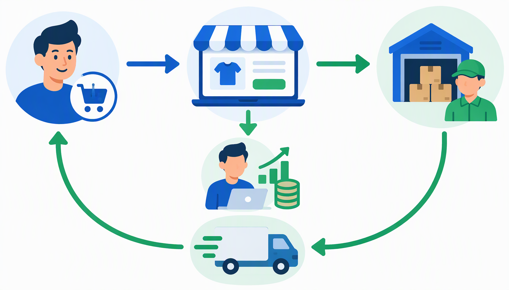
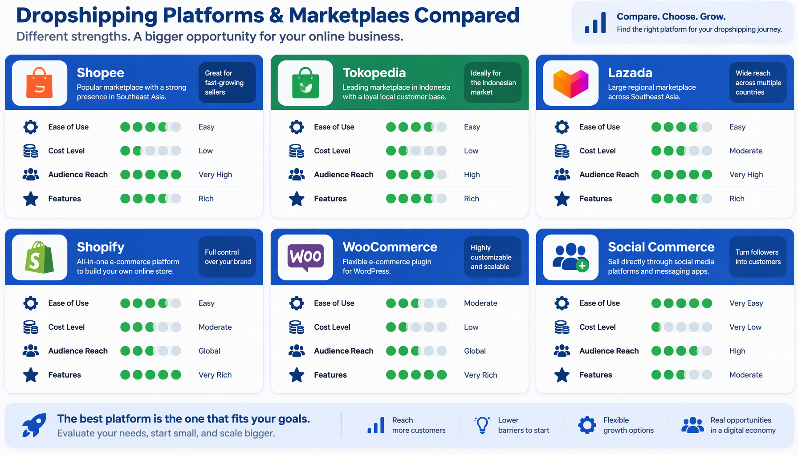
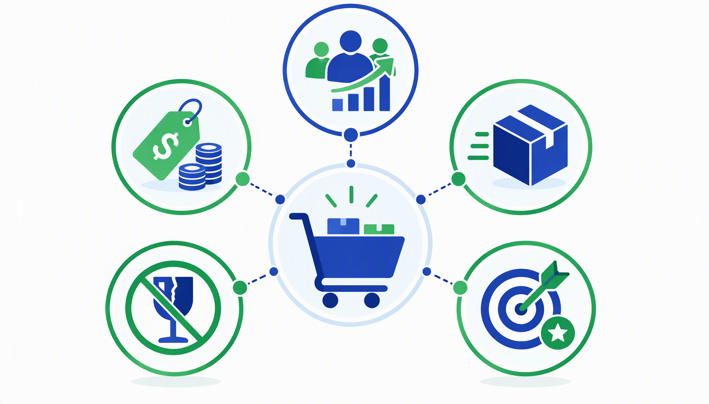
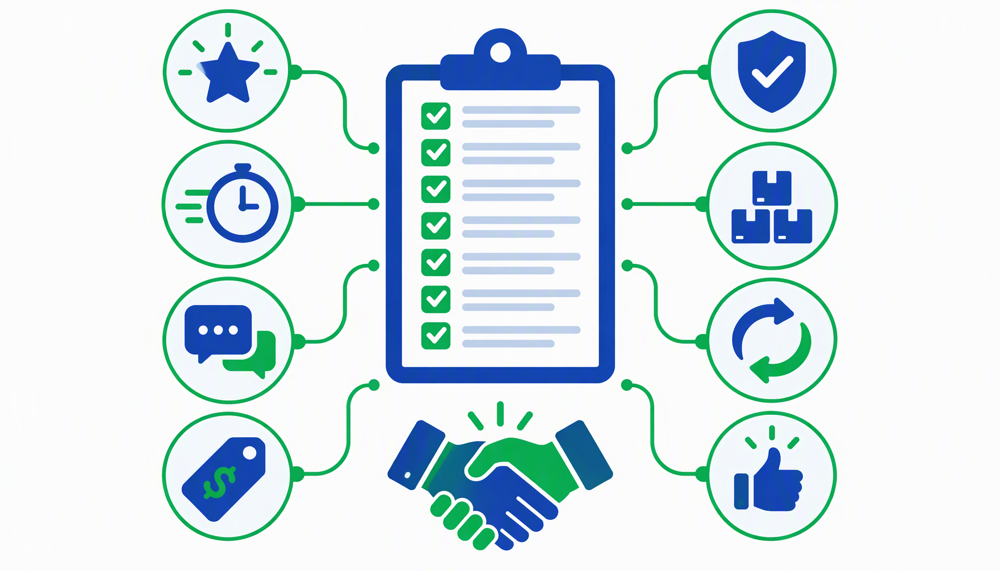
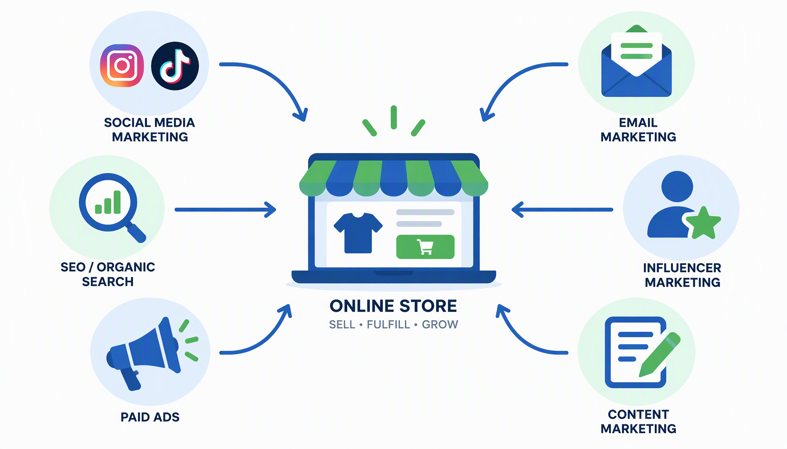
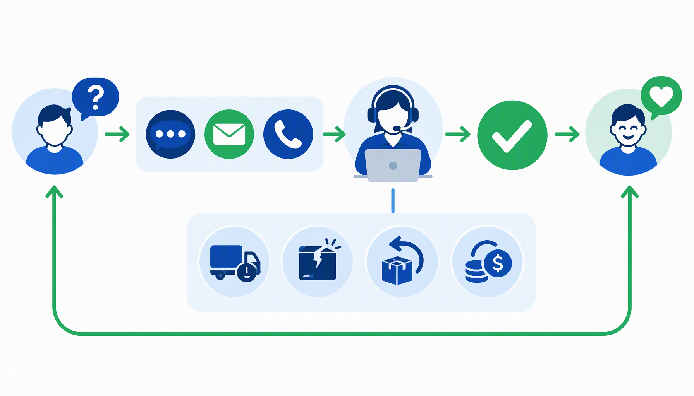
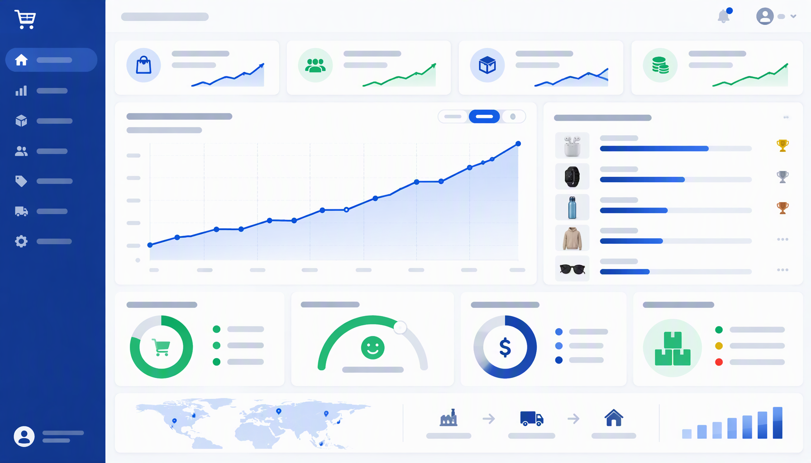
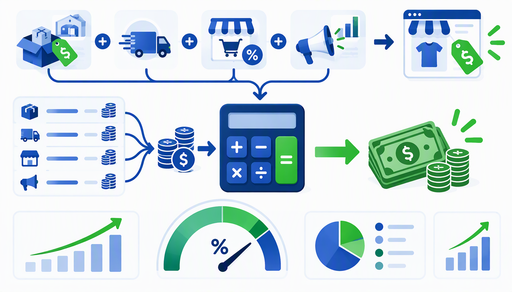
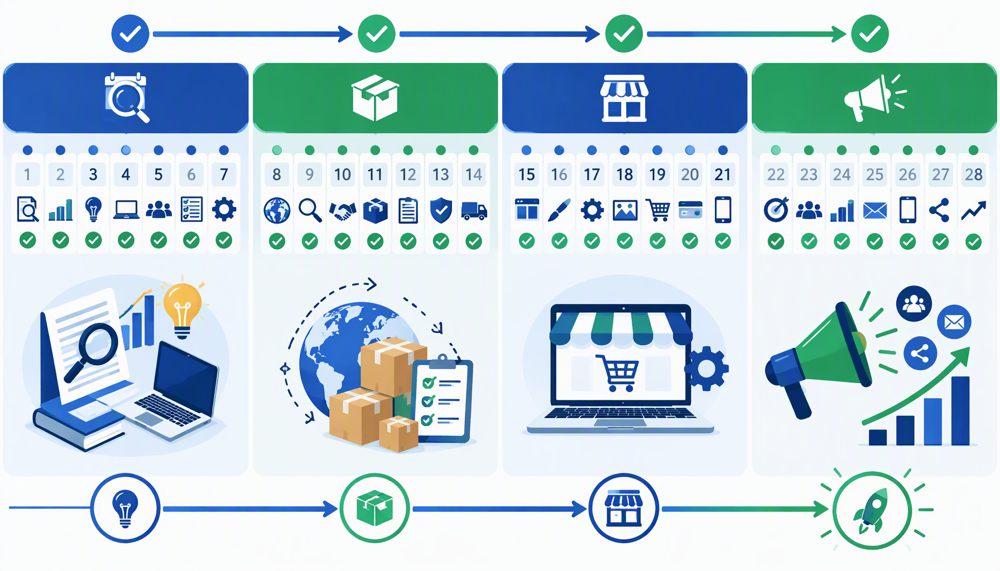

# PANDUAN LENGKAP DROPSHIPPING UNTUK UMKM INDONESIA

**Penulis: Siraj Nur Ihrom**
**SNISHOP.COM | Edition 2026**

---

## DAFTAR ISI

**BAGIAN 1: FONDASI DROPSHIPPING**

1. Memahami Dropshipping: Konsep, Alur Kerja, dan Peluang di Indonesia
2. Kelebihan dan Kekurangan Dropshipping Dibanding Model Bisnis Lainnya
3. Memilih Platform Jual yang Tepat: Shopee, Tokopedia, Lazada, dan Lainnya
4. Riset Niche dan Seleksi Produk yang Menjanjikan

**BAGIAN 2: STRATEGI DAN EKSEKUSI**

5. Mencari dan Mengevaluasi Supplier Terpercaya
6. Membangun Toko Online yang Profesional
7. Strategi Pemasaran Digital untuk Dropshipping
8. Manajemen Pemesanan, Pengiriman, dan Layanan Pelanggan

**BAGIAN 3: SKALING DAN OPTIMASI**

9. Analisis Data dan Optimasi Performa Toko
10. Strategi Scaling dan Otomasi Bisnis Dropshipping

**BONUS**

- 3 Studi Kasus Sukses Dropshipping UMKM Indonesia
- Kalkulator ROI dan Keuntungan Dropshipping
- Rencana Implementasi 30 Hari

---

# BAGIAN 1: FONDASI DROPSHIPPING

---

## Bab 1: Memahami Dropshipping: Konsep, Alur Kerja, dan Peluang di Indonesia

### 1.1 Apa Itu Dropshipping?

Dropshipping adalah model bisnis e-commerce di mana penjual tidak menyimpan stok barang secara fisik. Ketika penjual menerima pesanan dari pelanggan, penjual meneruskan pesanan tersebut kepada supplier atau distributor, yang kemudian mengirimkan barang langsung ke pelanggan atas nama toko penjual.

Model ini menghilangkan kebutuhan modal besar untuk inventaris dan gudang. Penjual berperan sebagai perantara yang menghubungkan supplier dengan konsumen akhir, menambahkan nilai melalui kurasi produk, pemasaran, dan layanan pelanggan.

Di Indonesia, dropshipping telah menjadi pintu masuk utama bagi ribuan wirausahawan digital. Kombinasi penetrasi internet yang tinggi, pertumbuhan marketplace lokal, dan ketersediaan supplier domestik membuat model ini sangat relevan bagi UMKM yang ingin memulai bisnis online dengan risiko minimal.

### 1.2 Alur Kerja Dropshipping

Proses dropshipping mengikuti rangkaian langkah berikut:

1. **Pembukaan Toko**: Penjual membuat toko online di marketplace atau platform e-commerce mandiri.
2. **Daftar Produk**: Penjual mengunggah katalog produk dari supplier ke tokonya, termasuk foto, deskripsi, dan harga yang sudah ditambah margin keuntungan.
3. **Pelanggan Memesan**: Pembeli melihat produk di toko online, lalu melakukan pemesanan dan pembayaran.
4. **Penerusan Pesanan**: Penjual menerima pembayaran, kemudian memesan produk dari supplier dengan harga grosir dan memberikan alamat pengiriman pelanggan.
5. **Pengiriman oleh Supplier**: Supplier mengemas dan mengirimkan produk langsung ke pelanggan. Kemasan bisa menggunakan nama toko penjual (jika disepakati).
6. **Layanan Pelanggan**: Penjual menangani pertanyaan, komplain, dan permintaan retur dari pelanggan.

### 1.3 Pemain Utama dalam Ekosistem Dropshipping

Terdapat tiga pihak utama dalam ekosistem dropshipping:

**Penjual (Dropshipper)**: Bertugas memasarkan produk, mengelola toko online, melayani pelanggan, dan mengatur operasional penjualan. Penjual tidak perlu menyentuh barang fisik.

**Supplier**: Menyediakan produk, mengelola stok, mengemas pesanan, dan melakukan pengiriman. Supplier bisa berupa produsen langsung, distributor, atau agen grosir.

**Pelanggan (End Consumer)**: Pembeli akhir yang bertransaksi dengan penjual. Pelanggan biasanya tidak mengetahui bahwa produk dikirim langsung oleh supplier.

### 1.4 Mengapa Dropshipping Relevan untuk UMKM Indonesia?

**Modal Awal Rendah**: UMKM tidak perlu investasi ratusan juta rupiah untuk stok barang. Modal utama hanya koneksi internet, perangkat komputer atau smartphone, dan biaya pendaftaran toko online yang umumnya gratis.

**Risiko Terukur**: Karena tidak ada stok yang mengendap, risiko kerugian akibat barang tidak laku sangat kecil. UMKM bisa menguji berbagai produk tanpa takut rugi besar.

**Fleksibilitas Lokasi**: Bisnis bisa dijalankan dari rumah, kafe, atau co-working space. Cocok bagi pelaku UMKM di kota kecil yang ingin menjangkau pasar nasional.

**Skalabilitas Mudah**: Ketika pesanan meningkat, penjual tidak perlu menambah gudang atau staf pengemasan secara signifikan. Supplier yang menangani sebagian besar operasional logistik.

### 1.5 Lanskap Dropshipping Indonesia Tahun 2026

Pasar e-commerce Indonesia diproyeksikan mencapai nilai di atas 80 miliar dolar AS pada tahun 2026. Beberapa faktor pendorong:

- Jumlah pengguna internet melebihi 220 juta jiwa.
- Adopsi pembayaran digital melalui e-wallet seperti GoPay, OVO, DANA, dan ShopeePay meningkat pesat.
- Infrastruktur logistik terus membaik dengan hadirnya layanan same-day delivery di berbagai kota.
- Pemerintah mendukung digitalisasi UMKM melalui program e-Smart dan Making Indonesia 4.0.

Peluang ini menjadikan dropshipping sebagai model bisnis yang sangat menjanjikan bagi UMKM Indonesia yang ingin bersaing di era digital.

---

## Bab 2: Kelebihan dan Kekurangan Dropshipping Dibanding Model Bisnis Lainnya

### 2.1 Perbandingan Model Bisnis E-Commerce

Sebelum memutuskan menggunakan dropshipping, penting untuk memahami perbandingannya dengan model bisnis e-commerce lain:

| Aspek | Dropshipping | Stok Sendiri | Reseller | Pre-Order |
|-------|-------------|--------------|----------|-----------|
| Modal Awal | Sangat rendah | Tinggi (gudang dan stok) | Sedang | Rendah |
| Risiko Stok | Tidak ada | Tinggi | Sedang | Tidak ada |
| Kontrol Kualitas | Terbatas | Penuh | Terbatas | Penuh |
| Waktu Pengiriman | Bergantung supplier | Cepat (jika stok ada) | Bergantung supplier | Lama |
| Margin Keuntungan | Sedang (15-40%) | Tinggi (40-70%) | Sedang (10-30%) | Tinggi |
| Skalabilitas | Mudah | Butuh investasi besar | Sedang | Terbatas |

### 2.2 Kelebihan Dropshipping

**1. Tanpa Ribet Stok Barang**

Penjual tidak perlu membeli barang dalam jumlah besar di muka. Setiap pembelian ke supplier dilakukan setelah ada pesanan dari pelanggan. Arus kas tetap sehat karena modal hanya keluar setelah ada pemasukan.

**2. Lokasi Operasional Bebas**

Selama terkoneksi internet, penjual bisa mengelola bisnis dari mana saja. Tidak perlu gudang, tidak perlu toko fisik. Ini sangat menguntungkan bagi UMKM di daerah yang ingin menjangkau pasar seluruh Indonesia.

**3. Katalog Produk Luas**

Penjual bisa menawarkan ratusan bahkan ribuan produk dari berbagai supplier tanpa batasan ruang penyimpanan. Jika suatu produk tidak laku, cukup hapus dari katalog tanpa kerugian.

**4. Fokus pada Pemasaran**

Karena operasional pengiriman ditangani supplier, penjual bisa mengalokasikan waktu dan energi untuk kegiatan yang menghasilkan pendapatan, seperti pemasaran, pembuatan konten, dan layanan pelanggan.

**5. Mudah Menguji Pasar**

Dropshipping memungkinkan penjual menguji berbagai kategori produk dan niche tanpa risiko finansial besar. Jika suatu niche tidak menguntungkan, penjual bisa berpindah ke niche lain dengan cepat.

### 2.3 Kekurangan Dropshipping

**1. Margin Keuntungan Lebih Tipis**

Karena harga beli dari supplier sudah tetap, margin keuntungan penjual terbatas pada selisih harga jual dan harga supplier. Persaingan harga di marketplace juga menekan margin.

**2. Ketergantungan pada Supplier**

Ketersediaan stok, kecepatan pengiriman, dan kualitas produk sangat bergantung pada supplier. Jika supplier bermasalah, reputasi toko penjual yang terdampak.

**3. Kontrol Kualitas Terbatas**

Penjual tidak melihat langsung kondisi barang sebelum dikirim ke pelanggan. Produk yang sampai bisa berbeda dari foto atau deskripsi jika supplier tidak bertanggung jawab.

**4. Persaingan Ketat**

Karena barrier to entry rendah, banyak penjual menawarkan produk serupa. Perang harga sering terjadi, terutama di marketplace besar.

**5. Kompleksitas Layanan Pelanggan**

Ketika terjadi masalah pengiriman atau produk cacat, penjual harus menjadi penengah antara pelanggan dan supplier. Proses resolusi bisa memakan waktu lebih lama.

### 2.4 Mitigasi Risiko Dropshipping

Setiap kekurangan memiliki strategi mitigasi:

**Untuk Margin Tipis**: Fokus pada produk dengan diferensiasi kuat, bangun brand sendiri, dan tawarkan paket bundling yang meningkatkan nilai transaksi.

**Untuk Ketergantungan Supplier**: Bekerja dengan minimal dua hingga tiga supplier untuk produk utama. Lakukan evaluasi rutin terhadap performa masing-masing supplier.

**Untuk Kontrol Kualitas**: Pesan sampel produk secara berkala. Baca ulasan pelanggan dengan teliti dan segera ganti supplier jika kualitas menurun.

**Untuk Persaingan**: Bangun identitas brand yang unik, buat konten produk original, dan fokus pada layanan pelanggan yang unggul.

**Untuk Layanan Pelanggan**: Buat SOP penanganan komplain yang jelas. Tetapkan waktu respons maksimal dan prosedur eskalasi ke supplier.

---

## Bab 3: Memilih Platform Jual yang Tepat: Shopee, Tokopedia, Lazada, dan Lainnya

### 3.1 Lanskap Marketplace Indonesia

Indonesia memiliki beberapa marketplace besar yang menjadi tempat transaksi jutaan pembeli setiap hari. Setiap platform memiliki karakteristik, kebijakan dropshipping, dan fitur yang berbeda. Memilih platform yang tepat sangat menentukan keberhasilan bisnis dropshipping.

### 3.2 Shopee

Shopee merupakan marketplace dengan jumlah pengguna aktif terbesar di Indonesia. Platform ini sangat populer di kalangan pembeli muda dan menawarkan berbagai fitur pemasaran bawaan.

**Kelebihan untuk Dropshipper:**

- Fitur gratis ongkir yang disubsidi Shopee meningkatkan konversi penjualan.
- Shopee Ads memungkinkan promosi berbayar dengan budget fleksibel, mulai dari Rp50.000 per hari.
- Live streaming terintegrasi memungkinkan penjual mempromosikan produk secara interaktif.
- Program affiliate Shopee memperluas jangkauan produk melalui jaringan promoter.
- Shopee menyediakan dashboard analitik yang komprehensif untuk memantau performa toko.

**Kebijakan Dropshipping di Shopee:**

Shopee mengizinkan model dropshipping selama pengiriman menggunakan resi yang valid dan waktu pemrosesan sesuai ketentuan. Penjual harus memastikan supplier mampu mengirim dalam batas waktu yang ditentukan (umumnya 2x24 jam).

**Kategori Populer untuk Dropshipping:**

- Fashion wanita dan pria
- Aksesoris gadget
- Perlengkapan rumah tangga
- Produk kecantikan dan perawatan
- Mainan dan hobi

### 3.3 Tokopedia

Tokopedia dikenal sebagai marketplace yang kuat di segmen elektronik, gadget, dan produk-produk berkualitas premium. Platform ini memiliki reputasi baik dalam hal kepercayaan pembeli.

**Kelebihan untuk Dropshipper:**

- TopAds memberikan opsi promosi dengan target yang presisi.
- Fitur power merchant dan official store meningkatkan kredibilitas toko.
- Integrasi dengan Gojek memungkinkan pengiriman instan di kota-kota besar.
- Program Tokopedia Seller University menyediakan edukasi gratis bagi penjual.
- Sistem rating dan ulasan yang transparan membantu membangun kepercayaan.

**Kebijakan Dropshipping di Tokopedia:**

Tokopedia mengizinkan dropshipping dengan syarat penjual mencantumkan diri sebagai pengirim dan menggunakan resi yang valid. Waktu pengiriman harus sesuai dengan pengaturan toko.

**Kategori Populer untuk Dropshipper:**

- Elektronik dan aksesorinya
- Komputer dan laptop
- Fashion Muslim
- Perlengkapan kantor
- Otomotif

### 3.4 Lazada

Lazada, yang didukung oleh Alibaba Group, memiliki kekuatan di segmen produk internasional dan brand resmi. Platform ini cocok untuk dropshipper yang ingin menawarkan produk impor.

**Kelebihan untuk Dropshipper:**

- Lazada menyediakan program Lazada Dropshipping Center yang secara khusus mendukung model bisnis ini.
- Akses ke produk dari supplier internasional melalui Alibaba ecosystem.
- Platform ini memiliki program voucher dan kampanye besar seperti Lazada Birthday Sale dan 12.12.
- Seller Center yang informatif memudahkan pengelolaan toko.

**Kebijakan Dropshipping di Lazada:**

Lazada memiliki program resmi bernama "Lazada Dropshipping" yang memfasilitasi kerja sama antara penjual dan supplier. Platform ini menyediakan integrasi API untuk sinkronisasi stok dan pesanan secara otomatis.

### 3.5 Platform Alternatif

Selain tiga marketplace besar, terdapat beberapa platform lain yang layak dipertimbangkan:

**Bukalapak**: Marketplace yang kuat di segmen UMKM dan produk lokal. Cocok untuk dropshipper yang ingin menjangkau pasar di luar Jawa.

**TikTok Shop**: Platform social commerce yang berkembang pesat. Cocok untuk dropshipper yang mahir membuat konten video pendek dan live streaming.

**Instagram Shopping**: Fitur belanja terintegrasi di Instagram memungkinkan penjualan langsung dari feed dan stories. Cocok untuk produk visual seperti fashion dan dekorasi.

**Website Mandiri (Shopify, WooCommerce, SNIshop)**: Memberikan kontrol penuh atas brand dan pengalaman belanja. Cocok untuk dropshipper yang ingin membangun brand jangka panjang tanpa bergantung pada marketplace.

### 3.6 Strategi Multi-Platform

Pendekatan terbaik untuk memaksimalkan penjualan adalah dengan menjual di beberapa platform sekaligus. Strategi ini memiliki beberapa keuntungan:

- Diversifikasi risiko: jika satu platform mengalami penurunan traffic, penjualan dari platform lain tetap berjalan.
- Jangkauan audiens lebih luas: setiap marketplace memiliki demografi pengguna yang berbeda.
- Optimasi berdasarkan data: penjual bisa membandingkan performa produk di berbagai platform dan fokus pada yang paling menguntungkan.

Namun, multi-platform juga menambah kompleksitas operasional. Gunakan tools manajemen toko seperti SNIshop ERP atau Vincensio untuk mengelola pesanan dari berbagai marketplace dalam satu dashboard terpadu.

### 3.7 Tips Memilih Platform Utama

Pertimbangkan faktor-faktor berikut saat memilih platform utama:

1. **Target Pasar**: Sesuaikan platform dengan demografi pelanggan sasaran. Pembeli muda cenderung di Shopee, sementara profesional lebih banyak di Tokopedia.
2. **Kategori Produk**: Setiap platform memiliki kategori yang lebih kuat. Pilih platform yang sesuai dengan niche produk.
3. **Biaya Operasional**: Bandingkan biaya komisi, biaya iklan, dan potongan pembayaran antar platform.
4. **Kemudahan Operasional**: Pertimbangkan kemudahan integrasi dengan supplier dan tools manajemen yang tersedia.
5. **Kebijakan Dropshipping**: Pastikan platform mengizinkan model dropshipping dan kebijakan tersebut tidak sering berubah.

---

## Bab 4: Riset Niche dan Seleksi Produk yang Menjanjikan

### 4.1 Mengapa Pemilihan Niche Sangat Penting?

Memilih niche yang tepat adalah fondasi keberhasilan bisnis dropshipping. Niche yang salah berarti bersaing di pasar yang jenuh atau menjual produk yang tidak diminati. Sebaliknya, niche yang tepat memberikan keunggulan kompetitif, margin yang lebih baik, dan basis pelanggan yang loyal.

### 4.2 Kriteria Niche yang Menjanjikan

Niche dropshipping yang ideal memenuhi kriteria berikut:

**Permintaan Konsisten**: Produk memiliki permintaan stabil sepanjang tahun atau memiliki tren naik. Hindari produk yang hanya musiman kecuali Anda siap dengan strategi cadangan untuk bulan-bulan sepi.

**Persaingan Moderat**: Niche dengan terlalu banyak penjual akan menyulitkan penjual baru untuk bersaing. Cari niche yang memiliki cukup permintaan tetapi belum jenuh.

**Margin Menguntungkan**: Harga jual produk memungkinkan margin minimal 30 persen setelah memperhitungkan harga supplier, biaya pengiriman, biaya platform, dan biaya pemasaran.

**Ukuran dan Berat Ideal**: Produk yang kecil dan ringan lebih murah untuk dikirim dan lebih kecil risikonya rusak selama pengiriman.

**Potensi Branding**: Niche yang memungkinkan Anda membangun cerita brand akan lebih mudah mempertahankan pelanggan.

### 4.3 Teknik Riset Niche

**Metode 1: Analisis Marketplace**

Gunakan fitur pencarian di Shopee, Tokopedia, dan Lazada untuk mengidentifikasi produk yang laris. Perhatikan:

- Jumlah terjual: produk dengan ratusan atau ribuan penjualan menunjukkan permintaan tinggi.
- Jumlah ulasan: ulasan yang banyak menunjukkan transaksi aktif.
- Rating: rating di atas 4,5 menunjukkan kepuasan pelanggan.
- Harga: bandingkan harga di berbagai toko untuk mengidentifikasi rentang harga pasar.

**Metode 2: Riset Kata Kunci**

Gunakan Google Trends, Ubersuggest, atau Keyword Planner untuk menemukan kata kunci yang banyak dicari. Kata kunci dengan volume pencarian tinggi dan persaingan rendah menandakan peluang niche yang bagus.

**Metode 3: Analisis Media Sosial**

Perhatikan tren di TikTok, Instagram, dan Facebook Groups. Produk yang viral di media sosial sering kali memiliki permintaan tinggi di marketplace. Bergabunglah dengan grup komunitas hobi atau minat tertentu untuk memahami kebutuhan mereka.

**Metode 4: Kunjungan ke Pusat Grosir**

Kunjungi pusat grosir seperti Tanah Abang di Jakarta, Mangga Dua, atau pusat grosir di kota Anda. Amati produk apa yang paling banyak dicari pedagang dan tanyakan tren terkini kepada pedagang langsung.

### 4.4 Niche Populer untuk Dropshipping di Indonesia

Berikut beberapa niche yang terbukti menguntungkan untuk pasar Indonesia:

| Niche | Contoh Produk | Kisaran Harga Jual | Margin Rata-rata |
|-------|--------------|-------------------|-----------------|
| Fashion Muslim | Hijab, gamis, mukena | Rp75.000-Rp350.000 | 35-50% |
| Aksesoris Gadget | Casing, charger, earphone | Rp25.000-Rp200.000 | 40-60% |
| Perlengkapan Rumah | Rak, organizer, dekorasi | Rp50.000-Rp300.000 | 30-45% |
| Kecantikan | Skincare, makeup tools | Rp35.000-Rp250.000 | 35-55% |
| Hobi dan DIY | Alat kerajinan, bahan craft | Rp20.000-Rp150.000 | 40-65% |
| Perlengkapan Bayi | Baju bayi, mainan edukatif | Rp40.000-Rp200.000 | 35-50% |
| Makanan Kering | Snack, bumbu, minuman bubuk | Rp15.000-Rp100.000 | 25-40% |

### 4.5 Evaluasi dan Seleksi Produk

Setelah mengidentifikasi beberapa produk potensial, lakukan evaluasi mendalam:

**Langkah 1: Cek Ketersediaan Supplier**

Pastikan ada minimal dua hingga tiga supplier yang menyediakan produk tersebut. Ketergantungan pada satu supplier sangat berisiko.

**Langkah 2: Hitung Margin Keuntungan**

Gunakan rumus sederhana:

Margin = (Harga Jual - Harga Supplier - Biaya Kirim - Biaya Platform) / Harga Jual x 100%

Targetkan margin minimal 30 persen. Jika margin di bawah 20 persen, produk tersebut sulit menghasilkan keuntungan yang layak setelah memperhitungkan biaya pemasaran.

**Langkah 3: Pesan Sampel**

Sebelum menjual, pesan sampel produk dari supplier. Evaluasi kualitas bahan, ketahanan kemasan, kesesuaian dengan foto, dan waktu pengiriman.

**Langkah 4: Analisis Kompetitor**

Pelajari toko-toko yang sudah menjual produk serupa. Perhatikan harga mereka, strategi pemasaran, ulasan pelanggan, dan kelemahan yang bisa Anda manfaatkan.

**Langkah 5: Uji Pasar**

Mulailah dengan menjual beberapa produk untuk menguji respons pasar. Lacak tingkat konversi, jumlah pertanyaan dari calon pembeli, dan feedback yang diterima. Gunakan data ini untuk memutuskan apakah akan melanjutkan atau beralih ke produk lain.

### 4.6 Kesalahan Umum dalam Pemilihan Produk

Hindari kesalahan-kesalahan berikut:

- **Terlalu banyak produk di awal**: Fokus pada 10-20 produk terlebih dahulu sebelum menambah katalog.
- **Mengikuti tren tanpa riset**: Tren bisa hilang dalam hitungan minggu. Pastikan produk memiliki permintaan jangka panjang.
- **Mengabaikan berat dan ukuran**: Produk besar dan berat memiliki biaya pengiriman tinggi yang bisa menggerus margin.
- **Menjual produk bermerek tanpa izin**: Ini melanggar hukum dan kebijakan marketplace. Pastikan Anda memiliki izin untuk menjual produk bermerek.
- **Tidak memperhitungkan retur**: Produk seperti pakaian memiliki tingkat retur tinggi karena masalah ukuran. Pertimbangkan faktor ini dalam perhitungan margin.

---

# BAGIAN 2: STRATEGI DAN EKSEKUSI

---

## Bab 5: Mencari dan Mengevaluasi Supplier Terpercaya

### 5.1 Pentingnya Supplier yang Tepat

Supplier adalah tulang punggung bisnis dropshipping. Kualitas produk, kecepatan pengiriman, dan kehandalan komunikasi dengan supplier langsung memengaruhi kepuasan pelanggan dan reputasi toko Anda. Salah memilih supplier bisa menghancurkan bisnis yang sudah dibangun dengan susah payah.

### 5.2 Sumber Supplier untuk Dropshipper Indonesia

**Supplier Domestik:**

**Tanah Abang, Jakarta**: Pusat grosir tekstil dan fashion terbesar di Asia Tenggara. Banyak pedagang di Tanah Abang yang menerima pesanan dropship dan menyediakan layanan pengiriman ke seluruh Indonesia. Blok A hingga F menawarkan berbagai kategori produk, dari busana muslim hingga aksesoris.

**Mangga Dua, Jakarta**: Pusat grosir elektronik, aksesoris gadget, dan perlengkapan rumah. Banyak toko di Mangga Dua yang sudah familiar dengan model dropshipping dan menyediakan layanan pengemasan atas nama toko dropshipper.

**Pasar Baru, Jakarta**: Terkenal untuk kain, bahan tekstil, dan perlengkapan jahit. Cocok untuk dropshipper yang ingin memasuki niche fashion custom atau bahan kerajinan.

**Surabaya (Pasar Turi dan Grosir Wonokromo)**: Pusat distribusi untuk kawasan Indonesia Timur. Banyak supplier yang menawarkan harga kompetitif untuk produk fashion, tas, dan aksesoris.

**Bandung (Cibaduyut dan Pasar Baru Bandung)**: Terkenal sebagai pusat produksi sepatu dan produk kulit. Banyak produsen sepatu yang menerima pesanan dropship dengan jumlah minimum yang rendah.

**Platform Online untuk Mencari Supplier Domestik:**

- **Jakmall**: Platform dropshipping lokal yang menghubungkan penjual dengan ribuan supplier. Fitur utamanya adalah integrasi langsung dengan marketplace seperti Shopee dan Tokopedia.
- **Baleomol**: Menyediakan berbagai produk dengan sistem dropship. Katalog mencakup fashion, aksesoris, dan perlengkapan rumah.
- **Supplier.id**: Direktori supplier Indonesia yang memverifikasi keaslian dan kredibilitas setiap supplier terdaftar.
- **Facebook Groups**: Banyak grup Facebook yang menjadi komunitas dropshipper dan supplier. Cari grup dengan kata kunci "dropship [nama niche]" atau "supplier [nama produk]".
- **Instagram**: Banyak supplier dan produsen yang mempromosikan layanan dropship melalui Instagram. Gunakan hashtag seperti #dropshipmurah, #supplierdropship, atau #dropshipindonesia.

**Supplier Internasional:**

Untuk produk-produk tertentu, supplier internasional bisa menawarkan harga yang lebih kompetitif:

- **AliExpress**: Platform retail dari Alibaba Group yang menerima pesanan satuan. Banyak produk dengan harga sangat murah, tetapi waktu pengiriman ke Indonesia berkisar 7-30 hari.
- **1688.com**: Platform grosir domestik China dengan harga lebih murah dari AliExpress. Memerlukan agen perantara untuk pemesanan dan pengiriman ke Indonesia.
- **Alibaba.com**: Platform B2B untuk pemesanan dalam jumlah besar. Beberapa supplier menerima pesanan dropship dengan syarat tertentu.

### 5.3 Kriteria Evaluasi Supplier

Gunakan kriteria berikut untuk menilai kualitas supplier:

**1. Reputasi dan Track Record**

Periksa ulasan dari pembeli atau dropshipper lain. Supplier yang baik memiliki rating konsisten di atas 4,5 dan ulasan positif yang detail. Waspadai supplier dengan ulasan palsu yang terlalu generik.

**2. Kecepatan Respons**

Hubungi supplier dan ukur seberapa cepat mereka merespons. Supplier yang baik biasanya membalas dalam waktu kurang dari 2 jam pada jam kerja. Respons yang lambat menandakan pelayanan yang mungkin mengecewakan.

**3. Konsistensi Stok**

Tanyakan bagaimana supplier mengelola ketersediaan stok. Supplier yang handal memiliki sistem notifikasi ketika stok menipis dan memberikan estimasi waktu restock.

**4. Kualitas Produk**

Pesan sampel sebelum bekerja sama. Evaluasi bahan, jahitan, kemasan, dan kesesuaian dengan foto katalog. Lakukan pemesanan sampel secara berkala bahkan setelah bekerja sama untuk memastikan kualitas tetap terjaga.

**5. Kebijakan Dropship**

Tanyakan apakah supplier mendukung pengiriman atas nama toko Anda, apakah mereka menyertakan invoice atau promosi mereka dalam paket, dan bagaimana prosedur retur dan garansi produk.

**6. Kapasitas Pengiriman**

Pastikan supplier mampu menangani volume pesanan Anda, terutama saat periode ramai seperti Hari Raya, Harbolnas, atau kampanye marketplace.

### 5.4 Membangun Hubungan Jangka Panjang dengan Supplier

Hubatan yang baik dengan supplier memberikan beberapa keuntungan:

- Prioritas pemrosesan pesanan saat periode ramai.
- Harga khusus atau diskon volume setelah mencapai target penjualan tertentu.
- Akses lebih awal ke produk baru sebelum dipasarkan secara luas.
- Fleksibilitas dalam hal pembayaran dan tempo.
- Komunikasi yang lebih terbuka tentang masalah stok atau produksi.

Tips membangun hubungan baik:

- Bayar pesanan tepat waktu dan konsisten.
- Berikan feedback konstruktif ketika ada masalah.
- Komunikasikan rencana promosi besar agar supplier bisa mempersiapkan stok.
- Kunjungi supplier secara berkala jika memungkinkan.
- Jadilah mitra yang profesional dan menghargai.

### 5.5 Kontrak dan Kesepakatan Kerja Sama

Untuk kerja sama yang serius, buat kesepakatan tertulis yang mencakup:

- Daftar produk dan harga yang disepakati.
- Standar kualitas dan prosedur penanganan produk cacat.
- Waktu pemrosesan dan pengiriman pesanan.
- Kebijakan retur dan refund.
- Ketentuan kerahasiaan data pelanggan.
- Durasi kerja sama dan syarat pengakhiran.

---

## Bab 6: Membangun Toko Online yang Profesional

### 6.1 Fondasi Toko Online yang Kuat

Toko online adalah wajah bisnis Anda di dunia digital. Tampilan, navigasi, dan pengalaman belanja yang baik meningkatkan kepercayaan pelanggan dan mendorong konversi.

### 6.2 Setup Toko di Marketplace

**Langkah-langkah Dasar:**

1. **Daftar Akun Seller**: Buat akun penjual di marketplace pilihan. Gunakan informasi bisnis yang asli dan lengkap.
2. **Verifikasi Identitas**: Unggah KTP dan dokumen yang diperlukan untuk verifikasi. Proses ini biasanya memakan waktu 1-3 hari kerja.
3. **Atur Profil Toko**: Isi nama toko, deskripsi, logo, dan banner. Buat profil yang profesional dan mencerminkan niche produk Anda.
4. **Konfigurasi Pengiriman**: Atur metode pengiriman yang tersedia dan alamat asal pengiriman. Jika menggunakan supplier dari berbagai lokasi, pertimbangkan untuk menggunakan alamat gudang konsolidasi.
5. **Atur Metode Pembayaran**: Aktifkan semua metode pembayaran yang tersedia, termasuk transfer bank, e-wallet, dan COD (Cash On Delivery).

### 6.3 Optimasi Halaman Produk

Halaman produk yang dioptimasi dengan baik meningkatkan konversi secara signifikan:

**Foto Produk:**

- Gunakan foto berkualitas tinggi dengan resolusi minimal 800x800 piksel.
- Sediakan minimal 4-6 foto dari berbagai sudut.
- Gunakan latar putih bersih untuk foto utama.
- Tambahkan foto lifestyle yang menunjukkan produk dalam penggunaan sehari-hari.
- Sertakan foto detail seperti tekstur bahan, label, atau ukuran.

**Judul Produk:**

- Gunakan format: [Merek/Jenis] + [Nama Produk] + [Fitur Utama] + [Ukuran/Warna].
- Masukkan kata kunci yang sering dicari pembeli.
- Batasi 60-80 karakter agar tampil lengkap di hasil pencarian.
- Contoh: "Gamis Syari Premium Rayon Premium Dewasa, Model Aisyah Full Kerut, Size M-XXL".

**Deskripsi Produk:**

- Mulai dengan ringkasan singkat yang menonjolkan keunggulan utama.
- Sertakan spesifikasi lengkap: bahan, ukuran, berat, warna yang tersedia.
- Jelaskan manfaat produk, bukan hanya fitur.
- Tambahkan informasi pengiriman dan kebijakan retur.
- Gunakan format yang mudah dibaca dengan bullet points dan paragraf pendek.

**Harga:**

- Riset harga kompetitor untuk produk serupa.
- Tetapkan harga yang kompetitif tetapi masih memberikan margin memadai.
- Pertimbangkan strategi harga psikologis, misalnya Rp99.000 alih-alih Rp100.000.
- Tawarkan diskon atau paket bundling untuk meningkatkan nilai transaksi.

### 6.4 Kategori dan Tag Produk

Organisasi produk dengan kategori dan tag yang tepat:

- Gunakan kategori yang disediakan marketplace secara akurat.
- Tambahkan tag atau label yang relevan dengan produk.
- Kelompokkan produk serupa agar pembeli mudah menjelajah.
- Perbarui kategori secara berkala seiring bertambahnya katalog.

### 6.5 Kebijakan Toko yang Jelas

Buat kebijakan yang transparan untuk membangun kepercayaan:

- **Kebijakan Pengiriman**: Jelaskan estimasi waktu pengiriman untuk berbagai wilayah.
- **Kebijakan Retur**: Tetapkan syarat dan prosedur pengembalian barang.
- **Kebijakan Garansi**: Jika berlaku, jelaskan cakupan dan durasi garansi.
- **Jam Operasional**: Informasikan kapan toko buka dan kapan pesanan diproses.

### 6.6 Membangun Kredibilitas Toko

Kredibilitas adalah kunci konversi di marketplace:

- **Minta Ulasan**: Setelah transaksi berhasil, kirim pesan yang meminta pembeli memberikan ulasan.
- **Respons Cepat**: Balas pertanyaan calon pembeli dalam waktu kurang dari 30 menit.
- **Badge dan Sertifikasi**: Kejar badge seperti Star Seller, Power Merchant, atau Official Store untuk meningkatkan kepercayaan.
- **Konten Konsisten**: Perbarui toko secara rutin dengan produk baru dan promosi.
- **Transparansi**: Jika ada keterlambatan pengiriman atau masalah stok, komunikasikan secara proaktif kepada pelanggan.

---

## Bab 7: Strategi Pemasaran Digital untuk Dropshipping

### 7.1 Kerangka Pemasaran Digital untuk Dropshipper

Pemasaran digital adalah mesin penggerak penjualan dalam bisnis dropshipping. Tanpa strategi pemasaran yang efektif, toko online Anda tidak akan terlihat di tengah jutaan produk yang bersaing.

### 7.2 Pemasaran Organik di Marketplace

**Optimasi SEO Marketplace:**

Setiap marketplace memiliki algoritma pencarian internal. Optimasi produk agar muncul di posisi atas:

- Riset kata kunci menggunakan fitur pencarian marketplace. Ketik kata kunci umum dan lihat saran autocomplete.
- Tempatkan kata kunci utama di judul, deskripsi, dan tag produk.
- Gunakan variasi kata kunci untuk menjangkau lebih banyak pencarian.
- Perbarui listing produk secara berkala agar tetap relevan di algoritma.

**Manfaatkan Fitur Promosi Marketplace:**

- **Shopee**: Gunakan Shopee Ads, Shopee Feed, dan ikuti kampanye seperti Shopee 9.9, 11.11, dan 12.12.
- **Tokopedia**: Manfaatkan TopAds, promo gratis ongkir, dan ikut serta dalam event seperti Tokopedia Wow Sale.
- **Lazada**: Gunakan Sponsored Solutions dan ikuti kampanye Lazada seperti LazMall Everyday Low Price.

**Strategi Konten Organik:**

- Buat konten video review produk dan unggah di Shopee Video atau TikTok.
- Lakukan live streaming secara rutin untuk memamerkan produk dan menjawab pertanyaan secara langsung.
- Buat konten edukatif yang relevan dengan niche, seperti tips memilih hijab yang tepat atau cara merawat sepatu kulit.

### 7.3 Pemasaran Media Sosial

**Instagram:**

- Buat feed yang konsisten dan estetis sesuai identitas brand.
- Gunakan Reels untuk menjangkau audiens baru melalui algoritma eksplorasi.
- Manfaatkan Stories untuk interaksi harian dengan followers.
- Gunakan fitur Instagram Shopping untuk menandai produk langsung di postingan.
- Bekerja sama dengan micro-influencer di niche Anda untuk memperluas jangkauan.

**TikTok:**

- Buat konten video pendek yang menghibur dan informatif tentang produk.
- Ikuti tren challenge dan sound viral yang relevan dengan niche.
- Gunakan TikTok Shop untuk penjualan langsung dari video.
- Lakukan live streaming di TikTok untuk demonstrasi produk.
- Targetkan Gen Z dan milenial dengan konten yang autentik dan tidak terlalu promosi.

**Facebook:**

- Buat Facebook Page dan Group yang berfokus pada niche produk Anda.
- Gunakan Facebook Marketplace untuk menjangkau pembeli lokal.
- Jalankan Facebook Ads dengan target audiens yang spesifik.
- Bagikan konten edukatif dan testimonial pelanggan untuk membangun kepercayaan.

### 7.4 Iklan Berbayar

**Shopee Ads dan TopAds:**

- Mulai dengan budget kecil, sekitar Rp50.000-Rp100.000 per hari.
- Targetkan kata kunci yang spesifik dan memiliki niat beli tinggi.
- Pantau ACoS (Advertising Cost of Sale) dan pastikan di bawah margin keuntungan.
- Matikan iklan untuk produk yang tidak menghasilkan konversi setelah 7 hari.

**Facebook dan Instagram Ads:**

- Gunakan format carousel untuk menampilkan beberapa produk dalam satu iklan.
- Targetkan berdasarkan minat, perilaku, dan demografi yang sesuai.
- Buat lookalike audience dari daftar pelanggan yang sudah pernah membeli.
- Gunakan video ads yang menunjukkan produk dalam penggunaan nyata.
- Mulai dengan budget Rp100.000-Rp200.000 per hari untuk pengujian.

**Google Ads:**

- Gunakan Google Shopping Ads untuk menampilkan produk di hasil pencarian Google.
- Targetkan kata kunci dengan intent pembelian, seperti "beli [nama produk] murah" atau "harga [nama produk] terbaru".
- Buat landing page yang dioptimasi untuk konversi.

### 7.5 Email dan WhatsApp Marketing

**Email Marketing:**

- Kumpulkan alamat email pelanggan melalui formulir di website atau saat checkout.
- Kirim newsletter mingguan berisi produk baru, promo, dan tips relevan.
- Gunakan email otomatis untuk menyambut pelanggan baru, mengingatkan keranjang yang ditinggalkan, dan meminta ulasan.

**WhatsApp Marketing:**

- Gunakan WhatsApp Business untuk berkomunikasi dengan pelanggan.
- Buat katalog produk di WhatsApp Business.
- Kirim broadcast message yang dipersonalisasi untuk promo dan pengumuman produk baru.
- Buat grup WhatsApp VIP untuk pelanggan setia yang mendapatkan akses lebih awal ke promo eksklusif.

### 7.6 Strategi Konten dan Copywriting

**Formula Copywriting yang Efektif:**

- **AIDA (Attention, Interest, Desire, Action)**: Menarik perhatian, membangun minat, menciptakan keinginan, dan mendorong tindakan.
- **PAS (Problem, Agitate, Solution)**: Mengidentifikasi masalah, memperburuk dampaknya, dan menawarkan produk sebagai solusi.
- **FAB (Features, Advantages, Benefits)**: Menjelaskan fitur, keunggulan, dan manfaat produk bagi pelanggan.

**Tips Copywriting untuk Dropshipping:**

- Gunakan bahasa yang sesuai dengan target pasar.
- Tonjolkan manfaat, bukan hanya spesifikasi.
- Sertakan social proof seperti jumlah terjual atau testimoni.
- Buat urgency dengan penawaran terbatas atau stok terbatas.
- Gunakan call-to-action yang jelas dan spesifik.

---

## Bab 8: Manajemen Pemesanan, Pengiriman, dan Layanan Pelanggan

### 8.1 Siklus Pemesanan dalam Dropshipping

Manajemen pemesanan yang efisien adalah kunci operasional dropshipping yang lancar. Siklus pemesanan mencakup:

1. Pelanggan memesan dan membayar di toko Anda.
2. Anda menerima notifikasi pesanan dan memverifikasi detail.
3. Anda meneruskan pesanan ke supplier beserta alamat pelanggan.
4. Anda membayar supplier dan memberikan bukti pembayaran.
5. Supplier memproses, mengemas, dan mengirim pesanan.
6. Anda mendapatkan nomor resi dan menginputnya ke marketplace.
7. Pelacakan pengiriman aktif dan pelanggan bisa memantau status.
8. Pesanan diterima dan transaksi selesai.

### 8.2 Sistem Manajemen Pesanan

**Penggunaan Spreadsheet:**

Untuk tahap awal dengan volume pesanan rendah (di bawah 20 pesanan per hari), spreadsheet bisa digunakan untuk melacak pesanan:

- Kolom wajib: nomor pesanan, nama pelanggan, produk, alamat, status pembayaran, status pesanan ke supplier, nomor resi, dan status pengiriman.
- Perbarui spreadsheet setiap kali ada perubahan status.
- Gunakan formula untuk menghitung total penjualan, biaya supplier, dan keuntungan.

**Penggunaan Tools Manajemen:**

Ketika volume pesanan meningkat, beralihlah ke tools manajemen yang lebih canggih:

- **SNIshop ERP**: Sistem ERP lokal yang mengintegrasikan manajemen pesanan dari berbagai marketplace, akuntansi, dan inventori dalam satu platform.
- **Vincensio**: Software manajemen toko online yang mendukung multi-marketplace.
- **Jubelio**: Platform manajemen e-commerce yang menyediakan fitur sinkronisasi pesanan, stok, dan pengiriman dari berbagai marketplace.
- **OrderKini**: Tools khusus untuk mengelola pesanan dari berbagai channel penjualan.

### 8.3 Manajemen Pengiriman

**Kurir dan Logistik di Indonesia:**

Pilihan kurir yang tersedia untuk dropshipping di Indonesia:

| Kurir | Keunggulan | Estimasi Waktu | Jangkauan |
|-------|-----------|----------------|-----------|
| JNE | Jaringan luas, layanan YES (same day) | 1-3 hari | Seluruh Indonesia |
| J&T Express | Harga kompetitif, tracking real-time | 1-4 hari | Seluruh Indonesia |
| SiCepat | Layanan HALU (same day) di kota besar | 1-2 hari | Kota-kota besar |
| Anteraja | Harga terjangkau untuk pengiriman ekonomis | 2-5 hari | Seluruh Indonesia |
| Ninja Express | Pengiriman same day dan next day | 1-2 hari | Kota-kota besar |
| Pos Indonesia | Jangkauan hingga daerah terpencil | 3-7 hari | Seluruh Indonesia |
| GoSend/GrabExpress | Pengiriman instan dalam kota | 1-4 jam | Kota besar |

**Strategi Pengiriman:**

- Tawarkan beberapa opsi pengiriman (reguler, cepat, instan) agar pelanggan bisa memilih sesuai kebutuhan.
- Aktifkan fitur gratis ongkir yang disubsidi marketplace untuk meningkatkan konversi.
- Tetapkan estimasi waktu pengiriman yang realistis, lebih baik menjanjikan waktu lebih lama dan mengirim lebih cepat.
- Untuk pesanan ke luar Jawa, berikan estimasi waktu yang lebih longgar.
- Lacak setiap pengiriman secara aktif dan informasikan pelanggan jika ada keterlambatan.

### 8.4 Layanan Pelanggan yang Unggul

Layanan pelanggan adalah diferensiator utama dalam bisnis dropshipping. Karena banyak penjual menawarkan produk serupa, kualitas layanan menjadi pembeda.

**Prinsip Layanan Pelanggan:**

- **Respons Cepat**: Usahakan membalas pesan dalam waktu kurang dari 15 menit pada jam operasional.
- **Empati**: Pahami keluhan pelanggan dan tunjukkan bahwa Anda peduli.
- **Solusi Oriented**: Fokus pada penyelesaian masalah, bukan mencari kesalahan.
- **Proaktif**: Informasikan pelanggan tentang status pesanan tanpa menunggu ditanya.
- **Konsisten**: Berikan layanan yang sama baiknya di semua channel komunikasi.

**SOP Penanganan Komplain:**

1. Dengarkan keluhan pelanggan dengan saksama.
2. Minta maaf atas ketidaknyamanan yang dialami.
3. Identifikasi akar masalah (keterlambatan pengiriman, produk cacat, salah kirim, dll).
4. Tawarkan solusi konkret: penggantian, refund, atau pengiriman ulang.
5. Hubungi supplier untuk koordinasi jika masalah berasal dari pihak mereka.
6. Follow up dengan pelanggan untuk memastikan solusi telah dijalankan.
7. Catat setiap komplain untuk evaluasi dan perbaikan proses.

**Template Pesan Otomatis:**

Siapkan template pesan untuk situasi umum:

- Ucapan terima kasih setelah pembelian.
- Konfirmasi pesanan sedang diproses.
- Notifikasi nomor resi dan estimasi kedatangan.
- Follow up setelah pengiriman untuk meminta ulasan.
- Respons untuk pertanyaan umum tentang ukuran, bahan, dan ketersediaan stok.

### 8.5 Penanganan Retur dan Refund

Retur dan refund adalah bagian tak terpisahkan dari bisnis e-commerce. Kelola proses ini dengan profesional:

- Tetapkan kebijakan retur yang jelas di halaman toko.
- Berikan batas waktu retur, misalnya 3-7 hari setelah barang diterima.
- Minta foto atau video bukti kondisi barang sebagai syarat retur.
- Koordinasikan dengan supplier untuk penggantian barang atau refund.
- Proses refund secepat mungkin setelah retur disetujui.
- Evaluasi penyebab retur untuk mengurangi kejadian serupa di masa depan.

### 8.6 Membangun Loyalitas Pelanggan

Pelanggan yang kembali membeli lebih menguntungkan daripada pelanggan baru. Strategi membangun loyalitas:

- Program poin atau reward untuk pembelian berulang.
- Diskon eksklusif untuk pelanggan lama.
- Akses lebih awal ke produk baru atau promo spesial.
- Komunikasi personal melalui WhatsApp atau email.
- Surprise kecil seperti hadiah kecil atau kartu ucapan di paket (jika memungkinkan koordinasi dengan supplier).

---

# BAGIAN 3: SKALING DAN OPTIMASI

---

## Bab 9: Analisis Data dan Optimasi Performa Toko

### 9.1 Mengapa Analisis Data Penting?

Data adalah kompas yang memandu keputusan bisnis. Tanpa analisis data, Anda beroperasi berdasarkan dugaan dan insting semata. Toko dropshipping yang sukses menggunakan data untuk mengoptimasi setiap aspek operasional, dari pemilihan produk hingga strategi pemasaran.

### 9.2 Metrik Kunci yang Harus Dipantau

**Metrik Penjualan:**

- **GMV (Gross Merchandise Value)**: Total nilai transaksi sebelum dikurangi retur dan diskon.
- **Jumlah Pesanan**: Total pesanan yang diterima dalam periode tertentu.
- **Nilai Rata-rata Pesanan (AOV)**: Total penjualan dibagi jumlah pesanan.
- **Tingkat Konversi**: Persentase pengunjung toko yang melakukan pembelian.
- **Tingkat Retur**: Persentase pesanan yang diretur dari total pesanan.

**Metrik Pemasaran:**

- **ROAS (Return on Ad Spend)**: Pendapatan dari iklan dibagi biaya iklan.
- **CAC (Customer Acquisition Cost)**: Total biaya pemasaran dibagi jumlah pelanggan baru.
- **CTR (Click-Through Rate)**: Persentase orang yang mengklik iklan setelah melihatnya.
- **CPC (Cost Per Click)**: Biaya yang dikeluarkan untuk setiap klik pada iklan.

**Metrik Operasional:**

- **Waktu Pemrosesan Pesanan**: Rata-rata waktu dari pesanan diterima hingga dikirim.
- **Tingkat Kepuasan Pelanggan**: Diukur dari rating dan ulasan.
- **Waktu Respons**: Rata-rata waktu untuk membalas pesan pelanggan.

### 9.3 Dashboard Analitik Marketplace

Setiap marketplace menyediakan dashboard analitik bawaan:

**Shopee Seller Centre:**

- Data penjualan harian, mingguan, dan bulanan.
- Analisis performa produk berdasarkan penjualan, tampilan, dan konversi.
- Data traffic toko: jumlah pengunjung, halaman yang dilihat, dan sumber traffic.
- Perbandingan performa dengan toko sejenis di kategori yang sama.

**Tokopedia Seller Centre:**

- Ringkasan penjualan dan pesanan.
- Analisis produk terlaris dan produk yang perlu dioptimasi.
- Data performa iklan dan promosi.
- Laporan keuangan otomatis.

**Lazada Seller Center:**

- Dashboard bisnis dengan ringkasan penjualan, pesanan, dan pendapatan.
- Analisis traffic dan konversi.
- Laporan performa kampanye dan iklan.
- Data retur dan komplain pelanggan.

### 9.4 Teknik Optimasi Berbasis Data

**Optimasi Produk:**

- Identifikasi produk dengan konversi tinggi dan tingkatkan promosi untuk produk tersebut.
- Hapus atau perbarui produk dengan konversi rendah setelah periode evaluasi.
- Sesuaikan harga berdasarkan elastisitas permintaan dan respons terhadap perubahan harga sebelumnya.
- Tambahkan variasi produk (warna, ukuran) berdasarkan permintaan pelanggan.

**Optimasi Pemasaran:**

- Alokasikan budget iklan lebih besar untuk produk dan kata kunci yang menghasilkan ROAS tertinggi.
- Hentikan iklan yang menghabiskan budget tanpa menghasilkan konversi.
- Uji berbagai format iklan dan copy untuk menemukan kombinasi terbaik.
- Analisis waktu terbaik untuk menjalankan iklan berdasarkan pola pembelian pelanggan.

**Optimasi Operasional:**

- Identifikasi bottleneck dalam proses pemenuhan pesanan.
- Kurangi waktu pemrosesan dengan membuat SOP yang lebih efisien.
- Evaluasi performa supplier secara berkala dan ganti yang tidak memenuhi standar.
- Otomasi tugas-tugas repetitif menggunakan tools manajemen.

### 9.5 A/B Testing untuk Dropshipping

A/B testing memungkinkan Anda membuat keputusan berdasarkan data, bukan asumsi:

**Apa yang Bisa Diuji:**

- Judul produk: uji dua versi judul untuk melihat mana yang menghasilkan lebih banyak klik.
- Foto produk: bandingkan foto utama yang berbeda untuk melihat mana yang menghasilkan konversi lebih tinggi.
- Deskripsi produk: uji panjang dan gaya deskripsi yang berbeda.
- Harga: uji berbagai titik harga untuk menemukan yang menghasilkan keuntungan total tertinggi.
- Iklan: uji berbagai copy, gambar, dan target audiens.

**Cara Melakukan A/B Testing:**

1. Tentukan variabel yang ingin diuji.
2. Buat dua versi yang berbeda hanya pada satu variabel.
3. Jalankan kedua versi secara bersamaan selama periode yang cukup (minimal 7 hari).
4. Ukur metrik yang relevan (klik, konversi, penjualan).
5. Pilih versi yang menghasilkan hasil lebih baik dan implementasikan.

### 9.6 Financial Management

**Pencatatan Keuangan yang Disiplin:**

Pisahkan keuangan bisnis dan pribadi. Gunakan rekening bank terpisah untuk transaksi bisnis. Catat setiap pemasukan dan pengeluaran secara detail.

**Laporan Keuangan Bulanan:**

Buat laporan keuangan sederhana setiap bulan yang mencakup:

- Total penjualan dan jumlah pesanan.
- Total biaya: harga supplier, biaya pengiriman, biaya marketplace, biaya iklan.
- Keuntungan bersih dan margin keuntungan.
- Arus kas: pemasukan dan pengeluaran aktual.
- Rasio keuangan kunci seperti ROAS dan CAC.

**Perencanaan Pajak:**

Konsultasikan dengan akuntan atau gunakan jasa konsultan pajak untuk memastikan kewajiban pajak terpenuhi. UMKM dengan omzet di bawah 4,8 miliar rupiah per tahun mendapatkan fasilitas PPh Final 0,5 persen dari pemerintah.

---

## Bab 10: Strategi Scaling dan Otomasi Bisnis Dropshipping

### 10.1 Tanda Bisnis Siap untuk Scaling

Sebelum melakukan scaling, pastikan fondasi bisnis sudah kuat:

- Penjualan konsisten selama minimal 3-6 bulan terakhir.
- Margin keuntungan positif dan tren meningkat.
- Proses operasional sudah terstandarisasi dengan SOP yang jelas.
- Supplier handal dan mampu menangani volume yang lebih tinggi.
- Layanan pelanggan berjalan lancar dengan rating toko di atas 4,5.
- Arus kas sehat dengan cadangan dana untuk ekspansi.

### 10.2 Strategi Scaling Horizontal

**Ekspansi Katalog Produk:**

- Tambahkan produk pelengkap yang relevan dengan niche utama.
- Uji produk dari supplier baru untuk diversifikasi.
- Perluas ke sub-niche yang berdekatan. Misalnya, jika niche utama adalah fashion Muslim, pertimbangkan untuk menambahkan parfum halal atau aksesoris hijab.

**Ekspansi Multi-Platform:**

- Jika baru menjual di satu marketplace, tambahkan marketplace lain.
- Pertimbangkan untuk membuka toko di platform internasional seperti Lazada untuk menjangkau pasar Asia Tenggara.
- Bangun website mandiri untuk mengurangi ketergantungan pada marketplace.

**Ekspansi Channel Pemasaran:**

- Tambahkan channel pemasaran baru yang belum digunakan.
- Tingkatkan budget iklan untuk channel yang sudah terbukti efektif.
- Eksplorasi partnership dengan influencer dan content creator.

### 10.3 Strategi Scaling Vertikal

**Membangun Brand Sendiri:**

Scaling vertikal berarti meningkatkan nilai dan kontrol atas bisnis:

- Buat brand sendiri dengan logo, identitas visual, dan cerita brand yang kuat.
- Bekerja sama dengan supplier untuk memproduksi produk dengan label brand Anda (private label).
- Investasikan dalam kemasan custom yang mencerminkan identitas brand.
- Bangun komunitas pelanggan melalui media sosial dan grup eksklusif.

**Mengembangkan Produk Eksklusif:**

- Identifikasi produk terlaris dan negosiasikan eksklusivitas dengan supplier.
- Kembangkan produk custom berdasarkan feedback pelanggan.
- Ciptakan paket bundling yang unik dan tidak tersedia di toko lain.

### 10.4 Otomasi Bisnis

Otomasi adalah kunci untuk scaling tanpa menambah biaya operasional secara proporsional:

**Otomasi Pemesanan:**

- Gunakan tools seperti SNIshop ERP, Jubelio, atau OrderKini untuk otomatisasi pemrosesan pesanan dari berbagai marketplace.
- Atur auto-forward pesanan ke supplier begitu pembayaran dikonfirmasi.
- Gunakan API marketplace untuk sinkronisasi stok dan harga secara real-time.

**Otomasi Pemasaran:**

- Jadwalkan postingan media sosial menggunakan tools seperti Buffer, Hootsuite, atau Later.
- Atur email otomatis untuk welcome series, cart abandonment, dan follow up pasca pembelian.
- Gunakan chatbot untuk menangani pertanyaan umum pelanggan di WhatsApp dan marketplace.

**Otomasi Laporan:**

- Atur laporan penjualan otomatis dari dashboard marketplace.
- Gunakan Google Sheets atau Excel dengan formula otomatis untuk rekap keuangan harian.
- Buat dashboard terpadu menggunakan Google Data Studio atau Metabase untuk memantau semua metrik bisnis.

### 10.5 Membangun Tim

Ketika bisnis berkembang, Anda membutuhkan bantuan untuk mengelola operasional:

**Posisi yang Perlu Direkrut:**

- **Admin Toko**: Mengelola listing produk, membalas pesan pelanggan, dan memproses pesanan.
- **Content Creator**: Membuat foto, video, dan copy untuk pemasaran.
- **Ads Specialist**: Mengelola dan mengoptimasi kampanye iklan berbayar.
- **Customer Service**: Menangani komplain, retur, dan pertanyaan pelanggan.

**Tips Merekrut untuk UMKM:**

- Mulai dengan freelancer atau pekerja paruh waktu untuk menekan biaya.
- Gunakan platform seperti Glints, JobsStreet, atau LinkedIn untuk mencari kandidat.
- Berikan pelatihan yang terstruktur agar karyawan memahami standar layanan Anda.
- Buat SOP tertulis untuk setiap tugas agar delegasi berjalan lancar.

### 10.6 Menghadapi Tantangan Scaling

**Tantangan 1: Penurunan Kualitas Layanan**

Semakin banyak pesanan, semakin sulit mempertahankan kualitas layanan. Solusi: buat SOP yang detail, gunakan checklist, dan lakukan quality check secara acak.

**Tantanangan 2: Manajemen Supplier yang Kompleks**

Dengan bertambahnya produk dan volume, koordinasi dengan supplier menjadi lebih rumit. Solusi: gunakan tools manajemen supplier dan lakukan evaluasi kinerja bulanan.

**Tantangan 3: Arus Kas**

Scaling membutuhkan investasi di pemasaran dan operasional. Solusi: pantau arus kas secara ketat, negosiasikan tempo pembayaran dengan supplier, dan sisihkan dana cadangan.

**Tantangan 4: Persaingan yang Meningkat**

Kesuksesan menarik pesaing baru. Solusi: terus berinovasi, perkuat brand, dan fokus pada layanan pelanggan yang unggul.

---

# STUDI KASUS: KISAH SUKSES DROPSHIPPING UMKM INDONESIA

---

## Studi Kasus 1: Hijab Cantik Nusantara dari Bandung

**Profil Bisnis:**

- Nama Toko: Hijab Cantik Nusantara
- Lokasi: Bandung, Jawa Barat
- Niche: Fashion Muslim (hijab, gamis, mukena)
- Platform Utama: Shopee dan Tokopedia
- Dimulai: Januari 2023

**Latar Belakang:**

Rina, seorang ibu rumah tangga di Bandung, memulai bisnis dropshipping hijab dengan modal awal Rp500.000 untuk kuota internet dan pendaftaran akun seller. Ia memilih niche fashion Muslim karena memahami kebutuhan pasar ini secara personal dan memiliki akses ke supplier di pusat grosir Bandung.

**Strategi yang Diterapkan:**

Rina bekerja sama dengan tiga produsen hijab di Cibaduyut dan Pasar Baru Bandung. Ia fokus pada foto produk berkualitas tinggi dengan model lokal dan deskripsi yang detail termasuk bahan, ukuran, dan tips styling. Rina melakukan live streaming di Shopee setiap akhir pekan dan aktif membuat konten TikTok tentang tutorial hijab.

**Hasil setelah 18 Bulan:**

- Penjualan rata-rata 150 pesanan per hari.
- Omzet bulanan mencapai Rp120 juta.
- Margin keuntungan bersih 35 persen, menghasilkan Rp42 juta per bulan.
- Rating toko 4,8 di Shopee dengan lebih dari 15.000 ulasan.
- Memiliki 3 karyawan untuk menangani operasional.

**Pelajaran Kunci:**

Fokus pada satu niche memungkinkan Rina membangun keahlian dan reputasi yang kuat. Konten edukatif dan live streaming menjadi diferensiator utama yang membedakan tokonya dari ribuan penjual hijab lainnya.

---

## Studi Kasus 2: GadgetKu Store dari Surabaya

**Profil Bisnis:**

- Nama Toko: GadgetKu Store
- Lokasi: Surabaya, Jawa Timur
- Niche: Aksesoris Gadget
- Platform Utama: Tokopedia dan Shopee
- Dimulai: Maret 2022

**Latar Belakang:**

Dimas, mahasiswa teknik informatika di Surabaya, memulai GadgetKu Store sebagai bisnis sampingan. Ia memanfaatkan koneksi internet kampus dan waktu luang untuk mengelola toko. Modal awalnya hanya Rp300.000 untuk membeli sampel produk dari supplier di Mangga Dua.

**Strategi yang Diterapkan:**

Dimas menggunakan pendekatan berbasis data. Ia menganalisis kata kunci yang paling banyak dicari di Tokopedia dan menyesuaikan judul serta deskripsi produk dengan kata kunci tersebut. Ia menjalankan TopAds dengan budget Rp75.000 per hari dan secara ketat memantau ROAS. Dimas juga membangun grup Telegram untuk pelanggan setia yang mendapatkan info promo lebih awal.

**Hasil setelah 24 Bulan:**

- Katalog produk mencapai 500 SKU aksesoris gadget.
- Penjualan rata-rata 200 pesanan per hari.
- Omzet bulanan mencapai Rp180 juta.
- Margin keuntungan bersih 30 persen, menghasilkan Rp54 juta per bulan.
- Star Seller di Tokopedia dan Star+ di Shopee.
- Tim terdiri dari 5 orang: 2 admin, 1 content creator, 1 ads specialist, dan 1 customer service.

**Pelajaran Kunci:**

Pendekatan berbasis data dan pengujian berkelanjutan memungkinkan Dimas mengoptimasi setiap aspek bisnisnya. Grup Telegram menciptakan komunitas pelanggan yang loyal dan menjadi sumber feedback berharga untuk pengembangan produk.

---

## Studi Kasus 3: Rumah Dekorasi Minimalis dari Yogyakarta

**Profil Bisnis:**

- Nama Toko: Rumah Dekorasi Minimalis
- Lokasi: Yogyakarta
- Niche: Dekorasi dan Perlengkapan Rumah
- Platform Utama: Shopee, Tokopedia, dan Website Mandiri
- Dimulai: Juni 2023

**Latar Belakang:**

Arief dan istrinya memulai bisnis dropshipping dekorasi rumah setelah memperhatikan tren renovasi rumah yang meningkat pasca pandemi. Mereka memanfaatkan hubungan dengan pengrajin lokal di Kasongan dan pusat grosir di Yogyakarta untuk menyediakan produk dekorasi dengan desain unik.

**Strategi yang Diterapkan:**

Arief membangun website mandiri menggunakan Shopify untuk melengkapi penjualan di marketplace. Website ini menjadi etalase brand yang lebih premium. Ia aktif beriklan di Instagram dan Pinterest dengan foto produk yang estetis. Arief juga bekerja sama dengan interior designer lokal untuk membuat konten kolaborasi yang menampilkan produk-produknya.

**Hasil setelah 12 Bulan:**

- Penjualan rata-rata 80 pesanan per hari dari semua channel.
- Omzet bulanan mencapai Rp95 juta (60 persen dari marketplace, 40 persen dari website).
- Margin keuntungan bersih 40 persen, menghasilkan Rp38 juta per bulan.
- Rating toko 4,9 di kedua marketplace.
- Website mendapatkan 10.000 pengunjung unik per bulan dari SEO dan media sosial.

**Pelajaran Kunci:**

Kombinasi marketplace dan website mandiri memberikan diversifikasi channel yang kuat. Kolaborasi dengan profesional di bidang terkait (interior designer) membuka akses ke audiens baru dan meningkatkan kredibilitas brand.

---

# KALKULATOR ROI DAN KEUNTUNGAN DROPSHIPPING

## Menghitung Keuntungan Dropshipping

Memahami perhitungan keuntungan adalah keterampilan fundamental bagi setiap dropshipper. Berikut panduan lengkap menghitung ROI dan profit bisnis dropshipping Anda.

### Komponen Biaya

Sebelum menghitung keuntungan, identifikasi semua komponen biaya:

**Biaya Tetap (Bulanan):**

- Kuota internet: Rp150.000-Rp300.000 per bulan.
- Langganan tools manajemen (jika ada): Rp100.000-Rp500.000 per bulan.
- Gaji karyawan (jika ada): sesuai jumlah dan posisi.

**Biaya Variabel (Per Pesanan):**

- Harga beli dari supplier.
- Biaya pengiriman (jika ditanggung penjual).
- Komisi marketplace (1-6 persen tergantung platform dan kategori).
- Biaya iklan per penjualan.
- Biaya kemasan (jika ditanggung penjual).
- Biaya retur dan refund (estimasi 2-5 persen dari penjualan).

### Formula Perhitungan

**Keuntungan Kotor per Pesanan:**

Keuntungan Kotor = Harga Jual - Harga Supplier - Biaya Kirim - Komisi Marketplace

**Keuntungan Bersih per Pesanan:**

Keuntungan Bersih = Keuntungan Kotor - Biaya Iklan per Penjualan - Biaya Retur (estimasi)

**Margin Keuntungan:**

Margin = (Keuntungan Bersih / Harga Jual) x 100%

**ROI Bulanan:**

ROI = (Total Keuntungan Bersih Bulanan - Total Biaya Tetap Bulanan) / Total Investasi Awal x 100%

### Contoh Perhitungan

Mari kita hitung keuntungan untuk toko dropshipping aksesoris gadget:

**Data per Pesanan:**

- Harga jual rata-rata: Rp100.000
- Harga supplier: Rp55.000
- Biaya kirim (ditanggung pembeli): Rp0 (gratis ongkir marketplace)
- Komisi marketplace (5%): Rp5.000
- Biaya iklan per penjualan: Rp8.000
- Estimasi biaya retur (3%): Rp3.000

**Perhitungan:**

- Keuntungan Kotor = Rp100.000 - Rp55.000 - Rp0 - Rp5.000 = Rp40.000
- Keuntungan Bersih = Rp40.000 - Rp8.000 - Rp3.000 = Rp29.000
- Margin = (Rp29.000 / Rp100.000) x 100% = 29%

**Proyeksi Bulanan (150 pesanan/hari, 30 hari):**

- Total pesanan bulanan: 4.500
- Total keuntungan bersih: 4.500 x Rp29.000 = Rp130.500.000
- Total biaya tetap: Rp2.000.000 (internet, tools, langganan)
- Laba bersih bulanan: Rp130.500.000 - Rp2.000.000 = Rp128.500.000

**ROI (dengan investasi awal Rp5.000.000):**

- ROI = (Rp128.500.000 / Rp5.000.000) x 100% = 2.570% per bulan

Catatan: angka di atas adalah ilustrasi untuk bisnis yang sudah berjalan stabil. Pada bulan-bulan pertama, volume pesanan biasanya jauh lebih rendah dan memerlukan waktu untuk membangun momentum.

### Tips Meningkatkan ROI

1. **Negosiasi Harga Supplier**: Semakin besar volume pesanan, semakin kuat posisi tawar Anda untuk mendapatkan harga lebih rendah.
2. **Optimasi Iklan**: Tingkatkan ROAS dengan menargetkan kata kunci yang lebih spesifik dan menghentikan iklan yang tidak efisien.
3. **Tingkatkan Nilai Rata-rata Pesanan**: Tawarkan bundling dan upselling untuk meningkatkan nilai setiap transaksi.
4. **Kurangi Tingkat Retur**: Perbaiki deskripsi produk dan foto agar sesuai dengan kondisi asli, sehingga mengurangi retur.
5. **Manfaatkan Gratis Ongkir Marketplace**: Subsidi ongkir dari marketplace mengurangi beban biaya dan meningkatkan konversi.

---

# RENCANA IMPLEMENTASI 30 HARI

## Panduan Langkah demi Langkah Memulai Dropshipping dalam 30 Hari

Rencana ini dirancang untuk membawa Anda dari nol hingga memiliki toko dropshipping yang operasional dan siap menerima pesanan.

### Minggu 1: Riset dan Perencanaan (Hari 1-7)

**Hari 1-2: Riset Niche**

- Daftar 5-10 niche yang menarik minat Anda.
- Riset setiap niche menggunakan marketplace: cek jumlah penjual, harga, dan volume penjualan.
- Pilih 2-3 niche teratas berdasarkan kriteria: permintaan, persaingan, dan margin.
- Catat temuan riset dalam spreadsheet.

**Hari 3-4: Riset Supplier**

- Cari minimal 5 calon supplier untuk niche yang dipilih.
- Hubungi setiap supplier dan tanyakan: harga, kebijakan dropship, waktu pengiriman, dan minimum order.
- Pesan sampel dari 2-3 supplier terbaik.
- Buat perbandingan supplier dalam spreadsheet.

**Hari 5-6: Perencanaan Bisnis**

- Tentukan nama brand dan daftar nama alternatif.
- Buat rencana keuangan sederhana: estimasi modal awal, biaya operasional bulanan, dan target penjualan.
- Tentukan platform utama dan platform tambahan.
- Buat daftar produk awal (10-20 produk).

**Hari 7: Evaluasi Sampel dan Keputusan Akhir**

- Terima dan evaluasi sampel produk.
- Pilih supplier utama dan supplier cadangan.
- Finalisasi daftar produk yang akan dijual.
- Tentukan harga jual untuk setiap produk.

### Minggu 2: Setup Toko (Hari 8-14)

**Hari 8-9: Pendaftaran dan Verifikasi**

- Daftar akun seller di marketplace utama.
- Unggah dokumen verifikasi identitas.
- Tunggu proses verifikasi (biasanya 1-3 hari kerja).
- Siapkan dokumen yang diperlukan untuk verifikasi.

**Hari 10-11: Desain dan Branding**

- Buat logo toko menggunakan Canva atau hire designer di Fiverr.
- Desain banner toko dan foto profil.
- Tulis deskripsi toko yang menarik dan informatif.
- Siapkan template pesan untuk komunikasi dengan pelanggan.

**Hari 12-14: Upload Produk**

- Ambil foto produk dari sampel atau minta foto katalog dari supplier.
- Buat judul produk yang dioptimasi untuk pencarian.
- Tulis deskripsi produk yang detail dan menarik.
- Tetapkan harga, kategori, dan tag untuk setiap produk.
- Upload 10-20 produk pertama ke toko.

### Minggu 3: Peluncuran dan Pemasaran Awal (Hari 15-21)

**Hari 15-16: Optimasi Toko**

- Periksa semua listing produk untuk memastikan tidak ada kesalahan.
- Atur metode pengiriman dan alamat pengirim.
- Aktifkan semua metode pembayaran.
- Buat kebijakan toko (pengiriman, retur, garansi).

**Hari 17-18: Persiapan Pemasaran**

- Buat akun media sosial untuk brand (Instagram, TikTok).
- Siapkan konten awal: 5-10 postingan untuk feed dan stories.
- Daftar program iklan marketplace (Shopee Ads atau TopAds).
- Tentukan budget iklan awal: Rp50.000-Rp100.000 per hari.

**Hari 19-21: Peluncuran**

- Umumkan pembukaan toko di media sosial pribadi dan grup yang relevan.
- Aktifkan iklan pertama di marketplace.
- Mulai posting konten di media sosial secara konsisten.
- Bagikan link toko di status WhatsApp dan minta dukungan dari teman dan keluarga.
- Pantau respons dan buat catatan untuk perbaikan.

### Minggu 4: Optimasi dan Evaluasi (Hari 22-30)

**Hari 22-24: Evaluasi Awal**

- Analisis data penjualan minggu pertama.
- Periksa metrik: jumlah pengunjung, konversi, dan penjualan.
- Identifikasi produk yang paling banyak dilihat dan yang paling banyak terjual.
- Kumpulkan feedback dari pembeli pertama.

**Hari 25-27: Optimasi**

- Perbarui judul dan deskripsi produk yang performanya rendah.
- Ganti foto produk yang kurang menarik.
- Sesuaikan harga berdasarkan respons pasar.
- Tingkatkan budget iklan untuk produk yang terjual baik.
- Hentikan iklan untuk produk yang tidak menghasilkan konversi.

**Hari 28-30: Perencanaan Bulan Berikutnya**

- Buat laporan keuangan bulan pertama.
- Evaluasi total penjualan, biaya, dan keuntungan.
- Identifikasi area perbaikan untuk bulan kedua.
- Tambah 5-10 produk baru berdasarkan data penjualan.
- Tetapkan target penjualan untuk bulan kedua.
- Buat rencana konten media sosial untuk bulan berikutnya.

### Target Realistis Bulan Pertama

- Jumlah produk di toko: 15-25 SKU.
- Total penjualan: 20-50 pesanan.
- Omzet: Rp2.000.000-Rp10.000.000.
- Rating toko: 4,5 atau lebih (jika sudah ada ulasan).
- Followers media sosial: 100-500.

Ingat bahwa bulan pertama adalah fase pembelajaran. Fokus pada membangun fondasi yang kuat, bukan langsung menghasilkan penjualan besar. Konsistensi dan kesabaran adalah kunci keberhasilan jangka panjang.

---

## TIPS TAMBAHAN UNTUK KEBERHASILAN JANGKA PANJANG

**Bangun Mentalitas Wirausaha**

Bisnis dropshipping bukan skema cepat kaya. Dibutuhkan konsistensi, kesabaran, dan kemauan untuk belajar dari kegagalan. Di bulan-bulan pertama, Anda mungkin menghadapi pesanan yang sepi, komplain pelanggan, atau masalah dengan supplier. Setiap tantangan adalah peluang belajar yang akan membuat Anda lebih kuat dan lebih pintar dalam berbisnis.

**Investasi pada Pendidikan Berkelanjutan**

Dunia e-commerce berubah dengan cepat. Algoritma marketplace diperbarui, tren pasar bergeser, dan teknologi baru muncul secara konstan. Luangkan waktu setiap minggu untuk membaca artikel industri, mengikuti webinar, dan bergabung dengan komunitas dropshipper. Pengetahuan yang terus diperbarui adalah keunggulan kompetitif yang tidak bisa ditiru pesaing.

**Jaga Kesehatan Finansial Bisnis**

Pisahkan sepenuhnya keuangan pribadi dan bisnis. Reinvestasikan keuntungan bulan-bulan pertama untuk memperluas katalog produk, meningkatkan kualitas foto, atau menambah budget iklan. Jangan tergesa-gesa mengambil keuntungan untuk keperluan pribadi sebelum bisnis memiliki fondasi finansial yang kuat.

**Bangun Jaringan dan Komunitas**

Bergabunglah dengan komunitas dropshipper dan UMKM digital di Indonesia. Komunitas ini menjadi sumber informasi berharga tentang supplier baru, tren pasar, dan strategi yang terbukti berhasil. Networking juga membuka peluang kolaborasi bisnis yang saling menguntungkan.

**Dokumentasikan Setiap Proses**

Catat setiap keputusan, eksperimen, dan hasilnya dalam jurnal bisnis yang terorganisir. Dokumentasi ini menjadi referensi berharga saat Anda perlu membuat keputusan serupa di masa depan. Pola keberhasilan dan kegagalan yang tercatat akan membantu Anda membuat keputusan yang lebih baik dan lebih cepat. Banyak dropshipper sukses yang kita pelajari dalam studi kasus di bab sebelumnya menekankan pentingnya pencatatan yang disiplin sejak hari pertama beroperasi.

**Manajemen Waktu yang Efektif**

Sebagai pelaku UMKM yang mungkin menjalankan bisnis secara sampingan, manajemen waktu menjadi sangat krusial. Tetapkan jam kerja spesifik untuk mengurus toko online Anda. Prioritaskan tugas-tugas yang menghasilkan dampak terbesar pada pendapatan, seperti optimasi produk terlaris dan pengelolaan iklan. Gunakan tools penjadwalan dan pengingat untuk memastikan tidak ada tugas penting yang terlewatkan.

---

## PENUTUP

Dropshipping adalah model bisnis yang memberikan akses demokratis bagi UMKM Indonesia untuk berpartisipasi dalam ekonomi digital. Dengan modal minimal, risiko terukur, dan fleksibilitas tinggi, model ini memungkinkan siapa saja untuk membangun bisnis online yang menguntungkan.

Kunci keberhasilan dropshipping bukan terletak pada modal besar atau teknologi canggih, melainkan pada ketekunan dalam riset, kualitas dalam eksekusi, dan konsistensi dalam melayani pelanggan. Mulailah dari langkah kecil, belajar dari data, dan tingkatkan secara bertahap.

Pasar e-commerce Indonesia terus tumbuh dan membuka peluang yang semakin luas bagi pelaku UMKM. Dengan panduan ini sebagai peta jalan, Anda memiliki fondasi pengetahuan yang diperlukan untuk membangun bisnis dropshipping yang berkelanjutan dan menguntungkan.

Selamat memulai perjalanan dropshipping Anda.

---

## DAFTAR PUSTAKA

1. Asosiasi E-Commerce Indonesia (idEA). Laporan Tahunan E-Commerce Indonesia 2025.
2. Kementerian Perdagangan Republik Indonesia. Peta Jalan E-Commerce Indonesia 2024-2026.
3. Google, Temasek, Bain and Company. e-Conomy SEA 2025 Report.
4. Statista. Digital Market Outlook: E-Commerce Indonesia 2026.
5. Shopee Indonesia. Panduan Seller Shopee 2026.
6. Tokopedia. Tokopedia Seller Education Center.
7. Lazada. Lazada Dropshipping Program Guidelines 2026.

---

**PANDUAN LENGKAP DROPSHIPPING UNTUK UMKM INDONESIA**

Penulis: Siraj Nur Ihrom
Editor: SNISHOP.COM Content Team
Edisi: 2026
Penerbit: SNISHOP.COM

Hak cipta dilindungi undang-undang. Seluruh konten dalam buku ini, termasuk teks, gambar, grafik, dan tata letak, merupakan milik SNISHOP.COM dan dilindungi oleh undang-undang hak cipta Republik Indonesia. Dilarang keras menggandakan, mendistribusikan, atau menyimpan sebagian atau seluruh isi buku ini dalam bentuk apapun tanpa izin tertulis dari penerbit.

Informasi yang disajikan dalam buku ini bertujuan untuk tujuan edukasi dan tidak merupakan jaminan keberhasilan bisnis. Hasil yang dicapai setiap individu dapat bervariasi tergantung pada usaha, dedikasi, dan kondisi pasar. Pembaca disarankan untuk melakukan riset mandiri dan berkonsultasi dengan profesional sebelum mengambil keputusan bisnis.

SNISHOP.COM adalah merek dagang terdaftar. Semua merek dagang dan nama produk yang disebutkan dalam buku ini adalah milik pemiliknya masing-masing.

Cetakan Pertama, 2026
Jakarta, Indonesia
