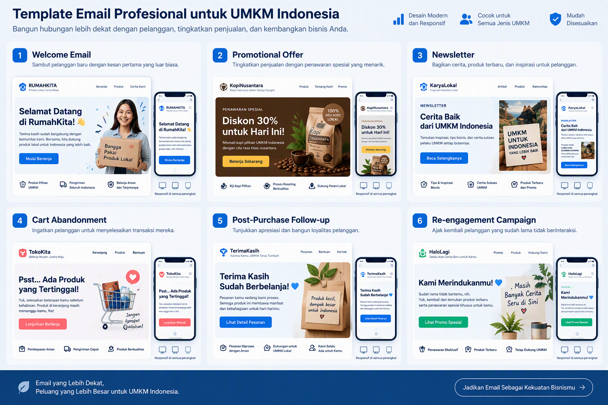

# Panduan Lengkap Email Automation dan CRM untuk Bisnis UMKM

**Product 36 - SNISHOP Digital Content**

---


---

## Daftar Isi

**BAGIAN 1: FONDASI EMAIL AUTOMATION**

1. Mengapa Email Automation untuk UMKM
2. Membangun Email List yang Berkualitas
3. Memilih Platform Email Marketing

**BAGIAN 2: STRATEGI DAN EKSEKUSI**

4. Email Segmentation dan Personalization
5. Membuat Email yang Dibaca dan Diklik
6. Automation Workflow
7. CRM Integration

**BAGIAN 3: OPTIMASI DAN SCALING**

8. Analytics dan Metrics
9. Deliverability dan Inbox Placement
10. Advanced Automation dan Scaling

**LENGKAPAN**

- Studi Kasus
- Kalkulator ROI Email Automation
- Rencana Implementasi 30 Hari
- Kesimpulan
- Tentang Penulis
- Copyright

---

# BAGIAN 1: FONDASI EMAIL AUTOMATION

---

# Bab 1: Mengapa Email Automation untuk UMKM


## 1.1 Realitas Pemasaran Digital untuk UMKM di Indonesia

Usaha Mikro, Kecil, dan Menengah (UMKM) merupakan tulang punggung perekonomian Indonesia. Berdasarkan data Kementerian Koperasi dan UKM, terdapat lebih dari 64 juta UMKM yang berkontribusi sebesar 61,1 persen terhadap Produk Domestik Bruto nasional. Namun, sebagian besar UMKM di Indonesia masih menghadapi tantangan besar dalam hal pemasaran digital dan manajemen hubungan pelanggan.

Banyak pelaku UMKM mengandalkan media sosial sebagai satu-satunya channel pemasaran. Mereka membangun following di Instagram, membuat konten di TikTok, atau beriklan di Facebook. Masalahnya, algoritma media sosial bisa berubah kapan saja. Jangkauan organik terus menurun. Iklan berbayar semakin mahal. Dan yang paling berbahaya, Anda tidak memiliki kendali atas audiens Anda di platform tersebut.

Di sinilah email marketing menjadi solusi yang jauh lebih stabil dan bisa diandalkan. Email memberikan Anda akses langsung ke inbox pelanggan tanpa bergantung pada algoritma pihak ketiga.

## 1.2 Statistik Email Marketing yang Tidak Bisa Diabaikan

Email marketing bukan sekadar channel pemasaran lama yang masih bertahan. Data menunjukkan bahwa email justru menjadi salah satu channel dengan ROI tertinggi dalam pemasaran digital. Berikut adalah fakta-fakta penting:

**ROI Email Marketing:**

- Setiap Rp 1 yang diinvestasikan dalam email marketing menghasilkan rata-rata Rp 56 dalam bentuk revenue (Data: Litmus, 2024)
- ROI rata-rata email marketing mencapai 3.600 persen atau 36:1
- Email marketing menghasilkan revenue 40 persen lebih tinggi dibandingkan channel sosial media untuk bisnis retail

**Jangkauan dan Penggunaan:**

- Terdapat 4,5 miliar pengguna email aktif di seluruh dunia pada tahun 2024
- Di Indonesia, penetrasi email mencapai 45 persen dari populasi, atau sekitar 122 juta pengguna
- 77 persen profesional lebih memilih komunikasi bisnis melalui email dibandingkan media sosial
- 59 persen konsumen Indonesia menyatakan email mempengaruhi keputusan pembelian mereka

**Perilaku Konsumen:**

- 72 persen konsumen lebih suka menerima konten promosi melalui email dibandingkan media sosial
- Email menghasilkan 17 persen lebih banyak konversi dibandingkan kombinasi sosial media dan display ads
- 66 persen konsumen Indonesia telah melakukan pembelian setelah menerima email promosi
- Pelanggan yang menerima email promotional menghabiskan 138 persen lebih banyak dibandingkan yang tidak menerima email

**Perbandingan dengan Channel Lain:**

| Metrik | Email Marketing | Social Media | SMS Marketing | WhatsApp |
|--------|----------------|--------------|---------------|----------|
| ROI | 3.600% | 1.200% | 2.800% | 1.500% |
| Biaya per pesan | Rp 5-50 | Rp 50-200 | Rp 100-300 | Rp 50-150 |
| Jangkauan organik | Tinggi | Rendah | Sangat Tinggi | Tinggi |
| Tingkat konversi | 2-5% | 0,5-1% | 3-6% | 1-3% |
| Personalisasi | Sangat Tinggi | Rendah | Sedang | Sedang |
| Otomatisasi | Sangat Mudah | Terbatas | Mudah | Mudah |

## 1.3 Mengapa Email Automation Lebih Efektif dari Email Manual

Email automation adalah proses mengirim email secara otomatis berdasarkan trigger, jadwal, atau perilaku pelanggan tertentu. Berbeda dengan mengirim email manual satu per satu, automation memungkinkan Anda:

**Efisiensi Waktu:**

- Menghemat rata-rata 10 jam per minggu dibandingkan mengirim email manual
- Mengirim email yang tepat pada waktu yang tepat tanpa intervensi manual
- Menangani ribuan pelanggan secara bersamaan tanpa menambah beban kerja

**Konsistensi:**

- Setiap pelanggan mendapatkan pengalaman yang sama dan terukur
- Tidak ada email yang terlewat atau terlambat dikirim
- Pesan tetap konsisten meskipun volume pelanggan meningkat

**Personalisasi Skala Besar:**

- Mengirim konten yang berbeda berdasarkan perilaku masing-masing pelanggan
- Menyesuaikan pesan berdasarkan tahap customer journey
- Meningkatkan relevansi dan engagement secara signifikan

**Contoh Perbandingan Hasil:**

Sebuah toko online fashion di Jakarta melakukan perbandingan antara email manual dan automation selama 3 bulan:

- Email manual: Open rate 12%, Click rate 1,8%, Konversi 0,5%
- Email automation: Open rate 28%, Click rate 5,2%, Konversi 2,1%
- Revenue dari email automation: Rp 18,5 juta per bulan
- Revenue dari email manual: Rp 4,2 juta per bulan

## 1.4 Email Automation dalam Konteks CRM

Customer Relationship Management (CRM) adalah strategi untuk mengelola hubungan dengan pelanggan secara menyeluruh. Email automation merupakan salah satu komponen terpenting dalam CRM karena:

1. **Touchpoint Terukur:** Setiap interaksi melalui email dapat dilacak dan diukur
2. **Data-Driven Decision:** Data dari email memberikan insight tentang preferensi pelanggan
3. **Lifecycle Management:** Email automation mendukung setiap tahap hubungan dengan pelanggan
4. **Retention dan Loyalty:** Email yang dipersonalisasi meningkatkan retensi pelanggan hingga 25 persen

## 1.5 Checklist: Apakah Bisnis Anda Siap untuk Email Automation?

Sebelum memulai, pastikan bisnis Anda memenuhi kriteria berikut:

- [ ] Anda memiliki produk atau jasa yang bisa dipasarkan melalui email
- [ ] Anda sudah memiliki atau sedang membangun database pelanggan
- [ ] Anda memiliki anggaran minimal Rp 200.000 per bulan untuk platform email
- [ ] Anda siap meluangkan waktu 3-5 jam per minggu untuk mengelola email marketing
- [ ] Anda memiliki konten yang berharga untuk dibagikan kepada pelanggan
- [ ] Anda berkomitmen untuk konsisten minimal 6 bulan ke depan

## 1.6 Tips dan Best Practices

1. Mulai dari yang sederhana. Jangan langsung membuat 10 automation workflow. Mulailah dengan welcome series dan abandoned cart.
2. Fokus pada kualitas, bukan kuantitas. Lebih baik mengirim 2 email berkualitas per minggu daripada 7 email spam per hari.
3. Selalu berikan opsi unsubscribe. Ini bukan hanya kewajiban hukum, tetapi juga membangun kepercayaan.
4. Test sebelum kirim. Selalu kirim test email ke diri sendiri sebelum mengirim ke seluruh list.
5. Dokumentasikan semua workflow. Buat catatan tentang setiap automation yang Anda buat beserta tujuannya.

---

# Bab 2: Membangun Email List yang Berkualitas


## 2.1 Mengapa Email List adalah Aset Paling Berharga

Email list bukan sekadar kumpulan alamat email. Email list adalah aset bisnis yang nilainya terus bertambah seiring waktu. Berikut alasannya:

- **Owned Media:** Tidak seperti followers di media sosial yang bisa hilang karena perubahan algoritma, email list sepenuhnya milik Anda
- **High Intent:** Orang yang mendaftar ke email list Anda menunjukkan minat yang nyata terhadap produk atau konten Anda
- **Direct Access:** Anda bisa menghubungi mereka kapan saja tanpa biaya iklan tambahan
- **Scalable:** Satu email bisa menjangkau 100 atau 100.000 orang dengan biaya yang hampir sama

**Nilai Email List dalam Angka:**

Sebuah studi dari Direct Marketing Association menunjukkan bahwa nilai rata-rata satu subscriber email adalah Rp 112.000 per tahun. Jadi jika Anda memiliki 1.000 subscriber, aset email list Anda bernilai sekitar Rp 112 juta per tahun dalam potensi revenue.

## 2.2 Lead Magnet: Memberi Nilai Sebelum Meminta

Lead magnet adalah insentif yang Anda berikan secara gratis sebagai exchange atas alamat email seseorang. Lead magnet yang efektif harus memenuhi kriteria berikut:

1. **Relevan:** Sesuai dengan produk atau jasa yang Anda jual
2. **Bernilai:** Memberikan solusi nyata atas masalah audiens
3. **Spesifik:** Menjawab satu masalah tertentu, bukan banyak masalah sekaligus
4. **Instant:** Bisa langsung diakses atau digunakan setelah mendaftar
5. **Actionable:** Bisa langsung dipraktikkan oleh pendaftar

**Contoh Lead Magnet untuk Berbagai Jenis UMKM:**

| Jenis UMKM | Lead Magnet | Format | Conversion Rate |
|------------|-------------|--------|----------------|
| Toko Fashion | Panduan Styling 7 Hari | PDF 15 halaman | 8,2% |
| Kuliner/Restoran | Resep Eksklusif Chef | Video + PDF | 6,5% |
| Jasa Konsultan | Template Bisnis Plan | Spreadsheet | 12,3% |
| Produk Kecantikan | Skincare Routine Guide | PDF + Checklist | 9,1% |
| Kursus Online | Mini Course Gratis | 5 Email Series | 15,7% |
| Toko Elektronik | Panduan Membeli Gadget | PDF Comparison | 7,8% |

**Langkah Membuat Lead Magnet:**

1. Identifikasi masalah utama target audiens Anda
2. Buat solusi praktis yang bisa disampaikan dalam format digital
3. Desain lead magnet menggunakan Canva atau tools serupa
4. Buat landing page sederhana untuk mengumpulkan email
5. Setup email otomatis yang mengirim lead magnet setelah pendaftaran
6. Promosikan lead magnet di semua channel yang Anda miliki

## 2.3 Opt-In Forms: Menempatkan Form di Tempat yang Tepat

Form pendaftaran email harus ditempatkan di lokasi strategis agar mendapatkan jumlah subscriber maksimal. Berikut adalah penempatan yang direkomendasikan:

**Lokasi Opt-In Form:**

1. **Homepage Banner:** Form di bagian atas halaman utama website
2. **Exit-Intent Popup:** Popup yang muncul saat pengunjung hendak meninggalkan website
3. **Sidebar Widget:** Form permanen di sidebar blog atau website
4. **In-Content:** Form yang disisipkan di tengah artikel blog
5. **Footer:** Form di bagian bawah setiap halaman website
6. **Landing Page Khusus:** Halaman terpisah yang didedikasikan untuk opt-in
7. **Checkout Page:** Form saat proses pembayaran di toko online

**Conversion Rate per Lokasi:**

| Lokasi | Conversion Rate Rata-rata |
|--------|--------------------------|
| Exit-Intent Popup | 3-5% |
| Landing Page Khusus | 5-15% |
| In-Content | 1-3% |
| Homepage Banner | 1-2% |
| Sidebar Widget | 0,5-1,5% |
| Footer | 0,5-1% |
| Checkout Page | 8-12% |

**Best Practices untuk Opt-In Form:**

- Gunakan headline yang menarik dan spesifik. Contoh: "Dapatkan 10 Template Gratis untuk Menghemat 5 Jam Kerja Anda Setiap Minggu"
- Batasi field form hanya pada nama dan email. Setiap field tambahan mengurangi conversion rate sebesar 11 persen
- Tambahkan social proof. Contoh: "Bergabung dengan 5.000+ profesional yang sudah mendapatkan tips mingguan kami"
- Gunakan tombol CTA yang jelas dan action-oriented. Hindari kata "Submit" atau "Kirim". Gunakan "Dapatkan Sekarang" atau "Ya, Saya Mau"
- Pastikan form mobile-friendly karena 65 persen email dibuka di perangkat mobile

## 2.4 Landing Page untuk Email Opt-In

Landing page khusus untuk email opt-in adalah halaman yang dirancang dengan satu tujuan: membuat pengunjung memberikan alamat email mereka. Landing page yang efektif memiliki elemen-elemen berikut:

**Struktur Landing Page Opt-In:**

1. **Headline:** Satu kalimat yang menjelaskan nilai utama lead magnet
2. **Sub-headline:** Penjelasan singkat tentang apa yang akan didapatkan
3. **Visual:** Gambar atau mockup dari lead magnet
4. **Bullet Points:** 3-5 poin tentang apa yang akan dipelajari atau didapatkan
5. **Social Proof:** Testimoni, jumlah subscriber, atau logo media yang pernah meliput
6. **Form:** Field nama dan email dengan tombol CTA yang jelas
7. **Privacy Statement:** Jaminan bahwa email tidak akan disalahgunakan

**Contoh Copy Landing Page:**

Headline: "Panduan Lengkap Mengelola Keuangan UMKM dalam 30 Menit per Minggu"

Sub-headline: "Download gratis template spreadsheet yang sudah digunakan oleh 2.500+ pelaku UMKM di seluruh Indonesia untuk mencatat pemasukan, pengeluaran, dan laba bersih bisnis mereka."

Bullet Points:
- Template spreadsheet siap pakai dengan formula otomatis
- Video tutorial cara mengisi dan menggunakannya
- Checklist 10 kesalahan keuangan yang sering dilakukan UMKM
- Akses ke grup komunitas eksklusif

## 2.5 Strategi List Building Jangka Panjang

Membangun email list bukan aktivitas sekali jadi. Diperlukan strategi berkelanjutan untuk terus menambah subscriber berkualitas.

**10 Strategi List Building:**

1. **Content Upgrade:** Tambahkan lead magnet spesifik di setiap artikel blog
2. **Webinar:** Selenggarakan webinar gratis yang mengharuskan pendaftaran via email
3. **Giveaway:** Adakan undian berhadiah dengan syarat subscribe email
4. **Quiz:** Buat quiz interaktif yang hasilnya dikirim via email
5. **Resource Library:** Buat perpustakaan konten eksklusif untuk subscriber
6. **Referral Program:** Berikan insentif untuk subscriber yang mengajak teman
7. **Offline Events:** Kumpulkan email saat acara offline atau pameran
8. **Social Media CTA:** Arahkan followers media sosial ke landing page email
9. **Partnership:** Kolaborasi dengan brand lain untuk cross-promote email list
10. **Paid Ads:** Gunakan Facebook Ads atau Google Ads untuk mendorong opt-in

**Target Pertumbuhan List:**

| Bulan | Subscriber | Strategi Utama |
|-------|-----------|----------------|
| 1 | 100 | Lead magnet + website form |
| 2 | 250 | Content upgrade + social media |
| 3 | 500 | Webinar pertama |
| 4 | 800 | Giveaway + referral |
| 5 | 1.200 | Paid ads mulai dijalankan |
| 6 | 1.800 | Partnership + quiz |
| 9 | 3.500 | Semua strategi aktif |
| 12 | 5.000 | Optimasi dan scaling |

## 2.6 Template dan Checklist

**Checklist Membangun Email List:**

- [ ] Tentukan lead magnet yang relevan dengan bisnis Anda
- [ ] Buat lead magnet dalam format digital (PDF, video, template)
- [ ] Setup landing page opt-in
- [ ] Buat opt-in form untuk website
- [ ] Setup exit-intent popup
- [ ] Tambahkan in-content form di blog
- [ ] Buat welcome email otomatis
- [ ] Promosikan lead magnet di media sosial
- [ ] Jadwalkan webinar atau live session pertama
- [ ] Setup tracking untuk mengukur conversion rate per channel

## 2.7 Tips dan Best Practices

1. Jangan pernah membeli email list. Email yang dibeli memiliki engagement rate sangat rendah dan bisa merusak reputasi domain Anda.
2. Gunakan double opt-in untuk memastikan kualitas subscriber. Meskipun mengurangi jumlah pendaftar, double opt-in menghasilkan list yang lebih engaged.
3. Berikan kejelasan tentang frekuensi email. Jika Anda berencana mengirim email setiap minggu, sampaikan di form pendaftaran.
4. Segmentasi sejak awal. Tanyakan minat atau kebutuhan subscriber saat pendaftaran untuk memudahkan segmentasi di kemudian hari.
5. Bersihkan list secara berkala. Hapus subscriber yang tidak membuka email selama 6 bulan untuk menjaga deliverability.

---

# Bab 3: Memilih Platform Email Marketing


## 3.1 Landscape Platform Email Marketing

Memilih platform email marketing yang tepat adalah keputusan strategis yang akan mempengaruhi efektivitas seluruh kampanye email Anda. Saat ini terdapat puluhan platform yang tersedia, masing-masing dengan kelebihan dan kekurangan. Untuk UMKM di Indonesia, berikut adalah kriteria utama dalam memilih platform:

1. **Harga yang terjangkau:** Sesuai dengan budget UMKM
2. **Kemudahan penggunaan:** Interface yang intuitif tanpa perlu keahlian teknis
3. **Fitur automation:** Kemampuan membuat workflow otomatis
4. **Template email:** Ketersediaan template yang menarik dan responsif
5. **Integrasi:** Kemampuan terhubung dengan tools lain yang Anda gunakan
6. **Support bahasa Indonesia:** Atau minimal dokumentasi yang mudah dipahami
7. **Deliverability:** Reputasi pengiriman yang baik ke provider email di Indonesia

## 3.2 Perbandingan Platform Email Marketing Populer

### Mailchimp

Mailchimp adalah platform email marketing paling populer di dunia dengan lebih dari 12 juta pengguna aktif. Platform ini cocok untuk UMKM yang baru memulai email marketing.

**Kelebihan:**
- Free plan untuk hingga 500 kontak dan 1.000 email per bulan
- Drag-and-drop email builder yang sangat mudah digunakan
- Template email yang beragam dan profesional
- Fitur automation dasar tersedia bahkan di free plan
- Integrasi dengan lebih dari 300 tools pihak ketiga
- Analytics dan reporting yang komprehensif

**Kekurangan:**
- Harga meningkat signifikan seiring pertumbuhan list
- Fitur automation di free plan terbatas
- Beberapa fitur advanced hanya tersedia di plan mahal
- Kurang optimal untuk bisnis dengan kebutuhan CRM kompleks

**Harga:**
- Free: 500 kontak, 1.000 email/bulan
- Essentials: USD 13/bulan (500 kontak)
- Standard: USD 20/bulan (500 kontak)
- Premium: USD 350/bulan (10.000 kontak)

**Cocok untuk:** UMKM yang baru memulai, bisnis retail, dan brand yang membutuhkan email marketing dasar dengan desain menarik.

### ConvertKit (sekarang Kit)

ConvertKit adalah platform email marketing yang dirancang khusus untuk kreator konten, blogger, dan online course creator. Platform ini fokus pada simplicity dan automation.

**Kelebihan:**
- Automation workflow yang powerful dan mudah dibuat
- Visual automation builder yang intuitif
- Fitur landing page dan form bawaan
- Tagging system yang fleksibel untuk segmentasi
- Creator Network untuk monetisasi newsletter
- Deliverability yang sangat baik

**Kekurangan:**
- Tidak ada free plan (hanya free trial)
- Template email lebih sedikit dibandingkan Mailchimp
- Kurang cocok untuk e-commerce
- Harga relatif mahal untuk fitur yang ditawarkan
- Tidak ada fitur CRM lengkap

**Harga:**
- Creator: USD 9/bulan (1.000 subscriber)
- Creator Pro: USD 29/bulan (1.000 subscriber)

**Cocok untuk:** Content creator, blogger, online educator, dan bisnis berbasis konten.

### Beehiiv

Beehiiv adalah platform newsletter yang relatif baru namun berkembang sangat cepat. Platform ini dirancang untuk membantu kreator membangun dan memonetisasi newsletter mereka.

**Kelebihan:**
- Fokus pada newsletter dan content publishing
- Fitur monetisasi bawaan (paid subscription)
- Referral program bawaan untuk pertumbuhan
- Analytics yang sangat detail
- Desain newsletter yang modern dan clean
- Boost network untuk cross-promotion

**Kekurangan:**
- Fitur automation masih terbatas
- Kurang cocok untuk email marketing transaksional
- Ekosistem integrasi masih berkembang
- Belum ada kantor atau support di Asia Tenggara

**Harga:**
- Free: 2.500 subscriber
- Grow: USD 19/bulan (2.500 subscriber)
- Scale: USD 49/bulan (2.500 subscriber)

**Cocok untuk:** Newsletter creator, media company, dan bisnis yang ingin membangun thought leadership melalui newsletter.

### MailerLite

MailerLite adalah platform email marketing yang menawarkan keseimbangan antara fitur dan harga. Platform ini sangat cocok untuk UMKM yang membutuhkan fitur lengkap dengan budget terbatas.

**Kelebihan:**
- Free plan yang generous (1.000 kontak, 12.000 email/bulan)
- Fitur automation yang lengkap termasuk di free plan
- Email builder dengan drag-and-drop yang mudah
- Landing page builder bawaan
- Integrasi e-commerce yang baik
- Customer support yang responsif

**Kekurangan:**
- Template tidak sebanyak Mailchimp
- Fitur reporting bisa lebih detail
- Deliverability kadang kurang konsisten di Indonesia
- Fitur CRM masih terbatas

**Harga:**
- Free: 1.000 kontak, 12.000 email/bulan
- Starter: USD 10/bulan (1.000 kontak)
- Advanced: USD 17/bulan (1.000 kontak)

**Cocok untuk:** UMKM dengan budget terbatas, bisnis yang membutuhkan automation lengkap, dan toko online.

### Perbandingan Ringkas

| Fitur | Mailchimp | ConvertKit | Beehiiv | MailerLite |
|-------|-----------|------------|---------|------------|
| Free Plan | Ya (500 kontak) | Tidak | Ya (2.500 subs) | Ya (1.000 kontak) |
| Automation | Dasar | Advanced | Terbatas | Lengkap |
| Landing Page | Ya | Ya | Ya | Ya |
| E-commerce | Sangat Baik | Kurang | Tidak | Baik |
| Newsletter | Baik | Sangat Baik | Sangat Baik | Baik |
| Template | 100+ | 50+ | 20+ | 80+ |
| Integrasi | 300+ | 100+ | 50+ | 100+ |
| Support Bahasa | Tidak | Tidak | Tidak | Tidak |
| Harga Mulai | USD 13/bln | USD 9/bln | Free | USD 10/bln |

## 3.3 Rekomendasi Platform Berdasarkan Jenis UMKM

**Toko Online/E-commerce:**
- Pilihan utama: Mailchimp (integrasi e-commerce terbaik)
- Alternatif: MailerLite (budget-friendly dengan fitur lengkap)

**Content Creator/Kursus Online:**
- Pilihan utama: ConvertKit (automation dan tagging terbaik)
- Alternatif: Beehiiv (monetisasi newsletter)

**Jasa Profesional/Konsultan:**
- Pilihan utama: MailerLite (balance fitur dan harga)
- Alternatif: Mailchimp (template profesional)

**Startup SaaS:**
- Pilihan utama: ConvertKit (automation workflow)
- Alternatif: Mailchimp (integrasi dengan tools SaaS)

**UMKM Kuliner/Retail:**
- Pilihan utama: MailerLite (simple dan affordable)
- Alternatif: Mailchimp (template menarik)

## 3.4 Langkah-Langkah Setup Platform

Berikut adalah langkah umum untuk memulai dengan platform email marketing:

1. **Daftar akun:** Buat akun di platform pilihan Anda
2. **Verifikasi domain:** Tambahkan dan verifikasi domain email pengirim Anda
3. **Setup SPF dan DKIM:** Konfigurasi autentikasi email untuk meningkatkan deliverability
4. **Import kontak:** Masukkan daftar email yang sudah Anda miliki (jika ada)
5. **Buat template:** Desain template email sesuai brand Anda
6. **Setup form:** Buat opt-in form dan embedding di website
7. **Buat automation:** Setup welcome email otomatis
8. **Test kirim:** Kirim test email untuk memastikan semuanya berjalan baik
9. **Monitor:** Pantau deliverability dan engagement di minggu pertama

## 3.5 Tips dan Best Practices

1. Mulailah dengan free plan untuk menguji platform sebelum berkomitmen pada plan berbayar.
2. Pastikan platform yang Anda pilih mendukung integrasi dengan tools yang sudah Anda gunakan (website, e-commerce, CRM).
3. Perhatikan batas email per bulan. Beberapa platform membatasi jumlah email yang bisa dikirim meskipun jumlah kontak sedikit.
4. Test deliverability ke berbagai provider email Indonesia (Gmail, Yahoo, Outlook, dan provider lokal seperti Telkom).
5. Baca review dari pengguna lain, khususnya dari Indonesia, untuk memahami kualitas support dan deliverability di wilayah Anda.

---

# BAGIAN 2: STRATEGI DAN EKSEKUSI

---

# Bab 4: Email Segmentation dan Personalization


## 4.1 Mengapa Segmentasi Email Sangat Penting

Segmentasi email adalah proses membagi email list Anda menjadi kelompok-kelompok yang lebih kecil berdasarkan karakteristik, perilaku, atau preferensi tertentu. Segmentasi bukan lagi fitur opsional, melainkan kebutuhan fundamental dalam email marketing modern.

**Data yang Mendukung Segmentasi:**

- Email yang dipersonalisasi menghasilkan transaction rate 6 kali lebih tinggi dibandingkan email tanpa personalisasi (Data: Aberdeen Group)
- 78 persen konsumen mengatakan mereka hanya akan terlibat dengan penawaran yang dipersonalisasi berdasarkan perilaku mereka
- Marketer yang menggunakan segmentasi melaporkan peningkatan revenue sebesar 760 persen
- 58 persen konsumen akan berhenti berlangganan jika email tidak relevan dengan mereka
- Email dengan subject line yang dipersonalisasi meningkatkan open rate sebesar 26 persen

**Dampak Segmentasi pada Metrik Email:**

| Metrik | Tanpa Segmentasi | Dengan Segmentasi | Peningkatan |
|--------|-----------------|-------------------|-------------|
| Open Rate | 14% | 28% | +100% |
| Click Rate | 2,1% | 5,8% | +176% |
| Conversion Rate | 0,8% | 2,9% | +263% |
| Unsubscribe Rate | 0,5% | 0,2% | -60% |
| Revenue per Email | Rp 45 | Rp 135 | +200% |

## 4.2 Jenis-Jenis Segmentasi Email

### Segmentasi Berdasarkan Demografi

Segmentasi demografi membagi subscriber berdasarkan karakteristik pribadi seperti usia, jenis kelamin, lokasi, pekerjaan, dan pendapatan.

**Contoh Implementasi:**

Sebuah brand fashion di Surabaya membagi subscriber mereka:
- Wanita 18-25 tahun: konten fashion casual, harga terjangkau
- Wanita 26-35 tahun: konten fashion office wear, mid-range price
- Pria 18-30 tahun: konten streetwear dan casual
- Pria 31-45 tahun: konten formal dan business casual

Hasil setelah segmentasi:
- Open rate meningkat dari 15% menjadi 32%
- Click rate meningkat dari 2% menjadi 6,5%
- Revenue per email meningkat 180 persen

### Segmentasi Berdasarkan Perilaku (Behavioral)

Segmentasi perilaku membagi subscriber berdasarkan tindakan yang mereka lakukan, seperti halaman yang dikunjungi, produk yang dilihat, email yang diklik, atau pembelian yang dilakukan.

**Jenis Segmentasi Perilaku:**

1. **Purchase History:** Berdasarkan produk yang pernah dibeli
2. **Email Engagement:** Berdasarkan tingkat interaksi dengan email
3. **Website Activity:** Berdasarkan halaman yang dikunjungi di website
4. **Cart Abandonment:** Berdasarkan produk yang ditinggalkan di cart
5. **Content Preference:** Berdasarkan jenis konten yang paling sering diklik
6. **Frequency:** Berdasarkan seberapa sering mereka berinteraksi dengan brand

**Contoh Implementasi:**

Toko online kosmetik di Bandung menerapkan segmentasi perilaku:
- Segment A: Pelanggan yang membeli skincare (45% dari total subscriber)
- Segment B: Pelanggan yang membeli makeup (30% dari total subscriber)
- Segment C: Pelanggan yang hanya browsing tanpa membeli (15%)
- Segment D: Pelanggan yang sudah tidak aktif selama 90 hari (10%)

Hasil setelah 3 bulan:
- Revenue dari Segment A meningkat 45% dengan cross-sell produk complementary
- Revenue dari Segment B meningkat 32% dengan early access produk baru
- Segment C dikonversi menjadi pembeli dengan targeted discount 15%
- Segment D di-reactivate dengan special win-back campaign

### Segmentasi Berdasarkan Tahap Customer Journey

Segmentasi ini membagi subscriber berdasarkan posisi mereka dalam funnel pembelian:

1. **Awareness Stage:** Baru mengenal brand, belum pernah membeli
2. **Consideration Stage:** Sedang mempertimbangkan produk, membandingkan opsi
3. **Decision Stage:** Siap membeli, perlu dorongan terakhir
4. **Retention Stage:** Sudah membeli, perlu dijaga loyalitasnya
5. **Advocacy Stage:** Pelanggan setia yang bisa menjadi brand ambassador

## 4.3 Personalization: Lebih dari Sekadar Menyebut Nama

Personalisasi email berarti menyesuaikan konten, penawaran, dan pengalaman email berdasarkan data dan preferensi masing-masing individu. Personalisasi yang efektif mencakup beberapa level:

**Level 1: Personalisasi Dasar**
- Menyebut nama subscriber di subject line atau body email
- Contoh: "Hadi, khusus untuk Anda: diskon 20% hari ini"

**Level 2: Personalisasi Konten**
- Menyesuaikan konten email berdasarkan minat atau perilaku
- Contoh: Mengirim rekomendasi produk berdasarkan kategori yang pernah dilihat

**Level 3: Personalisasi Penawaran**
- Menyesuaikan penawaran berdasarkan purchase history dan kemampuan bayar
- Contoh: Memberikan diskon berbeda untuk pelanggan baru vs pelanggan setia

**Level 4: Personalisasi Timing**
- Mengirim email pada waktu yang optimal untuk masing-masing subscriber
- Contoh: Mengirim email promo pada jam istirahat siang untuk pekerja kantoran

**Level 5: Personalisasi Dinamis**
- Menggunakan dynamic content blocks yang berubah berdasarkan data subscriber
- Contoh: Satu template email yang menampilkan produk berbeda untuk setiap subscriber

## 4.4 Langkah-Langkah Implementasi Segmentasi

**Langkah 1: Audit Data yang Tersedia**

Daftar semua data yang Anda miliki tentang subscriber:
- Data demografi (nama, lokasi, usia)
- Data perilaku (pembelian, klik, kunjungan website)
- Data preferensi (jenis produk, frekuensi komunikasi)
- Data sumber (dari mana mereka mendaftar)

**Langkah 2: Tentukan Segmen yang Relevan**

Berdasarkan data yang tersedia, tentukan segmen yang paling berdampak pada bisnis:
- Untuk e-commerce: segmentasi berdasarkan purchase history dan cart behavior
- Untuk service business: segmentasi berdasarkan jenis layanan yang diminati
- Untuk content creator: segmentasi berdasarkan topik konten yang disukai

**Langkah 3: Setup Segmentasi di Platform**

Buat segmen di platform email marketing Anda:
- Gunakan tags dan custom fields untuk mengelompokkan subscriber
- Setup rules otomatis untuk memindahkan subscriber antar segmen
- Pastikan setiap subscriber bisa berada di lebih dari satu segmen

**Langkah 4: Buat Konten per Segmen**

Kembangkan konten email yang disesuaikan untuk setiap segmen:
- Buat template base yang bisa dimodifikasi
- Siapkan variasi konten untuk setiap segmen
- Test konten pada sample kecil sebelum kirim massal

**Langkah 5: Monitor dan Optimasi**

Lacak performa setiap segmen:
- Bandingkan metrik antar segmen
- Identifikasi segmen yang underperform
- Terus refine segmentasi berdasarkan data baru

## 4.5 Template Segmentasi

**Template Segmen Dasar untuk UMKM:**

| Segmen | Kriteria | Email yang Dikirim | Frekuensi |
|--------|----------|-------------------|-----------|
| New Subscriber | Baru daftar < 7 hari | Welcome series (5 email) | Harian (seri) |
| Active Buyer | Beli dalam 30 hari terakhir | Product updates, cross-sell | 2x/minggu |
| Lapsed Customer | Tidak beli 60-90 hari | Re-engagement campaign | 1x/minggu |
| VIP Customer | Total belanja > Rp 5 juta | Exclusive offers, early access | 3x/minggu |
| Window Shopper | Browse tapi tidak beli | Product recommendation | 2x/minggu |
| Newsletter Only | Hanya ingin konten | Educational content | 1x/minggu |

## 4.6 Tips dan Best Practices

1. Jangan membuat terlalu banyak segmen di awal. Mulailah dengan 3-5 segmen utama, lalu tambahkan seiring bertambahnya data.
2. Pastikan setiap segmen cukup besar untuk menghasilkan insight yang bermakna. Segmen dengan kurang dari 50 orang mungkin tidak cukup untuk analisis statistik.
3. Selalu test email pada setiap segmen sebelum mengirim ke seluruh list.
4. Berikan opsi bagi subscriber untuk memilih preferensi mereka sendiri melalui preference center.
5. Review dan update segmentasi Anda setiap bulan berdasarkan data terbaru.

---

# Bab 5: Membuat Email yang Dibaca dan Diklik



## 5.1 Anatomi Email yang Efektif

Email yang berhasil bukan hanya soal konten yang bagus. Ada beberapa elemen yang harus bekerja sama untuk membuat subscriber membuka, membaca, dan mengklik email Anda.

**Anatomi Email:**

1. **From Name:** Nama pengirim yang dikenali dan dipercaya
2. **Subject Line:** Kalimat yang memicu rasa ingin tahu dan urgency
3. **Preview Text:** Teks pendamping subject line yang muncul di inbox
4. **Header:** Area atas email dengan branding dan headline utama
5. **Body Content:** Isi utama email dengan pesan dan nilai
6. **Call-to-Action:** Tombol atau link yang mengarahkan ke aksi yang diinginkan
7. **Footer:** Informasi perusahaan, link sosial media, dan tombol unsubscribe

## 5.2 Subject Line: Pintu Gerbang Email Anda

Subject line adalah elemen paling kritis dalam email Anda. Jika subject line tidak berhasil membuat subscriber membuka email, maka seluruh konten di dalamnya tidak akan pernah dilihat.

**Formula Subject Line yang Terbukti Efektif:**

**Formula 1: Curiosity Gap**
- "Rahasia di balik pertumbuhan 300% toko online ini"
- "Satu hal yang hampir semua UMKM salah lakukan"
- "Mengapa 8 dari 10 pelanggan tidak kembali (dan cara memperbaikinya)"

**Formula 2: Urgency dan Scarcity**
- "Flash sale 4 jam: diskon 50% untuk 100 pembeli pertama"
- "Besok terakhir: kesempatan mendapat harga early bird"
- "Hanya tersisa 12 unit: jangan sampai kehabisan"

**Formula 3: Benefit-Driven**
- "Cara menghemat 3 jam kerja setiap hari dengan satu template"
- "Tingkatkan penjualan 45% dalam 30 hari dengan strategi ini"
- "Panduan lengkap yang sudah membantu 5.000+ UMKM Indonesia"

**Formula 4: Personalization**
- "[Nama], ini khusus untuk pelanggan setia kami"
- "Rekomendasi produk berdasarkan pembelian terakhir Anda"
- "[Nama], kami rindu Anda: ada hadiah spesial menanti"

**Formula 5: Social Proof**
- "2.500+ UMKM sudah membuktikan: ini hasilnya"
- "Email yang paling banyak diminta subscriber kami bulan ini"
- "Kenapa 9 dari 10 pelanggan kami merekomendasikan produk ini"

**Data Performa Subject Line:**

| Tipe Subject Line | Avg Open Rate | Avg Click Rate |
|-------------------|---------------|----------------|
| Curiosity Gap | 32% | 5,1% |
| Urgency/Scarcity | 28% | 6,2% |
| Benefit-Driven | 26% | 4,8% |
| Personalized | 30% | 5,5% |
| Social Proof | 25% | 4,3% |
| Pertanyaan | 22% | 3,9% |
| Emoji (1-2 buah) | 27% | 4,5% |

**Aturan Subject Line:**

- Panjang optimal: 6-10 kata atau 30-50 karakter
- Hindari kata-kata spam: "gratis", "diskon besar", "terbatas", "segera"
- Jangan menggunakan ALL CAPS
- Test subject line dengan A/B testing
- Sesuaikan dengan segmen yang ditarget

## 5.3 Preview Text: Peluang Kedua untuk Menarik Perhatian

Preview text adalah teks yang muncul di samping atau di bawah subject line di inbox. Banyak marketer mengabaikan elemen ini, padahal preview text bisa meningkatkan open rate hingga 12 persen.

**Best Practices Preview Text:**

- Panjang optimal: 40-130 karakter
- Lengkapi subject line, jangan mengulang
- Berikan konteks tambahan atau preview isi email
- Hindari preview text default dari platform (biasanya "View in browser")

**Contoh Kombinasi Subject Line dan Preview Text:**

Subject: "Rahasia di balik pertumbuhan 300% toko online ini"
Preview: "Studi kasus lengkap dari brand lokal yang berhasil scale dari 0 ke Rp 500 juta dalam 6 bulan..."

Subject: "Flash sale 4 jam: diskon 50%"
Preview: "Berlaku hingga pukul 16.00 WIB hari ini. 100 produk pertama mendapat harga spesial..."

## 5.4 Email Design dan Layout

Desain email mempengaruhi bagaimana subscriber berinteraksi dengan konten Anda. Email yang baik harus mudah dibaca, menarik secara visual, dan responsif di semua perangkat.

**Prinsip Desain Email:**

1. **Single Column Layout:** Gunakan layout satu kolom untuk kemudahan membaca di mobile
2. **Width Maksimal 600px:** Standar lebar email yang optimal untuk semua email client
3. **Font Size Minimal 14px:** Untuk body text, gunakan minimal 14px agar mudah dibaca
4. **Contrast yang Cukup:** Pastikan teks memiliki kontras yang baik dengan background
5. **Whitespace yang Cukup:** Berikan ruang antar elemen agar email tidak terlihat padat
6. **Image-to-Text Ratio:** Idealnya 60% teks dan 40% gambar
7. **Mobile-First:** 65% email dibuka di mobile, desain harus mobile-friendly

**Struktur Template Email:**

```
+------------------------------------------+
|  HEADER: Logo + Brand Name               |
+------------------------------------------+
|  HERO: Headline + Visual Utama           |
+------------------------------------------+
|  BODY: Konten utama dengan formatting    |
|  - Subheading 1                          |
|  - Paragraf + gambar pendukung           |
|  - Subheading 2                          |
|  - Bullet points atau numbered list      |
+------------------------------------------+
|  CTA: Tombol call-to-action utama        |
+------------------------------------------+
|  SECONDARY: Konten tambahan/rekomendasi  |
+------------------------------------------+
|  FOOTER: Info perusahaan + unsubscribe   |
+------------------------------------------+
```

## 5.5 Copywriting untuk Email

Copywriting email berbeda dengan copywriting untuk media sosial atau website. Email membutuhkan pendekatan yang lebih personal dan langsung.

**Framework Copywriting Email:**

**AIDA (Attention, Interest, Desire, Action):**
- Attention: Buka dengan hook yang menarik
- Interest: Bangun minat dengan cerita atau data
- Desire: Ciptakan keinginan dengan benefit dan social proof
- Action: Tutup dengan CTA yang jelas

**PAS (Problem, Agitate, Solution):**
- Problem: Identifikasi masalah yang dihadapi subscriber
- Agitate: Perbesar masalah dengan konsekuensi jika tidak ditangani
- Solution: Hadirkan produk atau jasa Anda sebagai solusi

**Contoh Email dengan Framework PAS:**

Subject: "Omzet stagnan di Rp 10 juta per bulan?"

Body:
"Apakah bisnis Anda sudah berjalan beberapa bulan tapi omzet tidak pernah naik dari Rp 10 juta?

Anda tidak sendirian. 67% UMKM di Indonesia mengalami plateau di fase awal bisnis. Mereka bekerja keras setiap hari, tapi hasilnya begitu-begitu saja.

Masalahnya bukan pada kerja keras Anda. Masalahnya adalah Anda belum memiliki sistem yang bisa mengkonversi pengunjung menjadi pelanggan secara otomatis.

Kami telah membantu 347 UMKM keluar dari fase stagnan dengan email automation. Rata-rata mereka meningkatkan omzet 45% dalam 90 hari pertama.

[Download Panduan Gratis Sekarang]"

## 5.6 Call-to-Action yang Efektif

CTA adalah elemen paling penting dalam email marketing karena menentukan apakah subscriber akan mengambil tindakan yang Anda inginkan.

**Prinsip CTA Efektif:**

1. **Satu Email, Satu CTA Utama:** Jangan membingungkan subscriber dengan terlalu banyak pilihan
2. **Gunakan Tombol, Bukan Link:** Tombol CTA menghasilkan click rate 28% lebih tinggi
3. **Warna Kontras:** CTA harus menonjol dari elemen lain
4. **Teks Action-Oriented:** Gunakan kata kerja yang jelas
5. **Ukuran Optimal:** Tombol minimal 44x44 pixel untuk kemudahan tap di mobile

**Contoh Teks CTA:**

| Konteks | CTA Lemah | CTA Kuat |
|---------|-----------|----------|
| Download | Download | Dapatkan Panduan Gratis |
| Belanja | Klik di sini | Belanja Sekarang |
| Daftar | Submit | Ya, Saya Mau Daftar |
| Webinar | Registrasi | Amankan Kursi Saya |
| Diskon | Promo | Klaim Diskon 50% Saya |

## 5.7 Checklist Email Sebelum Dikirim

- [ ] Subject line menarik dan relevan (6-10 kata)
- [ ] Preview text melengkapi subject line
- [ ] From name dikenali oleh subscriber
- [ ] Email responsif di mobile dan desktop
- [ ] Semua link berfungsi dengan baik
- [ ] CTA jelas dan mudah diklik
- [ ] Tidak ada typo atau kesalahan grammar
- [ ] Image memiliki alt text
- [ ] Link unsubscribe terlihat dan berfungsi
- [ ] Email sudah ditest kirim ke minimal 3 perangkat berbeda

## 5.8 Tips dan Best Practices

1. Kirim email pada waktu yang optimal. Untuk audiens Indonesia, waktu terbaik adalah Selasa-Kamis pukul 09.00-11.00 atau 19.00-21.00 WIB.
2. Gunakan nama pengirim yang personal, bukan nama perusahaan. "Budi dari BrandX" lebih efektif daripada "BrandX Official".
3. Tulis email seolah-olah Anda berbicara kepada satu orang, bukan ribuan orang.
4. Baca email Anda dengan keras sebelum mengirim. Jika terdengar kaku atau terlalu formal, revisi agar lebih conversational.
5. Selalu sertakan plain text version di samping HTML version untuk memastikan email bisa dibaca di semua email client.

---

# Bab 6: Automation Workflow


## 6.1 Memahami Email Automation Workflow

Email automation workflow adalah serangkaian email yang dikirim secara otomatis berdasarkan trigger atau kondisi tertentu. Berbeda dengan broadcast email yang dikirim sekaligus ke seluruh list, automation workflow mengirim email secara bertahap berdasarkan perilaku dan timing yang tepat.

**Komponen Automation Workflow:**

1. **Trigger:** Peristiwa yang memulai workflow (contoh: pendaftaran baru, pembelian, cart abandonment)
2. **Delay:** Jeda waktu antara satu email dan email berikutnya
3. **Condition:** Kondisi yang menentukan jalur email (contoh: sudah beli atau belum)
4. **Action:** Email yang dikirim atau tindakan yang diambil
5. **Goal:** Hasil yang ingin dicapai dari workflow

## 6.2 Welcome Series: Kesan Pertama yang Menentukan

Welcome series adalah rangkaian email yang dikirim kepada subscriber baru setelah mereka mendaftar. Welcome series memiliki open rate tertinggi di antara semua jenis email, mencapai 50-60 persen pada email pertama.

**Struktur Welcome Series 5 Email:**

**Email 1 (Immediate - 0 jam setelah daftar):**
- Subject: "Selamat datang, [Nama]! Ini yang perlu Anda tahu"
- Konten: Ucapan terima kasih, delivery lead magnet, penjelasan tentang apa yang akan mereka terima
- CTA: Download lead magnet

**Email 2 (Hari ke-1):**
- Subject: "Cerita di balik [Brand]: mengapa kami memulai"
- Konten: Brand story, misi, dan nilai-nilai perusahaan
- CTA: Follow social media

**Email 3 (Hari ke-3):**
- Subject: "3 hal yang bisa Anda lakukan hari ini"
- Konten: Quick wins atau tips yang bisa langsung dipraktikkan
- CTA: Baca blog/panduan

**Email 4 (Hari ke-5):**
- Subject: "Apa kata mereka yang sudah mencoba [Produk]"
- Konten: Testimoni dan social proof dari pelanggan lain
- CTA: Lihat produk/layanan

**Email 5 (Hari ke-7):**
- Subject: "Penawaran spesial untuk Anda, [Nama]"
- Konten: First-purchase discount atau special offer
- CTA: Belanja sekarang dengan diskon

**Hasil Typical Welcome Series:**

| Metrik | Tanpa Welcome Series | Dengan Welcome Series |
|--------|---------------------|----------------------|
| Engagement Rate | 15% | 45% |
| First Purchase Rate | 3% | 12% |
| Average Order Value | Rp 150.000 | Rp 225.000 |
| 90-Day Revenue | Rp 2,1 juta | Rp 8,7 juta |

## 6.3 Abandoned Cart Recovery: Menyelamatkan Revenue yang Hilang

Abandoned cart email dikirim kepada pelanggan yang telah menambahkan produk ke keranjang belanja tetapi tidak menyelesaikan pembelian. Rata-rata 69,82 persen keranjang belanja online ditinggalkan tanpa pembelian.

**Struktur Abandoned Cart Series 3 Email:**

**Email 1 (1 jam setelah abandon):**
- Subject: "Anda meninggalkan sesuatu di keranjang, [Nama]"
- Konten: Reminder tentang produk yang ditinggalkan, gambar produk, tombol kembali ke cart
- Tone: Helpful reminder

**Email 2 (24 jam setelah abandon):**
- Subject: "Masih berpikir? Ini yang perlu Anda tahu"
- Konten: Social proof tentang produk, FAQ, testimonial pelanggan
- Tone: Persuasive but not pushy

**Email 3 (48 jam setelah abandon):**
- Subject: "Penawaran terakhir: diskon 10% khusus untuk Anda"
- Konten: Small discount atau free shipping sebagai insentif terakhir
- Tone: Urgency dengan batas waktu

**Contoh Hasil Abandoned Cart Recovery:**

Toko online sepatu di Yogyakarta dengan rata-rata 200 cart per hari:
- Tanpa abandoned cart email: 130 cart selesai (65%)
- Dengan abandoned cart email series: 165 cart selesai (82,5%)
- Tambahan revenue: Rp 27,5 juta per bulan
- Email recovery rate: 17,5% dari cart yang sebelumnya hilang

## 6.4 Re-Engagement Campaign: Menghidupkan Kembali Subscriber Pasif

Re-engagement email ditujukan kepada subscriber yang sudah tidak aktif selama periode tertentu (biasanya 60-90 hari). Tujuannya adalah untuk mengaktifkan kembali subscriber atau membersihkan mereka dari list.

**Struktur Re-Engagement Series 3 Email:**

**Email 1 (Setelah 60 hari tidak aktif):**
- Subject: "[Nama], kami sudah lama tidak mendengar dari Anda"
- Konten: Reminder tentang nilai yang Anda berikan, highlight konten populer
- CTA: "Klik di sini jika masih tertarik"

**Email 2 (7 hari kemudian, jika tidak ada respon):**
- Subject: "Ada yang spesial untuk Anda"
- Konten: Exclusive offer atau konten premium gratis
- CTA: "Klaim hadiah Anda"

**Email 3 (7 hari kemudian, jika masih tidak ada respon):**
- Subject: "Apakah ini selamat tinggal?"
- Konten: Final attempt, tanyakan apakah mereka masih ingin menerima email
- CTA: "Ya, tetap kirim email" atau "Tidak, unsubscribe saya"

**Hasil Typical Re-Engagement:**

- 5-10% subscriber yang di-reengage akan kembali aktif
- 2-5% akan memilih untuk unsubscribe
- Sisanya tetap pasif dan sebaiknya dihapus dari list
- Revenue dari re-engagement: Rp 3-5 juta per bulan untuk list 5.000 subscriber

## 6.5 Post-Purchase Follow-Up

Post-purchase email dikirim setelah pelanggan melakukan pembelian. Email ini penting untuk membangun loyalitas dan mendorong repeat purchase.

**Struktur Post-Purchase Series 4 Email:**

**Email 1 (Immediate setelah pembelian):**
- Subject: "Terima kasih, [Nama]! Detail pesanan Anda"
- Konten: Konfirmasi pesanan, estimasi pengiriman, apa yang diharapkan selanjutnya

**Email 2 (Saat pengiriman):**
- Subject: "Pesanan Anda sedang dalam perjalanan"
- Konten: Tracking number, tips merawat produk, apa yang bisa diharapkan

**Email 3 (7 hari setelah terima produk):**
- Subject: "Bagaimana pengalaman Anda dengan [Produk]?"
- Konten: Request review/testimoni, tips penggunaan lanjutan
- CTA: Tinggalkan review

**Email 4 (30 hari setelah pembelian):**
- Subject: "Rekomendasi khusus untuk Anda, [Nama]"
- Konten: Cross-sell produk complementary, loyalty program
- CTA: Belanja lagi

## 6.6 Birthday dan Anniversary Email

Email ulang tahun dan anniversary adalah cara yang efektif untuk membangun hubungan personal dengan pelanggan.

**Template Birthday Email:**

Subject: "Selamat ulang tahun, [Nama]! Hadiah spesial untuk Anda"

Body:
"Hi [Nama],

Tim [Brand] ingin mengucapkan selamat ulang tahun! Semoga tahun ini membawa kebahagiaan dan kesuksesan untuk Anda.

Sebagai tanda apresiasi, kami memberikan voucher diskon 25% yang bisa Anda gunakan untuk pembelian apa saja. Voucher ini berlaku selama 14 hari ke depan.

Kode voucher: HAPPYBD-[NAMA]

[Belanja Sekarang dengan Voucher]

Salam hangat,
Tim [Brand]"

**Hasil Birthday Email:**
- Open rate rata-rata: 45%
- Click rate rata-rata: 12%
- Conversion rate: 8%
- Average order value: 35% lebih tinggi dari email reguler

## 6.7 Template Automation Workflow

**Template Workflow untuk UMKM E-commerce:**

```
TRIGGER: Pendaftaran Baru
  |
  v
EMAIL 1: Welcome + Lead Magnet (0 jam)
  |
  v (1 hari)
EMAIL 2: Brand Story (24 jam)
  |
  v (2 hari)
EMAIL 3: Quick Tips (72 jam)
  |
  v (2 hari)
EMAIL 4: Social Proof (120 jam)
  |
  v (2 hari)
EMAIL 5: Special Offer (168 jam)
  |
  v
  [Condition: Sudah beli?]
  |           |
  YA          TIDAK
  |           |
  v           v
Post-Purchase   Abandoned Cart
Series            Series
```

## 6.8 Tips dan Best Practices

1. Jangan mengirim terlalu banyak email di awal. Welcome series yang terlalu agresif bisa menyebabkan unsubscribe.
2. Selalu sertakan exit condition dalam workflow. Jika pelanggan sudah membeli, jangan terus mengirim email abandoned cart.
3. Test timing setiap email dalam workflow. Delay yang terlalu lama bisa membuat subscriber lupa, sementara delay yang terlalu singkat bisa terasa spam.
4. Monitor performa setiap email dalam workflow dan optimasi secara berkelanjutan.
5. Buat workflow yang bisa berjalan tanpa intervensi manual selama minimal 30 hari.

---

# Bab 7: CRM Integration


## 7.1 Menghubungkan Email Marketing dengan CRM

CRM (Customer Relationship Management) adalah sistem yang mengelola seluruh interaksi dengan pelanggan, dari prospek pertama hingga menjadi pelanggan setia. Mengintegrasikan email marketing dengan CRM memberikan pandangan 360 derajat tentang setiap pelanggan.

**Manfaat Integrasi Email-CRM:**

1. **Single Customer View:** Semua data pelanggan tersentralisasi dalam satu tempat
2. **Automated Data Sync:** Data pembelian, interaksi, dan perilaku otomatis tersinkronisasi
3. **Better Segmentation:** Segmentasi email berdasarkan data CRM yang lengkap
4. **Lead Scoring:** Menilai kualitas lead berdasarkan interaksi email dan perilaku lain
5. **Revenue Attribution:** Melacak revenue yang dihasilkan dari setiap kampanye email
6. **Personalization yang Lebih Dalam:** Personalisasi berdasarkan data CRM, bukan hanya data email

## 7.2 Customer Journey Mapping

Customer journey map adalah visualisasi lengkap tentang perjalanan pelanggan dari pertama kali mengenal brand hingga menjadi pelanggan setia dan advocate.

**Tahapan Customer Journey:**

**Tahap 1: Awareness (Kesadaran)**
- Pelanggan pertama kali mengenal brand Anda
- Touchpoints: Sosial media, iklan, referral, pencarian Google
- Goal email: Memperkenalkan brand dan memberikan nilai
- Metrik: Open rate, brand recall

**Tahap 2: Consideration (Pertimbangan)**
- Pelanggan mulai mempertimbangkan produk Anda
- Touchpoints: Website, review, perbandingan produk
- Goal email: Edukasi tentang produk dan differentiation
- Metrik: Click rate, website visits

**Tahap 3: Decision (Keputusan)**
- Pelanggan siap membuat keputusan pembelian
- Touchpoints: Pricing page, demo, sales call
- Goal email: Mendorong pembelian dengan social proof dan urgency
- Metrik: Conversion rate, revenue

**Tahap 4: Retention (Retensi)**
- Pelanggan sudah membeli dan perlu dijaga loyalitasnya
- Touchpoints: Email follow-up, customer service, loyalty program
- Goal email: Memastikan kepuasan dan mendorong repeat purchase
- Metrik: Repeat purchase rate, customer lifetime value

**Tahap 5: Advocacy (Advokasi)**
- Pelanggan setia yang merekomendasikan brand kepada orang lain
- Touchpoints: Referral program, review request, community
- Goal email: Memotivasi untuk menjadi advocate
- Metrik: Referral rate, NPS score

## 7.3 Lead Scoring: Menilai Kualitas Prospek

Lead scoring adalah sistem untuk memberikan nilai numerik pada setiap prospek berdasarkan tingkat engagement dan kesiapan mereka untuk membeli.

**Contoh Sistem Lead Scoring:**

| Aksi | Poin |
|------|------|
| Buka email | 2 |
| Klik link di email | 5 |
| Download lead magnet | 10 |
| Kunjungi halaman pricing | 15 |
| Request demo | 25 |
| Melakukan pembelian | 50 |
| Tidak buka email 30 hari | -10 |
| Unsubscribe | -50 |

**Kategorisasi Lead Berdasarkan Skor:**

| Skor | Kategori | Tindakan |
|------|----------|----------|
| 0-20 | Cold Lead | Nurture dengan educational content |
| 21-50 | Warm Lead | Kirim case study dan product demo |
| 51-80 | Hot Lead | Kirim penawaran spesial, follow-up personal |
| 81-100 | Ready to Buy | Immediate sales follow-up |

**Contoh Implementasi Lead Scoring:**

Sebuah perusahaan SaaS di Jakarta menerapkan lead scoring:
- Total prospek: 2.000
- Cold leads (0-20): 1.200 (60%) - dikirim newsletter mingguan
- Warm leads (21-50): 500 (25%) - dikirim case study dan webinar invite
- Hot leads (51-80): 200 (10%) - dikirim demo invitation dan special offer
- Ready to buy (81-100): 100 (5%) - dihubungi langsung oleh sales team

Hasil:
- Conversion rate dari cold lead: 2%
- Conversion rate dari warm lead: 8%
- Conversion rate dari hot lead: 25%
- Conversion rate dari ready to buy: 60%
- Revenue meningkat 180% dalam 6 bulan

## 7.4 Data Integration: Menghubungkan Semua Touchpoints

Untuk mendapatkan gambaran lengkap tentang pelanggan, Anda perlu menghubungkan data dari berbagai sumber:

**Sumber Data yang Perlu Diintegrasikan:**

1. **Website Analytics:** Halaman yang dikunjungi, waktu di website, bounce rate
2. **E-commerce Platform:** Riwayat pembelian, nilai transaksi, produk favorit
3. **Social Media:** Engagement, followers, interaksi
4. **Customer Support:** Tiket support, keluhan, feedback
5. **Sales Team:** Catatan sales call, status deal, pipeline stage
6. **Email Platform:** Open rate, click rate, email yang diklik

**Cara Mengintegrasikan Data:**

1. **Native Integration:** Gunakan integrasi bawaan antar platform
2. **Zapier/Make:** Gunakan automation tools untuk menghubungkan platform
3. **API Custom:** Develop integrasi custom menggunakan API
4. **CRM sebagai Hub:** Gunakan CRM sebagai pusat data yang menghubungkan semua platform

## 7.5 Template Customer Journey Email

**Template Mapping Email per Tahap Journey:**

| Tahap | Tujuan | Jenis Email | Frekuensi | KPI |
|-------|--------|-------------|-----------|-----|
| Awareness | Edukasi | Newsletter, blog digest | 1x/minggu | Open rate |
| Consideration | Build trust | Case study, comparison | 2x/bulan | Click rate |
| Decision | Konversi | Promo, urgency | 1-2x/bulan | Conversion rate |
| Retention | Loyalitas | Tips, exclusive offers | 2x/minggu | Repeat purchase |
| Advocacy | Referral | Referral program, review | 1x/bulan | Referral rate |

## 7.6 Tips dan Best Practices

1. Mulailah dengan mengintegrasikan email platform dengan e-commerce atau website Anda terlebih dahulu sebelum menambahkan sumber data lain.
2. Jangan mengumpulkan data berlebihan. Fokus pada data yang benar-benar actionable untuk bisnis Anda.
3. Setup automated data sync agar data selalu update tanpa intervensi manual.
4. Review lead scoring system setiap 3 bulan dan sesuaikan berdasarkan data aktual.
5. Pastikan semua tim (marketing, sales, customer service) memiliki akses ke data CRM yang sama.

---

# BAGIAN 3: OPTIMASI DAN SCALING

---

# Bab 8: Analytics dan Metrics


## 8.1 Metrik Utama Email Marketing

Mengukur performa email marketing adalah kunci untuk terus meningkatkan hasil kampanye Anda. Tanpa data yang tepat, Anda tidak akan tahu apa yang berhasil dan apa yang perlu diperbaiki.

**Metrik Utama yang Harus Dipantau:**

**1. Open Rate (Tingkat Buka Email)**

Open rate adalah persentase subscriber yang membuka email Anda dari total email yang terkirim.

- Formula: (Jumlah email dibuka / Jumlah email terkirim) x 100%
- Benchmark industri: 20-25%
- Target yang baik: di atas 25%
- Faktor yang mempengaruhi: subject line, from name, timing, brand recognition

**2. Click-Through Rate (CTR)**

CTR adalah persentase subscriber yang mengklik minimal satu link di email Anda.

- Formula: (Jumlah klik unik / Jumlah email terkirim) x 100%
- Benchmark industri: 2-3%
- Target yang baik: di atas 3%
- Faktor yang mempengaruhi: konten email, CTA, relevansi, desain

**3. Click-to-Open Rate (CTOR)**

CTOR mengukur efektivitas konten email dari mereka yang sudah membuka.

- Formula: (Jumlah klik unik / Jumlah email dibuka) x 100%
- Benchmark industri: 10-15%
- Target yang baik: di atas 15%
- Faktor yang mempengaruhi: kualitas konten, relevansi CTA, desain

**4. Conversion Rate**

Conversion rate adalah persentase subscriber yang melakukan tindakan yang diinginkan setelah mengklik link di email.

- Formula: (Jumlah konversi / Jumlah klik) x 100%
- Benchmark industri: 1-5%
- Target yang baik: di atas 5%
- Faktor yang mempengaruhi: landing page, penawaran, user experience

**5. Bounce Rate**

Bounce rate adalah persentase email yang tidak berhasil dikirim ke inbox penerima.

- Formula: (Jumlah email bounce / Jumlah email terkirim) x 100%
- Target: di bawah 2%
- Jenis bounce: Hard bounce (email tidak valid) dan soft bounce (mailbox penuh)

**6. Unsubscribe Rate**

Unsubscribe rate adalah persentase subscriber yang memilih berhenti menerima email dari Anda.

- Formula: (Jumlah unsubscribe / Jumlah email terkirim) x 100%
- Target: di bawah 0,5%
- Jika di atas 0,5%: konten tidak relevan atau terlalu sering mengirim

**7. Revenue per Email**

Revenue per email mengukur berapa revenue yang dihasilkan dari setiap email yang dikirim.

- Formula: Total revenue dari email / Jumlah email terkirim
- Benchmark: Rp 50-200 per email
- Target: terus meningkat setiap bulan

## 8.2 A/B Testing: Metode Ilmiah untuk Optimasi

A/B testing adalah metode membandingkan dua versi email untuk menentukan mana yang menghasilkan performa lebih baik.

**Elemen yang Bisa Di-A/B Test:**

1. Subject line (paling berdampak pada open rate)
2. Preview text
3. From name
4. Send time
5. CTA text dan warna
6. Email layout dan desain
7. Panjang konten email
8. Personalization level
9. Tipe penawaran (diskon vs free shipping vs gift)
10. Image vs no image

**Langkah-Langkah A/B Testing:**

1. **Tentukan hipotesis:** "Subject line dengan angka akan meningkatkan open rate 15%"
2. **Pilih variabel:** Subject line
3. **Buat variasi:** Versi A (tanpa angka) vs Versi B (dengan angka)
4. **Tentukan sample size:** Minimal 1.000 email per variasi untuk signifikansi statistik
5. **Jalankan test:** Kirim secara acak ke dua kelompok subscriber
6. **Tentukan durasi:** Minimal 24-48 jam untuk mengumpulkan data cukup
7. **Analisis hasil:** Bandingkan metrik utama dan tentukan winner
8. **Implementasi:** Gunakan winning variation untuk email selanjutnya

**Contoh A/B Test dengan Hasil:**

Test: Subject line dengan personalisasi vs tanpa personalisasi
- Sample: 2.000 subscriber (1.000 per variasi)
- Durasi: 48 jam

Hasil:
- Versi A (tanpa personalisasi): "Promo akhir bulan diskon 30%"
  - Open rate: 18%
  - Click rate: 2,5%
- Versi B (dengan personalisasi): "Budi, promo akhir bulan diskon 30% khusus untuk Anda"
  - Open rate: 27%
  - Click rate: 4,1%
- Winner: Versi B dengan peningkatan open rate 50% dan click rate 64%

## 8.3 Reporting dan Dashboard

Membuat laporan email marketing yang komprehensif membantu Anda melacak progress dan membuat keputusan berbasis data.

**Template Laporan Bulanan:**

| Metrik | Bulan Ini | Bulan Lalu | Perubahan | Target |
|--------|-----------|------------|-----------|--------|
| Total Subscriber | 3.500 | 3.200 | +9,4% | 3.500 |
| Open Rate | 26% | 24% | +8,3% | 25% |
| Click Rate | 4,2% | 3,8% | +10,5% | 4% |
| Conversion Rate | 3,1% | 2,5% | +24% | 3% |
| Revenue | Rp 12,5 jt | Rp 9,8 jt | +27,6% | Rp 12 jt |
| Unsubscribe Rate | 0,3% | 0,4% | -25% | <0,5% |
| Bounce Rate | 1,2% | 1,5% | -20% | <2% |

## 8.4 Tips dan Best Practices

1. Jangan hanya fokus pada satu metrik. Lihat keseluruhan metrik untuk mendapatkan gambaran yang utuh.
2. Bandingkan performa dengan benchmark industri, tetapi lebih penting untuk membandingkan dengan performa Anda sendiri dari waktu ke waktu.
3. Lakukan minimal 2 A/B test per bulan untuk terus mengoptimasi performa email.
4. Buat laporan bulanan dan review bersama tim untuk mendapatkan perspektif berbeda.
5. Dokumentasikan semua hasil test agar bisa dijadikan referensi untuk kampanye di masa depan.

---

# Bab 9: Deliverability dan Inbox Placement


## 9.1 Memahami Email Deliverability

Deliverability adalah kemampuan email Anda untuk mencapai inbox penerima, bukan folder spam atau bounce kembali. Deliverability yang buruk berarti email Anda tidak akan pernah dilihat oleh subscriber, sekalipun mereka sudah mendaftar secara sukarela.

**Statistik Deliverability:**

- Rata-rata deliverability rate global: 98%
- Rata-rata email yang masuk folder spam: 2-5%
- 33% subscriber akan berhenti berinteraksi dengan brand jika email masuk spam
- Email yang masuk tab Promotions (Gmail) memiliki open rate 25% lebih rendah dari Primary inbox

**Faktor yang Mempengaruhi Deliverability:**

1. **Reputasi Domain:** Skor kepercayaan domain pengirim
2. **Reputasi IP:** Skor kepercayaan IP address pengirim
3. **Authentication:** Setup SPF, DKIM, dan DMARC
4. **Engagement Rate:** Open rate, click rate, dan respons subscriber
5. **List Quality:** Kualitas dan kebersihan email list
6. **Content Quality:** Konten email yang tidak trigger spam filter
7. **Complaint Rate:** Jumlah subscriber yang menandai email sebagai spam

## 9.2 Email Authentication: SPF, DKIM, dan DMARC

Autentikasi email adalah metode teknis untuk memverifikasi bahwa email benar-benar dikirim dari domain yang diklaim. Ini adalah fondasi utama deliverability.

**SPF (Sender Policy Framework):**

SPF adalah record DNS yang mencantumkan server mana yang diizinkan untuk mengirim email atas nama domain Anda.

Contoh SPF record:
```
v=spf1 include:_spf.google.com include:mailchimp.com ~all
```

Cara setup:
1. Login ke DNS management domain Anda
2. Tambahkan TXT record baru
3. Masukkan SPF record yang diberikan oleh platform email Anda
4. Tunggu propagasi DNS (biasanya 1-24 jam)
5. Verifikasi menggunakan tools seperti MXToolbox

**DKIM (DomainKeys Identified Mail):**

DKIM menambahkan tanda tangan digital pada setiap email yang dikirim, memungkinkan penerima memverifikasi keaslian email.

Cara setup:
1. Generate DKIM key di platform email marketing Anda
2. Tambahkan TXT record di DNS management domain Anda
3. Verifikasi setup menggunakan tools DKIM validator
4. Test dengan mengirim email ke akun Gmail dan cek header email

**DMARC (Domain-based Message Authentication, Reporting, and Conformance):**

DMARC memberitahu server penerima apa yang harus dilakukan jika email gagal verifikasi SPF atau DKIM.

Contoh DMARC record:
```
v=DMARC1; p=quarantine; rua=mailto:dmarc@yourdomain.com; pct=100
```

Policy options:
- p=none: Monitor saja, tidak ada tindakan
- p=quarantine: Kirim ke folder spam jika gagal verifikasi
- p=reject: Tolak email jika gagal verifikasi

**Rekomendasi Setup:**

| Record | Prioritas | Status |
|--------|-----------|--------|
| SPF | Wajib | Harus setup sebelum mengirim email |
| DKIM | Wajib | Harus setup sebelum mengirim email |
| DMARC | Sangat Penting | Setup minimal p=none untuk monitoring |

## 9.3 List Hygiene: Menjaga Kesehatan Email List

List hygiene adalah praktik menjaga kualitas email list Anda agar tetap bersih dan engaged.

**Praktik List Hygiene:**

1. **Hapus Hard Bounce Segera:** Email yang bounce karena alamat tidak valid harus segera dihapus
2. **Clean Inactive Subscriber:** Hapus subscriber yang tidak membuka email selama 90 hari
3. **Double Opt-In:** Gunakan konfirmasi ganda untuk memastikan email valid
4. **Update Preference:** Berikan opsi bagi subscriber untuk update preferensi mereka
5. **Monitor Complaint Rate:** Jaga complaint rate di bawah 0,1%

**Jadwal List Cleaning:**

| Frekuensi | Tindakan |
|-----------|----------|
| Harian | Hapus hard bounce |
| Mingguan | Review engagement metrics |
| Bulanan | Hapus inactive subscriber (>90 hari) |
| Kuartalan | Audit menyeluruh dan update segmentasi |

**Dampak List Hygiene pada Deliverability:**

Sebuah toko online di Surabaya melakukan list cleaning:
- Sebelum cleaning: 5.000 subscriber, open rate 12%, deliverability 85%
- Setelah cleaning: 3.200 subscriber (hapus 1.800 inactive)
- Hasil: Open rate naik menjadi 24%, deliverability naik menjadi 97%
- Revenue tetap sama meskipun subscriber berkurang 36%

## 9.4 Spam Score dan Content Quality

Spam score adalah skor yang menunjukkan kemungkinan email Anda ditandai sebagai spam oleh filter.

**Faktor yang Meningkatkan Spam Score:**

1. Penggunaan kata-kata trigger spam: "gratis", "diskon besar", "terbatas", "URGENT"
2. Terlalu banyak tanda seru (!!!)
3. ALL CAPS dalam subject line
4. Image-to-text ratio terlalu tinggi (>80% gambar)
5. Link ke domain yang tidak terpercaya
6. HTML yang tidak valid atau berantakan
7. Missing unsubscribe link
8. Inconsistent sending volume

**Target Spam Score:**

- Skor 0-2: Excellent (hampir pasti masuk inbox)
- Skor 3-5: Good (kemungkinan besar masuk inbox)
- Skor 5-7: Warning (risiko masuk spam)
- Skor 7-10: Critical (hampir pasti masuk spam)

**Tools untuk Cek Spam Score:**

- Mail-Tester.com: Cek spam score gratis
- GlockApps: Cek inbox placement
- MXToolbox: Cek blacklist status

## 9.5 Tips dan Best Practices

1. Setup SPF, DKIM, dan DMARC sebelum mengirim email pertama. Ini adalah fondasi deliverability.
2. Panaskan domain Anda secara bertahap. Jangan langsung mengirim 10.000 email dari domain baru.
3. Konsisten dalam volume pengiriman. Lonjakan volume yang tiba-tiba bisa trigger spam filter.
4. Monitor blacklist status domain Anda secara berkala menggunakan MXToolbox.
5. Jaga engagement rate tinggi dengan mengirim konten yang relevan dan valuable.

---

# Bab 10: Advanced Automation dan Scaling


## 10.1 Dynamic Content: Satu Email, Banyak Variasi

Dynamic content memungkinkan Anda menampilkan konten yang berbeda dalam satu email berdasarkan data atau perilaku masing-masing subscriber. Ini adalah level tertinggi dari personalisasi email.

**Contoh Dynamic Content:**

1. **Produk berdasarkan lokasi:** Menampilkan produk yang tersedia di wilayah subscriber
2. **Harga berdasarkan segmen:** Menampilkan harga khusus untuk VIP member
3. **Konten berdasarkan minat:** Menampilkan artikel yang sesuai dengan minat subscriber
4. **Gambar berdasarkan device:** Menampilkan gambar yang optimal untuk device subscriber

**Implementasi Dynamic Content:**

Sebuah travel agency di Bali menggunakan dynamic content untuk mengirim satu email ke 5.000 subscriber dengan variasi:
- Header image berbeda berdasarkan lokasi subscriber (Jawa, Sumatera, Kalimantan, Sulawesi, Bali-Nusa Tenggara)
- Destinasi rekomendasi berdasarkan riwayat pencarian
- Harga khusus untuk subscriber yang pernah booking sebelumnya
- CTA yang berbeda berdasarkan budget segmen

Hasil:
- Open rate: 35% (naik dari 22% tanpa dynamic content)
- Click rate: 7,8% (naik dari 3,2%)
- Booking conversion: 4,5% (naik dari 1,8%)
- Revenue increase: 145%

## 10.2 Triggered Emails: Email Berdasarkan Peristiwa

Triggered emails adalah email yang dikirim secara otomatis berdasarkan peristiwa atau aksi spesifik yang dilakukan subscriber.

**Jenis Triggered Emails:**

1. **Behavioral Trigger:** Berdasarkan tindakan di website atau app
   - Contoh: Browse abandonment, product view, search result
   - Timing: 1-24 jam setelah trigger

2. **Transaction Trigger:** Berdasarkan transaksi yang dilakukan
   - Contoh: Purchase confirmation, shipping update, delivery confirmation
   - Timing: Immediate setelah transaksi

3. **Milestone Trigger:** Berdasarkan pencapaian atau peristiwa penting
   - Contoh: Ulang tahun, anniversary pelanggan, pencapaian loyalty
   - Timing: Sesuai tanggal peristiwa

4. **Time-Based Trigger:** Berdasarkan waktu atau durasi
   - Contoh: Subscription renewal, reorder reminder, seasonal promotion
   - Timing: Berdasarkan kalender atau interval

**Contoh Triggered Email dengan Hasil:**

Browse abandonment email untuk hotel booking platform:
- Trigger: Pengunjung melihat kamar hotel tetapi tidak booking
- Timing: 2 jam setelah browsing
- Konten: Kamar yang dilihat + rekomendasi serupa + review tamu
- Hasil: Recovery rate 8,5%, menghasilkan Rp 45 juta/bulan tambahan

## 10.3 Multi-Channel Orchestration

Multi-channel orchestration adalah koordinasi komunikasi dengan pelanggan melalui berbagai channel secara terintegrasi. Email tidak berdiri sendiri, tetapi bekerja bersama channel lain untuk memberikan pengalaman yang kohesif.

**Strategi Multi-Channel:**

```
Channel Email:
  - Welcome series
  - Newsletter mingguan
  - Promosi bulanan

Channel WhatsApp:
  - Konfirmasi pesanan
  - Reminder pembayaran
  - Customer support

Channel SMS:
  - Flash sale notification
  - Shipping update
  - OTP verification

Channel Social Media:
  - Brand awareness
  - Community building
  - User-generated content
```

**Contoh Orchestration:**

Pelanggan melakukan pembelian di toko online:
1. Email: Konfirmasi pesanan (immediate)
2. WhatsApp: Update status pengiriman (H+1)
3. Email: Tracking information (H+2)
4. SMS: Notifikasi paket tiba (H+3)
5. Email: Request review (H+7)
6. Email: Cross-sell produk complementary (H+14)
7. WhatsApp: Reminder reorder (H+30)

Hasil multi-channel approach:
- Customer satisfaction: 92% (naik dari 75%)
- Repeat purchase rate: 35% (naik dari 18%)
- Average order value: Rp 285.000 (naik dari Rp 195.000)

## 10.4 Scaling Email Marketing

Scaling email marketing berarti meningkatkan volume dan kompleksitas kampanye seiring pertumbuhan bisnis Anda.

**Tahapan Scaling:**

**Tahap 1: Foundation (0-1.000 subscriber)**
- Fokus: Membangun list dan automation dasar
- Platform: Free plan atau plan termurah
- Tim: 1 orang menangani semua
- Budget: Rp 0-500.000/bulan

**Tahap 2: Growth (1.000-5.000 subscriber)**
- Fokus: Optimasi dan segmentasi
- Platform: Paid plan dengan fitur lengkap
- Tim: 1-2 orang dedicated
- Budget: Rp 500.000-2.000.000/bulan

**Tahap 3: Scale (5.000-20.000 subscriber)**
- Fokus: Advanced automation dan personalisasi
- Platform: Advanced plan atau enterprise
- Tim: 2-3 orang dengan spesialisasi
- Budget: Rp 2.000.000-5.000.000/bulan

**Tahap 4: Enterprise (20.000+ subscriber)**
- Fokus: Multi-channel orchestration dan AI
- Platform: Enterprise solution atau custom
- Tim: 3-5 orang plus agency support
- Budget: Rp 5.000.000-20.000.000/bulan

## 10.5 AI dan Masa Depan Email Automation

Artificial Intelligence (AI) mulai mengubah landscape email marketing secara signifikan. Berikut adalah tren yang perlu diperhatikan:

**AI-Powered Features:**

1. **Send Time Optimization:** AI menentukan waktu pengiriman optimal untuk setiap subscriber
2. **Subject Line Generator:** AI menghasilkan subject line berdasarkan data historis
3. **Content Personalization:** AI menyesuaikan konten secara real-time
4. **Predictive Analytics:** AI memprediksi perilaku pembelian subscriber
5. **Automated Segmentation:** AI mengelompokkan subscriber secara otomatis

**Contoh Implementasi AI:**

Sebuah e-commerce fashion menggunakan AI untuk send time optimization:
- Setiap subscriber menerima email pada waktu yang berbeda
- AI menganalisis kapan masing-masing subscriber paling sering membuka email
- Hasil: Open rate meningkat 32% dibandingkan waktu pengiriman tetap

## 10.6 Tips dan Best Practices

1. Jangan scaling sebelum fondasi kuat. Pastikan deliverability dan engagement rate sudah optimal sebelum meningkatkan volume.
2. Investasikan waktu untuk membangun automation workflow yang comprehensive. Automation yang baik akan menghemat waktu dan meningkatkan hasil.
3. Pertimbangkan multi-channel approach ketika email list sudah mencapai 5.000 subscriber.
4. Monitor ROI setiap channel dan fokus pada channel yang memberikan hasil terbaik.
5. Tetap update dengan tren dan teknologi terbaru dalam email marketing.

---

# STUDI KASUS

---

## Studi Kasus 1: Toko Online Fashion yang Meningkatkan Revenue 45% dengan Email Automation


### Profil Bisnis

- Nama: StyleHub (nama disamarkan)
- Jenis bisnis: Toko online fashion wanita
- Lokasi: Surabaya, Jawa Timur
- Tim: 5 orang
- Revenue bulanan sebelum email automation: Rp 85 juta
- Email list: 3.200 subscriber (belum dikelola dengan baik)

### Tantangan

StyleHub menghadapi beberapa tantangan:
- Revenue stagnan di level Rp 85 juta per bulan selama 6 bulan
- Customer acquisition cost meningkat 40% karena kompetisi iklan yang semakin ketat
- Repeat purchase rate hanya 15% (sangat rendah untuk fashion e-commerce)
- Email list 3.200 subscriber tidak pernah dimanfaatkan secara optimal
- Hanya mengirim broadcast email 1-2 kali per bulan tanpa strategi yang jelas

### Solusi yang Diimplementasikan

**Bulan 1: Fondasi**
- Migrasi ke Mailchimp Standard plan
- Setup SPF, DKIM, dan DMARC
- Segmentasi list menjadi 5 segmen berdasarkan purchase history
- Cleanup list: hapus 800 subscriber inactive (tersisa 2.400)

**Bulan 2: Automation**
- Setup welcome series (5 email)
- Setup abandoned cart series (3 email)
- Setup post-purchase series (4 email)
- Mulai mengirim newsletter mingguan yang konsisten

**Bulan 3: Optimasi**
- A/B testing subject line (melakukan 8 test)
- Setup re-engagement campaign
- Implementasi birthday email
- Mulai cross-sell dan upsell melalui email

### Hasil Setelah 6 Bulan

| Metrik | Sebelum | Sesudah | Perubahan |
|--------|---------|---------|-----------|
| Total Subscriber | 3.200 | 4.800 | +50% |
| Open Rate | 12% | 28% | +133% |
| Click Rate | 1,8% | 5,5% | +206% |
| Conversion Rate | 0,5% | 2,3% | +360% |
| Monthly Revenue | Rp 85 jt | Rp 123 jt | +45% |
| Repeat Purchase Rate | 15% | 32% | +113% |
| Email Revenue Contribution | 5% | 22% | +340% |
| Customer Acquisition Cost | Rp 75.000 | Rp 52.000 | -31% |

### Breakdown Revenue Increase

Revenue tambahan Rp 38 juta per bulan berasal dari:
- Abandoned cart recovery: Rp 12 juta (32% dari tambahan)
- Welcome series conversion: Rp 8 juta (21%)
- Post-purchase cross-sell: Rp 10 juta (26%)
- Newsletter promotion: Rp 5 juta (13%)
- Re-engagement campaign: Rp 3 juta (8%)

### Investasi dan ROI

- Biaya platform (Mailchimp): Rp 350.000/bulan
- Biaya tools tambahan: Rp 150.000/bulan
- Waktu tim: 15 jam/minggu (setara Rp 3,75 juta/bulan)
- Total investasi: Rp 4,25 juta/bulan
- Revenue tambahan: Rp 38 juta/bulan
- ROI: 794% (Rp 38 juta / Rp 4,25 juta x 100%)

---

## Studi Kasus 2: SaaS Startup yang Mengurangi Churn 30% dengan Re-Engagement Emails


### Profil Bisnis

- Nama: KasirPro (nama disamarkan)
- Jenis bisnis: SaaS aplikasi kasir (POS) untuk UMKM
- Lokasi: Jakarta Selatan
- Tim: 12 orang
- Monthly recurring revenue (MRR): Rp 120 juta
- Total pelanggan aktif: 400
- Monthly churn rate: 8% (sangat tinggi untuk SaaS)

### Tantangan

KasirPro menghadapi masalah churn yang serius:
- 32 pelanggan baru churn setiap bulan (8% dari 400)
- Customer acquisition cost: Rp 500.000 per pelanggan
- Lifetime value rata-rata: Rp 1,8 juta (hanya 6 bulan retention)
- Tidak ada sistem untuk mendeteksi pelanggan yang berisiko churn
- Tidak ada komunikasi proaktif dengan pelanggan yang tidak aktif

### Solusi yang Diimplementasikan

**Bulan 1: Analisis dan Setup**
- Integrasi email platform dengan CRM dan product analytics
- Identifikasi sinyal churn: login frequency, feature usage, support tickets
- Setup lead scoring berdasarkan product engagement
- Segmentasi pelanggan: Active, At-Risk, Dormant, Churned

**Bulan 2: Automation Workflow**
- Setup onboarding series untuk pengguna baru (7 email selama 14 hari)
- Setup engagement tracking email (mingguan berdasarkan usage)
- Setup at-risk detection dan re-engagement campaign
- Setup win-back campaign untuk churned customers

**Bulan 3: Optimasi dan Expansion**
- A/B testing konten email onboarding
- Setup milestone celebration email (penggunaan ke-100, ke-500, dst)
- Setup feature education email untuk meningkatkan adoption
- Implementasi NPS survey melalui email

### Sinyal Churn Detection

| Sinyal | Bobot | Tindakan |
|--------|-------|----------|
| Tidak login 7 hari | 10 poin | Kirim tips dan reminder |
| Tidak login 14 hari | 25 poin | Kirim email personal dari CS |
| Feature usage turun 50% | 20 poin | Kirim tutorial feature baru |
| Support ticket unresolved | 15 poin | Escalate ke senior CS |
| Total skor > 40 | At-Risk | Campaign re-engagement intensif |

### Hasil Setelah 6 Bulan

| Metrik | Sebelum | Sesudah | Perubahan |
|--------|---------|---------|-----------|
| Monthly Churn Rate | 8% | 5,6% | -30% |
| Active Customers | 400 | 520 | +30% |
| MRR | Rp 120 jt | Rp 156 jt | +30% |
| Average Lifetime | 6 bulan | 9,5 bulan | +58% |
| Customer LTV | Rp 1,8 jt | Rp 2,85 jt | +58% |
| NPS Score | 32 | 58 | +81% |
| Feature Adoption | 35% | 62% | +77% |

### Breakdown Dampak

Pengurangan churn dari 8% menjadi 5,6% berarti:
- Pelanggan churn per bulan: dari 32 menjadi 22 (hemat 10 pelanggan)
- Revenue yang diselamatkan: 10 x Rp 300.000 = Rp 3 juta/bulan
- Akumulasi pelanggan baru (net growth): 20 pelanggan/bulan
- MRR tambahan setelah 6 bulan: 120 pelanggan x Rp 300.000 = Rp 36 juta

### Investasi dan ROI

- Biaya platform email: Rp 1,2 juta/bulan
- Biaya CRM integration: Rp 500.000/bulan
- Waktu tim marketing: 20 jam/minggu (setara Rp 5 juta/bulan)
- Total investasi: Rp 6,7 juta/bulan
- Revenue yang diselamatkan dan ditambah: Rp 39 juta/bulan
- ROI: 482%

---

## Studi Kasus 3: Course Creator yang Menghasilkan Rp 30 Juta/Bulan dari Email List


### Profil Bisnis

- Nama: Akademi Digital (nama disamarkan)
- Jenis bisnis: Online course creator (digital marketing dan bisnis online)
- Lokasi: Bandung, Jawa Barat
- Tim: 3 orang (founder + 2 admin)
- Produk: 3 course online dengan harga Rp 499.000 - Rp 1.499.000
- Email list: 2.800 subscriber

### Tantangan

Akademi Digital menghadapi beberapa tantangan:
- Revenue tidak konsisten, sangat bergantung pada launch course baru
- Tidak ada passive income dari produk yang sudah ada
- Email list 2.800 subscriber tidak dimonetisasi secara optimal
- Hanya mengirim email saat ada course launch (3-4 kali per tahun)
- Tidak ada nurture sequence untuk warm up calon pembeli

### Solusi yang Diimplementasikan

**Bulan 1: Content Strategy**
- Setup newsletter mingguan dengan konten educational
- Buat lead magnet baru: "Panduan Digital Marketing untuk Pemula" (PDF 30 halaman)
- Setup landing page opt-in yang baru dengan conversion rate optimization
- Mulai promosi lead magnet di semua channel (Instagram, YouTube, TikTok)

**Bulan 2: Nurture System**
- Setup welcome series 7 email (educate + build trust)
- Setup automated product recommendation berdasarkan minat
- Buat email sequence untuk setiap produk course
- Setup evergreen webinar funnel (webinar otomatis + email follow-up)

**Bulan 3: Monetization**
- Setup automated sales funnel untuk course termurah (Rp 499.000)
- Implementasi flash sale bulanan (24 jam)
- Setup affiliate program melalui email
- Buat membership community untuk subscriber premium

### Email Funnel Structure

```
Lead Magnet (Free PDF)
    |
    v
Welcome Series (7 email, 10 hari)
    |
    v
Educational Content (newsletter mingguan)
    |
    v
Webinar Invite (otomatis setelah 14 hari)
    |
    v
Webinar Attendance (recorded, evergreen)
    |
    v
Sales Sequence (5 email, 7 hari)
    |
    v
[Condition: Beli?]
    |           |
    YA          TIDAK
    |           |
    v           v
Upsell        Follow-up
Sequence      (monthly promo)
```

### Hasil Setelah 6 Bulan

| Metrik | Sebelum | Sesudah | Perubahan |
|--------|---------|---------|-----------|
| Email List | 2.800 | 6.500 | +132% |
| Newsletter Open Rate | 18% | 35% | +94% |
| Course Sales per Bulan | 15 | 62 | +313% |
| Monthly Revenue | Rp 8 jt | Rp 30 jt | +275% |
| Revenue per Subscriber | Rp 2.857 | Rp 4.615 | +62% |
| Passive Revenue Ratio | 10% | 55% | +450% |

### Breakdown Revenue Rp 30 Juta/Bulan

- Course A (Rp 499.000): 25 penjualan = Rp 12,5 juta
- Course B (Rp 799.000): 15 penjualan = Rp 11,9 juta
- Course C (Rp 1.499.000): 3 penjualan = Rp 4,5 juta
- Affiliate commission: Rp 1,1 juta
- Total: Rp 30 juta

Sumber penjualan:
- Dari email automation: 65% (Rp 19,5 juta)
- Dari newsletter manual: 20% (Rp 6 juta)
- Dari organic social media: 15% (Rp 4,5 juta)

### Investasi dan ROI

- Biaya platform email (ConvertKit): Rp 450.000/bulan
- Biaya tools (landing page, webinar): Rp 800.000/bulan
- Waktu founder: 10 jam/minggu (setara Rp 5 juta/bulan)
- Total investasi: Rp 6,25 juta/bulan
- Revenue: Rp 30 juta/bulan
- ROI: 380%

---

# KALKULATOR ROI EMAIL AUTOMATION


## Cara Menggunakan Kalkulator

Kalkulator ini membantu Anda menghitung potensi ROI dari implementasi email automation untuk bisnis Anda. Masukkan data bisnis Anda dan bandingkan dengan contoh perhitungan di bawah ini.

## Contoh Perhitungan 1: Toko Online Kecil

**Data Bisnis:**
- Jumlah subscriber: 1.500
- Rata-rata nilai transaksi: Rp 200.000
- Frekuensi pembelian per tahun: 3 kali
- Biaya platform email: Rp 300.000/bulan (Rp 3,6 juta/tahun)
- Biaya tools tambahan: Rp 100.000/bulan (Rp 1,2 juta/tahun)
- Waktu pengelolaan: 8 jam/minggu (setara Rp 2 juta/bulan = Rp 24 juta/tahun)

**Perhitungan:**

```
Total investasi per tahun:
- Platform: Rp 3.600.000
- Tools: Rp 1.200.000
- Waktu: Rp 24.000.000
- TOTAL INVESTASI: Rp 28.800.000

Pendapatan dari email automation:
- Subscriber yang melakukan pembelian via email: 1.500 x 15% = 225 orang
- Rata-rata transaksi via email: Rp 200.000 x 2 (2 transaksi dari email) = Rp 400.000
- Total revenue dari email: 225 x Rp 400.000 = Rp 90.000.000

ROI = (Revenue - Investasi) / Investasi x 100%
ROI = (Rp 90.000.000 - Rp 28.800.000) / Rp 28.800.000 x 100%
ROI = 212%

Revenue per rupiah yang diinvestasikan:
Rp 90.000.000 / Rp 28.800.000 = Rp 3,13
Artinya setiap Rp 1 yang diinvestasikan menghasilkan Rp 3,13
```

## Contoh Perhitungan 2: Bisnis Jasa/Konsultan

**Data Bisnis:**
- Jumlah subscriber: 800
- Rata-rata nilai proyek: Rp 5.000.000
- Conversion rate dari email: 2%
- Biaya platform email: Rp 200.000/bulan (Rp 2,4 juta/tahun)
- Biaya tools tambahan: Rp 150.000/bulan (Rp 1,8 juta/tahun)
- Waktu pengelolaan: 5 jam/minggu (setara Rp 1,25 juta/bulan = Rp 15 juta/tahun)

**Perhitungan:**

```
Total investasi per tahun:
- Platform: Rp 2.400.000
- Tools: Rp 1.800.000
- Waktu: Rp 15.000.000
- TOTAL INVESTASI: Rp 19.200.000

Pendapatan dari email automation:
- Lead yang qualified dari email: 800 x 8% = 64 lead
- Conversion rate ke klien: 64 x 2% = 1,28 (dibulatkan 1 klien per bulan)
- Total klien per tahun dari email: 12 klien
- Total revenue: 12 x Rp 5.000.000 = Rp 60.000.000

ROI = (Rp 60.000.000 - Rp 19.200.000) / Rp 19.200.000 x 100%
ROI = 212%

Revenue per rupiah yang diinvestasikan:
Rp 60.000.000 / Rp 19.200.000 = Rp 3,13
```

## Contoh Perhitungan 3: Course Creator/Info Product

**Data Bisnis:**
- Jumlah subscriber: 3.000
- Harga course: Rp 750.000
- Conversion rate dari email: 3%
- Biaya platform email: Rp 500.000/bulan (Rp 6 juta/tahun)
- Biaya tools tambahan: Rp 300.000/bulan (Rp 3,6 juta/tahun)
- Waktu pengelolaan: 10 jam/minggu (setara Rp 2,5 juta/bulan = Rp 30 juta/tahun)

**Perhitungan:**

```
Total investasi per tahun:
- Platform: Rp 6.000.000
- Tools: Rp 3.600.000
- Waktu: Rp 30.000.000
- TOTAL INVESTASI: Rp 39.600.000

Pendapatan dari email automation:
- Subscriber yang membeli via email: 3.000 x 3% = 90 orang
- Total revenue: 90 x Rp 750.000 = Rp 67.500.000

ROI = (Rp 67.500.000 - Rp 39.600.000) / Rp 39.600.000 x 100%
ROI = 70%

Revenue per rupiah yang diinvestasikan:
Rp 67.500.000 / Rp 39.600.000 = Rp 1,70
```

## Template Kalkulator untuk Bisnis Anda

Gunakan template berikut untuk menghitung ROI email automation bisnis Anda:

```
INPUT:
- Jumlah subscriber: ___
- Rata-rata nilai transaksi: Rp ___
- Persentase subscriber yang beli via email: ___%
- Frekuensi pembelian per tahun via email: ___ kali

INVESTASI PER TAHUN:
- Biaya platform email: Rp ___
- Biaya tools tambahan: Rp ___
- Biaya waktu (jam/minggu x Rp ___ per jam x 52 minggu): Rp ___
- TOTAL INVESTASI: Rp ___

PENDAPATAN:
- Jumlah pembeli via email: (subscriber x ___%) = ___ orang
- Revenue per pembeli per tahun: (Rp ___ x ___ kali) = Rp ___
- TOTAL REVENUE: Rp ___

ROI:
- ROI = (Revenue - Investasi) / Investasi x 100%
- ROI = ___%
- Revenue per Rp 1 yang diinvestasikan: Rp ___
```

---

# RENCANA IMPLEMENTASI 30 HARI


## Minggu 1: Fondasi (Hari 1-7)

**Hari 1: Audit dan Perencanaan**
- [ ] Audit semua channel pemasaran yang sudah berjalan
- [ ] Daftar semua data pelanggan yang tersedia
- [ ] Tentukan tujuan email marketing (revenue, engagement, retention)
- [ ] Tetapkan budget bulanan untuk email marketing
- [ ] Tentukan KPI utama yang akan diukur

**Hari 2: Pemilihan Platform**
- [ ] Riset dan bandingkan 3-4 platform email marketing
- [ ] Daftar free trial di 2 platform teratas
- [ ] Test fitur dan kemudahan penggunaan
- [ ] Pilih platform yang paling sesuai dengan kebutuhan dan budget
- [ ] Buat akun dan mulai setup

**Hari 3: Setup Teknis**
- [ ] Verifikasi domain email pengirim
- [ ] Setup SPF record di DNS
- [ ] Setup DKIM record di DNS
- [ ] Setup DMARC record di DNS
- [ ] Test konfigurasi menggunakan MXToolbox

**Hari 4: Membangun Email List**
- [ ] Tentukan lead magnet yang akan ditawarkan
- [ ] Buat lead magnet (PDF, template, atau video)
- [ ] Buat landing page opt-in
- [ ] Setup opt-in form di website
- [ ] Promosikan lead magnet di media sosial

**Hari 5: Desain Template**
- [ ] Buat template email header dengan branding
- [ ] Desain template newsletter
- [ ] Desain template promosi
- [ ] Test responsivitas template di mobile dan desktop
- [ ] Setup footer dengan informasi perusahaan dan link unsubscribe

**Hari 6: Welcome Email**
- [ ] Tulis email welcome pertama (delivery lead magnet)
- [ ] Tulis email kedua (brand story)
- [ ] Setup automation untuk welcome series
- [ ] Test kirim welcome email ke diri sendiri
- [ ] Verifikasi semua link berfungsi

**Hari 7: Review Minggu 1**
- [ ] Review semua setup teknis
- [ ] Test end-to-end flow dari pendaftaran sampai menerima email
- [ ] Dokumentasikan semua yang sudah dikonfigurasi
- [ ] Siapkan konten untuk minggu ke-2
- [ ] Evaluasi dan catat hambatan yang dihadapi

## Minggu 2: Konten dan Automation (Hari 8-14)

**Hari 8: Konten Newsletter**
- [ ] Tentukan topik newsletter untuk 4 minggu ke depan
- [ ] Tulis newsletter edisi pertama
- [ ] Buat subject line dan preview text
- [ ] Siapkan CTA yang jelas
- [ ] Test kirim newsletter

**Hari 9: Abandoned Cart Setup**
- [ ] Identifikasi trigger untuk abandoned cart
- [ ] Tulis email abandoned cart pertama (1 jam setelah abandon)
- [ ] Tulis email kedua (24 jam setelah abandon)
- [ ] Tulis email ketiga (48 jam, dengan diskon)
- [ ] Setup automation workflow

**Hari 10: Segmentasi**
- [ ] Tentukan segmen yang akan dibuat
- [ ] Setup tags dan custom fields di platform
- [ ] Pindahkan subscriber yang ada ke segmen yang sesuai
- [ ] Buat rules otomatis untuk segmentasi
- [ ] Test segmentasi dengan sample email

**Hari 11: Post-Purchase Automation**
- [ ] Tulis email konfirmasi pesanan
- [ ] Tulis email shipping update
- [ ] Tulis email request review
- [ ] Tulis email cross-sell
- [ ] Setup automation workflow

**Hari 12: Re-Engagement Campaign**
- [ ] Identifikasi subscriber yang tidak aktif (>60 hari)
- [ ] Tulis email re-engagement pertama
- [ ] Tulis email re-engagement kedua (dengan offer)
- [ ] Tulis email re-engagement ketiga (final attempt)
- [ ] Setup automation workflow

**Hari 13: A/B Testing Setup**
- [ ] Tentukan elemen yang akan di-test
- [ ] Buat 2 variasi subject line
- [ ] Setup A/B test di platform
- [ ] Tentukan sample size dan durasi test
- [ ] Dokumentasikan hipotesis test

**Hari 14: Review Minggu 2**
- [ ] Review semua automation workflow yang sudah dibuat
- [ ] Test semua flow dari awal sampai akhir
- [ ] Kirim newsletter pertama ke seluruh list
- [ ] Monitor hasil dan catat feedback
- [ ] Evaluasi dan rencanakan optimasi

## Minggu 3: Optimasi dan Testing (Hari 15-21)

**Hari 15: Analisis Data Awal**
- [ ] Kumpulkan data open rate dan click rate dari email yang sudah dikirim
- [ ] Bandingkan dengan benchmark industri
- [ ] Identifikasi area yang perlu diperbaiki
- [ ] Catat insight dan learning
- [ ] Buat rencana optimasi

**Hari 16: Optimasi Subject Line**
- [ ] Analisis subject line yang memiliki open rate tertinggi
- [ ] Identifikasi pola dan formula yang berhasil
- [ ] Buat template subject line untuk berbagai jenis email
- [ ] Implementasi learnings di email berikutnya
- [ ] Jalankan A/B test kedua

**Hari 17: Optimasi Konten**
- [ ] Analisis email dengan click rate tertinggi
- [ ] Identifikasi jenis konten dan CTA yang paling efektif
- [ ] Update template email berdasarkan insight
- [ ] Test format konten yang berbeda (video, gambar, teks)
- [ ] Implementasi perubahan

**Hari 18: Optimasi Timing**
- [ ] Analisis open rate berdasarkan waktu pengiriman
- [ ] Identifikasi waktu optimal untuk audiens Anda
- [ ] Setup send time optimization (jika tersedia)
- [ ] Test pengiriman di waktu yang berbeda
- [ ] Dokumentasikan hasil

**Hari 19: List Growth**
- [ ] Evaluasi pertumbuhan list sejauh ini
- [ ] Tambahkan opt-in form di lokasi baru
- [ ] Promosikan lead magnet di channel tambahan
- [ ] Pertimbangkan paid ads untuk list building
- [ ] Setup referral program

**Hari 20: Advanced Automation**
- [ ] Setup birthday email automation
- [ ] Setup anniversary email (jika data tersedia)
- [ ] Buat win-back campaign untuk subscriber yang unsubscribe
- [ ] Setup product recommendation berdasarkan purchase history
- [ ] Test semua automation baru

**Hari 21: Review Minggu 3**
- [ ] Review semua metrik dan bandingkan dengan minggu 1-2
- [ ] Evaluasi hasil A/B testing
- [ ] Dokumentasikan best practices yang ditemukan
- [ ] Update SOP email marketing
- [ ] Rencana untuk minggu ke-4

## Minggu 4: Scaling dan Long-Term Planning (Hari 22-30)

**Hari 22: Content Calendar**
- [ ] Buat kalender konten email untuk 3 bulan ke depan
- [ ] Tentukan frekuensi pengiriman (newsletter, promo, educational)
- [ ] Jadwalkan semua email di platform
- [ ] Siapkan buffer konten untuk situasi darurat
- [ ] Setup reminder untuk review konten

**Hari 23: CRM Integration**
- [ ] Evaluasi kebutuhan CRM untuk bisnis Anda
- [ ] Pilih CRM yang sesuai (jika belum memiliki)
- [ ] Setup integrasi antara email platform dan CRM
- [ ] Sync data pelanggan
- [ ] Test data flow

**Hari 24: Lead Scoring**
- [ ] Tentukan kriteria lead scoring
- [ ] Setup scoring rules di platform
- [ ] Assign skor untuk subscriber yang ada
- [ ] Buat automation berdasarkan skor
- [ ] Test dan validasi scoring

**Hari 25: Multi-Channel Planning**
- [ ] Evaluasi channel komunikasi lain yang digunakan
- [ ] Tentukan peran setiap channel dalam customer journey
- [ ] Buat strategi orkestrasi multi-channel
- [ ] Setup integrasi antar channel
- [ ] Test koordinasi antar channel

**Hari 26: Reporting System**
- [ ] Buat template laporan bulanan
- [ ] Setup dashboard untuk monitoring metrik
- [ ] Tentukan KPI dan target untuk bulan berikutnya
- [ ] Setup automated reporting (jika tersedia)
- [ ] Buat jadwal review bulanan

**Hari 27: Team Training**
- [ ] Dokumentasikan semua SOP email marketing
- [ ] Buat panduan untuk tim (jika ada)
- [ ] Training penggunaan platform email
- [ ] Training analisis data dan reporting
- [ ] Setup akses dan permission untuk tim

**Hari 28: Compliance Check**
- [ ] Pastikan semua email memiliki link unsubscribe
- [ ] Review privacy policy dan data protection
- [ ] Pastikan compliance dengan regulasi yang berlaku
- [ ] Setup preference center untuk subscriber
- [ ] Dokumentasikan proses handling data

**Hari 29: Long-Term Strategy**
- [ ] Review tujuan 3 bulan, 6 bulan, dan 12 bulan
- [ ] Tentukan target pertumbuhan list
- [ ] Rencana budget untuk scaling
- [ ] Evaluasi kebutuhan tools tambahan
- [ ] Buat roadmap email marketing 12 bulan

**Hari 30: Evaluasi dan Celebration**
- [ ] Review pencapaian selama 30 hari
- [ ] Bandingkan hasil dengan tujuan awal
- [ ] Dokumentasikan lessons learned
- [ ] Rayakan pencapaian (sekecil apapun)
- [ ] Tetapkan rencana untuk bulan berikutnya

---

# KESIMPULAN

Email automation dan CRM bukan lagi kemewahan untuk bisnis besar. Untuk UMKM di Indonesia, email automation adalah investasi strategis yang memberikan ROI tertinggi dibandingkan channel pemasaran digital lainnya. Dengan ROI rata-rata 3.600 persen, email automation memberikan return yang signifikan bahkan untuk bisnis dengan budget terbatas.

Poin-poin kunci yang telah dibahas dalam panduan ini:

**Bagian 1 - Fondasi:**
- Email marketing memberikan ROI 36:1, tertinggi di antara semua channel digital
- Membangun email list yang berkualitas memerlukan lead magnet yang relevan dan strategi list building yang konsisten
- Pemilihan platform yang tepat harus mempertimbangkan kebutuhan spesifik bisnis dan budget yang tersedia

**Bagian 2 - Strategi dan Eksekusi:**
- Segmentasi dan personalisasi meningkatkan revenue hingga 760 persen
- Subject line yang efektif menggunakan formula curiosity gap, urgency, benefit, personalization, atau social proof
- Automation workflow (welcome series, abandoned cart, re-engagement, post-purchase) menghasilkan konversi yang jauh lebih tinggi dari broadcast email
- Integrasi CRM memungkinkan personalisasi yang lebih dalam dan lead scoring yang akurat

**Bagian 3 - Optimasi dan Scaling:**
- Analytics dan A/B testing adalah kunci untuk terus meningkatkan performa email
- Deliverability yang baik memerlukan setup SPF, DKIM, DMARC, dan list hygiene yang konsisten
- Advanced automation dengan dynamic content dan multi-channel orchestration membawa email marketing ke level berikutnya

Tiga studi kasus yang telah disajikan membuktikan bahwa email automation memberikan hasil nyata:
- Toko online fashion meningkatkan revenue 45% dalam 6 bulan
- SaaS startup mengurangi churn 30% dan meningkatkan MRR 30%
- Course creator menghasilkan Rp 30 juta per bulan dari email list

Rencana implementasi 30 hari yang disajikan dalam panduan ini memberikan roadmap yang jelas dan actionable. Anda tidak perlu mengimplementasikan semuanya sekaligus. Mulailah dari fondasi yang kuat, kemudian bangun secara bertahap.

Yang paling penting, mulailah sekarang. Setiap hari yang Anda tunda adalah revenue yang hilang. Dengan budget mulai dari Rp 200.000 per bulan dan waktu 3-5 jam per minggu, Anda sudah bisa memulai email automation yang menghasilkan ROI signifikan.

Email list Anda adalah aset bisnis yang paling berharga. Lindungi, kembangkan, dan manfaatkan dengan strategi yang tepat. Email automation dan CRM adalah kunci untuk membangun bisnis yang sustainable dan profitable di era digital.

---

# TENTANG PENULIS


**Siraj Nur Ihrom** adalah CEO dan Founder dari SNISHOP.COM, platform yang berdedikasi untuk memberdayakan UMKM Indonesia melalui solusi digital dan edukasi bisnis. Dengan pengalaman lebih dari 10 tahun di bidang teknologi dan pemasaran digital, Siraj telah membantu ribuan pelaku UMKM di seluruh Indonesia untuk bertransformasi secara digital dan meningkatkan pendapatan mereka.

Sebagai seorang entrepreneur yang memulai dari nol, Siraj memahami tantangan yang dihadapi oleh pelaku UMKM dalam membangun dan mengembangkan bisnis di era digital. Visinya adalah menjadikan SNISHOP sebagai partner terpercaya bagi UMKM Indonesia untuk tumbuh dan bersaing di pasar global.

Siraj merupakan seorang praktisi sekaligus edukator yang aktif berbagi pengetahuan melalui berbagai platform, termasuk workshop, seminar, dan konten digital. Pendekatannya yang praktis dan berbasis data menjadikan setiap materi yang disampaikan langsung applicable untuk bisnis pembaca.

Melalui panduan ini, Siraj berharap dapat membantu pelaku UMKM Indonesia untuk memanfaatkan email automation dan CRM sebagai senjata strategis dalam membangun bisnis yang sustainable dan profitable.

---

# COPYRIGHT

**Panduan Lengkap Email Automation dan CRM untuk Bisnis UMKM**

Product 36 - SNISHOP Digital Content

Copyright 2025 SNISHOP.COM. All rights reserved.

Diterbitkan oleh SNISHOP.COM

Penulis: Siraj Nur Ihrom
Editor: Tim Konten SNISHOP
Desain: Tim Desain SNISHOP

Seluruh konten dalam buku ini dilindungi oleh undang-undang hak cipta. Dilarang menggandakan, mendistribusikan, atau menyimpan bagian manapun dari buku ini dalam bentuk apapun tanpa izin tertulis dari penerbit.

**Penyangkalan:** Informasi dalam buku ini disediakan sebagai panduan edukasi. Hasil yang dicapai dapat bervariasi tergantung pada implementasi, industri, dan faktor lainnya. Data dan statistik yang disajikan bersumber dari penelitian industri yang relevan dan pengalaman praktis penulis. Pembaca disarankan untuk melakukan riset tambahan dan konsultasi dengan profesional sebelum mengambil keputusan bisnis.

**Edisi Pertama:** Desember 2025

**Kontek:**
SNISHOP.COM
Email: hello@snishop.com
Website: www.snishop.com

---
