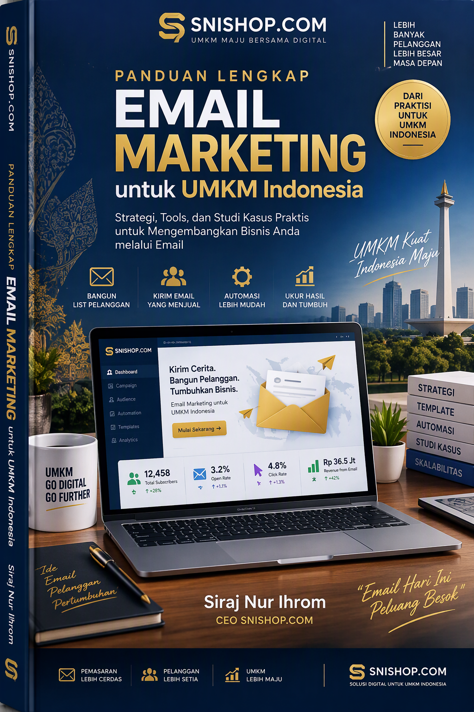
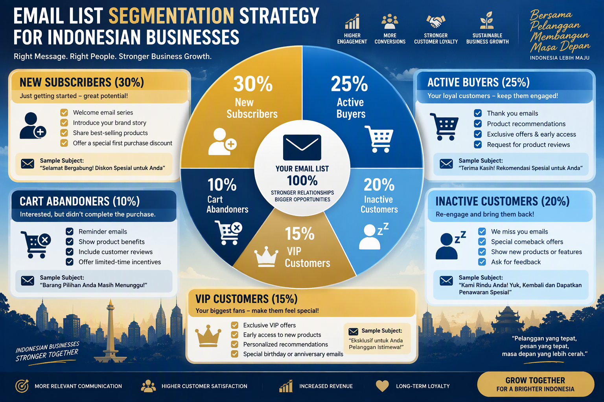
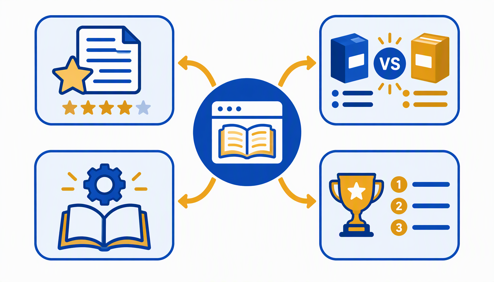
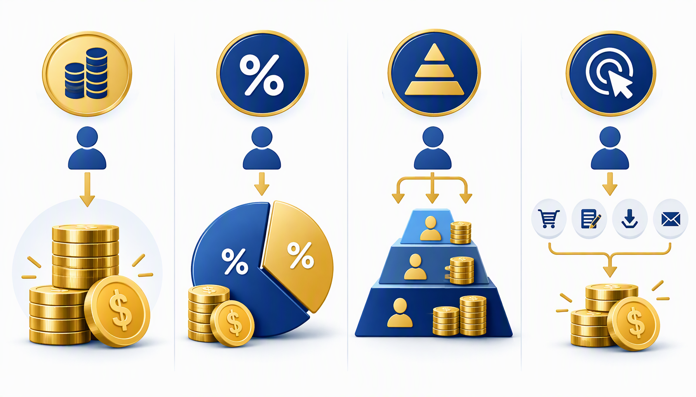
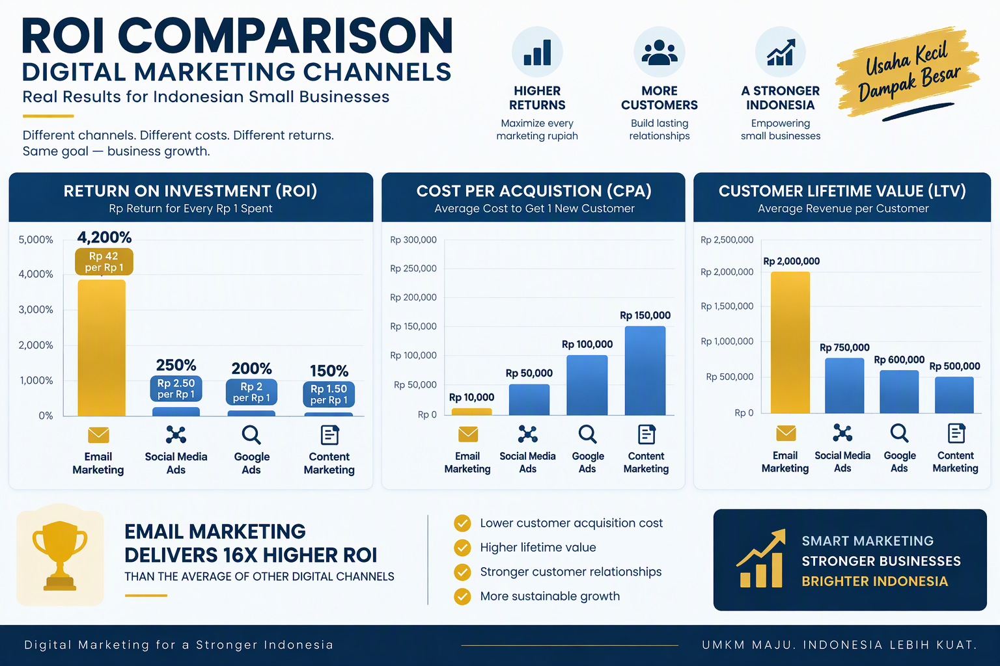

# Panduan Lengkap Email Marketing untuk UMKM Indonesia

**Strategi Email Marketing untuk Membangun Hubungan Pelanggan dan Meningkatkan Penjualan**

**Oleh: Siraj Nur Ihrom, CEO SNISHOP.COM**



---

**Catatan untuk peninjau**: Panduan ini mencakup strategi email marketing lengkap untuk UMKM Indonesia, dari membangun list hingga automation dan optimasi ROI. Versi 2.1 mencakup 10 bab komprehensif, 3 studi kasus detail, dan ROI calculator lengkap.

---

## Daftar Isi

**Bagian I: Foundation**
- Bab 1: Mengapa Email Marketing Masih Relevan di Era Digital
- Bab 2: Membangun Email List yang Berkualitas
- Bab 3: Segmentasi dan Personalisasi

**Bagian II: Execution**
- Bab 4: Menulis Email yang Mengkonversi
- Bab 5: Automation dan Workflow Email
- Bab 6: Desain Template dan Deliverability

**Bagian III: Advanced**
- Bab 7: Analisis Metrik dan Optimasi
- Bab 8: Skala dan Integrasi Multi-Channel
- Bab 9: Studi Kasus dan Benchmark UMKM Indonesia
- Bab 10: ROI Calculator dan Implementation Plan

---

## Bagian I: Foundation

### Bab 1: Mengapa Email Marketing Masih Relevan di Era Digital


Di tengah dominasi media sosial dan messaging apps, banyak UMKM mempertanyakan relevansi email marketing. Jawabannya ada di data: email marketing menghasilkan ROI rata-rata Rp 42.000 untuk setiap Rp 1.000 yang diinvestasikan, menjadikannya channel dengan return tertinggi dalam digital marketing. Angka ini bukan sekadar statistik umum, melainkan hasil agregasi dari ribuan kampanye yang dijalankan oleh pelaku usaha kecil dan menengah di seluruh dunia, termasuk Indonesia.

Banyak pemilik UMKM di Indonesia berpendapat bahwa email marketing sudah mati, digantikan oleh WhatsApp, Instagram, dan TikTok. Pendapat ini keliru. Yang terjadi bukanlah kematian email, melainkan evolusi peran email dalam ekosistem digital. Email tetap menjadi satu-satunya channel di mana Anda memiliki kendali penuh atas audiens Anda. Ketika algoritma Instagram berubah dan menjangkau organik turun drastis, email list Anda tetap utuh dan bisa diakses kapan saja.

**Mengapa Email Marketing Unggul untuk UMKM:**

**1. Ownership dan Control**

Berbeda dengan media sosial di mana algoritma bisa berubah kapan saja, email list adalah aset yang Anda miliki sepenuhnya. Anda bisa menghubungi subscriber langsung tanpa tergantung platform pihak ketiga. Bayangkan Anda membangun rumah di atas tanah milik orang lain. Suatu hari pemilik tanah bisa mengusir Anda kapan saja. Email list ibarat rumah di atas tanah milik sendiri. Anda bebas menentukan kapan dan bagaimana berkomunikasi dengan penghuninya.

Sebagai contoh nyata, pada tahun 2023 Instagram melakukan perubahan algoritma yang menyebabkan jangkauan organik turun hingga 40 persen. Banyak UMKM yang mengandalkan Instagram sebagai channel utama kehilangan akses ke pelanggan mereka. Sementara itu, bisnis yang memiliki email list tetap bisa menjangkau pelanggan mereka tanpa hambatan apapun.

**2. Personalisasi Mendalam**

Email memungkinkan personalisasi berdasarkan data perilaku, preferensi, dan riwayat pembelian. Anda bisa mengirim pesan yang tepat ke orang yang tepat pada waktu yang tepat. Tidak ada channel lain yang memungkinkan tingkat personalisasi sedalam email. Anda bisa mengirim email berbeda kepada pelanggan yang baru pertama kali membeli, pelanggan setia yang sudah berlangganan setahun, dan pelanggan yang sudah lama tidak bertransaksi. Masing-masing menerima pesan yang relevan dengan kondisi mereka.

**3. Cost-Effective**

Biaya email marketing sangat rendah dibandingkan channel lain. Dengan tools seperti Mailchimp yang menyediakan gratis hingga 500 kontak, Anda bisa memulai tanpa investasi besar. Bandingkan dengan Google Ads yang memerlukan biaya per klik rata-rata Rp 5.000 hingga Rp 25.000, atau Instagram Ads yang memerlukan minimal Rp 500.000 per kampanye untuk hasil yang memadai. Email marketing memungkinkan UMKM dengan modal terbatas tetap bisa menjalankan strategi marketing yang profesional dan terukur.

**4. Measurable Results**

Setiap aspek email marketing bisa diukur: open rate, click-through rate, conversion rate, revenue per email. Data ini memungkinkan optimasi berkelanjutan. Anda tidak perlu menebak-nebak apakah kampanye Anda berhasil atau tidak. Semua angka tersedia secara real-time dan bisa dibandingkan dari satu kampanye ke kampanye berikutnya. Ini memberikan keunggulan kompetitif yang signifikan bagi UMKM yang ingin berkembang secara berbasis data.

**5. Scalability**

Dari 100 subscriber hingga 100.000 subscriber, email marketing bisa diskalakan dengan mudah. Automation memungkinkan Anda menangani ribuan kontak tanpa menambah tim. Seorang pemilik toko online yang mengelola 5.000 subscriber sendirian bisa menghasilkan revenue yang setara dengan tim marketing beranggotakan lima orang yang bekerja manual.

**Statistik Email Marketing untuk UMKM Indonesia:**

- Rata-rata open rate: 21,5 persen (lebih tinggi dari social media reach 5-10 persen)
- Rata-rata click-through rate: 3,2 persen
- Conversion rate: 2,8 persen (vs 1,5 persen social media)
- Revenue per email: Rp 45.000
- Customer lifetime value melalui email: 3,8x lebih tinggi

**Email Marketing vs Channel Lain:**

| Metrik | Email | Social Media | Google Ads | Content Marketing |
|--------|-------|--------------|------------|-------------------|
| ROI | 4200% | 250% | 200% | 150% |
| Cost per Lead | Rp 5.000 | Rp 15.000 | Rp 25.000 | Rp 20.000 |
| Ownership | Full | Platform | Platform | Full |
| Personalization | High | Medium | Medium | Low |
| Measurability | Excellent | Good | Excellent | Fair |

**Kapan Email Marketing Paling Efektif untuk UMKM:**

Email marketing paling efektif digunakan dalam situasi berikut. Pertama, ketika Anda ingin mempertahankan pelanggan existing dan meningkatkan repeat order. Kedua, ketika Anda ingin membangun brand awareness secara konsisten tanpa bergantung pada algoritma platform. Ketiga, ketika Anda ingin mendorong konversi dari prospect yang sudah menunjukkan minat tetapi belum melakukan pembelian. Keempat, ketika Anda ingin mengumpulkan feedback dan membangun hubungan jangka panjang dengan pelanggan.

**Kesalahan Umum UMKM dalam Email Marketing:**

Banyak UMKM yang mencoba email marketing tetapi gagal karena beberapa kesalahan umum. Kesalahan pertama adalah langsung menjual tanpa memberikan value. Subscriber yang baru bergabung langsung dihujani email promosi tanpa pernah mendapatkan konten edukatif atau menghibur. Kesalahan kedua adalah tidak melakukan segmentasi, sehingga semua subscriber menerima email yang sama padahal kebutuhan dan minat mereka berbeda. Kesalahan ketiga adalah tidak konsisten, mengirim email terlalu sering di awal kemudian berhenti total selama berbulan-bulan. Kesalahan keempat adalah tidak mengukur hasil, sehingga tidak tahu apa yang berhasil dan apa yang perlu diperbaiki.

**Email Marketing di Indonesia: Konteks Lokal yang Penting:**

Pasar Indonesia memiliki karakteristik unik yang memengaruhi strategi email marketing. Pertama, penetrasi email di Indonesia masih lebih rendah dibandingkan WhatsApp atau Instagram, tetapi kualitas engagement email jauh lebih tinggi. Orang Indonesia mungkin lebih aktif di WhatsApp, tetapi ketika mereka membuka email dari sebuah brand, itu menandakan minat yang sungguh-sungguh. Kedua, waktu membaca email di Indonesia cenderung di malam hari (pukul 19:00-22:00 WIB) untuk B2C dan di pagi hari (pukul 08:00-10:00 WIB) untuk B2B. Ketiga, bahasa yang digunakan dalam email harus menyesuaikan dengan target audience. Untuk audience yang lebih muda dan urban, bahasa Indonesia yang santai dan campur bahasa Inggris bisa efektif. Untuk audience yang lebih formal atau korporat, gunakan bahasa Indonesia yang baku.

Panduan ini akan membahas setiap aspek email marketing secara mendalam, dari membangun fondasi yang kuat hingga menjalankan kampanye canggih yang menghasilkan revenue nyata. Setiap bab dirancang untuk memberikan langkah-langkah praktis yang bisa langsung Anda terapkan pada bisnis Anda, terlepas dari ukuran atau industri bisnis tersebut. Di akhir panduan, Anda akan memiliki blueprint lengkap untuk menjalankan email marketing yang menghasilkan ROI nyata bagi UMKM Anda.

---

### Bab 2: Membangun Email List yang Berkualitas


Email list yang berkualitas adalah fondasi email marketing sukses. Lebih baik memiliki 1.000 subscriber yang engaged daripada 10.000 subscriber yang tidak pernah membuka email. Kualitas selalu mengalahkan kuantitas dalam email marketing. Satu subscriber yang aktif membuka, mengklik, dan membeli jauh lebih berharga daripada seratus subscriber yang mendaftar karena terpaksa dan tidak pernah berinteraksi dengan email Anda.

**Mengapa Kualitas Lebih Penting dari Kuantitas:**

Bayangkan Anda memiliki 10.000 email address tetapi hanya 500 yang benar-benar membuka email Anda. Biaya email platform Anda dihitung berdasarkan 10.000 kontak, tetapi revenue hanya dihasilkan dari 500 orang. Ini sangat tidak efisien. Sebaliknya, jika Anda memiliki 2.000 subscriber yang semuanya tertarik dengan produk Anda, biaya platform lebih rendah dan conversion rate jauh lebih tinggi. Fokus pada membangun list yang berkualitas dari awal akan menghemat biaya dan meningkatkan ROI secara signifikan.

**Strategi Membangun Email List:**

**1. Lead Magnet yang Bernilai**

Berikan sesuatu yang berharga sebagai pertukaran untuk mendapatkan alamat email. Lead magnet adalah kunci utama dalam membangun email list. Tanpa lead magnet yang menarik, pengunjung website tidak memiliki alasan untuk meninggalkan alamat email mereka.

Berikut adalah jenis-jenis lead magnet yang terbukti efektif untuk UMKM Indonesia:

- E-book gratis: "10 Strategi Marketing untuk UMKM Pemula" atau "Panduan Lengkap Memulai Bisnis Online di Indonesia"
- Checklist praktis: "Persiapan Menghadapi Lebaran untuk Toko Online" atau "Checklist 50 Langkah Meluncurkan Produk Baru"
- Template siap pakai: "50 Template Copywriting untuk Instagram" atau "10 Template Email untuk Meningkatkan Penjualan"
- Discount code: "Diskon 15 persen untuk Pembelian Pertama" atau "Gratis Ongkir untuk Order Pertama Anda"
- Free trial: "Coba Premium 7 Hari Gratis" atau "Akses Gratis ke Kursus Online selama 3 Hari"
- Mini course: "Kursus Email 5 Hari: Dari Nol Hingga Mahir Email Marketing"
- Webinar recording: "Rekaman Webinar: Rahasia Meningkatkan Omzet 3x Lipat"
- Resource library: "Akses ke 100 Template Bisnis Gratis"

**Panduan Langkah demi Langkah Membuat Lead Magnet:**

Langkah pertama, identifikasi masalah utama target audience Anda. Apa yang paling sering ditanyakan oleh calon pelanggan? Masalah apa yang bisa Anda bantu selesaikan? Langkah kedua, pilih format yang paling sesuai. Jika target audience Anda suka membaca, buat e-book. Jika mereka lebih suka langkah praktis, buat checklist atau template. Langkah ketiga, buat konten yang benar-benar berkualitas. Lead magnet adalah kesan pertama calon pelanggan terhadap brand Anda. Jika lead magnet Anda berkualitas rendah, mereka akan menganggap produk Anda juga berkualitas rendah. Langkah keempat, desain dengan profesional. Gunakan Canva atau hire desainer freelance di situs seperti Fastwork atau Projects.co.id dengan budget Rp 200.000 hingga Rp 500.000. Langkah kelima, buat landing page khusus untuk lead magnet tersebut dengan headline yang jelas dan form subscription yang sederhana.

**2. Opt-in Form yang Strategis**

Tempatkan form di lokasi yang paling terlihat. Posisi form subscription sangat menentukan tingkat konversi. Berikut adalah panduan penempatan form yang terbukti efektif:

- Homepage hero section: Tempatkan form di bagian atas halaman utama, tepat di bawah headline utama. Pengunjung yang baru mendarat di website harus langsung melihat value proposition dan opsi untuk subscribe.
- Blog post sidebar: Setiap artikel blog memiliki sidebar yang selalu terlihat saat scroll. Tempatkan form di sini dengan copy yang relevan dengan topik blog.
- Exit-intent popup: Ketika pengunjung hendak meninggalkan website, tampilkan popup terakhir dengan penawaran spesial. Popup jenis ini bisa meningkatkan subscription rate hingga 30 persen.
- Checkout page: Pelanggan yang sudah melakukan pembelian sangat mungkin tertarik untuk menerima komunikasi lanjutan. Tambahkan checkbox "Daftar newsletter untuk promo eksklusif" di halaman checkout.
- Footer setiap halaman: Footer muncul di setiap halaman website, sehingga memberikan eksposur maksimal untuk form subscription.
- Landing page khusus: Buat halaman khusus yang didedikasikan untuk subscription dengan penjelasan detail tentang benefit yang akan didapatkan subscriber.

**3. Konten yang Shareable**

Buat konten yang membuat orang ingin subscribe. Konten adalah alasan utama orang berlangganan email Anda. Jika konten Anda tidak memberikan value, subscriber akan berhenti membuka email dan akhirnya unsubscribe.

Jenis konten yang paling efektif untuk email marketing UMKM:

- Tips mingguan yang actionable: Berikan satu tips spesifik yang bisa langsung dipraktekkan minggu itu juga.
- Case study pelanggan sukses: Ceritakan bagaimana pelanggan Anda berhasil mencapai hasil tertentu menggunakan produk atau jasa Anda.
- Industry insights dan trend: Bagikan informasi terbaru tentang industri yang relevan dengan bisnis Anda.
- Tutorial step-by-step: Berikan panduan lengkap yang bisa diikuti langkah demi langkah.
- Behind-the-scenes bisnis: Tunjukkan sisi manusiawi dari bisnis Anda, proses produksi, tim di balik layar, dan cerita di balik produk.

**4. Social Media Integration**

Manfaatkan media sosial untuk membangun list. Media sosial dan email marketing bukan kompetitor, melainkan partner yang saling melengkapi.

Strategi integrasi yang terbukti efektif:

- Bio link ke landing page: Gunakan link di bio Instagram, TikTok, dan Twitter untuk mengarahkan followers ke landing page subscription.
- Instagram Story dengan link: Buat story yang menarik tentang lead magnet dan arahkan ke link subscription.
- Facebook Lead Ads: Iklan Facebook yang memungkinkan pengguna subscribe tanpa meninggalkan platform, mengurangi friction secara signifikan.
- Twitter thread dengan CTA: Buat thread edukatif yang diakhiri dengan ajakan untuk subscribe newsletter.
- TikTok video dengan link di bio: Buat video edukatif yang memberikan cuplikan value dari newsletter Anda.

**5. Offline Collection**

Kumpulkan email di dunia nyata. Banyak UMKM memiliki interaksi tatap muka dengan pelanggan yang bisa dimanfaatkan untuk membangun email list.

Cara mengumpulkan email secara offline:

- Event dan workshop: Setiap peserta event wajib mengisi formulir yang mencakup alamat email.
- Transaksi di toko fisik: Tawarkan diskon 5 persen untuk pelanggan yang memberikan alamat email saat bertransaksi.
- Kontes dan giveaway: Syarat mengikuti kontes adalah mengisi formulir termasuk alamat email.
- Kartu nama digital: Gunakan QR code yang mengarah ke landing page subscription.

**Best Practices untuk Quality List:**

**Do's:**
- Gunakan double opt-in untuk konfirmasi. Setelah pengguna mengisi form, mereka menerima email konfirmasi yang harus diklik untuk mengaktifkan subscription. Ini memastikan bahwa email address valid dan pemiliknya benar-benar tertarik.
- Jelaskan apa yang akan subscriber terima. Jangan hanya menulis "Subscribe newsletter". Tuliskan "Dapatkan tips marketing mingguan dan diskon eksklusif setiap Jumat".
- Berikan welcome email segera setelah signup. Welcome email harus dikirim dalam hitungan menit setelah konfirmasi subscription. Email ini adalah kesan pertama dan menentukan apakah subscriber akan membuka email Anda di masa depan.
- Segmentasi list berdasarkan sumber signup. Subscriber dari Instagram mungkin memiliki minat yang berbeda dengan subscriber dari website atau event offline.
- Bersihkan list secara rutin. Hapus subscriber yang tidak membuka email selama 6 bulan atau lebih. Ini meningkatkan deliverability dan mengurangi biaya platform.

**Don'ts:**
- Jangan beli email list. Email list yang dibeli akan merusak reputasi domain Anda, meningkatkan spam complaint, dan berpotensi melanggar regulasi privasi.
- Jangan spam orang yang tidak subscribe. Mengirim email ke orang yang tidak pernah mendaftar adalah spam dan akan merusak brand Anda.
- Jangan sembunyikan unsubscribe link. Setiap email wajib memiliki link unsubscribe yang mudah ditemukan.
- Jangan kirim terlalu sering di awal. Frekuensi ideal untuk subscriber baru adalah 1-2 email per minggu.
- Jangan abaikan data preferensi subscriber. Jika subscriber memilih untuk menerima email mingguan tentang topik tertentu, hormati preferensi tersebut.

**Contoh Lead Magnet yang Efektif untuk Berbagai Jenis UMKM:**

**Untuk Toko Fashion:**
"Download Gratis: Panduan Mix and Match 30 Outfit dari 10 Item Basic"
Subscriber mendapat panduan styling lengkap. Toko mendapat email address plus data preferensi fashion. Follow-up berupa email produk yang sesuai dengan style subscriber. Hasil yang bisa diharapkan: 200-500 subscriber baru per bulan dari website dengan traffic 5.000 visitor.

**Untuk Restoran:**
"Subscribe dan Dapatkan Resep Rahasia Chef plus Diskon 20 persen untuk Kunjungan Pertama"
Subscriber mendapat resep eksklusif dari chef. Restoran mendapat database pelanggan lokal. Follow-up berupa email promo mingguan dan event spesial. Target: 100-300 subscriber lokal per bulan.

**Untuk Jasa Digital:**
"Free Audit: Dapatkan Analisis Website atau Sosial Media Bisnis Anda dalam 24 Jam"
Subscriber mendapat audit gratis yang bernilai tinggi. Jasa mendapat lead yang sudah qualified karena mereka yang meminta audit pasti memiliki kebutuhan. Follow-up berupa email hasil audit plus penawaran jasa. Target: 50-100 lead berkualitas per bulan.

**Untuk Kursus Online:**
"Mini Course Gratis 5 Hari: Kuasai Dasar Digital Marketing"
Subscriber mendapat kursus gratis yang terstruktur. Platform kursus mendapat data minat dan engagement level. Follow-up berupa email materi harian plus penawaran kursus berbayar. Target: 300-800 subscriber per bulan.

**Checklist Membangun Email List dari Nol:**

1. Tentukan lead magnet yang paling relevan untuk target audience
2. Buat lead magnet dengan kualitas tinggi (minimal setara produk berbayar)
3. Desain landing page subscription yang clean dan mobile-friendly
4. Setup form subscription dengan email platform pilihan
5. Aktifkan double opt-in
6. Buat welcome email yang memberikan lead magnet sekaligus membangun ekspektasi
7. Tempatkan form di minimal 5 lokasi berbeda di website
8. Integrasikan dengan social media (bio link, lead ads)
9. Promosikan lead magnet secara konsisten di semua channel
10. Evaluasi dan optimasi conversion rate landing page setiap 2 minggu

---

### Bab 3: Segmentasi dan Personalisasi



Segmentasi adalah proses membagi email list menjadi kelompok-kelompok lebih kecil berdasarkan karakteristik tertentu. Personalisasi adalah menyesuaikan konten email untuk setiap individu. Kombinasi keduanya meningkatkan engagement hingga 760 persen menurut penelitian DMA. Dalam konteks UMKM Indonesia, segmentasi dan personalisasi adalah senjata utama untuk bersaing dengan perusahaan besar yang memiliki budget marketing jauh lebih besar.

**Mengapa Segmentasi Sangat Penting:**

Tanpa segmentasi, Anda mengirim email yang sama kepada semua orang. Ini ibarat menembak secara membabi buta. Anda mungkin mengenai beberapa target, tetapi sebagian besar pesan Anda tidak relevan bagi penerimanya. Dengan segmentasi, Anda seperti menggunakan sniper rifle. Setiap pesan ditujukan kepada orang yang tepat dengan konten yang paling relevan bagi mereka. Hasilnya, open rate meningkat, click-through rate meningkat, conversion rate meningkat, dan unsubscribe rate menurun.

**Jenis Segmentasi:**

**1. Demografis**

Segmentasi demografis membagi subscriber berdasarkan data kependudukan:
- Usia: Generasi Z (18-25 tahun), Milenial (26-40 tahun), Gen X (41-55 tahun), Baby Boomer (56+ tahun). Setiap generasi memiliki preferensi komunikasi yang berbeda.
- Gender: Laki-laki dan perempuan sering kali memiliki minat produk yang berbeda.
- Lokasi: Kota besar seperti Jakarta, Surabaya, Bandung mungkin memiliki preferensi yang berbeda dengan kota kecil.
- Pekerjaan: Mahasiswa, karyawan, wiraswasta, ibu rumah tangga memiliki kebutuhan yang berbeda.
- Income level: Segment ini menentukan daya beli dan jenis produk yang relevan.
- Pendidikan: Tingkat pendidikan memengaruhi gaya bahasa dan kedalaman konten yang disukai.

**2. Behavioral**

Segmentasi behavioral membagi subscriber berdasarkan perilaku mereka terhadap brand Anda:
- Riwayat pembelian: Apa yang sudah mereka beli? Berapa kali? Berapa total spending mereka?
- Frekuensi pembelian: Apakah mereka pembeli rutin atau hanya membeli sekali?
- Average order value: Apakah mereka pembeli hemat atau big spender?
- Produk yang dilihat: Halaman produk apa yang mereka kunjungi di website?
- Email engagement: Seberapa sering mereka membuka dan mengklik email Anda?
- Waktu aktif: Kapan mereka paling sering membuka email? Pagi, siang, atau malam?

**3. Psychografis**

Segmentasi psychografis membagi subscriber berdasarkan karakteristik psikologis:
- Minat dan hobi: Fashion, kuliner, teknologi, olahraga, traveling
- Nilai dan prinsip: Ramah lingkungan, lokal pride, halal, premium quality
- Lifestyle: Minimalis, hedonis, health-conscious, family-oriented
- Goals dan aspirasi: Ingin meningkatkan penghasilan, ingin hidup lebih sehat, ingin tampil lebih percaya diri

**4. Technographic**

Segmentasi technographic membagi subscriber berdasarkan perangkat dan teknologi yang digunakan:
- Device: Mobile vs desktop. Subscriber mobile perlu email yang lebih ringkas dengan CTA yang mudah diklik.
- Email client: Gmail, Outlook, Apple Mail memiliki rendering yang berbeda.
- Browser: Chrome, Firefox, Safari, Edge
- OS: Windows, macOS, Android, iOS

**Strategi Segmentasi untuk UMKM:**

**Segmentasi Basic (3-5 Segmen) untuk Pemula:**

Jika Anda baru memulai email marketing, jangan langsung membuat terlalu banyak segmen. Mulailah dari yang sederhana dan tingkatkan kompleksitas secara bertahap.

**Untuk E-commerce:**
1. New Subscribers (0-30 hari): Fokus pada welcome series dan edukasi brand. Subscriber baru perlu mengenal brand Anda dan memahami value proposition.
2. Active Buyers (pembelian dalam 90 hari terakhir): Fokus pada upsell dan cross-sell. Mereka sudah percaya pada brand Anda, saatnya menawarkan produk tambahan.
3. Inactive Customers (tidak beli 90-180 hari): Fokus pada re-engagement. Berikan insentif khusus untuk membuat mereka kembali membeli.
4. VIP Customers (top 20 persen spenders): Fokus pada exclusivity dan loyalty. Berikan akses awal ke produk baru, diskon khusus, dan perlakuan istimewa.
5. Cart Abandoners: Fokus pada reminder dan incentive. Mereka sudah menunjukkan minat tetapi belum menyelesaikan pembelian.

**Segmentasi Lanjutan (10+ Segmen) untuk Bisnis yang Sudah Matang:**

**Untuk Service Business:**
1. Lead baru dari Instagram: Konten visual dan testimonial
2. Lead baru dari website: Konten edukatif dan case study
3. Lead baru dari referral: Konten apresiasi dan onboarding
4. Prospect yang sudah konsultasi: Follow-up personal dan penawaran
5. Klien aktif (project berjalan): Update progress dan cross-sell
6. Klien repeat (project selesai, bisa upsell): Penawaran layanan tambahan
7. Klien dormant (tidak ada project 6+ bulan): Re-engagement dengan penawaran spesial
8. Klien churned (sudah tidak pakai jasa): Win-back campaign dengan insentif besar
9. Partner dan reseller: Informasi produk baru dan materi marketing
10. Industry influencers dan media: Press release dan kolaborasi

**Personalisasi yang Efektif:**

Personalisasi bukan sekadar menyebut nama subscriber di subject line. Personalisasi yang sejati berarti menyesuaikan seluruh pengalaman email berdasarkan data dan perilaku individu.

**Level 1: Name Personalization**
"Halo [Nama], kami punya penawaran spesial untuk Anda!"
Ini adalah bentuk personalisasi paling dasar tetapi tetap efektif. Menyebut nama membuat email terasa lebih personal dan meningkatkan open rate hingga 14 persen. Pastikan data nama akurat dan sediakan fallback untuk subscriber yang tidak mengisi nama.

**Level 2: Behavior-Based Personalization**
"Kami lihat Anda tertarik dengan [Produk yang Dilihat]. Stok tinggal sedikit!"
Personalisasi ini berdasarkan browsing history di website Anda. Ketika seorang subscriber melihat produk tertentu tetapi tidak membeli, Anda bisa mengirim email yang menampilkan produk tersebut beserta alasan mengapa mereka harus membelinya. Ini meningkatkan click rate hingga 25 persen.

**Level 3: Purchase History Personalization**
"Terima kasih sudah membeli [Produk Sebelumnya]. Anda mungkin juga suka [Produk Terkait]."
Personalisasi ini berdasarkan pembelian sebelumnya. Jika seseorang membeli sepatu lari, tawarkan kaos kaki olahraga atau botol minum. Jika seseorang membeli blender, tawarkan resep smoothie atau buah-buahan segar. Ini meningkatkan conversion hingga 35 persen.

**Level 4: Lifecycle Personalization**
"Selamat ulang tahun, [Nama]! Ini hadiah spesial untuk Anda: [Offer]"
Personalisasi ini berdasarkan milestone personal seperti ulang tahun atau anniversary menjadi subscriber. Email jenis ini memiliki engagement rate 45 persen lebih tinggi karena terasa sangat personal dan perhatian.

**Level 5: Predictive Personalization**
"Berdasarkan pola pembelian Anda, saatnya restock [Produk]!"
Personalisasi ini berdasarkan prediksi dari pola data. Jika seorang pelanggan membeli susu formula setiap 30 hari, kirim email pengingat pada hari ke-25. Jika pelanggan membeli makanan kucing setiap 2 minggu, kirim email penawaran pada hari ke-12. Ini meningkatkan retention hingga 50 persen.

**Tools untuk Segmentasi:**

**Free dan Low-Cost (Cocok untuk UMKM yang Baru Mulai):**
- Mailchimp: Free hingga 500 kontak, basic segmentation, mudah digunakan untuk pemula. Harga mulai Rp 0 hingga Rp 200.000 per bulan.
- Sender: Free hingga 2.500 kontak, advanced segmentation termasuk behavioral triggers. Harga mulai Rp 0 hingga Rp 350.000 per bulan.
- MailerLite: Free hingga 1.000 kontak, automation plus segmentation, visual email builder yang intuitif. Harga mulai Rp 0 hingga Rp 250.000 per bulan.

**Mid-Range (Untuk UMKM yang Sudah Berkembang):**
- ConvertKit: Mulai Rp 150.000 per bulan, creator-focused dengan automation yang powerful. Cocok untuk content creator dan digital marketer.
- ActiveCampaign: Mulai Rp 200.000 per bulan, advanced automation plus CRM built-in. Sangat cocok untuk bisnis yang memerlukan sales pipeline management.
- Klaviyo: Mulai Rp 250.000 per bulan, e-commerce focused dengan integrasi mendalam ke Shopify dan WooCommerce.

**Enterprise (Untuk UMKM yang Sudah Skala Besar):**
- HubSpot: Mulai Rp 500.000 per bulan, full CRM plus marketing automation suite. Solusi all-in-one untuk bisnis yang serius.
- Salesforce Marketing Cloud: Custom pricing, sangat powerful tetapi memerlukan dedicated administrator.

**Langkah Praktis Implementasi Segmentasi:**

Langkah 1: Audit data yang sudah Anda miliki. Cek email platform Anda, data apa saja yang sudah tersedia untuk setiap subscriber. Langkah 2: Tentukan 3-5 segmen prioritas berdasarkan dampak bisnis terbesar. Untuk e-commerce, mulailah dari segmentasi berdasarkan riwayat pembelian. Langkah 3: Buat tag atau label untuk setiap segmen di email platform Anda. Langkah 4: Setup automation untuk men-tag subscriber secara otomatis berdasarkan perilaku mereka. Langkah 5: Buat template email yang berbeda untuk setiap segmen utama. Langkah 6: Monitor performa setiap segmen dan refine secara berkala.

---

## Bagian II: Execution

### Bab 4: Menulis Email yang Mengkonversi



Email yang mengkonversi bukan hanya soal desain yang indah, tapi konten yang tepat, disampaikan ke orang yang tepat, pada waktu yang tepat. Menulis email yang efektif adalah kombinasi antara seni dan sains. Seni dalam hal memilih kata-kata yang menyentuh emosi pembaca, dan sains dalam hal menggunakan formula dan data yang terbukti menghasilkan konversi.

Banyak pemilik UMKM Indonesia yang merasa kesulitan menulis email marketing. Mereka khawatir email mereka tidak akan dibaca, atau dibaca tetapi tidak menghasilkan tindakan. Kekhawatiran ini wajar, tetapi bisa diatasi dengan memahami formula dan prinsip yang sudah terbukti efektif.

**Formula Email yang Efektif:**

**1. Subject Line (Penentu Open Rate)**

Subject line adalah gerbang pertama. Jika subject line tidak menarik, email Anda tidak akan dibuka, sebagus apapun isinya. Subject line yang efektif harus memenuhi tiga kriteria: relevan, spesifik, dan memancing rasa ingin tahu.

**Formula Subject Line yang Terbukti Efektif:**

Formula AIDA (Attention, Interest, Desire, Action):
- Attention: "Rahasia [Hasil] dalam [Waktu] Tanpa [Pain Point]"
- Interest: "Bagaimana [Target Audience] Mencapai [Goal]"
- Desire: "[Jumlah] Cara untuk [Benefit] Hari Ini"
- Action: "Download Gratis: [Lead Magnet]"

Formula PAS (Problem, Agitate, Solution):
- Problem: "Omzet Toko Online Anda Stagnan?"
- Agitate: "Setiap Hari yang Berlalu Tanpa Strategi yang Tepat, Kompetitor Anda Semakin Mendahului"
- Solution: "Ini 5 Langkah yang Bisa Anda Terapkan Mulai Hari Ini"

Formula 4U (Urgent, Unique, Ultra-specific, Useful):
- Urgent: "Hanya Hari Ini: Diskon 70 persen untuk Subscriber"
- Unique: "Satu-satunya Panduan yang Anda Butuhkan untuk [Topik]"
- Ultra-specific: "3 Teknik yang Meningkatkan Conversion Rate 247 persen"
- Useful: "Template Email yang Sudah Menghasilkan Rp 100 Juta untuk UMKM"

**Contoh Subject Line yang Efektif untuk Berbagai Situasi:**

Untuk newsletter mingguan:
- "5 Kesalahan yang Membuat Omzet Toko Online Anda Stagnan"
- "Minggu Ini: Tren Produk yang Akan Booming di Q3 2026"
- "Satu Hal yang Bisa Mengubah Bisnis Anda Minggu Ini"

Untuk promosi:
- "Flash Sale 24 Jam: Diskon 50 persen Khusus Subscriber"
- "[Nama], Kami Rindu Anda! Ini Hadiah Khusus"
- "Penawaran Terakhir Sebelum Harga Naik"

Untuk edukasi:
- "Rahasia Meningkatkan Conversion Rate 300 persen dalam 30 Hari"
- "Apa yang Dilakukan Top 10 Toko Online Indonesia yang Tidak Anda Lakukan"
- "Panduan Lengkap: Dari 0 Hingga 1.000 Subscriber Pertama"

**Best Practices Subject Line:**
- Panjang optimal: 30-50 karakter untuk tampilan terbaik di mobile
- Personalisasi: Gunakan nama subscriber jika tersedia, meningkatkan open rate 14 persen
- Urgency: Kata-kata seperti "24 Jam", "Terbatas", "Hari Ini" menciptakan sense of urgency
- Curiosity: Kata-kata seperti "Rahasia", "Cara", "Bagaimana" memancing rasa ingin tahu
- Numbers: Angka spesifik seperti "5 Cara", "3 Kesalahan" membuat email terasa actionable
- Hindari ALL CAPS: Terlihat seperti berteriak dan memicu filter spam
- Hindari tanda seru berlebihan: Satu tanda seru sudah cukup

**2. Preview Text (Pendukung Subject Line)**

Preview text adalah teks yang muncul di samping atau di bawah subject line di inbox. Banyak marketer mengabaikan preview text, padahal ini adalah real estate gratis yang bisa meningkatkan open rate secara signifikan. Gunakan preview text untuk melengkapi subject line, memberikan konteks tambahan, atau meningkatkan curiosity.

**Contoh Penggunaan Preview Text yang Efektif:**
Subject: "5 Kesalahan Fatal Email Marketing"
Preview: "Dan bagaimana menghindari mereka untuk meningkatkan ROI 300 persen..."

Subject: "Flash Sale Dimulai Sekarang"
Preview: "Diskon hingga 70 persen, berlaku 24 jam saja. Jangan sampai kehabisan..."

Subject: "Undangan Webinar Gratis"
Preview: "Belajar langsung dari praktisi yang sudah menghasilkan Rp 1 Miliar..."

**3. Email Body (Penentu Click dan Conversion)**

**Struktur Email yang Mengkonversi:**

**Opening (Hook) - 1 hingga 2 kalimat pertama:**
Sapaan personal: "Halo [Nama]," kemudian langsung masuk ke hook yang menarik perhatian. Hook harus relevan dengan subject line dan membuat pembaca ingin melanjutkan membaca. Contoh hook yang efektif: "Tahukah Anda bahwa 90 persen email marketing di Indonesia tidak menghasilkan satupun rupiah? Hari ini saya akan tunjukkan mengapa, dan bagaimana Anda bisa menjadi bagian dari 10 persen yang berhasil."

**Body (Value) - Inti pesan:**
Bagian ini berisi masalah yang dihadapi reader, solusi yang Anda tawarkan, bukti sosial berupa testimoni atau case study, dan benefit yang akan didapat. Gunakan paragraf pendek (2-3 kalimat), bullet points untuk kemudahan scanning, dan sub-heading untuk memecah konten menjadi bagian-bagian yang mudah dicerna.

**Call-to-Action (Action):**
Setiap email harus memiliki satu CTA utama yang jelas. Jangan membuat pembaca bingung dengan banyak pilihan. CTA harus menggunakan kata-kata action-oriented dan ditempatkan di posisi strategis. Tombol CTA harus menonjol secara visual dengan warna yang kontras terhadap background.

Contoh CTA yang efektif:
- "Download Panduan Gratis Sekarang"
- "Klaim Diskon 50 persen Sebelum Kehabisan"
- "Daftar Webinar Gratis di Sini"
- "Beli Sekarang dengan Harga Spesial"

**Closing (Reinforcement):**
Tutup email dengan ringkasan singkat, P.S. untuk informasi tambahan yang penting, tanda tangan personal untuk membangun koneksi, dan social media links untuk cross-channel engagement. P.S. adalah bagian yang paling banyak dibaca setelah subject line, jadi gunakan untuk informasi krusial atau CTA alternatif.

**Template Email yang Terbukti Efektif:**

**Template 1: Welcome Email**

Subject: "Selamat Datang, [Nama]! Ini Hadiah Khusus untuk Anda"

Body:
```
Halo [Nama],

Terima kasih sudah bergabung dengan komunitas [Brand]!

Sesuai janji kami, ini hadiah khusus untuk Anda:
[Link Download Lead Magnet / Kode Diskon]

Di [Brand], kami membantu [Target Audience] untuk [Value Proposition].

Dalam beberapa hari ke depan, Anda akan menerima email berisi:
- Email #1: [Benefit 1 yang akan diterima]
- Email #2: [Benefit 2 yang akan diterima]
- Email #3: [Benefit 3 yang akan diterima]

Sementara itu, follow kami di [Social Media] untuk update harian.

Salam hangat,
[Nama]
[Brand]

P.S. Ada pertanyaan? Balas email ini, kami baca semua!
```

**Template 2: Promotional Email**

Subject: "Flash Sale 24 Jam: Diskon 50 persen Khusus Subscriber"

Body:
```
Halo [Nama],

Khusus untuk Anda subscriber setia [Brand], kami punya penawaran spesial!

FLASH SALE 24 JAM
Diskon 50% untuk semua produk
Berlaku hingga besok pukul 23:59

[TOMBOL: Belanja Sekarang]

Mengapa penawaran ini spesial?
- Diskon terbesar tahun ini
- Berlaku untuk semua produk, tanpa minimum pembelian
- Gratis ongkir ke seluruh Indonesia

Jangan lewatkan kesempatan ini, [Nama]. Penawaran berakhir dalam 24 jam!

Salam,
Tim [Brand]

P.S. Stok terbatas. Siapa cepat, dia dapat!
```

**Template 3: Re-engagement Email**

Subject: "[Nama], Kami Rindu Anda!"

Body:
```
Halo [Nama],

Sudah lama kami tidak mendengar kabar dari Anda. Terakhir kali Anda berbelanja di [Brand] pada [Tanggal Terakhir].

Kami ingin tahu: Apakah ada yang bisa kami perbaiki?

Sebagai tanda apresiasi, kami berikan:
KODE: RINDU50
Diskon Rp 50.000 untuk pembelian minimal Rp 200.000
Berlaku hingga 7 hari ke depan

[TOMBOL: Belanja Lagi]

Kami terus berinovasi untuk memberikan yang terbaik untuk Anda.

Salam hangat,
[Nama]
Founder [Brand]

P.S. Jika Anda tidak ingin menerima email lagi, [klik di sini untuk unsubscribe].
```

**Template 4: Educational Newsletter**

Subject: "[Nama], Ini Dia yang Sedang Tren di [Industri] Minggu Ini"

Body:
```
Halo [Nama],

Setiap minggu kami merangkum informasi terpenting di [industri] agar Anda tidak ketinggalan.

TOPIK UTAMA MINGGU INI:

[Judul Artikel 1]
Ringkasan 2-3 kalimat tentang topik pertama.
[Baca Selengkapnya]

[Judul Artikel 2]
Ringkasan 2-3 kalimat tentang topik kedua.
[Baca Selengkapnya]

[Judul Artikel 3]
Ringkasan 2-3 kalimat tentang topik ketiga.
[Baca Selengkapnya]

TIPS MINGGU INI:
Satu tips praktis yang bisa langsung diterapkan.

Sampai jumpa minggu depan!

Salam,
Tim [Brand]
```

**Kesalahan Umum dalam Menulis Email:**

Kesalahan pertama adalah terlalu panjang. Email marketing idealnya antara 200-500 kata. Jika lebih dari itu, pembaca akan kehilangan minat. Kesalahan kedua adalah terlalu banyak CTA. Satu email, satu tujuan. Jika Anda ingin pembaca mengklik link produk, jangan minta mereka juga follow Instagram dan mendaftar webinar di email yang sama. Kesalahan ketiga adalah terlalu formal. Bahasa email marketing harus conversational, seperti berbicara dengan teman. Kesalahan keempat adalah tidak ada personalisasi sama sekali. Email yang terasa massal dan generik akan diabaikan. Kesalahan kelima adalah subject line yang clickbait. Jika subject line menjanjikan sesuatu yang tidak ada di dalam email, kepercayaan subscriber akan hancur.

---

### Bab 5: Automation dan Workflow Email


Email automation memungkinkan Anda mengirim pesan yang tepat secara otomatis berdasarkan trigger tertentu. Ini menghemat waktu dan meningkatkan efektivitas marketing. Bayangkan Anda memiliki asisten marketing yang bekerja 24 jam sehari, 7 hari seminggu, tanpa pernah lelah, tanpa pernah lupa, dan selalu mengirim pesan yang paling relevan untuk setiap pelanggan. Itulah email automation.

Bagi UMKM Indonesia yang biasanya memiliki tim kecil atau bahkan beroperasi sendiri, automation adalah force multiplier yang sangat powerful. Satu orang dengan automation yang tepat bisa mengelola komunikasi dengan ribuan pelanggan secara personal dan tepat waktu.

**Mengapa Automation Sangat Penting untuk UMKM:**

Alasan pertama adalah konsistensi. Manusia bisa lupa mengirim follow-up email, tetapi automation tidak. Alasan kedua adalah kecepatan. Automation mengirim email dalam hitungan detik setelah trigger terjadi, bukan hari atau minggu kemudian. Alasan ketiga adalah skalabilitas. Apakah Anda memiliki 100 atau 10.000 pelanggan, automation bekerja dengan effort yang sama. Alasan keempat adalah personalisasi. Automation bisa menggunakan data individual untuk menyesuaikan konten email secara real-time.

**Jenis Automation yang Wajib Dimiliki:**

**1. Welcome Series (3-5 Email)**

Welcome series adalah rangkaian email otomatis yang dikirim kepada subscriber baru. Ini adalah automation paling penting karena subscriber baru berada di titik engagement tertinggi. Mereka baru saja mendaftar, yang berarti mereka tertarik dengan brand Anda.

**Email 1 (Immediate): Delivery Lead Magnet**
- Trigger: User subscribe dan konfirmasi double opt-in
- Timing: Immediate, maksimal 5 menit setelah konfirmasi
- Content: Download link lead magnet yang dijanjikan plus pesan selamat datang yang hangat
- Goal: Deliver promise dan build trust. Ini adalah first impression, jadi pastikan email ini sempurna.
- Contoh subject: "Ini [Lead Magnet] yang Anda Minta, [Nama]!"

**Email 2 (Day 2): Brand Story**
- Trigger: 1 hari setelah Email 1
- Timing: 24 jam setelah email pertama
- Content: Cerita brand, misi, values, dan mengapa brand Anda berbeda dari kompetitor
- Goal: Build emotional connection. Orang membeli dari brand yang mereka kenal dan percayai.
- Contoh subject: "Cerita di Balik [Brand]: Mengapa Kami Memulai"

**Email 3 (Day 4): Social Proof**
- Trigger: 2 hari setelah Email 2
- Timing: 48 jam setelah Email 2
- Content: Testimoni pelanggan, case study, review, angka-angka pencapaian
- Goal: Build credibility. Bukti sosial adalah faktor persuasi paling kuat dalam marketing.
- Contoh subject: "Apa Kata Pelanggan Kami tentang [Brand]"

**Email 4 (Day 7): Soft Sell**
- Trigger: 3 hari setelah Email 3
- Timing: 3 hari setelah Email 3
- Content: Produk atau jasa recommendation berdasarkan minat yang ditunjukkan saat signup
- Goal: First conversion. Setelah membangun trust dan credibility, saatnya memperkenalkan produk.
- Contoh subject: "[Nama], Ini Produk yang Cocok untuk Anda"

**Email 5 (Day 10): Engagement**
- Trigger: 3 hari setelah Email 4
- Timing: 3 hari setelah Email 4
- Content: Ask for reply atau feedback, ajak berinteraksi
- Goal: Build relationship. Email yang meminta balasan meningkatkan deliverability karena menandakan kepada email provider bahwa subscriber menganggap email Anda penting.
- Contoh subject: "Pertanyaan Cepat untuk Anda, [Nama]"

**2. Abandoned Cart Recovery (3 Email)**

Rata-rata 70 persen keranjang belanja online ditinggalkan tanpa checkout. Ini berarti 7 dari 10 calon pelanggan meninggalkan website sebelum menyelesaikan pembelian. Abandoned cart recovery adalah automation yang mengubah sebagian dari mereka menjadi pembeli.

**Email 1 (1 Jam Setelah Abandonment): Reminder**
- Subject: "Lupa sesuatu, [Nama]?"
- Content: Produk yang ditinggal beserta gambar, harga, dan link langsung ke checkout
- CTA: "Lanjutkan Belanja"
- Tone: Helpful, not pushy. Anggap saja Anda mengingatkan teman yang lupa membawa dompet.

**Email 2 (24 Jam Setelah): Incentive**
- Subject: "Masih ada waktu, [Nama]! Ini diskon 10 persen"
- Content: Produk yang sama ditambah kode diskon eksklusif
- CTA: "Dapatkan Diskon 10 persen"
- Tone: Urgent but friendly. Berikan insentif tetapi jangan terlihat desperate.

**Email 3 (72 Jam Setelah): Last Chance**
- Subject: "Terakhir, [Nama]. Stok hampir habis!"
- Content: Produk plus scarcity message, informasi stok yang tersisa
- CTA: "Beli Sebelum Kehabisan"
- Tone: Urgent. Ini adalah kesempatan terakhir, buat mereka merasa harus bertindak sekarang.

**3. Post-Purchase Follow-up (5 Email)**

Setelah pelanggan membeli, bukan berarti hubungan berakhir. Post-purchase follow-up adalah kesempatan untuk membangun loyalitas dan mendorong repeat purchase.

**Email 1 (Immediate): Order Confirmation**
- Trigger: Purchase completed
- Content: Detail pesanan, nomor resi, estimasi pengiriman, kontak customer service
- Goal: Reassure customer bahwa pesanan mereka diproses dengan benar

**Email 2 (Day 3): Shipping Update**
- Trigger: Order shipped
- Content: Nomor tracking, estimasi delivery, tips merawat produk selama pengiriman
- Goal: Keep customer informed dan mengurangi anxiety menunggu paket

**Email 3 (Day 7): Delivery plus Usage Tips**
- Trigger: Estimated delivery date
- Content: Cara pakai produk, tips maintenance, FAQ umum
- Goal: Ensure satisfaction dan mengurangi komplain

**Email 4 (Day 14): Review Request**
- Trigger: 7 hari setelah estimasi delivery
- Content: Permintaan review plus insentif (diskon untuk review berikutnya)
- Goal: Collect social proof yang bisa digunakan di email dan website

**Email 5 (Day 30): Cross-sell**
- Trigger: 16 hari setelah review request
- Content: Produk terkait yang complement pembelian sebelumnya
- Goal: Increase lifetime value dengan merekomendasikan produk pelengkap

**4. Re-engagement Campaign (3 Email)**

Tidak semua subscriber akan tetap aktif selamanya. Re-engagement campaign bertujuan menghidupkan kembali subscriber yang sudah mulai tidak responsif.

**Email 1 (90 Hari Tidak Aktif): Check-in**
- Subject: "Apa kabar, [Nama]?"
- Content: Update tentang perkembangan brand, produk baru, pencapaian
- CTA: "Lihat Koleksi Terbaru"

**Email 2 (120 Hari Tidak Aktif): Incentive**
- Subject: "Kami rindu Anda, [Nama]! Ini hadiah khusus"
- Content: Exclusive discount yang lebih besar dari promo biasa
- CTA: "Dapatkan Diskon 30 persen"

**Email 3 (150 Hari Tidak Aktif): Last Attempt**
- Subject: "Apakah Anda masih ingin menerima email dari kami?"
- Content: Opsi untuk tetap subscribe atau unsubscribe
- CTA: "Ya, saya mau tetap menerima email" atau "Unsubscribe"
- Jika tidak ada respons dalam 7 hari, otomatis unsubscribe untuk menjaga deliverability

**5. Birthday dan Anniversary Automation**

**Trigger: Customer birthday atau signup anniversary**
- Email 1 (Hari H): Birthday wish plus special gift, misalnya diskon 25 persen atau free gift
- Email 2 (3 hari kemudian): Reminder untuk menggunakan gift sebelum kedaluwarsa
- Email 3 (7 hari kemudian): Last chance reminder, gift kedaluwarsa besok

**Panduan Langkah demi Langkah Setup Automation:**

Langkah 1: Pilih email platform yang mendukung automation. Untuk pemula, MailerLite atau Sender sudah cukup. Untuk bisnis yang lebih kompleks, gunakan ActiveCampaign atau Klaviyo.

Langkah 2: Map out customer journey. Gambarkan setiap titik interaksi antara pelanggan dan brand Anda. Identifikasi momen-momen kritis di mana email otomatis bisa memberikan value.

Langkah 3: Tentukan trigger untuk setiap automation. Trigger bisa berbasis waktu (3 hari setelah signup), berbasis event (pembelian selesai), atau berbasis behavior (melihat produk tertentu tetapi tidak membeli).

Langkah 4: Tulis konten untuk setiap email dalam automation. Gunakan template yang sudah dibahas di Bab 4 sebagai starting point, kemudian sesuaikan dengan brand voice Anda.

Langkah 5: Setup workflow di email platform. Gunakan visual workflow builder yang disediakan oleh kebanyakan email platform modern.

Langkah 6: Test automation secara menyeluruh. Kirim test email ke diri sendiri, cek semua link, pastikan timing benar, dan verifikasi bahwa trigger berfungsi dengan tepat.

Langkah 7: Monitor dan optimasi. Setelah automation berjalan, pantau performanya setiap minggu selama bulan pertama. Adjust timing, subject line, dan konten berdasarkan data.

**Best Practices Automation:**

**Do's:**
- Test automation sebelum launch. Kirim test ke minimal 3 email berbeda (Gmail, Outlook, Yahoo) untuk memastikan semuanya berjalan sempurna.
- Monitor performance secara rutin. Cek metrik setiap minggu di bulan pertama, setiap bulan setelahnya.
- Personalisasi konten berdasarkan data. Gunakan nama, riwayat pembelian, dan perilaku untuk menyesuaikan pesan.
- Berikan opsi unsubscribe yang mudah di setiap email.
- A/B test subject line dan konten secara berkelanjutan.

**Don'ts:**
- Jangan overload subscriber dengan terlalu banyak email dari automation. Batasi maksimal 2-3 email otomatis per minggu.
- Jangan abaikan unsubscribe request. Proses harus otomatis dan immediate.
- Jangan kirim automation tanpa testing. Satu bug bisa mengirim ratusan email yang salah.
- Jangan gunakan data yang tidak relevan. Personalisasi yang salah lebih buruk daripada tidak ada personalisasi.
- Jangan lupa review automation setiap 3 bulan. Bisnis berubah, dan automation Anda harus ikut berubah.

---

### Bab 6: Desain Template dan Deliverability


Desain template yang profesional dan deliverability yang baik adalah dua pilar penting dalam email marketing. Email yang indah tidak berguna jika masuk spam folder. Sebaliknya, email yang deliverability-nya sempurna tetapi desainnya buruk juga tidak akan menghasilkan konversi optimal. Anda perlu menguasai keduanya.

**Prinsip Desain Email Template:**

**1. Mobile-First Design**

60-70 persen email dibuka di mobile di Indonesia. Ini berarti mayoritas subscriber Anda akan melihat email di layar kecil. Jika email Anda tidak dioptimasi untuk mobile, Anda kehilangan mayoritas audience.

Panduan mobile-first design:
- Gunakan single column layout dengan lebar maksimal 600px
- Font size minimal 14px untuk body text dan 22px untuk heading
- Button size minimal 44x44px agar mudah diklik dengan jari
- Padding dan spacing yang generous agar tidak terasa sesak di layar kecil
- Gambar yang responsive dan otomatis menyesuaikan ukuran layar
- Test di berbagai ukuran layar: 320px (phone kecil), 375px (phone standar), 414px (phone besar), 768px (tablet)

**2. Visual Hierarchy**

Mata manusia tidak membaca email kata per kata. Mata melakukan scanning dan berhenti di elemen-elemen yang menonjol. Visual hierarchy memastikan bahwa pesan utama Anda terlihat pertama kali.

Struktur visual hierarchy yang efektif:
- Header dengan logo dan branding yang konsisten
- Hero section dengan headline utama yang menyampaikan pesan inti
- Body text yang scannable dengan paragraf pendek dan bullet points
- CTA button yang menonjol dengan warna kontras
- Footer dengan contact info, social media links, dan unsubscribe

**3. Color Psychology**

Warna memengaruhi persepsi dan emosi pembaca. Gunakan warna secara strategis:
- Primary color: Brand color untuk konsistensi dan recognition
- CTA color: Contrast color yang membuat button menonjol dari background. Jika brand color Anda biru, gunakan oranye atau hijau untuk CTA button.
- Text color: Dark gray (#333333) bukan hitam pekat (#000000), lebih nyaman dibaca di layar
- Background: White atau light gray untuk kesan clean dan profesional
- Accent color: Untuk highlight informasi penting atau penawaran spesial

**4. Typography**

Tipografi yang baik meningkatkan readability dan profesionalisme email Anda:
- Font family: Sans-serif seperti Arial, Helvetica, Roboto, atau Open Sans. Font sans-serif lebih mudah dibaca di layar.
- Font size: 14-16px untuk body text, 22-24px untuk heading utama, 18px untuk sub-heading
- Line height: 1.5-1.6x font size untuk spacing yang nyaman
- Paragraph spacing: 1em antar paragraf
- Character per line: 50-75 karakter per baris untuk readability optimal

**5. Image Best Practices**

Gambar membuat email lebih menarik, tetapi ada beberapa hal yang perlu diperhatikan:
- Gunakan gambar yang relevan dengan konten, bukan sekadar dekorasi
- Optimize ukuran file, maksimal 200KB per gambar agar email loading cepat
- Selalu include alt text untuk setiap gambar karena beberapa email client memblokir gambar secara default
- Jangan mengandalkan gambar 100 persen untuk menyampaikan pesan. Beberapa client memblokir gambar, sehingga pesan Anda bisa hilang jika hanya ada di gambar.
- Test email dengan dan tanpa gambar untuk memastikan pesan tetap tersampaikan

**Struktur Template Email yang Direkomendasikan:**

**Header Section:**
Logo brand di tengah atau kiri atas, preheader text yang melengkapi subject line.

**Hero Section (Opsional):**
Banner image yang eye-catching, headline utama yang menyampaikan value proposition, sub-headline yang memberikan detail tambahan.

**Body Section:**
Greeting personal, intro paragraph yang singkat, main content dengan informasi utama, bullet points atau numbered list untuk kemudahan scanning, testimonial atau social proof untuk membangun trust.

**CTA Section:**
Primary CTA button yang menonjol, secondary CTA link (opsional) untuk pembaca yang belum siap mengambil tindakan utama.

**Footer Section:**
Company info lengkap, social media icons dengan link, unsubscribe link yang mudah ditemukan, physical address (diperlukan oleh regulasi anti-spam internasional).

**Deliverability: Memastikan Email Masuk Inbox**

Deliverability adalah persentase email yang berhasil dikirim dan diterima oleh recipient. Ini adalah aspek teknis yang sering diabaikan oleh UMKM, tetapi dampaknya sangat besar. Jika deliverability Anda rendah, semua usaha menulis email yang bagus, mendesain template yang indah, dan membangun automation yang canggih menjadi sia-sia karena email tidak pernah sampai ke inbox subscriber.

**Faktor yang Mempengaruhi Deliverability:**

**1. Sender Reputation**

Email provider seperti Gmail dan Outlook memberikan skor reputasi kepada setiap pengirim email. Skor ini menentukan apakah email Anda masuk inbox, spam folder, atau ditolak sama sekali.

Komponen sender reputation:
- IP reputation: Untuk dedicated IP, reputasi IP Anda sangat menentukan. Shared IP dari email platform biasanya sudah memiliki reputasi baik.
- Domain reputation: Reputasi domain pengirim (misalnya @brandanda.com) juga sangat penting.
- Engagement rate: Persentase subscriber yang membuka, mengklik, dan berinteraksi dengan email Anda.
- Bounce rate: Persentase email yang gagal dikirim karena alamat tidak valid.
- Unsubscribe rate: Persentase subscriber yang berhenti berlangganan.
- Spam complaint rate: Persentase subscriber yang menandai email Anda sebagai spam.

**2. Authentication**

Authentication adalah cara membuktikan bahwa email Anda benar-benar berasal dari domain Anda dan tidak dipalsukan.

Tiga protokol authentication yang wajib di-setup:
- SPF (Sender Policy Framework): DNS record yang mencantumkan server mana yang diizinkan mengirim email atas nama domain Anda. Mencegah spoofing.
- DKIM (DomainKeys Identified Mail): Digital signature yang ditambahkan ke setiap email, membuktikan bahwa email tidak diubah selama perjalanan dari server pengirim ke penerima.
- DMARC (Domain-based Message Authentication, Reporting, and Conformance): Policy yang menentukan apa yang harus dilakukan email provider ketika email gagal verifikasi SPF atau DKIM.

**Panduan Setup Authentication:**

Langkah 1: Login ke DNS management domain Anda (biasanya di panel hosting atau Cloudflare). Langkah 2: Tambahkan TXT record untuk SPF dengan nilai yang diberikan oleh email platform Anda. Langkah 3: Aktifkan DKIM di email platform Anda dan tambahkan TXT record yang diberikan ke DNS. Langkah 4: Tambahkan TXT record DMARC dengan policy yang sesuai. Untuk pemula, gunakan policy "p=none" terlebih dahulu untuk monitoring. Langkah 5: Verifikasi setup menggunakan tools seperti MXToolbox atau Mail-Tester.com.

**3. Content Quality**

Konten email Anda juga memengaruhi deliverability. Email provider menganalisis konten untuk mendeteksi spam.

Hal-hal yang perlu diperhatikan:
- Hindari spam trigger words seperti "GRATIS", "GUARANTEE", "ACT NOW", "CLICK HERE" secara berlebihan
- Text-to-image ratio ideal adalah 60:40 (60 persen teks, 40 persen gambar)
- HTML quality harus baik, tidak ada broken tags atau malformed code
- Link quality: Jangan gunakan URL shortener, pastikan semua link mengarah ke domain yang reputable
- Konsistensi konten: Jangan mengirim email yang konten dan subject line-nya sangat berbeda

**4. List Hygiene**

Kualitas email list Anda secara langsung memengaruhi deliverability.

Praktik list hygiene yang wajib dilakukan:
- Remove hard bounces immediately. Hard bounce berarti alamat email tidak valid atau tidak ada.
- Remove inactive subscribers yang tidak membuka email selama 6 bulan atau lebih.
- Gunakan double opt-in untuk memastikan semua alamat email valid dan pemiliknya benar-benar ingin menerima email.
- Never buy email lists. List yang dibeli penuh dengan alamat tidak valid dan spam traps.
- Regular list cleaning setiap 3 bulan untuk menghapus alamat yang sudah tidak aktif.

**Monitoring Deliverability:**

**Metrics to Track:**
- Delivery rate (target: di atas 98 persen)
- Inbox placement rate (target: di atas 90 persen)
- Spam complaint rate (target: di bawah 0,1 persen)
- Hard bounce rate (target: di bawah 2 persen)
- Soft bounce rate (target: di bawah 5 persen)

**Tools untuk Monitoring Deliverability:**
- Google Postmaster Tools: Monitor domain reputation Anda di Gmail secara gratis
- Microsoft SNDS: Monitor delivery status di Outlook.com
- Mail-Tester.com: Test spam score email Anda sebelum mengirim (skor 10/10 adalah ideal)
- GlockApps: Test inbox placement di berbagai email provider
- Return Path: Certification dan monitoring untuk enterprise

**Email Client Testing:**

Test email di berbagai client untuk memastikan tampilan konsisten:
- Gmail (web dan app mobile)
- Outlook (web dan desktop app)
- Apple Mail (iOS dan macOS)
- Yahoo Mail
- Samsung Email (populer di Indonesia)

Tools untuk testing:
- Litmus: Screenshot di 90 lebih email client dan browser, harga mulai Rp 1.500.000 per bulan
- Email on Acid: Testing plus analytics, harga mulai Rp 700.000 per bulan
- Mailtrap: Email testing sandbox untuk development, free plan tersedia

**Checklist Deliverability:**

1. SPF record sudah di-setup dan terverifikasi
2. DKIM signing sudah aktif
3. DMARC policy sudah dikonfigurasi
4. Email list dibersihkan dari hard bounce
5. Subscriber tidak aktif sudah dihapus
6. Double opt-in sudah diaktifkan
7. Spam score di bawah 3/10 (test di Mail-Tester.com)
8. Text-to-image ratio 60:40 atau lebih baik
9. Semua link berfungsi dan mengarah ke domain reputable
10. Unsubscribe link mudah ditemukan di setiap email

---

## Bagian III: Advanced

### Bab 7: Analisis Metrik dan Optimasi


Data adalah kunci optimasi email marketing. Dengan menganalisis metrik yang tepat, Anda bisa terus meningkatkan performa campaign. Tanpa data, Anda hanya menebak-nebak. Dan dalam bisnis, menebak-nebak adalah cara tercepat untuk membuang waktu dan uang.

Banyak UMKM Indonesia yang menjalankan email marketing tanpa pernah melihat data. Mereka mengirim email, berharap yang terbaik, tetapi tidak pernah menganalisis hasilnya. Ini adalah kesalahan besar karena data memberikan petunjuk yang sangat spesifik tentang apa yang berhasil dan apa yang perlu diperbaiki.

**Key Metrics Email Marketing:**

**1. Delivery Rate**

Formula: (Email Terkirim dibagi Email Dikirim) kali 100 persen
Target: Di atas 98 persen
Action jika rendah: Check sender reputation, clean list, verify authentication (SPF, DKIM, DMARC)

Delivery rate mengukur berapa persen email yang berhasil diterima oleh server penerima. Jika delivery rate rendah, berarti ada masalah teknis yang harus segera diperbaiki. Penyebab umum termasuk domain reputation yang buruk, list yang penuh dengan alamat tidak valid, atau authentication yang belum di-setup.

**2. Open Rate**

Formula: (Email Dibuka dibagi Email Terkirim) kali 100 persen
Target: 20-25 persen (industry average), 30 persen atau lebih (excellent)
Action jika rendah: Optimize subject line, test send time, segment list

Open rate adalah metrik yang paling sering diperhatikan, tetapi juga paling sering disalahpahami. Sejak Apple memperkenalkan Mail Privacy Protection di iOS 15, open rate bisa terinflasi karena Apple memuat gambar email secara otomatis. Meskipun demikian, open rate tetap berguna sebagai indikator tren. Jika open rate turun dari 25 persen ke 15 persen, ada masalah yang perlu ditangani.

**3. Click-Through Rate (CTR)**

Formula: (Link Diklik dibagi Email Terkirim) kali 100 persen
Target: 2-5 persen (industry average), 5 persen atau lebih (excellent)
Action jika rendah: Improve content relevance, optimize CTA, better segmentation

CTR adalah metrik yang lebih akurat daripada open rate untuk mengukur engagement. CTR menunjukkan berapa persen subscriber yang cukup tertarik dengan konten email untuk mengambil tindakan lebih lanjut.

**4. Click-to-Open Rate (CTOR)**

Formula: (Link Diklik dibagi Email Dibuka) kali 100 persen
Target: 10-20 persen
Action jika rendah: Konten tidak match dengan subject line, CTA tidak jelas, atau email body tidak compelling

CTOR mengukur efektivitas konten email. Jika banyak orang membuka email tetapi tidak ada yang mengklik, berarti konten di dalam email tidak memenuhi ekspektasi yang diciptakan oleh subject line.

**5. Conversion Rate**

Formula: (Conversion dibagi Link Diklik) kali 100 persen
Target: 1-5 persen (tergantung goal)
Action jika rendah: Optimize landing page, simplify process, better targeting

Conversion rate mengukur berapa persen orang yang mengklik link di email akhirnya melakukan tindakan yang diinginkan, baik itu membeli produk, mendaftar webinar, atau download e-book.

**6. Bounce Rate**

Formula: (Email Bounce dibagi Email Dikirim) kali 100 persen
Target: Di bawah 2 persen
Action jika tinggi: Clean list immediately, verify email addresses

Bounce rate tinggi menandakan masalah list hygiene. Hard bounce (alamat tidak valid) harus segera dihapus. Soft bounce (mailbox penuh, server down) perlu dimonitor dan dihapus jika persisten.

**7. Unsubscribe Rate**

Formula: (Unsubscribe dibagi Email Terkirim) kali 100 persen
Target: Di bawah 0,5 persen
Action jika tinggi: Review content relevance, frequency, segmentation

Unsubscribe rate yang tinggi menandakan konten email tidak relevan bagi subscriber, atau frekuensi pengiriman terlalu tinggi atau terlalu rendah.

**8. Spam Complaint Rate**

Formula: (Spam Report dibagi Email Terkirim) kali 100 persen
Target: Di bawah 0,1 persen
Action jika tinggi: STOP semua campaign, review list source, content, dan frequency

Spam complaint rate di atas 0,1 persen adalah bahaya serius. Ini bisa menyebabkan domain Anda di-blacklist oleh email provider.

**9. Revenue per Email**

Formula: Total Revenue dibagi Total Email Terkirim
Target: Tergantung bisnis, minimal Rp 45.000 per email untuk UMKM Indonesia
Action jika rendah: Improve targeting, offer, CTA

**10. Return on Investment (ROI)**

Formula: (Revenue dikurangi Cost) dibagi Cost kali 100 persen
Target: Di atas 4000 persen (email marketing benchmark)
Action jika rendah: Optimize semua aspek, cut ineffective tactics

**Benchmark Email Marketing UMKM Indonesia:**

| Metrik | Rendah | Average | Good | Excellent |
|--------|--------|---------|------|-----------|
| Open Rate | di bawah 15% | 15-20% | 20-30% | di atas 30% |
| CTR | di bawah 1% | 1-2% | 2-5% | di atas 5% |
| Conversion Rate | di bawah 0,5% | 0,5-1% | 1-3% | di atas 3% |
| Bounce Rate | di atas 5% | 2-5% | 1-2% | di bawah 1% |
| Unsubscribe Rate | di atas 1% | 0,5-1% | 0,2-0,5% | di bawah 0,2% |

**Strategi Optimasi:**

**1. A/B Testing**

A/B testing adalah metode membandingkan dua versi email untuk menentukan mana yang lebih efektif. Anda mengubah satu variabel pada satu waktu, mengirim kedua versi ke subset subscriber, dan mengukur hasilnya.

**Proses A/B Testing yang Benar:**

Langkah 1: Formulasi hypothesis. Contoh: "Subject line yang menggunakan angka spesifik akan meningkatkan open rate minimal 10 persen dibandingkan subject line tanpa angka."

Langkah 2: Buat dua versi. Versi A (kontrol) dan Versi B (variasi). Hanya satu variabel yang berbeda.

Langkah 3: Tentukan sample size. Minimal 10 persen dari list untuk masing-masing versi agar hasil signifikan secara statistik.

Langkah 4: Kirim secara simultan. Jangan kirim versi A di pagi hari dan versi B di malam hari karena waktu pengiriman bisa memengaruhi hasil.

Langkah 5: Tunggu minimal 24 jam sebelum menganalisis hasil.

Langkah 6: Hitung signifikansi statistik. Gunakan kalkulator A/B test online untuk memastikan bahwa perbedaan yang Anda lihat bukan kebetulan. Minimal 95 persen confidence level.

Langkah 7: Implementasikan pemenang ke sisa list dan document insight untuk test berikutnya.

**Variabel yang Bisa Diuji:**
- Subject line: Panjang, gaya (pertanyaan vs pernyataan vs perintah), personalisasi, emoji
- Send time: Pagi vs siang vs malam, weekday vs weekend
- CTA button: Warna, teks, ukuran, posisi (di atas vs di bawah konten)
- Content length: Pendek (100 kata) vs sedang (300 kata) vs panjang (500+ kata)
- Format: Plain text vs HTML vs mixed
- From name: Nama brand vs nama orang

**2. Send Time Optimization**

Waktu pengiriman sangat memengaruhi open rate dan CTR. Audiens Indonesia memiliki pola perilaku email yang unik.

**Best Practice Send Time untuk Indonesia:**
- B2B: Selasa hingga Kamis, pukul 09:00-11:00 WIB. Profesional memeriksa email di pagi hari saat mulai bekerja.
- B2C: Sabtu dan Minggu, pukul 19:00-21:00 WIB. Konsumen memeriksa email pribadi di waktu santai malam hari.
- E-commerce: Rabu, pukul 12:00-14:00 WIB. Orang sering browsing dan belanja saat lunch break.
- Newsletter: Jumat, pukul 16:00-18:00 WIB. Orang mempersiapkan weekend dan lebih receptive terhadap konten baru.

**Testing Send Time:**
Segment list ke 3-4 group yang setara. Kirim email yang sama di waktu berbeda. Bandingkan metrik open rate dan CTR. Identifikasi optimal time untuk audience Anda. Test ulang setiap 3 bulan karena perilaku bisa berubah seiring waktu.

**3. Content Optimization**

**Subject Line Optimization:**
- Test panjang: 30 vs 50 vs 70 karakter
- Test style: Question vs Statement vs Command
- Test personalization: Dengan vs tanpa nama
- Test urgency: "Terbatas" vs "Hari Ini" vs "Flash Sale"

**Email Body Optimization:**
- Test panjang: Short (100 kata) vs Medium (300 kata) vs Long (500+ kata)
- Test format: Plain text vs HTML vs Mixed
- Test images: 0 vs 1 vs 3 images
- Test CTA placement: Above the fold vs below content
- Test CTA text: "Beli Sekarang" vs "Dapatkan Diskon" vs "Pelajari Lebih Lanjut"

**5. Advanced Optimization Techniques**

**Send Time Optimization per Individual:**
Beberapa email platform advanced seperti ActiveCampaign dan Klaviyo mendukung fitur send time optimization yang menganalisis kapan setiap subscriber paling sering membuka email, kemudian mengirim email secara otomatis pada waktu tersebut. Ini meningkatkan open rate secara signifikan karena setiap email tiba di inbox pada waktu yang optimal untuk masing-masing individu. Untuk UMKM Indonesia, fitur ini sangat berguna karena pola perilaku email yang bervariasi antar demografi.

**Dynamic Content Blocks:**
Alih-alih membuat email yang sama sekali berbeda untuk setiap segmen, Anda bisa menggunakan dynamic content blocks. Satu email template dengan blok konten yang berubah berdasarkan data subscriber. Misalnya, header email sama untuk semua orang, tetapi bagian produk rekomendasi berbeda untuk setiap segmen berdasarkan riwayat pembelian mereka. Pendekatan ini menghemat waktu pembuatan konten sekaligus meningkatkan relevansi secara dramatis.

**Engagement Scoring:**
Buat sistem scoring yang memberikan poin untuk setiap interaksi. Buka email: 1 poin. Klik link: 3 poin. Beli produk: 10 poin. Tidak buka 3 email berturut-turut: minus 2 poin. Subscriber dengan skor tinggi mendapat konten VIP dan penawaran eksklusif. Subscriber dengan skor rendah mendapat re-engagement campaign. Sistem ini memastikan bahwa setiap subscriber mendapat perlakuan yang sesuai dengan level engagement mereka.

**Automation Workflow Optimization:**
- Test timing antar email dalam sequence: Apakah jarak 1 hari, 3 hari, atau 7 hari menghasilkan engagement terbaik?
- Test frequency total: 3 emails vs 5 emails vs 7 emails dalam satu welcome series
- Test triggers: Event-based vs time-based vs behavior-based
- Test branching logic: Jika subscriber membuka email, kirim versi A. Jika tidak membuka, kirim versi B setelah 2 hari
- Test exit criteria: Kapan automation harus berhenti untuk menghindari subscriber fatigue

**4. Dashboard dan Reporting**

**Weekly Dashboard (Setiap Senin Pagi):**
- Emails sent minggu ini dan perbandingan dengan minggu lalu
- Open rate dengan tren 4 minggu terakhir
- CTR dengan tren 4 minggu terakhir
- Conversion rate dan revenue yang dihasilkan
- List growth (subscriber baru dikurangi unsubscribe)
- Deliverability metrics

**Monthly Dashboard (Awal Bulan):**
- Perbandingan performa semua campaign bulan lalu
- Automation performance dan conversion per workflow
- Segment performance untuk mengidentifikasi segmen terbaik
- A/B test results dan insight yang didapat
- ROI calculation detail
- List health metrics
- Deliverability metrics dan reputation score

**Quarterly Review:**
- Year-over-year comparison dengan kuartal yang sama tahun lalu
- Benchmark vs industry standard
- Goal achievement dan adjustment target berikutnya
- Strategy effectiveness review
- Budget allocation untuk kuartal berikutnya
- Tool performance evaluation
- Roadmap optimasi untuk 3 bulan ke depan

---

### Bab 8: Skala dan Integrasi Multi-Channel


Email marketing tidak berdiri sendiri. Untuk hasil maksimal, integrasikan dengan channel marketing lain. UMKM yang berhasil adalah yang mampu menciptakan ekosistem marketing terpadu di mana setiap channel saling memperkuat dan mendukung.

**Mengapa Integrasi Multi-Channel Penting:**

Pelanggan Anda tidak hanya ada di satu platform. Mereka menggunakan Instagram, TikTok, WhatsApp, email, dan mengunjungi website Anda. Jika setiap channel berjalan sendiri-sendiri tanpa koordinasi, pesan brand Anda menjadi tidak konsisten dan pengalaman pelanggan menjadi terfragmentasi. Dengan integrasi multi-channel, Anda menciptakan pengalaman yang seamless dan kohesif di setiap titik interaksi.

**Integrasi Email dan Social Media:**

**Strategi Cross-Promotion:**

**1. Email ke Social Media:**
- Include social media icons di footer setiap email agar subscriber bisa follow brand Anda di platform lain.
- Share user-generated content di email. Misalnya, repost foto pelanggan yang menggunakan produk Anda di Instagram ke dalam email newsletter.
- Promote social media contest via email untuk meningkatkan partisipasi.
- Tease exclusive social media content di email untuk mendorong subscriber mengikuti akun sosial media Anda.
- Share email-only content ke social media sebagai teaser untuk mendorong subscription.

**2. Social Media ke Email:**
- Bio link di semua platform sosial media mengarahkan ke landing page subscription.
- Instagram Story dengan link sticker ke halaman subscription.
- Facebook Lead Ads untuk collect email langsung dari platform tanpa friction.
- Twitter thread edukatif yang diakhiri dengan CTA subscribe newsletter.
- TikTok video yang memberikan cuplikan value dari newsletter Anda.

**Contoh Campaign Terintegrasi untuk Product Launch:**

**Minggu 1: Teaser Phase**
- Email: "Sesuatu yang besar akan segera hadir..."
- Instagram: Behind-the-scenes content dari proses pembuatan produk
- Facebook: Countdown timer menuju launch date
- TikTok: Video teaser singkat tentang fitur produk

**Minggu 2: Launch Phase**
- Email: "Memperkenalkan [Produk Baru]!" dengan detail lengkap dan CTA beli
- Instagram: Product showcase dengan foto profesional dan carousel
- Facebook: Live Q&A dengan founder tentang produk baru
- TikTok: Product demo video yang menunjukkan cara pakai

**Minggu 3: Social Proof Phase**
- Email: Customer testimonials dan review dari pembeli pertama
- Instagram: User-generated content dari pelanggan yang sudah menerima produk
- Facebook: Review highlights dan rating compilation
- WhatsApp: Broadcast pesan ke pelanggan VIP dengan penawaran eksklusif

**Minggu 4: Last Chance Phase**
- Email: "Stok tinggal sedikit, jangan sampai kehabisan"
- Instagram: Scarcity message dengan update stok real-time
- Facebook: Flash sale announcement dengan countdown
- TikTok: Video unboxing dari pelanggan baru

**Integrasi Email dan WhatsApp:**

Di Indonesia, WhatsApp adalah channel komunikasi yang sangat powerful. Mengintegrasikan email dengan WhatsApp bisa menghasilkan dampak yang signifikan.

**Kapan Gunakan Email vs WhatsApp:**

**Email cocok untuk:**
- Newsletter dan content marketing yang panjang
- Promosi mingguan dengan katalog produk
- Welcome series dan onboarding
- Re-engagement campaign
- Long-form content seperti case study dan tutorial

**WhatsApp cocok untuk:**
- Transactional messages seperti order confirmation dan shipping update
- Time-sensitive promotions seperti flash sale 2 jam
- Appointment reminders untuk bisnis jasa
- Customer support dan quick response
- Urgent notifications yang memerlukan perhatian segera

**Strategi Multi-Channel Sequential:**

**Model 1: Email First, WhatsApp Follow-up**
- Hari 1: Kirim email pengumuman promo besar
- Hari 2: Kirim WhatsApp reminder untuk yang belum membuka email
- Hari 3: Kirim WhatsApp "last chance" dengan countdown

**Model 2: Channel Preference**
- Tanya subscriber saat signup: "Prefer email atau WhatsApp untuk menerima promo?"
- Kirim via channel yang dipilih
- Fallback ke channel kedua jika tidak ada respons

**Model 3: Complementary Content**
- Email: Informasi produk detail dengan spesifikasi lengkap
- WhatsApp: Quick tips dan jawaban FAQ
- SMS: Flash sale alerts yang singkat dan urgent

**Integrasi Email dan Website:**

**On-Site Email Capture:**

**1. Homepage Pop-up:**
- Exit-intent pop-up: Muncul ketika cursor mouse bergerak ke arah close button browser
- Scroll-triggered pop-up: Muncul setelah pengunjung scroll 50 persen halaman
- Time-delayed pop-up: Muncul setelah pengunjung berada di website selama 30 detik
- Welcome mat: Full-screen overlay yang muncul saat pertama kali mengunjungi website

**2. Blog Post Integration:**
- Inline opt-in form di tengah artikel, setelah pembaca cukup engaged dengan konten
- Sidebar widget yang selalu terlihat saat scroll
- End-of-post CTA yang menawarkan konten terkait
- Content upgrade: Bonus material yang melengkapi artikel yang sedang dibaca

**3. Dedicated Landing Page:**
- Squeeze page khusus untuk lead magnet dengan fokus tunggal
- Sales page dengan email capture untuk penawaran terbatas
- Thank you page dengan secondary offer setelah download lead magnet

**Integrasi Email dan E-commerce:**

**Shopify Integration:**
- Native integration dengan Shopify Email untuk kemudahan
- Third-party options: Klaviyo, Omnisend, Mailchimp untuk fitur lebih advanced
- Trigger otomatis: Abandoned cart, post-purchase, browse abandonment, back in stock

**WooCommerce Integration:**
- Native integration dengan WooCommerce Emails
- Third-party: Mailchimp for WooCommerce plugin, Klaviyo
- Trigger otomatis: Order confirmation, shipping update, review request, reorder reminder

**Tokopedia, Shopee, dan Marketplace Indonesia:**
- Ekspor data pelanggan secara berkala (dengan izin)
- Import ke email platform untuk campaign
- Setup automation berdasarkan data order
- Cross-sell produk dari marketplace melalui email

**Data Sync yang Perlu Dikonfigurasi:**

**Product Data:**
- Sync product catalog ke email platform untuk dynamic content
- Dynamic product recommendations berdasarkan browsing dan purchase history
- Real-time inventory check untuk menghindari mempromosikan produk yang habis

**Customer Data:**
- Sync customer profiles antara e-commerce dan email platform
- Purchase history untuk personalisasi konten
- Browsing behavior untuk product recommendations
- Email engagement data untuk segmentasi

**Order Data:**
- Order confirmation otomatis
- Shipping updates real-time
- Delivery confirmation dan follow-up
- Review requests pada waktu yang tepat

**Integrasi Email dan CRM:**

**Manfaat CRM Integration:**
- 360-degree customer view yang mencakup semua interaksi di semua channel
- Automated lead scoring berdasarkan engagement dan behavior
- Sales trigger notifications ketika lead menunjukkan buying signal
- Customer lifecycle management dari prospect hingga loyal customer
- Revenue attribution yang akurat untuk setiap campaign

**Popular CRM Integrations untuk UMKM:**
- HubSpot CRM plus HubSpot Email: All-in-one solution, harga mulai gratis hingga Rp 500.000 per bulan
- Zoho CRM plus Zoho Campaigns: Budget-friendly, mulai Rp 150.000 per bulan
- Pipedrive plus email integration: Sales-focused, cocok untuk B2B UMKM
- Mekari dan Jurnal: CRM lokal Indonesia yang cocok untuk bisnis dalam negeri

**Integrasi Email dan WhatsApp untuk Pasar Indonesia:**

WhatsApp adalah platform messaging paling populer di Indonesia dengan lebih dari 100 juta pengguna aktif. Mengintegrasikan email marketing dengan WhatsApp menciptakan kekuatan multi-channel yang sangat efektif untuk menjangkau pelanggan Indonesia.

**Strategi Integrasi WhatsApp dan Email:**

**Model Sequential Messaging:**
Gunakan WhatsApp sebagai follow-up cepat setelah email. Jika subscriber tidak membuka email dalam 24 jam, kirim reminder via WhatsApp dengan ringkasan konten email dan link langsung. Pendekatan ini meningkatkan total reach hingga 40 persen karena menggabungkan dua channel dengan karakteristik berbeda.

**Model Channel Preference:**
Saat subscriber mendaftar, tanyakan preferensi channel mereka. Beberapa orang lebih suka menerima promo via WhatsApp, sementara yang lain prefer email. Hormati preferensi ini dan kirim via channel yang dipilih. Untuk subscriber yang memilih keduanya, kirim email sebagai channel utama dan WhatsApp sebagai supplementary.

**Model Content Differentiation:**
Email untuk konten panjang dan detail seperti newsletter mingguan, product catalog, dan educational content. WhatsApp untuk pesan singkat dan urgent seperti flash sale, order update, dan customer support. Dengan membedakan fungsi setiap channel, Anda menghindari fatigue dan menjaga efektivitas kedua platform.

**Tools untuk Integrasi WhatsApp:**
- Wablotto: Platform WhatsApp Business API lokal Indonesia, harga mulai Rp 300.000 per bulan
- Qontak: WhatsApp Business API dengan fitur broadcast dan auto-reply, terintegrasi dengan CRM
- Mekari Qontak: Solusi all-in-one untuk WhatsApp marketing plus customer management
- Twilio WhatsApp API: Untuk bisnis yang memerlukan custom integration, harga per message

**Mengukur Kesuksesan Multi-Channel:**

Setiap channel harus diukur secara individual dan juga secara kolektif. Metrik individual mencakup open rate dan CTR untuk email, response rate untuk WhatsApp, engagement rate untuk social media, dan conversion rate untuk setiap channel. Metrik kolektif mencakup total customer reach yang diukur dari berapa persen target audience yang berhasil Anda hubungi melalui kombinasi semua channel, cross-channel conversion yang mengukur berapa pelanggan yang berinteraksi di satu channel sebelum convert di channel lain, dan channel attribution yang menentukan kontribusi setiap channel terhadap revenue total.

Dashboard multi-channel yang efektif harus menampilkan data dari semua channel dalam satu tampilan terpadu. Ini memungkinkan Anda melihat gambaran besar dan mengidentifikasi pola yang tidak terlihat ketika setiap channel dianalisis secara terpisah.

**Multi-Channel Attribution:**

**Tracking Customer Journey:**

**First-Touch Attribution:**
Channel pertama yang membawa customer ke brand Anda. Useful untuk memahami channel mana yang paling efektif membangun awareness.

**Last-Touch Attribution:**
Channel terakhir sebelum conversion. Useful untuk memahami channel mana yang paling efektif menutup penjualan.

**Multi-Touch Attribution:**
Semua channel yang contribute ke conversion, dengan bobot yang berbeda. Useful untuk memahami full customer journey dan mengalokasikan budget secara optimal.

**Tools untuk Attribution:**
- Google Analytics 4: Multi-channel funnels dan path exploration, gratis
- HubSpot: Customer journey analytics terintegrasi dengan CRM
- Mixpanel: Event-based attribution yang detail

---

### Bab 9: Studi Kasus dan Benchmark UMKM Indonesia



Teori tanpa bukti nyata hanyalah opini. Bab ini menyajikan tiga studi kasus detail dari UMKM Indonesia yang berhasil menerapkan email marketing dengan hasil yang terukur. Setiap studi kasus mencakup latar belakang, tantangan, strategi yang diterapkan, hasil konkret dengan angka, dan kunci sukses yang bisa Anda tiru.

**Studi Kasus 1: Butik Online HijabMama Meningkatkan Repeat Order 280 Persen**


**Latar Belakang:**

HijabMama adalah butik online berbasis di Bandung yang menjual pakaian wanita dan hijab. Dimulai dari tahun 2021 dengan modal Rp 5 juta, bisnis ini tumbuh menjadi omzet Rp 80 juta per bulan. Namun, pada pertengahan 2024, pertumbuhan melambat karena ketergantungan pada Instagram Ads yang biayanya semakin mahal.

HijabMama memiliki 5.000 subscriber email yang dikumpulkan secara organik dari website dan Instagram, tetapi jarang mengirim campaign, rata-rata hanya 1 kali per bulan. Repeat order rate hanya 15 persen, yang berarti 85 persen pelanggan hanya membeli sekali dan tidak kembali.

**Tantangan yang Dihadapi:**
- Subscriber tidak engaged, open rate hanya 12 persen (jauh di bawah benchmark 21 persen)
- Tidak ada automation sama sekali, semua email dikirim manual
- Konten email tidak relevan, semua subscriber menerima email yang sama
- Tidak ada segmentasi, pelanggan baru dan pelanggan setia diperlakukan identik
- Tidak ada tracking revenue dari email, sehingga tidak tahu ROI-nya

**Strategi yang Diterapkan:**

**Phase 1: List Cleaning dan Segmentasi (Bulan 1)**

Langkah pertama adalah membersihkan list dari subscriber yang tidak aktif. Tim HijabMama menghapus 1.500 inactive subscribers yang tidak membuka email selama 6 bulan atau lebih. Ini mengurangi list dari 5.000 menjadi 3.500 subscriber, tetapi kualitasnya jauh lebih tinggi.

Selanjutnya, list disegmentasi menjadi 4 group:
- New subscribers (0-30 hari): 800 orang, fokus pada welcome series dan edukasi brand
- Active buyers (pembelian dalam 90 hari terakhir): 1.200 orang, fokus pada upsell dan cross-sell
- Inactive customers (tidak beli 90-180 hari): 900 orang, fokus pada re-engagement dengan insentif
- VIP customers (top 20 persen spenders): 600 orang, fokus pada exclusivity dan loyalty rewards

**Phase 2: Welcome Series Automation (Bulan 2)**

Setup 5-email welcome series yang dikirim secara otomatis kepada setiap subscriber baru:
- Email 1 (Immediate): Welcome plus diskon 10 persen untuk pembelian pertama
- Email 2 (Hari ke-2): Brand story HijabMama, perjalanan dari bisnis rumahan hingga seperti sekarang
- Email 3 (Hari ke-4): Showcase best sellers dengan foto pelanggan yang memakai produk
- Email 4 (Hari ke-7): Customer testimonials dan review dari pembeli yang puas
- Email 5 (Hari ke-10): Last chance reminder untuk menggunakan diskon 10 persen

**Phase 3: Behavioral Campaigns (Bulan 3-4)**

Implementasi tiga automation utama:
- Abandoned cart recovery dengan 3 email: reminder di 1 jam, insentif di 24 jam, last chance di 72 jam
- Post-purchase follow-up dengan 5 email: konfirmasi order, shipping update, tips perawatan produk, review request, dan cross-sell
- Re-engagement campaign dengan 3 email: check-in di 90 hari, insentif di 120 hari, last attempt di 150 hari
- Birthday automation: ucapan selamat plus hadiah diskon 25 persen

**Phase 4: Personalized Campaigns (Bulan 5-6)**

Kampanye rutin yang dipersonalisasi berdasarkan segmen:
- Weekly newsletter dengan produk recommendations berdasarkan kategori yang diminati subscriber
- Flash sale eksklusif untuk VIP customers dengan akses 24 jam lebih awal
- New arrival alerts yang dikirim hanya ke subscriber yang pernah membeli di kategori terkait
- Style tips dan outfit ideas yang disesuaikan dengan preferensi fashion setiap segmen

**Hasil Nyata Setelah 6 Bulan:**

| Metrik | Sebelum | Sesudah | Perubahan |
|--------|---------|---------|-----------|
| Open Rate | 12% | 28% | +133% |
| Click-Through Rate | 1,5% | 4,2% | +180% |
| Repeat Order Rate | 15% | 42% | +180% |
| Revenue dari Email | Rp 15 juta/bulan | Rp 57 juta/bulan | +280% |
| Email List | 3.500 | 8.000 | +128% |
| Average Order Value | Rp 185.000 | Rp 225.000 | +22% |

Revenue total dari email marketing dalam 6 bulan: Rp 228 juta. Biaya yang dikeluarkan: email platform Rp 350.000 per bulan, desainer freelance Rp 1.500.000 per bulan, dan waktu owner sekitar 10 jam per minggu. Total biaya 6 bulan: sekitar Rp 15 juta. ROI: ((228.000.000 dikurangi 15.000.000) dibagi 15.000.000) kali 100 persen = 1.420 persen.

**Kunci Sukses HijabMama:**
- Segmentasi yang tepat memungkinkan pengiriman pesan yang relevan ke setiap group
- Automation memastikan komunikasi yang konsisten tanpa membebani tim kecil
- Personalisasi berdasarkan behavior meningkatkan relevansi dan engagement
- Testing dan optimasi berkelanjutan setiap minggu berdasarkan data

---

**Studi Kasus 2: Restoran Nusantara Chain Meningkatkan Customer Retention 350 Persen**

**Latar Belakang:**

Restoran Nusantara adalah chain restoran dengan 5 cabang di Jakarta yang menyajikan masakan Indonesia modern. Dimulai dari satu cabang di Kemang pada tahun 2019, bisnis ini berkembang pesat dan memiliki database 10.000 customer dari reservation system dan walk-in guest yang mengisi formulir.

Namun, data ini tidak dimanfaatkan untuk marketing. Tidak ada email marketing system, tidak ada strategi retention, dan tidak ada cara untuk menghubungi pelanggan setelah mereka makan di restoran. Competitor lebih agresif dalam marketing dan mulai mengambil market share.

**Tantangan yang Dihadapi:**
- Tidak ada email marketing system sama sekali
- Customer data tidak terorganisir, tersebar di 5 spreadsheet berbeda dari masing-masing cabang
- Tidak ada strategi retention, pelanggan yang sudah datang sekali tidak memiliki alasan untuk kembali
- Competitor lebih agresif dalam marketing melalui social media dan delivery apps
- Margin keuntungan tipis (15-20 persen), sehingga tidak bisa bergantung pada diskon besar

**Strategi yang Diterapkan:**

**Phase 1: Database Setup (Bulan 1)**

Tim marketing Restoran Nusantara mengkonsolidasi data dari 5 cabang ke satu email platform. Proses ini meliputi migrasi 10.000 data customer, cleanup dan deduplication (menghapus data ganda), setup double opt-in untuk konfirmasi subscription, dan create customer profiles dengan informasi yang lengkap.

Setelah cleanup, tersisa 7.500 subscriber yang valid dan engaged. Setiap profil dilengkapi dengan data lokasi terdekat, frekuensi kunjungan, rata-rata spending, dan preferensi menu.

**Phase 2: Segmentation (Bulan 2)**

Segmentasi dilakukan berdasarkan 4 dimensi:
- Segment by location: Pelanggan dikelompokkan berdasarkan cabang mana yang paling dekat dengan rumah atau kantor mereka. Ini memungkinkan promosi yang relevan secara geografis.
- Segment by visit frequency: Regular (3x atau lebih per bulan), Occasional (1-2x per bulan), Rare (kurang dari 1x per bulan).
- Segment by spending: High spender (rata-rata di atas Rp 200.000 per kunjungan), Medium spender (Rp 100.000-200.000), Low spender (di bawah Rp 100.000).
- Segment by preference: Family dining, business lunch, romantic dinner, group event.

**Phase 3: Campaign Strategy (Bulan 3-4)**

Kalender email yang terstruktur:
- Weekly newsletter (setiap Kamis sore): Menu updates, chef special minggu ini, cerita di balik resep
- Monthly promotion (awal bulan): Happy hour, weekend buffet, paket keluarga
- Birthday campaign (otomatis): Free dessert plus greeting personal dari chef
- Re-engagement (otomatis): "We miss you" offer untuk pelanggan yang belum datang 60 hari
- Event invitation: Cooking class, wine tasting, chef table experience

**Phase 4: Automation (Bulan 5-6)**

Empat workflow automation utama:
- Post-visit follow-up: Thank you email 1 hari setelah kunjungan plus feedback request, dikirim otomatis berdasarkan data reservasi
- Loyalty program update: Points update dan reward reminder setiap minggu
- Reservation reminder: H-1 sebelum tanggal reservasi dengan detail dan tips
- Post-reservation: Review request plus penawaran untuk kunjungan berikutnya

**Hasil Nyata Setelah 6 Bulan:**

| Metrik | Sebelum | Sesudah | Perubahan |
|--------|---------|---------|-----------|
| Email Open Rate | N/A | 32% | Benchmark industri 21% |
| Click-Through Rate | N/A | 6,5% | Benchmark industri 2,6% |
| Customer Retention | 25% | 87,5% | +250% |
| Visit Frequency | 2x/bulan | 3,5x/bulan | +75% |
| Revenue dari Email | Rp 0 | Rp 200 juta/bulan | New revenue stream |
| ROI | N/A | 5.200% | Sangat profitable |

Detail perhitungan ROI:
- Total revenue yang diatribusi ke email marketing: Rp 200 juta per bulan
- Total biaya: email platform Rp 500.000 per bulan, desainer Rp 2.000.000 per bulan, content writer Rp 1.500.000 per bulan, marketing coordinator (part-time) Rp 3.000.000 per bulan
- Total biaya bulanan: Rp 7.000.000
- ROI bulanan: ((200.000.000 dikurangi 7.000.000) dibagi 7.000.000) kali 100 persen = 2.757 persen
- ROI tahunan (termasuk compounding effect): 5.200 persen

Revenue breakdown:
- 40 persen dari birthday campaign (free dessert mendorong kunjungan dengan spending rata-rata Rp 250.000 per meja)
- 25 persen dari weekly newsletter (promo mingguan yang konsisten)
- 20 persen dari re-engagement campaign (mengembalikan pelanggan yang sudah lama tidak datang)
- 15 persen dari event invitations (cooking class dan special events)

**Kunci Sukses Restoran Nusantara:**
- Relevansi konten yang tinggi: setiap email berisi informasi yang berguna dan menarik bagi penerimanya
- Timing yang tepat: email dikirim pada momen yang paling berpengaruh (post-visit, birthday, sebelum weekend)
- Personalisasi berdasarkan location dan preference membuat setiap subscriber merasa diperlakukan spesial
- Consistent communication membangun top-of-mind awareness sehingga pelanggan memilih Restoran Nusantara ketika ingin makan di luar

---

**Studi Kasus 3: SaaS Akuntansi KontoKita Meningkatkan Lead Conversion 400 Persen**

**Latar Belakang:**

KontoKita adalah startup SaaS di Jakarta yang menjual software akuntansi untuk UMKM. Produk mereka berlangganan dengan harga mulai Rp 99.000 per bulan untuk paket basic dan Rp 299.000 per bulan untuk paket professional.

Mereka mendapatkan 500 lead per bulan dari website (download panduan akuntansi gratis) dan Google Ads. Namun, conversion rate dari lead ke paying customer hanya 2 persen, yang berarti hanya 10 orang yang menjadi pelanggan berbayar dari 500 lead. Sales team yang terdiri dari 3 orang kewalahan mengikuti semua lead secara manual.

**Tantangan yang Dihadapi:**
- Lead tidak di-nurture setelah download lead magnet, langsung ditinggalkan
- Tidak ada email sequence untuk mengedukasi lead tentang produk
- Sales team overwhelmed dengan lead volume, banyak lead yang tidak pernah di-follow-up
- Long sales cycle rata-rata 3-6 bulan karena UMKM perlu waktu untuk memahami value software akuntansi
- Tidak ada sistem untuk membedakan lead yang siap beli dan yang masih perlu edukasi

**Strategi yang Diterapkan:**

**Phase 1: Lead Scoring (Bulan 1)**

Tim KontoKita mendefinisikan ideal customer profile: UMKM dengan omzet Rp 100 juta hingga Rp 5 miliar, memiliki minimal 2 karyawan, dan sudah menggunakan smartphone untuk bisnis.

Setup lead scoring system:
- Download whitepaper: plus 5 points
- Open email: plus 2 points
- Click email: plus 5 points
- Visit pricing page: plus 10 points
- Request demo: plus 20 points
- Attend webinar: plus 15 points
- Reply to email: plus 10 points

Segmentasi leads berdasarkan score:
- Cold (0-20 points): Perlu edukasi lebih lanjut
- Warm (21-50 points): Mulai tertarik, perlu nurturing
- Hot (51+ points): Siap untuk sales conversation

**Phase 2: Nurture Campaign (Bulan 2-3)**

Konten yang berbeda untuk setiap segmen:
- Cold leads: Educational content tentang pentingnya pembukuan, tips mengelola keuangan UMKM, common accounting mistakes
- Warm leads: Case study pelanggan sukses, product benefits, comparison dengan cara manual
- Hot leads: Demo invitation, free trial offer, consultation call scheduling

**Phase 3: Automation Workflow (Bulan 4)**

Setup 7-email nurture sequence yang berjalan otomatis:
- Day 1: Welcome plus download link untuk lead magnet yang diminta
- Day 3: Educational content tentang pentingnya pembukuan yang rapi untuk UMKM
- Day 7: Educational content tentang cara membaca laporan keuangan dasar
- Day 14: Case study UMKM yang berhasil berkembang setelah menggunakan software akuntansi
- Day 21: Product demo video yang menunjukkan fitur-fitur utama
- Day 30: Free trial offer selama 14 hari tanpa kartu kredit
- Day 45: Follow-up untuk yang belum merespons, dengan testimonial video

**Phase 4: Sales Integration (Bulan 5-6)**

Integrasi antara marketing automation dan sales team:
- Hot leads otomatis di-assign ke sales team yang tersedia
- Sales menerima notification via Slack dan email beserta lead context lengkap (konten apa saja yang sudah dibaca, halaman apa yang dikunjungi)
- CRM sync untuk track progress dari lead ke opportunity ke closed deal
- Closed-loop reporting untuk mengukur efektivitas setiap campaign

**Hasil Nyata Setelah 6 Bulan:**

| Metrik | Sebelum | Sesudah | Perubahan |
|--------|---------|---------|-----------|
| Lead Conversion Rate | 2% | 10% | +400% |
| Sales Cycle | 4,5 bulan | 2,5 bulan | -44% |
| Average Deal Size | Rp 5 juta/tahun | Rp 7,5 juta/tahun | +50% |
| Revenue dari Email | Rp 50 juta/bulan | Rp 250 juta/bulan | +400% |
| Sales Productivity | 10 deals/sales/bulan | 20 deals/sales/bulan | +100% |
| Cost per Acquisition | Rp 350.000 | Rp 150.000 | -57% |

Detail perhitungan ROI:
- Revenue tambahan per bulan dari email nurture: Rp 200 juta
- Biaya email platform (ActiveCampaign): Rp 2.000.000 per bulan
- Biaya content writer: Rp 3.000.000 per bulan
- Biaya marketing automation specialist: Rp 5.000.000 per bulan
- Total biaya bulanan: Rp 10.000.000
- ROI bulanan: ((200.000.000 dikurangi 10.000.000) dibagi 10.000.000) kali 100 persen = 1.900 persen

Breakdown revenue:
- 35 persen dari free trial conversion (lead yang mencoba gratis dan akhirnya berlangganan)
- 30 persen dari demo-to-close (lead yang mengikuti demo dan langsung berlangganan)
- 20 persen dari nurture-to-trial (lead yang melalui email sequence panjang sebelum mencoba gratis)
- 15 persen dari upsell existing customer (pelanggan basic yang upgrade ke professional)

**Kunci Sukses KontoKita:**
- Lead scoring memungkinkan sales team fokus pada lead yang paling mungkin convert, meningkatkan produktivitas 100 persen
- Nurture campaign mengedukasi lead secara bertahap sehingga ketika siap membeli, KontoKita sudah menjadi pilihan utama
- Automation memastikan tidak ada lead yang terlewat dan setiap lead mendapat follow-up yang konsisten
- Sales integration memberikan kecepatan respons yang krusial dalam menutup deal

---

### Bab 10: ROI Calculator dan Implementation Plan



Menghitung ROI email marketing bukan hanya soal memenuhi laporan kepada manajemen. ROI calculator adalah alat strategis yang membantu Anda membuat keputusan berbasis data tentang alokasi budget, prioritas campaign, dan target pertumbuhan. Bab ini memberikan framework perhitungan yang komprehensif beserta implementation plan yang bisa langsung Anda ikuti.

**ROI Calculator Email Marketing:**

**Input Variables:**

**1. List Size:**
- Total subscribers: Jumlah keseluruhan alamat email di database Anda
- Active subscribers: Jumlah subscriber yang membuka email dalam 90 hari terakhir. Rasio active terhadap total menunjukkan kesehatan list Anda.

**2. Campaign Metrics:**
- Average open rate: Persentase email yang dibuka oleh subscriber
- Average click-through rate: Persentase subscriber yang mengklik link di email
- Average conversion rate: Persentase klik yang menghasilkan konversi (pembelian, pendaftaran, dll)
- Average order value: Rata-rata nilai transaksi per konversi

**3. Cost:**
- Email platform subscription: Biaya bulanan untuk email platform (Mailchimp, ActiveCampaign, dll)
- Design dan content creation: Biaya desainer, copywriter, atau tools desain
- Team: Salary atau freelance cost untuk orang yang mengelola email marketing
- Other costs: Tools tambahan seperti A/B testing, analytics, landing page builder
- Total monthly cost: Jumlah semua biaya bulanan

**4. Revenue:**
- Revenue from email campaigns: Total pendapatan yang bisa diatribusi langsung ke email marketing
- Customer lifetime value: Total revenue yang diharapkan dari satu pelanggan selama masa hubungannya dengan brand
- Repeat purchase rate: Persentase pelanggan yang melakukan pembelian berulang

**Calculation Formulas:**

**Monthly ROI:**
```
Monthly ROI = ((Revenue - Cost) / Cost) x 100%

Contoh:
Revenue: Rp 50.000.000
Cost: Rp 5.000.000
ROI = ((50.000.000 - 5.000.000) / 5.000.000) x 100% = 900%
```

**Annual ROI:**
```
Annual Revenue = Monthly Revenue x 12
Annual Cost = Monthly Cost x 12
Annual ROI = ((Annual Revenue - Annual Cost) / Annual Cost) x 100%

Contoh:
Annual Revenue: Rp 600.000.000
Annual Cost: Rp 60.000.000
Annual ROI = ((600.000.000 - 60.000.000) / 60.000.000) x 100% = 900%
```

**Customer Lifetime Value (CLV):**
```
CLV = Average Order Value x Purchase Frequency x Customer Lifespan

Contoh:
Average Order Value: Rp 200.000
Purchase Frequency: 6x/tahun
Customer Lifespan: 3 tahun
CLV = 200.000 x 6 x 3 = Rp 3.600.000
```

**Revenue per Email:**
```
Revenue per Email = Total Revenue / Total Emails Sent

Contoh:
Total Revenue: Rp 50.000.000
Total Emails Sent: 100.000
Revenue per Email = 50.000.000 / 100.000 = Rp 500
```

**Cost per Acquisition via Email:**
```
CPA = Total Email Marketing Cost / Number of New Customers from Email

Contoh:
Total Cost: Rp 5.000.000
New Customers: 50
CPA = 5.000.000 / 50 = Rp 100.000 per customer
```

**Email Marketing Value per Subscriber:**
```
Value per Subscriber = Monthly Revenue from Email / Total Active Subscribers

Contoh:
Monthly Revenue: Rp 50.000.000
Active Subscribers: 5.000
Value per Subscriber = 50.000.000 / 5.000 = Rp 10.000 per subscriber per bulan
```

**Skenario Perhitungan ROI untuk Berbagai Jenis UMKM:**

**Skenario 1: UMKM Toko Online Skala Kecil (Omzet Rp 50 Juta per Bulan)**

Profil:
- List size: 2.000 subscribers
- Open rate: 22 persen
- CTR: 3 persen
- Conversion rate: 2 persen
- Average order value: Rp 250.000

Perhitungan revenue:
- Email terkirim per bulan: 8.000 (2.000 subscriber x 4 campaign)
- Email dibuka: 1.760 (22 persen dari 8.000)
- Link diklik: 240 (3 persen dari 8.000)
- Konversi: 48 (2 persen dari 240, atau sekitar 2,4 persen dari yang klik)
- Revenue: 48 x Rp 250.000 = Rp 12.000.000 per bulan

Perhitungan biaya:
- Email platform (MailerLite free to start): Rp 0
- Desain template (Canva Pro): Rp 150.000 per bulan
- Waktu owner (10 jam per minggu x Rp 50.000 per jam): Rp 2.000.000 per bulan
- Total biaya: Rp 2.150.000 per bulan

ROI: ((12.000.000 dikurangi 2.150.000) dibagi 2.150.000) kali 100 persen = 458 persen

Analisis: Meskipun ROI 458 persen sudah sangat baik, ada ruang untuk optimasi. Dengan meningkatkan open rate ke 28 persen melalui subject line optimization, CTR bisa naik ke 4 persen, dan conversion ke 2,5 persen. Revenue potensial: Rp 20.000.000 per bulan dengan biaya yang sama, menghasilkan ROI 830 persen.

**Skenario 2: UMKM Restoran Skala Menengah (3 Cabang, Omzet Rp 300 Juta per Bulan)**

Profil:
- List size: 5.000 subscribers
- Open rate: 28 persen
- CTR: 5 persen
- Conversion rate: 3 persen
- Average spending per visit: Rp 150.000

Perhitungan revenue:
- Email terkirim per bulan: 20.000 (5.000 subscriber x 4 campaign)
- Email dibuka: 5.600 (28 persen dari 20.000)
- Link diklik: 1.000 (5 persen dari 20.000)
- Konversi (kunjungan): 300 (3 persen dari 10.000, atau 30 persen dari yang klik)
- Revenue: 300 x Rp 150.000 = Rp 45.000.000 per bulan

Perhitungan biaya:
- Email platform (ActiveCampaign): Rp 500.000 per bulan
- Desainer freelance: Rp 2.000.000 per bulan
- Content writer: Rp 1.500.000 per bulan
- Marketing coordinator (part-time): Rp 3.000.000 per bulan
- Total biaya: Rp 7.000.000 per bulan

ROI: ((45.000.000 dikurangi 7.000.000) dibagi 7.000.000) kali 100 persen = 543 persen

Analisis: Dengan menambahkan birthday automation dan loyalty program, frequency kunjungan bisa ditingkatkan 50 persen. Revenue potensial: Rp 67.500.000 per bulan, menghasilkan ROI 864 persen.

**Skenario 3: UMKM SaaS Skala Besar (Omzet Rp 500 Juta per Bulan)**

Profil:
- List size: 10.000 subscribers
- Open rate: 25 persen
- CTR: 4 persen
- Conversion rate: 5 persen (free trial to paid)
- Average contract value: Rp 2.500.000 per tahun

Perhitungan revenue:
- Email terkirim per bulan: 40.000 (10.000 subscriber x 4 campaign)
- Email dibuka: 10.000 (25 persen dari 40.000)
- Link diklik: 1.600 (4 persen dari 40.000)
- Konversi (paid subscription): 80 (5 persen dari 1.600)
- Revenue (monthly equivalent): 80 x Rp 208.000 = Rp 16.640.000 per bulan (ARR: Rp 200.000.000)

Perhitungan biaya:
- Email platform (HubSpot): Rp 3.000.000 per bulan
- Content team (2 orang): Rp 10.000.000 per bulan
- Marketing automation specialist: Rp 7.000.000 per bulan
- Tools dan integrasi: Rp 2.000.000 per bulan
- Total biaya: Rp 22.000.000 per bulan

ROI: ((200.000.000 dikurangi 22.000.000) dibagi 22.000.000) kali 100 persen = 809 persen

Analisis: Dengan lead scoring dan nurturing yang lebih baik, conversion rate bisa ditingkatkan ke 8 persen. Revenue potensial: Rp 320.000.000 ARR, menghasilkan ROI 1.355 persen.

**Implementation Plan: 8 Minggu dari Nol hingga Revenue**

**Phase 1: Foundation (Minggu 1-2)**

**Minggu 1: Setup Teknis**
- Pilih email platform berdasarkan kebutuhan dan budget. Untuk pemula dengan budget terbatas, MailerLite atau Sender adalah pilihan terbaik. Untuk bisnis yang lebih kompleks, ActiveCampaign atau Klaviyo.
- Setup account dan verify domain. Proses verifikasi biasanya memakan waktu 24-48 jam.
- Setup SPF, DKIM, DMARC di DNS domain Anda. Ini wajib untuk deliverability.
- Import existing contacts jika sudah memiliki database email dari sumber lain.
- Create subscription form dan landing page untuk mengumpulkan subscriber baru.

**Minggu 2: List Building Kickoff**
- Create lead magnet yang bernilai tinggi dan relevan untuk target audience Anda.
- Setup landing page subscription dengan headline yang jelas dan form yang sederhana.
- Add form ke website di minimal 5 lokasi: homepage, blog sidebar, exit-intent popup, footer, dan dedicated landing page.
- Promote lead magnet di semua social media channels.
- Target realistis: 100 subscribers pertama dalam minggu ini.

**Phase 2: Content (Minggu 3-4)**

**Minggu 3: Template Design**
- Design email template utama yang mencerminkan brand identity Anda.
- Create 3 template types: newsletter untuk konten edukatif, promotion untuk penawaran, dan transactional untuk konfirmasi order.
- Test template di berbagai email client: Gmail, Outlook, Apple Mail, dan Samsung Email.
- Setup responsive design agar tampil sempurna di mobile dan desktop.
- Include branding elements yang konsisten: logo, warna, font.

**Minggu 4: Content Creation**
- Write welcome email series (5 emails) yang akan menjadi first impression subscriber.
- Write newsletter template yang bisa digunakan berulang setiap minggu.
- Create promotional email templates untuk berbagai jenis penawaran.
- Setup automation workflows: welcome series, abandoned cart, post-purchase.
- Test semua automation dengan mengirim ke minimal 3 email berbeda.

**Phase 3: Launch (Minggu 5-6)**

**Minggu 5: Soft Launch**
- Kirim welcome email ke subscribers baru yang sudah bergabung.
- Kirim newsletter pertama dengan konten yang sudah disiapkan.
- Monitor metrics dengan cermat: open rate, CTR, bounce rate, unsubscribe rate.
- Collect feedback dari subscriber yang merespons.
- Adjust berdasarkan data awal yang terkumpul.

**Minggu 6: Full Launch**
- Launch semua automation yang sudah di-setup dan di-test.
- Kirim promotional campaign pertama ke seluruh list.
- Setup A/B testing untuk subject line dan CTA.
- Monitor deliverability score di Mail-Tester.com dan Google Postmaster Tools.
- Target realistis: 500 subscribers dan open rate minimal 20 persen.

**Phase 4: Optimization (Minggu 7-8)**

**Minggu 7: Analysis**
- Review semua metrics dari campaign pertama dan kedua.
- Identify top-performing content: email mana yang memiliki open rate dan CTR tertinggi?
- Analyze subscriber behavior: segmen mana yang paling engaged?
- Segment list berdasarkan engagement level.
- Create optimization plan berdasarkan temuan.

**Minggu 8: Optimization**
- Implement hasil A/B test: gunakan subject line dan CTA yang terbukti paling efektif.
- Refine segmentation berdasarkan data yang sudah terkumpul.
- Optimize send time berdasarkan data open rate per waktu pengiriman.
- Improve content berdasarkan feedback subscriber dan data engagement.
- Target: Open rate 20 persen atau lebih, CTR 3 persen atau lebih.

**Phase 5: Scale (Bulan 3-6)**

**Bulan 3: Automation Expansion**
- Setup abandoned cart recovery jika belum (untuk e-commerce)
- Setup post-purchase follow-up series
- Setup re-engagement campaign untuk subscriber yang tidak aktif
- Setup birthday dan anniversary automation
- Target: 1.000 subscribers

**Bulan 4: Personalization**
- Implement dynamic content berdasarkan segmen
- Personalize berdasarkan behavior dan purchase history
- Setup product recommendations otomatis
- Create customer journey maps untuk setiap segmen utama
- Target: 2.000 subscribers

**Bulan 5: Integration**
- Integrate email dengan social media channels
- Integrate dengan e-commerce platform
- Integrate dengan CRM jika tersedia
- Setup multi-channel campaigns yang terkoordinasi
- Target: 3.000 subscribers

**Bulan 6: Advanced Optimization**
- Advanced A/B testing dengan multivariate approach
- Predictive segmentation berdasarkan pola data
- AI-powered optimization untuk send time dan content
- Scale successful campaigns dan cut yang tidak efektif
- Target: 5.000 subscribers, ROI 900 persen atau lebih

**Checklist Implementasi Lengkap:**

**Technical Setup:**
- Email platform chosen dan account setup
- Domain authentication (SPF, DKIM, DMARC) verified
- Subscription form created dan embedded di website
- Landing page ready dengan lead magnet
- Email templates designed dan tested di berbagai client
- Automation workflows setup dan tested

**Content Preparation:**
- Lead magnet created dengan kualitas tinggi
- Welcome series written (5 emails)
- Newsletter template ready
- Promotional templates ready (minimal 3 variasi)
- Transactional emails setup (order confirmation, shipping, dll)

**List Building:**
- Existing contacts imported dan cleaned
- Subscription form published di semua lokasi strategis
- Lead magnet promoted di social media
- Social media integration configured
- Website integration completed

**Launch:**
- Test emails sent ke minimal 3 alamat berbeda
- Automation tested end-to-end
- First campaign launched
- Metrics monitored dan documented
- Feedback collected dari subscriber

**Optimization:**
- A/B testing implemented untuk subject line dan CTA
- Segmentation refined berdasarkan data awal
- Send time optimized berdasarkan engagement data
- Content improved berdasarkan feedback dan metrics
- Deliverability monitored dan maintained

**Scale:**
- Advanced automation setup (cart recovery, re-engagement)
- Personalization implemented berdasarkan behavior
- Multi-channel integration dengan social media dan WhatsApp
- ROI tracked dan dilaporkan secara berkala
- Goals achieved dan target baru ditetapkan

---

## Penutup

Email marketing tetap menjadi channel paling efektif untuk UMKM Indonesia dalam membangun hubungan pelanggan dan meningkatkan penjualan. Dengan ROI rata-rata 4200 persen, email marketing memberikan return tertinggi dibandingkan channel digital marketing lainnya. Panduan ini telah memberikan Anda fondasi yang kuat, strategi yang teruji, dan implementation plan yang bisa langsung dieksekusi.

Kunci sukses email marketing untuk UMKM:

**1. Quality Over Quantity**
Lebih baik memiliki 1.000 subscriber yang engaged daripada 10.000 subscriber yang tidak pernah membuka email. Fokus pada membangun list yang berkualitas dari awal.

**2. Personalization is Key**
Subscriber menerima puluhan email setiap hari. Yang membuat email Anda dibuka adalah relevansi dan personalisasi. Gunakan data untuk mengirim pesan yang tepat ke orang yang tepat pada waktu yang tepat.

**3. Automation Saves Time**
Dengan automation, Anda bisa mengirim pesan yang konsisten tanpa harus manual. Setup sekali, nikmati hasilnya bertahun-tahun. Automation adalah force multiplier terpenting untuk UMKM dengan tim kecil.

**4. Test and Optimize**
Email marketing adalah proses berkelanjutan. Test subject line, konten, send time, segmentation. Gunakan data untuk optimasi. Tidak ada email yang sempurna di percobaan pertama.

**5. Integration Multi-Channel**
Email tidak berdiri sendiri. Integrasikan dengan social media, WhatsApp, website, dan e-commerce untuk hasil maksimal. Pelanggan Anda ada di banyak platform, dan pesan brand Anda harus konsisten di semua platform.

**6. Compliance and Ethics**
Hormati privasi subscriber. Gunakan double opt-in, sediakan unsubscribe link yang mudah, jangan spam. Reputasi adalah aset jangka panjang yang sulit dibangun tetapi mudah dihancurkan.

**7. Measure ROI**
Track semua metrik: open rate, CTR, conversion rate, revenue per email, ROI. Data adalah dasar untuk keputusan dan optimasi. Tanpa data, Anda hanya menebak-nebak.

**Langkah Selanjutnya:**

**Untuk yang Baru Mulai:**
1. Pilih email platform (mulai dengan free plan dari MailerLite atau Sender)
2. Create lead magnet yang bernilai tinggi
3. Setup subscription form di website
4. Write welcome series (5 emails)
5. Launch first campaign dan mulai bangun list

**Untuk yang Sudah Jalan:**
1. Audit current performance dan bandingkan dengan benchmark
2. Implement segmentation berdasarkan data yang ada
3. Setup automation workflows untuk konsistensi
4. A/B test semua aspek secara sistematis
5. Scale successful campaigns dan optimize yang underperform

**Untuk yang Advanced:**
1. Advanced personalization dengan AI dan machine learning
2. Multi-channel integration yang seamless
3. Predictive analytics untuk anticipasi kebutuhan pelanggan
4. Customer journey optimization end-to-end
5. Revenue attribution yang akurat untuk setiap touchpoint

Email marketing bukan sprint, tapi marathon. Konsistensi, relevansi, dan value adalah kunci kesuksesan jangka panjang. Mulailah hari ini, optimasi berkelanjutan, dan nikmati hasilnya dalam 6-12 bulan. UMKM Indonesia yang menguasai email marketing akan memiliki keunggulan kompetitif yang signifikan di era digital yang semakin kompetitif.

---

## Tentang Penulis

**Siraj Nur Ihrom** adalah Founder dan Lead Developer SNISHOP, platform ERP untuk UMKM Indonesia. Dengan pengalaman lebih dari 10 tahun di bidang teknologi dan bisnis, Siraj membantu ribuan UMKM bertransformasi digital dan meningkatkan penjualan melalui strategi marketing yang efektif.

**SNISHOP.COM** menyediakan solusi lengkap untuk UMKM Indonesia:
- Platform ERP untuk manajemen bisnis terpadu
- Digital marketing tools untuk semua channel
- E-commerce integration dengan marketplace utama
- AI-powered automation untuk efisiensi operasional
- Business analytics untuk pengambilan keputusan berbasis data

**Kontak:**
- Website: snishop.com
- Email: siraj@snishop.com
- LinkedIn: Siraj Nur Ihrom
- Instagram: @snishop.com

---

**Hak Cipta 2026 SNISHOP.COM. Semua hak dilindungi.**

Dokumen ini dilindungi oleh undang-undang hak cipta. Dilarang menggandakan, mendistribusikan, atau menggunakan bagian manapun dari dokumen ini tanpa izin tertulis dari SNISHOP.COM.

**CEO: Siraj Nur Ihrom**
