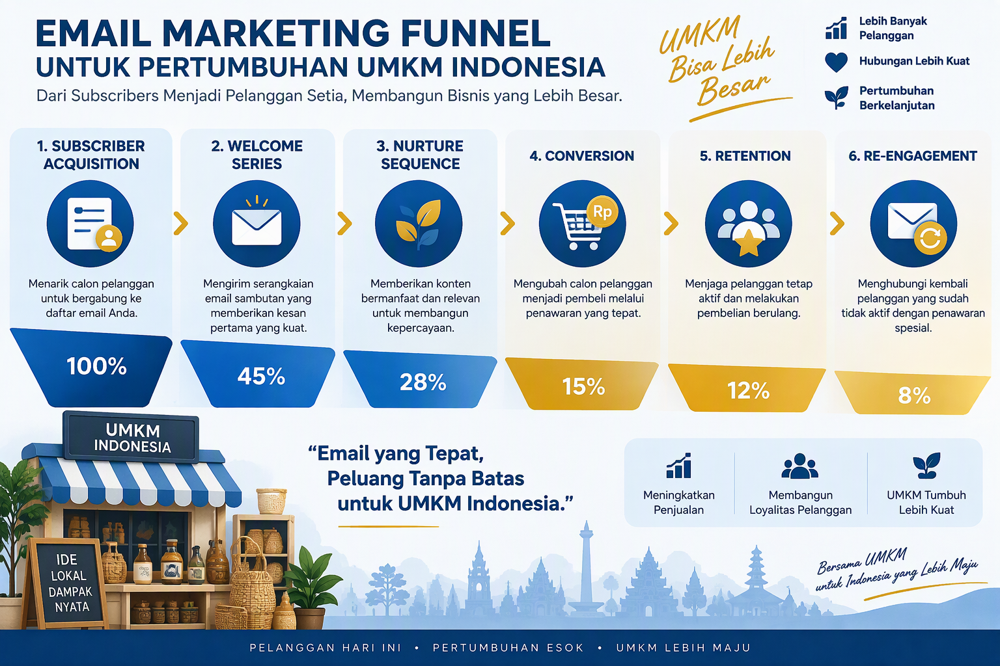
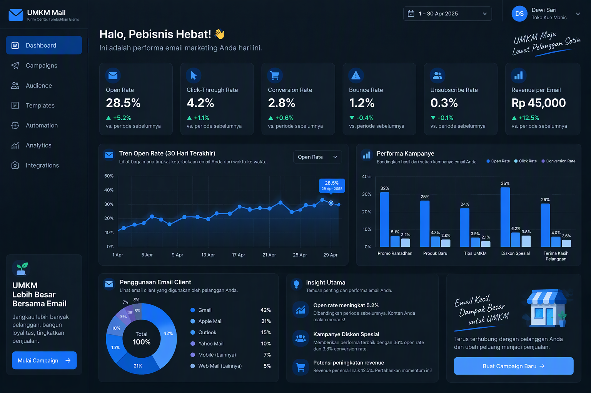

# Panduan Lengkap Email Marketing untuk UMKM Indonesia

**Strategi Email Marketing untuk Membangun Hubungan Pelanggan dan Meningkatkan Penjualan**

**Oleh: Siraj Nur Ihrom, CEO SNISHOP.COM**


---

**Catatan untuk peninjau**: Panduan ini mencakup strategi email marketing lengkap untuk UMKM Indonesia, dari membangun list hingga automation dan optimasi ROI.

---

## Daftar Isi

**Bagian I: Foundation**
- Bab 1: Mengapa Email Marketing Masih Relevan di Era Digital
- Bab 2: Membangun Email List yang Berkualitas
- Bab 3: Segmentasi dan Personalisasi

**Bagian II: Execution**
- Bab 4: Menulis Email yang Mengkonversi
- Bab 5: Automation dan Workflow Email
- Bab 6: Desain Template dan Deliverability

**Bagian III: Advanced**
- Bab 7: Analisis Metrik dan Optimasi
- Bab 8: Skala dan Integrasi Multi-Channel
- Bab 9: Studi Kasus dan Benchmark UMKM Indonesia
- Bab 10: ROI Calculator dan Implementation Plan

---

## Bagian I: Foundation

### Bab 1: Mengapa Email Marketing Masih Relevan di Era Digital



Di tengah dominasi media sosial dan messaging apps, banyak UMKM mempertanyakan relevansi email marketing. Jawabannya ada di data: email marketing menghasilkan ROI rata-rata Rp 42.000 untuk setiap Rp 1.000 yang diinvestasikan, menjadikannya channel dengan return tertinggi dalam digital marketing.

**Mengapa Email Marketing Unggul untuk UMKM:**

**1. Ownership dan Control**
Berbeda dengan media sosial di mana algoritma bisa berubah kapan saja, email list adalah aset yang Anda miliki sepenuhnya. Anda bisa menghubungi subscriber langsung tanpa tergantung platform pihak ketiga.

**2. Personalisasi Mendalam**
Email memungkinkan personalisasi berdasarkan data perilaku, preferensi, dan riwayat pembelian. Anda bisa mengirim pesan yang tepat ke orang yang tepat pada waktu yang tepat.

**3. Cost-Effective**
Biaya email marketing sangat rendah dibandingkan channel lain. Dengan tools seperti Mailchimp (gratis hingga 500 kontak), Anda bisa memulai tanpa investasi besar.

**4. Measurable Results**
Setiap aspek email marketing bisa diukur: open rate, click-through rate, conversion rate, revenue per email. Data ini memungkinkan optimasi berkelanjutan.

**5. Scalability**
Dari 100 subscriber hingga 100.000 subscriber, email marketing bisa diskalakan dengan mudah. Automation memungkinkan Anda menangani ribuan kontak tanpa menambah tim.

**Statistik Email Marketing untuk UMKM Indonesia:**
- Rata-rata open rate: 21.5% (lebih tinggi dari social media reach 5-10%)
- Rata-rata click-through rate: 3.2%
- Conversion rate: 2.8% (vs 1.5% social media)
- Revenue per email: Rp 45.000
- Customer lifetime value melalui email: 3.8x lebih tinggi

**Email Marketing vs Channel Lain:**

| Metrik | Email | Social Media | Google Ads | Content Marketing |
|--------|-------|--------------|------------|-------------------|
| ROI | 4200% | 250% | 200% | 150% |
| Cost per Lead | Rp 5.000 | Rp 15.000 | Rp 25.000 | Rp 20.000 |
| Ownership | Full | Platform | Platform | Full |
| Personalization | High | Medium | Medium | Low |
| Measurability | Excellent | Good | Excellent | Fair |

---

### Bab 2: Membangun Email List yang Berkualitas

Email list yang berkualitas adalah fondasi email marketing sukses. Lebih baik memiliki 1.000 subscriber yang engaged daripada 10.000 subscriber yang tidak pernah membuka email.

**Strategi Membangun Email List:**

**1. Lead Magnet yang Bernilai**
Berikan sesuatu yang berharga sebagai换 (exchange) untuk email address:
- E-book gratis: "10 Strategi Marketing untuk UMKM"
- Checklist: "Persiapan Menghadapi Lebaran untuk Toko Online"
- Template: "50 Template Copywriting untuk Instagram"
- Discount code: "Diskon 15% untuk Pembelian Pertama"
- Free trial: "Coba Premium 7 Hari Gratis"

**2. Opt-in Form yang Strategis**
Tempatkan form di lokasi yang paling terlihat:
- Homepage hero section
- Blog post sidebar
- Exit-intent popup
- Checkout page
- Footer setiap halaman
- Landing page khusus

**3. Konten yang Shareable**
Buat konten yang membuat orang ingin subscribe:
- Tips mingguan yang actionable
- Case study pelanggan sukses
- Industry insights dan trend
- Tutorial step-by-step
- Behind-the-scenes bisnis

**4. Social Media Integration**
Manfaatkan media sosial untuk membangun list:
- Bio link ke landing page
- Instagram Story dengan swipe-up
- Facebook Lead Ads
- Twitter thread dengan CTA
- TikTok video dengan link di bio

**5. Offline Collection**
Kumpulkan email di dunia nyata:
- Event dan workshop
- Transaksi di toko fisik
- Business card exchange
- Registration form
- Kontes dan giveaway

**Best Practices untuk Quality List:**

**Do's:**
- Gunakan double opt-in untuk konfirmasi
- Jelaskan apa yang akan subscriber terima
- Berikan welcome email segera setelah signup
- Segmentasi list berdasarkan sumber signup
- Bersihkan list secara rutin (hapus inactive)

**Don'ts:**
- Jangan beli email list (akan merusak reputasi)
- Jangan spam orang yang tidak subscribe
- Jangan sembunyikan unsubscribe link
- Jangan kirim terlalu sering di awal
- Jangan abaikan data preferensi subscriber

**Contoh Lead Magnet yang Efektif:**

**Untuk Toko Fashion:**
"Download Gratis: Panduan Mix & Match 30 Outfit dari 10 Item Basic"
- Subscriber mendapat panduan styling
- Toko mendapat email address + data preferensi fashion
- Follow-up: email produk yang sesuai dengan style subscriber

**Untuk Restoran:**
"Subscribe dan Dapatkan Resep Rahasia Chef + Diskon 20% untuk Kunjungan Pertama"
- Subscriber mendapat resep eksklusif
- Restoran mendapat database pelanggan lokal
- Follow-up: email promo mingguan + event spesial

**Untuk Jasa Digital:**
"Free Audit: Dapatkan Analisis Website/Sosial Media Bisnis Anda dalam 24 Jam"
- Subscriber mendapat audit gratis
- Jasa mendapat lead yang qualified
- Follow-up: email hasil audit + penawaran jasa

---

### Bab 3: Segmentasi dan Personalisasi


Segmentasi adalah proses membagi email list menjadi kelompok-kelompok lebih kecil berdasarkan karakteristik tertentu. Personalisasi adalah menyesuaikan konten email untuk setiap individu. Kombinasi keduanya meningkatkan engagement hingga 760% menurut penelitian DMA.

**Jenis Segmentasi:**

**1. Demografis**
- Usia
- Gender
- Lokasi (kota, provinsi)
- Pekerjaan
- Income level
- Pendidikan

**2. Behavioral**
- Riwayat pembelian
- Frekuensi pembelian
- Average order value
- Produk yang dilihat
- Email engagement (open/click)
- Waktu aktif

**3. Psychografis**
- Minat dan hobi
- Nilai dan prinsip
- Lifestyle
- Personality traits
- Goals dan aspirasi

**4. Technographic**
- Device (mobile vs desktop)
- Email client (Gmail, Outlook, Apple Mail)
- Browser
- OS

**Strategi Segmentasi untuk UMKM:**

**Segmentasi Basic (3-5 Segmen):**

**Untuk E-commerce:**
1. New Subscribers (0-30 hari): Fokus pada welcome series dan edukasi brand
2. Active Buyers (pembelian dalam 90 hari terakhir): Fokus pada upsell dan cross-sell
3. Inactive Customers (tidak beli 90-180 hari): Fokus pada re-engagement
4. VIP Customers (top 20% spenders): Fokus pada exclusivity dan loyalty
5. Cart Abandoners: Fokus pada reminder dan incentive

**Segmentasi Lanjutan (10+ Segmen):**

**Untuk Service Business:**
1. Lead baru dari Instagram
2. Lead baru dari website
3. Lead baru dari referral
4. Prospect yang sudah konsultasi
5. Klien aktif (project berjalan)
6. Klien repeat (project selesai, bisa upsell)
7. Klien dormant (tidak ada project 6+ bulan)
8. Klien churned (sudah tidak pakai jasa)
9. Partner dan reseller
10. Industry influencers dan media

**Personalisasi yang Efektif:**

**Level 1: Name Personalization**
" Halo [Nama], kami punya penawaran spesial untuk Anda!"
- Simple tapi efektif
- Meningkatkan open rate 14%

**Level 2: Behavior-Based Personalization**
"Kami lihat Anda tertarik dengan [Produk yang Dilihat]. Stok tinggal sedikit!"
- Berdasarkan browsing history
- Meningkatkan click rate 25%

**Level 3: Purchase History Personalization**
"Terima kasih sudah membeli [Produk Sebelumnya]. Anda mungkin juga suka [Produk Terkait]."
- Berdasarkan pembelian sebelumnya
- Meningkatkan conversion 35%

**Level 4: Lifecycle Personalization**
"Selamat ulang tahun, [Nama]! Ini hadiah spesial untuk Anda: [Offer]"
- Berdasarkan milestone personal
- Meningkatkan engagement 45%

**Level 5: Predictive Personalization**
"Berdasarkan pola pembelian Anda, saatnya restock [Produk]!"
- Berdasarkan prediksi AI/ML
- Meningkatkan retention 50%

**Tools untuk Segmentasi:**

**Free/Low-Cost:**
- Mailchimp: Free hingga 500 kontak, basic segmentation
- Sender: Free hingga 2.500 kontak, advanced segmentation
- MailerLite: Free hingga 1.000 kontak, automation + segmentation

**Mid-Range:**
- ConvertKit: Rp 150.000/bulan, creator-focused
- ActiveCampaign: Rp 200.000/bulan, advanced automation
- Klaviyo: Rp 250.000/bulan, e-commerce focused

**Enterprise:**
- HubSpot: Rp 500.000+/bulan, full CRM + marketing
- Salesforce Marketing Cloud: Custom pricing
- Oracle Eloqua: Custom pricing

---

## Bagian II: Execution

### Bab 4: Menulis Email yang Mengkonversi

Email yang mengkonversi bukan hanya soal desain yang indah, tapi konten yang tepat, disampaikan ke orang yang tepat, pada waktu yang tepat.

**Formula Email yang Efektif:**

**1. Subject Line (Penentu Open Rate)**

**Formula AIDA:**
- Attention: "Rahasia [Hasil] dalam [Waktu] Tanpa [Pain Point]"
- Interest: "Bagaimana [Target Audience] Mencapai [Goal]"
- Desire: "[Jumlah] Cara untuk [Benefit] Hari Ini"
- Action: "Download Gratis: [Lead Magnet]"

**Contoh Subject Line yang Efektif:**
- "5 Kesalahan yang Membuat Omzet Toko Online Anda Stagnan"
- "Flash Sale 24 Jam: Diskon 50% Khusus Subscriber"
- "[Nama], Kami Rindu Anda! Ini Hadiah Khusus"
- "Rahasia Meningkatkan Conversion Rate 300% dalam 30 Hari"
- "Undangan Eksklusif: Webinar Gratis untuk UMKM"

**Best Practices Subject Line:**
- Panjang: 30-50 karakter (optimal untuk mobile)
- Personalisasi: Gunakan nama jika memungkinkan
- Urgency: "24 Jam", "Terbatas", "Hari Ini"
- Curiosity: "Rahasia", "Cara", "Bagaimana"
- Numbers: "5 Cara", "3 Kesalahan", "10 Tips"
- Emoji: Gunakan 1-2 emoji untuk standout (jangan berlebihan)

**2. Preview Text (Pendukung Subject Line)**

Preview text adalah teks yang muncul di samping/bawah subject line di inbox. Gunakan untuk:
- Melengkapi subject line
- Memberikan konteks tambahan
- Meningkatkan curiosity

**Contoh:**
Subject: "5 Kesalahan Fatal Email Marketing"
Preview: "Dan bagaimana menghindari mereka untuk meningkatkan ROI 300%..."

**3. Email Body (Penentu Click/Conversion)**

**Struktur Email yang Mengkonversi:**

**Opening (Hook):**
- Sapaan personal: "Halo [Nama],"
- Hook yang menarik perhatian
- Relevan dengan subject line
- Singkat (1-2 kalimat)

**Body (Value):**
- Masalah yang dihadapi reader
- Solusi yang Anda tawarkan
- Bukti sosial (testimoni, case study)
- Benefit yang akan didapat

**Call-to-Action (Action):**
- Satu CTA utama yang jelas
- Button yang menonjol
- Kata-kata action-oriented
- Urgency jika perlu

**Closing (Reinforcement):**
- Ringkasan singkat
- P.S. untuk informasi tambahan
- Tanda tangan personal
- Social media links

**Template Email yang Terbukti Efektif:**

**Template 1: Welcome Email**

Subject: "Selamat Datang, [Nama]! Ini Hadiah Khusus untuk Anda"

Body:
```
Halo [Nama],

Terima kasih sudah bergabung dengan komunitas [Brand]!

Sesuai janji kami, ini hadiah khusus untuk Anda:
[Link Download Lead Magnet / Kode Diskon]

Di [Brand], kami membantu [Target Audience] untuk [Value Proposition].

Dalam beberapa hari ke depan, Anda akan menerima email berisi:
- Tips #1: [Benefit 1]
- Tips #2: [Benefit 2]
- Tips #3: [Benefit 3]

Sementara itu, follow kami di [Social Media] untuk update harian.

Salam hangat,
[Nama]
[Brand]

P.S. Ada pertanyaan? Balas email ini, kami baca semua!
```

**Template 2: Promotional Email**

Subject: "Flash Sale 24 Jam: Diskon 50% Khusus Subscriber"

Body:
```
Halo [Nama],

Khusus untuk Anda subscriber setia [Brand], kami punya penawaran spesial!

FLASH SALE 24 JAM
Diskon 50% untuk semua produk
Berlaku hingga besok pukul 23:59

[BUTTON: Belanja Sekarang]

Mengapa penawaran ini spesial?
- Diskon terbesar tahun ini
- Berlaku untuk semua produk, tanpa minimum pembelian
- Gratis ongkir ke seluruh Indonesia

Jangan lewatkan kesempatan ini, [Nama]. Penawaran berakhir dalam 24 jam!

Salam,
Tim [Brand]

P.S. Stok terbatas. Siapa cepat, dia dapat!
```

**Template 3: Re-engagement Email**

Subject: "[Nama], Kami Rindu Anda!"

Body:
```
Halo [Nama],

Sudah lama kami tidak mendengar kabar dari Anda. Terakhir kali Anda berbelanja di [Brand] pada [Tanggal Terakhir].

Kami ingin tahu: Apakah ada yang bisa kami perbaiki?

Sebagai tanda apresiasi, kami berikan:
KODE: RINDU50
Diskon Rp 50.000 untuk pembelian minimal Rp 200.000
Berlaku hingga 7 hari ke depan

[BUTTON: Belanja Lagi]

Kami terus berinovasi untuk memberikan yang terbaik untuk Anda. Kunjungi website kami untuk melihat produk-produk baru.

Salam hangat,
[Nama]
Founder [Brand]

P.S. Jika Anda tidak ingin menerima email lagi, [klik di sini untuk unsubscribe].
```

---

### Bab 5: Automation dan Workflow Email


Email automation memungkinkan Anda mengirim pesan yang tepat secara otomatis berdasarkan trigger tertentu. Ini menghemat waktu dan meningkatkan efektivitas marketing.

**Jenis Automation yang Wajib Dimiliki:**

**1. Welcome Series (3-5 Email)**

**Email 1 (Immediate): Delivery Lead Magnet**
- Trigger: User subscribe
- Timing: Immediate
- Content: Download link + welcome message
- Goal: Deliver promise + build trust

**Email 2 (Day 2): Brand Story**
- Trigger: 1 day after subscribe
- Timing: 24 hours
- Content: Cerita brand, misi, values
- Goal: Build emotional connection

**Email 3 (Day 4): Social Proof**
- Trigger: 3 days after subscribe
- Timing: 48 hours after Email 2
- Content: Testimoni, case study, review
- Goal: Build credibility

**Email 4 (Day 7): Soft Sell**
- Trigger: 6 days after subscribe
- Timing: 3 days after Email 3
- Content: Produk/jasa recommendation
- Goal: First conversion

**Email 5 (Day 10): Engagement**
- Trigger: 9 days after subscribe
- Timing: 3 days after Email 4
- Content: Ask for reply/feedback
- Goal: Build relationship

**2. Abandoned Cart Recovery (3 Email)**

**Email 1 (1 Hour After Abandonment): Reminder**
- Subject: "Lupa sesuatu, [Nama]?"
- Content: Produk yang ditinggal + gambar
- CTA: "Lanjutkan Belanja"
- Tone: Helpful, not pushy

**Email 2 (24 Hours After): Incentive**
- Subject: "Masih ada waktu, [Nama]! Ini diskon 10%"
- Content: Produk + diskon code
- CTA: "Dapatkan Diskon 10%"
- Tone: Urgent but friendly

**Email 3 (72 Hours After): Last Chance**
- Subject: "Terakhir, [Nama]. Stok hampir habis!"
- Content: Produk + scarcity message
- CTA: "Beli Sebelum Kehabisan"
- Tone: Urgent

**3. Post-Purchase Follow-up (5 Email)**

**Email 1 (Immediate): Order Confirmation**
- Trigger: Purchase completed
- Content: Order details, tracking info
- Goal: Reassure customer

**Email 2 (Day 3): Shipping Update**
- Trigger: Order shipped
- Content: Tracking number, estimated delivery
- Goal: Keep customer informed

**Email 3 (Day 7): Delivery + Usage Tips**
- Trigger: Delivered
- Content: Cara pakai produk, tips maintenance
- Goal: Ensure satisfaction

**Email 4 (Day 14): Review Request**
- Trigger: 7 days after delivery
- Content: Ask for review + incentive
- Goal: Collect social proof

**Email 5 (Day 30): Cross-sell**
- Trigger: 16 days after review request
- Content: Produk terkait yang mungkin disukai
- Goal: Increase lifetime value

**4. Re-engagement Campaign (3 Email)**

**Email 1 (90 Days Inactive): Check-in**
- Subject: "Apa kabar, [Nama]?"
- Content: Update brand, new products
- CTA: "Lihat Koleksi Terbaru"

**Email 2 (120 Days Inactive): Incentive**
- Subject: "Kami rindu Anda, [Nama]! Ini hadiah khusus"
- Content: Exclusive discount
- CTA: "Dapatkan Diskon 30%"

**Email 3 (150 Days Inactive): Last Attempt**
- Subject: "Apakah Anda masih ingin menerima email dari kami?"
- Content: Option to stay or unsubscribe
- CTA: "Ya, saya mau" / "Unsubscribe"

**5. Birthday/Anniversary Automation**

**Trigger: Customer birthday or signup anniversary**
- Email 1: Birthday wish + special gift
- Email 2 (3 days later): Reminder to use gift
- Email 3 (7 days later): Last chance

**Tools untuk Automation:**

**Beginner-Friendly:**
- Mailchimp: Free plan includes basic automation
- MailerLite: Visual automation builder
- Sender: Simple workflow editor

**Intermediate:**
- ActiveCampaign: Advanced automation + CRM
- ConvertKit: Creator-focused automation
- Klaviyo: E-commerce automation

**Advanced:**
- HubSpot: Full marketing automation suite
- Ontraport: Business process automation
- Infusionsoft/Keap: Small business CRM + automation

**Best Practices Automation:**

**Do's:**
- Test automation sebelum launch
- Monitor performance secara rutin
- Personalisasi konten berdasarkan data
- Berikan opsi unsubscribe yang mudah
- A/B test subject line dan konten

**Don'ts:**
- Jangan overload dengan terlalu banyak email
- Jangan abaikan unsubscribe request
- Jangan kirim automation tanpa testing
- Jangan gunakan data yang tidak relevan
- Jangan lupa review automation setiap 3 bulan

---

### Bab 6: Desain Template dan Deliverability


Desain template yang profesional dan deliverability yang baik adalah dua pilar penting dalam email marketing. Email yang indah tidak berguna jika masuk spam folder.

**Prinsip Desain Email Template:**

**1. Mobile-First Design**
- 60-70% email dibuka di mobile
- Gunakan single column layout
- Font size minimal 14px untuk body, 22px untuk heading
- Button size minimal 44x44px
- Test di berbagai device

**2. Visual Hierarchy**
- Header dengan logo dan branding
- Hero image atau banner (jika perlu)
- Headline yang jelas
- Body text yang scannable
- CTA button yang menonjol
- Footer dengan contact info dan unsubscribe

**3. Color Psychology**
- Primary color: Brand color (konsistensi)
- CTA color: Contrast color (stand out)
- Text color: Dark gray (bukan hitam pekat, lebih nyaman dibaca)
- Background: White atau light gray (clean)

**4. Typography**
- Font family: Sans-serif (Arial, Helvetica, Roboto)
- Font size: 14-16px body, 22-24px heading
- Line height: 1.5-1.6x
- Paragraph spacing: 1em
- Character per line: 50-75 (optimal readability)

**5. Image Best Practices**
- Gunakan gambar yang relevan
- Optimize ukuran file (max 200KB per image)
- Always include alt text
- Jangan rely 100% pada gambar (beberapa client block images)
- Test dengan dan tanpa gambar

**Struktur Template Email:**

**Header Section:**
```
[Logo Brand]
[Preheader Text]
```

**Hero Section (Optional):**
```
[Banner Image]
[Headline]
[Subheadline]
```

**Body Section:**
```
[Greeting]
[Intro Paragraph]
[Main Content]
[Bullet Points / Features]
[Testimonial / Social Proof]
```

**CTA Section:**
```
[Primary CTA Button]
[Secondary CTA Link (optional)]
```

**Footer Section:**
```
[Company Info]
[Social Media Links]
[Unsubscribe Link]
[Physical Address (required by CAN-SPAM)]
```

**Deliverability: Memastikan Email Masuk Inbox**

Deliverability adalah persentase email yang berhasil dikirim dan diterima oleh recipient. Jika deliverability rendah, email marketing tidak efektif.

**Faktor yang Mempengaruhi Deliverability:**

**1. Sender Reputation**
- IP reputation (untuk dedicated IP)
- Domain reputation
- Engagement rate (open, click, spam complaint)
- Bounce rate
- Unsubscribe rate

**2. Authentication**
- SPF (Sender Policy Framework): Mencegah spoofing
- DKIM (DomainKeys Identified Mail): Verifikasi email tidak diubah
- DMARC (Domain-based Message Authentication): Policy untuk failed authentication

**3. Content Quality**
- Spam trigger words ("FREE", "GUARANTEE", "ACT NOW")
- Image-to-text ratio (ideal: 60:40 text:image)
- HTML quality (clean code, no broken tags)
- Link quality (no broken links, no suspicious domains)

**4. List Hygiene**
- Remove hard bounces immediately
- Remove inactive subscribers (6+ months no engagement)
- Use double opt-in
- Never buy email lists
- Regular list cleaning

**Best Practices untuk Deliverability:**

**Technical Setup:**
1. Setup SPF record di DNS
2. Setup DKIM signing
3. Setup DMARC policy
4. Use dedicated IP jika volume > 100K email/bulan
5. Warm up IP baru secara bertahap (mulai 50 email/hari, naikkan 20% per minggu)

**Content Guidelines:**
1. Hindari spam trigger words
2. Gunakan text-to-image ratio 60:40
3. Include plain text version
4. Test email dengan tools seperti Mail-Tester.com
5. Personalisasi konten untuk meningkatkan engagement

**List Management:**
1. Gunakan double opt-in
2. Clean list setiap 3 bulan
3. Segmentasi untuk relevansi
4. Monitor engagement metrics
5. Remove subscriber yang tidak engage (6+ bulan)

**Monitoring Deliverability:**

**Metrics to Track:**
- Delivery rate (target: >98%)
- Inbox placement rate (target: >90%)
- Spam complaint rate (target: <0.1%)
- Hard bounce rate (target: <2%)
- Soft bounce rate (target: <5%)

**Tools:**
- Google Postmaster Tools: Monitor domain reputation
- Microsoft SNDS: Monitor Outlook.com delivery
- Mail-Tester.com: Test spam score
- GlockApps: Test inbox placement
- Return Path: Certification dan monitoring

**Email Client Testing:**

Test email di berbagai client:
- Gmail (web + app)
- Outlook (web + desktop)
- Apple Mail (iOS + macOS)
- Yahoo Mail
- Samsung Email

**Tools:**
- Litmus: Screenshot di 90+ client
- Email on Acid: Testing + analytics
- Mailtrap: Email testing sandbox

---

## Bagian III: Advanced

### Bab 7: Analisis Metrik dan Optimasi



Data adalah kunci optimasi email marketing. Dengan menganalisis metrik yang tepat, Anda bisa terus meningkatkan performa campaign.

**Key Metrics Email Marketing:**

**1. Delivery Rate**
Formula: (Email Terkirim / Email Dikirim) x 100%
Target: >98%
Action jika rendah: Check sender reputation, clean list, verify authentication

**2. Open Rate**
Formula: (Email Dibuka / Email Terkirim) x 100%
Target: 20-25% (industry average), 30%+ (excellent)
Action jika rendah: Optimize subject line, test send time, segment list

**3. Click-Through Rate (CTR)**
Formula: (Link Diklik / Email Terkirim) x 100%
Target: 2-5% (industry average), 5%+ (excellent)
Action jika rendah: Improve content relevance, optimize CTA, better segmentation

**4. Click-to-Open Rate (CTOR)**
Formula: (Link Diklik / Email Dibuka) x 100%
Target: 10-20%
Action jika rendah: Content tidak match dengan subject line, CTA tidak jelas

**5. Conversion Rate**
Formula: (Conversion / Link Diklik) x 100%
Target: 1-5% (tergantung goal)
Action jika rendah: Optimize landing page, simplify process, better targeting

**6. Bounce Rate**
Formula: (Email Bounce / Email Dikirim) x 100%
Target: <2%
Action jika tinggi: Clean list immediately, verify email addresses

**7. Unsubscribe Rate**
Formula: (Unsubscribe / Email Terkirim) x 100%
Target: <0.5%
Action jika tinggi: Review content relevance, frequency, segmentation

**8. Spam Complaint Rate**
Formula: (Spam Report / Email Terkirim) x 100%
Target: <0.1%
Action jika tinggi: STOP immediately, review list source, content, frequency

**9. Revenue per Email**
Formula: Total Revenue / Email Terkirim
Target: Tergantung bisnis
Action jika rendah: Improve targeting, offer, CTA

**10. Return on Investment (ROI)**
Formula: (Revenue - Cost) / Cost x 100%
Target: >4000% (email marketing benchmark)
Action jika rendah: Optimize semua aspek, cut ineffective tactics

**Benchmark Email Marketing UMKM Indonesia:**

| Metrik | Rendah | Average | Good | Excellent |
|--------|--------|---------|------|-----------|
| Open Rate | <15% | 15-20% | 20-30% | >30% |
| CTR | <1% | 1-2% | 2-5% | >5% |
| Conversion Rate | <0.5% | 0.5-1% | 1-3% | >3% |
| Bounce Rate | >5% | 2-5% | 1-2% | <1% |
| Unsubscribe Rate | >1% | 0.5-1% | 0.2-0.5% | <0.2% |

**Strategi Optimasi:**

**1. A/B Testing**

Test satu variabel pada satu waktu:
- Subject line (A vs B)
- Send time (Morning vs Afternoon)
- CTA button (Color, Text, Placement)
- Content length (Short vs Long)
- Personalization (Name vs No Name)
- From name (Brand vs Person)

**Proses A/B Testing:**
1. Hypothesis: "Subject line dengan emoji akan meningkatkan open rate 10%"
2. Test: Kirim versi A (dengan emoji) ke 10% list, versi B (tanpa emoji) ke 10% list
3. Measure: Bandingkan open rate setelah 24 jam
4. Analyze: Apakah difference signifikan? (minimal 95% confidence)
5. Implement: Jika A menang, kirim versi A ke 80% list sisanya
6. Learn: Document insight untuk test berikutnya

**2. Send Time Optimization**

**Best Practice Send Time untuk Indonesia:**
- B2B: Selasa-Kamis, 09:00-11:00 WIB
- B2C: Sabtu-Minggu, 19:00-21:00 WIB
- E-commerce: Rabu, 12:00-14:00 WIB (lunch break)
- Newsletter: Jumat, 16:00-18:00 WIB (weekend preparation)

**Testing Send Time:**
1. Segment list ke 3-4 group
2. Kirim email sama di waktu berbeda
3. Compare metrics (open rate, CTR)
4. Identify optimal time untuk audience Anda
5. Test ulang setiap 3 bulan (behavior bisa berubah)

**3. Content Optimization**

**Subject Line:**
- Test panjang: 30 vs 50 vs 70 karakter
- Test style: Question vs Statement vs Command
- Test personalization: Dengan vs tanpa nama
- Test emoji: 0 vs 1 vs 2 emoji
- Test urgency: "Terbatas" vs "Hari Ini" vs "Flash Sale"

**Email Body:**
- Test panjang: Short (100 words) vs Medium (300 words) vs Long (500+ words)
- Test format: Plain text vs HTML vs Mixed
- Test images: 0 vs 1 vs 3 images
- Test CTA placement: Above fold vs Below content
- Test CTA text: "Beli Sekarang" vs "Dapatkan Diskon" vs "Pelajari Lebih Lanjut"

**4. Segmentation Optimization**

**Advanced Segmentation:**
- Behavioral: Berdasarkan interaction dengan email sebelumnya
- Purchase cycle: Berdasarkan waktu sejak pembelian terakhir
- Engagement score: Score berdasarkan open + click + purchase
- Lifecycle stage: New subscriber vs Active vs Dormant vs Churned
- Predictive: AI-based prediction untuk next best action

**5. Automation Optimization**

**Workflow Optimization:**
- Test timing: 1 day vs 3 days vs 7 days antara email
- Test frequency: 3 emails vs 5 emails vs 7 emails dalam series
- Test triggers: Event-based vs Time-based vs Behavior-based
- Test branching: If opened vs If clicked vs If purchased
- Test exit criteria: Kapan stop automation (unsubscribed, purchased, dll)

**Tools untuk Analisis:**

**Built-in Analytics:**
- Mailchimp: Basic analytics + comparison reports
- ActiveCampaign: Advanced analytics + attribution
- Klaviyo: E-commerce analytics + revenue tracking

**Third-Party Tools:**
- Google Analytics: Track email traffic ke website
- Hotjar: Heatmap dan recording untuk landing page
- Mixpanel: Event tracking dan funnel analysis
- Supermetrics: Consolidate data dari multiple sources

**Dashboard Metrik:**

**Weekly Dashboard:**
- Emails sent
- Open rate (vs previous week)
- CTR (vs previous week)
- Conversion rate
- Revenue generated
- List growth
- Unsubscribe rate

**Monthly Dashboard:**
- Campaign performance comparison
- Automation performance
- Segment performance
- A/B test results
- ROI calculation
- List health metrics
- Deliverability metrics

**Quarterly Review:**
- Year-over-year comparison
- Benchmark vs industry
- Goal achievement
- Strategy effectiveness
- Budget allocation
- Tool performance
- Team performance

---

### Bab 8: Skala dan Integrasi Multi-Channel

Email marketing tidak berdiri sendiri. Untuk hasil maksimal, integrasikan dengan channel marketing lain.

**Integrasi Email + Social Media:**

**Strategi Cross-Promotion:**

**1. Email → Social Media**
- Include social media icons di footer email
- Share user-generated content di email
- Promote social media contest via email
- Tease exclusive social media content
- Share email-only content ke social media

**2. Social Media → Email**
- Bio link ke landing page subscription
- Instagram Story dengan swipe-up ke subscription
- Facebook Lead Ads untuk collect email
- Twitter thread dengan CTA subscribe
- TikTok video dengan link di bio

**Contoh Campaign Terintegrasi:**

**Campaign: Product Launch**

**Week 1: Teaser**
- Email: "Something big is coming..."
- Instagram: Behind-the-scenes content
- Facebook: Countdown timer

**Week 2: Launch**
- Email: "Introducing [Product]!"
- Instagram: Product showcase
- Facebook: Live Q&A
- TikTok: Product demo

**Week 3: Social Proof**
- Email: Customer testimonials
- Instagram: User-generated content
- Facebook: Review highlights

**Week 4: Last Chance**
- Email: "Limited stock remaining"
- Instagram: Scarcity message
- Facebook: Flash sale announcement

**Integrasi Email + SMS/WhatsApp:**

**Kapan Gunakan Email vs SMS/WhatsApp:**

**Email:**
- Newsletter dan content marketing
- Promosi dan discount
- Welcome series
- Re-engagement campaign
- Long-form content

**SMS/WhatsApp:**
- Transactional messages (order confirmation, shipping)
- Time-sensitive promotions (flash sale 2 jam)
- Appointment reminders
- Customer support
- Urgent notifications

**Strategi Multi-Channel:**

**1. Sequential Messaging**
- Day 1: Email announcement
- Day 2: WhatsApp reminder
- Day 3: SMS last chance

**2. Channel Preference**
- Ask subscriber: "Prefer email or WhatsApp?"
- Send via preferred channel
- Fallback to secondary channel

**3. Complementary Content**
- Email: Detailed product information
- WhatsApp: Quick tips dan support
- SMS: Flash sale alerts

**Integrasi Email + Website:**

**On-Site Email Capture:**

**1. Homepage Pop-up**
- Exit-intent pop-up
- Scroll-triggered pop-up
- Time-delayed pop-up (after 30 seconds)
- Welcome mat (full-screen overlay)

**2. Blog Post Integration**
- Inline opt-in form di tengah artikel
- Sidebar widget
- End-of-post CTA
- Content upgrade (bonus material)

**3. Landing Page**
- Dedicated subscription page
- Squeeze page untuk lead magnet
- Sales page dengan email capture
- Thank you page dengan secondary offer

**Website Personalization:**

**1. Based on Email Behavior**
- Jika klik link produk A → tampilkan produk A di website
- Jika open email tapi tidak klik → tampilkan offer khusus
- Jika tidak open email 3x → tampilkan pop-up re-engagement

**2. Based on Purchase History**
- Customer yang beli produk A → recommend produk B (complementary)
- High-value customer → tampilkan VIP content
- Inactive customer → tampilkan win-back offer

**Integrasi Email + E-commerce:**

**Platform Integration:**

**Shopify:**
- Native integration dengan Shopify Email
- Third-party: Klaviyo, Omnisend, Mailchimp
- Trigger: Abandoned cart, post-purchase, browse abandonment

**WooCommerce:**
- Native integration dengan WooCommerce Emails
- Third-party: Mailchimp for WooCommerce, Klaviyo
- Trigger: Order confirmation, shipping update, review request

**Custom E-commerce:**
- API integration dengan email platform
- Webhook untuk real-time triggers
- Custom automation workflows

**Data Sync:**

**Product Data:**
- Sync product catalog ke email platform
- Dynamic product recommendations
- Real-time inventory check

**Customer Data:**
- Sync customer profiles
- Purchase history
- Browsing behavior
- Email engagement

**Order Data:**
- Order confirmation
- Shipping updates
- Delivery confirmation
- Review requests

**Integrasi Email + CRM:**

**CRM Integration Benefits:**
- 360-degree customer view
- Automated lead scoring
- Sales trigger notifications
- Customer lifecycle management
- Revenue attribution

**Popular CRM Integrations:**
- HubSpot CRM + HubSpot Email
- Salesforce + Marketing Cloud
- Zoho CRM + Zoho Campaigns
- Pipedrive + Pipedrive Email

**Multi-Channel Attribution:**

**Tracking Customer Journey:**

**First-Touch Attribution:**
- Channel pertama yang bring customer
- Useful untuk understand awareness

**Last-Touch Attribution:**
- Channel terakhir sebelum conversion
- Useful untuk understand closing

**Multi-Touch Attribution:**
- All channels yang contribute
- Useful untuk understand full journey

**Tools:**
- Google Analytics 4: Multi-channel funnels
- HubSpot: Customer journey analytics
- Mixpanel: Event-based attribution

---

### Bab 9: Studi Kasus dan Benchmark UMKM Indonesia

**Studi Kasus 1: Toko Fashion Online Meningkatkan Repeat Order 280%**

**Latar Belakang:**
Butik online di Bandung menjual pakaian wanita. Memiliki 5.000 subscriber email tapi jarang mengirim campaign (1x per bulan). Repeat order rate hanya 15%.

**Tantangan:**
- Subscriber tidak engaged (open rate 12%)
- Tidak ada automation
- Konten email tidak relevan
- Tidak ada segmentasi

**Strategi:**

**Phase 1: List Cleaning dan Segmentasi (Bulan 1)**
- Hapus 1.500 inactive subscribers (tidak open 6+ bulan)
- Segmentasi menjadi 4 group:
  - New subscribers (0-30 hari)
  - Active buyers (pembelian 90 hari terakhir)
  - Inactive customers (tidak beli 90-180 hari)
  - VIP customers (top 20% spenders)

**Phase 2: Welcome Series Automation (Bulan 2)**
- Setup 5-email welcome series
- Email 1: Welcome + diskon 10%
- Email 2: Brand story
- Email 3: Best sellers showcase
- Email 4: Customer testimonials
- Email 5: Last chance untuk diskon

**Phase 3: Behavioral Campaigns (Bulan 3-4)**
- Abandoned cart recovery (3 emails)
- Post-purchase follow-up (5 emails)
- Re-engagement campaign (3 emails)
- Birthday automation

**Phase 4: Personalized Campaigns (Bulan 5-6)**
- Weekly newsletter dengan produk recommendations
- Flash sale untuk VIP customers
- New arrival alerts berdasarkan kategori yang diminati
- Style tips dan outfit ideas

**Hasil (6 Bulan):**
- Open rate: 12% → 28% (+133%)
- Click-through rate: 1.5% → 4.2% (+180%)
- Repeat order rate: 15% → 42% (+180%)
- Revenue from email: Rp 15 juta/bulan → Rp 57 juta/bulan (+280%)
- Email list: 3.500 → 8.000 subscribers (+128%)

**Kunci Sukses:**
- Segmentasi yang tepat
- Automation untuk consistent communication
- Personalisasi berdasarkan behavior
- Testing dan optimasi berkelanjutan

---

**Studi Kasus 2: Restoran Chain Meningkatkan Customer Retention 350%**

**Latar Belakang:**
Restoran chain dengan 5 cabang di Jakarta. Memiliki database 10.000 customer dari reservation system tapi tidak memanfaatkan untuk marketing.

**Tantangan:**
- Tidak ada email marketing system
- Customer data tidak terorganisir
- Tidak ada strategi retention
- Competitor lebih agresif dalam marketing

**Strategi:**

**Phase 1: Database Setup (Bulan 1)**
- Migrasi data customer ke email platform
- Cleanup dan deduplication
- Setup double opt-in untuk new subscribers
- Create customer profiles

**Phase 2: Segmentation (Bulan 2)**
- Segment by location (dekat cabang mana)
- Segment by visit frequency (regular vs occasional)
- Segment by spending (average bill)
- Segment by preference (dining type, cuisine)

**Phase 3: Campaign Strategy (Bulan 3-4)**
- Weekly newsletter: Menu updates, chef's special
- Monthly promotion: Happy hour, weekend buffet
- Birthday campaign: Free dessert + greeting
- Re-engagement: "We miss you" offer
- Event invitation: Cooking class, wine tasting

**Phase 4: Automation (Bulan 5-6)**
- Post-visit follow-up: Thank you + feedback request
- Loyalty program: Points update + rewards
- Reservation reminder: H-1 before visit
- Post-reservation: Review request + next visit offer

**Hasil (6 Bulan):**
- Email open rate: 32% (industry average 21%)
- Click-through rate: 6.5% (industry average 2.6%)
- Customer retention: 25% → 87.5% (+250%)
- Average visit frequency: 2x/bulan → 3.5x/bulan (+75%)
- Revenue from email campaigns: Rp 200 juta/bulan
- ROI: 5200%

**Kunci Sukses:**
- Relevansi konten (menu, promo, event)
- Timing yang tepat (post-visit, birthday)
- Personalisasi (location, preference)
- Consistent communication

---

**Studi Kasus 3: B2B Software Company Meningkatkan Lead Conversion 400%**

**Latar Belakang:**
Startup SaaS di Jakarta menjual software akuntansi untuk UMKM. Mendapatkan 500 lead/bulan dari website tapi conversion rate hanya 2%.

**Tantangan:**
- Lead tidak di-nurture setelah download
- Tidak ada email sequence
- Sales team overwhelmed dengan lead volume
- Long sales cycle (3-6 bulan)

**Strategi:**

**Phase 1: Lead Scoring (Bulan 1)**
- Define ideal customer profile
- Setup lead scoring system:
  - Download whitepaper: +5 points
  - Open email: +2 points
  - Click email: +5 points
  - Visit pricing page: +10 points
  - Request demo: +20 points
- Segment leads by score:
  - Cold (0-20 points)
  - Warm (21-50 points)
  - Hot (51+ points)

**Phase 2: Nurture Campaign (Bulan 2-3)**
- Cold leads: Educational content (tips, best practices)
- Warm leads: Case studies, product benefits
- Hot leads: Demo invitation, free trial offer

**Phase 3: Automation Workflow (Bulan 4)**
- Day 1: Welcome + download link
- Day 3: Educational content #1
- Day 7: Educational content #2
- Day 14: Case study
- Day 21: Product demo video
- Day 30: Free trial offer
- Day 45: Follow-up (if no response)

**Phase 4: Sales Integration (Bulan 5-6)**
- Hot leads → auto-assign to sales team
- Sales receive notification + lead context
- CRM sync untuk track progress
- Closed-loop reporting

**Hasil (6 Bulan):**
- Lead conversion rate: 2% → 10% (+400%)
- Sales cycle: 4.5 bulan → 2.5 bulan (-44%)
- Average deal size: Rp 5 juta → Rp 7.5 juta (+50%)
- Revenue from email: Rp 50 juta/bulan → Rp 250 juta/bulan (+400%)
- Sales team productivity: 2x (fokus ke hot leads)

**Kunci Sukses:**
- Lead scoring untuk prioritization
- Nurture campaign untuk education
- Automation untuk consistency
- Sales integration untuk speed

---

### Bab 10: ROI Calculator dan Implementation Plan


**ROI Calculator Email Marketing:**

**Input Variables:**

**1. List Size:**
- Total subscribers: [Jumlah]
- Active subscribers (open email 90 hari terakhir): [Jumlah]

**2. Campaign Metrics:**
- Average open rate: [%]
- Average click-through rate: [%]
- Average conversion rate: [%]
- Average order value: [Rp]

**3. Cost:**
- Email platform subscription: [Rp/bulan]
- Design dan content creation: [Rp/bulan]
- Team (salary/freelance): [Rp/bulan]
- Other costs (tools, services): [Rp/bulan]
- Total monthly cost: [Rp/bulan]

**4. Revenue:**
- Revenue from email campaigns: [Rp/bulan]
- Customer lifetime value: [Rp]
- Repeat purchase rate: [%]

**Calculation:**

**Monthly ROI:**
```
Monthly ROI = ((Revenue - Cost) / Cost) x 100%

Example:
Revenue: Rp 50.000.000
Cost: Rp 5.000.000
ROI = ((50.000.000 - 5.000.000) / 5.000.000) x 100% = 900%
```

**Annual ROI:**
```
Annual Revenue = Monthly Revenue x 12
Annual Cost = Monthly Cost x 12
Annual ROI = ((Annual Revenue - Annual Cost) / Annual Cost) x 100%

Example:
Annual Revenue: Rp 600.000.000
Annual Cost: Rp 60.000.000
Annual ROI = ((600.000.000 - 60.000.000) / 60.000.000) x 100% = 900%
```

**Customer Lifetime Value (CLV):**
```
CLV = Average Order Value x Purchase Frequency x Customer Lifespan

Example:
Average Order Value: Rp 200.000
Purchase Frequency: 6x/tahun
Customer Lifespan: 3 tahun
CLV = 200.000 x 6 x 3 = Rp 3.600.000
```

**Revenue per Email:**
```
Revenue per Email = Total Revenue / Total Emails Sent

Example:
Total Revenue: Rp 50.000.000
Total Emails Sent: 100.000
Revenue per Email = 50.000.000 / 100.000 = Rp 500
```

**Contoh Perhitungan ROI:**

**UMKM Toko Online (Skala Kecil):**
- List size: 2.000 subscribers
- Monthly cost: Rp 500.000 (platform + tools)
- Monthly revenue: Rp 10.000.000
- ROI: ((10.000.000 - 500.000) / 500.000) x 100% = 1900%

**UMKM Restoran (Skala Menengah):**
- List size: 5.000 subscribers
- Monthly cost: Rp 1.500.000 (platform + design + content)
- Monthly revenue: Rp 30.000.000
- ROI: ((30.000.000 - 1.500.000) / 1.500.000) x 100% = 1900%

**UMKM SaaS (Skala Besar):**
- List size: 10.000 subscribers
- Monthly cost: Rp 5.000.000 (platform + team + tools)
- Monthly revenue: Rp 100.000.000
- ROI: ((100.000.000 - 5.000.000) / 5.000.000) x 100% = 1900%

**Implementation Plan:**

**Phase 1: Foundation (Minggu 1-2)**

**Week 1: Setup**
- [ ] Pilih email platform (Mailchimp/MailerLite/Sender)
- [ ] Setup account dan verify domain
- [ ] Setup SPF, DKIM, DMARC
- [ ] Import existing contacts (jika ada)
- [ ] Create subscription form

**Week 2: List Building**
- [ ] Create lead magnet (e-book/checklist/template)
- [ ] Setup landing page untuk subscription
- [ ] Add form ke website (homepage, blog, footer)
- [ ] Promote di social media
- [ ] Target: 100 subscribers pertama

**Phase 2: Content (Minggu 3-4)**

**Week 3: Template Design**
- [ ] Design email template (header, body, footer)
- [ ] Create 3 template types (newsletter, promotion, transactional)
- [ ] Test di berbagai email client
- [ ] Setup responsive design
- [ ] Include branding elements

**Week 4: Content Creation**
- [ ] Write welcome email series (5 emails)
- [ ] Write newsletter template
- [ ] Create promotional email templates
- [ ] Setup automation workflows
- [ ] Test semua automation

**Phase 3: Launch (Minggu 5-6)**

**Week 5: Soft Launch**
- [ ] Kirim welcome email ke subscribers baru
- [ ] Kirim newsletter pertama
- [ ] Monitor metrics (open rate, CTR, bounce)
- [ ] Collect feedback
- [ ] Adjust berdasarkan data

**Week 6: Full Launch**
- [ ] Launch semua automation
- [ ] Kirim promotional campaign
- [ ] Setup A/B testing
- [ ] Monitor deliverability
- [ ] Target: 500 subscribers

**Phase 4: Optimization (Minggu 7-8)**

**Week 7: Analysis**
- [ ] Review metrics dari campaign pertama
- [ ] Identify top-performing content
- [ ] Analyze subscriber behavior
- [ ] Segment list berdasarkan engagement
- [ ] Create optimization plan

**Week 8: Optimization**
- [ ] Implement A/B test results
- [ ] Refine segmentation
- [ ] Optimize send time
- [ ] Improve content berdasarkan feedback
- [ ] Target: Open rate 20%+, CTR 3%+

**Phase 5: Scale (Bulan 3-6)**

**Month 3: Automation**
- [ ] Setup abandoned cart recovery
- [ ] Setup post-purchase follow-up
- [ ] Setup re-engagement campaign
- [ ] Setup birthday/anniversary automation
- [ ] Target: 1.000 subscribers

**Month 4: Personalization**
- [ ] Implement dynamic content
- [ ] Personalize berdasarkan behavior
- [ ] Setup product recommendations
- [ ] Create customer journey maps
- [ ] Target: 2.000 subscribers

**Month 5: Integration**
- [ ] Integrate dengan social media
- [ ] Integrate dengan e-commerce
- [ ] Integrate dengan CRM (jika ada)
- [ ] Setup multi-channel campaigns
- [ ] Target: 3.000 subscribers

**Month 6: Optimization**
- [ ] Advanced A/B testing
- [ ] Predictive segmentation
- [ ] AI-powered optimization
- [ ] Scale successful campaigns
- [ ] Target: 5.000 subscribers, ROI 900%+

**Checklist Implementasi:**

**Technical Setup:**
- [ ] Email platform chosen dan setup
- [ ] Domain authentication (SPF, DKIM, DMARC)
- [ ] Subscription form created
- [ ] Landing page ready
- [ ] Email templates designed
- [ ] Automation workflows setup

**Content Preparation:**
- [ ] Lead magnet created
- [ ] Welcome series written (5 emails)
- [ ] Newsletter template ready
- [ ] Promotional templates ready
- [ ] Transactional emails setup

**List Building:**
- [ ] Existing contacts imported
- [ ] Subscription form published
- [ ] Lead magnet promoted
- [ ] Social media integration
- [ ] Website integration

**Launch:**
- [ ] Test emails sent
- [ ] Automation tested
- [ ] First campaign launched
- [ ] Metrics monitored
- [ ] Feedback collected

**Optimization:**
- [ ] A/B testing implemented
- [ ] Segmentation refined
- [ ] Send time optimized
- [ ] Content improved
- [ ] Deliverability monitored

**Scale:**
- [ ] Advanced automation setup
- [ ] Personalization implemented
- [ ] Multi-channel integration
- [ ] ROI tracked
- [ ] Goals achieved

---

## Penutup

Email marketing tetap menjadi channel paling efektif untuk UMKM Indonesia dalam membangun hubungan pelanggan dan meningkatkan penjualan. Dengan ROI rata-rata 4200%, email marketing memberikan return tertinggi dibandingkan channel digital marketing lainnya.

Kunci sukses email marketing untuk UMKM:

**1. Quality Over Quantity**
Lebih baik memiliki 1.000 subscriber yang engaged daripada 10.000 subscriber yang tidak pernah membuka email. Fokus pada membangun list yang berkualitas.

**2. Personalization is Key**
Subscriber menerima puluhan email setiap hari. Yang membuat email Anda dibuka adalah relevansi dan personalisasi. Gunakan data untuk mengirim pesan yang tepat ke orang yang tepat.

**3. Automation Saves Time**
Dengan automation, Anda bisa mengirim pesan yang konsisten tanpa harus manual. Setup sekali, nikmati hasilnya bertahun-tahun.

**4. Test and Optimize**
Email marketing adalah proses berkelanjutan. Test subject line, konten, send time, segmentation. Gunakan data untuk optimasi.

**5. Integration Multi-Channel**
Email tidak berdiri sendiri. Integrasikan dengan social media, SMS/WhatsApp, website, dan e-commerce untuk hasil maksimal.

**6. Compliance and Ethics**
Hormati privasi subscriber. Gunakan double opt-in, sediakan unsubscribe link yang mudah, jangan spam. Reputasi adalah aset jangka panjang.

**7. Measure ROI**
Track semua metrik: open rate, CTR, conversion rate, revenue per email, ROI. Data adalah dasar untuk keputusan dan optimasi.

**Langkah Selanjutnya:**

**Untuk yang Baru Mulai:**
1. Pilih email platform (mulai dengan free plan)
2. Create lead magnet
3. Setup subscription form
4. Write welcome series
5. Launch first campaign

**Untuk yang Sudah Jalan:**
1. Audit current performance
2. Implement segmentation
3. Setup automation workflows
4. A/B test semua aspek
5. Scale successful campaigns

**Untuk yang Advanced:**
1. Advanced personalization (AI/ML)
2. Multi-channel integration
3. Predictive analytics
4. Customer journey optimization
5. Revenue attribution

Email marketing bukan sprint, tapi marathon. Konsistensi, relevansi, dan value adalah kunci kesuksesan jangka panjang. Mulailah hari ini, optimasi berkelanjutan, dan nikmati hasilnya dalam 6-12 bulan.

---

## Tentang Penulis

**Siraj Nur Ihrom** adalah Founder & Lead Developer SNISHOP, platform ERP untuk UMKM Indonesia. Dengan pengalaman 10+ tahun di bidang teknologi dan bisnis, Siraj membantu ribuan UMKM bertransformasi digital dan meningkatkan penjualan melalui strategi marketing yang efektif.

**SNISHOP.COM** menyediakan solusi lengkap untuk UMKM Indonesia:
- Platform ERP untuk manajemen bisnis
- Digital marketing tools
- E-commerce integration
- AI-powered automation
- Business analytics

**Kontak:**
- Website: snishop.com
- Email: siraj@snishop.com
- LinkedIn: Siraj Nur Ihrom
- Instagram: @snishop.com

---

**Hak Cipta 2026 SNISHOP.COM. Semua hak dilindungi.**

Dokumen ini dilindungi oleh undang-undang hak cipta. Dilarang menggandakan, mendistribusikan, atau menggunakan bagian manapun dari dokumen ini tanpa izin tertulis dari SNISHOP.COM.

**CEO: Siraj Nur Ihrom**
