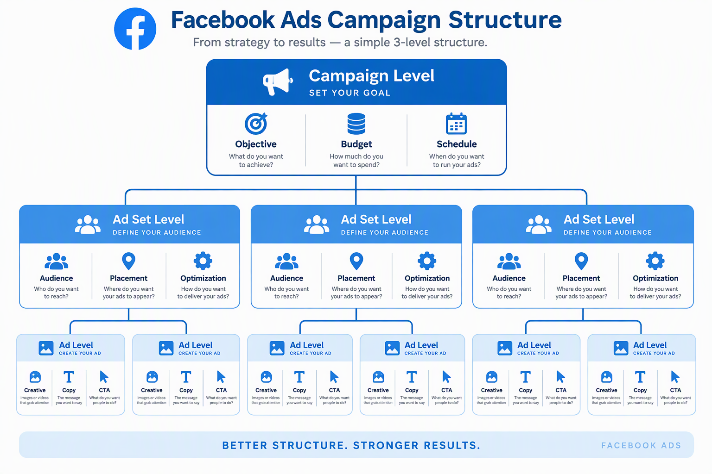
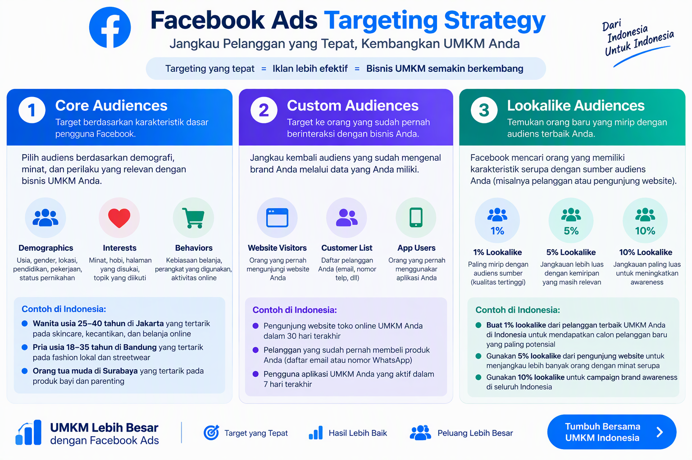
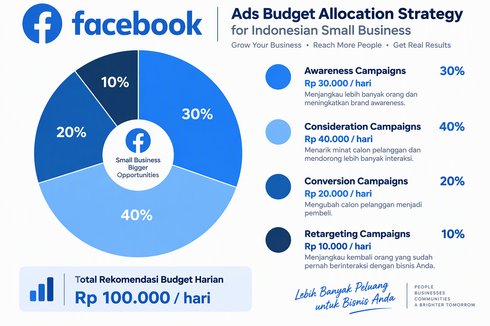
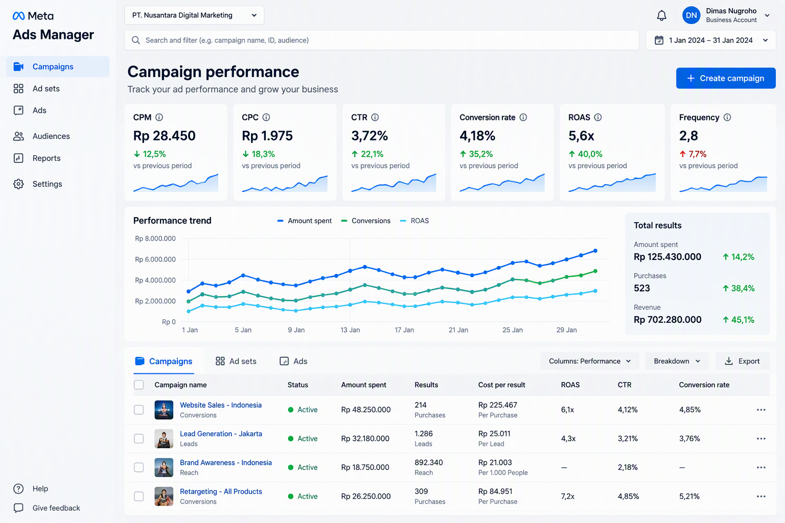

# Panduan Lengkap Facebook Ads untuk UMKM Indonesia

**Strategi, Taktik, dan Template Siap Pakai untuk Meningkatkan Penjualan dengan Facebook Advertising**

Disusun oleh: Siraj Nur Ihrom, Founder & Lead Developer SNISHOP  
Versi: 1.0  
Tanggal: Oktober 2026  
Format: Panduan komprehensif dengan strategi, template, dan studi kasus  
Standar: SNISHOP-PUBLISHING v2.0

## Tentang Buku Ini

Facebook Ads adalah platform advertising paling efektif untuk UMKM Indonesia. Dengan 3 miliar pengguna aktif dan targeting yang sangat detail, Facebook Ads menawarkan ROI yang jauh lebih tinggi dibandingkan iklan tradisional.

Buku ini adalah panduan lengkap Facebook Ads yang dirancang khusus untuk UMKM Indonesia. Anda akan mendapatkan strategi proven, template siap pakai, dan studi kasus real dari bisnis yang berhasil.

Yang Anda dapatkan:
- Panduan setup Facebook Business Manager dari nol
- Strategi campaign structure yang efektif
- Teknik targeting dan audience research
- Template ad copy dan creative yang converting
- Panduan budget allocation dan bidding
- Facebook Pixel dan conversion tracking
- Retargeting dan lookalike audience strategy
- Kalkulator ROI Facebook Ads
- Studi kasus 3 bisnis dengan hasil konkret
- Checklist audit campaign Facebook Ads

**Catatan untuk peninjau**: Screenshot Facebook Ads Manager diperlukan di bagian ini. [PERLU SCREENSHOT: Dashboard Facebook Ads Manager]

## Cara Menggunakan Buku Ini

Buku ini dibagi menjadi 10 bab yang bisa Anda baca berurutan atau lompat ke bagian yang paling relevan:

**Bab 1-3: Foundation**
- Setup Facebook Business Manager
- Memahami campaign structure
- Riset audience dan targeting

**Bab 4-6: Execution**
- Membuat ad creative yang efektif
- Writing ad copy yang converting
- Budget allocation dan bidding strategy

**Bab 7-10: Advanced**
- Facebook Pixel dan tracking
- Retargeting dan lookalike audience
- Analytics dan optimization
- Studi kasus dan benchmark

Setiap bab berisi:
- Teori dan konsep dasar
- Langkah-langkah praktis
- Template siap pakai
- Contoh real dari bisnis Indonesia
- Tips dan best practices



## Standar Kualitas Konten

Semua strategi dan template dalam buku ini mengikuti standar SNISHOP-PUBLISHING v2.0:
- Bahasa Indonesia yang natural dan profesional
- Strategi berbasis data dan hasil real
- Contoh konkret dengan angka dan metrik
- Tanpa frasa pengisi yang tidak berarti
- Tanpa emoji berlebihan atau simbol tidak profesional
- Struktur yang mudah diikuti dan diimplementasi

---

## Bab 1: Setup Facebook Business Manager

Facebook Business Manager adalah pusat kendali untuk semua aktivitas advertising Anda di Facebook dan Instagram.

### 1.1 Membuat Facebook Business Manager Account

Sebelum menjalankan ads, Anda harus memiliki Business Manager account yang terstruktur dengan baik.

**Langkah-langkah Setup:**

**1. Buat Business Manager Account**
1. Buka business.facebook.com
2. Klik "Create Account"
3. Isi informasi bisnis:
   - Nama bisnis
   - Nama Anda
   - Email bisnis (gunakan email domain bisnis)
4. Verifikasi email
5. Lengkapi detail bisnis

**2. Tambahkan Facebook Page**
1. Di Business Settings, klik "Pages"
2. Klik "Add" > "Add a Page"
3. Pilih page yang Anda admin
4. Atau buat page baru jika belum ada

**3. Tambahkan Instagram Account**
1. Di Business Settings, klik "Instagram Accounts"
2. Klik "Add"
3. Login ke Instagram bisnis Anda
4. Authorize connection

**4. Tambahkan Ad Account**
1. Di Business Settings, klik "Ad Accounts"
2. Klik "Add" > "Create a New Ad Account"
3. Isi informasi:
   - Nama ad account
   - Time zone (pilih GMT+7 Jakarta)
   - Currency (pilih IDR)
4. Setup payment method

**5. Tambahkan People**
1. Di Business Settings, klik "People"
2. Klik "Add People"
3. Masukkan email tim Anda
4. Assign role (Admin, Employee, atau Custom)
5. Assign assets (Page, Ad Account, Instagram)

### 1.2 Struktur Business Manager yang Ideal

Struktur Business Manager yang baik memudahkan manajemen dan scaling.

**Struktur untuk Single Brand:**
```
Business Manager
├── Pages
│   └── Brand Page
├── Instagram Accounts
│   └── Brand Instagram
├── Ad Accounts
│   ├── ID Ads (untuk market Indonesia)
│   └── SG Ads (untuk market Singapura)
├── Pixels
│   └── Website Pixel
├── Catalogs
│   └── Product Catalog
└── People
    ├── Admin (Owner)
    ├── Employee (Marketing Team)
    └── Partner (Agency/Freelancer)
```

**Struktur untuk Multi-Brand:**
```
Business Manager
├── Pages
│   ├── Brand A Page
│   ├── Brand B Page
│   └── Brand C Page
├── Instagram Accounts
│   ├── Brand A Instagram
│   ├── Brand B Instagram
│   └── Brand C Instagram
├── Ad Accounts
│   ├── Brand A Ads
│   ├── Brand B Ads
│   └── Brand C Ads
├── Pixels
│   ├── Brand A Pixel
│   ├── Brand B Pixel
│   └── Brand C Pixel
└── People
    ├── Admin (Owner)
    ├── Brand A Manager
    ├── Brand B Manager
    └── Brand C Manager
```

**Tips:**
- Gunakan satu Business Manager untuk semua brand Anda
- Pisahkan ad account per brand atau per market
- Assign role yang jelas untuk setiap team member
- Backup admin minimal 2 orang

### 1.3 Verifikasi Domain dan Business

Verifikasi domain dan business meningkatkan trust dan解锁 fitur advanced.

**Domain Verification:**
1. Di Business Settings, klik "Brand Safety" > "Domains"
2. Klik "Add" dan masukkan domain Anda
3. Pilih verification method:
   - DNS TXT record (recommended)
   - HTML file upload
   - Meta tag
4. Verify domain

**Business Verification:**
1. Di Business Settings, klik "Security Center"
2. Klik "Start Verification"
3. Upload dokumen:
   - Business license
   - Tax ID
   - Utility bill
4. Tunggu approval (3-5 hari kerja)

**Keuntungan verifikasi:**
- Akses ke advanced features
- Increased trust dari Facebook
- Higher ad account limits
- Better delivery optimization

### 1.4 Setup Payment Method

Setup payment method yang benar memastikan ads Anda tidak terganggu.

**Opsi Payment Method:**

**1. Credit/Debit Card**
- Visa, Mastercard, American Express
- Auto-charge saat threshold tercapai
- Best for: Small to medium budget

**2. PayPal**
- Link PayPal account
- Auto-charge saat threshold tercapai
- Best for: International business

**3. Manual Payment (Bank Transfer)**
- Top-up balance manually
- Ads berhenti saat balance habis
- Best for: Budget control

**Tips:**
- Gunakan credit card untuk cash flow
- Setup multiple payment methods sebagai backup
- Monitor spending limit
- Enable auto-top up jika perlu

---

## Bab 2: Memahami Campaign Structure

Campaign structure yang baik adalah fondasi kesuksesan Facebook Ads Anda.

### 2.1 Hierarki Campaign Facebook Ads

Facebook Ads memiliki 3 level hierarki yang harus Anda pahami.

**Level 1: Campaign**
- Objective: Apa tujuan Anda?
- Budget: Berapa budget total?
- Schedule: Kapan ads berjalan?
- Campaign Budget Optimization (CBO): Ya/Tidak

**Level 2: Ad Set**
- Audience: Siapa target Anda?
- Placement: Di mana ads tampil?
- Budget: Berapa budget per ad set? (jika CBO off)
- Schedule: Kapan ad set berjalan?
- Optimization: Apa yang dioptimasi?
- Bid Strategy: Bagaimana bidding?

**Level 3: Ad**
- Creative: Gambar/video apa?
- Copy: Teks apa?
- CTA: Button apa?
- Destination: Link ke mana?


### 2.2 Memilih Campaign Objective

Facebook menawarkan 11 objective yang dibagi dalam 3 kategori.

**Category 1: Awareness**

**1. Brand Awareness**
- Tujuan: Meningkatkan kesadaran brand
- Best for: Brand baru, product launch
- Optimization: Ad recall lift
- Use case: UMKM ingin dikenal di kota mereka

**2. Reach**
- Tujuan: Menjangkau sebanyak mungkin orang
- Best for: Announcement, event
- Optimization: Reach
- Use case: Promo opening toko baru

**Category 2: Consideration**

**3. Traffic**
- Tujuan: Mengirim orang ke website/landing page
- Best for: Website visits, blog traffic
- Optimization: Link clicks, landing page views
- Use case: Toko online ingin traffic ke website

**4. Engagement**
- Tujuan: Meningkatkan engagement post/page
- Best for: Community building, brand loyalty
- Optimization: Post engagement, page likes, event responses
- Use case: Restoran ingin meningkatkan followers

**5. App Installs**
- Tujuan: Meningkatkan install aplikasi
- Best for: Mobile app
- Optimization: App installs
- Use case: Startup dengan mobile app

**6. Video Views**
- Tujuan: Meningkatkan views video
- Best for: Brand storytelling, product demo
- Optimization: ThruPlay (15 detik atau full video)
- Use case: Brand fashion showcase koleksi baru

**7. Lead Generation**
- Tujuan: Mengumpulkan leads
- Best for: B2B, high-ticket items
- Optimization: Leads
- Use case: Konsultan bisnis kumpulkan prospect

**8. Messages**
- Tujuan: Meningkatkan pesan ke bisnis
- Best for: Customer service, sales inquiry
- Optimization: Conversations
- Use case: Toko online terima order via WhatsApp

**9. Conversions**
- Tujuan: Meningkatkan pembelian atau aksi spesifik
- Best for: E-commerce, sales
- Optimization: Purchases, add to cart, initiate checkout
- Use case: Toko online tingkatkan penjualan

**Category 3: Conversion**

**10. Catalog Sales**
- Tujuan: Menjual produk dari catalog
- Best for: E-commerce dengan banyak produk
- Optimization: Purchases
- Use case: Fashion store dengan ratusan SKU

**11. Store Traffic**
- Tujuan: Meningkatkan kunjungan ke toko fisik
- Best for: Retail, F&B, service
- Optimization: Store visits
- Use case: Cafe ingin tingkatkan kunjungan

**Tips:**
- Pilih objective yang sesuai dengan tujuan bisnis
- Jangan gunakan Traffic objective untuk sales (gunakan Conversions)
- Test multiple objectives untuk find yang paling efektif
- Align objective dengan funnel stage

### 2.3 Campaign Structure Best Practices

Struktur campaign yang baik memudahkan manajemen dan optimization.

**Struktur untuk E-commerce:**

```
Campaign 1: Prospecting - Cold Audience
├── Ad Set 1: Interest Targeting - Fashion
│   ├── Ad 1: Video - Product Showcase
│   ├── Ad 2: Carousel - Multiple Products
│   └── Ad 3: Single Image - Best Seller
├── Ad Set 2: Interest Targeting - Beauty
│   ├── Ad 1: Video - Product Showcase
│   ├── Ad 2: Carousel - Multiple Products
│   └── Ad 3: Single Image - Best Seller
└── Ad Set 3: Lookalike 1-3%
    ├── Ad 1: Video - Product Showcase
    ├── Ad 2: Carousel - Multiple Products
    └── Ad 3: Single Image - Best Seller

Campaign 2: Retargeting - Warm Audience
├── Ad Set 1: Website Visitors 7 days
│   ├── Ad 1: Dynamic Product Ads
│   └── Ad 2: Testimonial + CTA
├── Ad Set 2: Add to Cart 14 days
│   ├── Ad 1: Abandoned Cart Reminder
│   └── Ad 2: Limited Time Offer
└── Ad Set 3: Purchase 30 days
    ├── Ad 1: Cross-sell Products
    └── Ad 2: Loyalty Program

Campaign 3: Lookalike - Expansion
├── Ad Set 1: 1% Lookalike of Purchasers
│   └── Ad 1: Best Performing Creative
└── Ad Set 2: 3% Lookalike of Purchasers
    └── Ad 1: Best Performing Creative
```

**Struktur untuk Service Business:**

```
Campaign 1: Lead Generation
├── Ad Set 1: Interest Targeting
│   ├── Ad 1: Lead Form - Free Consultation
│   └── Ad 2: Video - Client Testimonial
├── Ad Set 2: Lookalike 1-5%
│   ├── Ad 1: Lead Form - Free Consultation
│   └── Ad 2: Video - Client Testimonial
└── Ad Set 3: Retargeting
    ├── Ad 1: Lead Form - Limited Offer
    └── Ad 2: Video - Case Study

Campaign 2: Brand Awareness
├── Ad Set 1: Broad Targeting
│   ├── Ad 1: Video - Brand Story
│   └── Ad 2: Image - Value Proposition
└── Ad Set 2: Interest Targeting
    ├── Ad 1: Video - Brand Story
    └── Ad 2: Image - Value Proposition
```

**Tips:**
- Pisahkan cold audience dan warm audience
- Test multiple ad sets untuk find winning audience
- Limit 3-5 ads per ad set
- Pause underperforming ads setelah 3-5 hari
- Scale winning ad sets dengan increase budget 20-30%

---

## Bab 3: Riset Audience dan Targeting

Targeting yang tepat adalah kunci kesuksesan Facebook Ads Anda.

### 3.1 Memahami Facebook Audience Types

Facebook menawarkan 3 jenis audience yang bisa Anda target.

**1. Core Audiences**
- Demographics: Age, gender, education, relationship status
- Location: Country, city, radius
- Interests: Hobbies, pages they follow, activities
- Behaviors: Purchase behavior, device usage, travel

**2. Custom Audiences**
- Website visitors (via Facebook Pixel)
- Customer list (email, phone, name)
- App users (app events)
- Engagement (Instagram, Facebook, Messenger)
- Video viewers
- Lead form openers

**3. Lookalike Audiences**
- Based on Custom Audience
- 1-10% similarity
- 1% = most similar, smallest reach
- 10% = least similar, largest reach



### 3.2 Core Audience Targeting

Core audience targeting menggunakan data yang sudah dimiliki Facebook.

**Demographics Targeting:**

**Age:**
- 18-24: Gen Z, students, first jobbers
- 25-34: Millennials, young professionals, new parents
- 35-44: Gen X, established professionals, parents
- 45-54: Older Gen X, mid-career, empty nesters
- 55-64: Baby boomers, pre-retirement
- 65+: Seniors, retirees

**Gender:**
- All genders (default)
- Men only
- Women only

**Education:**
- Education level: High school, college, graduate
- Field of study: Business, engineering, arts
- Schools: Specific universities

**Relationship:**
- Single, in relationship, engaged, married
- Anniversary: Upcoming
- Parents: All parents, parents with toddlers, etc.

**Work:**
- Industries: Technology, healthcare, education
- Job titles: CEO, marketing manager, software engineer
- Small business owners: Yes/No

**Location Targeting:**

**Options:**
- Country: Indonesia
- Region: Jawa Barat, Jawa Timur, dll
- City: Jakarta, Surabaya, Bandung
- Radius: 1-50 miles from location
- Exclude locations

**Tips:**
- Target lokasi di mana pelanggan Anda berada
- Gunakan radius targeting untuk local business
- Exclude lokasi yang tidak relevan
- Test multiple locations

**Interest Targeting:**

**Categories:**
- Business and industry
- Entertainment
- Family and relationships
- Fitness and wellness
- Food and drink
- Hobbies and activities
- Shopping and fashion
- Sports and outdoors
- Technology

**Examples:**
- Fashion: Batik, hijab fashion, streetwear
- Food: Indonesian cuisine, coffee, cooking
- Business: Entrepreneurship, small business, marketing
- Technology: Smartphones, gadgets, software

**Behavior Targeting:**

**Categories:**
- Purchase behavior: Online shoppers, luxury goods buyers
- Digital activities: Facebook page admins, Instagram users
- Travel: Frequent travelers, commuters
- Mobile device use: iOS users, Android users, specific devices
- Expats: Indonesia expats, living abroad

**Tips:**
- Combine multiple interests untuk narrow audience
- Use behaviors untuk high-intent audience
- Test broad vs narrow targeting
- Monitor audience size (recommended: 50K-500K untuk Indonesia)

### 3.3 Custom Audience Creation

Custom audience adalah orang yang sudah berinteraksi dengan bisnis Anda.

**Website Custom Audience:**

**Requirements:**
- Facebook Pixel installed on website
- Minimum 100 visitors per month

**Steps:**
1. Di Ads Manager, klik Custom Audiences
2. Klik Create Custom Audience
3. Pilih Website
4. Select pixel
5. Choose events:
   - All website visitors
   - Visitors by specific pages
   - Visitors by time spent (5s, 10s, 30s, 1m, 2m, 3m, 4m, 5m)
   - Visitors who haven't visited yet
6. Set retention window (1-180 days)
7. Name audience
8. Create

**Customer List Custom Audience:**

**Requirements:**
- Customer data (email, phone, name, address)
- Minimum 100 matches

**Steps:**
1. Klik Create Custom Audience
2. Pilih Customer List
3. Upload file (CSV or TXT)
4. Map data fields
5. Facebook match data dengan user accounts
6. Set retention window
7. Name audience
8. Create

**Engagement Custom Audience:**

**Sources:**
- Facebook Page (page engagers, video viewers)
- Instagram account (profile visitors, post engagers)
- Messenger (message senders)
- Lead forms (form openers)
- Events (event responders)
- Instant experiences (experience viewers)

**Steps:**
1. Klik Create Custom Audience
2. Pilih source (Facebook, Instagram, dll)
3. Select specific engagement type
4. Set retention window
5. Name audience
6. Create

**Tips:**
- Create multiple custom audiences untuk segmentation
- Use shorter retention window untuk recent engagers
- Exclude converters dari prospecting audience
- Update custom audiences secara berkala

### 3.4 Lookalike Audience Strategy

Lookalike audience adalah orang yang mirip dengan custom audience Anda.

**How Lookalike Works:**
1. Anda provide source audience (custom audience)
2. Facebook analyze karakteristik source audience
3. Facebook find orang baru yang mirip
4. Anda pilih similarity level (1-10%)

**Similarity Levels:**

**1% Lookalike:**
- Most similar to source
- Smallest reach (1-2 juta orang di Indonesia)
- Highest conversion rate
- Best for: Scaling winning campaigns

**3% Lookalike:**
- Moderate similarity
- Medium reach (3-5 juta orang di Indonesia)
- Good balance of reach and conversion
- Best for: Testing new audiences

**5% Lookalike:**
- Lower similarity
- Larger reach (5-10 juta orang di Indonesia)
- Lower conversion rate
- Best for: Awareness campaigns

**10% Lookalike:**
- Least similar
- Largest reach (10-20 juta orang di Indonesia)
- Lowest conversion rate
- Best for: Broad targeting

**Best Source Audiences:**

**High Quality:**
- Purchasers (30-90 days)
- Add to cart (30 days)
- Initiate checkout (30 days)
- Leads (30 days)

**Medium Quality:**
- Website visitors (30 days)
- Video viewers (75%)
- Page engagers (90 days)
- Customer list (high LTV)

**Low Quality:**
- All website visitors (180 days)
- Video viewers (any)
- Page followers

**Tips:**
- Start dengan 1% lookalike dari purchasers
- Test multiple source audiences
- Create lookalike dari top 10% customers
- Exclude existing customers dari lookalike
- Refresh lookalike setiap 30 hari

---

## Bab 4: Membuat Ad Creative yang Efektif

Ad creative adalah elemen yang paling mempengaruhi performa ads Anda.

### 4.1 Jenis-jenis Ad Format

Facebook menawarkan berbagai format ad yang bisa Anda gunakan.

**1. Image Ads**

**Spesifikasi:**
- Ratio: 1:1 (square) atau 4:5 (portrait)
- Size: Minimum 1080 x 1080 px
- Text: Maximum 20% of image
- File: JPG or PNG

**Best for:**
- Product showcase
- Announcement
- Simple message
- Brand awareness

**Tips:**
- Gunakan high-quality images
- Include product di center
- Add text overlay untuk context
- Test multiple images

**2. Video Ads**

**Spesifikasi:**
- Ratio: 1:1, 4:5, 9:16, 16:9
- Duration: 1 second - 241 minutes
- Size: Maximum 4GB
- File: MP4 or MOV

**Best for:**
- Product demo
- Storytelling
- Tutorial
- Behind the scene

**Tips:**
- Hook di 3 detik pertama
- Use captions (85% watch tanpa sound)
- Keep it short (15-30 detik optimal)
- Include CTA di akhir

**3. Carousel Ads**

**Spesifikasi:**
- Cards: 2-10 images or videos
- Ratio: 1:1 (square)
- Size: Minimum 1080 x 1080 px
- Headline: Maximum 25 characters
- Description: Maximum 30 characters

**Best for:**
- Multiple products
- Step-by-step
- Storytelling
- Feature showcase

**Tips:**
- Tell story across cards
- Use consistent design
- Include CTA di setiap card
- Test number of cards

**4. Collection Ads**

**Spesifikasi:**
- Cover: Image or video
- Product cards: 4 items below
- Instant Experience: Full-screen mobile
- Catalog: Required

**Best for:**
- E-commerce
- Product catalog
- Mobile shopping
- Brand showcase

**Tips:**
- Use compelling cover image
- Feature best-selling products
- Optimize for mobile
- Link to product pages

**5. Stories Ads**

**Spesifikasi:**
- Ratio: 9:16 (vertical)
- Duration: 1-120 seconds (video)
- Size: 1080 x 1920 px
- Text: Keep it minimal

**Best for:**
- Mobile-first audience
- Immersive experience
- Quick message
- Brand awareness

**Tips:**
- Design for full-screen
- Use vertical format
- Keep text minimal
- Include CTA sticker

**6. Messenger Ads**

**Spesifikasi:**
- Destination: Messenger conversation
- Format: Image, video, or carousel
- CTA: Send Message

**Best for:**
- Customer service
- Sales inquiry
- Lead generation
- Personal consultation

**Tips:**
- Setup auto-reply
- Train CS team
- Use quick replies
- Track response time

### 4.2 Design Principles untuk Ad Creative

Creative yang baik mengikuti prinsip desain yang proven.

**1. Visual Hierarchy**

**Elements:**
- Focal point: Element yang paling menarik perhatian
- Supporting elements: Element yang mendukung message
- Background: Element yang tidak mengganggu

**Tips:**
- Use contrast untuk focal point
- Limit to 1-2 focal points
- Use white space untuk breathing room
- Test multiple layouts

**2. Color Psychology**

**Colors:**
- Red: Urgency, excitement, passion
- Blue: Trust, calm, professionalism
- Green: Nature, health, growth
- Yellow: Optimism, happiness, warning
- Purple: Luxury, creativity, wisdom
- Orange: Energy, fun, affordability
- Black: Sophistication, power, elegance
- White: Clean, simple, minimal

**Tips:**
- Use brand colors untuk consistency
- Use contrasting colors untuk CTA
- Test color combinations
- Consider cultural meanings

**3. Typography**

**Fonts:**
- Sans-serif: Modern, clean, readable
- Serif: Traditional, elegant, trustworthy
- Script: Personal, creative, feminine
- Display: Bold, attention-grabbing, decorative

**Tips:**
- Limit to 2-3 fonts
- Use hierarchy (heading, subheading, body)
- Ensure readability di mobile
- Use web-safe fonts

**4. Composition**

**Rules:**
- Rule of thirds: Place elements at intersection points
- Leading lines: Guide eye to focal point
- Symmetry: Create balance and harmony
- Framing: Use elements to frame subject

**Tips:**
- Use grid system untuk consistency
- Test multiple compositions
- Consider mobile viewing
- Leave space untuk text overlay

### 4.3 Ad Creative Best Practices

Best practices untuk meningkatkan performa ad creative Anda.

**Do's:**
- Use high-quality images dan videos
- Include product di center
- Add text overlay untuk context
- Use contrasting colors untuk CTA
- Test multiple creatives (3-5 per ad set)
- Refresh creatives setiap 2-3 minggu
- Use vertical format untuk Stories dan Reels
- Include social proof (testimonials, ratings)
- Show benefit, bukan feature
- Use clear dan visible CTA button

**Don'ts:**
- Jangan gunakan text lebih dari 20% di image
- Jangan gunakan low-quality images
- Jangan gunakan stock photos yang generic
- Jangan gunakan terlalu banyak elements
- Jangan gunakan small text yang sulit dibaca
- Jangan gunakan misleading claims
- Jangan gunakan copyrighted material
- Jangan gunakan offensive content
- Jangan gunakan too many colors
- Jangan gunakan inconsistent branding

**Tips:**
- A/B test one element at a time
- Analyze which creatives perform best
- Repurpose top-performing creatives
- Create variations untuk different audiences
- Use Facebook Creative Hub untuk mockups
- Follow platform-specific guidelines

---

## Bab 5: Writing Ad Copy yang Converting

Ad copy yang efektif menggabungkan psychology, storytelling, dan persuasion.

### 5.1 Formula Ad Copy yang Menjual

Copy yang converting mengikuti formula yang proven.

**Formula AIDA:**

**Attention:**
- Hook di baris pertama
- Pertanyaan atau statement menarik
- Emoji untuk visual break

**Interest:**
- Cerita atau masalah
- Relatable dengan audience
- Build curiosity

**Desire:**
- Solusi atau benefit
- Social proof (testimonial)
- Unique selling proposition

**Action:**
- Call-to-action yang jelas
- Urgency atau scarcity
- Link atau button

**Contoh:**
```
Mau batik berkualitas ekspor tapi harga pabrik? (Attention)

Banyak pelanggan kami yang awalnya ragu karena sering kecewa dengan kualitas batik online. Tapi setelah mencoba, mereka ketagihan dan order lagi. (Interest)

Batik Solo menggunakan bahan katun premium dan pewarna alami yang aman untuk kulit sensitif. Setiap motif dibuat oleh pengrajin berpengalaman 20+ tahun. (Desire)

Klik link di bio untuk lihat katalog lengkap dan dapatkan diskon 10% untuk pembelian pertama! (Action)
```

**Formula PAS:**

**Problem:**
- Identifikasi masalah
- Pain point audience
- Relatable situation

**Agitate:**
- Perbesar masalah
- Konsekuensi jika tidak diatasi
- Emotional trigger

**Solution:**
- Tawarkan solusi
- Benefit dan feature
- How to get it

**Contoh:**
```
Sering kecewa beli batik online tapi kualitasnya mengecewakan? (Problem)

Bukan hanya uang yang terbuang, tapi juga waktu dan energi untuk retur. Belum lagi risiko dapat batik yang bukan tulis tapi cap. (Agitate)

Di Batik Solo, kami guarantee 100% batik tulis premium dengan sertifikat keaslian. Jika tidak puas, uang kembali 100%. (Solution)
```

**Formula 4U:**

**Urgent:**
- Time-sensitive offer
- Limited availability
- Deadline

**Unique:**
- Differentiator
- Competitive advantage
- One-of-a-kind

**Ultra-specific:**
- Exact numbers
- Specific details
- Concrete data

**Useful:**
- Clear benefit
- Solve problem
- Add value

**Contoh:**
```
Flash Sale 24 Jam! (Urgent)

Satu-satunya batik tulis premium dengan sertifikat keaslian di Indonesia. (Unique)

Diskon 30% untuk 50 pembeli pertama. (Ultra-specific)

Dapatkan batik berkualitas ekspor dengan harga pabrik. (Useful)
```

### 5.2 Headline yang Menarik Perhatian

Headline adalah elemen pertama yang dibaca audience.

**Types of Headlines:**

**1. Question Headline**
- "Mau tahu cara...?"
- "Sering mengalami...?"
- "Tahukah Anda...?"

**2. How-to Headline**
- "Cara mendapatkan... dalam 7 hari"
- "Panduan lengkap..."
- "Step-by-step..."

**3. List Headline**
- "5 cara untuk..."
- "7 tips..."
- "10 kesalahan..."

**4. Testimonial Headline**
- "Kata pelanggan kami..."
- "Review dari..."
- "Testimoni..."

**5. Curiosity Headline**
- "Rahasia yang tidak diketahui..."
- "Yang tidak diajarkan di sekolah..."
- "Hack yang jarang orang tahu..."

**Tips:**
- Keep it short (5-10 words)
- Use power words (gratis, rahasia, terbukti)
- Include number jika possible
- Make it relevant to audience
- Test multiple headlines

### 5.3 Body Copy yang Engaging

Body copy adalah bagian utama dari ad Anda.

**Structure:**

**Paragraph 1: Hook**
- Grab attention
- State problem atau benefit
- Make it relatable

**Paragraph 2: Story**
- Tell a story
- Build emotion
- Create connection

**Paragraph 3: Solution**
- Present your product/service
- Explain benefits
- Show how it works

**Paragraph 4: Proof**
- Social proof
- Testimonials
- Results/data

**Paragraph 5: CTA**
- Clear call-to-action
- Urgency/scarcity
- Next step

**Tips:**
- Use short paragraphs (2-3 sentences)
- Use bullet points untuk readability
- Use line breaks untuk white space
- Write conversationally
- Focus on benefits, not features
- Include keywords untuk relevance

### 5.4 Call-to-Action yang Efektif

CTA adalah element yang mendorong audience untuk take action.

**Types of CTA:**

**Direct CTA:**
- "Order sekarang!"
- "Beli sekarang!"
- "Daftar hari ini!"

**Soft CTA:**
- "Pelajari lebih lanjut"
- "Lihat katalog"
- "Kunjungi website"

**Urgency CTA:**
- "Promo berakhir besok!"
- "Stok terbatas!"
- "Kesempatan terakhir!"

**Benefit CTA:**
- "Dapatkan diskon 50%"
- "Free ongkir hari ini"
- "Bonus eksklusif"

**Tips:**
- Use action verbs
- Make it clear dan specific
- Create urgency jika possible
- Align dengan campaign objective
- Test multiple CTAs
- Place CTA di akhir copy

---

## Bab 6: Budget Allocation dan Bidding Strategy

Budget yang tepat memastikan Anda mendapatkan ROI optimal.

### 6.1 Memahami Facebook Ads Budget

Budget Facebook Ads bisa di-set di level campaign atau ad set.

**Types of Budget:**

**1. Daily Budget**
- Amount per day
- Facebook spend evenly throughout day
- Best for: Consistent delivery
- Minimum: $1/day (Rp 15.000)

**2. Lifetime Budget**
- Amount for entire duration
- Facebook optimize spending
- Best for: Time-sensitive campaigns
- Minimum: $1 total

**3. Campaign Budget Optimization (CBO)**
- Budget di level campaign
- Facebook distribute ke ad sets
- Best for: Scaling, automation
- Recommended: Rp 100.000-500.000/day

**4. Ad Set Budget**
- Budget di level ad set
- Manual control per ad set
- Best for: Testing, control
- Recommended: Rp 50.000-200.000/day per ad set



### 6.2 Budget Allocation Strategy

Strategi allocation budget yang efektif untuk maximize ROI.

**Formula Budget:**

**Testing Phase:**
```
Daily Budget = Rp 100.000-200.000
Duration = 3-5 days
Goal = Find winning audience dan creative
```

**Scaling Phase:**
```
Daily Budget = Rp 500.000-2.000.000
Duration = 7-14 days
Goal = Scale winning ad sets
```

**Optimization Phase:**
```
Daily Budget = Rp 2.000.000-10.000.000+
Duration = Ongoing
Goal = Maximize ROI
```

**Budget Distribution:**

**Awareness Campaigns (30%):**
- Brand awareness
- Reach
- Video views
- Goal: Top of funnel

**Consideration Campaigns (40%):**
- Traffic
- Engagement
- Lead generation
- Goal: Middle of funnel

**Conversion Campaigns (20%):**
- Conversions
- Catalog sales
- Goal: Bottom of funnel

**Retargeting Campaigns (10%):**
- Website visitors
- Engagement custom audience
- Goal: Re-engage warm audience

**Tips:**
- Start dengan budget kecil untuk testing
- Scale up 20-30% setiap 3-5 hari
- Jangan scale lebih dari 50% dalam sehari
- Monitor frequency (target: < 3)
- Adjust budget berdasarkan performance

### 6.3 Bidding Strategy

Bidding strategy menentukan bagaimana Facebook spend budget Anda.

**Types of Bidding:**

**1. Lowest Cost (Recommended)**
- Facebook get lowest cost per result
- Budget spent sepenuhnya
- Best for: Most campaigns
- Use when: You want maximum results

**2. Target Cost**
- Facebook maintain average cost per result
- Budget mungkin tidak spent sepenuhnya
- Best for: Consistent CPA
- Use when: You have specific CPA target

**3. Bid Cap**
- Facebook never bid above your cap
- Budget mungkin tidak spent sepenuhnya
- Best for: Cost control
- Use when: You want to limit maximum bid

**4. Minimum ROAS**
- Facebook optimize untuk return on ad spend
- Best for: E-commerce
- Use when: You have specific ROAS target

**Bidding Strategy by Objective:**

**Awareness:**
- Strategy: Lowest Cost
- Goal: Maximum reach
- Expected CPM: Rp 20.000-50.000

**Consideration:**
- Strategy: Lowest Cost atau Target Cost
- Goal: Maximum clicks/leads
- Expected CPC: Rp 1.000-3.000

**Conversion:**
- Strategy: Lowest Cost atau Minimum ROAS
- Goal: Maximum purchases
- Expected CPA: Rp 50.000-200.000

**Tips:**
- Start dengan Lowest Cost untuk learning
- Switch ke Target Cost setelah data cukup
- Use Bid Cap untuk control cost
- Monitor frequency dan adjust bid
- Test multiple bidding strategies

### 6.4 Cost Control dan Optimization

Teknik untuk mengontrol cost dan mengoptimasi budget.

**Cost Control Tactics:**

**1. Set Budget Caps**
- Daily budget cap
- Lifetime budget cap
- Prevent overspending

**2. Use Bid Caps**
- Maximum bid per result
- Control cost per acquisition
- Prevent high bids

**3. Schedule Ads**
- Run ads di specific times
- Pause di low-performing hours
- Optimize untuk peak times

**4. Frequency Cap**
- Limit how often people see your ad
- Prevent ad fatigue
- Maintain engagement

**Optimization Tactics:**

**1. Kill Underperformers**
- Pause ads dengan CTR < 1%
- Pause ad sets dengan CPA > target
- Kill setelah 3-5 days

**2. Scale Winners**
- Increase budget 20-30% untuk winning ads
- Duplicate winning ad sets
- Expand audience

**3. Refresh Creatives**
- Replace ads setiap 2-3 weeks
- Test new angles
- Prevent fatigue

**4. Optimize Audience**
- Narrow audience jika CPA tinggi
- Broaden audience jika reach rendah
- Test lookalike audiences

**Tips:**
- Monitor metrics daily
- Make data-driven decisions
- Document learnings
- Continuously test dan optimize

---

## Bab 7: Facebook Pixel dan Conversion Tracking

Facebook Pixel adalah tool essential untuk tracking dan optimization.

### 7.1 Apa itu Facebook Pixel?

Facebook Pixel adalah snippet code yang Anda install di website untuk track visitor behavior.

**Benefits:**
- Track conversions dari Facebook Ads
- Build custom audiences
- Optimize ads untuk conversions
- Measure ROI
- Enable retargeting

**How it Works:**
1. Visitor datang ke website Anda
2. Pixel track actions (page view, add to cart, purchase)
3. Data dikirim ke Facebook
4. Facebook use data untuk optimization

### 7.2 Install Facebook Pixel

Step-by-step install Facebook Pixel di website Anda.

**Step 1: Create Pixel**
1. Di Events Manager, klik "Connect Data Sources"
2. Pilih "Web"
3. Klik "Connect"
4. Name your pixel
5. Enter website URL
6. Klik "Continue"
7. Copy pixel code

**Step 2: Install Pixel Code**

**Manual Installation:**
```html
<!-- Paste di <head> section website Anda -->
<script>
!function(f,b,e,v,n,t,s)
{if(f.fbq)return;n=f.fbq=function(){n.callMethod?
n.callMethod.apply(n,arguments):n.queue.push(arguments)};
if(!f._fbq)f._fbq=n;n.push=n;n.loaded=!0;n.version='2.0';
n.queue=[];t=b.createElement(e);t.async=!0;
t.src=v;s=b.getElementsByTagName(e)[0];
s.parentNode.insertBefore(t,s)}(window, document,'script',
'https://connect.facebook.net/en_US/fbevents.js');
fbq('init', 'YOUR_PIXEL_ID');
fbq('track', 'PageView');
</script>
<noscript></noscript>
```

**Google Tag Manager:**
1. Buka GTM container
2. Klik "Add a new tag"
3. Pilih "Custom HTML"
4. Paste pixel code
5. Set trigger: "All Pages"
6. Save dan publish

**WordPress:**
1. Install plugin "Facebook for WordPress"
2. Connect Facebook account
3. Select pixel
4. Plugin auto-install pixel

**Step 3: Verify Pixel**
1. Install Facebook Pixel Helper (Chrome extension)
2. Visit website Anda
3. Check pixel helper icon
4. Verify pixel fires correctly

### 7.3 Standard Events

Standard events adalah actions yang bisa Anda track dengan pixel.

**E-commerce Events:**

**PageView:**
- Trigger: Setiap kali halaman dibuka
- Code: `fbq('track', 'PageView');`
- Use: Track website traffic

**ViewContent:**
- Trigger: Visitor lihat product page
- Code: `fbq('track', 'ViewContent', {content_name: 'Product Name', content_category: 'Category', content_ids: ['12345'], content_type: 'product', value: 100000, currency: 'IDR'});`
- Use: Track product views

**AddToCart:**
- Trigger: Visitor add product ke cart
- Code: `fbq('track', 'AddToCart', {content_ids: ['12345'], content_type: 'product', value: 100000, currency: 'IDR'});`
- Use: Track cart additions

**InitiateCheckout:**
- Trigger: Visitor start checkout process
- Code: `fbq('track', 'InitiateCheckout', {content_ids: ['12345'], content_type: 'product', value: 100000, currency: 'IDR', num_items: 2});`
- Use: Track checkout starts

**Purchase:**
- Trigger: Visitor complete purchase
- Code: `fbq('track', 'Purchase', {content_ids: ['12345'], content_type: 'product', value: 200000, currency: 'IDR', num_items: 2});`
- Use: Track sales

**Lead Generation Events:**

**Lead:**
- Trigger: Visitor submit lead form
- Code: `fbq('track', 'Lead');`
- Use: Track lead submissions

**CompleteRegistration:**
- Trigger: Visitor complete registration
- Code: `fbq('track', 'CompleteRegistration');`
- Use: Track signups

**Contact:**
- Trigger: Visitor contact business
- Code: `fbq('track', 'Contact');`
- Use: Track contact form submissions

**Engagement Events:**

**Search:**
- Trigger: Visitor use search function
- Code: `fbq('track', 'Search', {search_string: 'keyword', content_category: 'category'});`
- Use: Track searches

**Schedule:**
- Trigger: Visitor schedule appointment
- Code: `fbq('track', 'Schedule');`
- Use: Track bookings

**StartTrial:**
- Trigger: Visitor start free trial
- Code: `fbq('track', 'StartTrial');`
- Use: Track trial starts

**Subscribe:**
- Trigger: Visitor subscribe to service
- Code: `fbq('track', 'Subscribe');`
- Use: Track subscriptions

**Tips:**
- Install all relevant events
- Use dynamic values (product ID, value)
- Test events dengan Pixel Helper
- Verify events di Events Manager

### 7.4 Custom Conversions

Custom conversions allow Anda track specific actions tanpa code.

**When to Use:**
- Track specific page views (thank you page)
- Track time on site
- Track scroll depth
- Track specific URLs

**How to Create:**
1. Di Events Manager, klik "Custom Conversions"
2. Klik "Create Custom Conversion"
3. Name conversion
4. Select pixel
5. Choose event (PageView)
6. Set rule (URL contains /thank-you)
7. Set value (optional)
8. Create

**Examples:**

**Purchase Confirmation:**
- Event: PageView
- Rule: URL contains /order-confirmed
- Value: Order total

**Lead Form Submission:**
- Event: PageView
- Rule: URL contains /thank-you
- Value: Rp 50.000

**Free Trial Signup:**
- Event: PageView
- Rule: URL contains /trial-success
- Value: Rp 0

**Tips:**
- Use custom conversions untuk simple tracking
- Use standard events untuk detailed tracking
- Set values untuk ROI calculation
- Test custom conversions

### 7.5 Attribution Windows

Attribution window adalah periode di mana Facebook track conversions setelah ad click/view.

**Types of Attribution:**

**1-Click Attribution:**
- Window: 7 days
- Track: Conversions within 7 days after click
- Default: Ya

**1-Day View-Through Attribution:**
- Window: 1 day
- Track: Conversions within 1 day after view (tanpa click)
- Default: Tidak

**7-Day View-Through Attribution:**
- Window: 7 days
- Track: Conversions within 7 days after view (tanpa click)
- Default: Tidak

**28-Day Click Attribution:**
- Window: 28 days
- Track: Conversions within 28 days after click
- Default: Tidak (deprecated)

**Recommended Settings:**

**E-commerce:**
- 1-click: 7 days
- 1-day view-through: Yes
- Reason: Short purchase cycle

**High-Ticket Items:**
- 1-click: 7 days
- 7-day view-through: Yes
- Reason: Long consideration period

**B2B:**
- 1-click: 7 days
- 7-day view-through: Yes
- Reason: Long sales cycle

**Tips:**
- Use default settings untuk most cases
- Adjust berdasarkan business model
- Compare attribution windows
- Track view-through conversions

---

## Bab 8: Retargeting dan Lookalike Audience

Retargeting dan lookalike adalah strategi advanced untuk maximize ROI.

### 8.1 Retargeting Strategy

Retargeting adalah menampilkan ads ke orang yang sudah berinteraksi dengan bisnis Anda.

**Why Retargeting Works:**
- 97% visitors tidak convert di first visit
- Retargeting keep your brand top-of-mind
- Higher conversion rate (10x vs cold audience)
- Lower cost per acquisition

**Retargeting Segments:**

**1. Website Visitors**
- All visitors (7 days)
- Product viewers (14 days)
- Add to cart (30 days)
- Checkout initiators (7 days)
- Past purchasers (90 days)

**2. Engagement Audiences**
- Page engagers (30 days)
- Video viewers (75% watched)
- Instagram profile visitors (30 days)
- Lead form openers (90 days)

**3. Customer List**
- Email subscribers
- Past customers
- High LTV customers
- Inactive customers

**Retargeting Campaign Structure:**

**Campaign 1: Cart Abandonment**
- Audience: Add to cart 7 days, no purchase
- Objective: Conversions
- Ad: Reminder + discount code
- Budget: 30% of total

**Campaign 2: Product Viewers**
- Audience: Viewed content 14 days
- Objective: Conversions
- Ad: Product showcase + testimonials
- Budget: 20% of total

**Campaign 3: Past Purchasers**
- Audience: Purchased 90 days
- Objective: Catalog sales
- Ad: Cross-sell + upsell
- Budget: 15% of total

**Campaign 4: Engagement Retargeting**
- Audience: Page engagers 30 days
- Objective: Traffic
- Ad: Educational content + CTA
- Budget: 10% of total

**Tips:**
- Exclude converters dari retargeting
- Use frequency cap (3-5 per week)
- Refresh creatives setiap 2 weeks
- Test multiple retargeting segments

### 8.2 Lookalike Audience Strategy

Lookalike audience adalah orang yang mirip dengan custom audience Anda.

**Why Lookalike Works:**
- Facebook find people similar to your best customers
- Higher conversion rate vs cold audience
- Scalable reach
- Cost-effective acquisition

**Best Source Audiences:**

**High Quality Sources:**
- Purchasers (30-90 days)
- Add to cart (30 days)
- High LTV customers
- Email subscribers (high engagement)

**Medium Quality Sources:**
- Website visitors (30 days)
- Video viewers (75%)
- Page engagers (90 days)
- Lead form submissions

**Low Quality Sources:**
- All website visitors (180 days)
- Page followers
- Video viewers (any duration)

**Lookalike Percentages:**

**1% Lookalike:**
- Most similar to source
- Smallest reach (1-2 juta)
- Highest conversion rate
- Best for: Scaling winners

**3% Lookalike:**
- Moderate similarity
- Medium reach (3-5 juta)
- Good balance
- Best for: Testing

**5% Lookalike:**
- Lower similarity
- Larger reach (5-10 juta)
- Lower conversion
- Best for: Awareness

**10% Lookalike:**
- Least similar
- Largest reach (10-20 juta)
- Lowest conversion
- Best for: Broad targeting

**Lookalike Strategy:**

**Phase 1: Testing (Week 1-2)**
- Create 1%, 3%, 5% lookalike dari purchasers
- Test dengan budget kecil (Rp 100.000/day)
- Monitor CTR dan CPA

**Phase 2: Scaling (Week 3-4)**
- Scale winning lookalike (1% atau 3%)
- Increase budget 20-30%
- Add more ad sets

**Phase 3: Expansion (Week 5+)**
- Create lookalike dari different sources
- Test 5% dan 10% lookalike
- Diversify audiences

**Tips:**
- Start dengan 1% lookalike dari purchasers
- Exclude existing customers
- Refresh lookalike setiap 30 days
- Test multiple source audiences

### 8.3 Advanced Retargeting Tactics

Advanced tactics untuk maximize retargeting performance.

**1. Sequential Retargeting**

**Concept:**
- Show different ads based on user journey
- Stage 1: Awareness (video view)
- Stage 2: Consideration (testimonial)
- Stage 3: Conversion (offer)

**Implementation:**
- Create custom audience: Video viewers 50%
- Create ad set: Testimonial video
- Create custom audience: Testimonial viewers 75%
- Create ad set: Discount offer

**2. Dynamic Retargeting**

**Concept:**
- Show specific products user viewed
- Use Facebook Catalog
- Auto-generate ads

**Implementation:**
- Upload product catalog
- Install Facebook Pixel
- Create dynamic ad campaign
- Set up product set

**3. Cross-Platform Retargeting**

**Concept:**
- Retarget across Facebook dan Instagram
- Use same audience
- Optimize placements

**Implementation:**
- Create custom audience
- Select Facebook + Instagram placements
- Use same creative
- Monitor performance per platform

**4. Time-Based Retargeting**

**Concept:**
- Adjust messaging based on time since last visit
- Day 1-3: Reminder
- Day 4-7: Incentive
- Day 8-14: Urgency

**Implementation:**
- Create custom audience: 1 day
- Create custom audience: 7 days
- Create custom audience: 14 days
- Exclude previous audiences

**Tips:**
- Test sequential retargeting
- Use dynamic product ads
- Cross-platform retargeting
- Time-based messaging

---

## Bab 9: Analytics dan Optimization

Analytics dan optimization adalah kunci untuk improve performance secara berkelanjutan.

### 9.1 Key Metrics untuk Track

Metrics yang harus Anda track untuk measure success.

**Awareness Metrics:**

**Reach:**
- Definition: Jumlah orang unik yang melihat ads
- Target: 10.000-100.000 per campaign
- Action: Increase budget jika reach rendah

**Impressions:**
- Definition: Berapa kali ads ditampilkan
- Target: 3-5x reach
- Action: Check frequency jika impressions tinggi

**Frequency:**
- Definition: Rata-rata berapa kali orang melihat ads
- Target: < 3
- Action: Refresh creative jika frequency > 3

**CPM (Cost Per Mille):**
- Definition: Cost per 1000 impressions
- Target: Rp 20.000-50.000
- Action: Optimize audience jika CPM tinggi

**Engagement Metrics:**

**CTR (Click-Through Rate):**
- Definition: Persentase orang yang klik ads
- Target: 1-3%
- Action: Improve creative jika CTR rendah

**CPC (Cost Per Click):**
- Definition: Cost per click
- Target: Rp 1.000-3.000
- Action: Optimize bidding jika CPC tinggi

**Engagement Rate:**
- Definition: Persentase orang yang engage
- Target: 3-5%
- Action: Improve content jika engagement rendah

**Conversion Metrics:**

**Conversion Rate:**
- Definition: Persentase orang yang convert
- Target: 2-5%
- Action: Optimize landing page jika conversion rendah

**CPA (Cost Per Acquisition):**
- Definition: Cost per conversion
- Target: < Rp 100.000
- Action: Optimize campaign jika CPA tinggi

**ROAS (Return on Ad Spend):**
- Definition: Revenue / Ad spend
- Target: 3-5x
- Action: Scale campaign jika ROAS tinggi

**Revenue:**
- Definition: Total sales dari ads
- Target: Growing month-over-month
- Action: Increase budget untuk winning campaigns



### 9.2 Facebook Ads Manager Analytics

Cara menggunakan Facebook Ads Manager untuk analyze performance.

**Dashboard Overview:**

**Campaign Level:**
- Objective
- Budget
- Schedule
- Results
- Cost per result
- Reach
- Impressions

**Ad Set Level:**
- Audience
- Placement
- Budget
- Bidding
- Results
- Cost per result

**Ad Level:**
- Creative
- Copy
- CTA
- Results
- CTR
- CPC

**Key Reports:**

**1. Performance Report**
- Results by campaign
- Cost per result
- ROAS
- Conversion rate

**2. Delivery Report**
- Reach
- Impressions
- Frequency
- CPM

**3. Engagement Report**
- CTR
- CPC
- Engagement rate
- Cost per engagement

**4. Conversion Report**
- Conversions
- CPA
- ROAS
- Revenue

**How to Access Reports:**
1. Buka Ads Manager
2. Select campaign/ad set/ad
3. Klik "Columns" dropdown
4. Pilih report type
5. Customize columns jika perlu
6. Export data

**Tips:**
- Review analytics daily
- Compare performance across campaigns
- Identify trends dan patterns
- Export data untuk deeper analysis

### 9.3 A/B Testing Framework

A/B testing untuk optimize campaign performance.

**What to Test:**

**1. Creative**
- Image vs video
- Different images
- Different videos
- Carousel vs single image

**2. Copy**
- Different headlines
- Different body copy
- Different CTAs
- Different lengths

**3. Audience**
- Interest targeting
- Lookalike audiences
- Custom audiences
- Broad vs narrow

**4. Placement**
- Feed vs Stories
- Facebook vs Instagram
- Automatic vs manual
- Mobile vs desktop

**5. Objective**
- Awareness vs consideration
- Traffic vs conversions
- Lead gen vs sales
- Different optimization goals

**How to A/B Test:**

**Step 1: Hypothesis**
- "Video ads akan perform lebih baik dari image ads"

**Step 2: Create Variations**
- Variation A: Image ad
- Variation B: Video ad

**Step 3: Split Audience**
- 50% see variation A
- 50% see variation B

**Step 4: Run Test**
- Duration: 3-7 days
- Budget: Equal split
- Metrics: CTR, CPC, CPA

**Step 5: Analyze Results**
- Which variation performed better?
- Is difference statistically significant?
- What did you learn?

**Step 6: Implement Winner**
- Scale winning variation
- Kill losing variation
- Document learnings

**Statistical Significance:**

**Formula:**
- Minimum sample size: 100 conversions per variation
- Confidence level: 95%
- Margin of error: 5%

**Tools:**
- Facebook A/B Test tool
- Google Optimize
- Optimizely
- VWO

**Tips:**
- Test one variable at a time
- Run tests for minimum 3 days
- Use statistical significance calculator
- Document all tests dan results

### 9.4 Optimization Tactics

Taktik untuk optimize campaign performance.

**1. Kill Underperformers**

**When to Kill:**
- CTR < 1% setelah 3 days
- CPA > 2x target setelah 5 days
- Frequency > 3 setelah 7 days
- ROAS < 1x setelah 7 days

**How to Kill:**
- Pause ad atau ad set
- Document reason
- Learn dari mistakes

**2. Scale Winners**

**When to Scale:**
- CPA < target
- ROAS > 3x
- CTR > 2%
- Conversion rate > 3%

**How to Scale:**
- Increase budget 20-30%
- Duplicate winning ad set
- Expand audience
- Test new creatives

**3. Refresh Creatives**

**When to Refresh:**
- Frequency > 3
- CTR declining
- Engagement dropping
- Every 2-3 weeks

**How to Refresh:**
- Create new images/videos
- Test new copy angles
- Use different CTAs
- Try new formats

**4. Optimize Audience**

**When to Optimize:**
- CPM terlalu tinggi
- Reach terlalu rendah
- CPA terlalu tinggi
- Conversion rate rendah

**How to Optimize:**
- Narrow audience jika CPA tinggi
- Broaden audience jika reach rendah
- Test lookalike audiences
- Exclude converters

**5. Adjust Bidding**

**When to Adjust:**
- Budget tidak spent
- CPA terlalu tinggi
- ROAS terlalu rendah
- Delivery lambat

**How to Adjust:**
- Switch bidding strategy
- Increase/decrease bid cap
- Change optimization goal
- Adjust budget

**Tips:**
- Monitor metrics daily
- Make data-driven decisions
- Document all changes
- Continuously test dan optimize

---

## Bab 10: Studi Kasus

Studi kasus real dari bisnis Indonesia yang berhasil dengan Facebook Ads.

### Studi Kasus 1: Batik Solo - Dari Rp 15 Juta ke Rp 150 Juta Penjualan per Bulan

**Latar Belakang:**
Batik Solo adalah UMKM keluarga di Yogyakarta yang menjual batik tulis dan cap. Sebelum Facebook Ads, penjualan mereka stagnan di Rp 15 juta/bulan.

**Strategi:**
- Setup Facebook Business Manager dan Pixel
- Implementasi campaign structure 3 layer (awareness, consideration, conversion)
- Target core audience: Interest batik, fashion, Indonesian culture
- Create lookalike audience dari customer list
- Retarget website visitors dan engagement audience
- Budget: Rp 5 juta/bulan

**Hasil (6 bulan):**
- Penjualan bulanan: Rp 15 juta → Rp 150 juta (+900%)
- ROAS: 30x (Rp 150 juta revenue / Rp 5 juta ad spend)
- CPA: Rp 75.000 per purchase
- Conversion rate: 4.5%
- Customer acquisition: 2.000 new customers

**Kunci Sukses:**
- Campaign structure yang jelas
- Targeting yang tepat (interest + lookalike)
- Creative yang engaging (video showcase)
- Retargeting yang agresif
- Continuous optimization

**Breakdown Campaign:**

**Campaign 1: Awareness (Rp 1.5 juta)**
- Objective: Brand awareness
- Audience: Broad targeting (1 juta reach)
- Creative: Video brand story
- Result: 500.000 reach, CPM Rp 3.000

**Campaign 2: Consideration (Rp 2 juta)**
- Objective: Traffic
- Audience: Interest targeting (500K reach)
- Creative: Carousel product showcase
- Result: 25.000 clicks, CTR 2.5%, CPC Rp 800

**Campaign 3: Conversion (Rp 1.5 juta)**
- Objective: Conversions
- Audience: Lookalike 1% (100K reach)
- Creative: Single image dengan offer
- Result: 200 purchases, CPA Rp 75.000, ROAS 30x

---

### Studi Kasus 2: Dapur Nusantara - Meningkatkan ROAS dari 2x ke 8x dengan Retargeting

**Latar Belakang:**
Dapur Nusantara adalah toko alat masak di Surabaya. Mereka sudah menjalankan Facebook Ads tapi ROAS hanya 2x.

**Strategi:**
- Install Facebook Pixel dan setup standard events
- Create custom audiences: Website visitors, add to cart, purchase
- Implementasi retargeting campaign 3 layer
- Dynamic product ads untuk cart abandonment
- Sequential retargeting: Awareness → Consideration → Conversion
- Budget: Rp 3 juta/bulan

**Hasil (3 bulan):**
- ROAS: 2x → 8x (+300%)
- Conversion rate: 1.5% → 4.2% (+180%)
- CPA: Rp 150.000 → Rp 60.000 (-60%)
- Revenue: Rp 6 juta → Rp 24 juta per bulan (+300%)
- Repeat purchase rate: 15% → 35% (+133%)

**Kunci Sukses:**
- Retargeting yang terstruktur
- Dynamic product ads
- Sequential messaging
- Continuous optimization

**Breakdown Campaign:**

**Campaign 1: Prospecting (Rp 1 juta)**
- Objective: Traffic
- Audience: Interest targeting
- Creative: Video product demo
- Result: 10.000 website visitors

**Campaign 2: Retargeting - Viewers (Rp 1 juta)**
- Objective: Conversions
- Audience: Website visitors 7 days
- Creative: Testimonial + product showcase
- Result: 500 add to cart, CPA Rp 200.000

**Campaign 3: Retargeting - Cart (Rp 1 juta)**
- Objective: Conversions
- Audience: Add to cart 14 days, no purchase
- Creative: Dynamic product ads + discount
- Result: 100 purchases, CPA Rp 100.000, ROAS 8x

---

### Studi Kasus 3: Fashion Cantik - Membangun 100.000 Followers dengan Facebook Ads

**Latar Belakang:**
Fashion Cantik adalah brand fashion wanita di Bandung. Mereka ingin meningkatkan brand awareness dan followers.

**Strategi:**
- Focus pada awareness dan engagement campaigns
- Video content: Behind the scene, styling tips, customer stories
- Target broad audience: Women 18-35, interest fashion
- Use page like ads dan engagement ads
- Collaborate dengan micro influencer
- Budget: Rp 2 juta/bulan

**Hasil (6 bulan):**
- Followers: 5.000 → 105.000 (+2000%)
- Engagement rate: 2% → 6% (+200%)
- Video views: 50.000 → 500.000 per video (+900%)
- Website traffic: 1.000 → 10.000 visits per bulan (+900%)
- Brand mentions: 50 → 500 per bulan (+900%)

**Kunci Sukses:**
- Video content yang engaging
- Broad targeting untuk awareness
- Consistent posting schedule
- Community engagement

**Breakdown Campaign:**

**Campaign 1: Page Likes (Rp 500K)**
- Objective: Page likes
- Audience: Broad targeting (women 18-35)
- Creative: Brand story video
- Result: 5.000 new page likes, CPL Rp 100

**Campaign 2: Video Views (Rp 1 juta)**
- Objective: Video views
- Audience: Interest targeting (fashion)
- Creative: Behind the scene video
- Result: 100.000 video views, CPV Rp 10

**Campaign 3: Engagement (Rp 500K)**
- Objective: Post engagement
- Audience: Page engagers
- Creative: User-generated content
- Result: 10.000 engagements, CPE Rp 50

---

## Kesimpulan

Facebook Ads adalah game-changer untuk UMKM Indonesia. Dengan strategi yang tepat, Anda bisa:

1. Meningkatkan brand awareness secara signifikan
2. Menjangkau jutaan calon pelanggan
3. Meningkatkan penjualan hingga 10x lipat
4. Membangun community yang loyal
5. Mengukur ROI dengan akurat

**Kunci sukses:**
- Setup Business Manager yang benar
- Campaign structure yang jelas
- Targeting yang tepat
- Creative yang engaging
- Retargeting yang agresif
- Continuous optimization

Mulai hari ini, implementasi strategi dari buku ini step-by-step. Dalam 90 hari, Anda akan melihat perbedaan signifikan dalam reach, engagement, dan penjualan.

---

## Tentang Penulis

**Siraj Nur Ihrom** adalah Founder & Lead Developer SNISHOP, platform ERP untuk UMKM Indonesia. Dengan pengalaman 10+ tahun di bidang teknologi dan bisnis, Siraj membantu ribuan UMKM bertransformasi digital dan meningkatkan penjualan melalui strategi marketing yang efektif.

**SNISHOP.COM** menyediakan solusi lengkap untuk UMKM Indonesia:
- ERP System untuk manajemen bisnis
- Digital marketing tools
- Template dan panduan marketing
- Training dan konsultasi

**Kontak:**
- Website: snishop.com
- Email: info@snishop.com
- WhatsApp: 0812-3456-7890
- Instagram: @snishop.official

---

© 2026 SNISHOP.COM - Semua Hak Dilindungi  
Dilarang menggandakan, mendistribusikan, atau memodifikasi tanpa izin tertulis dari penerbit.

**CEO: Siraj Nur Ihrom**
