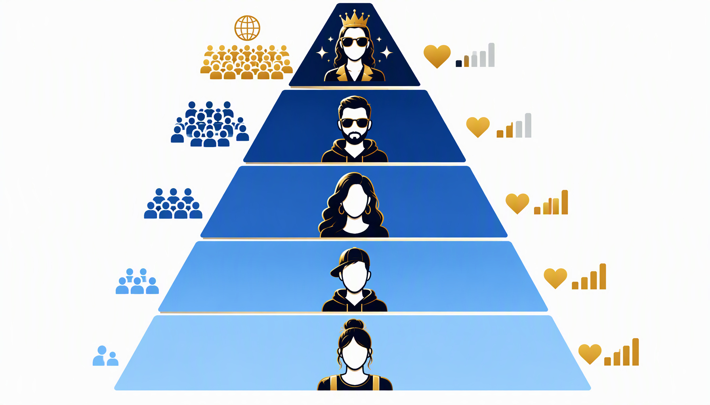
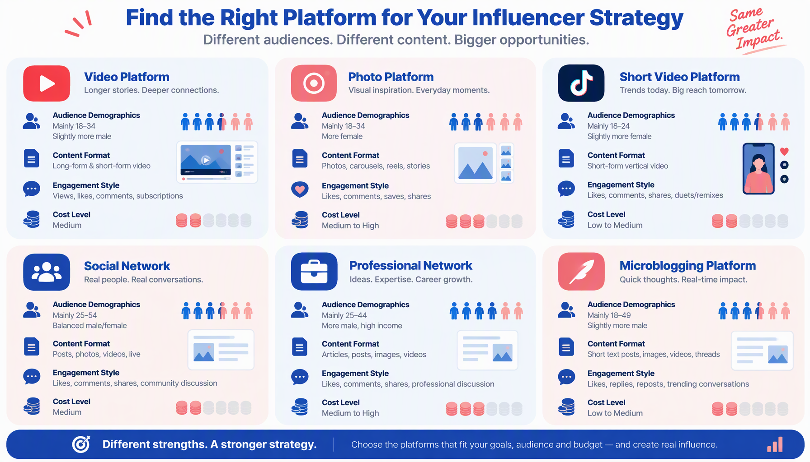
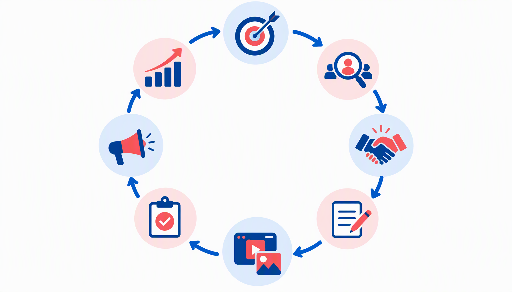
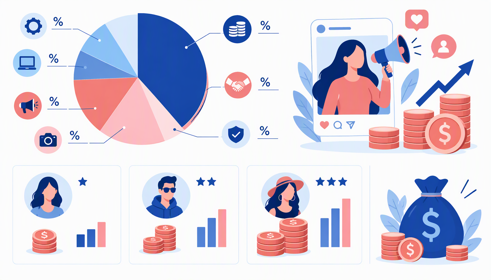
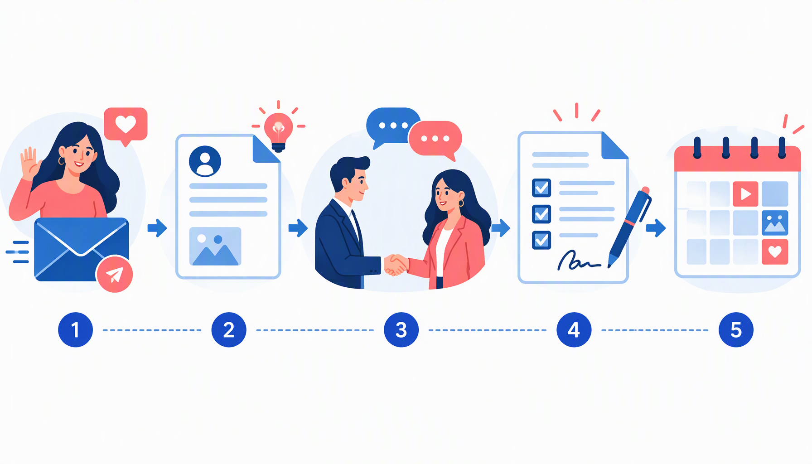
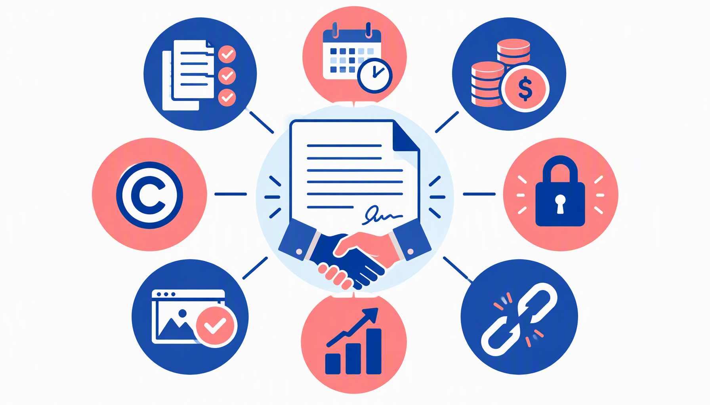
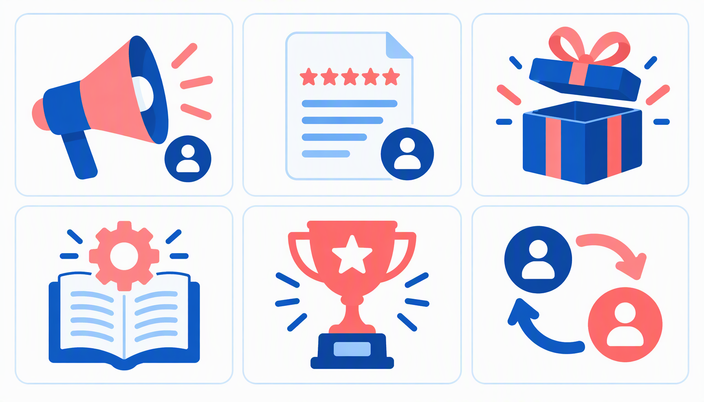
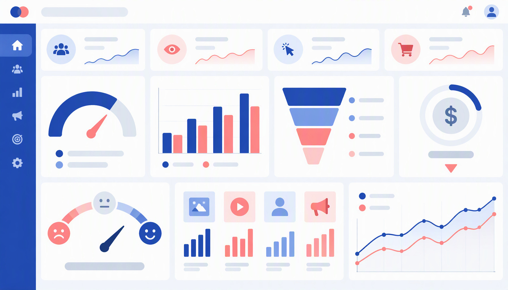
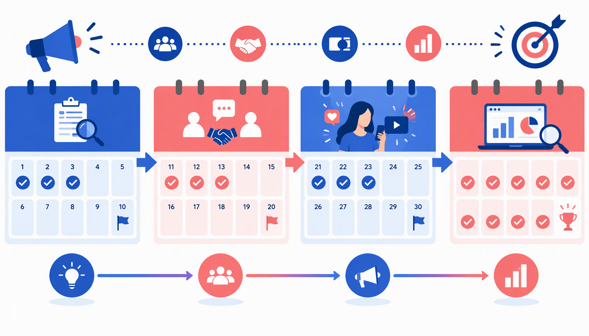

# PANDUAN LENGKAP INFLUENCER MARKETING UNTUK UMKM INDONESIA

**Penulis: Siraj Nur Ihrom**
**SNISHOP.COM | Edition 2026**

---

## DAFTAR ISI

**BAGIAN 1: FONDASI INFLUENCER MARKETING**

1. Memahami Influencer Marketing: Konsep, Evolusi, dan Peluang
2. Mengenal Tingkatan Influencer dan Karakteristiknya
3. Memilih Platform dan Niche yang Tepat
4. Riset dan Seleksi Influencer yang Sesuai Brand

**BAGIAN 2: STRATEGI DAN EKSEKUSI KAMPANYE**

5. Merancang Strategi Kampanye Influencer yang Efektif
6. Outreach, Negosiasi, dan Kontrak dengan Influencer
7. Jenis Konten dan Format Kolaborasi
8. Mengelola Kampanye dan Memastikan Kualitas Konten

**BAGIAN 3: PENGUKURAN, SKALING, DAN MASA DEPAN**

9. Analisis Performa dan Pengukuran ROI Kampanye
10. Strategi Scaling dan Membangun Relasi Jangka Panjang

**BONUS**
- 3 Studi Kasus Sukses Influencer Marketing UMKM Indonesia
- Kalkulator ROI dan Budget Planning
- Rencana Implementasi 30 Hari

---

# BAGIAN 1: FONDASI INFLUENCER MARKETING

---

## Bab 1: Memahami Influencer Marketing: Konsep, Evolusi, dan Peluang

### 1.1 Apa Itu Influencer Marketing?

Influencer marketing adalah strategi pemasaran yang melibatkan kolaborasi antara brand dengan individu yang memiliki pengaruh (influencer) di media sosial untuk mempromosikan produk, jasa, atau pesan brand kepada audiens mereka. Berbeda dengan iklan tradisional, influencer marketing memanfaatkan kepercayaan dan otoritas yang telah dibangun influencer dengan pengikutnya.

Di Indonesia, influencer marketing telah berkembang dari fenomena media sosial menjadi industri bernilai triliunan rupiah. Laporan dari Alvara Research Center menunjukkan bahwa 87% pengguna internet Indonesia pernah membeli produk berdasarkan rekomendasi influencer, menjadikannya salah satu saluran pemasaran paling efektif di pasar lokal.

### 1.2 Mengapa Influencer Marketing Efektif?

**Kepercayaan dan Autentisitas**: Konsumen modern lebih mempercayai rekomendasi dari orang yang mereka ikuti daripada iklan brand langsung. Data Nielsen menunjukkan bahwa 92% konsumen lebih percaya rekomendasi dari individu daripada iklan.

**Targeting yang Presisi**: Influencer biasanya memiliki niche spesifik. Ketika Anda berkolaborasi dengan influencer di niche yang relevan, pesan Anda langsung sampai ke audiens yang tepat.

**Konten yang Engaging**: Influencer adalah konten kreator profesional. Mereka tahu cara membuat konten yang menarik, entertaining, dan persuasif.

**Social Proof**: Ketika seseorang yang dikagumi merekomendasikan produk, followers-nya cenderung mengikuti. Ini adalah prinsip social proof yang sangat kuat.

**SEO dan Brand Awareness**: Kolaborasi influencer menghasilkan backlink, mention, dan user-generated content yang meningkatkan visibilitas brand di mesin pencari.

### 1.3 Evolusi Influencer Marketing di Indonesia

**Fase 1: Era Selebriti (2015-2017)**
- Brand hanya bekerja dengan artis dan selebriti TV
- Budget sangat besar, hanya untuk perusahaan besar
- Platform utama: Instagram dan YouTube
- Format: Endorsement sederhana, foto produk

**Fase 2: Era Micro-Influencer (2018-2020)**
- Munculnya influencer dari kalangan biasa yang ahli di niche tertentu
- Brand mulai menyadari bahwa micro-influencer memiliki engagement lebih tinggi
- Platform baru bermunculan: TikTok (2019 di Indonesia), Twitter
- Format lebih beragam: review, tutorial, unboxing

**Fase 3: Era Profesional (2021-2023)**
- Influencer marketing menjadi industri terstruktur
- Munculnya agency dan platform influencer marketing
- Data dan analytics menjadi standar dalam setiap kampanye
- Live shopping menjadi tren baru (TikTok Shop, Shopee Live)

**Fase 4: Era AI dan Hyper-Personalization (2024-sekarang)**
- AI digunakan untuk mencocokkan brand dengan influencer yang paling tepat
- Virtual influencer mulai muncul
- Konten menjadi lebih personal dan data-driven
- Regulasi semakin ketat mengenai disclosure dan etika

### 1.4 Influencer Marketing vs Iklan Tradisional

| Aspek | Influencer Marketing | Iklan Tradisional |
|-------|---------------------|-------------------|
| **Kepercayaan** | Tinggi (berbasis relasi personal) | Rendah (dianggap interruptif) |
| **Targeting** | Presisi (berbasis niche) | Luas (mass audience) |
| **Biaya** | Fleksibel (dari gratis hingga miliaran) | Mahal (minimum jutaan) |
| **Konten** | Autentik dan engaging | Scripted dan formal |
| **Engagement** | Tinggi (interaksi dua arah) | Rendah (satu arah) |
| **ROI** | Mudah diukur | Sulit diukur langsung |
| **Jangkauan** | Tergantung follower | Tergantung budget |

### 1.5 Statistik Influencer Marketing Indonesia 2026

Beberapa data penting tentang influencer marketing di Indonesia:

- **Nilai industri**: Diproyeksikan mencapai Rp12 triliun pada 2026
- **Jumlah influencer aktif**: Lebih dari 500.000 kreator konten di berbagai platform
- **Pengeluaran brand**: Rata-rata 25% dari total budget digital marketing dialokasikan untuk influencer
- **ROI rata-rata**: Rp6.5 untuk setiap Rp1 yang diinvestasikan
- **Platform terpopuler**: Instagram (45%), TikTok (30%), YouTube (15%), Twitter/X (10%)
- **Niche terpopuler**: Kecantikan (25%), Fashion (20%), Makanan (15%), Teknologi (12%), Lifestyle (10%), Lainnya (18%)

### 1.6 Peluang untuk UMKM

Influencer marketing bukan hanya untuk brand besar. UMKM memiliki keunggulan tersendiri:

**Budget Terbatas tapi Efektif**: UMKM bisa memulai dengan micro-influencer yang biayanya terjangkau namun engagement rate-nya tinggi.

**Produk Unik dan Lokal**: Influencer menyukai produk yang unik dan memiliki cerita. Produk UMKM seringkali memiliki keunikan yang tidak dimiliki produk massal.

**Relasi Personal**: UMKM bisa membangun relasi yang lebih personal dengan influencer karena skala bisnis yang lebih kecil.

**Agility**: UMKM bisa bergerak lebih cepat dalam mengambil keputusan dan menyesuaikan strategi dibandingkan korporasi besar.

---

## Bab 2: Mengenal Tingkatan Influencer dan Karakteristiknya

### 2.1 Nano Influencer (1.000-10.000 Followers)

Nano influencer adalah individu dengan pengikut kecil namun sangat engaged. Mereka biasanya adalah expert di niche spesifik dan memiliki hubungan personal yang kuat dengan followers-nya.

**Karakteristik**
- Engagement rate: 8-15% (sangat tinggi)
- Audiens: Sangat niche dan targeted
- Biaya: Gratis (produk sample) hingga Rp500.000 per post
- Konten: Autentik, personal, dan sangat relatable

**Kelebihan**
- Engagement rate tertinggi di antara semua tier
- Biaya sangat terjangkau untuk UMKM
- Audiens sangat percaya pada rekomendasi mereka
- Responsif dan mudah diajak kolaborasi

**Kekurangan**
- Jangkauan terbatas
- Mungkin belum profesional dalam membuat konten
- Analytics dan reporting terbatas

**Cocok untuk**: UMKM dengan budget terbatas, produk niche spesifik, kampanye lokal, testing pasar

### 2.2 Micro Influencer (10.000-100.000 Followers)

Micro influencer adalah sweet spot untuk kebanyakan kampanye influencer marketing. Mereka memiliki jangkauan yang cukup luas dengan engagement rate yang masih tinggi.

**Karakteristik**
- Engagement rate: 4-8%
- Audiens: Niche tapi dengan volume yang signifikan
- Biaya: Rp500.000-Rp5.000.000 per post
- Konten: Profesional namun tetap autentik

**Kelebihan**
- Balance antara jangkauan dan engagement
- Biaya masih terjangkau untuk UMKM menengah
- Konten berkualitas tinggi
- Sudah memahami cara kerja brand collaboration

**Kekurangan**
- Mulai selektif dalam memilih brand
- Mungkin bekerja dengan beberapa brand sekaligus
- Perlu brief yang lebih detail

**Cocok untuk**: UMKM yang ingin scale up, kampanye produk baru, brand awareness di niche spesifik

### 2.3 Mid-Tier Influencer (100.000-500.000 Followers)

Mid-tier influencer sudah dianggap sebagai public figure di niche mereka. Mereka memiliki tim kecil untuk mengelola konten dan kolaborasi.

**Karakteristik**
- Engagement rate: 2-5%
- Audiens: Luas dengan beberapa niche
- Biaya: Rp5.000.000-Rp25.000.000 per post
- Konten: Sangat profesional, sering memiliki tim produksi

**Kelebihan**
- Jangkauan luas dengan kredibilitas tinggi
- Konten berkualitas premium
- Sudah memiliki pengalaman dengan brand besar
- Bisa menjadi brand ambassador

**Kekurangan**
- Biaya signifikan untuk UMKM kecil
- Engagement rate mulai menurun
- Jadwal sangat padat
- Proses negosiasi lebih panjang

**Cocok untuk**: UMKM yang sudah established, peluncuran produk besar, kampanye nasional

### 2.4 Macro Influencer (500.000-1.000.000 Followers)

Macro influencer adalah selebriti media sosial. Mereka dikenal oleh masyarakat luas dan memiliki pengaruh yang sangat besar.

**Karakteristik**
- Engagement rate: 1-3%
- Audiens: Sangat luas, multi-demografi
- Biaya: Rp25.000.000-Rp100.000.000 per post
- Konten: Production value sangat tinggi

**Kelebihan**
- Jangkauan massal
- Brand awareness yang sangat kuat
- Kredibilitas tinggi
- Bisa menjadi game changer untuk brand

**Kekurangan**
- Biaya sangat besar
- Engagement rate relatif rendah
- Sulit diukur ROI langsung
- Tidak semua UMKM mampu

**Cocok untuk**: Brand besar, kampanye awareness skala nasional, peluncuran produk flagship

### 2.5 Mega Influencer dan Selebriti (1.000.000+ Followers)

Mega influencer dan selebriti adalah tier tertinggi dengan jangkauan jutaan followers. Mereka termasuk artis, atlet, dan public figure lainnya.

**Karakteristik**
- Engagement rate: 0.5-2%
- Audiens: Mass market, semua demografi
- Biaya: Rp100.000.000 hingga miliaran per kampanye
- Konten: Tim produksi profesional, quality setara iklan TV

**Kelebihan**
- Jangkauan nasional bahkan internasional
- Instant brand awareness
- Prestige dan credibility boost
- Media coverage tambahan

**Kekurangan**
- Biaya sangat besar, di luar jangkauan kebanyakan UMKM
- ROI sulit diprediksi
- Proses negosiasi kompleks
- Mungkin tidak autentik untuk niche tertentu

**Cocok untuk**: Perusahaan besar, kampanye nasional, brand repositioning

### 2.6 Perbandingan ROI per Tier

| Tier | Engagement Rate | Biaya per Post | CPM (Cost Per Mille) | Konversi per 1000 views | Rekomendasi |
|------|----------------|----------------|----------------------|------------------------|-------------|
| Nano | 8-15% | Gratis-Rp500K | Rp5.000-Rp20.000 | 15-30 | Best value untuk UMKM |
| Micro | 4-8% | Rp500K-Rp5jt | Rp10.000-Rp50.000 | 8-15 | Sweet spot |
| Mid-Tier | 2-5% | Rp5jt-Rp25jt | Rp30.000-Rp100.000 | 4-8 | Untuk scale up |
| Macro | 1-3% | Rp25jt-Rp100jt | Rp50.000-Rp200.000 | 2-4 | Brand awareness |
| Mega | 0.5-2% | Rp100jt+ | Rp100.000-Rp500.000 | 1-2 | National campaign |

### 2.7 Strategi Kombinasi Tier

Strategi terbaik seringkali bukan memilih satu tier, tapi mengkombinasikan beberapa tier:

**Pyramid Strategy**: 1-2 macro influencer untuk awareness, 5-10 micro influencer untuk engagement, 20-50 nano influencer untuk konversi dan social proof.

**Seeding Strategy**: Kirim produk ke 50-100 nano dan micro influencer tanpa kewajiban posting. Beberapa akan posting secara organik karena mereka genuinely menyukai produk Anda.

**Cascading Strategy**: Mulai dengan nano influencer untuk testing, scale up ke micro jika berhasil, lalu pertimbangkan mid-tier untuk kampanye besar.

---

## Bab 3: Memilih Platform dan Niche yang Tepat

### 3.1 Instagram: Platform Visual Commerce

Instagram tetap menjadi platform utama influencer marketing di Indonesia dengan 103 juta pengguna aktif.

**Demografi Pengguna**
- Usia dominan: 18-34 tahun (68%)
- Gender: Seimbang (52% wanita, 48% pria)
- Lokasi: Kota besar (Jakarta, Surabaya, Bandung, Medan)
- Daya beli: Menengah ke atas

**Format Konten**
- Feed Post: Foto atau carousel untuk review produk
- Stories: Konten ephemeral dengan link sticker
- Reels: Video pendek 15-90 detik
- Live: Real-time interaction dengan followers
- IGTV: Video panjang untuk review mendalam

**Kelebihan untuk Influencer Marketing**
- Visual-first platform, cocok untuk produk fisik
- Fitur shopping terintegrasi
- Insights dan analytics yang komprehensif
- Audience yang sangat besar dan beragam

**Kekurangan**
- Algoritma feed yang kompetitif
- Reach organik menurun dalam beberapa tahun terakhir
- Perlu strategi konten yang matang

**Niche Terpopuler**: Kecantikan, Fashion, Makanan, Travel, Lifestyle, Fitness

**Biaya Kolaborasi**
- Nano: Gratis produk - Rp500.000
- Micro: Rp500.000 - Rp5.000.000
- Mid-Tier: Rp5.000.000 - Rp25.000.000
- Macro: Rp25.000.000 - Rp100.000.000

### 3.2 TikTok: Platform Video Pendek yang Dominan

TikTok telah menjadi fenomena global dengan 127 juta pengguna aktif di Indonesia, menjadikannya platform dengan pertumbuhan tercepat.

**Demografi Pengguna**
- Usia dominan: 16-30 tahun (75%)
- Gender: Sedikit lebih banyak wanita (55%)
- Lokasi: Seluruh Indonesia, termasuk kota tier 2 dan 3
- Daya beli: Bervariasi, banyak dari segmen menengah

**Format Konten**
- Video pendek 15-60 detik (paling populer)
- Video 1-3 menit untuk konten lebih mendalam
- TikTok Live untuk real-time selling
- TikTok Shop untuk direct selling

**Kelebihan untuk Influencer Marketing**
- Algoritma yang sangat efektif dalam mendistribusikan konten
- Potensi viral yang sangat tinggi
- Biaya produksi konten relatif rendah
- TikTok Shop terintegrasi untuk direct selling
- Gen Z audience yang sangat engaged

**Kekurangan**
- Konten cepat tenggelam (short lifespan)
- Belum semua demographic aktif di TikTok
- Regulasi yang terus berubah
- Kontroversi terkait data privacy

**Niche Terpopuler**: Fashion, Kecantikan, Makanan, Hiburan, Edukasi, Tech

**Biaya Kolaborasi**
- Nano: Gratis produk - Rp300.000
- Micro: Rp300.000 - Rp3.000.000
- Mid-Tier: Rp3.000.000 - Rp15.000.000
- Macro: Rp15.000.000 - Rp75.000.000

### 3.3 YouTube: Platform Video Long-Form

YouTube memiliki 132 juta pengguna aktif di Indonesia dan merupakan platform utama untuk konten video panjang.

**Demografi Pengguna**
- Usia dominan: 18-44 tahun (70%)
- Gender: Laki-laki sedikit lebih banyak (55%)
- Lokasi: Seluruh Indonesia
- Daya beli: Bervariasi, dari menengah hingga atas

**Format Konten**
- Video review 10-30 menit
- Tutorial dan how-to
- Unboxing dan first impression
- Vlog yang mengintegrasikan produk
- YouTube Shorts untuk konten pendek

**Kelebihan untuk Influencer Marketing**
- Konten evergreen yang tetap relevan bertahun-tahun
- SEO-friendly (video YouTube muncul di pencarian Google)
- Format panjang memungkinkan review mendalam
- Monetisasi ganda (AdSense + sponsorship)
- Audience yang loyal dan engaged

**Kekurangan**
- Produksi konten lebih mahal dan time-consuming
- Pertumbuhan subscriber lambat
- Algoritma yang kompleks
- Perlu konsistensi tinggi

**Niche Terpopuler**: Teknologi, Gaming, Edukasi, Otomotif, Masak, Vlog

**Biaya Kolaborasi**
- Nano: Rp500.000 - Rp2.000.000
- Micro: Rp2.000.000 - Rp10.000.000
- Mid-Tier: Rp10.000.000 - Rp50.000.000
- Macro: Rp50.000.000 - Rp200.000.000

### 3.4 Facebook: Platform Komunitas dan Grup

Facebook masih memiliki basis pengguna terbesar di Indonesia dengan 167 juta pengguna aktif, meskipun dominasinya mulai berkurang.

**Demografi Pengguna**
- Usia dominan: 25-54 tahun (65%)
- Gender: Seimbang
- Lokasi: Seluruh Indonesia, termasuk daerah rural
- Daya beli: Bervariasi luas

**Format Konten**
- Postingan feed dengan foto atau video
- Facebook Stories
- Facebook Live
- Grup Facebook untuk komunitas niche
- Facebook Marketplace

**Kelebihan untuk Influencer Marketing**
- Basis pengguna terbesar di Indonesia
- Fitur grup yang sangat powerful untuk komunitas
- Facebook Ads terintegrasi untuk amplifikasi
- Audience yang lebih mature dengan daya beli
- Live shopping yang efektif

**Kekurangan**
- Reach organik sangat rendah
- Algoritma yang tidak memprioritaskan konten brand
- Audience lebih tua, mungkin tidak cocok untuk semua produk
- Stigma "platform orang tua" di kalangan muda

**Niche Terpopuler**: Parenting, Komunitas hobi, Bisnis lokal, Makanan, Properti

**Biaya Kolaborasi**
- Nano: Gratis produk - Rp300.000
- Micro: Rp300.000 - Rp2.000.000
- Mid-Tier: Rp2.000.000 - Rp10.000.000
- Macro: Rp10.000.000 - Rp50.000.000

### 3.5 Twitter/X: Platform Real-Time Conversation

Twitter/X memiliki 24 juta pengguna aktif di Indonesia dan merupakan platform utama untuk percakapan real-time.

**Demografi Pengguna**
- Usia dominan: 18-35 tahun (70%)
- Gender: Laki-laki lebih banyak (60%)
- Lokasi: Kota besar
- Daya beli: Menengah ke atas, educated

**Format Konten**
- Thread (utas) informatif
- Tweet dengan gambar atau video
- Spaces (audio live)
- Quote tweet dan reply

**Kelebihan untuk Influencer Marketing**
- Viral potential melalui retweet
- Audience yang sangat engaged dalam diskusi
- Cocok untuk produk tech, SaaS, dan B2B
- Real-time conversation dan trending topics
- Direct interaction dengan audience

**Kekurangan**
- Basis pengguna lebih kecil dibanding platform lain
- Konten cepat tenggelam
- Tidak visual-first
- Karakter terbatas per tweet

**Niche Terpopuler**: Teknologi, Politik, Olahraga, Entertainment, Bisnis

**Biaya Kolaborasi**
- Nano: Gratis produk - Rp200.000
- Micro: Rp200.000 - Rp1.500.000
- Mid-Tier: Rp1.500.000 - Rp7.000.000
- Macro: Rp7.000.000 - Rp30.000.000

### 3.6 LinkedIn: Platform Profesional dan B2B

LinkedIn memiliki 8 juta pengguna aktif di Indonesia dan merupakan platform utama untuk profesional dan B2B.

**Demografi Pengguna**
- Usia dominan: 25-45 tahun (75%)
- Gender: Seimbang
- Lokasi: Kota besar, pusat bisnis
- Daya beli: Tinggi, profesional dan decision maker

**Format Konten**
- Artikel profesional
- Postingan dengan insight industri
- Video pendek
- LinkedIn Newsletter
- LinkedIn Live

**Kelebihan untuk Influencer Marketing**
- Audience profesional dengan daya beli tinggi
- Sangat efektif untuk B2B dan SaaS
- Konten memiliki lifespan panjang
- Thought leadership positioning
- Direct access ke decision makers

**Kekurangan**
- Basis pengguna kecil di Indonesia
- Konten harus profesional dan formal
- Tidak cocok untuk produk consumer
- Engagement rate lebih rendah

**Niche Terpopuler**: Bisnis, Keuangan, Teknologi, Karir, Leadership, SaaS

**Biaya Kolaborasi**
- Nano: Rp300.000 - Rp1.000.000
- Micro: Rp1.000.000 - Rp5.000.000
- Mid-Tier: Rp5.000.000 - Rp20.000.000
- Macro: Rp20.000.000 - Rp75.000.000

### 3.7 Memilih Platform Berdasarkan Tujuan

| Tujuan | Platform Terbaik | Alasan |
|--------|-----------------|--------|
| **Brand Awareness** | Instagram, TikTok | Jangkauan luas, visual appealing |
| **Sales Conversion** | TikTok Shop, Instagram Shopping | Direct purchase path |
| **B2B Lead Generation** | LinkedIn | Professional audience |
| **Product Education** | YouTube | Format panjang untuk penjelasan detail |
| **Community Building** | Facebook Groups | Komunitas yang engaged |
| **Real-Time Buzz** | Twitter/X | Viral potential, trending topics |
| **Local Marketing** | Instagram, Facebook | Location-based targeting |
| **Gen Z Targeting** | TikTok | Dominan di demographic ini |

---

## Bab 4: Riset dan Seleksi Influencer yang Sesuai Brand

### 4.1 Kriteria Seleksi Influencer

Tidak semua influencer cocok untuk brand Anda. Berikut kriteria yang harus dipertimbangkan:

**Relevansi Niche**
- Influencer harus memiliki niche yang sesuai dengan produk Anda
- Periksa apakah konten mereka konsisten dengan brand values
- Contoh: Jangan gunakan influencer gaming untuk produk skincare

**Kualitas Audiens**
- Periksa demografi followers: usia, lokasi, gender
- Pastikan sesuai dengan target market Anda
- Tools: Instagram Insights, Social Blade, HypeAuditor

**Engagement Rate**
- Lebih penting daripada jumlah followers
- Engagement rate yang baik: di atas 3% untuk Instagram, di atas 5% untuk TikTok
- Hitung: (Likes + Comments + Shares) / Followers x 100%

**Autentisitas dan Kredibilitas**
- Periksa apakah influencer benar-benar menggunakan produk yang direkomendasikan
- Lihat apakah mereka selektif dalam memilih brand collaboration
- Cek apakah mereka pernah terlibat kontroversi

**Kualitas Konten**
- Evaluasi kualitas visual, editing, dan storytelling
- Pastikan sesuai dengan standar brand Anda
- Konten yang bagus akan memberikan hasil yang lebih baik

**Konsistensi**
- Influencer yang konsisten posting memiliki audience yang lebih loyal
- Periksa frekuensi posting dan engagement patterns
- Hindari influencer yang tidak aktif selama berbulan-bulan

### 4.2 Cara Meriset Influencer

**Metode Manual**
- Cari hashtag yang relevan dengan niche Anda
- Lihat siapa yang posting konten populer dengan hashtag tersebut
- Periksa profil mereka satu per satu
- Catat dalam spreadsheet untuk perbandingan

**Metode Tools**
- HypeAuditor: Analisis mendalam tentang followers dan engagement
- Social Blade: Track pertumbuhan followers dan statistik
- Modash: Database influencer dengan filter yang komprehensif
- AspireIQ: Platform untuk menemukan dan mengelola influencer
- Upfluence: Analytics dan discovery tools

**Metode Referral**
- Tanya ke sesama marketer tentang influencer yang pernah mereka ajak kerja sama
- Join komunitas marketer untuk mendapatkan rekomendasi
- Cek siapa yang bekerja dengan kompetitor Anda

### 4.3 Red Flags dalam Seleksi Influencer

**Followers Palsu**
- Jumlah followers tinggi tapi engagement sangat rendah
- Komentar generik seperti "Nice!" atau emoji tanpa substansi
- Pertumbuhan followers yang tidak natural (lonjakan tiba-tiba)
- Gunakan tools seperti HypeAuditor untuk mendeteksi fake followers

**Engagement Baiting**
- Influencer yang sering mengadakan giveaway hanya untuk menaikkan engagement
- Engagement tinggi tapi tidak berkualitas
- Followers hanya engage saat ada giveaway

**Kontroversi dan Reputasi Buruk**
- Pernah terlibat skandal atau kontroversi
- Sering membuat konten yang provokatif atau menyinggung
- Rekam jejak digital yang bermasalah
- Selalu Google nama influencer sebelum bekerja sama

**Inkonsistensi Brand**
- Bekerja dengan terlalu banyak brand sekaligus
- Promosi produk yang bertentangan satu sama lain
- Tidak memiliki niche yang jelas
- Konten terasa tidak autentik

**Metric Manipulation**
- Screenshot analytics yang tidak bisa diverifikasi
- Claim metric yang tidak masuk akal
- Tidak mau memberikan akses ke dashboard analytics
- Data yang tidak konsisten antar platform

### 4.4 Membuat Shortlist Influencer

Setelah riset, buat shortlist 10-20 influencer yang potensial. Untuk setiap influencer, catat:

**Informasi Dasar**
- Nama dan handle media sosial
- Platform utama dan secondary platforms
- Jumlah followers di setiap platform
- Niche dan topik utama konten

**Metrik Performa**
- Engagement rate rata-rata
- Average likes dan comments per post
- Average views untuk video
- Pertumbuhan followers per bulan

**Informasi Kolaborasi**
- Apakah pernah bekerja dengan brand sejenis
- Rate card atau estimasi biaya
- Kontak untuk bisnis (email atau DM)
- Availability dan response time

**Penilaian Kualitatif**
- Kualitas konten (skala 1-10)
- Kesesuaian dengan brand values (skala 1-10)
- Autentisitas rekomendasi (skala 1-10)
- Overall fit score (rata-rata)

### 4.5 Approaching Influencer untuk Pertama Kali

Setelah memiliki shortlist, langkah selanjutnya adalah melakukan pendekatan awal:

**Follow dan Engage Dulu**
- Follow akun mereka di semua platform
- Like dan comment secara genuine di beberapa postingan
- Share konten mereka jika relevan
- Bangun awareness sebelum outreach formal

**DM atau Email Pendek**
- Perkenalkan diri dan brand Anda secara singkat
- Sampaikan mengapa Anda tertarik bekerja sama
- Tanyakan apakah mereka terbuka untuk kolaborasi
- Jangan langsung negosiasi harga di pesan pertama

**Berikan Konteks yang Jelas**
- Jelaskan produk Anda dan mengapa cocok dengan audience mereka
- Sebutkan jenis kolaborasi yang Anda bayangkan
- Berikan timeline yang diinginkan
- Tanyakan rate card atau ekspektasi mereka

**Follow Up dengan Sopan**
- Jika tidak ada respons dalam 3-5 hari, kirim follow up
- Jangan spam atau terlalu agresif
- Jika tetap tidak ada respons, move on ke influencer lain

---

# BAGIAN 2: STRATEGI DAN EKSEKUSI KAMPANYE

---

## Bab 5: Merancang Strategi Kampanye Influencer yang Efektif

### 5.1 Menetapkan Tujuan Kampanye

Setiap kampanye influencer harus memiliki tujuan yang jelas dan terukur. Tujuan yang umum:

**Brand Awareness**
- Metrik: Reach, impressions, follower growth, mention volume
- Target: Meningkatkan kesadaran brand di target market
- Cocok untuk: Brand baru, peluncuran produk, rebranding

**Engagement**
- Metrik: Likes, comments, shares, saves, video views
- Target: Meningkatkan interaksi dengan brand
- Cocok untuk: Building community, product feedback, brand loyalty

**Traffic Generation**
- Metrik: Link clicks, website visits, landing page views
- Target: Mengarahkan traffic ke website atau landing page
- Cocok untuk: Product launch, promotional campaign, content marketing

**Sales Conversion**
- Metrik: Sales, revenue, conversion rate, average order value
- Target: Meningkatkan penjualan langsung
- Cocok untuk: Promosi produk, seasonal campaign, clearance sale

**Lead Generation**
- Metrik: Sign-ups, email subscribers, demo requests
- Target: Mengumpulkan data prospek potensial
- Cocok untuk: B2B, high-value products, service-based business

**User-Generated Content (UGC)**
- Metrik: Jumlah konten yang dibuat, quality of content
- Target: Menghasilkan konten autentik dari pengguna
- Cocok untuk: Social proof, content library, community building

### 5.2 Framework SMART untuk Tujuan Kampanye

Pastikan tujuan kampanye Anda memenuhi kriteria SMART:

**Specific (Spesifik)**
- Buruk: "Meningkatkan brand awareness"
- Baik: "Meningkatkan brand awareness di kalangan wanita usia 25-35 tahun di Jakarta"

**Measurable (Terukur)**
- Buruk: "Mendapatkan banyak engagement"
- Baik: "Mendapatkan minimal 10.000 likes dan 500 comments dari kampanye"

**Achievable (Dapat Dicapai)**
- Buruk: "Mendapatkan 1 juta followers dalam 1 bulan"
- Baik: "Mendapatkan 5.000 followers baru dalam 3 bulan"

**Relevant (Relevan)**
- Buruk: "Meningkatkan engagement di LinkedIn" (untuk produk fashion remaja)
- Baik: "Meningkatkan engagement di Instagram" (untuk produk fashion remaja)

**Time-bound (Batas Waktu)**
- Buruk: "Meningkatkan penjualan"
- Baik: "Meningkatkan penjualan 20% dalam 2 bulan kampanye"

### 5.3 Menentukan Budget Kampanye

Budget influencer marketing bervariasi tergantung skala dan tujuan. Berikut panduan alokasi budget:

**Budget Kecil (di bawah Rp5.000.000)**
- Fokus: Nano dan micro influencer
- Jumlah influencer: 5-10 nano atau 2-5 micro
- Platform: 1-2 platform utama
- Durasi: 1-2 bulan
- Ekspektasi: Testing dan validasi

**Budget Menengah (Rp5.000.000 - Rp25.000.000)**
- Fokus: Micro dan mid-tier influencer
- Jumlah influencer: 3-5 micro atau 1-2 mid-tier
- Platform: 2-3 platform
- Durasi: 2-3 bulan
- Ekspektasi: Brand awareness dan engagement

**Budget Besar (Rp25.000.000 - Rp100.000.000)**
- Fokus: Mid-tier dan macro influencer
- Jumlah influencer: 2-3 mid-tier atau 1 macro + beberapa micro
- Platform: Multi-platform
- Durasi: 3-6 bulan
- Ekspektasi: Significant brand awareness dan sales

**Budget Enterprise (di atas Rp100.000.000)**
- Fokus: Macro dan mega influencer
- Jumlah influencer: 1-2 macro/mega + supporting micro
- Platform: All major platforms
- Durasi: 6-12 bulan
- Ekspektasi: Market leadership dan national awareness

### 5.4 Menyusun Brief Kampanye

Brief yang jelas adalah kunci keberhasilan kampanye. Berikut komponen brief yang harus ada:

**Informasi Brand**
- Tentang brand Anda: visi, misi, values
- Target audience: demografi, psikografi, behavior
- Unique selling proposition: apa yang membedakan brand Anda
- Brand voice dan tone: formal, casual, humoris, inspiratif

**Informasi Produk**
- Nama produk dan deskripsi singkat
- Key features dan benefits
- Harga dan promo (jika ada)
- Link pembelian atau landing page
- USPs yang harus disampaikan

**Tujuan Kampanye**
- Tujuan utama dan secondary objectives
- KPI yang akan diukur
- Timeline kampanye
- Budget range (opsional, tergantung negosiasi)

**Panduan Konten**
- Jenis konten yang diharapkan (review, tutorial, unboxing, dll)
- Key messages yang harus disampaikan
- Do's and don'ts dalam konten
- Hashtag yang harus digunakan
- Tag dan mention yang diperlukan
- Disclosure requirement (#ad, #sponsored, #paidpartnership)

**Timeline dan Deliverables**
- Tanggal briefing dan Q&A
- Deadline submission konten untuk review
- Tanggal revisi (jika ada)
- Tanggal publish yang ditentukan
- Jumlah konten yang diharapkan (posts, stories, reels, dll)

**Kompensasi dan Benefit**
- Fee atau kompensasi finansial
- Produk gratis atau sample
- Benefit tambahan (discount code, affiliate commission, dll)
- Metode dan timeline pembayaran

### 5.5 Jenis Kampanye Influencer

**Product Seeding**
- Kirim produk gratis tanpa kewajiban posting
- Tujuannya membangun relasi dan mendapatkan organic mention
- Cocok untuk: Nano dan micro influencer, produk baru
- Biaya: Hanya produk sample
- Ekspektasi: 30-50% akan posting secara organik

**Sponsored Post**
- Bayar influencer untuk membuat konten tentang produk
- Anda memiliki kontrol atas pesan dan timing
- Cocok untuk: Semua tier influencer, kampanye spesifik
- Biaya: Tergantung tier dan platform
- Ekspektasi: Konten sesuai brief dengan kreativitas influencer

**Giveaway dan Kontes**
- Influencer mengadakan giveaway produk Anda
- Syarat: follow akun brand, like, comment, tag teman
- Cocok untuk: Meningkatkan followers dan engagement
- Biaya: Produk + fee influencer
- Ekspektasi: Follower growth dan engagement spike

**Affiliate Marketing**
- Influencer mendapatkan komisi per penjualan
- Biasanya dikombinasikan dengan base fee
- Cocok untuk: Performance-driven campaign
- Biaya: Base fee + komisi per sale
- Ekspektasi: Sales dan revenue yang terukur

**Brand Ambassador**
- Kolaborasi jangka panjang (3-12 bulan)
- Influencer menjadi "wajah" brand untuk periode tertentu
- Cocok untuk: Building long-term brand association
- Biaya: Retainer bulanan atau kontrak tahunan
- Ekspektasi: Konsisten brand mention dan endorsement

**Takeover**
- Influencer mengambil alih akun brand untuk periode tertentu
- Membuat konten di Stories atau feed brand
- Cocok untuk: Fresh perspective, cross-pollination audience
- Biaya: Fee per hari atau per campaign
- Ekspektasi: Engagement spike dan new followers

**Event Coverage**
- Influencer diundang ke event dan membuat konten live
- Cocok untuk: Product launch, grand opening, brand event
- Biaya: Undangan + fee + transport
- Ekspektasi: Real-time buzz dan event awareness

---

## Bab 6: Outreach, Negosiasi, dan Kontrak dengan Influencer

### 6.1 Crafting Outreach Message yang Efektif

Pesan pertama kepada influencer sangat menentukan apakah mereka akan merespons. Berikut template outreach yang efektif:

**Subject Line (untuk Email)**
- Jelas dan menarik: "Kolaborasi [Brand] x [Influencer Name]"
- Personal: Sebutkan nama mereka
- Spesifik: Jelaskan jenis kolaborasi

**Pembukaan**
- Sapaan personal: "Halo [Nama],"
- Tunjukkan Anda mengenal konten mereka: "Saya sudah mengikuti konten kamu tentang [topik] dan sangat mengapresiasi [hal spesifik]"
- Perkenalkan diri secara singkat: "Saya [Nama] dari [Brand]"

**Body**
- Jelaskan mengapa Anda menghubungi mereka: "Kami sedang mencari influencer yang [kriteria] dan profil kamu sangat sesuai"
- Sampaikan tentang brand dan produk secara singkat
- Jelaskan jenis kolaborasi yang Anda bayangkan
- Sebutkan benefit untuk mereka dan audience mereka

**Call to Action**
- Ajak untuk diskusi lebih lanjut: "Apakah kamu tertarik untuk berdiskusi lebih lanjut tentang kemungkinan kolaborasi ini?"
- Berikan opsi: "Saya bisa kirim brief detail atau kita bisa jumpa online untuk diskusi"
- Tutup dengan sopan: "Terima kasih atas waktunya, saya tunggu kabar baik dari kamu"

### 6.2 Negosiasi Rate dan Deliverables

Negosiasi adalah bagian penting dalam influencer marketing. Berikut tips negosiasi yang efektif:

**Riset Rate Card**
- Cek rate card influencer atau tanyakan langsung
- Bandingkan dengan market rate untuk tier dan niche yang sama
- Pertimbangkan engagement rate, bukan hanya followers

**Negosiasi Package**
- Jangan hanya negosiasi harga per post
- Tawarkan package deal untuk multiple posts atau long-term partnership
- Contoh: 3 posts + 5 stories dengan diskon 20%

**Value Exchange**
- Selain uang, apa yang bisa Anda tawarkan?
- Produk gratis, exclusive access, event invitation
- Exposure ke audience Anda (jika Anda juga memiliki platform besar)
- Testimonial dan portfolio building

**Performance-Based Component**
- Pertimbangkan struktur hybrid: base fee + performance bonus
- Contoh: Rp2.000.000 base fee + Rp5.000 per sale melalui kode promo mereka
- Ini memastikan influencer termotivasi untuk menghasilkan hasil terbaik

**Payment Terms**
- Negosiasikan terms yang jelas: 50% di muka, 50% setelah publish
- Atau full payment setelah konten published dan memenuhi KPI
- Pastikan metode pembayaran disepakati (transfer bank, e-wallet, dll)

### 6.3 Membuat Kontrak Influencer

Kontrak yang jelas melindungi kedua belah pihak. Berikut elemen-elemen penting dalam kontrak influencer:

**Identitas Para Pihak**
- Nama lengkap dan informasi kontak brand
- Nama lengkap dan informasi kontak influencer
- Tanggal perjanjian dimulai dan berakhir

**Scope of Work**
- Jenis konten yang harus dibuat (post, reels, stories, video, dll)
- Jumlah konten dan platform
- Timeline deliverables
- Revisi yang diizinkan (biasanya 1-2 kali revisi)

**Compensation**
- Total fee dan struktur pembayaran
- Timeline pembayaran (misalnya 50% di muka, 50% setelah publish)
- Benefit tambahan (produk gratis, affiliate commission, dll)

**Content Guidelines**
- Key messages yang harus disampaikan
- Do's and don'ts
- Brand assets yang harus digunakan (logo, hashtag, dll)
- Disclosure requirements (#ad, #sponsored)

**Usage Rights**
- Siapa yang berhak menggunakan konten setelah published
- Berapa lama brand bisa menggunakan konten influencer
- Di mana konten bisa digunakan (social media, website, ads, dll)
- Apakah konten bisa dimodifikasi

**Exclusivity**
- Apakah influencer tidak boleh bekerja dengan brand kompetitor
- Durasi exclusivity (biasanya 1-3 bulan sebelum dan sesudah kampanye)
- Kompensasi tambahan untuk exclusivity clause

**Performance Metrics**
- KPI yang diharapkan (reach, engagement, clicks, sales)
- Bagaimana metrik akan diukur dan dilaporkan
- Konsekuensi jika KPI tidak tercapai (jika ada)

**Termination Clause**
- Kondisi apa yang memungkinkan kontrak dibatalkan
- Notice period untuk pembatalan
- Konsekuensi finansial dari pembatalan sepihak

**Confidentiality**
- Informasi apa yang harus dijaga kerahasiaannya
- Durasi kewajiban confidentiality setelah kontrak berakhir

### 6.4 Kesalahan Umum dalam Outreach dan Negosiasi

**Terlalu Salesy di Pesan Pertama**
- Jangan langsung jualan di pesan pertama
- Bangun relasi dulu, baru bicara bisnis

**Tidak Riset tentang Influencer**
- Pesan generic yang sama dikirim ke semua influencer
- Sebutkan hal spesifik tentang konten mereka untuk menunjukkan Anda serius

**Budget Tidak Realistis**
- Menawarkan fee yang jauh di bawah market rate
- Atau mengharapkan deliverables yang tidak sesuai dengan budget

**Brief yang Tidak Jelas**
- Brief yang terlalu longgar atau terlalu ketat
- Influencer butuh kreativitas, tapi juga butuh arahan yang jelas

**Tidak Ada Kontrak Tertulis**
- Kesepakatan lisan saja tidak cukup
- Selalu buat kontrak tertulis untuk melindungi kedua belah pihak

**Mikromanajemen Konten**
- Memberikan terlalu banyak instruksi detail
- Trust influencer untuk membuat konten yang sesuai dengan style mereka

---

## Bab 7: Jenis Konten dan Format Kolaborasi

### 7.1 Sponsored Review

Review produk adalah format kolaborasi paling umum dan efektif. Influencer mencoba produk dan memberikan opini jujur kepada audience mereka.

**Format Terbaik**
- Video review 8-15 menit untuk YouTube
- Carousel post 5-10 slide untuk Instagram
- Video 30-60 detik untuk TikTok atau Reels

**Tips untuk Brand**
- Berikan produk minimal 2 minggu sebelum deadline konten
- Izinkan influencer untuk memberikan opini jujur, termasuk kekurangan
- Jangan memaksa influencer untuk mengatakan hal yang tidak mereka percayai
- Review yang autentik lebih dipercaya daripada review yang terlalu positif

**Contoh Struktur Review**
- Hook: Masalah yang diselesaikan produk
- First impression: Unboxing dan tampilan awal
- Pengalaman penggunaan: Bagaimana produk digunakan dalam keseharian
- Kelebihan: 3-5 hal yang disukai
- Kekurangan: 1-2 hal yang bisa diperbaiki
- Kesimpulan: Rekomendasi dan rating

### 7.2 Tutorial dan How-To

Format ini mengintegrasikan produk ke dalam tutorial yang memberikan nilai edukasi kepada audience.

**Format Terbaik**
- Video tutorial 10-20 menit untuk YouTube
- Reels atau TikTok 30-60 detik untuk quick tips
- Carousel post untuk step-by-step guide

**Tips untuk Brand**
- Pastikan produk benar-benar dibutuhkan dalam tutorial
- Jangan memaksakan produk jika tidak relevan
- Berikan informasi teknis yang dibutuhkan influencer
- Tutorial yang bermanfaat akan menghasilkan konversi lebih tinggi

**Contoh Struktur Tutorial**
- Pendahuluan: Apa yang akan dipelajari
- Bahan/alat yang dibutuhkan (termasuk produk Anda)
- Langkah-langkah detail
- Tips dan trik tambahan
- Hasil akhir dan CTA

### 7.3 Unboxing dan First Impression

Format ini menangkap excitement dan reaksi autentik saat pertama kali menerima produk.

**Format Terbaik**
- Video unboxing 5-10 menit untuk YouTube
- Stories sequence untuk Instagram
- Video pendek 15-30 detik untuk TikTok

**Tips untuk Brand**
- Kemasan produk harus menarik dan Instagrammable
- Sertakan personal touch: handwritten note, free sample, dll
- Biarkan reaksi influencer menjadi natural dan spontan
- Unboxing yang menarik bisa viral dan menghasilkan organic reach

### 7.4 Giveaway dan Kontes

Format ini efektif untuk meningkatkan engagement dan followers secara cepat.

**Format Terbaik**
- Post dengan visual menarik yang menjelaskan hadiah
- Syarat: follow, like, comment, tag teman, share
- Durasi: 1-2 minggu
- Pengumuman pemenang via stories atau live

**Tips untuk Brand**
- Hadiah harus relevan dan menarik bagi target audience
- Syarat tidak boleh terlalu rumit
- Pastikan giveaway sesuai dengan aturan platform
- Follow up dengan pemenang secara transparan

### 7.5 Live Shopping

Format ini semakin populer dengan adanya TikTok Shop, Shopee Live, dan Instagram Shopping.

**Format Terbaik**
- Live session 30-60 menit
- Demo produk secara real-time
- Q&A dengan viewers
- Flash sale atau exclusive discount selama live

**Tips untuk Brand**
- Siapkan produk sample yang cukup untuk demo
- Berikan talking points tapi biarkan influencer improvisasi
- Siapkan stok yang cukup untuk antisipasi lonjakan pesanan
- Promosikan live session beberapa hari sebelumnya

### 7.6 Takeover dan Takeover Stories

Format ini memberikan kontrol akun brand kepada influencer untuk periode tertentu.

**Format Terbaik**
- Instagram Stories takeover 1 hari
- TikTok takeover 1-3 hari
- Twitter/X takeover untuk event tertentu

**Tips untuk Brand**
- Pilih influencer yang sesuai dengan brand values
- Berikan guideline tentang apa yang boleh dan tidak boleh diposting
- Siapkan audience Anda untuk takeover
- Monitor konten secara real-time

### 7.7 Series dan Long-Term Content

Format ini melibatkan influencer untuk membuat konten secara berkala dalam periode tertentu.

**Format Terbaik**
- Weekly series: "Product of the Week" atau "Tips Tuesday"
- Monthly collaboration: 1-2 konten per bulan selama 3-6 bulan
- Seasonal campaign: Konten untuk momen tertentu (Ramadan, Lebaran, Natal)

**Tips untuk Brand**
- Konsistensi adalah kunci
- Berikan variasi agar konten tidak monoton
- Track performa setiap episode
- Adjust strategi berdasarkan feedback

### 7.8 User-Generated Content (UGC) Campaign

Format ini mengajak influencer dan followers mereka untuk membuat konten tentang brand.

**Format Terbaik**
- Hashtag campaign: Buat hashtag unik untuk campaign
- Challenge: Buat challenge yang mudah diikuti
- Contest: Berikan hadiah untuk konten terbaik

**Tips untuk Brand**
- Buat campaign yang mudah diikuti
- Berikan insentif yang menarik
- Feature konten terbaik di akun brand
- Gunakan konten UGC untuk marketing materials (dengan izin)

### 7.9 Memilih Format yang Tepat

| Tujuan | Format Terbaik | Platform | Budget |
|--------|---------------|----------|--------|
| **Product Awareness** | Review, Unboxing | YouTube, Instagram | Menengah |
| **Sales Conversion** | Live Shopping, Tutorial | TikTok, Instagram | Menengah-Besar |
| **Engagement** | Giveaway, Challenge | Instagram, TikTok | Kecil-Menengah |
| **Brand Loyalty** | Series, Ambassador | Multi-platform | Besar |
| **Content Library** | UGC Campaign | Instagram, TikTok | Kecil-Menengah |
| **B2B Lead Gen** | Tutorial, Webinar | LinkedIn, YouTube | Besar |

---

## Bab 8: Mengelola Kampanye dan Memastikan Kualitas Konten

### 8.1 Timeline Manajemen Kampanye

Kampanye influencer yang sukses membutuhkan manajemen timeline yang ketat:

**Fase 1: Perencanaan (Minggu 1-2)**
- Tetapkan tujuan dan KPI
- Riset dan shortlist influencer
- Siapkan budget dan brief
- Outreach dan negosiasi

**Fase 2: Persiapan (Minggu 3-4)**
- Finalisasi kontrak
- Kirim produk dan brief detail
- Jadwal briefing call dengan influencer
- Siapkan internal approval process

**Fase 3: Produksi Konten (Minggu 5-6)**
- Influencer membuat konten
- Submission draft untuk review
- Feedback dan revisi (1-2 ronde)
- Final approval

**Fase 4: Publikasi (Minggu 7-8)**
- Konten published sesuai jadwal
- Monitor engagement dan komentar
- Respond to comments dan questions
- Amplify dengan paid promotion (opsional)

**Fase 5: Evaluasi (Minggu 9-10)**
- Kumpulkan data performa
- Hitung ROI dan bandingkan dengan KPI
- Debrief dengan influencer
- Dokumentasi learnings untuk kampanye berikutnya

### 8.2 Review dan Approval Konten

Proses review konten penting untuk memastikan kualitas dan kesesuaian dengan brand guidelines:

**Apa yang Harus Direview**
- Akurasi informasi produk
- Kesesuaian dengan key messages
- Kualitas visual dan editing
- Disclosure yang tepat (#ad, #sponsored)
- Tag dan mention yang benar
- Link dan CTA yang berfungsi

**Apa yang Tidak Perlu Dikontrol**
- Gaya bahasa dan tone influencer (selama tidak melanggar brand values)
- Kreativitas dan angle konten
- Editing style dan visual aesthetic
- Waktu posting (selama sesuai kesepakatan)

**Feedback yang Konstruktif**
- Berikan feedback yang spesifik dan actionable
- Jelaskan mengapa perubahan diperlukan
- Hargai kreativitas influencer
- Batasi revisi sesuai kontrak (biasanya 1-2 kali)

### 8.3 Monitoring dan Engagement

Setelah konten published, pekerjaan belum selesai. Anda harus aktif monitoring:

**Monitor Komentar**
- Baca semua komentar di konten influencer
- Respond to questions tentang produk
- Flag komentar negatif atau misinformation
- Thank positive comments dan engagement

**Track Metrik Real-Time**
- Likes, comments, shares dalam 24 jam pertama
- Reach dan impressions
- Link clicks (jika ada)
- Website traffic dari kampanye

**Engage dengan Audience**
- Like dan reply komentar yang mention brand Anda
- Share konten influencer di Stories brand (dengan izin)
- Create follow-up content berdasarkan feedback

**Handle Issues**
- Jika ada komentar negatif, respond dengan cepat dan profesional
- Jika ada misinformation, koreksi dengan sopan
- Jika influencer tidak memenuhi deliverables, follow up sesuai kontrak

### 8.4 Dokumentasi dan Reporting

Dokumentasi yang baik penting untuk evaluasi dan kampanye masa depan:

**Screenshot dan Archive**
- Screenshot semua konten yang published
- Archive stories sebelum hilang (24 jam)
- Simpan semua komunikasi dengan influencer
- Dokumentasi metrik performa

**Performance Report**
- Reach dan impressions per konten
- Engagement metrics (likes, comments, shares, saves)
- Click-through rate dan website traffic
- Sales dan konversi (jika applicable)
- Cost per engagement dan cost per acquisition
- ROI calculation

**Learnings dan Recommendations**
- Apa yang bekerja dengan baik
- Apa yang bisa diperbaiki
- Insight tentang audience dan platform
- Rekomendasi untuk kampanye berikutnya

### 8.5 Membangun Relasi Jangka Panjang dengan Influencer

Relasi jangka panjang dengan influencer lebih berharga daripada transaksi satu kali:

**Komunikasi yang Konsisten**
- Tetap berhubungan meskipun tidak ada kampanye aktif
- Ucapkan selamat hari raya atau milestone penting
- Share achievement brand mereka
- Be genuine dalam membangun relasi

**Feedback dan Appreciation**
- Berikan feedback tentang performa kampanye
- Apresiasi kerja keras dan kreativitas mereka
- Share hasil kampanye dan impact yang mereka buat
- Berikan testimonial untuk portfolio mereka

**Priority Access**
- Berikan akses pertama ke produk baru
- Undangan exclusive ke event brand
- Offer first right of refusal untuk kampanye berikutnya
- Negosiasi rate yang lebih baik untuk long-term partner

**Growth Support**
- Promosikan konten mereka di akun brand
- Recommend mereka ke brand lain
- Share tips dan insight tentang industry
- Support personal brand mereka

---

# BAGIAN 3: PENGUKURAN, SKALING, DAN MASA DEPAN

---

## Bab 9: Analisis Performa dan Pengukuran ROI Kampanye

### 9.1 Metrik Kunci Influencer Marketing

Untuk mengukur keberhasilan kampanye, track metrik-metrik berikut:

**Awareness Metrics**
- Reach: Jumlah orang unik yang melihat konten
- Impressions: Total kali konten ditampilkan
- Follower growth: Pertumbuhan followers brand selama kampanye
- Brand mentions: Jumlah mention brand di platform

**Engagement Metrics**
- Likes, comments, shares, saves
- Engagement rate: (Total engagement / Reach) x 100%
- Video views dan completion rate
- Story completion rate

**Traffic Metrics**
- Link clicks dari konten influencer
- Website visits dari referral influencer
- Time on site dari traffic influencer
- Bounce rate dari traffic influencer

**Conversion Metrics**
- Sales langsung dari kode promo influencer
- Leads generated dari kampanye
- Conversion rate dari traffic influencer
- Average order value dari penjualan influencer

**Cost Efficiency Metrics**
- CPM (Cost Per Mille): Biaya per 1.000 impressions
- CPE (Cost Per Engagement): Biaya per engagement
- CPC (Cost Per Click): Biaya per klik
- CPA (Cost Per Acquisition): Biaya per konversi

### 9.2 Cara Mengukur ROI

**Langkah 1: Hitung Total Biaya Kampanye**
- Fee influencer
- Biaya produk sample
- Biaya produksi (jika ada)
- Biaya amplifikasi (paid promotion)
- Biaya tools dan platform
- Waktu tim internal (jika dihargai)

**Langkah 2: Hitung Total Value yang Dihasilkan**
- Revenue langsung dari penjualan
- Value dari traffic dan leads
- Value dari brand awareness (estimated)
- Value dari konten yang bisa digunakan ulang
- Value dari follower growth

**Langkah 3: Hitung ROI**
- ROI = (Total Value - Total Biaya) / Total Biaya x 100%
- Contoh: Total Value Rp50.000.000, Total Biaya Rp15.000.000
- ROI = (50.000.000 - 15.000.000) / 15.000.000 x 100% = 233%

**Langkah 4: Bandingkan dengan Channel Lain**
- Bandingkan ROI influencer marketing dengan channel marketing lain
- Apakah influencer marketing memberikan ROI lebih baik?
- Alokasi budget berdasarkan performa relatif

### 9.3 Tools untuk Tracking dan Analytics

**Native Platform Analytics**
- Instagram Insights: Reach, impressions, engagement
- TikTok Analytics: Views, engagement, follower demographics
- YouTube Analytics: Views, watch time, subscriber growth
- Facebook Insights: Reach, engagement, page likes

**Third-Party Tools**
- HypeAuditor: Influencer analytics dan fraud detection
- Social Blade: Track pertumbuhan followers dan statistik
- Sprout Social: Social media management dan analytics
- Brandwatch: Social listening dan brand mention tracking
- Mention: Real-time brand mention monitoring

**Affiliate dan Conversion Tracking**
- Kode promo unik untuk setiap influencer
- Affiliate link dengan tracking parameter
- Landing page khusus untuk kampanye influencer
- UTM parameters untuk tracking traffic source

### 9.4 Atribusi dan Multi-Touch Attribution

Salah satu tantangan dalam influencer marketing adalah atribusi. Seorang konsumen mungkin melihat konten influencer, lalu mencari brand di Google, baru kemudian membeli. Bagaimana Anda menghitung kontribusi influencer?

**Single-Touch Attribution**
- First-touch: Konversi dikreditkan ke touchpoint pertama (influencer)
- Last-touch: Konversi dikreditkan ke touchpoint terakhir (mungkin Google Ads)
- Kelemahan: Tidak mempertimbangkan journey lengkap

**Multi-Touch Attribution**
- Linear: Konversi dibagi rata ke semua touchpoints
- Weighted: Touchpoints tertentu diberi bobot lebih besar
- Time-decay: Touchpoints yang lebih dekat dengan konversi diberi bobot lebih besar

**Practical Approach**
- Track direct conversion melalui kode promo dan affiliate link
- Monitor brand mention dan search volume selama kampanye
- Survey pelanggan: "Dari mana Anda pertama kali mendengar tentang brand kami?"
- Gunakan kontrol grup: Bandingkan performa di region dengan dan tanpa kampanye influencer

### 9.5 Benchmark dan Industry Standard

Untuk mengevaluasi performa kampanye, bandingkan dengan benchmark industri:

**Engagement Rate Benchmark**
- Instagram: 1-3% (baik), 3-5% (sangat baik), di atas 5% (luar biasa)
- TikTok: 3-6% (baik), 6-10% (sangat baik), di atas 10% (luar biasa)
- YouTube: 2-4% (baik), 4-7% (sangat baik), di atas 7% (luar biasa)

**Conversion Rate Benchmark**
- E-commerce: 1-3% dari klik
- SaaS: 0.5-2% dari klik
- Lead generation: 2-5% dari klik

**Cost Benchmark**
- CPM Instagram: Rp20.000-Rp100.000
- CPM TikTok: Rp10.000-Rp50.000
- CPM YouTube: Rp30.000-Rp150.000
- CPA e-commerce: Rp50.000-Rp200.000

### 9.6 Reporting Template

Buat laporan komprehensif setelah setiap kampanye:

**Executive Summary**
- Tujuan kampanye
- Hasil utama (top 3-5 metrik)
- ROI dan rekomendasi

**Detailed Performance**
- Performance per influencer
- Performance per platform
- Performance per konten type
- Timeline performance

**Audience Insights**
- Demografi audience yang tercapai
- Geographic distribution
- Engagement patterns
- Sentiment analysis

**Financial Summary**
- Total biaya
- Total revenue/value
- ROI calculation
- Cost efficiency metrics

**Learnings dan Recommendations**
- Key successes
- Areas for improvement
- Recommendations untuk kampanye berikutnya
- Budget allocation suggestions

---

## Bab 10: Strategi Scaling dan Membangun Relasi Jangka Panjang

### 10.1 Dari Kampanye Tunggal ke Program Berkelanjutan

Banyak UMKM memulai dengan kampanye tunggal dan berkembang menjadi program influencer yang berkelanjutan:

**Fase 1: Testing (Bulan 1-3)**
- Jalankan 2-3 kampanye kecil dengan nano dan micro influencer
- Test berbagai platform, format konten, dan niche
- Identifikasi apa yang bekerja dan apa yang tidak
- Budget: Rp5.000.000-Rp15.000.000 total

**Fase 2: Optimization (Bulan 4-6)**
- Fokus pada influencer dan platform yang memberikan hasil terbaik
- Tingkatkan budget untuk top performers
- Bangun relasi jangka panjang dengan influencer terbaik
- Budget: Rp15.000.000-Rp30.000.000 per bulan

**Fase 3: Scaling (Bulan 7-12)**
- Scale up ke mid-tier dan macro influencer
- Diversifikasi ke multiple platform
- Bangun program ambassador
- Budget: Rp30.000.000-Rp100.000.000 per bulan

**Fase 4: Maturity (Tahun 2+)**
- Program influencer yang terstruktur dan terotomasi
- Multi-tier strategy dengan portfolio influencer
- Integration dengan marketing channels lain
- Budget: Rp100.000.000+ per bulan

### 10.2 Membangun Influencer Database

Database influencer yang terkelola dengan baik adalah aset berharga:

**Informasi yang Harus Dicatat**
- Data kontak dan social media handles
- Niche dan topik konten
- Audience demographics
- Performance history dengan brand Anda
- Rate card dan payment terms
- Feedback dan rating internal

**Segmentasi Database**
- Berdasarkan tier: Nano, Micro, Mid-Tier, Macro
- Berdasarkan platform: Instagram, TikTok, YouTube, dll
- Berdasarkan performa: Top performers, Average, Underperformers
- Berdasarkan niche: Kecantikan, Fashion, Tech, dll

**Maintenance Database**
- Update informasi secara berkala
- Track pertumbuhan dan perubahan influencer
- Hapus influencer yang tidak lagi relevan atau performanya menurun
- Tambah influencer baru dari riset berkelanjutan

### 10.3 Otomasi Proses Influencer Marketing

Saat program influencer Anda berkembang, otomasi menjadi penting:

**Outreach Automation**
- Tools: AspireIQ, Upfluence, Creator.co
- Otomasi: Email outreach, follow-up, scheduling
- Benefit: Hemat waktu, konsistensi, tracking

**Contract Management**
- Tools: DocuSign, HelloSign, PandaDoc
- Otomasi: Template kontrak, e-signature, reminder
- Benefit: Proses lebih cepat, legal compliance

**Content Approval**
- Tools: Planoly, Later, Sprout Social
- Otomasi: Submission, review, approval workflow
- Benefit: Transparansi, efisiensi, archive

**Performance Tracking**
- Tools: Dashboards custom dengan Google Data Studio
- Otomasi: Data collection, reporting, alert
- Benefit: Real-time insights, data-driven decisions

### 10.4 Membangun Tim Influencer Marketing

Saat program berkembang, Anda mungkin perlu membangun tim dedicated:

**Influencer Marketing Manager**
- Tanggung jawab: Strategy, execution, dan optimization
- Skill: Relationship management, analytics, content strategy
- Budget: Rp8.000.000-Rp15.000.000 per bulan

**Influencer Relations Specialist**
- Tanggung jawab: Outreach, negotiation, relationship management
- Skill: Communication, negotiation, networking
- Budget: Rp6.000.000-Rp10.000.000 per bulan

**Content Coordinator**
- Tanggung jawab: Brief creation, content review, approval process
- Skill: Content strategy, brand knowledge, attention to detail
- Budget: Rp5.000.000-Rp8.000.000 per bulan

**Analytics Specialist**
- Tanggung jawab: Performance tracking, reporting, optimization
- Skill: Data analysis, reporting tools, strategic thinking
- Budget: Rp7.000.000-Rp12.000.000 per bulan

### 10.5 Tren Masa Depan Influencer Marketing

**Virtual Influencer dan AI-Generated Content**
- Virtual influencer seperti Noonoouri dan Lil Miquela semakin populer
- AI digunakan untuk membuat konten dan optimasi kampanye
- Peluang: Biaya lebih rendah, kontrol penuh, available 24/7
- Tantangan: Autentisitas dan trust issues

**Micro-Moments dan Ephemeral Content**
- Konten yang cepat dan real-time semakin dominan
- Stories dan short-form video terus tumbuh
- Brand harus agile dan responsif
- Peluang: Engagement tinggi, FOMO marketing

**Social Commerce dan Shoppable Content**
- Integrasi belanja langsung di platform media sosial
- TikTok Shop, Instagram Shopping, Facebook Shops
- Influencer menjadi sales channel langsung
- Peluang: Shorter purchase journey, higher conversion

**Nano dan Employee Advocacy**
- Brand semakin memanfaatkan employee sebagai influencer
- Nano influencer dari dalam organisasi
- Autentisitas dan trust yang lebih tinggi
- Peluang: Biaya rendah, credibility tinggi

**Regulasi dan Transparency**
- Regulasi mengenai disclosure semakin ketat
- Konsumen semakin aware tentang sponsored content
- Transparency menjadi competitive advantage
- Peluang: Build trust melalui honesty

### 10.6 Menghadapi Tantangan dan Krisis

Dalam influencer marketing, krisis bisa terjadi kapan saja. Berikut cara mengatasinya:

**Influencer Terlibat Kontroversi**
- Monitor berita dan social media secara real-time
- Siapkan crisis communication plan
- Jika kontroversi minor: Tunggu dan lihat, jangan overreact
- Jika kontroversi mayor: Pause kampanye, evaluasi, putuskan apakah lanjut atau berhenti

**Konten yang Tidak Sesuai Ekspektasi**
- Jika konten sudah published dan bermasalah: Minta influencer untuk edit atau hapus
- Jika belum published: Berikan feedback yang jelas dan minta revisi
- Dokumentasi semua di kontrak untuk menghindari dispute

**Performance di Bawah Ekspektasi**
- Analisis mengapa performa rendah: konten, timing, audience mismatch?
- Diskusikan dengan influencer untuk mendapatkan insight mereka
- Adjust strategi untuk kampanye berikutnya
- Jangan langsung menyalahkan influencer

**Negative Backlash dari Audience**
- Jika audience influencer negatif terhadap brand: Evaluasi apakah influencer memang cocok
- Respond dengan profesional dan empati
- Jangan engage dalam argument di public
- Learn dan adjust selection process

---

# STUDI KASUS: SUKSES INFLUENCER MARKETING UMKM INDONESIA

## Studi Kasus 1: Brand Skincare Lokal Meledak dengan Micro-Influencer Strategy

**Profil**: Glow Naturals, brand skincare lokal dari Bandung

**Tantangan Awal (Januari 2024)**
- Brand baru dengan produk berkualitas tapi belum dikenal
- Budget marketing terbatas: Rp10.000.000 per bulan
- Kompetisi ketat dengan brand skincare internasional
- Belum ada presence di media sosial

**Strategi yang Diterapkan**
- Fokus pada 20 micro-influencer di niche skincare dan kecantikan
- Product seeding ke 50 nano-influencer tanpa kewajiban
- Kampanye review jujur dengan kebebasan kreatif
- Hashtag campaign #GlowWithNaturals untuk UGC

**Eksekusi**
- Bulan 1-2: Product seeding dan build relationship
- Bulan 3-4: 20 micro-influencer posting review
- Bulan 5-6: Amplify konten terbaik dengan paid promotion
- Bulan 7-12: Scale up dengan brand ambassador program

**Hasil (Oktober 2026)**
- Instagram: 125K followers (dari 0)
- Penjualan: Rp150.000.000 per bulan (dari 0)
- ROI: 450% (Rp4.5 untuk setiap Rp1 yang diinvestasikan)
- Brand recognition: Top 10 brand skincare lokal di Indonesia
- Tim marketing: 3 orang dedicated untuk influencer marketing

**Pelajaran Kunci**
- Autentisitas lebih penting dari production value
- Micro-influencer memberikan ROI lebih baik untuk brand baru
- UGC campaign membangun social proof yang kuat
- Konsistensi dan kesabaran adalah kunci

## Studi Kasus 2: UMKM Makanan Frozen Naik Kelas dengan TikTok Influencer

**Profil**: Dapur Beku, UMKM makanan frozen dari Surabaya

**Tantangan Awal (Juni 2024)**
- Produk berkualitas tapi penjualan hanya lokal
- Tidak ada budget untuk marketing tradisional
- Tim marketing hanya 1 orang (owner sendiri)
- Kompetisi dengan brand frozen food besar

**Strategi yang Diterapkan**
- Fokus pada TikTok sebagai platform utama
- Kolaborasi dengan 30 nano-influencer di niche makanan
- Live shopping session 2x per minggu
- Challenge campaign #MasakPraktisBersamaDapurBeku

**Eksekusi**
- Bulan 1: Riset influencer dan product seeding
- Bulan 2-3: Nano-influencer posting konten masak dengan produk
- Bulan 4-6: Live shopping dengan micro-influencer
- Bulan 7-12: Scale up ke mid-tier influencer dan paid promotion

**Hasil (Oktober 2026)**
- TikTok: 85K followers
- Penjualan online: Rp80.000.000 per bulan (naik 800% dari awal)
- TikTok Shop: Top 5 seller di kategori frozen food
- Distribution: Dari 1 kota ke 15 kota di Indonesia
- Tim: Dari 1 orang menjadi 8 orang

**Pelajaran Kunci**
- TikTok adalah game changer untuk produk visual seperti makanan
- Live shopping sangat efektif untuk F&B
- Nano-influencer bisa memberikan hasil luar biasa dengan budget terbatas
- Konsistensi posting dan live session sangat penting

## Studi Kasus 3: Brand Fashion Muslim Bertransformasi dengan Instagram Influencer

**Profil**: Hijab Cantik, brand fashion muslim dari Yogyakarta

**Tantangan Awal (Maret 2023)**
- Brand lokal dengan produk berkualitas tapi desain kurang modern
- Penjualan stagnan di level Rp20.000.000 per bulan
- Brand image dianggap "kuno" dan "tidak trendy"
- Tidak ada presence di media sosial

**Strategi yang Diterapkan**
- Repositioning brand sebagai "modern modest fashion"
- Kolaborasi dengan 5 mid-tier fashion influencer
- Konten styling dan outfit inspiration
- Instagram sebagai platform utama dengan fokus pada visual

**Eksekusi**
- Bulan 1-2: Rebranding dan persiapan konten
- Bulan 3-4: 5 mid-tier influencer posting styling content
- Bulan 5-8: Amplify dengan paid promotion dan Instagram Ads
- Bulan 9-12: Launch koleksi baru dengan influencer campaign besar

**Hasil (Oktober 2026)**
- Instagram: 200K followers
- Penjualan: Rp250.000.000 per bulan (naik 1.150%)
- Brand image: Dianggap sebagai brand fashion muslim modern dan trendy
- Distribution: Online + 5 offline store di kota besar
- Tim: 12 orang termasuk dedicated influencer marketing team

**Pelajaran Kunci**
- Influencer bisa membantu repositioning brand
- Visual quality sangat penting untuk fashion
- Mid-tier influencer memberikan balance antara reach dan credibility
- Integrated campaign (influencer + paid ads) memberikan hasil terbaik

---

# KALKULATOR ROI DAN BUDGET PLANNING

Gunakan kalkulator ini untuk merencanakan budget dan memproyeksikan ROI kampanye influencer marketing Anda.

## Input Budget

| Komponen Biaya | Estimasi Biaya |
|----------------|----------------|
| Fee influencer (5 micro x Rp2.000.000) | Rp10.000.000 |
| Produk sample (50 pcs x Rp50.000) | Rp2.500.000 |
| Paid promotion/amplifikasi | Rp5.000.000 |
| Tools dan platform | Rp1.000.000 |
| Biaya operasional tim | Rp3.000.000 |
| **Total Budget Kampanye** | **Rp21.500.000** |

## Proyeksi Pendapatan

**Skenario Konservatif**
- Total reach: 500.000 orang
- Engagement rate: 3%
- Engagement: 15.000 interaksi
- Conversion rate: 1%
- Sales: 150 transaksi
- Average order value: Rp150.000
- **Revenue: Rp22.500.000**
- **ROI: 5% (break-even)**

**Skenario Moderat**
- Total reach: 1.000.000 orang
- Engagement rate: 4%
- Engagement: 40.000 interaksi
- Conversion rate: 2%
- Sales: 400 transaksi
- Average order value: Rp175.000
- **Revenue: Rp70.000.000**
- **ROI: 226% (profitable)**

**Skenario Optimis**
- Total reach: 2.000.000 orang
- Engagement rate: 5%
- Engagement: 100.000 interaksi
- Conversion rate: 3%
- Sales: 1.000 transaksi
- Average order value: Rp200.000
- **Revenue: Rp200.000.000**
- **ROI: 830% (sangat profitable)**

## Break-Even Analysis

Untuk mencapai break-even dengan budget Rp21.500.000:
- Diperlukan revenue minimal Rp21.500.000
- Dengan average order value Rp175.000
- Butuh 123 transaksi
- Dengan conversion rate 2%, butuh 6.150 klik atau engagement berkualitas
- Dengan reach 1.000.000 dan engagement rate 4%, achievable

**Timeline realistis untuk break-even: Kampanye pertama atau kedua**

---

# RENCANA IMPLEMENTASI 30 HARI

## Minggu 1: Riset dan Perencanaan (Hari 1-7)

**Hari 1-2: Tentukan Tujuan dan Budget**
- Tetapkan tujuan kampanye (awareness, engagement, sales)
- Tentukan budget total dan alokasi per influencer
- Set KPI yang terukur dan timeline

**Hari 3-4: Riset Platform dan Niche**
- Pilih 1-2 platform utama berdasarkan target audience
- Riset niche dan tren konten di platform tersebut
- Identifikasi jenis konten yang paling efektif

**Hari 5-7: Riset dan Shortlist Influencer**
- Cari 30-50 influencer potensial
- Evaluasi berdasarkan kriteria: relevansi, engagement, kualitas konten
- Buat shortlist 10-15 influencer terbaik
- Catat semua informasi dalam spreadsheet

**Target Minggu 1**: Tujuan jelas, budget allocated, shortlist 10-15 influencer

## Minggu 2: Outreach dan Negosiasi (Hari 8-14)

**Hari 8-10: Outreach ke Influencer**
- Kirim pesan outreach ke 10-15 influencer di shortlist
- Personalisasi setiap pesan
- Follow akun mereka dan engage dengan konten mereka

**Hari 11-12: Follow Up dan Negosiasi**
- Follow up influencer yang belum merespons
- Negosiasi rate dan deliverables
- Diskusikan ekspektasi dan timeline

**Hari 13-14: Finalisasi dan Kontrak**
- Pilih 5-10 influencer terbaik yang setuju bekerja sama
- Kirim kontrak atau agreement tertulis
- Transfer payment awal (jika diperlukan)

**Target Minggu 2**: 5-10 influencer confirmed, kontrak signed

## Minggu 3: Persiapan dan Briefing (Hari 15-21)

**Hari 15-17: Kirim Produk dan Brief**
- Kirim produk sample ke semua influencer
- Kirim brief detail dengan key messages dan guidelines
- Jadwal briefing call atau meeting

**Hari 18-19: Briefing Call**
- Lakukan briefing call dengan setiap influencer
- Jelaskan ekspektasi dan answer questions
- Build rapport dan relationship

**Hari 20-21: Internal Preparation**
- Siapkan approval process
- Set up tracking (kode promo, affiliate link, UTM)
- Prepare internal team untuk monitoring

**Target Minggu 3**: Semua influencer menerima produk dan brief, tracking system ready

## Minggu 4: Eksekusi dan Monitoring (Hari 22-30)

**Hari 22-25: Konten Production**
- Influencer membuat konten
- Submission draft untuk review
- Feedback dan revisi

**Hari 26-28: Content Publishing**
- Konten published sesuai jadwal
- Monitor engagement dan komentar
- Respond to questions dan feedback

**Hari 29-30: Initial Evaluation**
- Kumpulkan data performa awal
- Hitung ROI sementara
- Identifikasi learnings untuk kampanye berikutnya

**Target Minggu 4**: Semua konten published, initial data collected, learnings documented

## Checklist Implementasi 30 Hari

**Minggu 1**
- [ ] Tujuan dan KPI ditetapkan
- [ ] Budget dialokasikan
- [ ] Platform dipilih
- [ ] 30-50 influencer diriset
- [ ] Shortlist 10-15 influencer dibuat

**Minggu 2**
- [ ] Outreach ke 10-15 influencer
- [ ] Negosiasi rate dan deliverables
- [ ] 5-10 influencer confirmed
- [ ] Kontrak signed

**Minggu 3**
- [ ] Produk sample dikirim
- [ ] Brief detail dikirim
- [ ] Briefing call dilakukan
- [ ] Tracking system setup

**Minggu 4**
- [ ] Konten created dan approved
- [ ] Konten published
- [ ] Monitoring dan engagement aktif
- [ ] Initial evaluation dilakukan

---

# KESIMPULAN

Influencer marketing adalah strategi yang powerful untuk UMKM Indonesia. Dengan pendekatan yang tepat, Anda bisa membangun brand awareness, engagement, dan sales dengan budget yang terjangkau.

Kunci keberhasilan influencer marketing:

1. **Pilih influencer yang tepat**: Relevansi lebih penting daripada jumlah followers
2. **Bangun relasi, bukan transaksi**: Influencer adalah partner, bukan alat iklan
3. **Berikan kebebasan kreatif**: Konten autentik lebih efektif daripada script kaku
4. **Ukur dan optimasi**: Track performa dan adjust strategi secara berkala
5. **Berpikir jangka panjang**: Program berkelanjutan lebih efektif daripada kampanye satu kali
6. **Transparan dan etis**: Disclosure yang jujur membangun trust
7. **Mulai kecil, scale up**: Test dengan nano dan micro influencer sebelum investasi besar

Mulai hari ini, ambil langkah pertama. Riset 5 influencer di niche Anda, kirim outreach message, atau lakukan product seeding. Action adalah kunci.

Semoga panduan ini membantu Anda membangun strategi influencer marketing yang sukses. Selamat berkarya dan semoga berhasil!

---

**SNISHOP.COM**
**Panduan Lengkap Influencer Marketing untuk UMKM Indonesia**
**Edition 2026**

**Penulis: Siraj Nur Ihrom**

Hak cipta dilindungi undang-undang. Dilarang menggandakan, mendistribusikan, atau menyimpan bagian manapun dari publikasi ini tanpa izin tertulis dari penerbit.

**SNISHOP.COM** - Partner Digital UMKM Indonesia
