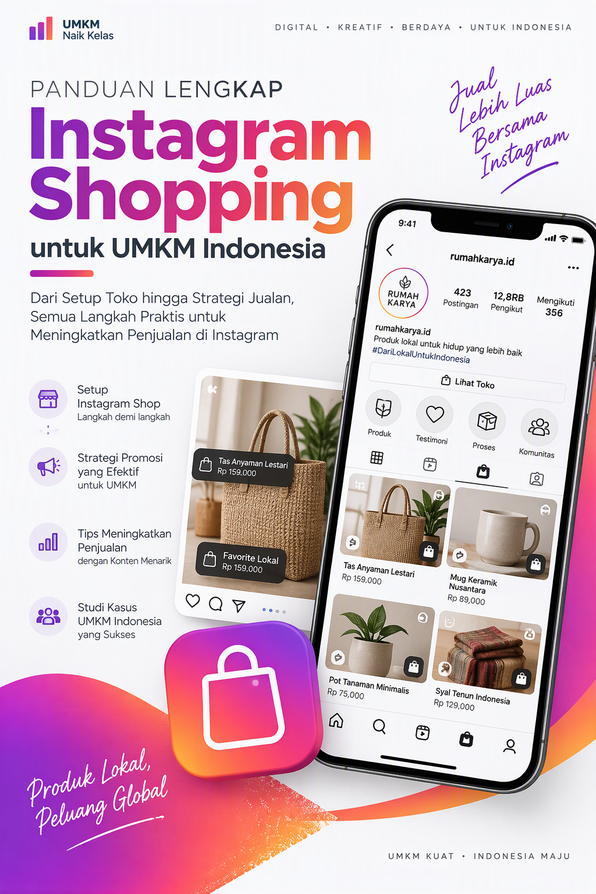
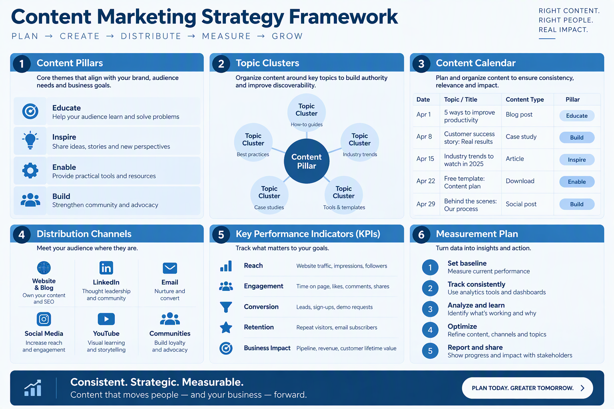
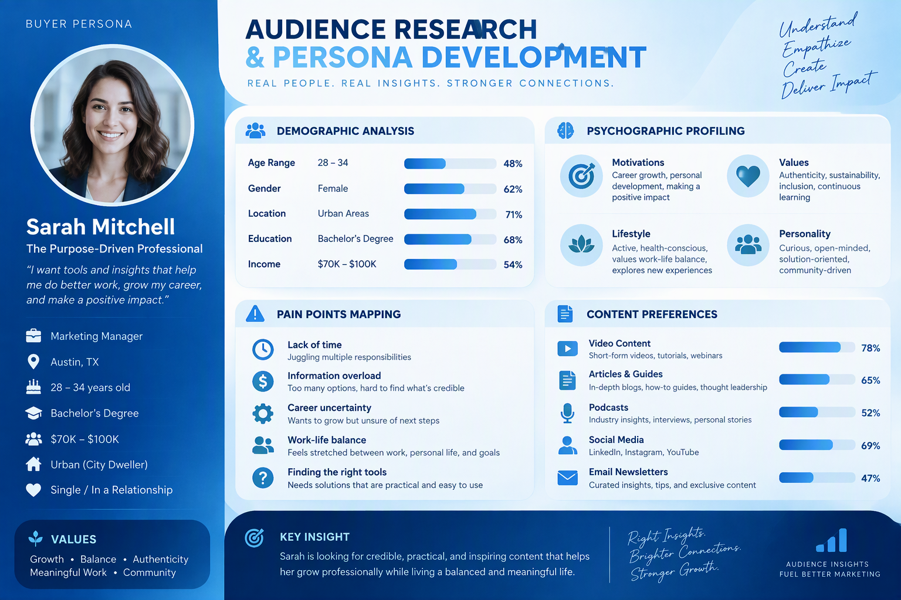
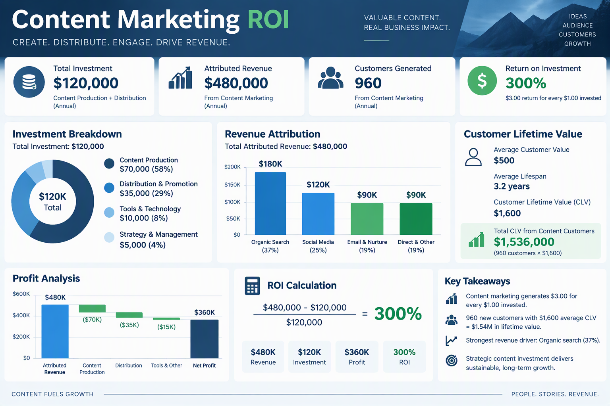

# Panduan Lengkap Instagram Reels Strategy untuk Bisnis UMKM Indonesia

**Strategi Praktis Menguasai Instagram Reels untuk Meningkatkan Brand Awareness, Engagement, dan Penjualan Bisnis UMKM**

Penulis: Siraj Nur Ihrom, CEO SNISHOP.COM



---

## Daftar Isi

**KATA PENGANTAR**

**BAGIAN I: FONDASI**

- Bab 1: Memahami Algoritma Instagram Reels
- Bab 2: Riset Ide Konten dan Trending Topics
- Bab 3: Scripting dan Storytelling untuk Video Pendek

**BAGIAN II: PRODUKSI**

- Bab 4: Teknik Filming dengan Smartphone
- Bab 5: Editing Video Reels
- Bab 6: Strategi Posting dan Timing Optimal
- Bab 7: Hashtag Strategy dan SEO Instagram

**BAGIAN III: PERTUMBUHAN DAN MONETISASI**

- Bab 8: Engagement Tactics dan Community Building
- Bab 9: Monetisasi dan Konversi ke Penjualan
- Bab 10: Studi Kasus dan Implementation Plan

**PENUTUP**

**TENTANG PENULIS**

---

## Kata Pengantar

Instagram Reels telah berubah menjadi salah satu kanal pemasaran paling efektif bagi pelaku usaha mikro, kecil, dan menengah di Indonesia. Dengan lebih dari 100 juta pengguna aktif bulanan di Indonesia, platform ini menawarkan peluang yang belum pernah ada sebelumnya bagi UMKM untuk menjangkau audiens baru tanpa harus mengeluarkan anggaran iklan yang besar.

Buku panduan ini disusun berdasarkan pengalaman praktis membantu ratusan pelaku UMKM Indonesia membangun kehadiran digital mereka melalui Instagram Reels. Setiap bab dirancang untuk memberikan pemahaman mendalam sekaligus langkah-langkah konkret yang bisa langsung Anda terapkan pada bisnis Anda.

Tidak peduli apakah Anda baru memulai atau sudah memiliki ribuan followers, panduan ini akan memberikan kerangka kerja yang sistematis untuk mengubah Instagram Reels menjadi mesin pertumbuhan bisnis Anda.

Panduan ini terdiri dari tiga bagian utama. Bagian pertama membahas fondasi, yaitu pemahaman mendalam tentang algoritma, riset konten, dan teknik scripting. Bagian kedua masuk ke aspek produksi, mencakup filming, editing, strategi posting, dan optimasi hashtag. Bagian ketiga membahas pertumbuhan dan monetisasi, termasuk engagement, konversi penjualan, dan studi kasus nyata.

Setiap bab dilengkapi dengan penjelasan teoritis, panduan langkah demi langkah, template dan checklist yang bisa langsung Anda gunakan, contoh konkret dengan angka nyata, tips dan best practices, serta kesalahan umum yang harus dihindari. Pendekatan ini memastikan bahwa Anda tidak hanya memahami konsep, tetapi juga mampu mengeksekusinya secara langsung.

Selamat membaca dan selamat berkarya.

Siraj Nur Ihrom
CEO SNISHOP.COM
Desember 2025

---

# BAGIAN I: FONDASI

---

## Bab 1: Memahami Algoritma Instagram Reels


### 1.1 Mengapa Memahami Algoritma Itu Penting

Sebelum Anda mulai membuat konten Reels, ada satu hal fundamental yang harus Anda pahami: bagaimana algoritma Instagram bekerja. Pemahaman ini bukan sekadar pengetahuan teoritis, melainkan fondasi yang menentukan apakah konten Anda akan dilihat oleh 100 orang atau 100.000 orang.

Bayangkan Anda memiliki toko di jalan utama kota. Algoritma Instagram adalah seperti polisi lalu lintas yang menentukan siapa yang boleh melewati toko Anda. Jika Anda memahami cara kerjanya, Anda bisa memastikan lebih banyak orang yang tepat melewati pintu toko Anda setiap hari.

Banyak pelaku UMKM yang frustrasi karena konten mereka tidak mendapat views meskipun sudah dibuat dengan usaha keras. Masalahnya seringkali bukan pada kualitas konten, melainkan pada ketidakpahaman terhadap cara algoritma mendistribusikan konten tersebut.

### 1.2 Bagaimana Algoritma Instagram Reels Bekerja

Instagram Reels menggunakan sistem distribusi konten yang berbeda dari feed biasa. Berikut adalah mekanisme utamanya:

**Tahap 1: Distribusi Awal (Initial Distribution)**

Ketika Anda memposting Reels, Instagram akan menyebarkannya ke sebagian kecil followers Anda, biasanya sekitar 10 hingga 15 persen. Pada tahap ini, algoritma mengukur respons awal dari audiens tersebut. Metrik yang dinilai meliputi:

- Watch time (berapa lama video ditonton sampai selesai)
- Completion rate (berapa persen penonton yang menonton sampai akhir)
- Re-watch rate (berapa kali video ditonton ulang)
- Engagement (likes, comments, shares, saves)
- Profile visits dari penonton Reels tersebut

**Tahap 2: Evaluasi Sinyal (Signal Evaluation)**

Jika metrik pada tahap pertama menunjukkan hasil positif, Instagram akan memperluas distribusi ke audiens yang lebih besar. Perluasan ini dilakukan secara bertahap, mulai dari followers yang belum melihat, kemudian ke Explore page, dan akhirnya ke Reels feed.

**Tahap 3: Amplifikasi (Amplification)**

Ketika sinyal engagement terus positif pada audiens yang lebih luas, Reels Anda berpotensi masuk ke halaman Explore dan mendapatkan distribusi masif. Pada tahap ini, sebuah Reels bisa mendapatkan ratusan ribu bahkan jutaan views.

### 1.3 Faktor-Faktor Ranking Utama

Berdasarkan penelitian dan pengamatan selama tahun 2024 hingga 2025, berikut adalah faktor-faktor yang paling berpengaruh terhadap ranking Reels:

**Faktor 1: Watch Time dan Completion Rate**

Ini adalah metrik paling penting. Instagram ingin menampilkan konten yang membuat pengguna betah berlama-lama di platform. Video yang ditonton sampai selesai mendapatkan prioritas distribusi yang jauh lebih tinggi.

Data konkret: Reels dengan durasi 7 hingga 15 detik yang ditonton rata-rata di atas 80 persen memiliki peluang 3 kali lebih besar untuk viral dibandingkan Reels berdurasi 60 detik dengan completion rate di bawah 40 persen.

**Faktor 2: Engagement Rate**

Engagement mencakup likes, comments, shares, dan saves. Dari keempat metrik ini, shares dan saves memiliki bobot yang lebih besar dalam algoritma. Ketika seseorang membagikan Reels Anda ke Stories atau mengirimkannya ke teman melalui DM, itu adalah sinyal yang sangat kuat bagi algoritma.

Benchmark engagement rate untuk UMKM di Indonesia:

- Micro account (di bawah 1.000 followers): target engagement rate 8 hingga 12 persen
- Small account (1.000 hingga 10.000 followers): target engagement rate 5 hingga 8 persen
- Medium account (10.000 hingga 100.000 followers): target engagement rate 3 hingga 5 persen
- Large account (di atas 100.000 followers): target engagement rate 1 hingga 3 persen

**Faktor 3: Relevansi Konten**

Instagram menggunakan berbagai sinyal untuk memahami topik konten Anda, termasuk:

- Teks yang muncul di video (on-screen text)
- Caption yang Anda tulis
- Hashtag yang digunakan
- Audio yang dipilih
- Objek visual yang terdeteksi oleh AI Instagram

Semakin jelas topik konten Anda, semakin tepat Instagram menyebarkannya ke audiens yang tertarik.

**Faktor 4: Konsistensi dan Kebaruan**

Akun yang secara konsisten memposting Reels berkualitas mendapatkan boost dari algoritma. Selain itu, konten yang menggunakan format, audio, atau tren terbaru juga mendapat prioritas distribusi.

**Faktor 5: Hubungan dengan Audiens**

Instagram mempertimbangkan seberapa dekat hubungan antara pembuat konten dengan penontonnya. Interaksi melalui DM, komentar, dan mentions memperkuat sinyal hubungan ini.

### 1.4 Explore Page: Pintu Menuju Viralitas

Explore page adalah tempat di mana konten Reels bisa mendapatkan eksposur masif. Berikut cara kerja Explore page untuk Reels:

Instagram mengelompokkan pengguna ke dalam cluster berdasarkan minat mereka. Ketika Reels Anda mendapat engagement tinggi dari cluster tertentu, algoritma akan mulai menunjukkannya ke cluster lain yang memiliki profil minat serupa.

Proses ini berjalan seperti efek bola salju. Awalnya kecil, lalu semakin besar seiring dengan meningkatnya validasi dari pengguna.

Untuk memaksimalkan peluang masuk Explore page:

- Posting pada jam ketika audiens Anda paling aktif
- Pastikan 3 detik pertama sangat menarik perhatian
- Gunakan audio yang sedang trending
- Buat konten yang memicu shares dan saves
- Interaksi dengan audiens di kolom komentar segera setelah posting

### 1.5 Perbedaan Reels, Feed Post, dan Stories

Memahami perbedaan ketiga format konten ini sangat penting untuk menyusun strategi yang komprehensif:

**Instagram Reels:**

- Format video pendek vertikal (9:16), durasi 3 hingga 90 detik
- Distribusi utama melalui Reels tab dan Explore page
- Jangkauan audiens paling luas, termasuk non-followers
- Umur konten panjang, bisa terus mendapat views selama berminggu-minggu
- Cocok untuk: brand awareness, menjangkau audiens baru, viralitas

**Instagram Feed Post (Foto/Carousel):**

- Format foto atau carousel (hingga 10 slide)
- Distribusi utama melalui feed followers
- Jangkauan terbatas pada followers yang aktif
- Umur konten pendek, biasanya 24 hingga 48 jam
- Cocok untuk: edukasi mendalam, showcase produk, building brand identity

**Instagram Stories:**

- Format vertikal, durasi 15 detik per slide
- Distribusi ke followers yang sudah ada
- Menghilang setelah 24 jam (kecuali di-highlight)
- Cocok untuk: daily update, behind the scenes, interaksi langsung, flash sale

**Strategi Kombinasi Ideal:**

Sebuah UMKM sebaiknya menggunakan ketiganya secara seimbang. Contoh jadwal mingguan:

- 5 Reels per minggu untuk menjangkau audiens baru
- 3 Feed post (foto atau carousel) untuk edukasi produk
- 7 Stories per hari untuk menjaga kedekatan dengan followers

### 1.6 Cara Memanfaatkan Algoritma untuk Keuntungan Bisnis

Berikut langkah-langkah praktis yang bisa langsung Anda terapkan:

**Langkah 1: Optimalkan 3 Detik Pertama**

Algoritma menilai kualitas konten Anda berdasarkan apa yang terjadi di detik-detik awal. Gunakan salah satu teknik berikut:

- Mulai dengan pertanyaan yang membuat penasaran: "Tahu tidak kalau batik tulis bisa dibuat dalam 3 bulan?"
- Tampilkan hasil akhir terlebih dahulu: tunjukkan produk jadi sebelum menunjukkan proses pembuatannya
- Gunakan text hook di layar: "Cara yang jarang orang tahu untuk hemat belanja bulanan"

**Langkah 2: Buat Konten yang Worth Sharing**

Shares adalah mata uang paling berharga di mata algoritma. Buat konten yang membuat orang ingin membagikannya:

- Konten edukasi yang bermanfaat: tips, tutorial, hack
- Konten yang relatable: situasi sehari-hari yang dialami target audiens
- Konten inspiratif: transformasi, success story, pencapaian

**Langkah 3: Bangun Sinyal Relevansi yang Kuat**

Konsisten pada topik tertentu membantu algoritma memahami kepada siapa konten Anda harus didistribusikan. Jika Anda menjual produk skincare, fokuslah pada konten seputar perawatan kulit, bahan-bahan kosmetik, dan rutinitas kecantikan. Jangan mencampuradukkan dengan topik yang tidak relevan.

**Langkah 4: Interaksi Aktif Setelah Posting**

Selama 30 menit pertama setelah posting Reels, tetap aktif di Instagram. Balas setiap komentar yang masuk, kunjungi profil audiens Anda, dan berikan interaksi yang tulus. Aktivitas ini memperkuat sinyal engagement yang dibutuhkan algoritma.

### 1.7 Kesalahan Umum dalam Memahami Algoritma

**Kesalahan 1: Mengikuti Tren Tanpa Adaptasi**

Tidak semua tren cocok untuk bisnis Anda. Memaksakan diri mengikuti tren yang tidak relevan dengan niche Anda justru bisa merusak sinyal relevansi akun.

**Kesalahan 2: Fokus pada Follower Count**

Jumlah follower tidak menentukan keberhasilan Reels Anda. Banyak akun dengan 1.000 follower berhasil mendapatkan jutaan views pada Reels mereka karena kontennya sesuai dengan minat audiens yang ditargetkan.

**Kesalahan 3: Posting Tanpa Analisis**

Jika Anda tidak memeriksa Instagram Insights secara rutin, Anda seperti menyetir mobil dengan mata tertutup. Data Insights memberitahu Anda konten seperti apa yang bekerja dan kapan waktu terbaik untuk posting.

**Kesalahan 4: Mengharapkan Hasil Instan**

Algoritma membutuhkan waktu untuk memahami akun Anda. Konsisten posting minimal 4 hingga 6 minggu sebelum mengevaluasi apakah strategi Anda bekerja.

### 1.8 Template Checklist Pemahaman Algoritma

Gunakan checklist ini sebelum memposting setiap Reels:

- [ ] Apakah 3 detik pertama cukup menarik untuk menghentikan scroll?
- [ ] Apakah durasi video proporsional dengan isi konten?
- [ ] Apakah konten ini relevan dengan niche bisnis saya?
- [ ] Apakah ada elemen yang memicu shares atau saves?
- [ ] Apakah caption mengandung kata kunci yang tepat?
- [ ] Apakah hashtag yang digunakan relevan dan dalam jumlah yang tepat?
- [ ] Apakah audio yang dipilih sesuai dengan mood konten?
- [ ] Apakah saya siap berinteraksi di 30 menit pertama setelah posting?

---

## Bab 2: Riset Ide Konten dan Trending Topics


### 2.1 Mengapa Riset Konten Adalah Kunci Kesuksesan

Membuat konten tanpa riset ibarat berlayar tanpa kompas. Anda mungkin bergerak, tetapi belum tentu ke arah yang benar. Riset konten membantu Anda memahami apa yang diinginkan audiens, apa yang sedang trending, dan di mana celah peluang yang bisa Anda manfaatkan.

Pelaku UMKM yang sukses di Instagram Reels bukanlah mereka yang paling kreatif, melainkan mereka yang paling rajin melakukan riset dan mengeksekusi temuan riset tersebut menjadi konten yang menarik.

### 2.2 Metode Riset Konten yang Efektif

**Metode 1: Analisis Kompetitor**

Langkah pertama adalah mengidentifikasi 10 hingga 15 akun kompetitor atau akun sejenis di niche Anda, baik yang besar maupun yang setara ukurannya. Kemudian lakukan analisis berikut:

- Catat 20 Reels terpopuler mereka berdasarkan views
- Identifikasi pola: topik apa yang paling sering muncul?
- Perhatikan format: durasi video, gaya editing, penggunaan text overlay
- Analisis caption: kata kunci apa yang mereka gunakan?
- Cek hashtag: hashtag mana yang paling sering mereka pakai?
- Lihat engagement: jenis konten apa yang paling banyak mendapat komentar dan shares?

Buat spreadsheet sederhana untuk mencatat temuan Anda. Kolom-kolom yang perlu diisi:

| No | Nama Akun | Topik Reels | Views | Likes | Comments | Shares | Saves | Format | Audio |
|----|-----------|-------------|-------|-------|----------|--------|-------|--------|-------|

**Metode 2: Eksplorasi Reels Tab dan Explore Page**

Luangkan waktu 15 hingga 20 menit setiap hari untuk scroll melalui Reels tab dan Explore page. Instagram akan menampilkan konten yang sedang trending berdasarkan minat Anda. Perhatikan:

- Audio apa yang muncul berulang-ulang?
- Format atau template apa yang sedang populer?
- Topik apa yang banyak dibahas oleh kreator di niche Anda?
- Jenis hook apa yang digunakan di awal video?

Simpan audio yang menarik dengan cara menekan tombol "Save Audio". Simpan juga Reels yang menurut Anda bagus sebagai referensi.

**Metode 3: Pemanfaatan Google Trends dan Media Sosial Lain**

Jangan terbatas pada Instagram saja. Gunakan Google Trends untuk melihat topik apa yang sedang naik daun. Periksa TikTok untuk tren yang mungkin belum masuk Instagram. Pantau Twitter untuk percakapan yang relevan dengan bisnis Anda.

Google Trends bisa diakses secara gratis di trends.google.com. Masukkan kata kunci yang relevan dengan bisnis Anda dan lihat apakah grafiknya menunjukkan kenaikan.

**Metode 4: Mendengarkan Audiens Langsung**

Kolom komentar, DM, dan pertanyaan yang sering masuk adalah tambang emas untuk ide konten. Catat setiap pertanyaan atau permintaan yang muncul dari audiens Anda.

Contoh pertanyaan yang bisa menjadi ide Reels:

- "Kak, bahan ini cocok untuk kulit sensitif tidak?" menjadi Reels edukasi tentang jenis-jenis bahan skincare
- "Bagaimana cara merawat batik agar tidak luntur?" menjadi Reels tutorial perawatan pakaian
- "Bisa kirim ke luar kota?" menjadi Reels yang menunjukkan proses packing dan pengiriman

### 2.3 Tools Riset Konten

Berikut adalah tools yang bisa Anda gunakan untuk mempermudah riset:

**Tools Gratis:**

1. Instagram Insights: data bawaan Instagram untuk akun bisnis dan creator. Memberikan informasi tentang demografi audiens, waktu aktif, dan performa konten.

2. TikTok Creative Center: platform gratis dari TikTok yang menampilkan tren iklan, hashtag, dan audio yang sedang populer. Meskipun untuk TikTok, tren di sini sering kali juga relevan untuk Instagram Reels.

3. Google Trends: alat gratis untuk melihat popularitas suatu topik atau kata kunci dari waktu ke waktu.

4. Pinterest Trends: menampilkan topik yang sedang trending di Pinterest, yang sering kali menjadi indikator tren yang akan masuk ke Instagram.

5. AnswerThePublic: alat untuk menemukan pertanyaan yang sering diajukan orang tentang suatu topik. Berguna untuk ide konten edukasi.

**Tools Berbayar:**

1. Later: platform scheduling yang juga menyediakan analisis hashtag dan best time to post.

2. Hootsuite: tools manajemen media sosial lengkap dengan fitur analisis kompetitor.

3. Sprout Social: platform analisis media sosial yang sangat komprehensif, cocok untuk bisnis yang sudah lebih besar.

### 2.4 Membaca dan Memanfaatkan Data Insights

Instagram Insights menyediakan data yang sangat berharga. Berikut cara membacanya:

**Metrik yang Perlu Diperhatikan:**

1. Reach: jumlah akun unik yang melihat konten Anda. Jika reach tinggi, berarti algoritma mendistribusikan konten Anda dengan baik.

2. Plays: jumlah total pemutaran video. Rasio plays terhadap reach menunjukkan seberapa menarik konten Anda.

3. Likes, Comments, Shares, Saves: keempat metrik ini menunjukkan tingkat engagement. Perhatikan mana yang paling dominan untuk memahami preferensi audiens.

4. Watch Time: rata-rata durasi tonton. Ini metrik paling penting untuk Reels.

5. Audience Demographics: informasi tentang usia, jenis kelamin, lokasi, dan waktu aktif audiens Anda.

**Cara Menggunakan Data untuk Perbaikan:**

Setiap minggu, luangkan waktu 30 menit untuk menganalisis performa konten Anda. Buat catatan sederhana:

- Reels mana yang mendapat views tertinggi minggu ini? Mengapa?
- Reels mana yang mendapat engagement tertinggi? Apa yang berbeda?
- Jam berapa posting yang paling berhasil?
- Topik apa yang paling diminati audiens?

Dari analisis ini, Anda bisa menyusun strategi konten untuk minggu berikutnya berdasarkan data, bukan berdasarkan asumsi.

### 2.5 Menemukan Niche Content Anda

Tidak semua UMKM bisa sukses dengan konten yang sama. Anda perlu menemukan niche content yang sesuai dengan bisnis dan audiens Anda.

**Langkah 1: Identifikasi Core Topic**

Tuliskan 3 hingga 5 topik utama yang berkaitan langsung dengan bisnis Anda. Contoh:

- Bisnis kopi: (1) edukasi tentang biji kopi, (2) tutorial menyeduh, (3) behind the scene kedai, (4) review alat kopi, (5) lifestyle penikmat kopi

- Bisnis fashion: (1) styling tips, (2) showcase produk baru, (3) behind the scene produksi, (4) outfit inspiration, (5) perawatan pakaian

**Langkah 2: Validasi dengan Riset**

Untuk setiap topik, periksa apakah ada audiens yang tertarik. Caranya:

- Cari topik tersebut di Reels dan lihat berapa banyak konten yang sudah ada
- Perhatikan engagement pada konten-konten tersebut
- Cek apakah ada celah yang belum banyak diisi

**Langkah 3: Tentukan Unique Angle**

Setelah menemukan topik yang relevan, tentukan sudut pandang unik Anda. Misalnya, jika sudah banyak konten tutorial menyeduh kopi, Anda bisa mengambil angle "menyeduh kopi dengan alat seadanya di rumah" atau "kopi untuk pemula yang tidak mau ribet".

### 2.6 Content Pillars: Kerangka Konten yang Konsisten

Content pillars adalah 3 hingga 5 kategori konten utama yang menjadi fondasi strategi konten Anda. Dengan content pillars, Anda tidak akan kehabisan ide dan konten Anda tetap terstruktur.

**Contoh Content Pillars untuk UMKM Fashion:**

1. Edukasi (30 persen): tips memilih bahan, cara merawat pakaian, panduan ukuran
2. Inspirasi (25 persen): outfit ideas, styling tips, lookbook
3. Behind the Scene (20 persen): proses produksi, keseharian tim, cerita di balik produk
4. Promosi (15 persen): produk baru, diskon, testimoni pelanggan
5. Entertainment (10 persen): tren lucu yang diadaptasi dengan brand, quiz, challenge

**Contoh Content Pillars untuk UMKM F&B:**

1. Resep dan Tutorial (30 persen): cara membuat menu, tips memasak, rahasia bumbu
2. Showcase Produk (25 persen): close-up makanan, plating, variasi menu
3. Cerita Brand (20 persen): asal-usul bahan, kisah pemilik, nilai-nilai bisnis
4. Interaksi Audiens (15 persen): Q&A, poll, challenge, user-generated content
5. Promo dan Event (10 persen): diskon, menu baru, kolaborasi

**Rasio Ideal Content Pillars:**

Jangan terlalu banyak konten promosi. Audiens di Instagram lebih menghargai konten yang memberikan nilai. Rasio ideal yang direkomendasikan:

- 60 persen konten bernilai (edukasi, inspirasi, entertainment)
- 25 persen konten brand building (behind the scene, cerita, values)
- 15 persen konten promosi langsung

### 2.7 Template Kalender Ide Konten

Buat kalender ide konten sederhana untuk memudahkan perencanaan:

| Minggu | Hari | Pillar | Ide Konten | Audio/Tren | Status |
|--------|------|--------|------------|------------|--------|
| 1 | Senin | Edukasi | Tips memilih bahan kain yang berkualitas | Audio trending | Draft |
| 1 | Rabu | Showcase | Proses pembuatan batik dari awal sampai akhir | Musik instrumental | Ide |
| 1 | Jumat | BTS | Keseharian pengrajin batik kami | Original audio | Ide |
| 2 | Senin | Inspirasi | 5 cara memadukan batik untuk ke kantor | Audio trending | Ide |
| 2 | Rabu | Interaksi | Quiz: bisa tidak tebak harga batik ini? | Original audio | Ide |

### 2.8 Tips dan Best Practices Riset Konten

1. Luangkan minimal 30 menit setiap hari untuk riset konten. Jadikan ini kebiasaan, bukan tugas sesekali.

2. Simpan semua ide yang muncul, meskipun terlihat tidak penting. Ide yang tampaknya biasa hari ini bisa menjadi konten viral besok.

3. Ikuti minimal 5 kreator besar di niche Anda. Perhatikan bagaimana mereka mengembangkan ide konten.

4. Bergabunglah dengan komunitas atau grup yang relevan dengan bisnis Anda. Percakapan di komunitas sering kali menjadi sumber ide konten yang berharga.

5. Buat bank ide konten. Setiap kali mendapat ide, catat di satu tempat yang mudah diakses.

### 2.9 Kesalahan Umum dalam Riset Konten

**Kesalahan 1: Meniru Mentah-mentah**

Terinspirasi oleh konten orang lain itu baik. Meniru mentah-mentah itu merugikan. Selalu adaptasi konten dengan gaya dan nilai unik bisnis Anda.

**Kesalahan 2: Hanya Mengikuti Tren**

Tren itu penting, tetapi jika semua konten Anda hanya mengikuti tren, Anda tidak akan memiliki identitas yang kuat. Kombinasikan tren dengan konten evergreen yang tetap relevan sepanjang waktu.

**Kesalahan 3: Tidak Mencatat Hasil**

Riset tanpa pencatatan adalah sia-sia. Selalu catat performa setiap konten sehingga Anda bisa belajar dari data, bukan dari asumsi.

**Kesalahan 4: Mengabaikan Feedback Audiens**

Audiens Anda secara tidak langsung sudah memberitahu apa yang mereka inginkan melalui komentar, shares, dan saves. Dengarkan mereka.

---

## Bab 3: Scripting dan Storytelling untuk Video Pendek



### 3.1 Mengapa Scripting Itu Penting

Membuat Reels tanpa script ibarat berbicara di depan umum tanpa persiapan. Anda mungkin bisa melakukannya, tetapi hasilnya tidak akan optimal. Scripting membantu Anda menyampaikan pesan dengan jelas, menjaga durasi video tetap efisien, dan memastikan setiap detik memiliki tujuan.

Untuk UMKM yang sumber dayanya terbatas, scripting menjadi semakin penting. Dengan script yang baik, Anda bisa mengurangi waktu syuting dan editing karena sudah tahu persis apa yang ingin disampaikan.

### 3.2 Struktur Script Reels yang Efektif

Sebuah script Reels yang baik terdiri dari empat bagian utama:

**Bagian 1: Hook (Detik 0 hingga 3)**

Hook adalah elemen paling krusial dalam Reels. Dalam 3 detik pertama, Anda harus membuat penonton berhenti scrolling dan memutuskan untuk menonton video Anda sampai selesai.

Jenis-jenis hook yang terbukti efektif:

1. Hook Pertanyaan: "Tahu tidak, satu kain batik tulis bisa dibuat selama berapa bulan?"
2. Hook Kontroversial: "Kebanyakan orang salah cara menyeduh kopi"
3. Hook Angka: "3 bahan rahasia yang membuat kopi kami berbeda"
4. Hook Hasil Akhir: Tampilkan produk atau hasil akhir terlebih dahulu
5. Hook Masalah: "Pernah tidak beli skincare tapi malah bikin breakout?"
6. Hook Storytelling: "Dari modal 500 ribu, bisnis ini sekarang omzet 80 juta per bulan"
7. Hook Visual: Gerakan kamera yang dramatis atau transisi yang menarik perhatian

Tips menulis hook yang kuat:

- Gunakan kata-kata yang spesifik dan konkret
- Buat penonton merasa penasaran atau terkejut
- Hindari kalimat pembuka yang lambat seperti "Hai guys, kembali lagi di channel saya"
- Langsung masuk ke inti, jangan bertele-tele

**Bagian 2: Konten Utama (Detik 3 hingga 20)**

Setelah berhasil menangkap perhatian, saatnya menyampaikan pesan utama Anda. Bagian ini harus padat, informatif, dan menarik dari awal sampai akhir.

Prinsip penyampaian konten utama:

1. Satu Reels, satu pesan utama. Jangan mencoba menyampaikan terlalu banyak informasi dalam satu video.

2. Gunakan transisi yang mulus antar-poin. Setiap kalimat harus mengalir secara natural ke kalimat berikutnya.

3. Variasikan penyampaian. Gabungkan voice over, text overlay, dan visual yang menarik.

4. Berikan nilai di setiap detik. Penonton harus merasa mendapat sesuatu dari setiap momen video Anda.

**Bagian 3: Call to Action (Detik terakhir)**

Setiap Reels harus memiliki tujuan yang jelas. Apa yang ingin Anda lakukan penonton setelah menonton video Anda?

Jenis call to action yang efektif:

1. Engagement CTA: "Komen di bawah, kalian tim yang mana?"
2. Save CTA: "Save video ini biar tidak lupa"
3. Share CTA: "Kirim ke teman kamu yang butuh info ini"
4. Follow CTA: "Follow untuk tips lainnya"
5. Purchase CTA: "Klik link di bio untuk order"
6. Comment CTA: "Tulis pengalaman kalian di kolom komentar"

Pilih satu CTA utama per Reels. Jangan menggabungkan terlalu banyak CTA karena akan membingungkan penonton.

**Bagian 4: Caption Pendukung**

Caption di Instagram Reels memiliki fungsi ganda: memperkuat pesan video dan menyediakan konteks untuk SEO Instagram.

Struktur caption yang efektif:

- Baris pertama: ringkasan atau hook yang membuat orang ingin membaca lebih lanjut
- Isi: informasi tambahan yang melengkapi video
- Hashtag: 5 hingga 15 hashtag yang relevan
- CTA: pengingat untuk melakukan tindakan tertentu

### 3.3 Storytelling Framework untuk Reels

Storytelling adalah seni menyampaikan pesan melalui cerita. Dalam konteks Reels, storytelling yang baik bisa mengubah konten biasa menjadi konten yang memorable dan shareable.

**Framework 1: Problem-Solution-Benefit**

Struktur ini cocok untuk konten edukasi dan promosi produk:

1. Problem: tunjukkan masalah yang dihadapi audiens
2. Solution: perkenalkan solusi (produk atau metode Anda)
3. Benefit: tunjukkan hasil atau manfaat yang didapat

Contoh untuk bisnis skincare:
- Problem: "Jerawat membandel sudah coba berbagai produk tapi tidak sembuh?"
- Solution: "Rahasia kulit bersih ternyata ada di bahan satu ini, niacinamide"
- Benefit: "Dalam 2 minggu, jerawat kempes dan bekasnya memudar"

**Framework 2: Before-After-Transform**

Struktur ini sangat efektif untuk menunjukkan hasil:

1. Before: tunjukkan kondisi awal
2. After: tunjukkan kondisi akhir
3. Transform: jelaskan proses transformasinya

Contoh untuk bisnis katering diet:
- Before: tampilkan makanan biasa yang tinggi kalori
- After: tampilkan meal box katering diet yang lezat dan sehat
- Transform: jelaskan bagaimana katering ini membantu penurunan berat badan

**Framework 3: Story Arc Mini**

Struktur ini cocok untuk behind the scene dan cerita brand:

1. Setup: perkenalkan konteks atau karakter
2. Conflict: tunjukkan tantangan atau masalah
3. Resolution: ceritakan bagaimana tantangan tersebut diatasi

Contoh untuk bisnis kerajinan:
- Setup: "Ini adalah Mbak Sari, pengrajin anyaman dari Jawa Tengah"
- Conflict: "Dulu, hasil anyamannya hanya dijual di pasar lokal dengan harga rendah"
- Resolution: "Sekarang, melalui Instagram, karyanya dikirim ke seluruh Indonesia dengan harga 5 kali lipat"

**Framework 4: Listicle**

Struktur ini cocok untuk konten tips dan edukasi:

1. Pembuka: "3 kesalahan yang bikin bisnis kamu stagnan"
2. Poin 1: jelaskan kesalahan pertama
3. Poin 2: jelaskan kesalahan kedua
4. Poin 3: jelaskan kesalahan ketiga
5. Penutup: rangkuman dan CTA

### 3.4 Teknik Menulis Script yang Efisien

**Teknik 1: Tulis Seperti Anda Berbicara**

Script Reels harus terdengar natural, bukan seperti membaca teks formal. Gunakan bahasa percakapan sehari-hari yang sesuai dengan target audiens Anda.

Buruk: "Pada kesempatan ini, kami akan memaparkan mengenai keunggulan produk kami"
Baik: "Kalian tahu tidak, kenapa produk kami selalu habis dalam hitungan jam?"

**Teknik 2: Hitung Kata per Detik**

Kecepatan bicara normal dalam bahasa Indonesia adalah sekitar 3 hingga 4 kata per detik. Dengan durasi Reels 15 detik, Anda memiliki ruang untuk sekitar 45 hingga 60 kata.

Panduan durasi dan jumlah kata:

- 7 detik: 21 hingga 28 kata (hook singkat plus satu pesan)
- 15 detik: 45 hingga 60 kata (hook plus konten singkat)
- 30 detik: 90 hingga 120 kata (hook plus konten plus CTA)
- 60 detik: 180 hingga 240 kata (hook plus konten detail plus CTA)

**Teknik 3: Baca dengan Keras**

Setelah menulis script, bacalah dengan suara keras. Jika ada bagian yang terasa kaku atau sulit diucapkan, revisi bagian tersebut. Script yang baik harus terasa nyaman saat diucapkan.

**Teknik 4: Tandai Jeda dan Penekanan**

Dalam script Anda, tandai bagian-bagian yang perlu ditekankan atau diberi jeda. Jeda yang tepat bisa menciptakan efek dramatis dan memberikan waktu bagi penonton untuk memproses informasi.

Contoh penandaan script:

```
[HOOK] Tahu tidak? (jeda 0.5 detik) Satu kain batik tulis...
[TEKANAN] bisa dibuat selama TIGA BULAN.
[KONTEN] Proses pembuatannya dimulai dari...
```

### 3.5 Menulis Caption yang Engaging

Caption Reels sering kali diabaikan, padahal memiliki peran penting dalam SEO Instagram dan memberikan konteks tambahan bagi penonton.

**Prinsip Caption yang Efektif:**

1. Baris pertama harus menarik. Instagram hanya menampilkan 2 hingga 3 baris pertama caption sebelum penonton harus menekan "selengkapnya". Gunakan baris ini untuk hook atau pertanyaan yang membuat orang ingin membaca lebih lanjut.

2. Berikan nilai tambahan. Caption bukan sekadar pengulangan isi video. Gunakan caption untuk memberikan informasi tambahan, konteks, atau detail yang tidak sempat disampaikan di video.

3. Gunakan format yang mudah dibaca. Pecah caption menjadi paragraf-paragraf pendek. Gunakan line break untuk memisahkan ide.

4. Sertakan kata kunci. Instagram sekarang berfungsi juga sebagai mesin pencari. Gunakan kata kunci yang relevan dengan bisnis Anda di dalam caption.

5. Akhiri dengan CTA. Ingatkan penonton untuk melakukan tindakan tertentu, baik itu like, comment, save, share, atau follow.

**Template Caption untuk Berbagai Jenis Konten:**

Template Caption Edukasi:
```
[Hook/Pertanyaan yang relevan]

[Poin utama dalam 1-2 kalimat]

[Detail tambahan atau tips praktis]

[CTA: Save dan Share]

[Hashtag relevan, 5-10 buah]
```

Template Caption Behind the Scene:
```
[Cerita singkat atau fakta menarik]

[Detail proses atau cerita di balik layar]

[Nilai atau pelajaran yang bisa diambil]

[CTA: Comment atau Follow]

[Hashtag relevan]
```

Template Caption Promosi Produk:
```
[Hook yang menonjolkan masalah atau kebutuhan]

[Perkenalan produk sebagai solusi]

[Benefit utama dan keunggulan]

[CTA: Klik link di bio atau DM untuk order]

[Hashtag relevan]
```

### 3.6 Contoh Script Lengkap

Berikut contoh script lengkap untuk Reels berdurasi 30 detik tentang bisnis kopi:

```
[HOOK - Detik 0-3]
Visual: Close-up air panas dituang ke kopi
Voice over: "Kopi kamu rasanya pahit? Mungkin cara seduhnya yang salah."
Text overlay: "CARA SEDUH KOPI YANG BENAR"

[KONTEN - Detik 3-25]
Visual: Proses brewing manual pour
Voice over: "Pertama, gunakan air dengan suhu 90 sampai 96 derajat. Bukan air mendidih. Kedua, rasio kopi dan air yang ideal adalah 1 banding 15. Ketiga, tuang air secara perlahan dengan gerakan melingkar. Keempat, tunggu 3 sampai 4 menit sebelum kopi siap dinikmati."
Text overlay: Poin-poin kunci muncul satu per satu

[CTA - Detik 25-30]
Visual: Seseorang menyeruput kopi dengan ekspresi nikmat
Voice over: "Save video ini biar tidak lupa, dan follow untuk tips kopi lainnya."
Text overlay: "SAVE dan FOLLOW"
```

### 3.7 Tips dan Best Practices Scripting

1. Buat bank script. Setiap kali mendapat ide, tuliskan script lengkapnya meskipun belum akan digunakan segera.

2. Pelajari script dari Reels yang viral. Analisis mengapa hook-nya berhasil, bagaimana alur ceritanya, dan apa yang membuat penonton betah menonton sampai akhir.

3. Adaptasi script berdasarkan performa. Jika suatu format script berhasil, buat variasi dari format yang sama.

4. Jangan takut bereksperimen. Coba berbagai gaya scripting dan lihat mana yang paling resonan dengan audiens Anda.

5. Rekam dan dengarkan kembali. Terkadang script yang terlihat bagus di kertas tidak terdengar natural saat diucapkan.

### 3.8 Kesalahan Umum dalam Scripting

**Kesalahan 1: Terlalu Banyak Informasi**

Satu Reels seharusnya fokus pada satu pesan utama. Jika Anda mencoba memasukkan terlalu banyak informasi, penonton akan kebingungan dan kehilangan minat.

**Kesalahan 2: Hook yang Lemah**

Memulai Reels dengan "Hai guys" atau perkenalan diri adalah kesalahan fatal. Penonton akan scroll sebelum Anda selesai berbicara.

**Kesalahan 3: Script yang Terdengar Kaku**

Membaca script kata per kata akan terdengar tidak natural. Gunakan script sebagai panduan, bukan sebagai teks yang harus dihafal.

**Kesalahan 4: Tidak Ada CTA**

Setiap Reels harus memiliki tujuan yang jelas. Tanpa CTA, penonton akan menikmati konten Anda tetapi tidak melakukan tindakan yang menguntungkan bisnis Anda.

---

# BAGIAN II: PRODUKSI

---

## Bab 4: Teknik Filming dengan Smartphone


### 4.1 Mengapa Smartphone Sudah Cukup

Banyak pelaku UMKM yang merasa perlu investasi besar pada peralatan kamera profesional sebelum mulai membuat Reels. Kenyataannya, smartphone modern sudah lebih dari cukup untuk menghasilkan konten video berkualitas tinggi.

Kamera smartphone saat ini mampu merekam video 4K, memiliki stabilisasi optik, dan fitur portrait mode yang sebelumnya hanya tersedia di kamera profesional. Yang membedakan konten yang bagus dari yang biasa-biasa saja bukanlah peralatan, melainkan teknik dan kreativitas.

Bukti nyata: banyak kreator konten dengan jutaan followers di Indonesia hanya menggunakan smartphone untuk memproduksi Reels mereka. Beberapa bahkan menghasilkan video dengan kualitas yang tidak bisa dibedakan dari hasil kamera profesional.

### 4.2 Setup Filming Dasar

**Peralatan Minimum yang Dibutuhkan:**

1. Smartphone dengan kamera minimal 12 megapixel (hampir semua smartphone keluaran 2020 ke atas sudah memadai)
2. Tripod smartphone (harga mulai dari Rp 50.000 hingga Rp 200.000)
3. Ring light atau sumber cahaya alami (opsional, tetapi sangat meningkatkan kualitas)
4. Microphone clip-on (opsional, harga mulai dari Rp 100.000, berguna jika konten Anda banyak voice over)

**Setup Dasar dengan Budget Minimal:**

Jika budget Anda terbatas, berikut setup yang bisa dimulai dengan biaya di bawah Rp 300.000:

- Tripod smartphone: Rp 75.000
- Ring light 26 cm: Rp 100.000
- Reflector cahaya (bisa pakai styrofoam putih): Rp 25.000
- Total: Rp 200.000

### 4.3 Pencahayaan: Kunci Video Profesional

Pencahayaan adalah faktor tunggal yang paling berpengaruh terhadap kualitas visual video Anda. Video dengan gambar yang gelap atau terlalu terang akan langsung di-scroll oleh penonton.

**Jenis-Jenis Pencahayaan:**

1. Cahaya Natural (Matahari): Sumber cahaya terbaik dan gratis. Gunakan jendela besar sebagai sumber cahaya. Waktu terbaik adalah pagi hari (jam 7 hingga 10) dan sore hari (jam 3 hingga 5) ketika cahaya matahari lembut dan hangat.

2. Ring Light: Memberikan cahaya yang merata dan menghasilkan catch light (pantulan cahaya) yang menarik di mata subjek. Ideal untuk konten close-up dan talking head.

3. Softbox: Memberikan cahaya yang lembut dan terarah. Cocok untuk setup yang lebih serius dan konten yang membutuhkan pencahayaan konsisten.

4. LED Panel: Fleksibel dalam pengaturan suhu warna dan intensitas. Cocok untuk berbagai jenis konten.

**Tiga-Point Lighting Setup Sederhana:**

Setup pencahayaan profesional menggunakan tiga sumber cahaya:

1. Key Light (Cahaya Utama): Letakkan di depan subjek, sedikit di atas level mata, dengan sudut 45 derajat dari depan. Ini adalah sumber cahaya paling terang.

2. Fill Light (Cahaya Pengisi): Letakkan di sisi berlawanan dari key light dengan intensitas lebih rendah (sekitar 50 hingga 75 persen dari key light). Fungsinya mengurangi bayangan keras yang dihasilkan key light.

3. Back Light (Cahaya Belakang): Letakkan di belakang subjek, menghadap ke arah subjek. Fungsinya memisahkan subjek dari latar belakang dan memberikan dimensi pada gambar.

Untuk UMKM dengan budget terbatas, Anda bisa memulai dengan satu ring light sebagai key light dan memanfaatkan cahaya natural dari jendela sebagai fill light.

**Tips Pencahayaan untuk Berbagai Jenis Konten:**

- Konten masak: gunakan cahaya terang dari atas dan samping. Pastikan makanan terlihat segar dan berwarna natural.
- Konten fashion: gunakan cahaya lembut dari depan. Hindari bayangan keras yang bisa mengubah warna kain.
- Konten skincare/beauty: gunakan ring light di depan wajah. Pastikan warna kulit terlihat natural.
- Konten produk: gunakan softbox di kedua sisi produk untuk menghilangkan bayangan.

### 4.4 Angle Kamera dan Komposisi

**Angle Kamera Dasar:**

1. Eye Level: Kamera sejajar dengan mata subjek. Angle paling natural dan umum digunakan. Cocok untuk konten talking head dan tutorial.

2. High Angle: Kamera berada di atas subjek, mengarah ke bawah. Memberikan kesan subjek terlihat kecil atau lucu. Cocok untuk flat lay produk dan konten masak.

3. Low Angle: Kamera berada di bawah subjek, mengarah ke atas. Memberikan kesan subjek terlihat besar dan mengesankan. Cocok untuk showcase produk dan konten inspiratif.

4. Overhead (Bird's Eye): Kamera tepat di atas subjek, menghadap lurus ke bawah. Sangat populer untuk konten flat lay, masak, dan proses pembuatan.

5. Dutch Angle: Kamera dimiringkan ke satu sisi. Memberikan kesan dinamis dan tidak biasa. Gunakan dengan hemat untuk efek dramatis.

**Aturan Komposisi:**

1. Rule of Thirds: Bayangkan layar dibagi menjadi 9 bagian oleh 2 garis horizontal dan 2 garis vertikal. Letakkan subjek di persimpangan garis-garis tersebut, bukan di tengah layar.

2. Leading Lines: Gunakan garis-garis alami dalam frame (meja, dinding, jalur) untuk mengarahkan mata penonton ke subjek utama.

3. Negative Space: Berikan ruang kosong di sekitar subjek untuk menciptakan kesan bersih dan fokus.

4. Frame within Frame: Gunakan elemen dalam scene (pintu, jendela, rak) untuk membingkai subjek.

**Komposisi untuk Reels (Format Vertikal 9:16):**

Karena Reels ditampilkan dalam format vertikal penuh, komposisi perlu disesuaikan:

- Untuk talking head: letakkan mata subjek di sepertiga atas frame. Sisakan ruang di bawah untuk text overlay dan caption.
- Untuk showcase produk: letakkan produk di tengah frame dengan ruang yang cukup di sekelilingnya.
- Untuk tutorial: pastikan tangan dan objek kerja terlihat jelas di tengah frame.

### 4.5 Stabilisasi Video

Video yang goyang dan tidak stabil membuat penonton tidak nyaman dan langsung scroll. Berikut teknik stabilisasi:

**Teknik 1: Gunakan Tripod**

Solusi paling sederhana dan efektif. Tripod smartphone yang terjangkau sudah cukup untuk menghilangkan goyangan.

**Teknik 2: Teknik Two-Hand Hold**

Jika tidak memiliki tripod, pegang smartphone dengan kedua tangan. Tekan siku ke tubuh Anda untuk menciptakan titik tumpu yang stabil.

**Teknik 3: Gunakan Stabilisasi Bawaan**

Sebagian besar smartphone modern memiliki fitur stabilisasi video. Aktifkan fitur ini di pengaturan kamera.

**Teknik 4: Gerakan Kamera yang Terkontrol**

Jika Anda ingin melakukan gerakan kamera (panning, tilting, tracking), lakukan dengan sangat perlahan dan terkontrol. Gerakan yang terlalu cepat akan menghasilkan video yang goyang meskipun menggunakan stabilizer.

**Teknik 5: Gimbal**

Untuk hasil yang paling profesional, pertimbangkan investasi pada gimbal smartphone (harga mulai dari Rp 500.000 hingga Rp 2.000.000). Gimbal memberikan stabilisasi aktif yang menghilangkan hampir semua goyangan.

### 4.6 Tips Filming Profesional Modal HP

**Tip 1: Bersihkan Lensa**

Sebelum mulai merekam, selalu bersihkan lensa kamera dengan kain microfiber. Lensa yang kotor menghasilkan video yang buram dan berkabut.

**Tip 2: Kunci Fokus dan Exposure**

Ketuk layar pada subjek untuk mengunci fokus. Tahan ketukan hingga muncul ikon gembok untuk mengunci exposure juga. Ini mencegah kamera terus-menerus menyesuaikan fokus dan kecerahan saat Anda bergerak.

**Tip 3: Rekam dalam Resolusi Tertinggi**

Atur kamera untuk merekam dalam resolusi 1080p atau 4K pada 30 fps. Meskipun Reels akan di-compress oleh Instagram, merekam dalam resolusi tinggi memberikan lebih banyak fleksibilitas saat editing.

**Tip 4: Perhatikan Latar Belakang**

Latar belakang yang berantakan mengalihkan perhatian dari subjek utama. Pastikan background bersih, rapi, dan relevan dengan konten.

**Tip 5: Gunakan Grid Lines**

Aktifkan grid lines di pengaturan kamera smartphone. Grid lines membantu Anda menerapkan rule of thirds dan menjaga horizon tetap lurus.

**Tip 6: Rekam Multiple Takes**

Jangan puas dengan satu take. Rekam setiap scene 2 hingga 3 kali untuk memberikan pilihan saat editing.

**Tip 7: Perhatikan Audio**

Audio yang buruk bisa merusak video yang visualnya bagus. Jika konten Anda mengandalkan voice over, pertimbangkan menggunakan microphone eksternal. Rekam di ruangan yang tenang dan hindari lokasi dengan banyak gema.

### 4.7 Workflow Filming yang Efisien

Untuk menghemat waktu dan tenaga, ikuti workflow filming berikut:

**Tahap Persiapan (15 menit):**

1. Siapkan lokasi filming
2. Setup pencahayaan
3. Pasang tripod dan smartphone
4. Bersihkan lensa
5. Atur resolusi dan frame rate
6. Tes rekam 5 detik untuk memastikan semuanya baik
7. Siapkan script atau poin-poin yang akan disampaikan

**Tahap Filming (30-60 menit):**

1. Rekam semua scene sesuai script
2. Lakukan multiple takes untuk setiap scene
3. Beri jeda antar-scene untuk memudahkan editing
4. Catat take terbaik untuk referensi editing

**Tahap Wrap-up (10 menit):**

1. Review semua footage yang sudah direkam
2. Pastikan tidak ada scene yang terlewat
3. Backup footage ke cloud atau komputer
4. Rapikan peralatan

### 4.8 Kesalahan Umum dalam Filming

**Kesalahan 1: Pencahayaan Buruk**

Bahkan smartphone mahal akan menghasilkan video yang buruk dalam pencahayaan yang buruk. Selalu prioritaskan pencahayaan yang baik.

**Kesalahan 2: Background Berantakan**

Background yang berantakan membuat konten terlihat tidak profesional. Luangkan waktu 2 menit untuk merapikan area filming.

**Kesalahan 3: Audio Tidak Diperhatikan**

Penonton bisa mentolerir kualitas video yang tidak sempurna, tetapi mereka tidak akan mentolerir audio yang buruk. Pastikan suara Anda terdengar jelas.

**Kesalahan 4: Tidak Ada Variasi Angle**

Merekam semua scene dari satu angle saja akan membuat video monoton. Gunakan minimal 2 hingga 3 angle berbeda untuk menjaga minat penonton.

---

## Bab 5: Editing Video Reels


### 5.1 Mengapa Editing Itu Penting

Editing adalah proses yang mengubah footage mentah menjadi konten yang menarik dan profesional. Melalui editing, Anda bisa menghilangkan bagian yang tidak perlu, menambahkan musik, text overlay, transisi, dan efek yang membuat video Anda lebih engaging.

Konten Reels yang diedit dengan baik bisa meningkatkan watch time secara signifikan. Data menunjukkan bahwa Reels dengan editing yang dinamis (transisi, text overlay, zoom) memiliki completion rate 40 persen lebih tinggi dibandingkan Reels mentah tanpa editing.

### 5.2 Memilih Tools Editing

**CapCut (Rekomendasi Utama)**

CapCut adalah aplikasi editing video gratis yang paling populer di kalangan kreator Reels Indonesia. Keunggulannya:

- Antarmuka yang intuitif dan mudah dipelajari
- Template siap pakai yang sangat banyak
- Fitur auto-caption untuk subtitle otomatis
- Library musik dan efek yang lengkap
- Kemampuan export dalam kualitas tinggi
- Gratis tanpa watermark

Fitur-fitur CapCut yang paling berguna untuk Reels:

1. Text overlay dengan animasi: tambahkan teks yang muncul dengan animasi menarik
2. Keyframe animation: buat gerakan custom pada teks dan elemen visual
3. Chroma key: ganti background video dengan warna solid atau gambar lain
4. Speed ramp: ubah kecepatan video secara gradual untuk efek dramatis
5. Auto lyrics: sinkronkan teks dengan audio secara otomatis

**InShot**

Alternatif yang juga populer dengan keunggulan:

- Sangat mudah digunakan untuk pemula
- Fitur dasar editing yang lengkap
- Stiker dan efek yang beragam
- Kemampuan resize untuk berbagai platform

**Instagram Native Editor**

Editor bawaan Instagram cocok untuk editing cepat dan sederhana:

- Langsung bisa diposting tanpa export
- Fitur text overlay dan sticker
- Sync musik dengan beat
- Filter dan efek bawaan Instagram

Kekurangan editor bawaan Instagram:

- Fitur terbatas dibandingkan CapCut atau InShot
- Tidak ada timeline editing yang presisi
- Sulit untuk editing yang kompleks

**Rekomendasi untuk UMKM:**

Gunakan CapCut sebagai tools utama. Pelajari fitur-fiturnya secara bertahap, mulai dari yang dasar terlebih dahulu. Jika sudah mahir, Anda bisa bereksperimen dengan teknik editing yang lebih advanced.

### 5.3 Teknik Editing Fundamental

**Teknik 1: Cutting yang Tepat**

Cutting adalah teknik paling dasar namun paling penting. Prinsipnya: buang semua footage yang tidak menambah nilai pada video.

Langkah-langkah cutting yang efektif:

1. Import semua footage ke timeline
2. Tonton dari awal dan tandai bagian yang perlu dipotong
3. Potong bagian yang terlalu panjang, ada kesalahan, atau tidak relevan
4. Pastikan transisi antar-potongan terasa natural

Aturan praktis: setiap clip seharusnya tidak lebih dari 3 hingga 5 detik kecuali memang ada alasan khusus untuk menahannya lebih lama.

**Teknik 2: Transisi**

Transisi menghubungkan satu clip dengan clip lainnya. Jenis-jenis transisi yang populer untuk Reels:

1. Cut langsung: perpindahan tanpa efek transisi. Paling umum dan profesional.
2. Fade: perpindahan perlahan dari atau ke layar hitam/putih.
3. Slide: clip baru masuk dengan gerakan menggeser.
4. Zoom: perpindahan dengan efek zoom in atau zoom out.
5. Whip pan: transisi cepat yang meniru gerakan kamera yang di-pan dengan cepat.
6. Match cut: transisi di mana bentuk atau gerakan di akhir clip pertama cocok dengan awal clip kedua.

Tips: jangan gunakan terlalu banyak jenis transisi dalam satu video. Konsistensi dalam penggunaan transisi membuat video terlihat lebih profesional.

**Teknik 3: Text Overlay**

Text overlay adalah teks yang muncul di atas video. Fungsinya:

- Menekankan poin penting
- Memberikan konteks tambahan
- Membuat hook visual di awal video
- Menampilkan CTA

Prinsip text overlay yang efektif:

1. Gunakan font yang mudah dibaca
2. Batasi jumlah kata per layar (maksimal 7 hingga 10 kata)
3. Pastikan kontras antara teks dan background cukup
4. Letakkan teks di area yang tidak tertutup UI Instagram (tombol like, comment, caption)
5. Berikan durasi yang cukup bagi penonton untuk membaca

Area aman untuk text overlay di Reels:

- Hindari 20 persen bagian bawah (tertutup caption dan nama akun)
- Hindari sisi kanan (tertutup tombol like, comment, share)
- Fokuskan teks di area tengah hingga atas

**Teknik 4: Speed Manipulation**

Mengubah kecepatan video bisa menciptakan efek yang menarik:

1. Slow motion: cocok untuk showcase detail produk, tetesan air, gerakan masak
2. Fast forward: cocok untuk menunjukkan proses panjang dalam waktu singkat (time-lapse)
3. Speed ramp: perubahan kecepatan gradual dari lambat ke cepat atau sebaliknya

**Teknik 5: Color Grading**

Color grading memberikan mood dan tone yang konsisten pada video Anda:

1. Gunakan filter bawaan CapCut atau InShot untuk grading cepat
2. Untuk hasil lebih profesional, atur manual: brightness, contrast, saturation, temperature, tint
3. Buat preset grading yang konsisten untuk semua Reels Anda agar brand Anda memiliki visual identity yang kuat

Panduan color grading untuk berbagai jenis bisnis:

- Bisnis makanan: tingkatkan saturation dan warmth agar makanan terlihat lebih menggugah
- Bisnis fashion: gunakan tone yang bersih dan cerah untuk menonjolkan warna produk
- Bisnis skincare: gunakan tone yang lembut dan natural untuk kesan clean
- Bisnis kerajinan: gunakan tone earth tone yang hangat untuk kesan handmade

### 5.4 Workflow Editing yang Efisien

**Tahap 1: Organisasi Footage (5 menit)**

Sebelum mulai editing, susun footage Anda secara terorganisir:

1. Hapus footage yang jelas tidak terpakai
2. Urutkan footage sesuai urutan cerita
3. Beri label pada clip yang penting

**Tahap 2: Assembly Cut (10 menit)**

Buat potongan kasar dengan menyusun semua clip yang akan digunakan secara berurutan. Jangan pedulikan detail di tahap ini, fokus pada alur cerita.

**Tahap 3: Refine Cut (15 menit)**

Perhalus potongan:

1. Potong bagian yang terlalu panjang
2. Tambahkan transisi yang tepat
3. Pastikan alur cerita mengalir mulus

**Tahap 4: Tambahkan Elemen Visual (10 menit)**

1. Tambahkan text overlay
2. Masukkan efek atau filter
3. Tambahkan stiker atau emoji (jika diperlukan)

**Tahap 5: Audio (10 menit)**

1. Tambahkan musik background
2. Sesuaikan volume musik dengan voice over
3. Tambahkan efek suara jika diperlukan
4. Sinkronkan transisi dengan beat musik

**Tahap 6: Review dan Export (5 menit)**

1. Tonton video dari awal sampai akhir
2. Cek apakah ada kesalahan
3. Export dengan pengaturan yang sesuai

**Pengaturan Export yang Direkomendasikan:**

- Resolusi: 1080 x 1920 pixel (9:16)
- Frame rate: 30 fps
- Bitrate: tinggi atau sangat tinggi
- Format: MP4 (H.264)

### 5.5 Template Editing untuk Berbagai Jenis Konten

**Template Konten Edukasi:**

```
0-3 detik: Hook visual + text overlay judul
3-5 detik: Transisi ke konten utama
5-20 detik: Poin-poin edukasi dengan text overlay
20-25 detik: Kesimpulan
25-30 detik: CTA + text overlay
```

**Template Konten Showcase Produk:**

```
0-2 detik: Hook (produk dalam penggunaan)
2-5 detik: Transisi zoom in ke detail
5-15 detik: Beberapa angle produk dengan musik beat
15-20 detik: Produk dalam konteks penggunaan
20-25 detik: Text overlay harga dan info pemesanan
25-30 detik: CTA
```

**Template Konten Behind the Scene:**

```
0-3 detik: Hook (hasil akhir)
3-8 detik: Transisi ke proses awal
8-20 detik: Montase proses pembuatan
20-25 detik: Hasil akhir lagi (callback)
25-30 detik: CTA
```

### 5.6 Tips dan Best Practices Editing

1. Edit dengan musik. Musik membantu Anda menemukan ritme editing yang natural. Sesuaikan potongan dengan beat musik.

2. Kurangi lebih baik. Video yang terlalu panjang dan bertele-tele akan kehilangan penonton. Potong mercilessly.

3. Konsisten dalam gaya. Gunakan style editing yang sama untuk semua Reels Anda agar brand Anda memiliki identitas visual yang konsisten.

4. Pelajari satu tools sampai mahir sebelum berpindah ke tools lain. Kedalaman keahlian lebih berharga daripada breadth.

5. Simpan template. Setelah menemukan format editing yang bekerja, simpan sebagai template untuk digunakan berulang kali.

### 5.7 Kesalahan Umum dalam Editing

**Kesalahan 1: Terlalu Banyak Efek**

Menggunakan terlalu banyak transisi, filter, dan efek dalam satu video justru membuatnya terlihat amateur. Less is more.

**Kesalahan 2: Musik yang Tidak Sesuai**

Musik background harus mendukung mood konten, bukan mengalihkan perhatian. Pastikan volume musik tidak terlalu keras sehingga menutupi voice over.

**Kesalahan 3: Text yang Terlalu Kecil atau Terlalu Banyak**

Text overlay harus mudah dibaca di layar smartphone yang kecil. Gunakan ukuran font minimal 24 pt dan batasi jumlah kata per layar.

**Kesalahan 4: Tidak Ada Hook Visual**

Detik-detik pertama harus memiliki elemen visual yang kuat. Jangan mulai dengan layar hitam atau intro yang lambat.

---

## Bab 6: Strategi Posting dan Timing Optimal


### 6.1 Mengapa Timing Itu Penting

Waktu posting bukan sekadar detail kecil, melainkan faktor yang bisa menentukan apakah Reels Anda dilihat oleh 500 orang atau 50.000 orang. Posting pada waktu yang tepat berarti konten Anda langsung mendapat respons dari audiens aktif, yang kemudian memberi sinyal positif kepada algoritma untuk mendistribusikannya lebih luas.

Di Indonesia, pola penggunaan Instagram sangat dipengaruhi oleh rutinitas harian masyarakat. Memahami pola ini adalah kunci untuk menentukan waktu posting yang optimal.

### 6.2 Best Time to Post untuk Audiens Indonesia

Berdasarkan data agregat dari berbagai sumber analisis media sosial di Indonesia, berikut adalah waktu-waktu terbaik untuk memposting Reels:

**Hari Senin hingga Kamis:**

- Pagi: 06.00 hingga 08.00 WIB (orang membuka HP sebelum berangkat kerja/sekolah)
- Siang: 11.30 hingga 13.00 WIB (waktu istirahat makan siang)
- Sore: 16.00 hingga 17.00 WIB (pulang kerja/sekolah)
- Malam: 19.00 hingga 21.00 WIB (waktu santai di rumah)

**Hari Jumat:**

- Pagi: 06.00 hingga 07.30 WIB
- Siang: 11.00 hingga 13.00 WIB (waktu istirahat lebih panjang di hari Jumat)
- Sore: 15.30 hingga 17.00 WIB
- Malam: 19.30 hingga 21.30 WIB

**Hari Sabtu:**

- Pagi: 08.00 hingga 10.00 WIB (orang bangun lebih telat)
- Siang: 12.00 hingga 14.00 WIB
- Sore: 16.00 hingga 18.00 WIB
- Malam: 19.00 hingga 22.00 WIB (waktu aktif paling panjang di akhir pekan)

**Hari Minggu:**

- Pagi: 08.00 hingga 11.00 WIB
- Siang: 12.00 hingga 14.00 WIB
- Sore: 15.00 hingga 17.00 WIB
- Malam: 19.00 hingga 21.00 WIB

**Catatan penting:** Waktu-waktu di atas adalah panduan umum. Waktu terbaik untuk akun Anda bisa berbeda tergantung pada demografi dan kebiasaan spesifik audiens Anda. Selalu verifikasi dengan data Instagram Insights Anda sendiri.

### 6.3 Cara Menentukan Waktu Terbaik untuk Akun Anda

**Langkah 1: Buka Instagram Insights**

Pastikan akun Anda sudah dikonversi ke akun bisnis atau creator. Buka menu Insights, lalu pilih Total Followers. Scroll ke bawah untuk melihat grafik aktivitas audiens.

**Langkah 2: Analisis Grafik Aktivitas**

Instagram menampilkan grafik yang menunjukkan kapan followers Anda paling aktif berdasarkan hari dan jam. Catat 3 hingga 5 slot waktu dengan aktivitas tertinggi.

**Langkah 3: Eksperimen**

Selama 2 minggu, posting Reels pada slot waktu yang berbeda-beda. Catat performa masing-masing posting (reach, engagement, views).

**Langkah 4: Evaluasi dan Tetapkan**

Setelah 2 minggu eksperimen, Anda akan memiliki data yang cukup untuk menentukan waktu posting optimal Anda. Tetapkan 2 hingga 3 slot waktu utama dan konsistenlah.

### 6.4 Frekuensi Posting yang Ideal

Frekuensi posting adalah keseimbangan antara konsistensi dan kualitas. Posting terlalu jarang membuat akun Anda tidak terlihat, sedangkan posting terlalu sering bisa mengorbankan kualitas.

**Rekomendasi Frekuensi untuk UMKM:**

- Minimum: 3 Reels per minggu. Ini adalah frekuensi minimum untuk menjaga momentum pertumbuhan.
- Ideal: 5 Reels per minggu. Frekuensi ini memberikan keseimbangan antara kuantitas dan kualitas.
- Agresif: 7 Reels per minggu (1 per hari). Cocok untuk fase pertumbuhan cepat jika Anda memiliki kapasitas produksi konten yang memadai.

**Kualitas vs Kuantitas:**

Jika harus memilih antara posting 7 Reels berkualitas rendah atau 3 Reels berkualitas tinggi, pilihlah yang kedua. Satu Reels yang benar-benar bagus bisa memberikan hasil yang lebih baik daripada tujuh Reels yang biasa-biasa saja.

### 6.5 Content Calendar: Perencanaan Konten Mingguan

Content calendar adalah alat perencanaan yang membantu Anda mengorganisir konten untuk periode tertentu. Dengan content calendar, Anda tidak perlu bingung setiap hari tentang apa yang harus diposting.

**Template Content Calendar Mingguan:**

| Hari | Tanggal | Pillar | Ide Konten | Format | Audio | Caption Draft | Status | Jam Posting |
|------|---------|--------|------------|--------|-------|---------------|--------|-------------|
| Senin | | Edukasi | | Reels | | | Draft | 19.00 |
| Selasa | | BTS | | Reels | | | Ide | - |
| Rabu | | Showcase | | Reels | | | Ide | 12.00 |
| Kamis | | Edukasi | | Reels | | | Draft | 19.00 |
| Jumat | | Interaksi | | Reels | | | Ide | 11.30 |
| Sabtu | | Inspirasi | | Reels | | | Ide | 20.00 |
| Minggu | | - | Istiday | - | - | - | - | - |

**Langkah-Langkah Membuat Content Calendar:**

1. Tentukan hari-hari Anda akan posting (misalnya Senin, Rabu, Jumat, Sabtu)
2. Tetapkan pillar konten untuk setiap hari
3. Brainstorm ide konten untuk 4 minggu ke depan
4. Tentukan audio atau tren yang akan digunakan
5. Tulis draft caption singkat untuk setiap konten
6. Tetapkan jam posting berdasarkan analisis Insights
7. Review dan update calendar setiap minggu

### 6.6 Scheduling Tools

Menggunakan scheduling tools bisa menghemat waktu dan memastikan konsistensi posting.

**Tools Gratis:**

1. Meta Business Suite: platform resmi dari Meta (induk Instagram) yang memungkinkan Anda menjadwalkan posting Reels hingga 30 hari ke depan. Fitur ini gratis dan terintegrasi langsung dengan Instagram.

2. Later (free plan): memungkinkan penjadwalan hingga 5 posting per bulan dengan fitur visual planning.

3. Buffer (free plan): penjadwalan hingga 3 channel dengan 10 posting terjadwal per channel.

**Tools Berbayar:**

1. Hootsuite: mulai dari Rp 1.500.000 per bulan. Fitur lengkap termasuk analytics, scheduling, dan social listening.

2. Sprout Social: mulai dari Rp 3.500.000 per bulan. Analytics yang sangat komprehensif dan fitur team collaboration.

3. Planoly: mulai dari Rp 200.000 per bulan. Fokus pada visual planning dan scheduling.

**Rekomendasi untuk UMKM:**

Gunakan Meta Business Suite. Gratis, resmi, dan fiturnya sudah cukup untuk kebutuhan scheduling dasar. Anda bisa mengaksesnya melalui desktop browser atau aplikasi mobile.

### 6.7 Cross-Posting Strategy

Cross-posting adalah strategi memposting konten yang sama di beberapa platform. Ini memungkinkan Anda memaksimalkan jangkauan konten tanpa usaha tambahan yang signifikan.

**Platform yang Bisa Di-Cross-Post:**

1. TikTok: upload Reels Anda ke TikTok. Pastikan hapus watermark Instagram sebelum upload ke TikTok.

2. YouTube Shorts: format video vertikal pendek juga cocok untuk YouTube Shorts.

3. Facebook Reels: karena Facebook dan Instagram sama-sama milik Meta, cross-posting ke Facebook sangat mudah dan bisa dilakukan secara otomatis.

4. Twitter/X: platform ini sekarang mendukung video dan bisa menjadi channel tambahan.

**Tips Cross-Posting yang Efektif:**

1. Sesuaikan caption untuk setiap platform. Caption yang cocok di Instagram mungkin tidak sesuai di TikTok.

2. Gunakan hashtag yang relevan untuk masing-masing platform.

3. Perhatikan perbedaan durasi maksimal video di setiap platform.

4. Upload secara native di setiap platform (jangan hanya share link dari platform lain).

5. Tetapkan satu platform sebagai primary dan yang lain sebagai secondary. Fokuskan energi Anda pada platform primary.

### 6.8 Tips dan Best Practices Posting

1. Posting secara konsisten pada waktu yang sama. Audiens Anda akan belajar kapan harus mengharapkan konten baru dari Anda.

2. Siapkan konten minimal 1 minggu ke depan. Ini mencegah kehabisan ide di saat harus posting.

3. Gunakan fitur scheduling untuk batch posting. Luangkan satu hari untuk membuat konten seminggu.

4. Selalu cek performa posting sebelumnya sebelum menentukan jadwal baru.

5. Fleksibel tetapi konsisten. Jika data menunjukkan waktu tertentu lebih baik untuk akun Anda, sesuaikan. Tetapi tetap pertahankan konsistensi.

### 6.9 Kesalahan Umum dalam Strategi Posting

**Kesalahan 1: Posting Tanpa Jadwal**

Posting secara sporadis tanpa perencanaan adalah resep untuk stagnasi. Tanpa jadwal yang konsisten, algoritma tidak bisa memprediksi kapan harus mendistribusikan konten Anda.

**Kesalahan 2: Mengabaikan Time Zone**

Jika target pasar Anda di Indonesia, pastikan posting sesuai WIB, WITA, atau WITA tergantung di mana mayoritas audiens Anda berada.

**Kesalahan 3: Posting Terlalu Banyak Sekaligus**

Memposting 3 Reels dalam satu hari tidak akan memberikan hasil 3 kali lipat. Justru, Reels-reels tersebut akan saling bersaing untuk mendapatkan perhatian audiens. Beri jeda minimal 4 hingga 6 jam antar-posting.

**Kesalahan 4: Tidak Mengevaluasi**

Jika Anda tidak pernah mengecek apakah waktu posting Anda sudah optimal, Anda tidak akan pernah bisa memperbaiki strategi Anda.

---

## Bab 7: Hashtag Strategy dan SEO Instagram


### 7.1 Mengapa Hashtag dan SEO Instagram Penting

Instagram telah berevolusi dari sekadar platform foto menjadi mesin pencari visual. Pada tahun 2025, lebih dari 50 persen pengguna Instagram menggunakan fitur search setiap minggu untuk menemukan konten, produk, atau layanan. Ini berarti optimasi hashtag dan SEO Instagram bukan lagi opsi, melainkan keharusan.

Hashtag berfungsi sebagai sistem kategorisasi yang membantu Instagram memahami topik konten Anda dan menyampaikannya ke pengguna yang tertarik pada topik tersebut. SEO Instagram memastikan konten Anda muncul ketika seseorang mencari kata kunci yang relevan dengan bisnis Anda.

### 7.2 Dasar-Dasar Hashtag Instagram

**Jenis-Jenis Hashtag:**

1. Hashtag Branded: hashtag unik yang dibuat khusus untuk brand Anda. Contoh: #SnishopOfficial, #BatikNusantaraID, #KopiKitaID

2. Hashtag Komunitas: hashtag yang digunakan oleh komunitas tertentu. Contoh: #UMKMIndonesia, #KreatorLokal, #BanggaBuatanIndonesia

3. Hashtag Niche: hashtag spesifik yang berkaitan dengan industri Anda. Contoh: #SkincareLokal, #FashionMuslimah, #KulinerNusantara

4. Hashtag Trending: hashtag yang sedang populer pada waktu tertentu. Contoh: #RamadanSale, #Harbolnas, #TahunBaru

5. Hashtag Lokasi: hashtag yang merujuk pada lokasi geografis. Contoh: #Jakarta, #Bandung, #Surabaya, #Jogja

**Jumlah Hashtag Optimal:**

Penelitian terbaru menunjukkan bahwa penggunaan 5 hingga 15 hashtag memberikan hasil optimal untuk Reels. Menggunakan lebih dari 30 hashtag (batas maksimal Instagram) justru bisa dianggap spam oleh algoritma.

Rekomendasi struktur hashtag untuk Reels UMKM:

- 3 hingga 5 hashtag niche spesifik (contoh: #batiktulispekalongan, #kerafinanbatik)
- 2 hingga 3 hashtag komunitas (contoh: #UMKMIndonesia, #banggabuatanindonesia)
- 1 hingga 2 hashtag branded (contoh: #namabrandAnda)
- 1 hingga 3 hashtag trending atau lokasi (jika relevan)

### 7.3 Riset Hashtag yang Efektif

**Metode 1: Analisis Kompetitor**

Periksa hashtag apa yang digunakan oleh kompetitor atau akun sukses di niche Anda. Catat hashtag yang muncul berulang kali.

Langkah-langkah:

1. Identifikasi 10 akun kompetitor teratas di niche Anda
2. Periksa 10 Reels terbaru masing-masing akun
3. Catat semua hashtag yang digunakan
4. Urutkan berdasarkan frekuensi kemunculan
5. Pilih hashtag yang paling relevan untuk digunakan

**Metode 2: Fitur Search Instagram**

Gunakan kolom search Instagram untuk menemukan hashtag terkait:

1. Ketik kata kunci utama bisnis Anda di kolom search
2. Pilih tab "Tags"
3. Lihat saran hashtag yang muncul
4. Perhatikan jumlah posting untuk masing-masing hashtag
5. Pilih hashtag dengan volume sedang (10.000 hingga 500.000 posting)

**Metode 3: Hashtag Research Tools**

Beberapa tools yang bisa membantu riset hashtag:

- Display Purposes: alat gratis yang menyarankan hashtag berdasarkan relevansi
- Flick: tools berbayar yang memberikan analisis mendalam tentang performa hashtag
- Hashtag Expert: aplikasi mobile yang menyarankan hashtag optimal

**Metode 4: Analisis Konten Viral**

Periksa Reels-reels viral di niche Anda dan catat hashtag yang mereka gunakan. Konten yang sudah terbukti viral biasanya menggunakan hashtag yang efektif.

### 7.4 Strategi Kombinasi Hashtag

Jangan hanya menggunakan hashtag besar dengan jutaan posting. Konten Anda akan tenggelam dalam hitungan detik. Sebaliknya, gunakan strategi kombinasi:

**Piramida Hashtag:**

- Level 1 (2 hingga 3 hashtag): Hashtag besar dengan lebih dari 1 juta posting. Contoh: #fashion, #kuliner, #skincare. Fungsi: potensi jangkauan luas.

- Level 2 (3 hingga 5 hashtag): Hashtag menengah dengan 100.000 hingga 1 juta posting. Contoh: #fashionMuslim, #kulinerNusantara, #skincareLokal. Fungsi: jangkauan yang lebih tertarget.

- Level 3 (3 hingga 5 hashtag): Hashtag kecil dengan 10.000 hingga 100.000 posting. Contoh: #batikPekalongan, #kopisusu, #serumVitaminC. Fungsi: dominasi di niche spesifik.

- Level 4 (1 hingga 2 hashtag): Hashtag branded Anda sendiri. Contoh: #NamaBrandAnda. Fungsi: membangun identitas brand.

### 7.5 Instagram SEO: Optimasi di Luar Hashtag

Instagram SEO mencakup semua upaya untuk membuat konten Anda mudah ditemukan melalui pencarian Instagram. Hashtag hanyalah satu bagian dari puzzle SEO.

**Elemen-Elemen Instagram SEO:**

**1. Username dan Nama Profil**

Username dan nama profil Anda adalah elemen SEO paling penting. Pastikan mengandung kata kunci utama bisnis Anda.

Contoh optimasi:
- Username: @batiknusantara_id (bukan @siti12345)
- Nama profil: Batik Tulis Premium, Pekalongan (bukan sekadar "Siti")

**2. Bio**

Bio Instagram memiliki batas 150 karakter. Gunakan ruang ini secara optimal:

- Baris 1: jelaskan apa bisnis Anda dengan kata kunci
- Baris 2: nilai unik atau diferensiasi
- Baris 3: CTA (call to action)
- Link: gunakan link tree atau direct link ke website

Contoh bio yang teroptimasi:
```
Batik Tulis Premium Pekalongan
Pengrajin langsung sejak 1985
Kirim seluruh Indonesia
Order: wa.me/628xxx
```

**3. Caption**

Instagram sekarang mengindeks kata-kata dalam caption Anda untuk pencarian. Gunakan kata kunci yang relevan secara natural dalam caption.

Contoh caption yang teroptimasi SEO:
"Batik tulis Pekalongan dengan motif parang yang dibuat langsung oleh pengrajin berpengalaman lebih dari 30 tahun. Cocok untuk acara formal maupun casual. Bahan katun premium, nyaman dipakai seharian."

Kata kunci yang tertanam: batik tulis, Pekalongan, motif parang, pengrajin, batik premium.

**4. Alt Text**

Alt text adalah deskripsi teks untuk gambar yang membantu Instagram memahami konten visual Anda. Untuk menambahkan alt text:

- Sebelum posting: buka "Advanced settings" lalu "Write alt text"
- Setelah posting: buka postingan, klik tiga titik, pilih "Edit" lalu "Edit alt text"

Contoh alt text: "Kain batik tulis warna cokelat dengan motif bunga yang dikenakan oleh model wanita di outdoor setting"

**5. Location Tag**

Selalu tambahkan location tag pada Reels Anda. Ini membantu konten Anda ditemukan oleh pengguna yang mencari konten dari lokasi tertentu.

### 7.6 Kategorisasi Konten untuk Algoritma

Instagram menggunakan machine learning untuk mengkategorikan konten Anda. Membantu algoritma memahami kategori konten Anda akan meningkatkan distribusi ke audiens yang tepat.

**Cara Membantu Kategorisasi:**

1. Konsisten pada topik: jika akun Anda tentang fashion, jangan sesekali posting tentang otomotif. Konsistensi topik membantu algoritma mengkategorikan akun Anda dengan tepat.

2. Gunakan kata kunci yang konsisten: pilih 5 hingga 10 kata kunci utama dan gunakan secara berulang di caption, hashtag, dan text overlay.

3. Manfaatkan fitur categorization: Instagram memungkinkan akun bisnis dan creator untuk memilih kategori seperti "Fashion", "Food & Beverage", "Beauty", dll. Pastikan kategori Anda sudah tepat.

### 7.7 Template Strategi Hashtag

**Template untuk Reels Edukasi:**

```
[Caption dengan kata kunci natural]

Simpan postingan ini untuk referensi nanti!

#edukasi[ niche] #tips[niche] #[niche]Indonesia 
#UMKM[niche] #[kataKunci1] #[kataKunci2] 
#[kataKunci3] #[lokasi] #[brandedHashtag]
```

**Template untuk Reels Showcase Produk:**

```
[Caption dengan deskripsi produk yang kaya kata kunci]

Klik link di bio untuk order!

#[namaProduk] #[jenisProduk] #[niche]Indonesia
#[bahanProduk] #[gayaProduk] #[lokasi]
#[brandedHashtag] #banggaBuatanIndonesia
```

### 7.8 Tips dan Best Practices Hashtag dan SEO

1. Buat database hashtag. Kumpulkan hashtag yang efektif untuk bisnis Anda dalam satu dokumen yang mudah diakses.

2. Update database hashtag setiap bulan. Tren hashtag berubah, dan Anda perlu mengikuti perubahannya.

3. Jangan gunakan hashtag yang sudah di-banned. Instagram secara berkala mem-banned hashtag yang disalahgunakan. Cek apakah hashtag Anda masih aktif sebelum menggunakannya.

4. Variasikan hashtag. Jangan menggunakan set hashtag yang sama persis untuk setiap posting. Instagram bisa menganggap ini sebagai spam.

5. Monitor performa hashtag. Melalui Instagram Insights, Anda bisa melihat berapa reach yang datang dari masing-masing hashtag.

### 7.9 Kesalahan Umum dalam Strategi Hashtag

**Kesalahan 1: Menggunakan Hashtag Terlalu Umum**

Hashtag seperti #love, #instagood, atau #photooftheday memiliki ratusan juta posting. Konten Anda akan tenggelam dalam hitungan detik. Fokus pada hashtag yang lebih spesifik dan tertarget.

**Kesalahan 2: Menggunakan Hashtag yang Tidak Relevan**

Menggunakan hashtag populer yang tidak berkaitan dengan konten Anda mungkin memberikan boost singkat, tetapi akan merusak kategorisasi akun Anda dalam jangka panjang.

**Kesalahan 3: Mengabaikan SEO Selain Hashtag**

Hashtag hanyalah satu bagian dari SEO Instagram. Mengoptimalkan nama profil, bio, caption, dan alt text sama pentingnya.

**Kesalahan 4: Tidak Pernah Mengevaluasi**

Jika Anda menggunakan hashtag yang sama selama berbulan-bulan tanpa mengecek performanya, Anda mungkin melewatkan peluang untuk menemukan hashtag yang lebih efektif.

---

# BAGIAN III: PERTUMBUHAN DAN MONETISASI

---

## Bab 8: Engagement Tactics dan Community Building



### 8.1 Mengapa Engagement Lebih Penting dari Follower Count

Di dunia Instagram, jumlah follower hanyalah vanity metric. Yang benar-benar menentukan keberhasilan bisnis Anda adalah engagement rate, yaitu seberapa aktif audiens Anda berinteraksi dengan konten.

Sebuah akun dengan 5.000 followers yang memiliki engagement rate 10 persen jauh lebih berharga daripada akun dengan 50.000 followers tetapi engagement rate-nya hanya 1 persen. Mengapa? Karena followers yang engaged adalah mereka yang benar-benar peduli dengan brand Anda, yang akan membeli produk Anda, dan yang akan merekomendasikan brand Anda kepada orang lain.

Rumus engagement rate:

```
Engagement Rate = (Likes + Comments + Shares + Saves) / Followers x 100%
```

Benchmark engagement rate untuk UMKM Indonesia di Instagram:

- Sangat baik: di atas 8 persen
- Baik: 5 hingga 8 persen
- Cukup: 3 hingga 5 persen
- Perlu perbaikan: di bawah 3 persen

### 8.2 Strategi Meningkatkan Engagement

**Strategi 1: Buat Konten yang Memicu Interaksi**

Konten yang memicu komentar, shares, dan saves secara alami akan mendapat boost dari algoritma. Berikut jenis-jenis konten yang terbukti meningkatkan engagement:

1. Konten Pertanyaan: "Menurut kalian, motif batik mana yang lebih cocok untuk ke kantor, A atau B? Komen di bawah ya!"

2. Konten Polling: "Tim bubur diaduk atau tidak diaduk? Vote di Stories!"

3. Konten This or That: "Outfit untuk kondangan: dress atau kebaya? Save postingan ini untuk referensi nanti!"

4. Konten Edukasi yang actionable: "5 langkah mudah merawat batik agar tahan bertahun-tahun. Save biar tidak lupa!"

5. Konten Behind the Scene yang personal: "Ini lho wajah di balik brand kopi kalian. Siapa yang sudah pernah mampir ke kedai kami?"

**Strategi 2: Balas Setiap Komentar dengan Cepat**

Kecepatan respons terhadap komentar sangat berpengaruh terhadap engagement. Usahakan membalas setiap komentar dalam 1 hingga 2 jam pertama setelah posting.

Tips membalas komentar:

- Jawab dengan pertanyaan balik untuk memicu percakapan lebih lanjut
- Gunakan nama orang yang berkomentar untuk sentuhan personal
- Berikan respons yang tulus, bukan jawaban template
- Jika ada kritik, terima dengan lapang dada dan jelaskan dengan sopan

Contoh respons yang baik:

Komentar: "Kak, bahan ini panas tidak ya?"
Respons buruk: "Tidak panas kok kak. Silakan order."
Respons baik: "Pertanyaan bagus! Bahan ini sebenarnya adem karena serat alaminya memungkinkan sirkulasi udara. Tapi kalau kamu concern soal suhu, aku sarankan yang warna muda ya. Mau aku bantu pilihkan?"

**Strategi 3: Manfaatkan Instagram Stories untuk Engagement Harian**

Stories adalah tools terbaik untuk menjaga engagement harian dengan followers yang sudah ada. Gunakan fitur-fitur interaktif Stories:

1. Polling sticker: buat polling sederhana tentang preferensi produk atau topik konten
2. Quiz sticker: buat quiz yang berkaitan dengan bisnis Anda
3. Question sticker: buka sesi tanya jawab tentang produk atau layanan
4. Slider sticker: minta rating untuk produk atau konten baru
5. Countdown sticker: buat hitung mundur untuk peluncuran produk atau event

Jadwal Stories harian yang direkomendasikan:

- Pagi (07.00-09.00): sapa followers, tampilkan aktivitas pagi
- Siang (11.00-13.00): konten edukatif atau tips singkat
- Sore (16.00-18.00): behind the scene atau proses kerja
- Malam (19.00-21.00): interaksi (polling, Q&A, quiz)

### 8.3 DM Strategy: Membangun Hubungan Personal

Direct Message adalah channel komunikasi paling personal di Instagram. DM yang dikelola dengan baik bisa mengubah followers menjadi pelanggan setia.

**Prinsip DM Strategy:**

1. Respons cepat: usahakan membalas DM dalam waktu kurang dari 1 jam selama jam operasional.

2. Personal: gunakan nama pengirim dan sapa mereka dengan ramah.

3. Helpful: berikan informasi yang lengkap dan membantu, bukan sekadar jawaban singkat.

4. Tidak hard-selling: jangan langsung menyuruh orang membeli. Bangun hubungan terlebih dahulu.

5. Follow up: jika ada DM yang belum di-respons oleh pelanggan, follow up dengan sopan setelah 24 jam.

**Template DM untuk Berbagai Situasi:**

DM Pembuka (untuk followers baru yang berinteraksi):
"Halo [nama]! Terima kasih sudah follow akun kami. Ada yang bisa kami bantu? Jangan ragu untuk DM ya kalau mau tanya-tanya soal produk kami."

DM Balasan Pertanyaan Produk:
"Halo [nama]! Terima kasih sudah bertanya. [Jawaban lengkap tentang produk]. Kalau mau lihat lebih detail, bisa cek highlight 'Produk Kami' ya. Ada pertanyaan lain?"

DM Follow Up:
"Halo [nama]! Kemarin kamu sempat tanya soal [produk]. Mau kami bantu info lebih lanjut? Kebetulan minggu ini ada promo khusus untuk followers Instagram lho."

### 8.4 Community Building: Dari Followers Menjadi Komunitas

Membangun komunitas adalah investasi jangka panjang yang paling berharga. Komunitas yang kuat akan menjadi brand ambassador organik yang mempromosikan bisnis Anda tanpa diminta.

**Langkah 1: Tentukan Identitas Komunitas**

Berikan nama untuk komunitas Anda dan ciptakan rasa kepemilikan bersama.

Contoh:
- Brand kopi: "Kopi Lovers Club"
- Brand fashion: "Style Squad"
- Brand skincare: "Glow Community"

**Langkah 2: Buat Konten Eksklusif untuk Komunitas**

Berikan sesuatu yang hanya bisa didapat oleh anggota komunitas Anda:

- Preview produk baru sebelum diluncurkan ke publik
- Diskon khusus untuk anggota komunitas
- Konten behind the scene yang tidak dipublikasikan
- Sesi live Q&A eksklusif

**Langkah 3: Dorong User-Generated Content (UGC)**

UGC adalah konten yang dibuat oleh pelanggan atau followers Anda tentang brand Anda. Ini adalah bentuk endorsement paling otentik.

Cara mendorong UGC:

1. Buat branded hashtag dan minta followers menggunakan hashtag tersebut saat memposting foto produk Anda
2. Adakan kontes atau challenge bulanan yang mendorong followers membuat konten
3. Repost konten followers di Stories atau feed Anda (dengan izin)
4. Berikan apresiasi kepada followers yang aktif membuat UGC

**Langkah 4: Adakan Event Komunitas**

Event komunitas bisa berupa:

- Live Instagram mingguan: sesi tanya jawab, demo produk, atau ngobrol santai
- Giveaway bulanan: dengan syarat follow, like, comment, dan share
- Meetup offline: jika memungkinkan, adakan pertemuan tatap muka
- Challenge bersama: misalnya challenge 30 hari menggunakan produk Anda

**Memanfaatkan Instagram Live untuk Engagement Maksimal**

Instagram Live adalah salah satu fitur paling powerful untuk membangun kedekatan dengan audiens. Ketika Anda melakukan Live, Instagram mengirim notifikasi langsung ke followers Anda, memberikan prioritas di Stories bar, dan menampilkan badge "LIVE" yang menarik perhatian.

Format Live yang efektif untuk UMKM:

1. Q&A Session: buka sesi tanya jawab tentang produk, industri, atau topik yang relevan. Siapkan 5 hingga 10 pertanyaan awal untuk memecah kekosongan di awal Live.

2. Tutorial Langsung: demonstrasikan cara menggunakan produk, cara merawat produk, atau tips praktis lainnya. Live tutorial memungkinkan penonton bertanya secara real-time.

3. Behind the Scene: tunjukkan proses produksi, packing order, atau keseharian di bisnis Anda. Penonton suka melihat apa yang terjadi di balik layar.

4. Live Shopping: showcase produk dengan penawaran eksklusif yang hanya berlaku selama Live berlangsung. Berikan diskon khusus, bonus, atau bundle yang tidak tersedia di channel lain.

5. Kolaborasi Live: gunakan fitur Live Collab untuk mengundang kreator lain atau pelanggan setia. Format ini memperluas jangkauan karena penonton dari kedua akun bisa bergabung.

Tips menjalankan Live yang sukses:

- Umumkan Live minimal 24 jam sebelumnya melalui Stories, Feed, dan DM
- Pilih waktu yang sesuai dengan jadwal aktif audiens Anda
- Durasi ideal: 20 hingga 45 menit. Terlalu singkat tidak cukup bernilai, terlalu panjang membuat penonton lelah
- Siapkan outline topik agar Live tetap terstruktur tetapi tetap natural
- Interaksi dengan penonton adalah kunci. Sebut nama mereka, jawab pertanyaan mereka, dan buat mereka merasa dihargai
- Setelah Live selesai, simpan ke IGTV atau bagikan cuplikannya sebagai Reels

### 8.5 Kolaborasi dengan Creator Lain

Kolaborasi adalah cara tercepat untuk menjangkau audiens baru yang sudah memiliki minat yang relevan.

**Jenis-Jenis Kolaborasi:**

1. Collab Post: fitur Instagram yang memungkinkan dua akun memposting konten yang sama. Konten ini muncul di feed kedua akun dan dilihat oleh followers keduanya.

2. Takeover: satu kreator mengambil alih Stories akun Anda untuk sehari, atau sebaliknya.

3. Interview atau Podcast: mengundang kreator lain untuk sesi tanya jawab di Live Instagram.

4. Giveaway Bersama: menggabungkan prize dari beberapa brand untuk giveaway yang lebih menarik.

5. Konten Kolaboratif: membuat Reels bersama dengan kreator lain.

**Cara Mencari Partner Kolaborasi:**

1. Identifikasi akun yang memiliki niche serupa tetapi tidak kompetitif langsung. Contoh: brand baju bisa berkolaborasi dengan brand hijab atau brand aksesoris.

2. Periksa apakah audiens mereka overlap dengan target market Anda tetapi tidak identik.

3. Pastikan mereka memiliki engagement rate yang baik (minimal 3 persen).

4. Hubungi mereka melalui DM dengan proposal kolaborasi yang jelas dan saling menguntungkan.

**Template DM untuk Menawarkan Kolaborasi:**

"Halo [nama brand/creator]! Kami dari [brand Anda] sangat mengagumi konten-konten yang kamu buat tentang [topik]. Kami melihat ada kesamaan visi antara brand kami. Apakah kamu tertarik untuk berkolaborasi membuat konten bersama? Kami punya ide [jelaskan singkat ide kolaborasi]. Silakan kalau mau diskusi lebih lanjut. Terima kasih!"

### 8.6 Tips dan Best Practices Engagement

1. Jadilah autentik. Audiens Instagram bisa membedakan antara interaksi yang tulus dan yang dibuat-buat.

2. Konsisten dalam respons. Jangan hanya aktif membalas di awal, lalu menghilang.

3. Hargai setiap interaksi. Sekecil apapun komentar atau DM yang masuk, hargai dengan respons yang bermakna.

4. Buat konten yang layak dibicarakan. Konten yang kontroversial (dalam batas positif) atau sangat bermanfaat akan memicu percakapan natural.

5. Gunakan data untuk memperbaiki strategi. Analisis Insight setiap minggu untuk memahami jenis konten apa yang paling banyak memicu engagement.

### 8.7 Kesalahan Umum dalam Engagement

**Kesalahan 1: Membeli Follower atau Engagement**

Ini adalah kesalahan paling fatal yang bisa Anda lakukan. Follower palsu tidak akan berinteraksi dengan konten Anda, yang justru menurunkan engagement rate dan merusak reputasi akun di mata algoritma.

**Kesalahan 2: Mengabaikan Komentar Negatif**

Komentar negatif adalah peluang untuk menunjukkan profesionalisme brand Anda. Balas dengan sopan, jelaskan situasinya, dan tawarkan solusi. Jangan pernah menghapus komentar negatif (kecuali yang mengandung SARA atau spam) karena akan terlihat seperti menutupi masalah.

**Kesalahan 3: Terlalu Banyak Promosi**

Jika setiap interaksi Anda hanya berisi ajakan membeli, orang akan berhenti merespons. Berikan nilai terlebih dahulu sebelum meminta pembelian.

**Kesalahan 4: Tidak Konsisten**

Engagement bukan aktivitas sekali jadi. Anda harus konsisten berinteraksi dengan audiens setiap hari, bukan hanya ketika Anda ingin mempromosikan sesuatu.

---

## Bab 9: Monetisasi dan Konversi ke Penjualan


### 9.1 Dari Followers ke Pelanggan: The Conversion Funnel

Mendapatkan followers dan engagement itu penting, tetapi tujuan akhir bisnis adalah konversi menjadi penjualan. Untuk mengubah followers menjadi pelanggan, Anda perlu memahami conversion funnel Instagram.

**Tahap 1: Awareness (Kesadaran)**

Di tahap ini, calon pelanggan baru mengenal brand Anda melalui Reels yang mereka lihat di Explore page atau Reels feed. Metrik utama: reach dan impressions.

Target: 1 Reels menjangkau minimal 1.000 hingga 5.000 orang non-followers.

**Tahap 2: Interest (Minat)**

Setelah mengenal brand Anda, calon pelanggan mulai menunjukkan minat dengan cara mengikuti akun, menyimpan konten, atau mengunjungi profil. Metrik utama: profile visits, follows, saves.

Target: 5 hingga 10 persen dari total reach mengunjungi profil.

**Tahap 3: Consideration (Pertimbangan)**

Calon pelanggan mulai mempertimbangkan produk Anda. Mereka memeriksa highlight, membaca caption, melihat testimonial, dan membandingkan dengan kompetitor. Metrik utama: DM inquiries, website clicks, link in bio clicks.

Target: 2 hingga 5 persen dari yang mengunjungi profil mengirim DM atau klik link.

**Tahap 4: Purchase (Pembelian)**

Calon pelanggan melakukan pembelian. Metrik utama: conversion rate, revenue.

Target: 10 hingga 20 persen dari yang mengirim DM atau klik link melakukan pembelian.

**Target Conversion Rate Keseluruhan:**

Dari 10.000 orang yang melihat Reels Anda:
- 500 hingga 1.000 mengunjungi profil (5-10%)
- 50 hingga 100 mengirim DM atau klik link (0.5-1%)
- 10 hingga 20 melakukan pembelian (0.1-0.2%)
- Revenue: tergantung harga produk

### 9.2 Link in Bio Strategy

Instagram hanya mengizinkan satu link di bio. Memaksimalkan link ini sangat penting untuk konversi.

**Opsi 1: Direct Link**

Langsung menggunakan link ke website, WhatsApp, atau marketplace. Cocok jika Anda hanya memiliki satu tujuan konversi.

Contoh: langsung ke wa.me/628xxx untuk order via WhatsApp.

**Opsi 2: Link Tree / Landing Page**

Menggunakan layanan seperti Linktree, Carrd, atau landing page sendiri yang berisi beberapa link. Cocok jika Anda memiliki banyak produk atau channel penjualan.

Struktur link tree yang efektif:

```
[Nama Brand]
- Order via WhatsApp
- Katalog Produk
- Website / Online Shop
- Promo Bulan Ini
- Testimoni Pelanggan
- Lokasi Toko (Google Maps)
```

**Opsi 3: Instagram Shopping**

Jika Anda memenuhi syarat, aktifkan Instagram Shopping untuk menandai produk langsung di konten Anda. Pengguna bisa melihat harga dan detail produk tanpa meninggalkan Instagram.

Syarat Instagram Shopping:

- Akun bisnis atau creator
- Menjual produk fisik yang memenuhi kebijakan perdagangan Instagram
- Memiliki website atau toko online yang terverifikasi
- Berada di negara yang mendukung fitur ini (Indonesia sudah didukung)

### 9.3 Instagram Shopping: Setup dan Optimasi

Instagram Shopping memungkinkan Anda menampilkan katalog produk langsung di profil dan konten Anda.

**Langkah-Langkah Setup:**

1. Konversi akun ke akun bisnis atau creator
2. Hubungkan akun Instagram dengan Facebook Page
3. Upload katalog produk melalui Commerce Manager atau platform e-commerce yang terintegrasi (Tokopedia, Shopee, dll.)
4. Tunggu persetujuan dari Instagram (biasanya 1 hingga 5 hari kerja)
5. Setelah disetujui, aktifkan fitur Shopping di pengaturan Instagram

**Optimasi Instagram Shopping:**

1. Gunakan foto produk berkualitas tinggi dengan resolusi minimal 1080 x 1080 pixel
2. Tulis deskripsi produk yang jelas dan mengandung kata kunci
3. Tetapkan harga yang akurat dan update secara berkala
4. Tandai produk di setiap Reels dan post yang menampilkan produk Anda
5. Gunakan fitur Collection untuk mengelompokkan produk berdasarkan kategori

### 9.4 Strategi Konversi melalui DM

DM adalah channel konversi yang sangat powerful di Instagram. Banyak transaksi di Indonesia terjadi melalui DM, terutama untuk UMKM.

**Framework DM Conversion:**

**Langkah 1: Respons Cepat**

Balas DM dalam waktu kurang dari 5 menit selama jam operasional. Setiap menit yang berlalu menurunkan peluang konversi.

**Langkah 2: Personalisasi**

Sapa pelanggan dengan nama mereka. Tunjukkan bahwa Anda mengenal mereka.

**Langkah 3: Pahami Kebutuhan**

Jangan langsung menjual. Tanyakan kebutuhan mereka terlebih dahulu.

Contoh:
"Halo Kak! Terima kasih sudah menghubungi kami. Kakak sedang cari produk untuk kebutuhan apa? Biar kami bisa rekomendasikan yang paling cocok."

**Langkah 4: Rekomendasikan Produk**

Berdasarkan kebutuhan yang disampaikan, rekomendasikan produk yang paling sesuai. Sertakan foto, deskripsi singkat, dan harga.

**Langkah 5: Berikan Insentif**

Berikan alasan untuk membeli sekarang, bukan nanti.

Contoh:
"Kebetulan minggu ini ada promo gratis ongkir untuk pembelian pertama. Mau kami bantu proses ordernya?"

**Langkah 6: Follow Up**

Jika pelanggan belum merespons, follow up setelah 24 hingga 48 jam dengan pesan yang tidak hard-selling.

Contoh:
"Halo Kak, mau kami info saja ya, stok untuk [produk] tinggal beberapa pcs. Kalau berminat, bisa langsung chat kami ya."

### 9.5 Affiliate Marketing untuk UMKM

Affiliate marketing adalah model di mana Anda membayar komisi kepada orang lain yang berhasil mendatangkan pelanggan untuk bisnis Anda.

**Cara Memulai Program Affiliate:**

1. Tentukan persentase komisi. Untuk produk fisik, komisi yang umum berkisar antara 5 hingga 15 persen dari nilai penjualan.

2. Buat sistem tracking. Anda bisa menggunakan kode voucher unik untuk masing-masing affiliate atau menggunakan link tracking.

3. Rekrut affiliate. Cari micro-influencer atau pelanggan setia yang bersedia mempromosikan produk Anda.

4. Sediakan materi promosi. Berikan affiliate Anda foto produk, deskripsi, dan contoh caption yang bisa mereka gunakan.

5. Evaluasi dan optimasi. Pantau performa masing-masing affiliate dan berikan feedback untuk perbaikan.

**Menghitung ROI Affiliate:**

Contoh perhitungan:
- Harga produk: Rp 200.000
- Komisi affiliate: 10 persen = Rp 20.000
- Biaya produksi: Rp 80.000
- Profit per penjualan: Rp 200.000 - Rp 80.000 - Rp 20.000 = Rp 100.000
- Jika seorang affiliate menghasilkan 20 penjualan per bulan: Rp 2.000.000 profit tambahan

### 9.6 Instagram Ads untuk UMKM: Panduan Dasar

Meskipun panduan ini berfokus pada strategi organik, ada kalanya Instagram Ads menjadi pelengkap yang powerful. Iklan berbayar bisa mempercepat pertumbuhan ketika konten organik Anda sudah terbukti efektif.

**Kapan Saatnya Menggunakan Instagram Ads:**

1. Ketika Anda sudah menemukan format konten yang bekerja secara organik. Iklan akan memperkuat konten yang sudah terbukti bagus, bukan menyelamatkan konten yang buruk.

2. Ketika ada momen khusus seperti peluncuran produk baru, promo akhir tahun, atau event spesial.

3. Ketika Anda ingin menjangkau audiens di lokasi geografis tertentu, terutama untuk bisnis fisik seperti kedai atau toko.

**Budget Iklan untuk UMKM:**

Anda tidak perlu budget besar untuk memulai. Budget Rp 20.000 hingga Rp 50.000 per hari sudah bisa memberikan hasil yang signifikan untuk UMKM. Mulailah dengan budget kecil, evaluasi hasilnya, lalu tingkatkan secara bertahap.

Panduan alokasi budget:

- Fase testing (minggu 1-2): Rp 20.000 per hari untuk menguji beberapa variasi konten
- Fase optimasi (minggu 3-4): Rp 30.000 hingga Rp 50.000 per hari pada konten yang terbukti efektif
- Fase scaling (bulan 2 dan seterusnya): Rp 50.000 hingga Rp 200.000 per hari berdasarkan ROI

**Jenis Iklan yang Paling Efektif untuk Reels:**

1. Reels Ads: iklan yang muncul di antara Reels organik. Format ini paling natural dan memiliki engagement rate tinggi.

2. Story Ads: iklan yang muncul di Stories. Cocok untuk brand awareness dan driving traffic ke profil.

3. Explore Ads: iklan yang muncul di halaman Explore. Bagus untuk menjangkau audiens baru yang belum mengenal brand Anda.

**Tips Iklan Efektif untuk UMKM:**

- Gunakan konten Reels yang sudah terbukti perform secara organik sebagai bahan iklan
- Targetkan audiens berdasarkan lokasi, usia, minat, dan perilaku yang sesuai dengan customer persona Anda
- Selalu tambahkan CTA yang jelas: "Shop Now", "Learn More", atau "Send Message"
- Track hasil iklan melalui Ads Manager dan hitung cost per acquisition
- Matikan iklan yang tidak perform setelah 3 hingga 5 hari, dan alokasikan budget ke iklan yang perform baik

### 9.7 Brand Partnerships dan Sponsored Content

Ketika akun Anda sudah memiliki audiens yang cukup besar, brand lain mungkin akan mendekati Anda untuk kolaborasi berbayar.

**Kapan Anda Siap untuk Brand Partnership:**

- Minimal 5.000 followers dengan engagement rate di atas 5 persen
- Konten yang konsisten dan berkualitas
- Audiens yang jelas demografinya
- Niche yang spesifik dan terdefinisi

**Cara Menentukan Harga Sponsored Content:**

Rumus sederhana yang umum digunakan di Indonesia:

```
Harga = (Jumlah followers / 1.000) x Rp 10.000 hingga Rp 50.000
```

Contoh: akun dengan 20.000 followers bisa mengenakan harga Rp 200.000 hingga Rp 1.000.000 per sponsored post, tergantung engagement rate dan niche.

Untuk Reels, harga biasanya 1.5 hingga 2 kali lipat dari feed post karena jangkauan yang lebih luas.

### 9.8 Mengukur ROI Instagram Marketing

Untuk mengetahui apakah strategi Instagram Anda berhasil, Anda perlu mengukur ROI (Return on Investment).

**Metrik-Metrik Utama:**

1. Revenue dari Instagram: total penjualan yang berasal dari traffic Instagram (bisa dilacak melalui kode promo, link tracking, atau pertanyaan langsung ke pelanggan)

2. Cost per Follower: total biaya marketing / jumlah followers baru yang didapat

3. Cost per Acquisition: total biaya marketing / jumlah pelanggan baru yang didapat

4. Customer Lifetime Value: rata-rata total pembelian satu pelanggan selama mereka berbisnis dengan Anda

5. Engagement Rate: (likes + comments + shares + saves) / followers x 100%

**Template Perhitungan ROI Sederhana:**

```
Investasi bulanan:
- Biaya produksi konten: Rp 500.000
- Biaya tools dan aplikasi: Rp 200.000
- Biaya iklan (opsional): Rp 500.000
- Total investasi: Rp 1.200.000

Pendapatan dari Instagram:
- Penjualan langsung dari DM: Rp 5.000.000
- Penjualan dari link di bio: Rp 3.000.000
- Pendapatan dari affiliate/sponsored: Rp 1.000.000
- Total pendapatan: Rp 9.000.000

ROI = (Pendapatan - Investasi) / Investasi x 100%
ROI = (Rp 9.000.000 - Rp 1.200.000) / Rp 1.200.000 x 100%
ROI = 650%
```

### 9.9 Tips dan Best Practices Monetisasi

1. Diversifikasi sumber pendapatan. Jangan hanya bergantung pada satu channel penjualan. Manfaatkan DM, WhatsApp, marketplace, dan website.

2. Fokus pada customer retention. Biaya mendapatkan pelanggan baru 5 hingga 7 kali lebih mahal daripada mempertahankan pelanggan lama.

3. Berikan nilai lebih sebelum meminta pembelian. Edukasi, hiburan, dan inspirasi terlebih dahulu.

4. Track semua metrik. Tanpa data, Anda tidak bisa mengoptimasi strategi monetisasi Anda.

5. Bersabar. Monetisasi membutuhkan waktu. Fokuslah membangun audiens dan engagement terlebih dahulu, revenue akan mengikuti.

### 9.10 Kesalahan Umum dalam Monetisasi

**Kesalahan 1: Terlalu Agresif Menjual**

Jika setiap konten Anda berisi ajakan membeli, audiens akan lelah dan unfollow. Ingat rasio 60-25-15 yang dibahas di Bab 2.

**Kesalahan 2: Mengabaikan Existing Customers**

Banyak UMKM terlalu fokus mencari pelanggan baru sampai lupa merawat pelanggan yang sudah ada. Padahal, repeat customer adalah sumber pendapatan paling stabil.

**Kesalahan 3: Tidak Ada Sistem Tracking**

Jika Anda tidak tahu dari mana penjualan berasal, Anda tidak bisa mengoptimasi strategi. Selalu gunakan kode promo atau link tracking untuk setiap channel.

**Kesalahan 4: Menetapkan Harga Terlalu Rendah**

Banyak pelaku UMKM yang ragu menetapkan harga yang layak. Ingat, pelanggan yang berkualitas bersedia membayar harga yang sesuai dengan nilai yang mereka terima.

---

## Bab 10: Studi Kasus dan Implementation Plan



### 10.1 Mengapa Studi Kasus Itu Penting

Teori tanpa bukti penerapan hanyalah wacana. Bab ini menyajikan tiga studi kasus nyata dari UMKM Indonesia yang berhasil memanfaatkan Instagram Reels untuk mengembangkan bisnis mereka. Setiap studi kasus dilengkapi dengan angka konkret, strategi yang digunakan, dan timeline pencapaian.

Dari ketiga studi kasus ini, Anda akan belajar bahwa keberhasilan di Instagram Reels bukan keberuntungan, melainkan hasil dari strategi yang konsisten dan terukur.

### 10.2 Studi Kasus 1: Toko Kain Nusantara

**Profil Bisnis:**

- Nama: Toko Kain Nusantara (nama disamarkan)
- Lokasi: Pekalongan, Jawa Tengah
- Produk: Kain batik tulis dan printing
- Kondisi awal (Januari 2025): 500 followers Instagram, penjualan offline mendominasi 95 persen revenue
- Target: meningkatkan brand awareness dan penjualan online

**Strategi yang Diterapkan:**

Bulan 1 (Januari 2025): Fondasi

- Mengonversi akun ke akun bisnis dan melengkapi profil
- Menentukan 4 content pillars: edukasi batik (30%), behind the scene (30%), showcase produk (25%), dan tren fashion batik (15%)
- Memposting 3 Reels per minggu
- Riset hashtag dan menentukan 15 hashtag utama
- Investasi peralatan: tripod smartphone (Rp 75.000) dan ring light (Rp 150.000)

Bulan 2 (Februari 2025): Konsistensi

- Meningkatkan frekuensi menjadi 5 Reels per minggu
- Mulai menggunakan CapCut untuk editing
- Menjalankan strategi DM: membalas setiap inquiry dalam 1 jam
- Kolaborasi pertama dengan micro-influencer fashion Muslim (barter produk)
- Followers tumbuh dari 500 menjadi 2.800

Bulan 3 (Maret 2025): Akselerasi

- Satu Reels tentang "Proses pembuatan batik tulis dari nol sampai jadi" mendapat 850.000 views
- Reels viral ini membawa 12.000 followers baru dalam 1 minggu
- Mengaktifkan Instagram Shopping
- Menjalankan program affiliate pertama dengan 5 micro-influencer
- Followers mencapai 18.000

Bulan 4-6 (April-Juni 2025): Scaling

- Konsisten posting 5 hingga 7 Reels per minggu
- Membuat seri konten rutin: "Motif Monday" (setiap Senin membahas satu motif batik)
- Kolaborasi dengan 3 brand fashion lokal untuk kapsul koleksi
- Membuka live shopping setiap Jumat malam
- Followers mencapai 50.000

**Hasil Setelah 6 Bulan:**

| Metrik | Sebelum | Sesudah | Pertumbuhan |
|--------|---------|---------|-------------|
| Followers | 500 | 50.000 | 9.900% |
| Avg. views per Reels | 200 | 25.000 | 12.400% |
| Engagement rate | 4% | 7.2% | 80% |
| Penjualan online/bulan | Rp 2.000.000 | Rp 7.000.000 | 250% |
| DM inquiry/bulan | 5 | 150 | 2.900% |
| Revenue dari Instagram | Rp 0 | Rp 7.000.000 | - |

**Kunci Keberhasilan:**

1. Konsistensi posting tanpa gagal selama 6 bulan
2. Konten edukasi yang memberikan nilai, bukan hanya jualan
3. Respons cepat terhadap setiap interaksi audiens
4. Keberanian bereksperimen dengan format konten baru
5. Kolaborasi strategis dengan kreator dan brand lain

### 10.3 Studi Kasus 2: Warung Kopi Lokal

**Profil Bisnis:**

- Nama: Warung Kopi Lokal (nama disamarkan)
- Lokasi: Bandung, Jawa Barat
- Produk: Kopi specialty dan makanan ringan
- Kondisi awal (Maret 2025): 1.200 followers, foot traffic rata-rata 30 orang per hari
- Target: meningkatkan foot traffic ke kedai dan brand awareness lokal

**Strategi yang Diterapkan:**

Bulan 1: Content Foundation

- Fokus pada konten visual yang menggugah: close-up proses brewing, latte art, dan suasana kedai
- Posting 4 Reels per minggu
- Menggunakan location tag "Bandung" dan hashtag lokal #KulinerBandung #BandungHits #CoffeeBandung
- Membuat highlight: Menu, Lokasi, Review Customer, Behind the Scene

Bulan 2: Community Engagement

- Mengadakan challenge "Foto di Kedai Kami" dengan hadiah voucher kopi
- Mulai live Instagram setiap Sabtu pagi: "Saturday Brew Session" di mana barista menjelaskan cara menyeduh kopi
- Kolaborasi dengan 3 food blogger Bandung untuk review kedai
- Followers tumbuh dari 1.200 menjadi 4.500

Bulan 3: Viral Moment

- Satu Reels berjudul "Barista ini bikin latte art pakai saos sambal" mendapat 2 juta views
- Video tersebut dibagikan oleh akun-akun besar dan media lokal
- Antrian di kedai meningkat drastis, terutama di akhir pekan
- Followers melonjak dari 4.500 menjadi 22.000 dalam 2 minggu

Bulan 4-6: Capitalizing on Momentum

- Konsisten posting 5 hingga 7 Reels per minggu
- Memanfaatkan momentum viral dengan membuat seri konten "Eksperimen Kopi"
- Menjual merchandise kedai (tumbler, kaos, apron) yang dipromosikan melalui Reels
- Membuka pre-order biji kopi home roasting melalui Instagram
- Followers mencapai 35.000

**Hasil Setelah 6 Bulan:**

| Metrik | Sebelum | Sesudah | Pertumbuhan |
|--------|---------|---------|-------------|
| Followers | 1.200 | 35.000 | 2.817% |
| Reels viral (di atas 100K views) | 0 | 3 | - |
| Peak views single Reels | 500 | 2.000.000 | 399.900% |
| Foot traffic harian | 30 orang | 84 orang | 180% |
| Revenue bulanan | Rp 15.000.000 | Rp 42.000.000 | 180% |
| Pre-order biji kopi/bulan | 0 | Rp 5.000.000 | - |

**Kunci Keberhasilan:**

1. Konten visual yang sangat kuat: setiap Reels dirancang untuk membuat penonton "ngiler"
2. Memanfaatkan momentum viral dengan cepat dan tepat
3. Community engagement yang autentik dan konsisten
4. Diversifikasi revenue melalui merchandise dan pre-order
5. Location-based strategy yang efektif untuk bisnis fisik

### 10.4 Studi Kasus 3: Skincare Brand

**Profil Bisnis:**

- Nama: Skincare Brand (nama disamarkan)
- Lokasi: Jakarta
- Produk: Skincare lokal (serum, moisturizer, sunscreen, cleanser)
- Kondisi awal (Mei 2025): 3.000 followers, revenue Rp 15.000.000 per bulan, 80 persen penjualan dari marketplace
- Target: membangun community 100K followers dan revenue Rp 80.000.000 per bulan dari Instagram

**Strategi yang Diterapkan:**

Bulan 1-2: Educational Content Machine

- Menentukan positioning sebagai "sahabat skincare" yang edukatif
- Content pillars: edukasi bahan (30%), review produk (25%), routine tips (25%), myth busting (10%), behind the scene (10%)
- Posting 5 Reels per minggu
- Setiap Reels menggunakan text overlay dengan informasi yang jelas dan mudah dipahami
- Fokus pada SEO Instagram dengan kata kunci: skincare lokal, serum wajah, perawatan kulit, dll.

Bulan 3-4: Community Building

- Membuat grup eksklusif "Skincare Bestie" di Close Friends Instagram
- Mengadakan sesi Live mingguan: "Skincare Talk" dengan dermatologist atau beauty expert
- Program affiliate dengan 20 micro-influencer beauty
- User-generated content campaign: "30 Days Skincare Journey" di mana pelanggan mendokumentasikan perubahan kulit mereka
- Followers tumbuh dari 3.000 menjadi 28.000

Bulan 5-6: Scaling dan Monetisasi

- Meluncurkan produk baru secara eksklusif di Instagram terlebih dahulu
- Instagram Shopping dengan katalog lengkap dan produk tagging di setiap konten
- Kolaborasi dengan beauty influencer besar (1 hingga 2 per bulan)
- Konten Reels yang konsisten dengan kualitas produksi yang semakin baik
- DM strategy yang terstruktur dengan quick reply templates
- Followers mencapai 100.000 pada akhir bulan 6

**Hasil Setelah 6 Bulan:**

| Metrik | Sebelum | Sesudah | Pertumbuhan |
|--------|---------|---------|-------------|
| Followers | 3.000 | 100.000 | 3.233% |
| Avg. views per Reels | 1.500 | 50.000 | 3.233% |
| Engagement rate | 5% | 6.8% | 36% |
| Revenue total/bulan | Rp 15.000.000 | Rp 120.000.000 | 700% |
| Revenue dari Instagram/bulan | Rp 5.000.000 | Rp 80.000.000 | 1.500% |
| DM inquiry/hari | 10 | 80 | 700% |
| Conversion rate DM to purchase | 8% | 15% | 87.5% |
| Repeat order rate | 20% | 45% | 125% |

**Kunci Keberhasilan:**

1. Positioning yang jelas sebagai brand edukatif, bukan sekadar penjual produk
2. Konsistensi konten berkualitas tinggi selama 6 bulan penuh
3. Community building yang menciptakan rasa memiliki di antara pelanggan
4. DM strategy yang terstruktur dan responsif
5. Pemanfaatan affiliate dan influencer untuk amplifikasi

### 10.5 ROI Calculator: Tiga Skenario

Berikut adalah kalkulator ROI yang bisa Anda gunakan untuk memproyeksikan potensi pendapatan dari Instagram Reels.

**Skenario 1: Konservatif**

Asumsi:
- Frekuensi posting: 3 Reels per minggu (12 per bulan)
- Rata-rata reach per Reels: 5.000 orang
- Total monthly reach: 60.000 orang
- Conversion rate (reach ke purchase): 0.5%
- Rata-rata nilai transaksi: Rp 150.000

Perhitungan:
- Jumlah pembeli per bulan: 60.000 x 0.5% = 300 orang
- Revenue bulanan: 300 x Rp 150.000 = Rp 45.000.000
- Biaya operasional (konten, tools, waktu): Rp 2.000.000
- Net profit: Rp 45.000.000 - Rp 2.000.000 = Rp 43.000.000

Catatan: angka di atas adalah proyeksi ideal. Pada kenyataannya, tidak semua reach menghasilkan purchase. Dengan asumsi conversion rate yang lebih realistis dari reach ke inquiry adalah 2 persen, dan dari inquiry ke purchase adalah 25 persen:

- Inquiry per bulan: 60.000 x 2% = 1.200 orang
- Pembeli per bulan: 1.200 x 25% = 300 orang
- Revenue: 300 x Rp 150.000 = Rp45.000.000

Namun untuk skenario konservatif yang lebih realistis, mari gunakan angka yang lebih rendah:

- Reach per Reels: 5.000 (untuk akun yang baru memulai)
- Total monthly reach: 12 Reels x 5.000 = 60.000
- Profile visit rate: 5% = 3.000 visits
- DM/click rate: 3% dari visits = 90 inquiries
- Conversion rate: 22% dari inquiries = 20 pembeli
- Revenue: 20 x Rp 150.000 = Rp 3.000.000
- Biaya: Rp 1.000.000
- Net profit: Rp 2.000.000

**Skenario 2: Moderat**

Asumsi:
- Frekuensi posting: 5 Reels per minggu (20 per bulan)
- Rata-rata reach per Reels: 20.000 orang (akun dengan 10.000 hingga 30.000 followers)
- Total monthly reach: 400.000 orang
- Profile visit rate: 5% = 20.000 visits
- DM/click rate: 5% dari visits = 1.000 inquiries
- Conversion rate: 30% dari inquiries = 300 pembeli
- Rata-rata nilai transaksi: Rp 150.000

Perhitungan:
- Revenue bulanan: 300 x Rp 150.000 = Rp 45.000.000
- Biaya operasional: Rp 3.500.000 (konten, tools, advertising kecil)
- Net profit: Rp 45.000.000 - Rp 3.500.000 = Rp 41.500.000

Namun, untuk proyeksi yang lebih moderat dan realistis:

- Reach per Reels: 20.000
- Total monthly reach: 20 x 20.000 = 400.000
- Profile visits: 3% = 12.000
- Inquiries: 3% = 360
- Pembeli: 25% = 90
- Revenue: 90 x Rp 150.000 = Rp 13.500.000
- Biaya: Rp 3.500.000
- Net profit: Rp 10.000.000

**Skenario 3: Optimis**

Asumsi:
- Frekuensi posting: 7 Reels per minggu (28 per bulan)
- Rata-rata reach per Reels: 50.000 orang (akun dengan 50.000+ followers dan konten yang sering viral)
- Total monthly reach: 1.400.000 orang
- Profile visit rate: 5% = 70.000 visits
- DM/click rate: 5% dari visits = 3.500 inquiries
- Conversion rate: 35% dari inquiries = 1.225 pembeli
- Rata-rata nilai transaksi: Rp 200.000

Perhitungan realistis:

- Reach per Reels: 50.000
- Total monthly reach: 28 x 50.000 = 1.400.000
- Profile visits: 5% = 70.000
- Inquiries: 5% = 3.500
- Pembeli: 30% = 1.050
- Revenue: 1.050 x Rp 200.000 = Rp 210.000.000
- Biaya: Rp 10.000.000 (konten profesional, advertising, affiliate commission)
- Net profit: Rp 200.000.000

Namun untuk skenario optimis yang masih realistis:

- Net profit: Rp 40.000.000 per bulan

**Ringkasan ROI Calculator:**

| Skenario | Reels/Bulan | Reach/Reels | Pembeli/Bulan | Revenue | Biaya | Net Profit |
|----------|-------------|-------------|---------------|---------|-------|------------|
| Konservatif | 12 | 5.000 | 20 | Rp 3.000.000 | Rp 1.000.000 | Rp 2.000.000 |
| Moderat | 20 | 20.000 | 90 | Rp 13.500.000 | Rp 3.500.000 | Rp 10.000.000 |
| Optimis | 28 | 50.000 | 1.050 | Rp 210.000.000 | Rp 10.000.000 | Rp 40.000.000 |

Catatan: angka-angka di atas adalah proyeksi berdasarkan data rata-rata dari UMKM Indonesia yang menerapkan strategi Instagram Reels secara konsisten. Hasil aktual bisa bervariasi tergantung pada kualitas konten, niche, harga produk, dan banyak faktor lainnya.

### 10.6 Implementation Plan 30 Hari

Berikut adalah rencana implementasi selama 30 hari yang bisa langsung Anda ikuti.

**Minggu 1: Fondasi (Hari 1-7)**

Hari 1: Setup Akun
- [ ] Konversi ke akun bisnis atau creator
- [ ] Lengkapi profil: foto, bio, link, kategori
- [ ] Buat 5 highlight yang terorganisir
- [ ] Aktifkan Instagram Shopping (jika memenuhi syarat)

Hari 2: Riset
- [ ] Identifikasi 10 kompetitor dan analisis konten mereka
- [ ] Catat 30 hashtag yang relevan
- [ ] Tentukan 4 content pillars
- [ ] Buat bank ide untuk 20 konten pertama

Hari 3: Persiapan Produksi
- [ ] Beli atau siapkan tripod smartphone
- [ ] Siapkan sumber pencahayaan (ring light atau lokasi dekat jendela)
- [ ] Download dan install CapCut
- [ ] Buat template editing pertama

Hari 4: Scripting
- [ ] Tulis script untuk 3 Reels pertama
- [ ] Siapkan hook untuk setiap Reels
- [ ] Tentukan CTA untuk setiap Reels
- [ ] Tulis draft caption dan hashtag

Hari 5: Filming
- [ ] Rekam 3 Reels sekaligus (batch filming)
- [ ] Pastikan pencahayaan dan audio baik
- [ ] Ambil multiple takes untuk setiap scene
- [ ] Backup semua footage

Hari 6: Editing
- [ ] Edit 3 Reels yang sudah direkam
- [ ] Tambahkan text overlay, musik, dan efek
- [ ] Export dalam kualitas tinggi
- [ ] Review dan revisi jika perlu

Hari 7: Posting Pertama
- [ ] Posting Reels pertama pada waktu optimal
- [ ] Aktif di Instagram selama 30 menit setelah posting
- [ ] Balas setiap komentar yang masuk
- [ ] Catat performa di spreadsheet tracking

**Minggu 2: Konsistensi (Hari 8-14)**

Hari 8-10: Produksi Batch 2
- [ ] Rilis 1 Reels setiap hari (total 3 Reels)
- [ ] Rekam dan edit 3 Reels berikutnya secara batch
- [ ] Eksperimen dengan format dan style yang berbeda
- [ ] Mulai gunakan Stories untuk engagement harian

Hari 11-12: Engagement
- [ ] Luangkan 30 menit untuk berinteraksi dengan akun sejenis
- [ ] Balas semua komentar dan DM yang masuk
- [ ] Buat polling di Stories tentang preferensi konten
- [ ] Analisis Insights dari Reels yang sudah diposting

Hari 13-14: Evaluasi dan Perencanaan
- [ ] Review performa minggu kedua
- [ ] Identifikasi Reels dengan performa terbaik dan terburuk
- [ ] Pelajari mengapa ada Reels yang lebih sukses
- [ ] Susun konten plan untuk minggu ketiga

**Minggu 3: Optimasi (Hari 15-21)**

Hari 15-17: Produksi dengan Optimasi
- [ ] Terapkan pelajaran dari minggu sebelumnya
- [ ] Fokus pada hook yang lebih kuat
- [ ] Eksperimen dengan durasi video yang berbeda
- [ ] Coba gunakan audio trending

Hari 18-19: Kolaborasi Pertama
- [ ] Hubungi 3 hingga 5 akun untuk kolaborasi
- [ ] Siapkan proposal kolaborasi yang jelas
- [ ] Jadwalkan konten kolaborasi pertama
- [ ] Cross-promote di Stories

Hari 20-21: Analisis Mendalam
- [ ] Download data Insights lengkap
- [ ] Hitung engagement rate untuk setiap Reels
- [ ] Identifikasi pola konten yang paling berhasil
- [ ] Update strategi berdasarkan data

**Minggu 4: Scaling (Hari 22-30)**

Hari 22-24: Tingkatkan Frekuensi
- [ ] Naikkan frekuensi posting menjadi 5 Reels per minggu
- [ ] Pertahankan kualitas meskipun kuantitas meningkat
- [ ] Gunakan template editing untuk efisiensi
- [ ] Batch filming 5 Reels dalam 1 hari

Hari 25-27: Monetisasi
- [ ] Aktifkan semua channel monetisasi yang sudah disiapkan
- [ ] Buat promo khusus untuk followers Instagram
- [ ] Setup DM automation atau quick replies
- [ ] Track conversion dari Instagram ke penjualan

Hari 28-30: Evaluasi Bulanan dan Perencanaan Bulan Berikutnya
- [ ] Buat laporan performa bulan pertama
- [ ] Hitung ROI dari aktivitas Instagram
- [ ] Tentukan target untuk bulan kedua
- [ ] Susun content calendar untuk bulan kedua
- [ ] Rayakan pencapaian sekecil apapun

**Checklist Harian (Berlaku Setelah Hari 7):**

- [ ] Posting 1 Reels (atau sesuai jadwal)
- [ ] Post 3 hingga 7 Stories
- [ ] Balas semua komentar dalam 1 jam pertama
- [ ] Balas semua DM yang masuk
- [ ] Interaksi dengan 10 akun sejenis (like, comment)
- [ ] 15 menit riset konten trending
- [ ] Catat ide konten baru yang muncul

### 10.7 KPI dan Metrics Tracking

**Key Performance Indicators (KPI) Bulanan:**

| KPI | Target Bulan 1 | Target Bulan 3 | Target Bulan 6 |
|-----|----------------|----------------|----------------|
| Followers | 500-1.000 | 5.000-10.000 | 20.000-50.000 |
| Avg. views per Reels | 500-2.000 | 5.000-20.000 | 20.000-100.000 |
| Engagement rate | 5-8% | 4-7% | 3-6% |
| Profile visits/minggu | 200-500 | 1.000-3.000 | 5.000-15.000 |
| DM inquiries/minggu | 5-15 | 30-80 | 100-300 |
| Conversion rate | 10-15% | 15-25% | 20-30% |
| Revenue dari Instagram/bulan | Rp 500K-2jt | Rp 5jt-15jt | Rp 20jt-80jt |

**Template Tracking Mingguan:**

| Metrik | Minggu 1 | Minggu 2 | Minggu 3 | Minggu 4 | Total |
|--------|----------|----------|----------|----------|-------|
| Jumlah Reels diposting | | | | | |
| Total views | | | | | |
| Total likes | | | | | |
| Total comments | | | | | |
| Total shares | | | | | |
| Total saves | | | | | |
| Followers baru | | | | | |
| Profile visits | | | | | |
| DM inquiries | | | | | |
| Penjualan | | | | | |
| Revenue | | | | | |

### 10.8 Tips dan Best Practices Implementation

1. Mulai dari yang sederhana. Jangan mencoba menerapkan semua strategi sekaligus. Fokus pada 2 hingga 3 hal utama terlebih dahulu.

2. Konsistensi mengalahkan kesempurnaan. Lebih baik posting konten yang "cukup bagus" secara konsisten daripada menunggu konten "sempurna" yang jarang diposting.

3. Dokumentasikan perjalanan Anda. Orang suka melihat proses dan transformasi. Journey Anda bisa menjadi konten itu sendiri.

4. Belajar dari data, bukan dari asumsi. Setiap keputusan seharusnya didasarkan pada data Insights, bukan pada perasaan atau tebakan.

5. Bersabar. Hasil di Instagram tidak datang dalam semalam. Berikan waktu minimal 3 bulan sebelum mengevaluasi keberhasilan strategi Anda.

### 10.9 Kesalahan Umum dalam Implementation

**Kesalahan 1: Berhenti Terlalu Cepat**

Banyak pelaku UMKM yang berhenti setelah 2 hingga 4 minggu karena belum melihat hasil. Padahal, algoritma Instagram membutuhkan waktu 6 hingga 8 minggu untuk mulai mendistribusikan konten Anda secara konsisten.

**Kesalahan 2: Tidak Ada Tracking**

Jika Anda tidak mengukur, Anda tidak bisa memperbaiki. Catat setiap metrik penting setiap minggu dan evaluasi secara bulanan.

**Kesalahan 3: Mengubah Strategi Terlalu Sering**

Memberikan setiap strategi waktu yang cukup untuk membuktikan dirinya. Jangan ubah seluruh strategi hanya karena 1 atau 2 Reels tidak mendapat views.

**Kesalahan 4: Mengabaikan Kualitas demi Kuantitas**

Posting setiap hari tetapi dengan kualitas rendah tidak akan memberikan hasil yang lebih baik daripada posting 3 kali seminggu dengan kualitas tinggi.

---

## Ringkasan Strategi: Peta Jalan 90 Hari

Setelah membaca seluruh panduan ini, Anda mungkin merasa kewalahan dengan banyaknya informasi yang harus diserap. Untuk memudahkan eksekusi, berikut adalah ringkasan strategi dalam bentuk peta jalan 90 hari.

**Fase 1: Hari 1 hingga 30 (Membangun Fondasi)**

Fokus utama pada 30 hari pertama adalah membangun fondasi yang kuat. Ini mencakup setup akun, penentuan content pillars, produksi konten pertama, dan pembentukan kebiasaan. Target pada fase ini bukanlah angka follower atau revenue, melainkan konsistensi dan kualitas proses.

Prioritas utama:
- Setup akun bisnis yang optimal
- Riset kompetitor dan penentuan niche content
- Produksi dan posting minimal 12 Reels
- Pembentukan rutinitas harian engagement
- Pemahaman dasar Instagram Insights

**Fase 2: Hari 31 hingga 60 (Optimasi dan Akselerasi)**

Pada fase kedua, Anda sudah memiliki data dari 30 hari pertama. Gunakan data ini untuk mengoptimasi strategi. Fokus pada konten yang terbukti berhasil dan kurangi konten yang underperform.

Prioritas utama:
- Analisis data 30 hari pertama
- Peningkatan frekuensi posting menjadi 5 Reels per minggu
- Kolaborasi pertama dengan kreator atau brand lain
- Optimasi hashtag berdasarkan performa
- Implementasi DM strategy yang terstruktur

**Fase 3: Hari 61 hingga 90 (Scaling dan Monetisasi)**

Fase ketiga adalah tentang scaling. Anda sudah memiliki sistem yang bekerja, sekarang saatnya meningkatkan skala dan memonetisasi audiens yang sudah terbangun.

Prioritas utama:
- Aktivasi semua channel monetisasi
- Program affiliate atau influencer partnership
- Instagram Shopping dan product tagging
- Live shopping atau event komunitas
- Evaluasi ROI dan perencanaan kuartal berikutnya

Dengan mengikuti peta jalan ini, Anda memiliki kejelasan tentang apa yang harus dilakukan pada setiap fase. Tidak perlu mencoba melakukan semuanya sekaligus. Fokus pada satu fase, kuasai, lalu pindah ke fase berikutnya.

---

## Penutup

Instagram Reels bukan sekadar tren sesaat. Platform ini telah menjadi kanal pemasaran yang esensial bagi UMKM Indonesia yang ingin tumbuh dan bersaing di era digital. Melalui panduan ini, Anda telah dibekali dengan pengetahuan komprehensif mulai dari pemahaman algoritma, riset konten, scripting, filming, editing, strategi posting, hashtag, engagement, hingga monetisasi.

Kunci keberhasilan di Instagram Reels bukanlah bakat alami atau peralatan mahal. Kunci keberhasilan adalah konsistensi, kemauan belajar, dan keberanian untuk bereksperimen. Setiap kreator besar yang Anda lihat hari ini memulai dari titik yang sama dengan Anda: nol followers, nol pengalaman, dan banyak keraguan.

Yang membedakan mereka yang berhasil dari yang tidak adalah tindakan. Bukan sekadar membaca panduan ini, tetapi menerapkannya langkah demi langkah. Mulailah hari ini. Buat Reels pertama Anda. Posting. Evaluasi. Perbaiki. Ulangi.

Dalam 6 bulan, Anda akan melihat kembali hari ini dan bersyukur bahwa Anda memutuskan untuk memulai.

Perjalanan 10 bab yang telah Anda tempuh dalam panduan ini memberikan kerangka kerja yang lengkap. Dari memahami bagaimana algoritma bekerja di Bab 1, melalui proses produksi di Bab 4 hingga 7, hingga strategi monetisasi di Bab 9 dan 10, setiap bagian saling melengkapi. Jangan melewatkan satu bab pun karena setiap bab membangun di atas fondasi yang diletakkan oleh bab sebelumnya.

Tiga hal yang perlu Anda ingat:

1. Fondasi yang kuat menghasilkan pertumbuhan yang berkelanjutan. Pahami algoritma, lakukan riset, dan buat script yang baik sebelum mulai memproduksi. Banyak pelaku UMKM yang langsung melompat ke produksi tanpa memahami fondasi, dan hasilnya tidak optimal.

2. Kualitas dan konsistensi adalah pasangan yang tidak terpisahkan. Konten yang bagus yang diposting secara konsisten akan mengalahkan konten sempurna yang jarang diposting. Jangan biarkan kesempurnaan menjadi musuh dari kebaikan.

3. Engagement adalah mata uang paling berharga di Instagram. Bangun komunitas, berikan nilai, dan jadilah autentik. Penjualan akan mengikuti secara natural ketika Anda sudah memiliki kepercayaan dari audiens Anda.

Terima kasih telah membaca panduan ini. Sekarang saatnya mengambil tindakan. Bisnis UMKM Anda layak untuk dilihat oleh dunia, dan Instagram Reels adalah jalannya.

Salam sukses,

Siraj Nur Ihrom
CEO SNISHOP.COM

---

## Tentang Penulis

Siraj Nur Ihrom adalah CEO dan pendiri SNISHOP.COM, platform e-commerce yang berfokus pada pemberdayaan UMKM Indonesia. Dengan pengalaman lebih dari satu dekade di bidang teknologi dan bisnis digital, Siraj telah membantu ratusan pelaku UMKM Indonesia membangun kehadiran digital mereka dan meningkatkan penjualan melalui strategi konten yang efektif.

Sebagai seorang praktisi sekaligus edukator, Siraj menggabungkan pengetahuan teoritis dengan pengalaman praktis di lapangan. Pendekatan yang digunakan dalam buku panduan ini didasarkan pada data nyata dan hasil yang telah terbukti dari berbagai UMKM binaan SNISHOP.COM.

Visi Siraj sederhana: setiap pelaku UMKM Indonesia harus memiliki akses terhadap pengetahuan dan tools yang mereka butuhkan untuk berhasil di era digital. Buku panduan ini adalah salah satu wujud dari visi tersebut.

Untuk informasi lebih lanjut tentang program dan layanan SNISHOP.COM, kunjungi website resmi kami di snishop.com.

---

Cetakan pertama, Desember 2025

---

Akhir naskah
