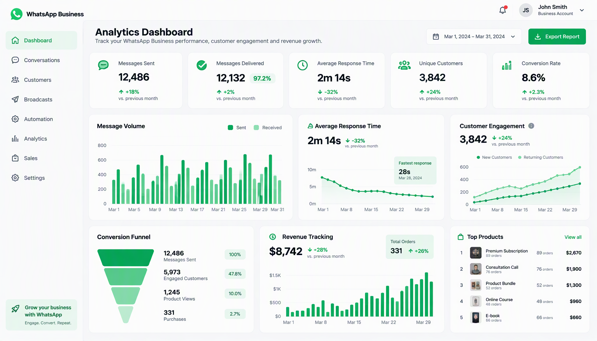

# Panduan Lengkap Inventory Management untuk UMKM Indonesia

**Product 53 | Content Production System**


---

## Daftar Isi

**BAGIAN 1: FONDASI INVENTORY MANAGEMENT**

- Bab 1: Revolusi Inventory Management di Era Digital
- Bab 2: Memahami Jenis-Jenis Inventory
- Bab 3: Strategi Inventory untuk UMKM
- Bab 4: Memilih Software Inventory
- Bab 5: Setup dan Konfigurasi

**BAGIAN 2: IMPLEMENTASI INVENTORY**

- Bab 6: Manajemen Stok dan SKU
- Bab 7: Inventory Tracking dan Monitoring
- Bab 8: Reorder Point dan Safety Stock
- Bab 9: Warehouse Management
- Bab 10: Quality Control dan Inspection
- Bab 11: Inventory Valuation Methods
- Bab 12: Analytics dan Reporting

**BAGIAN 3: OPTIMASI DAN SCALE**

- Bab 13: Integrasi dengan POS dan Accounting
- Bab 14: Best Practices dan Tips
- Bab 15: Studi Kasus Nyata UMKM Indonesia
- Bab 16: Roadmap 30 Hari dan Next Steps

---

# BAGIAN 1: FONDASI INVENTORY MANAGEMENT

---

## Bab 1: Revolusi Inventory Management di Era Digital


### 1.1 Dari Buku Catatan ke Sistem Digital

Bayangkan warung sembako Pak Hadi di Yogyakarta. Selama 15 tahun, ia mencatat stok barang di buku tulis. Setiap sore ia hitung ulang berapa karung beras tersisa, berapa dus mie instan yang masih ada di gudang. Seringkali ia salah hitung. Lebih sering lagi, ia baru tahu barang habis setelah pelanggan datang minta beli.

Sekarang bandingkan dengan Bu Sari yang menjalankan toko kelontong modern di Bekasi. Ia buka aplikasi di HP-nya, langsung terlihat: beras 23 karung, mie instan 4 dus, minyak goreng 15 liter. Sistem memberi notifikasi otomatis ketika stok beras tinggal 5 karung, waktu yang tepat untuk order ke supplier. Bu Sari tidak pernah kehilangan penjualan karena barang habis tanpa ketahuan.

Perbedaan antara Pak Hadi dan Bu Sari bukan soal modal atau ukuran toko. Perbedaannya ada pada cara mengelola inventory.

Inventory management, atau manajemen persediaan, adalah jantung dari bisnis yang menjual produk fisik. Mau bisnis Anda toko kelontong, online shop di Shopee, distributor makanan, atau produsen kerajinan tangan, cara Anda mengelola stok menentukan apakah bisnis untung atau rugi.

Data dari Kementerian Koperasi dan UKM menunjukkan bahwa 42% UMKM di Indonesia mengalami kerugian setiap tahunnya karena masalah manajemen stok. Stok yang menumpuk menyebabkan uang mati di gudang. Stok yang kosong menyebabkan pelanggan kabur. Dua masalah ini punya satu akar: tidak ada sistem inventory yang benar.

Buku ini akan mengubah cara Anda mengelola inventory. Bukan teori akademis yang rumit, tapi panduan praktis yang bisa langsung diterapkan hari ini juga. Kita mulai dari fondasi, naik ke implementasi, dan berakhir dengan optimasi.

### 1.2 Mengapa Inventory Management Berubah Total

Tiga perubahan besar memaksa UMKM untuk meninggalkan cara lama:

**Pertama, ledakan e-commerce.** Marketplace seperti Tokopedia, Shopee, dan Lazada membuka pasar yang jauh lebih luas. Tapi mereka juga menuntut kecepatan fulfillment. Pelanggan order hari ini, besok harus dikirim. Kalau Anda masih hitung stok manual, Anda akan kalah dari kompetitor yang sudah pakai sistem otomatis.

**Kedua, ekspektasi pelanggan.** Pembeli sekarang ingin tahu stok tersedia atau tidak sebelum mereka order. Mereka ingin konfirmasi real-time. Mereka tidak mau menerima "maaf barang habis" setelah transfer pembayaran. Ini hanya bisa dipenuhi dengan sistem inventory yang akurat.

**Ketiga, tekanan margin.** Harga bahan baku naik, ongkos kirim naik, tapi pelanggan tetap minta harga terjangkau. Satu-satunya cara menjaga margin adalah efisiensi. Efisiensi inventory berarti tidak ada uang yang menganggur di gudang, tidak ada barang yang kadaluarsa, dan tidak ada order yang terlewat.

### 1.3 Mitos-Mitos Inventory Management

Sebelum kita lanjut, mari luruskan beberapa kesalahpahaman umum:

**Mitos 1: "Bisnis saya kecil, belum perlu sistem inventory."**
Faktanya, semakin kecil bisnis, semakin kritis setiap rupiah yang tertanam di stok. UMKM dengan 50 SKU saja bisa kehilangan Rp 2-5 juta per bulan karena kesalahan inventory. Sistem inventory bukan kemewahan, itu kebutuhan.

**Mitos 2: "Excel sudah cukup."**
Excel bisa jadi titik awal, tapi bukan solusi jangka panjang. Ketika Anda punya lebih dari 100 SKU, lebih dari satu gudang, atau menjual di beberapa channel sekaligus, Excel akan kewalahan. Data jadi tidak sinkron, rumus error, dan Anda kembali ke kondisi sama dengan buku catatan.

**Mitos 3: "Software inventory itu mahal."**
Ini mungkin benar 5 tahun lalu. Sekarang, banyak solusi inventory yang gratis atau mulai dari Rp 100.000 per bulan. Biaya ini jauh lebih kecil dari kerugian akibat salah kelola stok.

**Mitos 4: "Saya sudah hafal stok saya."**
Hafalan manusia tidak akurat. Anda mungkin tahu perkiraan, tapi apakah Anda tahu persis berapa unit yang tersedia sekarang? Berapa yang sudah di-reserve untuk order? Berapa yang rusak? Sistem tidak lupa, tidak capek, dan tidak salah hitung.

### 1.4 Apa yang Akan Anda Dapatkan dari Buku Ini

Buku ini dirancang sebagai panduan end-to-end. Setelah membacanya, Anda akan mampu:

1. Memilih dan mengimplementasikan sistem inventory yang sesuai dengan skala bisnis Anda
2. Mengelola stok dengan metode yang terukur dan efisien
3. Menentukan kapan harus reorder dan berapa banyak
4. Mengoptimasi tata letak gudang untuk efisiensi maksimal
5. Mengintegrasikan inventory dengan POS dan akuntansi
6. Membaca laporan inventory dan mengambil keputusan berbasis data
7. Menghitung ROI dari investasi sistem inventory

Setiap bab dilengkapi contoh konkret, template yang bisa langsung dipakai, dan checklist implementasi. Tidak ada teori yang tidak bisa dipraktikkan.

### 1.5 Siapa yang Harus Membaca Buku Ini

Buku ini ditulis untuk:

- **Pemilik UMKM** yang masih mengelola stok secara manual dan ingin naik level
- **Manajer operasional** di bisnis retail, distribusi, atau manufaktur skala kecil-menengah
- **Pelaku e-commerce** yang kehilangan penjualan karena masalah stok
- **Siapa saja** yang ingin memahami inventory management tanpa harus kuliah S2 manajemen operasi

Anda tidak perlu background teknis. Anda tidak perlu jago matematika. Yang Anda butuhkan adalah kemauan untuk berubah dan konsistensi untuk menerapkan.

### 1.6 Peta Perjalanan

Perjalanan kita dibagi tiga bagian:

**Bagian 1 (Bab 1-5)** meletakkan fondasi. Anda akan memahami jenis-jenis inventory, strategi yang tepat untuk UMKM, cara memilih software, dan langkah setup awal.

**Bagian 2 (Bab 6-12)** adalah inti implementasi. Kita bahas manajemen SKU, tracking, reorder point, warehouse management, quality control, valuasi inventory, dan analytics.

**Bagian 3 (Bab 13-16)** membawa Anda ke level berikutnya: integrasi sistem, best practices, studi kasus nyata, dan roadmap implementasi 30 hari.

Setiap bab dirancang berdiri sendiri tapi saling terhubung. Anda bisa membaca berurutan atau langsung lompat ke bab yang paling relevan dengan kondisi Anda saat ini. Tapi rekomendasi saya: baca berurutan setidaknya satu kali pertama.

---

## Bab 2: Memahami Jenis-Jenis Inventory


### 2.1 Lebih dari Sekadar "Barang Dagangan"

Ketika orang menyebut "inventory", yang terbayang biasanya adalah produk jadi yang siap dijual. Padahal inventory jauh lebih luas dari itu. Memahami jenis-jenis inventory adalah langkah pertama untuk mengelolanya dengan benar.

Bayangkan Anda punya bisnis kue online. Inventory Anda bukan hanya kue yang siap kirim. Ada tepung, telur, mentega, dan coklat yang menunggu di dapur. Ada kue yang masih dalam proses panggang. Ada kemasan cantik yang siap dipakai. Ada juga kue display untuk foto katalog. Semuanya inventory, tapi jenisnya berbeda.

### 2.2 Empat Kategori Utama Inventory

**1. Raw Materials (Bahan Baku)**

Bahan baku adalah material dasar yang akan diolah menjadi produk jadi. Untuk bisnis furniture, ini berupa kayu, paku, cat, dan pernis. Untuk bisnis catering, ini bahan makanan segar. Untuk bisnis konveksi, ini kain, benang, kancing, dan resleting.

Cara mengelola bahan baku berbeda dengan produk jadi. Bahan baku punya umur simpan yang perlu diperhatikan. Bahan baku sering dibeli dalam jumlah besar untuk mendapat harga murah, tapi ini menciptakan risiko penyimpanan. Fluktuasi harga bahan baku juga mempengaruhi keputusan pembelian.

Tips untuk UMKM: Buat daftar supplier alternatif untuk setiap bahan baku utama. Jangan bergantung pada satu sumber. Ketika supplier utama kosong atau naik harga, Anda punya rencana cadangan.

**2. Work in Progress / WIP (Barang Dalam Proses)**

WIP adalah barang yang sudah mulai diolah tapi belum selesai. Di pabrik roti, WIP adalah adonan yang sedang mengembang. Di workshop furniture, WIP adalah meja yang sudah dipotong tapi belum diampelas.

WIP sering terabaikan dalam manajemen inventory. Padahal WIP mengikat modal kerja. Semakin lama proses produksi, semakin banyak uang yang "terparkir" di WIP.

Tips untuk UMKM: Ukur waktu produksi rata-rata untuk setiap produk. Identifikasi bottleneck, tahap yang paling lama. Cari cara mempercepat tahap tersebut. Setiap pengurangan waktu produksi berarti pengurangan modal yang tertahan.

**3. Finished Goods (Produk Jadi)**

Produk jadi adalah barang yang sudah selesai diproduksi dan siap dijual. Ini yang paling sering dianggap sebagai satu-satunya inventory. Produk jadi di toko fisik, di gudang e-commerce, atau di etalase showroom, semuanya finished goods.

Tantangan utama produk jadi:
- **Overstocking**: Terlalu banyak stok berarti uang mati di gudang
- **Stockout**: Kehabisan stok berarti kehilangan penjualan dan pelanggan
- **Obsolescence**: Produk jadi yang tidak terjual dalam waktu lama bisa jadi usang atau kedaluwarsa
- **Penyusutan**: Kerusakan, pencurian, atau kehilangan selama penyimpanan

**4. MRO Supplies (Maintenance, Repair, Operations)**

MRO adalah barang pendukung yang tidak menjadi bagian dari produk tapi diperlukan untuk operasional. Contoh: alat kebersihan, oli mesin, spare part peralatan produksi, alat tulis kantor, dan bahan kemasan.

MRO sering tidak dicatat dalam sistem inventory karena dianggap "receh". Tapi coba hitung berapa total pengeluaran MRO per bulan. Untuk banyak UMKM, angka MRO bisa mencapai 5-10% dari total biaya operasional.

### 2.3 Kategori Khusus untuk UMKM Indonesia

Selain empat kategori utama di atas, ada beberapa jenis inventory yang spesifik relevan untuk UMKM di Indonesia:

**Inventory Konsinyasi**
Banyak UMKM menitipkan barang di toko orang lain atau di marketplace. Barang ini masih milik Anda sampai terjual. Sistem inventory harus bisa melacak di mana barang berada dan siapa yang memegang.

**Inventory Musiman**
Indonesia punya banyak momen musiman: Lebaran, Natal, tahun ajaran baru, musim hujan. Stok kue lebaran tidak sama dengan stok kue biasa. Anda perlu perencanaan khusus untuk inventory musiman, kapan mulai stok, berapa banyak, dan kapan harus stop.

**Inventory Titip Jual**
Mirip konsinyasi tapi lebih informal. Anda titip produk di warung tetangga atau di event organizer. Tracking-nya lebih sulit karena seringkali tidak ada sistem pencatatan yang rapi dari pihak penerima titip.

**Dropship Inventory**
Kalau Anda menjalankan model dropship, secara teknis Anda tidak pegang inventory. Tapi Anda tetap perlu tahu stok di supplier. Banyak UMKM dropship kehilangan reputasi karena menjual barang yang sebenarnya sudah habis di supplier.

### 2.4 Klasifikasi ABC: Cara Prioritaskan Inventory

Tidak semua inventory sama pentingnya. Metode klasifikasi ABC membantu Anda fokus pada yang paling berdampak:

**Kategori A (20% item, 80% nilai)**
Barang-barang yang menyumbang mayoritas nilai inventory. Contoh: smartphone di toko HP, daging di toko frozen food. Item kategori A harus dimonitor setiap hari, punya safety stock yang ketat, dan reorder point yang presisi.

**Kategori B (30% item, 15% nilai)**
Barang menengah. Penting tapi tidak sebesar A. Monitoring mingguan cukup. Safety stock bisa lebih longgar.

**Kategori C (50% item, 5% nilai)**
Barang-barang kecil yang nilainya rendah. Contoh: aksesoris HP, permen di kasir. Monitoring bulanan sudah cukup. Order dalam jumlah besar sekaligus untuk menghemat biaya order.

Cara menerapkan klasifikasi ABC:
1. List semua item inventory Anda
2. Hitung nilai penggunaan tahunan setiap item (jumlah terjual x harga per unit)
3. Urutkan dari nilai tertinggi ke terendah
4. Top 20% = Kategori A, next 30% = Kategori B, sisanya = Kategori C

### 2.5 Checklist Pemahaman Inventory

Gunakan checklist ini untuk memastikan Anda sudah memahami inventory bisnis Anda:

- [ ] Saya tahu semua jenis inventory yang saya miliki (bahan baku, WIP, produk jadi, MRO)
- [ ] Saya sudah klasifikasi inventory saya ke kategori A, B, dan C
- [ ] Saya tahu berapa nilai total inventory di setiap kategori
- [ ] Saya tahu item mana yang paling cepat bergerak (fast-moving) dan paling lambat (slow-moving)
- [ ] Saya punya data umur simpan untuk inventory yang perishable
- [ ] Saya tahu di mana saja inventory saya berada (toko, gudang, titip jual, konsinyasi)
- [ ] Saya bisa identifikasi minimal 3 item yang paling sering kosong (stockout)
- [ ] Saya bisa identifikasi minimal 3 item yang paling menumpuk di gudang (overstock)

Jika Anda bisa centang semua kotak di atas, Anda sudah punya pemahaman solid tentang inventory bisnis Anda. Jika belum, itu tidak masalah, buku ini akan membantu Anda membangunnya.

---

## Bab 3: Strategi Inventory untuk UMKM


### 3.1 Tidak Ada Satu Strategi untuk Semua

Setiap bisnis unik. Toko kelontong di pelosok desa punya kebutuhan berbeda dengan distributor kosmetik di Jakarta. Produsen mebel di Jepara menghadapi tantangan yang tidak dialami penjual makanan beku. Karena itu, tidak ada satu strategi inventory yang cocok untuk semua.

Yang ada adalah prinsip-prinsip dasar yang bisa Anda adaptasi ke kondisi spesifik bisnis Anda. Bab ini akan memberikan kerangka kerja untuk memilih dan merancang strategi inventory yang pas.

### 3.2 Lima Strategi Utama untuk UMKM

**Strategi 1: Just in Time (JIT)**

Konsep JIT sederhana: pesan barang hanya ketika Anda membutuhkannya. Stok minimum, order sering tapi dalam jumlah kecil. Keuntungan: uang tidak tertahan di gudang. Kerugian: Anda sangat bergantung pada kecepatan supplier.

Cocok untuk: Bisnis dengan supplier yang reliable dan dekat. Contoh: warung makan yang supplier sayur-nya datang setiap pagi.

Tidak cocok untuk: Bisnis di daerah dengan akses supplier terbatas atau barang yang sering langka di pasaran.

Implementasi JIT untuk UMKM:
- Identifikasi barang yang paling cepat habis (fast-moving)
- Buat kesepakatan dengan supplier untuk pengiriman rutin (harian/mingguan)
- Jaga hubungan baik dengan supplier, JIT butuh komunikasi yang lancar
- Selalu punya rencana cadangan jika supplier utama bermasalah

**Strategi 2: Safety Stock (Stok Pengaman)**

Safety stock adalah stok tambahan di atas kebutuhan normal. Fungsinya seperti ban serep di mobil, Anda berharap tidak pernah dipakai, tapi senang kalau ada ketika dibutuhkan.

Safety stock melindungi Anda dari:
- Keterlambatan pengiriman supplier
- Lonjakan permintaan mendadak
- Musim hujan yang menghambat distribusi
- Masalah kualitas yang membuat barang harus diretur

Cara menghitung safety stock sederhana:

Safety Stock = (Penjualan Tertinggi per Hari x Lead Time Tertinggi) - (Penjualan Rata-rata per Hari x Lead Time Rata-rata)

Contoh: Penjualan tertinggi kopi bubuk = 15 pack/hari. Lead time tertinggi dari supplier = 5 hari. Penjualan rata-rata = 8 pack/hari. Lead time rata-rata = 3 hari.

Safety Stock = (15 x 5) - (8 x 3) = 75 - 24 = 51 pack

Artinya, Anda selalu punya minimal 51 pack kopi bubuk sebagai pengaman.

**Strategi 3: First In First Out (FIFO)**

FIFO berarti barang yang pertama masuk gudang, pertama kali keluar dan dijual. Ini wajib untuk barang yang punya masa kedaluwarsa: makanan, minuman, kosmetik, obat-obatan.

Implementasi FIFO di gudang UMKM:
- Rak atau area penyimpanan diatur agar barang lama di depan, barang baru di belakang
- Setiap barang yang masuk diberi label tanggal penerimaan
- Karyawan dilatih untuk selalu ambil barang dari depan
- Sistem inventory mencatat batch masuk dan mengeluarkan peringatan untuk batch yang mendekati expired

**Strategi 4: Last In First Out (LIFO)**

LIFO adalah kebalikan FIFO, barang yang terakhir masuk, pertama dikeluarkan. Strategi ini jarang dipakai untuk barang fisik karena berisiko barang lama menumpuk dan kedaluwarsa.

LIFO lebih relevan untuk valuasi inventory dalam akuntansi (akan dibahas di Bab 11). Untuk UMKM yang menjual produk non-perishable seperti aksesoris, alat rumah tangga, atau bahan bangunan, LIFO bisa dipertimbangkan jika ada alasan akuntansi yang mendukung.

**Strategi 5: Economic Order Quantity (EOQ)**

EOQ menjawab pertanyaan: berapa banyak barang yang harus saya pesan setiap kali order? Terlalu sedikit berarti biaya order tinggi (karena sering order). Terlalu banyak berarti biaya penyimpanan tinggi.

Rumus EOQ:

EOQ = Akar dari (2 x D x S) / H

Keterangan:
- D = Demand (kebutuhan tahunan dalam unit)
- S = Ordering cost (biaya per order: administrasi, transport, dll)
- H = Holding cost (biaya simpan per unit per tahun)

Contoh nyata: Toko bangunan menjual 1.200 sak semen per tahun. Biaya per order (telepon, transport ke supplier) = Rp 50.000. Biaya simpan per sak per tahun = Rp 10.000.

EOQ = Akar dari (2 x 1.200 x 50.000) / 10.000
EOQ = Akar dari 120.000.000 / 10.000
EOQ = Akar dari 12.000
EOQ = 110 sak

Artinya, setiap kali order semen, toko sebaiknya pesan 110 sak. Dengan kebutuhan tahunan 1.200 sak, berarti order sekitar 11 kali per tahun (kira-kira sebulan sekali).

### 3.3 Strategi Hybrid: Kombinasi yang Paling Efektif

UMKM di Indonesia jarang bisa pakai satu strategi murni. Kondisi pasar, ketersediaan supplier, dan pola permintaan pelanggan menuntut kombinasi. Berikut beberapa kombinasi yang terbukti efektif:

**JIT + Safety Stock**
Terapkan JIT untuk barang fast-moving yang supply-nya lancar. Tambahkan safety stock untuk barang yang supply-nya tidak pasti. Ini kombinasi paling umum dan paling mudah diimplementasikan.

**FIFO + Klasifikasi ABC**
Gunakan FIFO untuk semua barang perishable. Untuk barang non-perishable, terapkan klasifikasi ABC. Item kategori A dimonitor ketat dengan reorder point. Item kategori C cukup dicek bulanan.

**EOQ + Musiman**
Hitung EOQ untuk kebutuhan normal. Ketika mendekati musim tinggi (Lebaran, Natal), naikkan EOQ 30-50%. Setelah musim lewat, turunkan kembali ke EOQ normal.

### 3.4 Menentukan Strategi Berdasarkan Jenis Bisnis

| Jenis Bisnis | Strategi Utama | Strategi Pendukung |
|---|---|---|
| Toko kelontong/sembako | FIFO + Safety Stock | JIT untuk barang segar |
| Online shop fashion | Klasifikasi ABC + Safety Stock | LIFO untuk valuasi |
| Produsen makanan/minuman | FIFO + JIT | Safety Stock untuk bahan baku |
| Distributor | EOQ + Klasifikasi ABC | Safety Stock untuk item A |
| Dropshipper | Tracking stok supplier | Multi-supplier backup |
| Toko bangunan/material | EOQ + Safety Stock | Musiman untuk proyek |
| Konveksi/garmen | JIT bahan baku + FIFO | Safety Stock untuk bahan utama |

### 3.5 Mengukur Keberhasilan Strategi

Setiap strategi perlu diukur. Berikut metrik utama yang harus Anda track:

**Inventory Turnover Ratio (Perputaran Stok)**
Rumus: Harga Pokok Penjualan / Rata-rata Nilai Inventory

Angka ini menunjukkan berapa kali inventory Anda berputar dalam setahun. Semakin tinggi semakin baik, artinya barang cepat terjual.

Benchmark untuk UMKM Indonesia:
- Toko sembako: 12-24x per tahun (stok berputar setiap 2-4 minggu)
- Fashion retail: 4-8x per tahun
- Elektronik: 6-12x per tahun
- Furniture: 2-4x per tahun

**Stockout Rate**
Persentase order yang tidak bisa dipenuhi karena stok kosong.

Rumus: (Jumlah order yang stockout / Total order) x 100%

Target: di bawah 5%. Jika di atas 10%, strategi Anda perlu perbaikan serius.

**Carrying Cost (Biaya Penyimpanan)**
Total biaya untuk menyimpan inventory selama setahun, termasuk: sewa gudang, listrik, asuransi, penyusutan, dan opportunity cost dari modal yang tertahan.

Rumus sederhana: (Total biaya penyimpanan per tahun / Nilai rata-rata inventory) x 100%

Target: 15-25% dari nilai inventory per tahun. Jika lebih dari 30%, Anda menyimpan terlalu banyak atau terlalu lama.

**Dead Stock Ratio**
Persentase inventory yang tidak bergerak dalam 90 hari terakhir.

Rumus: (Nilai dead stock / Total nilai inventory) x 100%

Target: di bawah 5%. Dead stock di atas 10% berarti ada masalah serius dalam perencanaan pembelian.

### 3.6 Template Evaluasi Strategi

Gunakan template ini setiap kuartal untuk mengevaluasi strategi inventory Anda:

```
EVALUASI STRATEGI INVENTORY - Kuartal: _____
Tanggal Evaluasi: _____

1. Inventory Turnover Ratio: _____x (Target: _____x)
   Status: [ ] Baik  [ ] Perlu Perbaikan  [ ] Kritis

2. Stockout Rate: _____% (Target: <5%)
   Status: [ ] Baik  [ ] Perlu Perbaikan  [ ] Kritis
   Item yang paling sering stockout:
   a. ____________
   b. ____________
   c. ____________

3. Carrying Cost: _____% (Target: 15-25%)
   Status: [ ] Baik  [ ] Perlu Perbaikan  [ ] Kritis

4. Dead Stock Ratio: _____% (Target: <5%)
   Status: [ ] Baik  [ ] Perlu Perbaikan  [ ] Kritis
   Total nilai dead stock: Rp ____________
   Rencana penanganan: ________________________

5. Akurasi stok (hasil stock opname): _____%
   Status: [ ] Baik (>95%)  [ ] Perlu Perbaikan (90-95%)  [ ] Kritis (<90%)

6. Strategi yang perlu disesuaikan:
   _______________________________________________

7. Action items untuk kuartal berikutnya:
   a. ____________  Deadline: ________
   b. ____________  Deadline: ________
   c. ____________  Deadline: ________
```

---

## Bab 4: Memilih Software Inventory


### 4.1 Landscape Software Inventory untuk UMKM Indonesia

Pilihan software inventory untuk UMKM Indonesia semakin banyak. Dari yang gratis sampai yang premium, dari yang sederhana sampai yang kompleks. Memahami landscape ini membantu Anda memilih yang tepat tanpa membuang waktu mencoba satu per satu.

Secara umum, software inventory bisa dikelompokkan ke dalam empat kategori:

**Level 1: Spreadsheet (Excel/Google Sheets)**
Cocok untuk bisnis dengan kurang dari 50 SKU dan satu lokasi penjualan. Gratis, fleksibel, tapi manual dan rawan error. Cocok sebagai titik awal sebelum naik ke software dedicated.

**Level 2: Software Inventory Standalone**
Aplikasi yang fokus pada manajemen inventory saja. Contoh: Zoho Inventory, Sortly, inFlow Inventory. Harganya terjangkau, fiturnya lengkap untuk kebutuhan dasar, tapi tidak terintegrasi dengan akuntansi atau POS.

**Level 3: Platform All-in-One Lokal**
Software buatan Indonesia yang menggabungkan inventory, POS, akuntansi, dan kadang HR. Contoh: Mekari Jurnal, Accurate Online, Pawoon, Majoo. Keunggulannya: sudah disesuaikan dengan regulasi Indonesia (pajak, format laporan, dll).

**Level 4: ERP Skala Menengah**
Sistem enterprise resource planning yang mencakup seluruh aspek bisnis. Contoh: Odoo, SAP Business One, Oracle NetSuite. Cocok untuk UMKM yang sudah scale-up dan butuh integrasi penuh. Harganya lebih tinggi tapi sepadan untuk bisnis dengan omzet di atas Rp 5 miliar per tahun.

### 4.2 Kriteria Pemilihan Software

Jangan terjebak memilih software karena fiturnya lengkap atau harganya murah. Pilih berdasarkan kebutuhan spesifik bisnis Anda. Berikut kriteria yang perlu dipertimbangkan:

**1. Skalabilitas**
Bisnis Anda akan tumbuh. Software yang Anda pilih harus bisa tumbuh bersama. Tanyakan: berapa maksimal SKU yang bisa ditangani? Bisa tambah lokasi gudang? Bagaimana pricing-nya ketika bisnis membesar?

**2. Kemudahan Penggunaan**
Anda dan tim Anda bukan IT specialist. Software harus intuitif, bisa dipelajari dalam hitungan hari (bukan minggu), dan punya antarmuka yang jelas. Mintalah free trial dan coba langsung, jangan hanya baca review.

**3. Dukungan Lokal**
Software buatan Indonesia atau yang punya kantor support di Indonesia punya keunggulan: bahasa Indonesia, paham regulasi lokal, dan support yang responsif karena zona waktu sama.

**4. Integrasi**
Software inventory tidak berdiri sendiri. Ia harus bisa terhubung dengan marketplace (Tokopedia, Shopee), POS, akuntansi, dan mungkin ekspedisi. Cek apakah software punya API atau integrasi native dengan tools yang Anda pakai.

**5. Harga Total (Total Cost of Ownership)**
Jangan hanya lihat harga berlangganan bulanan. Hitung total biaya: setup fee, biaya training, biaya migrasi data, biaya integrasi, dan biaya upgrade. Kadang software yang "murah" jadi mahal karena banyak biaya tersembunyi.

**6. Backup dan Keamanan Data**
Data inventory adalah aset bisnis. Pastikan software punya backup otomatis, enkripsi data, dan server yang reliable. Tanyakan di mana data disimpan dan apa SLA uptime-nya.

### 4.3 Perbandingan Platform Populer

Berikut perbandingan platform inventory yang populer di kalangan UMKM Indonesia:

**Mekari Jurnal**
- Harga: mulai Rp 299.000/bulan (paket Essentials)
- Keunggulan: all-in-one (inventory, akuntansi, POS, pajak), support bahasa Indonesia, integrasi marketplace lokal
- Kekurangan: UI agak padat untuk pemula, beberapa fitur advanced butuh paket lebih tinggi
- Cocok untuk: UMKM yang butuh solusi lengkap dalam satu platform
- Kode referral: **JURNAL-UMKM50** (diskon 50% untuk 3 bulan pertama)

**Accurate Online**
- Harga: mulai Rp 249.000/bulan
- Keunggulan: kuat di akuntansi dan inventory, laporan pajak otomatis, sudah dipakai ribuan UMKM
- Kekurangan: integrasi marketplace masih terbatas, mobile app belum optimal
- Cocok untuk: UMKM yang mengutamakan ketepatan akuntansi dan pelaporan pajak
- Kode referral: **ACCURATE-SNISHOP** (diskon 20% tahun pertama)

**Zoho Inventory**
- Harga: gratis untuk sampai 50 order/bulan, mulai $29/bulan untuk lebih
- Keunggulan: gratis untuk bisnis kecil, integrasi luas dengan Zoho ecosystem dan marketplace global
- Kekurangan: belum ada fitur pajak Indonesia native, UI bahasa Inggris
- Cocok untuk: Online shop yang jual di marketplace internasional atau bisnis yang sudah pakai Zoho CRM
- Kode referral: **ZOHO-INV-SNISHOP** (extended free trial 60 hari)

**TradeGecko (sekarang QuickBooks Commerce)**
- Harga: mulai $39/bulan
- Keunggulan: multi-channel selling yang kuat, B2B ordering portal, integrasi Xero dan QuickBooks
- Kekurangan: harga relatif tinggi untuk UMKM kecil, beberapa fitur tidak relevan untuk pasar Indonesia
- Cocok untuk: Distributor atau wholesaler yang punya pelanggan B2B
- Kode referral: **TG-SNISHOP2025** (diskon 25% tahun pertama)

**Mekari F&B (Alternatif untuk Food & Beverage)**
Selain Mekari Jurnal, ada juga Mekari yang lebih fokus ke F&B. Untuk UMKM F&B yang butuh inventory bahan baku dan recipe management, ini bisa jadi pilihan yang lebih spesifik.

### 4.4 Solusi Gratis dan Low-Budget

Tidak semua UMKM punya budget untuk software berbayar. Berikut opsi yang bisa Anda pertimbangkan:

**Google Sheets + Template**
Gratis total. Banyak template inventory management yang bisa di-download. Kelemahan: manual, tidak real-time, tidak ada notifikasi otomatis. Tapi untuk bisnis dengan kurang dari 30 SKU, ini bisa jadi solusi awal yang memadai.

**Zoho Inventory (Free Tier)**
Gratis untuk sampai 50 order per bulan, 1 gudang, dan 1.000 item. Fitur sudah cukup untuk online shop kecil. Kekurangan: branding Zoho di invoice dan laporan.

**Odoo Community Edition**
Open source dan gratis. Fitur inventory sangat lengkap. Tapi butuh keahlian teknis untuk setup dan maintenance. Cocok jika Anda punya tim IT atau kenal orang yang bisa bantu.

**ABC Inventory Plus**
Software desktop gratis untuk Windows. Fitur cukup lengkap untuk single-location inventory. Tidak ada biaya berlangganan karena berjalan offline. Kekurangan: tidak ada sinkronisasi multi-device dan tidak ada update fitur.

### 4.5 Proses Pemilihan: Langkah demi Langkah

Jangan terburu-buru. Ikuti langkah ini untuk memastikan Anda memilih software yang tepat:

**Langkah 1: Inventaris Kebutuhan (Hari 1-2)**
Tulis semua yang Anda butuhkan dari software inventory. Bedakan antara "must have" dan "nice to have".

Must have:
- Tracking stok real-time
- Notifikasi stok rendah
- Laporan penjualan dan stok
- Multi-user access

Nice to have:
- Integrasi Tokopedia/Shopee
- Barcode scanner support
- Mobile app
- Laporan pajak otomatis

**Langkah 2: Shortlist 3 Kandidat (Hari 3)**
Berdasarkan kebutuhan di atas, pilih 3 software yang paling cocok. Baca review dari pengguna lain, terutama UMKM sejenis.

**Langkah 3: Free Trial (Hari 4-17)**
Daftar free trial untuk ketiga kandidat. Gunakan selama 2 minggu. Uji dengan skenario nyata bisnis Anda: input stok, buat order, cek laporan, coba fitur notifikasi.

**Langkah 4: Evaluasi dan Putuskan (Hari 18-20)**
Bandingkan pengalaman Anda dengan ketiga software. Gunakan scoring sheet sederhana dengan bobot untuk setiap kriteria.

**Langkah 5: Implementasi (Hari 21+)**
Setelah memilih, mulai proses implementasi. Kita akan bahas detailnya di Bab 5.

### 4.6 Kesalahan Umum dalam Memilih Software

**Kesalahan 1: Memilih yang paling murah**
Murah bukan berarti cocok. Software gratis yang tidak punya fitur yang Anda butuhkan justru lebih mahal karena Anda harus tambah tools lain.

**Kesalahan 2: Memilih yang paling lengkap**
Fitur berlimpah berarti kompleksitas tinggi. Anda membayar untuk fitur yang tidak akan pernah dipakai dan butuh waktu lebih lama untuk belajar.

**Kesalahan 3: Tidak mencoba dulu**
Jangan percaya review saja. Coba sendiri dengan data bisnis Anda.

**Kesalahan 4: Tidak mempertimbangkan tim**
Software yang Anda pilih akan dipakai oleh tim Anda setiap hari. Libatkan mereka dalam proses evaluasi.

**Kesalahan 5: Berpikir "nanti bisa migrate"**
Migrasi data antar software itu sulit dan mahal. Pilih software yang bisa tumbuh bersama bisnis Anda.

---

## Bab 5: Setup dan Konfigurasi


### 5.1 Persiapan Sebelum Setup

Sebelum Anda membuka software inventory dan mulai input data, ada beberapa hal yang harus disiapkan. Persiapan yang baik menghemat waktu implementasi berhari-hari dan mencegah kesalahan yang mahal untuk diperbaiki.

**Persiapan 1: Bersihkan Gudang Fisik**
Sebelum data masuk ke sistem, rapikan gudang atau area penyimpanan Anda. Kelompokkan barang berdasarkan kategori. Buang atau pisahkan barang rusak. Identifikasi barang yang sudah tidak relevan.

**Persiapan 2: Stock Opname Awal**
Hitung semua barang yang Anda miliki saat ini. Catat dengan teliti: jumlah, kondisi, dan lokasi penyimpanan. Ini akan jadi data awal (opening balance) di sistem inventory.

Tips: lakukan stock opname di waktu yang paling sedikit aktivitas, misalnya akhir pekan atau malam hari setelah toko tutup. Libatkan minimal 2 orang untuk cross-check.

**Persiapan 3: Siapkan Data Master**
Kumpulkan informasi dasar untuk setiap item inventory:
- Nama produk
- SKU atau kode barang
- Kategori
- Satuan (pcs, kg, liter, lusin, dll)
- Harga beli terakhir
- Harga jual
- Supplier utama
- Lead time dari supplier
- Minimum order quantity
- Lokasi penyimpanan di gudang

**Persiapan 4: Tentukan Struktur Organisasi**
Siapa yang akan akses sistem? Siapa yang boleh input data? Siapa yang boleh approve purchase order? Siapa yang bisa lihat laporan? Tentukan role dan permission sejak awal.

### 5.2 Langkah-Langkah Setup

Berikut langkah setup umum yang berlaku untuk hampir semua software inventory:

**Langkah 1: Buat Akun dan Konfigurasi Dasar**
Daftar akun, isi informasi perusahaan (nama, alamat, NPWP untuk software lokal), pilih mata uang (IDR), atur zona waktu (WIB/WITA/WIT).

**Langkah 2: Setup Struktur Gudang**
Definisikan lokasi penyimpanan: nama gudang/lokasi, alamat gudang, zona atau area di dalam gudang (jika ada), dan kapasitas (opsional).

Untuk UMKM dengan satu lokasi, ini cukup sederhana. Untuk yang punya beberapa lokasi (toko + gudang, atau beberapa cabang), setup setiap lokasi sebagai warehouse terpisah.

**Langkah 3: Input Data Master Produk**
Ini langkah yang paling memakan waktu tapi paling kritis. Input semua produk satu per satu atau via import CSV/Excel.

Format CSV standar untuk import produk:

```
SKU,Nama Produk,Kategori,Satuan,Harga Beli,Harga Jual,Stok Awal,Lokasi
BRG001,Beras Premium 5kg,Sembako,Kg,62000,68000,50,Gudang A
BRG002,Minyak Goreng 2L,Sembako,Pcs,28000,32000,30,Gudang A
BRG003,Gula Pasir 1kg,Sembako,Pcs,14000,16000,40,Gudang A
BRG004,Mie Instan Goreng,Mie & Pasta,Pcs,2500,3000,200,Gudang B
BRG005,Sabun Mandi Batang,Kebersihan,Pcs,3500,4500,100,Gudang B
```

Tips penting:
- Gunakan SKU yang konsisten dan bermakna (bukan angka random)
- Jangan gunakan spasi atau karakter khusus di SKU
- Pastikan tidak ada duplikasi SKU
- Backup file CSV import Anda

**Langkah 4: Setup Supplier**
Input data supplier utama dan alternatif: nama supplier, kontak (telepon, email, WhatsApp), alamat, daftar produk yang disupply, syarat pembayaran (cash, tempo 7 hari, tempo 30 hari), dan lead time rata-rata.

**Langkah 5: Setup Pelanggan (Jika B2B)**
Jika Anda punya pelanggan bisnis (toko yang beli dari Anda, reseller, dll), input data mereka: nama pelanggan, kontak, alamat pengiriman, kategori harga (jika ada harga khusus reseller), dan limit kredit (jika ada sistem tempo).

**Langkah 6: Konfigurasi Notifikasi**
Atur notifikasi untuk: stok rendah (low stock alert), stok habis (out of stock alert), barang mendekati expired (jika relevan), purchase order perlu approval, dan stok masuk dan keluar.

**Langkah 7: Uji Coba Sistem**
Sebelum go-live, lakukan uji coba:
1. Buat purchase order fiktif dan proses sampai barang masuk
2. Buat penjualan fiktif dan proses sampai stok berkurang
3. Cek apakah notifikasi stok rendah berfungsi
4. Generate laporan dan pastikan angkanya masuk akal
5. Coba akses dari HP (jika ada mobile app)

### 5.3 Migrasi Data dari Sistem Lama

Jika Anda pindah dari Excel atau software lain, migrasi data perlu perhatian khusus:

**Dari Excel/Google Sheets:**
1. Rapikan format spreadsheet Anda agar sesuai template import software baru
2. Pastikan tidak ada kolom kosong yang wajib diisi
3. Backup file asli sebelum import
4. Import data master produk terlebih dahulu
5. Import stok awal (opening balance)
6. Import data transaksi jika diperlukan (opsional, kadang lebih bersih mulai dari nol)

**Dari Software Lain:**
1. Export data dari software lama (biasanya format CSV atau Excel)
2. Sesuaikan format dengan template software baru
3. Perhatikan perbedaan field, nama kolom mungkin berbeda antar software
4. Import bertahap: master data dulu, lalu stok, lalu histori transaksi
5. Verifikasi total setelah import, pastikan jumlah stok dan nilai inventory sama

**Validasi Pasca-Migrasi:**
Setelah migrasi, lakukan stock opname ulang dan bandingkan dengan data di sistem baru. Selisih wajar adalah 1-2%. Jika lebih, investigasi penyebabnya sebelum lanjut operasional.

### 5.4 Training Tim

Software sebagus apapun tidak berguna jika tim tidak bisa atau tidak mau memakainya. Investasikan waktu untuk training:

**Hari 1-2: Training Dasar**
- Cara login dan navigasi menu
- Cara input data (produk, supplier, pelanggan)
- Cara melihat stok dan mencari produk
- Cara membuat purchase order sederhana
- Cara membuat penjualan/pengeluaran barang

**Hari 3-4: Training Lanjutan**
- Cara menerima barang dan penyesuaian stok
- Cara generate dan membaca laporan
- Cara menggunakan barcode scanner (jika ada)
- Cara menangani retur dan penyesuaian
- Cara menggunakan notifikasi dan alert

**Hari 5-7: Supervised Operation**
- Tim beroperasi dengan software baru, tapi ada pendampingan
- Setiap masalah dicatat untuk dibahas
- Evaluasi harian 15 menit untuk membahas kendala

**Tips Training:**
- Buat SOP tertulis untuk setiap proses (bisa dalam bentuk checklist)
- Rekam video tutorial singkat (2-3 menit) untuk setiap proses utama
- Tunjuk satu orang sebagai "super user" yang bisa bantu rekan lain
- Berikan insentif untuk adopsi cepat (misalnya bonus kecil jika 2 minggu pertama tidak ada error input)

### 5.5 Checklist Setup

Gunakan checklist ini untuk memastikan setup Anda lengkap:

**Persiapan:**
- [ ] Gudang fisik sudah rapi dan terorganisir
- [ ] Stock opname awal selesai
- [ ] Data master produk sudah disiapkan (minimal di spreadsheet)
- [ ] Data supplier sudah lengkap
- [ ] Struktur role dan permission sudah ditentukan

**Konfigurasi Sistem:**
- [ ] Akun perusahaan sudah dibuat
- [ ] Informasi perusahaan (nama, alamat, NPWP) sudah diisi
- [ ] Gudang/lokasi sudah di-setup
- [ ] Semua produk sudah di-input
- [ ] Stok awal sudah sesuai hasil stock opname
- [ ] Supplier sudah di-input
- [ ] Notifikasi sudah dikonfigurasi
- [ ] User dan permission sudah di-setup

**Testing:**
- [ ] Purchase order test berhasil
- [ ] Penjualan test berhasil
- [ ] Stok berkurang sesuai setelah penjualan
- [ ] Notifikasi stok rendah berfungsi
- [ ] Laporan bisa di-generate
- [ ] Akses mobile berfungsi (jika applicable)

**Training:**
- [ ] Semua user sudah di-training
- [ ] SOP tertulis sudah dibuat
- [ ] Super user sudah ditunjuk
- [ ] Periode supervised operation sudah dijalankan
- [ ] Tidak ada kendala kritis yang belum terselesaikan

Jika semua kotak tercentang, sistem inventory Anda siap go-live. Selamat, Anda baru saja mengambil langkah besar untuk meningkatkan efisiensi bisnis.

---
# BAGIAN 2: IMPLEMENTASI INVENTORY

---

## Bab 6: Manajemen Stok dan SKU


### 6.1 Apa Itu SKU dan Mengapa Penting

SKU (Stock Keeping Unit) adalah kode unik yang mengidentifikasi setiap produk dalam inventory Anda. SKU bukan sekadar label, tapi fondasi dari seluruh sistem inventory. Tanpa SKU yang benar, Anda tidak bisa tracking stok, menganalisis penjualan, atau mengelola reorder dengan efektif.

Bayangkan sebuah toko sepatu. Mereka punya sepatu yang sama dalam warna hitam, coklat, dan putih, masing-masing dalam ukuran 38 sampai 44. Itu berarti 3 x 7 = 21 varian. Setiap varian butuh SKU sendiri karena masing-masing memiliki stok yang berbeda.

### 6.2 Merancang SKU Naming Convention

Format SKU yang baik mengikuti prinsip ini:

**Prinsip 1: Deskriptif tapi Singkat**
SKU harus memberi petunjuk tentang produk tanpa terlalu panjang. Format yang umum: KATEGORI-VARIAN-UKURAN.

Contoh baik:
- KEMEJA-PTH-S (Kemeja Putih Small)
- SEPATU-HITAM-42 (Sepatu Hitam ukuran 42)
- KOPI-ARAB-250G (Kopi Arabica 250 gram)

Contoh buruk:
- KMJ-PTH-S-2026-001 (terlalu panjang)
- PRODUCT-12345 (tidak deskriptif)
- SEPATU_HITAM@42! (karakter spesial bermasalah)

**Prinsip 2: Konsisten**
Semua SKU mengikuti pola yang sama. Jika Anda mulai dengan KATEGORI-VARIAN-UKURAN, semua produk harus ikut format ini.

**Prinsip 3: Scalable**
Pikirkan pertumbuhan bisnis. Jika sekarang punya 100 SKU, mungkin 2 tahun lagi jadi 1.000. Format harus mengakomodasi pertumbuhan.

**Prinsip 4: Hindari Karakter Bermasalah**
Hanya gunakan huruf besar, angka, dan dash (-). Hindari spasi, underscore, titik, atau karakter spesial lainnya karena bisa bermasalah di sistem barcode atau database.

### 6.3 Sistem Barcode

Barcode mempercepat proses inventory secara signifikan. Scan barcode jauh lebih cepat dan akurat dibanding mengetik manual.

**Jenis barcode yang umum:**
- UPC-A: 12 digit, standar retail internasional
- EAN-13: 13 digit, standar di Indonesia dan Eropa
- Code 128: bisa encode huruf dan angka, fleksibel
- QR Code: 2 dimensi, bisa menyimpan lebih banyak data

**Implementasi barcode untuk UMKM:**
1. Beli printer barcode thermal (mulai Rp 500.000)
2. Beli scanner barcode USB (mulai Rp 150.000)
3. Generate barcode dari SKU menggunakan software atau generator online
4. Print dan tempel di setiap produk atau rak
5. Hubungkan scanner dengan software inventory

Dengan barcode, proses stock opname yang biasanya memakan waktu 2 hari bisa selesai dalam 4 jam. Picking accuracy naik dari 95% ke 99%+.

### 6.4 Strategi Manajemen Stok

**FIFO (First In, First Out)**
Barang yang pertama masuk gudang, pertama yang keluar. Ini strategi default untuk sebagian besar bisnis, terutama yang punya produk perishable.

Implementasi fisik: simpan barang baru di belakang rak, ambil barang dari depan. Setiap kali stok baru datang, letakkan di belakang stok yang sudah ada.

Implementasi sistem: software akan menandai batch mana yang masuk lebih dulu dan mengarahkan picking ke batch tersebut.

**LIFO (Last In, First Out)**
Barang terakhir masuk, pertama keluar. Jarang digunakan untuk fisik, tapi kadang dipakai untuk valuation (lihat Bab 11). Tidak direkomendasikan untuk produk perishable.

**Average Cost**
Setiap unit dianggap memiliki cost yang sama, yaitu rata-rata dari semua unit yang tersedia. Simple dan cocok untuk produk yang homogen dimana perbedaan batch tidak signifikan.

### 6.5 Stock Opname

Stock opname adalah proses menghitung fisik stok dan membandingkannya dengan catatan sistem. Ini penting untuk memastikan akurasi data.

**Jenis stock opname:**

**Full Stock Opname:** Hitung semua produk sekaligus. Biasanya dilakukan setahun sekali, seringkali di akhir tahun fiskal. Membutuhkan waktu dan sumber daya besar, kadang perlu tutup toko/gudang.

**Cycle Counting:** Hitung sebagian produk setiap hari atau minggu. Jadwal dibuat bergilir sehingga semua produk terhitung dalam periode tertentu (misalnya 3 bulan). Keunggulan: tidak perlu tutup operasi, error terdeteksi lebih cepat.

**Spot Check:** Hitung random beberapa item untuk verifikasi cepat. Tidak terjadwal, dilakukan sebagai quality control.

**Proses stock opname:**

Langkah 1: Persiapan
- Cetak stock count sheet dari sistem
- Siapkan alat: pulpen, kalkulator, scanner barcode
- Assign tim dan bagi zona
- Bekukan pergerakan stok (jika memungkinkan)

Langkah 2: Penghitungan
- Hitung fisik per lokasi
- Catat di count sheet atau scan barcode
- Tandai item yang rusak atau tidak teridentifikasi
- Hitung ulang jika ada keraguan

Langkah 3: Rekonsiliasi
- Bandingkan hasil hitung dengan sistem
- Hitung variance (selisih)
- Investigasi variance yang signifikan
- Buat adjustment di sistem

Langkah 4: Reporting
- Buat laporan stock opname
- Analisis penyebab variance
- Rekomendasikan tindakan perbaikan
- Presentasikan ke manajemen

### 6.6 Inventory Accuracy

Akurasi inventory diukur dengan formula:
Akurasi = (Jumlah item yang cocok / Total item yang dihitung) x 100%

Target minimal: 98%. Di bawah itu, ada masalah serius yang perlu ditangani.

Penyebab umum inaccuracy:
- Human error saat input data
- Pencurian atau kehilangan
- Barang rusak tidak dicatat
- Salah kirim atau salah terima
- Sistem tidak di-update setelah pergerakan stok

Cara meningkatkan akurasi:
- Cycle counting rutin
- Barcode scanning (kurangi manual entry)
- Training tim tentang prosedur
- Audit random setiap minggu
- Investigasi setiap discrepancy

---

## Bab 7: Inventory Tracking dan Monitoring


### 7.1 Real-Time Tracking

Real-time tracking berarti Anda tahu persis berapa stok yang tersedia setiap saat. Setiap penjualan, penerimaan, atau adjustment langsung ter-reflection di sistem.

Manfaat real-time tracking:
- Tidak ada lagi "maaf barang habis" ke pelanggan
- Keputusan reorder berbasis data aktual, bukan perkiraan
- Multi-channel selling tanpa risiko overselling
- Visibility penuh untuk seluruh tim

Cara mencapai real-time tracking:
1. Gunakan software inventory yang terintegrasi dengan POS
2. Pastikan setiap transaksi meng-update stok secara otomatis
3. Untuk multi-channel, gunakan tools sync seperti Ginee atau BigSeller
4. Review sync log secara berkala untuk memastikan tidak ada error

### 7.2 Batch dan Lot Tracking

Setiap batch produksi atau pembelian mendapat nomor identifikasi unik. Batch tracking memungkinkan Anda melacak:

- Kapan barang diproduksi atau dibeli
- Dari supplier mana barang berasal
- Kapan barang kedaluwarsa
- Ke pelanggan mana barang dikirim

Batch tracking sangat penting untuk:
- Produk makanan dan minuman (recall jika ada masalah)
- Produk farmasi dan kosmetik (regulasi pemerintah)
- Produk elektronik (warranty tracking)
- Bisnis manufaktur (quality control per batch)

Implementasi: Setiap kali menerima barang, assign nomor batch. Catat tanggal produksi, tanggal expired, dan supplier. Saat mengirim, catat batch mana yang dikirim ke pelanggan mana.

### 7.3 Serial Number Tracking

Untuk produk bernilai tinggi atau yang butuh warranty, track setiap unit individual dengan serial number unik.

Contoh: Toko elektronik menjual laptop. Setiap laptop punya serial number berbeda. Dengan serial number tracking, toko bisa tahu:
- Unit mana yang sudah terjual dan ke siapa
- Unit mana yang masih di stok
- Kapan warranty berakhir
- Apakah unit pernah diretur atau diperbaiki

Serial number tracking juga membantu mencegah penipuan dan memudahkan proses klaim garansi.

### 7.4 Expiry Date Management

Untuk bisnis yang menjual produk perishable (makanan, minuman, kosmetik, obat), expiry date management adalah masalah hidup-mati.

**Sistem FEFO (First Expired, First Out):**
Software mengarahkan picking ke batch yang paling dekat dengan tanggal expired. Ini memastikan barang yang mendekati expired terjual dulu, mengurangi waste.

**Alert otomatis:**
- H-90 hari: notifikasi ke tim sales untuk promo
- H-60 hari: notifikasi ke manajer untuk keputusan (discount, return ke supplier, atau write-off)
- H-30 hari: auto-remove dari katalog online, pindah ke area clearance
- H-7 hari: write-off atau disposal

**Dashboard expiry:**
Buat dashboard yang menunjukkan:
- Total nilai inventory yang akan expired dalam 30/60/90 hari
- Breakdown per kategori produk
- Trend: apakah waste meningkat atau menurun

### 7.5 Multi-Location Tracking

Ketika bisnis Anda berkembang ke beberapa lokasi, tracking inventory menjadi lebih kompleks. Tantangan utama:

**Stock Transfer:** Memindahkan barang dari gudang A ke toko B harus tercatat dengan benar. Buat prosedur: request transfer, approve, pick, ship, receive, confirm. Setiap langkah di-update di sistem.

**Visibility:** Anda perlu melihat total stok di semua lokasi sekaligus, tapi juga detail per lokasi. Dashboard harus memberikan kedua view ini.

**Allocation:** Ketika ada order besar, dari lokasi mana barang dikirim? Algoritma sederhana: kirim dari lokasi dengan stok terbanyak yang bisa fulfill order, atau yang paling dekat dengan pelanggan.

### 7.6 Inventory Alerts

Alert yang efektif mencegah masalah sebelum terjadi:

**Low Stock Alert:**
Trigger: stok di bawah reorder point
Action: notifikasi ke tim purchasing untuk segera order
Escalation: jika tidak di-respon dalam 24 jam, notifikasi ke manajer

**Overstock Alert:**
Trigger: stok di atas max level atau tidak ada penjualan dalam 60 hari
Action: stop ordering, jalankan promo, pertimbangkan return ke supplier

**Expiry Alert:**
Trigger: tersisa kurang dari 90 hari sebelum expired
Action: mulai promo clearance, hubungi supplier untuk return

**Dead Stock Alert:**
Trigger: tidak ada pergerakan dalam 90 hari
Action: review apakah masih layak dijual, discount besar, atau write-off

### 7.7 Monitoring KPIs

**Inventory Turnover Ratio:**
Formula: COGS / Average Inventory Value
Target retail: 6-12x per tahun
Artinya: inventory Anda "berputar" 6-12 kali setahun. Semakin tinggi, semakin efisien.

**Days Sales of Inventory (DSI):**
Formula: (Average Inventory / COGS) x 365
Target: kurang dari 60 hari
Artinya: rata-rata berapa hari barang berada di gudang sebelum terjual.

**Stockout Rate:**
Formula: (Jumlah stockout incidents / Total permintaan) x 100%
Target: kurang dari 2%
Artinya: seberapa sering pelanggan ingin membeli tapi barang tidak tersedia.

**Fill Rate:**
Formula: (Jumlah order yang ter-fulfill lengkap / Total order) x 100%
Target: lebih dari 95%
Artinya: seberapa sering Anda bisa memenuhi order pelanggan secara lengkap tanpa ada item yang kosong.

**Carrying Cost:**
Formula: Total biaya penyimpanan / Total nilai inventory x 100%
Target: kurang dari 25%
Termasuk: sewa gudang, listrik, asuransi, gaji staf gudang, depresiasi, opportunity cost.

---

## Bab 8: Reorder Point dan Safety Stock


### 8.1 Reorder Point (ROP)

Reorder point adalah level stok yang memicu pembelian baru. Ketika stok turun ke titik ini, saatnya order lagi.

Formula dasar:
ROP = (Average Daily Usage x Lead Time) + Safety Stock

Contoh konkret:
- Toko menjual rata-rata 30 unit/hari
- Supplier butuh 7 hari untuk mengirim
- Safety stock: 100 unit
- ROP = (30 x 7) + 100 = 310 unit

Artinya: ketika stok turun ke 310 unit, segera order ke supplier. Stok 310 unit cukup untuk menutupi penjualan selama 7 hari tunggu (30 x 7 = 210 unit) ditambah buffer keamanan (100 unit).

### 8.2 Menghitung Safety Stock

Safety stock melindungi dari dua ketidakpastian: demand lebih tinggi dari perkiraan, dan supplier lebih lambat dari janji.

Formula:
Safety Stock = (Max Daily Usage x Max Lead Time) - (Average Daily Usage x Average Lead Time)

Contoh:
- Average daily usage: 30, Max: 45
- Average lead time: 7 hari, Max: 10 hari
- Safety Stock = (45 x 10) - (30 x 7) = 450 - 210 = 240 unit

Safety stock 240 unit memberikan buffer yang cukup bahkan dalam skenario terburuk.

**Penyesuaian berdasarkan service level:**
- 90% service level: safety stock x 1.0
- 95% service level: safety stock x 1.3
- 99% service level: safety stock x 1.8

Semakin tinggi service level yang diinginkan, semakin besar safety stock yang dibutuhkan, dan semakin besar modal yang tertahan.

### 8.3 Economic Order Quantity (EOQ)

EOQ menjawab: berapa banyak yang harus di-order setiap kali?

Formula: EOQ = akar((2 x D x S) / H)

Dimana:
- D = Annual demand (kebutuhan tahunan)
- S = Ordering cost (biaya per order)
- H = Holding cost per unit per tahun

Contoh:
- D = 12.000 unit/tahun (1.000/bulan)
- S = Rp 150.000 per order
- H = Rp 3.000 per unit per tahun
- EOQ = akar((2 x 12.000 x 150.000) / 3.000) = akar(1.200.000) = 1.095 unit

Artinya: setiap kali order, sebaiknya pesan sekitar 1.100 unit. Ini meminimalkan total biaya (ordering + holding).

### 8.4 Min-Max System

Sistem sederhana yang cocok untuk UMKM:

**Min Level = Reorder Point**
Ketika stok turun ke level ini, order baru diperlukan.

**Max Level = Min Level + EOQ**
Ini adalah level stok maksimum yang diinginkan setelah order datang.

Contoh:
- Min Level (ROP): 310 unit
- EOQ: 500 unit
- Max Level: 310 + 500 = 810 unit

Ketika stok turun ke 310, order 500 unit. Setelah order datang, stok naik ke 810. Stok akan turun perlahan sampai kembali ke 310, lalu order lagi. Siklus berulang.

### 8.5 ABC Analysis untuk Reorder

Tidak semua item perlu perhatian yang sama:

**Category A (High Value, 20% items, 80% value):**
- Review: setiap hari
- Safety stock: tinggi (cover 7-10 hari)
- Reorder: sering, quantity kecil
- Supplier: multiple sources

**Category B (Medium Value, 30% items, 15% value):**
- Review: setiap minggu
- Safety stock: sedang (cover 4-7 hari)
- Reorder: periodik, quantity moderate
- Supplier: 1-2 sources

**Category C (Low Value, 50% items, 5% value):**
- Review: setiap bulan
- Safety stock: rendah (cover 2-3 hari)
- Reorder: jarang, quantity besar (sekalian hemat ongkir)
- Supplier: 1 source cukup

### 8.6 Automated Reordering

Software inventory modern bisa otomatis membuat purchase order ketika stok mencapai reorder point.

Setup automated reordering:
1. Pastikan ROP sudah benar untuk setiap item
2. Set auto-order enabled di software
3. Configure supplier untuk setiap item
4. Set approval workflow (misalnya: order di bawah Rp 5 juta auto-approve, di atas perlu approval manajer)
5. Test dengan small orders dulu
6. Monitor dan adjust

Manfaat automated reordering:
- Tidak ada lagi human error atau lupa order
- Reorder timing konsisten dan optimal
- Tim purchasing bisa fokus ke negosiasi dan sourcing
- Stockout berkurang drastis

---

## Bab 9: Warehouse Management


### 9.1 Warehouse Layout Design

Layout gudang yang baik menghemat waktu picking, mengurangi error, dan memaksimalkan ruang.

**Prinsip 1: Flow**
Alur barang harus satu arah: Receiving, Storage, Picking, Packing, Shipping. Hindari alur bolak-balik yang menyebabkan bottleneck.

**Prinsip 2: Accessibility**
Fast-moving items (kategori A) ditaruh di area yang paling mudah dijangkau, dekat dengan packing/shipping area. Slow-moving items (kategori C) bisa di area yang lebih jauh atau lebih tinggi.

**Prinsip 3: Space Utilization**
Manfaatkan ruang vertikal. Rak tinggi lebih efisien daripada rak rendah. Gunakan mezzanine jika perlu. Target space utilization minimal 85%.

**Prinsip 4: Safety**
Lorong cukup lebar untuk pergerakan orang dan alat. Penerangan memadai. Tanda darurat jelas. APAR tersedia dan terawat. Lantai tidak licin.

### 9.2 Storage Systems

**Shelving:**
Rak terbuka, cocok untuk small items yang di-pick manual. Investasi rendah, fleksibel. Cocok untuk UMKM dengan budget terbatas.

**Pallet Racking:**
Rak untuk pallet, cocok untuk barang besar atau berat. Membutuhkan forklift atau pallet jack. Investasi lebih tinggi tapi kapasitas besar.

**Bin System:**
Kotak-kotak kecil di rak, cocok untuk small parts dan komponen. Setiap bin diberi label jelas. Sering dipakai di bisnis elektronik atau aksesoris.

**Mezzanine:**
Lantai tambahan di atas area gudang. Menggandakan kapasitas tanpa perlu pindah gedung. Cocok untuk gudang dengan ceiling tinggi.

### 9.3 Picking Strategies

**Discrete Picking:**
Satu order dipick satu per satu. Picker jalan ke lokasi, ambil barang, kembali, ulangi. Simple tapi lambat untuk volume tinggi.

**Batch Picking:**
Beberapa order dipick sekaligus dalam satu trip. Picker bawa keranjang besar, ambil barang untuk beberapa order sekaligus, lalu sort di meja packing. Lebih cepat untuk volume sedang.

**Zone Picking:**
Gudang dibagi zona. Setiap picker bertanggung jawab atas satu zona. Order dilewatkan dari zona ke zona. Sangat efisien untuk gudang besar dengan banyak SKU.

**Wave Picking:**
Gabungan batch dan zone. Order dikelompokkan dalam "gelombang" yang dipick pada waktu tertentu. Cocok untuk operasi besar dengan jadwal pengiriman tetap.

Untuk UMKM, discrete picking biasanya cukup sampai 50 order/hari. Di atas itu, pertimbangkan batch picking. Zone picking baru diperlukan di atas 200 order/hari.

### 9.4 Warehouse KPIs

**Space Utilization:**
Formula: (Area terpakai / Total area tersedia) x 100%
Target: 85-90%. Di atas 90% berarti terlalu padat, sulit bergerak. Di bawah 80% berarti boros ruang.

**Picking Accuracy:**
Formula: (Order yang benar / Total order) x 100%
Target: lebih dari 99%. Error picking menyebabkan retur, customer complaint, dan biaya tambahan.

**Order Cycle Time:**
Waktu dari order diterima sampai barang siap kirim.
Target: kurang dari 24 jam untuk e-commerce, kurang dari 4 jam untuk same-day delivery.

**Labor Productivity:**
Formula: Total orders / Total jam kerja
Target: 50-100 orders per orang per hari (tergantung kompleksitas).

---

## Bab 10: Quality Control dan Inspection


### 10.1 Incoming Inspection

Setiap barang yang datang dari supplier harus diperiksa sebelum diterima ke sistem. Prosedur incoming inspection:

**Check 1: Quantity**
Hitung jumlah fisik dan bandingkan dengan purchase order dan delivery order. Selisih lebih dari 2% harus diinvestigasi.

**Check 2: Quality**
Periksa kondisi fisik: ada kerusakan, cacat, atau discoloration? Ambil sample random untuk inspeksi detail (AQL sampling).

**Check 3: Specifications**
Pastikan barang yang diterima sesuai dengan yang di-order: ukuran, warna, material, dan spesifikasi lain.

**Check 4: Packaging**
Kemasan harus memadai untuk melindungi produk. Packaging yang rusak bisa menandakan isi juga terpengaruh.

**Check 5: Documentation**
Kelengkapan dokumen: invoice, delivery order, sertifikat kualitas (jika ada), dan dokumen bea cukai (untuk barang impor).

### 10.2 In-Process Quality Control

Untuk bisnis yang memproduksi sendiri, quality control tidak hanya di awal dan akhir, tapi di setiap tahap produksi.

**Checkpoint di setiap tahap:**
- Tahap 1: Bahan baku sudah benar dan berkualitas
- Tahap 2: Proses produksi sesuai SOP
- Tahap 3: Produk setengah jadi memenuhi standar
- Tahap 4: Produk jadi melewati final inspection

**Statistical Process Control (SPC):**
Ambil sample secara periodik dan ukur parameter kritis. Plot di control chart. Jika ada trend menuju batas toleransi, hentikan proses dan perbaiki sebelum produk cacat terproduksi.

### 10.3 Final Inspection

Sebelum barang dikirim ke pelanggan, lakukan final inspection:

- Produk dalam kondisi sempurna
- Packaging sesuai standar (aman untuk pengiriman)
- Label benar (SKU, quantity, alamat)
- Dokumen lengkap (invoice, packing list)
- Quantity sesuai order

**Sampling plan:**
Untuk volume tinggi, tidak perlu inspect 100%. Gunakan AQL (Acceptable Quality Level) sampling. Untuk UMKM, inspect 10-20% random biasanya cukup. Jika defect rate di sample melebihi threshold, inspect semua.

### 10.4 Quality Metrics

**Defect Rate:**
Formula: (Jumlah produk cacat / Total produk diproduksi) x 100%
Target: kurang dari 1%

**Return Rate:**
Formula: (Jumlah order diretur / Total order) x 100%
Target: kurang dari 2%

**Customer Complaint Rate:**
Formula: (Jumlah komplain kualitas / Total pelanggan) x 100%
Target: kurang dari 1%

**Cost of Quality:**
Total biaya akibat masalah kualitas: retur, replacement, discount, waktu tim, reputasi. Biasanya 3-5% dari revenue jika quality control baik, bisa 10-15% jika buruk.

### 10.5 Quality Improvement

**Root Cause Analysis:**
Ketika ada masalah kualitas, cari akar penyebabnya, bukan hanya gejalanya.

Metode 5 Whys:
- Masalah: Produk sampai ke pelanggan dalam kondisi rusak
- Why 1: Packaging tidak memadai
- Why 2: Tidak ada standar packaging
- Why 3: Belum pernah ada complaint sebelumnya
- Why 4: Tidak ada sistem tracking complaint
- Why 5: Tidak ada QC manager
- Root cause: Perlu hire atau assign QC manager

**Supplier Quality Management:**
- Buat spesifikasi kualitas yang jelas untuk supplier
- Audit supplier secara periodik
- Berikan feedback rutin tentang kualitas
- Build partnership, bukan sekadar transaksi
- Punya supplier cadangan jika kualitas tidak membaik

---

## Bab 11: Inventory Valuation Methods


### 11.1 Mengapa Valuation Penting

Inventory valuation menentukan berapa nilai persediaan Anda di laporan keuangan. Ini mempengaruhi:

- **Cost of Goods Sold (COGS):** Berapa biaya langsung dari barang yang terjual
- **Gross Profit:** Revenue dikurangi COGS
- **Tax Liability:** Profit lebih tinggi berarti pajak lebih tinggi
- **Balance Sheet:** Nilai inventory sebagai aset perusahaan

Metode valuation yang Anda pilih bisa membuat perbedaan signifikan di angka-angka ini.

### 11.2 FIFO (First In, First Out)

Dalam FIFO, barang yang pertama dibeli dianggap pertama terjual. Ini metode yang paling umum di Indonesia dan sesuai dengan arus fisik kebanyakan bisnis.

Contoh:
- Januari: Beli 100 unit @ Rp 10.000
- Februari: Beli 100 unit @ Rp 12.000
- Maret: Jual 150 unit

COGS dengan FIFO:
- 100 unit dari Januari @ Rp 10.000 = Rp 1.000.000
- 50 unit dari Februari @ Rp 12.000 = Rp 600.000
- Total COGS = Rp 1.600.000

Sisa inventory: 50 unit @ Rp 12.000 = Rp 600.000

**Kelebihan FIFO:**
- Sesuai dengan arus fisik (barang lama keluar duluan)
- Nilai inventory di balance sheet mencerminkan harga terkini
- Profit lebih tinggi saat inflasi (bagus untuk citra perusahaan)

**Kekurangan FIFO:**
- Profit lebih tinggi berarti pajak lebih tinggi
- Perlu tracking batch yang lebih detail

### 11.3 Average (Weighted Average)

Setiap unit dianggap memiliki cost yang sama, yaitu rata-rata tertimbang dari semua unit yang tersedia.

Contoh yang sama:
- Januari: Beli 100 unit @ Rp 10.000 = Rp 1.000.000
- Februari: Beli 100 unit @ Rp 12.000 = Rp 1.200.000
- Total: 200 unit, total cost Rp 2.200.000
- Average cost per unit = Rp 2.200.000 / 200 = Rp 11.000

COGS dengan Average:
- 150 unit x Rp 11.000 = Rp 1.650.000

Sisa inventory: 50 unit x Rp 11.000 = Rp 550.000

**Kelebihan Average:**
- Simple, tidak perlu track batch individual
- Smooths out price fluctuations
- Diterima untuk perpajakan di Indonesia

**Kekurangan Average:**
- Tidak seakurat FIFO untuk produk dengan harga sangat fluktuatif
- Average cost bisa lag behind current prices

### 11.4 LIFO (Last In, First Out)

Dalam LIFO, barang terakhir dibeli dianggap pertama terjual. Metode ini TIDAK diperbolehkan untuk perpajakan di Indonesia (PSAK dan peraturan pajak mengharuskan FIFO atau Average).

Beberapa negara mengizinkan LIFO karena bisa mengurangi taxable income saat inflasi. Tapi di Indonesia, hindari LIFO.

### 11.5 Specific Identification

Setiap unit individual di-track cost-nya. Cocok untuk barang bernilai tinggi dan unik: mobil, perhiasan, karya seni, mesin industri.

Contoh: Dealer mobil bekas. Setiap mobil punya cost yang berbeda karena kondisi dan tahun berbeda. Saat terjual, cost yang dicatat adalah cost persis dari mobil yang terjual.

Tidak praktis untuk produk FMCG atau retail biasa karena volume terlalu besar.

### 11.6 Memilih Metode yang Tepat

**Rekomendasi untuk UMKM Indonesia:**

| Kondisi | Metode |
|---------|--------|
| Produk perishable (makanan, minuman) | FIFO |
| Produk fashion/retail umum | FIFO atau Average |
| Produk komoditas (harga fluktuatif) | Average |
| Barang unik/bernilai tinggi | Specific Identification |
| Manufaktur dengan BOM | Average atau FIFO |

Konsisten! Setelah memilih satu metode, gunakan secara konsisten. Perubahan metode hanya boleh dilakukan jika ada alasan kuat dan harus di-disclose di laporan keuangan.

---

## Bab 12: Analytics dan Reporting



### 12.1 Laporan Harian

**Stock Status Report:**
Menunjukkan level stok setiap SKU saat ini. Gunakan untuk:
- Identifikasi item yang perlu di-reorder
- Cek apakah ada item yang overstock
- Monitor stok di berbagai lokasi

**Stock Movement Report:**
Menunjukkan semua pergerakan stok hari ini: barang masuk (penerimaan), barang keluar (penjualan), dan adjustment. Gunakan untuk:
- Verifikasi bahwa semua transaksi tercatat
- Identifikasi pergerakan yang tidak biasa
- Audit trail

### 12.2 Laporan Mingguan

**Fast-Moving / Slow-Moving Report:**
Ranking produk berdasarkan kecepatan penjualan. Gunakan untuk:
- Identifikasi produk yang perlu di-promo (slow-moving)
- Pastikan fast-moving selalu tersedia
- Keputusan discontinuation

**Stockout Report:**
Daftar semua kejadian stockout minggu ini. Untuk setiap stockout:
- Berapa lama stok kosong
- Berapa estimasi penjualan yang hilang
- Apa penyebab stockout
- Apa tindakan pencegahan

**Inventory Valuation Report:**
Nilai total inventory berdasarkan metode valuation yang dipilih. Gunakan untuk:
- Laporan keuangan
- Monitoring trend nilai inventory
- Budgeting

### 12.3 Laporan Bulanan

**ABC Analysis Report:**
Klasifikasi ulang item ke kategori A, B, C berdasarkan data penjualan bulan terakhir. Kategori bisa berubah seiring waktu, jadi review bulanan penting.

**Carrying Cost Report:**
Total biaya penyimpanan inventory: sewa gudang, listrik, asuransi, gaji staf, depresiasi, dan opportunity cost. Bandingkan dengan nilai inventory untuk mendapatkan persentase carrying cost.

**Supplier Performance Report:**
Evaluasi setiap supplier berdasarkan:
- On-time delivery rate (target: lebih dari 95%)
- Quality acceptance rate (target: lebih dari 98%)
- Lead time consistency
- Responsiveness terhadap masalah

### 12.4 Advanced Analytics

**Demand Forecasting:**
Gunakan data historis untuk memprediksi permintaan masa depan. Software inventory biasanya punya fitur forecasting built-in. Akurasi forecasting meningkat seiring bertambahnya data.

**Inventory Optimization:**
Software menghitung reorder point, safety stock, dan EOQ optimal berdasarkan data aktual. Ini lebih akurat dari perhitungan manual karena memperhitungkan variabilitas demand dan lead time.

**What-If Analysis:**
Simulasikan skenario: "Bagaimana jika demand naik 20%?" atau "Bagaimana jika lead time supplier bertambah 3 hari?" Software bisa menunjukkan dampaknya ke stock levels dan service levels.

### 12.5 Dashboard Metrics

Dashboard yang efektif menampilkan:

**Operational:**
- Total SKU aktif
- Total inventory value
- Inventory turnover (current month vs target)
- Stockout incidents (week to date)
- Pending purchase orders

**Financial:**
- Carrying cost as % of inventory value
- Gross margin return on inventory (GMROI)
- Working capital tied up in inventory
- Dead stock value

**Customer:**
- Fill rate
- Order cycle time average
- Customer satisfaction score (related to availability)

Review dashboard setiap pagi sebagai ritual. Ini memberikan pulse check kesehatan inventory bisnis Anda.

---

# BAGIAN 3: OPTIMASI DAN SCALE

---

## Bab 13: Integrasi dengan POS dan Accounting


### 13.1 Mengapa Integrasi Penting

Tanpa integrasi, tim Anda harus input data penjualan dua kali: sekali di POS, sekali di sistem inventory. Ini membuang waktu dan menciptakan peluang error. Data di dua sistem bisa berbeda, menyebabkan keputusan yang salah.

Dengan integrasi:
- Setiap penjualan di POS otomatis mengurangi stok di inventory
- Setiap penerimaan barang otomatis ter-update di kedua sistem
- Laporan keuangan dan inventory selalu sinkron
- Tidak ada double entry yang membuang waktu

### 13.2 POS Integration

POS (Point of Sales) adalah titik penjualan dimana transaksi terjadi. Integrasi POS-inventory memastikan setiap penjualan langsung ter-reflection di stok.

**POS populer di Indonesia:**
- Moka POS: populer untuk F&B dan retail, mulai Rp 299.000/bulan
- Pawoon: fitur lengkap, cocok untuk berbagai jenis bisnis
- Majoo: ekosistem lengkap, dari POS hingga accounting
- Square: gratis, cocok untuk bisnis kecil

**Proses integrasi:**
1. Pilih POS yang compatible dengan software inventory Anda
2. Hubungkan melalui API atau integrasi built-in
3. Map produk: SKU di POS harus sama dengan SKU di inventory
4. Test: buat transaksi test, verifikasi stok ter-update
5. Go live dan monitor

### 13.3 Accounting Integration

Integrasi inventory-accounting memastikan setiap pergerakan stok menghasilkan journal entry yang benar:

- Penjualan: Debit COGS, Credit Inventory
- Penerimaan barang: Debit Inventory, Credit Accounts Payable
- Adjustment: Debit/Credit Inventory, Debit/Credit Adjustment Account

**Software accounting populer di Indonesia:**
- Jurnal (Mekari): paling populer, cloud-based, fitur lengkap
- Accurate: kuat di accounting, fitur inventory memadai
- Xero: international standard, bagus untuk bisnis dengan multi-currency
- QuickBooks: populer global, fitur lengkap

### 13.4 Marketplace Integration

Jika Anda jual di Tokopedia, Shopee, Lazada, atau TikTok Shop, integrasi marketplace sangat penting. Tanpa integrasi, Anda harus update stok manual di setiap marketplace, dan risiko overselling sangat tinggi.

**Tools integrasi marketplace:**
- Ginee: multi-channel management, sync stok real-time, harga management
- BigSeller: spesialis marketplace Indonesia, fitur lengkap
- SellerApp: analytics plus inventory management
- OneStock: fokus di inventory sync multi-channel

**Cara kerja:**
1. Hubungkan semua marketplace ke tools integrasi
2. Set inventory source (dari software inventory utama)
3. Configure sync interval (real-time atau setiap 5-15 menit)
4. Set stock allocation per channel (opsional)
5. Test sync dan verifikasi

### 13.5 Integration Best Practices

**Practice 1: Pilih Sistem yang Compatible**
Sebelum membeli software, pastikan bisa integrasi dengan tools yang sudah Anda gunakan. Cek apakah ada API atau integrasi built-in.

**Practice 2: Test Thoroughly**
Jangan langsung go live. Test integrasi dengan data sample selama minimal 1 minggu. Verifikasi setiap skenario: penjualan, retur, adjustment, transfer.

**Practice 3: Monitor Sync Status**
Cek sync log setiap hari. Jika ada error, segera investigasi. Sync yang gagal berarti data tidak sinkron.

**Practice 4: Punya Backup Plan**
Ketika integrasi down, apa rencana Anda? Siapkan prosedur manual sementara: catat transaksi di spreadsheet, input ke sistem setelah integrasi pulih.

**Practice 5: Document Everything**
Dokumentasikan setup integrasi, mapping data, troubleshooting guide, dan contact person untuk setiap vendor.

---

## Bab 14: Best Practices dan Tips


### 14.1 10 Best Practices Inventory Management

**1. Regular Stock Opname**
Jangan tunggu akhir tahun. Cycle counting setiap minggu untuk item A, setiap bulan untuk B, setiap kuartal untuk C. Akurasi inventory adalah fondasi dari semua keputusan.

**2. FIFO Disiplin**
Konsisten terapkan First In, First Out. Latih tim untuk selalu ambil barang lama duluan. Label tanggal masuk di setiap batch. Ini mencegah expired dan obsolescence.

**3. Safety Stock Maintenance**
Review safety stock setiap bulan. Adjust berdasarkan data aktual. Jangan set and forget. Demand berubah, lead time berubah, safety stock harus ikut berubah.

**4. Supplier Relationship**
Bangun hubungan yang kuat dengan supplier. Komunikasi rutin, kunjungan berkala, negosiasi win-win. Supplier yang baik akan prioritize order Anda saat supply chain disruption.

**5. Technology Adoption**
Gunakan teknologi untuk efisiensi: inventory software, barcode scanner, mobile app, automation. Investasi teknologi inventory biasanya ROI dalam 3-6 bulan.

**6. Data-Driven Decisions**
Jangan tebak-tebakan. Gunakan data untuk keputusan inventory: kapan order, berapa banyak, item mana yang perlu di-promo, item mana yang perlu di-discontinue.

**7. Team Training**
Investasi di training tim. Tim yang terlatih membuat lebih sedikit error, bekerja lebih cepat, dan bisa identifikasi masalah lebih awal.

**8. Continuous Improvement**
Review proses setiap bulan. Apa yang bisa diperbaiki? Apa yang bisa di-automate? Apa yang membuang waktu? Kaizen, perbaikan terus-menerus.

**9. Cross-Functional Communication**
Tim sales, purchasing, warehouse, dan finance harus komunikasi rutin. Sales forecast mempengaruhi purchasing. Warehouse capacity mempengaruhi sales promise. Semua terhubung.

**10. Customer-Centric Approach**
Inventory management bukan hanya soal efisiensi biaya, tapi juga soal melayani pelanggan. Stock yang tepat di waktu yang tepat = pelanggan puas = repeat business.

### 14.2 Tips Khusus UMKM

**Tip 1: Mulai Sederhana**
Jangan langsung implement semua fitur. Mulai dari dasar: setup SKU, tracking stok, reorder point. Setelah tim comfortable, baru tambah fitur advanced.

**Tip 2: Fokus pada Fast-Movers**
80/20 rule: 20% item menyumbang 80% revenue. Pastikan 20% ini selalu tersedia. Optimasi mereka dulu sebelum worry tentang yang lain.

**Tip 3: Regular Review**
Luangkan waktu 30 menit setiap pagi untuk review dashboard inventory. 1 jam setiap minggu untuk review laporan. 4 jam setiap bulan untuk review strategi.

**Tip 4: Jangan Takut Write-Off**
Dead stock yang tidak terjual 6 bulan lebih baik di-write-off daripada menyimpannya. Ruang gudang yang terpakai untuk dead stock bisa dipakai untuk produk yang menghasilkan.

**Tip 5: Negosiasi dengan Supplier**
Manfaatkan kode referral (lihat daftar di akhir buku ini). Negosiasi payment terms yang lebih panjang. Minta diskon untuk volume. Semua ini mengurangi carrying cost.

### 14.3 Common Mistakes to Avoid

**Mistake 1: Overstocking**
Penyebab: takut stockout, diskon quantity yang menggoda, forecast terlalu optimis.
Dampak: cash flow terganggu, carrying cost tinggi, risiko obsolescence.
Solusi: trust your data, order berdasarkan ROP dan EOQ, jangan order karena "feeling".

**Mistake 2: Understocking**
Penyebab: safety stock terlalu rendah, lead time tidak di-update, demand spike tidak diantisipasi.
Dampak: lost sales, customer kecewa, reputasi rusak.
Solusi: hitung safety stock dengan benar, update lead time secara berkala, prepare untuk seasonal demand.

**Mistake 3: No System**
Penyebab: "bisnis saya masih kecil", "belum punya budget", "masih bisa manual".
Dampak: error tinggi, tidak ada visibility, keputusan berdasarkan tebakan.
Solusi: mulai dari software gratis atau murah, ROI biasanya dalam 3 bulan.

**Mistake 4: Ignoring Data**
Penyebab: terlalu sibuk operasional, tidak tahu cara baca laporan, tidak punya waktu.
Dampak: masalah tidak terdeteksi sampai besar, opportunity hilang.
Solusi: jadwalkan waktu khusus untuk review data, mulai dari 1-2 laporan kunci.

**Mistake 5: No Process**
Penyebab: semua dikerjakan ad-hoc, tidak ada SOP, setiap orang cara sendiri.
Dampak: inkonsistensi, error, sulit scale.
Solusi: dokumentasikan proses, buat SOP, train tim, audit kepatuhan.

### 14.4 Scaling Your Inventory System

**Stage 1: Startup (0-100 SKU, 1 lokasi)**
Tools: Spreadsheet atau software basic
Tim: 1-2 orang handle inventory
Fokus: akurasi data, basic tracking

**Stage 2: Growth (100-1000 SKU, 2-3 lokasi)**
Tools: Dedicated inventory software, barcode system
Tim: 3-5 orang, spesialisasi mulai terbentuk
Fokus: integrasi POS dan accounting, cycle counting

**Stage 3: Scale (1000+ SKU, multi-warehouse)**
Tools: ERP system, WMS, advanced analytics
Tim: dedicated warehouse team, inventory manager
Fokus: automation, optimization, multi-channel

**Stage 4: Enterprise (10.000+ SKU, nasional)**
Tools: Enterprise ERP, AI-driven forecasting, robotics
Tim: department sendiri, head of supply chain
Fokus: end-to-end supply chain optimization

---

## Bab 15: Studi Kasus Nyata UMKM Indonesia


### 15.1 Studi Kasus 1: Toko Sembako Jaya, Surabaya

**Latar Belakang:**
Toko Sembako Jaya adalah toko kelontong dengan 3 cabang di Surabaya. Dimulai dari satu toko kecil pada 2015, bisnis ini berkembang berkat lokasi strategis dan harga kompetitif. Tapi pertumbuhan membawa masalah: inventory tidak terkelola dengan baik.

**Kondisi Sebelum:**
- Pencatatan manual di buku tulis dan Excel terpisah per cabang
- Stock accuracy kurang dari 70% (sering selisih antara catatan dan fisik)
- Stockout terjadi 10-15 kali per bulan (pelanggan datang, barang tidak ada)
- Overstock di beberapa item (uang mati di gudang)
- Tidak ada reporting yang bisa diandalkan
- Kerugian diperkirakan Rp 5-10 juta per bulan dari masalah inventory
- Owner tidak punya visibility real-time ke kondisi stok

**Tantangan:**
- 500+ SKU dengan berbagai kategori
- 3 lokasi dengan staf yang berbeda-beda kemampuannya
- Budget terbatas untuk investasi teknologi
- Resistensi dari staf senior yang sudah terbiasa cara lama
- Supplier yang tidak konsisten lead time-nya

**Solusi yang Diimplementasikan:**
Implementasi Jurnal Inventory terintegrasi dengan Moka POS.

**Fase 1: Setup (Bulan 1)**
- Setup akun Jurnal Inventory untuk 3 cabang
- Import 500+ SKU dengan data yang dibersihkan
- Setup 3 warehouses (satu per cabang)
- Train 6 staff (2 per cabang) selama 2 hari
- Connect Moka POS di setiap kasir
- Initial stock taking di semua cabang

**Fase 2: Migration (Bulan 2)**
- Full stock opname di semua cabang
- Adjust initial stock berdasarkan hasil opname
- Setup reorder points untuk 100 item teratas (kategori A)
- Configure auto-reorder alerts
- Test integrasi POS-inventory selama 2 minggu
- Fix bugs dan adjust konfigurasi

**Fase 3: Optimization (Bulan 3)**
- Analisis ABC classification
- Optimize stock levels berdasarkan data 2 bulan
- Setup reporting: daily stock status, weekly fast/slow movers
- Train advanced features: purchase order, supplier management
- Implement cycle counting program

**Hasil Setelah 6 Bulan:**

| Metric | Before | After | Improvement |
|--------|--------|-------|-------------|
| Stock Accuracy | 70% | 98% | +40% |
| Stockout per bulan | 10-15 | 1-2 | -85% |
| Overstock items | 25% | 8% | -68% |
| Revenue bulanan | Rp 300jt | Rp 420jt | +40% |
| Profit bulanan | Rp 30jt | Rp 55jt | +83% |
| Waktu stock opname | 3 hari | 4 jam | -89% |

**ROI Calculation:**
- Investment: Software Rp 900.000/bulan x 6 = Rp 5.400.000
- Training: Rp 2.000.000
- Barcode equipment: Rp 3.000.000
- Total investment: Rp 10.400.000
- Profit increase: Rp 25.000.000/bulan x 6 = Rp 150.000.000
- ROI: (150.000.000 - 10.400.000) / 10.400.000 x 100% = 1.342%

**Pelajaran Kunci:**
- Owner commitment sangat penting. Pak Hadi (owner) sendiri yang drive implementasi
- Staff training tidak bisa terburu-buru. Luangkan waktu yang cukup
- Mulai dari item kategori A, jangan coba semua sekaligus
- Data accuracy adalah fondasi. Garbage in, garbage out

### 15.2 Studi Kasus 2: Brand Fashion Lokal, Jakarta

**Latar Belakang:**
Sebuah brand fashion lokal menjual melalui 4 channel: website sendiri, Tokopedia, Shopee, dan Instagram DM. Tim terdiri dari 5 orang: owner, 2 admin online, 1 gudang, 1 packing.

**Kondisi Sebelum:**
- Inventory tersebar di 4 channel, tidak ada central control
- Overselling 20-30 kali per bulan (barang terjual di 2 channel sekaligus)
- Manual sync stok memakan waktu 3 jam per hari
- Customer complaints tinggi karena order dibatalkan
- Revenue loss diperkirakan Rp 15-20 juta per bulan
- Tim admin lebih fokus mengurus complaint daripada growth

**Tantangan:**
- 4 channel dengan sistem berbeda-beda
- 300+ SKU dengan banyak varian (warna dan ukuran)
- Trend fashion berubah cepat, perlu restock cepat
- Budget terbatas
- Tim tidak tech-savvy

**Solusi yang Diimplementasikan:**
Implementasi Ginee untuk multi-channel inventory management.

**Fase 1: Integration (Bulan 1)**
- Connect semua 4 channel ke Ginee
- Import product catalog dengan varian lengkap
- Setup inventory sync real-time
- Train tim selama 3 hari
- Parallel run: sistem lama dan baru jalan bersamaan 1 minggu

**Fase 2: Optimization (Bulan 2)**
- Setup auto-sync real-time (setiap 5 menit)
- Configure stock allocation per channel (30% website, 25% Tokopedia, 25% Shopee, 20% Instagram)
- Setup reorder alerts untuk item fast-moving
- Create reporting: channel performance, stock status
- Implement batch tracking untuk produksi baru

**Fase 3: Scale (Bulan 3)**
- Tambah channel baru: Lazada dan TikTok Shop
- Optimize stock allocation berdasarkan data penjualan
- Setup automated purchase order ke supplier
- Advanced analytics: demand forecasting, seasonal planning

**Hasil Setelah 6 Bulan:**

| Metric | Before | After | Improvement |
|--------|--------|-------|-------------|
| Overselling per bulan | 20-30 | 0-1 | -97% |
| Sync time per hari | 3 jam | 0 (auto) | -100% |
| Customer complaints | 50+ per bulan | 5 per bulan | -90% |
| Revenue bulanan | Rp 200jt | Rp 350jt | +75% |
| Tim productivity | 60% operational | 80% strategic | +33% |

**ROI Calculation:**
- Investment: Ginee Rp 300.000/bulan x 6 = Rp 1.800.000
- Training: Rp 1.500.000
- Total investment: Rp 3.300.000
- Revenue increase: Rp 150.000.000/bulan x 6 = Rp 900.000.000
- Complaint handling cost saved: Rp 5.000.000/bulan x 6 = Rp 30.000.000
- ROI: (930.000.000 - 3.300.000) / 3.300.000 x 100% = 28.082%

**Pelajaran Kunci:**
- Multi-channel selling tanpa integrasi = bencana yang pasti terjadi
- Stock allocation per channel mencegah satu channel "memakan" stok channel lain
- Tim yang terbebas dari tugas manual bisa fokus ke growth
- Scale up channel baru jadi mudah ketika inventory system sudah solid

### 15.3 Studi Kasus 3: Distributor Makanan Minuman, Semarang

**Latar Belakang:**
Distributor makanan dan minuman dengan 2 gudang dan 500+ SKU. Supply ke 200+ toko retail di area Semarang dan sekitarnya. Bisnis keluarga yang sudah berjalan 10 tahun.

**Kondisi Sebelum:**
- Warehouse tidak terorganisir, barang ditaruh di mana saja
- Picking time rata-rata 15 menit per order (seharusnya bisa 5 menit)
- Expired products menyebabkan kerugian Rp 10 juta per bulan
- Space utilization hanya 60% (gudang terasa penuh tapi tidak efisien)
- Order accuracy 92% (8% order ada error: salah item atau salah quantity)
- Tidak ada FIFO yang konsisten

**Tantangan:**
- 2 gudang dengan layout yang tidak optimal
- 500+ SKU dengan karakteristik berbeda (ada yang perishable, ada yang tidak)
- 10 staf gudang yang sudah terbiasa cara lama
- Budget terbatas untuk renovasi gudang
- Perlu tetap operasi selama transisi (tidak bisa tutup gudang)

**Solusi yang Diimplementasikan:**
Implementasi Zoho Inventory + barcode system + warehouse reorganization.

**Fase 1: Warehouse Reorganization (Bulan 1)**
- Redesign layout berdasarkan ABC analysis
- Fast-movers (A) dekat dengan packing area
- Medium-movers (B) di area tengah
- Slow-movers (C) di area belakang/atas
- Install racking system baru (investasi Rp 25 juta)
- Setup bin locations dan label semua rak
- Buat alur satu arah: receiving di belakang, shipping di depan

**Fase 2: System Setup (Bulan 2)**
- Setup Zoho Inventory untuk 2 gudang
- Import 500+ SKU dengan data yang dibersihkan
- Setup barcode system: print label untuk semua produk dan lokasi
- Configure batch tracking dan expiry date management
- Setup FEFO (First Expired, First Out) picking
- Train 10 staf dalam 3 sesi (masing-masing 4 jam)

**Fase 3: Process Optimization (Bulan 3)**
- Implement batch picking untuk order kecil
- Setup expiry tracking dengan alert otomatis
- Configure FIFO enforcement di sistem
- Optimize picking routes berdasarkan data
- Setup dashboard real-time untuk supervisor

**Hasil Setelah 6 Bulan:**

| Metric | Before | After | Improvement |
|--------|--------|-------|-------------|
| Picking time | 15 menit/order | 5 menit/order | -67% |
| Expired products/bulan | Rp 10jt | Rp 1jt | -90% |
| Space utilization | 60% | 90% | +50% |
| Order accuracy | 92% | 99% | +7.6% |
| Orders per day | 40 | 65 | +63% |
| Staff overtime | 20 jam/minggu | 5 jam/minggu | -75% |

**ROI Calculation:**
- Investment: Zoho Rp 1.500.000/bulan x 6 = Rp 9.000.000
- Racking system: Rp 25.000.000
- Barcode equipment: Rp 5.000.000
- Training: Rp 3.000.000
- Total investment: Rp 42.000.000
- Savings: expired reduction Rp 54.000.000 (6 bulan) + overtime reduction Rp 18.000.000 + capacity increase Rp 30.000.000
- Total savings: Rp 102.000.000
- ROI: (102.000.000 - 42.000.000) / 42.000.000 x 100% = 143%

**Pelajaran Kunci:**
- Warehouse layout adalah 50% dari efisiensi. System secanggih apapun tidak bisa compensate layout buruk
- FIFO enforcement butuh disiplin dan sistem yang mendukung
- Barcode system adalah game changer untuk accuracy
- Warehouse reorganization bisa dilakukan bertahap tanpa tutup operasi

### 15.4 Pola Umum dari Ketiga Studi Kasus

**Pola 1: Technology is Key**
Ketiga kasus menunjukkan bahwa digital system meningkatkan accuracy dan efficiency secara dramatis. Manual process tidak bisa compete.

**Pola 2: Integration Matters**
Sistem yang terintegrasi (POS, accounting, marketplace) memberikan value berlipat dibanding sistem yang berdiri sendiri.

**Pola 3: Data-Driven Decisions**
Semua kasus yang track metrics dan gunakan data untuk keputusan perform jauh lebih baik dari yang masih pakai feeling.

**Pola 4: Training is Critical**
Technology only as good as the people using it. Investasi di training sama pentingnya dengan investasi di software.

**Pola 5: Continuous Improvement**
Inventory management bukan project sekali selesai. Ini ongoing process yang perlu review dan optimization berkelanjutan.

---

## Bab 16: Roadmap 30 Hari dan Next Steps


### 16.1 Week 1: Assessment dan Planning (Hari 1-7)

**Hari 1: Current State Assessment**
- Audit proses inventory saat ini
- Identifikasi pain points utama
- Hitung physical stock (minimal item kategori A)
- Dokumentasi semua masalah yang ditemukan
- Output: daftar masalah dan prioritas

**Hari 2: Goal Setting**
- Define objectives SMART (Specific, Measurable, Achievable, Relevant, Time-bound)
- Contoh: "Meningkatkan stock accuracy dari 70% ke 95% dalam 90 hari"
- Set KPIs yang akan di-track
- Get management buy-in dan budget approval
- Assign project lead
- Output: dokumen goals dan KPIs

**Hari 3: Research Solutions**
- Research minimal 5 software inventory
- Bandingkan fitur, harga, dan review
- Shortlist 3 opsi terbaik
- Schedule demo dengan masing-masing vendor
- Output: shortlist 3 software

**Hari 4: Demo dan Trial**
- Ikuti demo dari 3 vendor
- Sign up for free trial
- Test dengan data bisnis Anda sendiri
- Minta feedback dari 2-3 anggota tim
- Output: evaluasi dan ranking

**Hari 5: Decision**
- Pilih software terbaik
- Negosiasi harga (gunakan kode referral!)
- Purchase subscription
- Setup akun dan akses
- Output: software ready to use

**Hari 6: Data Preparation**
- Collect semua data produk
- Clean data: hapus duplikat, standarisasi format
- Prepare import file (CSV/Excel)
- Verify data completeness
- Output: clean data ready for import

**Hari 7: Data Migration**
- Import data ke software
- Map fields dengan benar
- Validate data setelah import
- Fix errors yang muncul
- Output: data migrated successfully

### 16.2 Week 2: Setup dan Configuration (Hari 8-14)

**Hari 8: Warehouse Setup**
- Define warehouse structure di software
- Setup locations (gudang, zona, rak, bin)
- Assign PIC untuk setiap lokasi
- Configure settings

**Hari 9: Product Catalog**
- Create categories dan subcategories
- Setup SKUs untuk semua produk
- Add barcodes
- Set pricing (jual dan beli)

**Hari 10: Initial Stock**
- Input opening stock dari hasil stock opname
- Verify quantities
- Adjust discrepancies
- Document initial state

**Hari 11: Supplier Setup**
- Create supplier list
- Add contact info dan terms
- Set lead time untuk setiap supplier
- Link suppliers ke products

**Hari 12: Integration Setup**
- Connect POS (jika ada)
- Connect accounting software
- Connect marketplace (jika ada)
- Test sync di semua arah

**Hari 13: Automation Setup**
- Set reorder points untuk item A
- Configure alerts (low stock, overstock, expiry)
- Setup auto-reorder (jika available)
- Test automation

**Hari 14: Reporting Setup**
- Create custom reports yang dibutuhkan
- Setup dashboards
- Configure report schedules
- Test semua laporan

### 16.3 Week 3: Training dan Testing (Hari 15-21)

**Hari 15: Team Training (Basic)**
- Train semua user pada fitur dasar
- Cover: data entry, stock movements, basic reports
- Hands-on practice
- Q&A session

**Hari 16: Team Training (Advanced)**
- Train pada fitur advanced
- Cover: purchase orders, reporting, integrations
- Advanced troubleshooting
- Best practices

**Hari 17: Pilot Program**
- Select pilot team (3-5 orang)
- Start menggunakan sistem untuk operasional nyata
- Monitor usage dan adoption
- Collect feedback

**Hari 18: Testing**
- Test semua fitur secara sistematis
- Test integrations dengan data real
- Test reporting accuracy
- Test edge cases dan error scenarios
- Fix semua issues yang ditemukan

**Hari 19: Process Documentation**
- Document semua workflows
- Create SOPs untuk setiap proses
- Create training materials untuk user baru
- Document troubleshooting guide

**Hari 20: Optimization**
- Review workflows dari pilot
- Optimize processes berdasarkan feedback
- Update configurations
- Refine settings

**Hari 21: Week 3 Review**
- Review pilot results
- Identify improvements yang perlu dilakukan
- Update training materials
- Prepare untuk full rollout

### 16.4 Week 4: Full Rollout dan Optimization (Hari 22-30)

**Hari 22: Full Team Training**
- Train semua remaining users
- Cover semua features
- Provide documentation
- Set expectations

**Hari 23: Go Live**
- Migrate semua operasi ke sistem baru
- Start menggunakan sistem penuh
- Monitor closely
- Provide on-the-spot support

**Hari 24: Data Enrichment**
- Add missing information
- Update data yang kurang lengkap
- Validate accuracy
- Clean up anomalies

**Hari 25: Integration Testing**
- Test semua integrations di production
- Verify sync accuracy
- Check data flow end-to-end
- Fix issues

**Hari 26: Process Optimization**
- Review processes setelah beberapa hari operasi
- Identify bottlenecks
- Optimize workflows
- Update SOPs

**Hari 27: Advanced Features**
- Setup advanced automation
- Configure advanced analytics
- Create custom reports tambahan
- Explore fitur yang belum digunakan

**Hari 28: User Adoption**
- Monitor usage patterns
- Identify non-users atau low adoption
- Provide additional training
- Celebrate early wins

**Hari 29: Data Quality**
- Run quality checks
- Clean duplicates
- Update missing fields
- Validate data integrity

**Hari 30: Review dan Next Steps**
- Review 30-day results terhadap goals
- Celebrate achievements
- Identify areas for improvement
- Plan next 90 days priorities

### 16.5 KPI Targets

**30-Day Targets:**
- Stock accuracy: lebih dari 95%
- User adoption: lebih dari 80%
- Data quality: lebih dari 90%
- Integration status: 100% connected

**90-Day Targets:**
- Stockout rate: kurang dari 2%
- Inventory turnover: 6-12x per year
- Order accuracy: lebih dari 98%
- Time saved: lebih dari 50%

**6-Month Targets:**
- ROI: lebih dari 300%
- Carrying cost: kurang dari 25% of inventory value
- Fill rate: lebih dari 95%
- Customer satisfaction: lebih dari 90%

### 16.6 Kalkulator ROI Inventory System

Gunakan kalkulator sederhana ini untuk estimasi ROI bisnis Anda:

**Input:**
- Revenue bulanan saat ini: Rp ___
- Kerugian bulanan karena masalah inventory: Rp ___
- Biaya software per bulan: Rp ___
- Biaya implementasi (training, equipment): Rp ___

**Kalkulasi:**
- Profit increase per bulan = Kerugian yang di-eliminate = Rp ___
- Total investment (12 bulan) = (Biaya software x 12) + Biaya implementasi = Rp ___
- Total return (12 bulan) = Profit increase x 12 = Rp ___
- ROI = (Total return - Total investment) / Total investment x 100% = ___%

**Contoh:**
- Revenue: Rp 300.000.000
- Kerugian inventory: Rp 10.000.000/bulan
- Software: Rp 900.000/bulan
- Implementasi: Rp 10.000.000
- Profit increase: Rp 10.000.000/bulan
- Total investment: (900.000 x 12) + 10.000.000 = Rp 20.800.000
- Total return: 10.000.000 x 12 = Rp 120.000.000
- ROI: (120.000.000 - 20.800.000) / 20.800.000 x 100% = 477%

### 16.7 Final Thoughts

Inventory management adalah fondasi dari bisnis yang profitable. Dengan sistem yang baik, Anda bisa mengurangi biaya, meningkatkan penjualan, memperbaiki kepuasan pelanggan, dan membuat keputusan yang lebih baik.

Tidak ada waktu yang lebih baik dari sekarang untuk memulai. Follow the roadmap, measure results, optimize relentlessly. Dalam 30 hari, Anda akan punya sistem inventory yang berfungsi. Dalam 90 hari, Anda akan melihat hasil nyata. Dalam 6 bulan, ROI akan berbicara sendiri.

Mulai hari ini. Follow the steps. Dan saksikan bisnis Anda bertransformasi.

---

## Tentang SNISHOP

Panduan ini diterbitkan oleh SNISHOP.COM, platform ERP terpercaya untuk UMKM Indonesia.

**Website:** https://snishop.com
**Email:** support@snishop.com
**Lynk.id:** https://lynk.id/snishop

**CEO:** Siraj Nur Ihrom

**Misi:** Memberdayakan UMKM Indonesia melalui teknologi dan edukasi.

---

## Daftar Referral Codes

Gunakan kode referral ini untuk mendapatkan diskon eksklusif:

- Jurnal: SNISHOPJR (20% off tahun pertama)
- Mekari: SNISHOPMK (Free 2 bulan)
- Accurate: SNISHOPAC (Free setup + 1 bulan)
- Zoho Inventory: SNISHOPZO (30% off tahun pertama)
- Ginee: SNISHOPGN (Free 3 bulan)
- Moka POS: SNISHOPMK (20% off)

---

**(c) 2026 SNISHOP.COM - Semua Hak Dilindungi**

Dilarang menggandakan, mendistribusikan, atau memodifikasi konten ini tanpa izin tertulis dari SNISHOP.COM.

