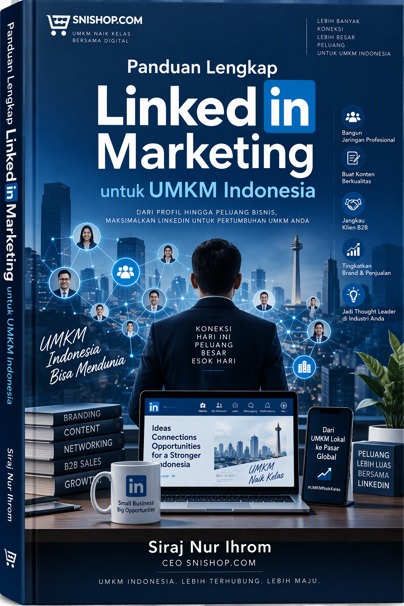
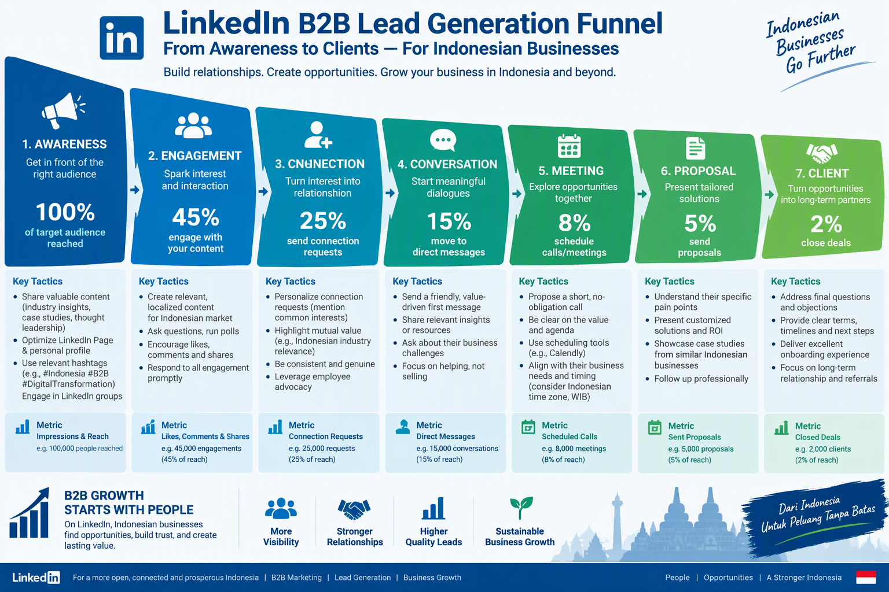
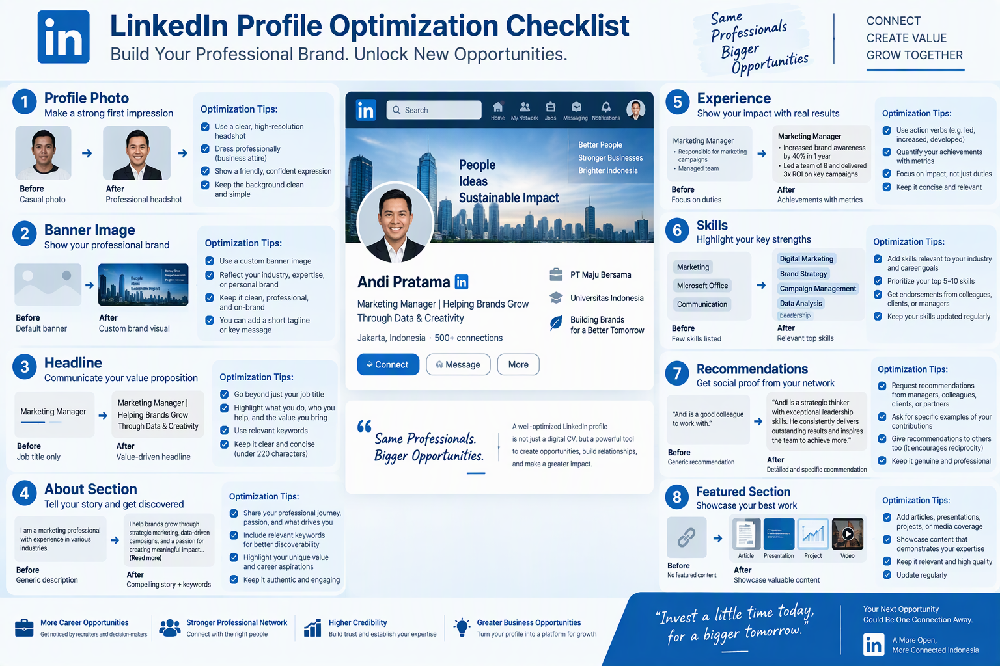
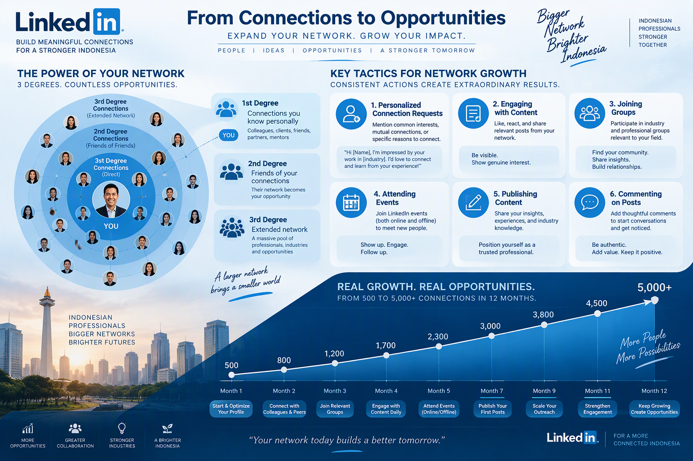
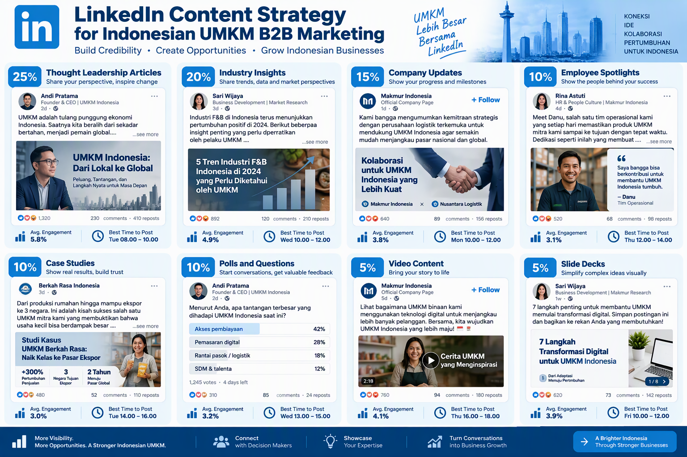
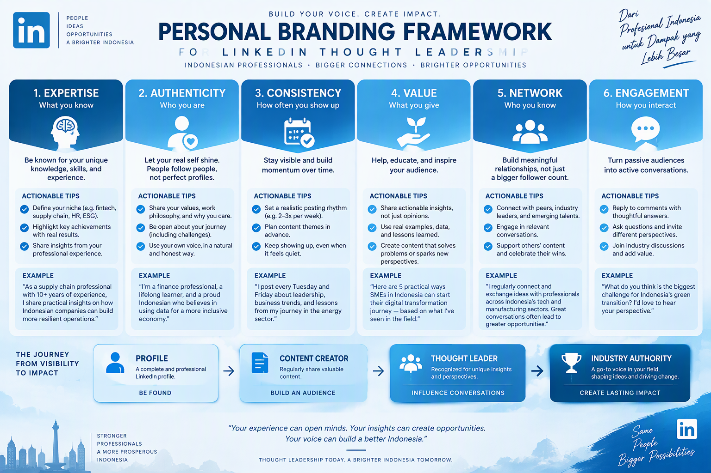
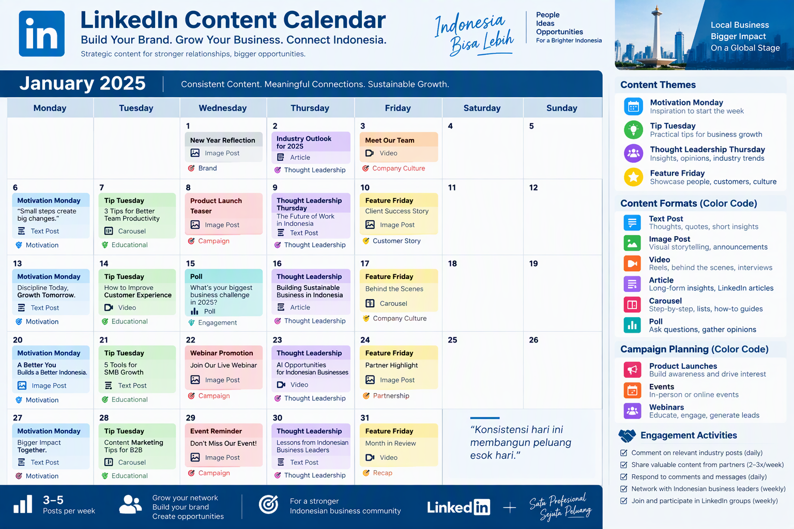
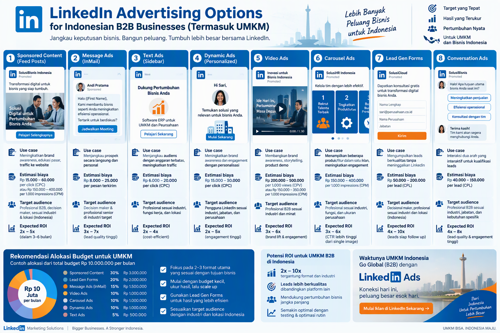
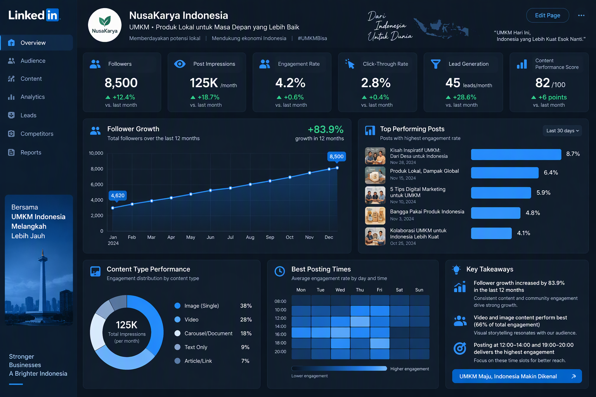
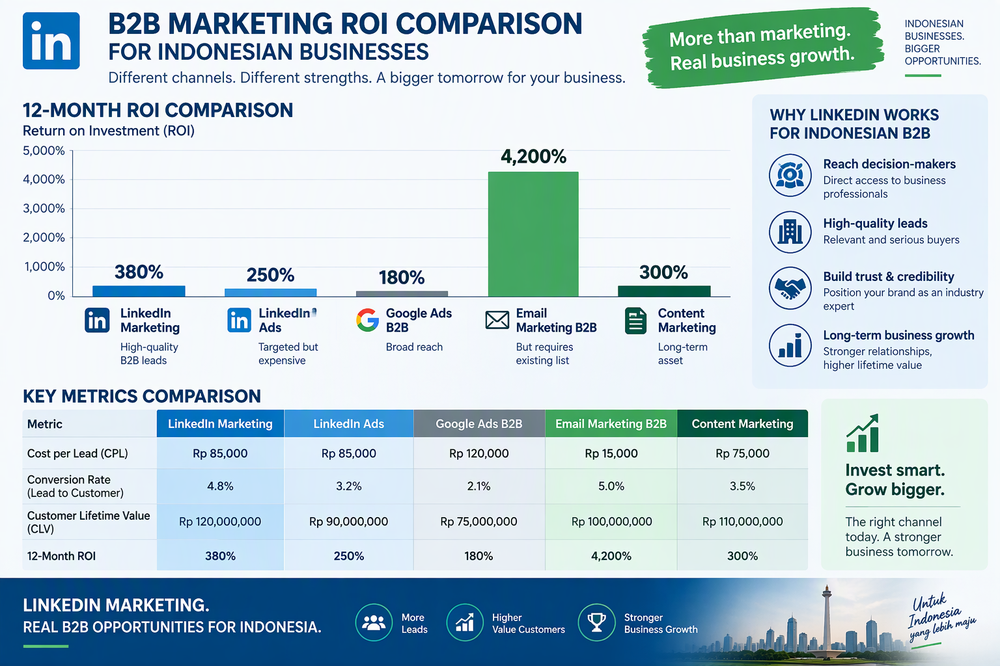

# PANDUAN LENGKAP LINKEDIN MARKETING UNTUK UMKM INDONESIA

## Produk 13 - SNISHOP Digital Product Series

---

**Judul:** Panduan Lengkap LinkedIn Marketing untuk UMKM Indonesia

**Penulis:** Siraj Nur Ihrom, CEO SNISHOP.COM

**Penerbit:** SNISHOP.COM

**Edisi:** Pertama, Desember 2025

**Hak Cipta:** 2025 SNISHOP.COM. Seluruh hak cipta dilindungi undang-undang.

---

---

## KATA PENGANTAR

Assalamualaikum Warahmatullahi Wabarakatuh.

Puji syukur kehadirat Allah SWT atas segala rahmat dan karunia-Nya sehingga buku panduan ini dapat diselesaikan dengan baik. Shalawat serta salam semoga senantiasa tercurah kepada Nabi Muhammad SAW, keluarga, sahabat, dan umatnya hingga akhir zaman.

LinkedIn telah berkembang menjadi platform profesional terbesar di dunia dengan lebih dari 1 miliar pengguna aktif. Di Indonesia, pertumbuhan pengguna LinkedIn menunjukkan tren yang sangat positif, dengan jutaan profesional dan pelaku bisnis yang aktif membangun jaringan dan mencari peluang baru. Bagi UMKM Indonesia, LinkedIn membuka pintu yang sebelumnya sulit diakses: pintu menuju klien korporat, mitra strategis, dan pasar global.

Buku ini disusun sebagai panduan komprehensif bagi para pelaku UMKM Indonesia yang ingin memanfaatkan LinkedIn sebagai instrumen marketing yang efektif. Dari membangun profil profesional, menciptakan konten berkualitas, hingga menjalankan kampanye iklan bertarget, semuanya dibahas secara mendalam dengan contoh konkret yang relevan dengan konteks bisnis Indonesia.

Semoga panduan ini menjadi manfaat bagi perkembangan UMKM Indonesia di era digital.

Wassalamualaikum Warahmatullahi Wabarakatuh.

Siraj Nur Ihrom
CEO SNISHOP.COM

---

## DAFTAR ISI

### BAGIAN I: FOUNDATION

**Bab 1: Mengapa LinkedIn Marketing Penting untuk UMKM Indonesia**
- 1.1 Statistik LinkedIn di Indonesia
- 1.2 LinkedIn vs Platform Lainnya untuk B2B
- 1.3 LinkedIn sebagai Alat Networking dan Lead Generation
- 1.4 Metrik Keberhasilan dan Benchmark B2B

**Bab 2: Optimasi Profil LinkedIn untuk Bisnis**
- 2.1 Foto Profil dan Banner
- 2.2 Formula Headline yang Menarik Klien
- 2.3 Bagian About yang Menceritakan Kisah Anda
- 2.4 Bagian Experience dengan Pencapaian
- 2.5 Skills dan Endorsements
- 2.6 Strategi Recommendations
- 2.7 Featured Section untuk Showcase Konten

**Bab 3: Membangun Network yang Berkualitas**
- 3.1 Strategi Koneksi: Kualitas di Atas Kuantitas
- 3.2 Permintaan Koneksi yang Dipersonalisasi
- 3.3 Lapisan Network: Derajat 1, 2, dan 3
- 3.4 Tumbuh dari 500 ke 5000+ Koneksi
- 3.5 Bergabung dan Berpartisipasi dalam Grup
- 3.6 Menghadiri Event LinkedIn

### BAGIAN II: EXECUTION

**Bab 4: Strategi Konten LinkedIn**
- 4.1 Jenis Konten yang Berhasil di LinkedIn
- 4.2 Artikel Thought Leadership
- 4.3 Insight dan Tren Industri
- 4.4 Update Perusahaan dan Berita
- 4.5 Sorotan Karyawan
- 4.6 Studi Kasus dan Kisah Sukses
- 4.7 Polling dan Posting Engagement
- 4.8 Strategi Konten Video

**Bab 5: Personal Branding di LinkedIn**
- 5.1 Membangun Otoritas di Industri Anda
- 5.2 Kreasi Konten yang Konsisten
- 5.3 Berinteraksi dengan Konten Orang Lain
- 5.4 Berbagi Keahlian Melalui Artikel
- 5.5 Membangun Suara yang Mudah Dikenali
- 5.6 Dari Profil Menuju Thought Leader

**Bab 6: Content Calendar dan Posting Strategy**
- 6.1 Waktu Terbaik untuk Posting (Zona Waktu Indonesia)
- 6.2 Frekuensi Posting: 3-5x per Minggu
- 6.3 Tema Konten per Hari
- 6.4 Rotasi Format Konten
- 6.5 Perencanaan Kampanye
- 6.6 Penjadwalan Aktivitas Engagement

**Bab 7: LinkedIn Advertising untuk B2B**
- 7.1 Format Iklan LinkedIn
- 7.2 Opsi Targeting
- 7.3 Perencanaan Anggaran untuk UMKM
- 7.4 Lead Gen Forms
- 7.5 A/B Testing Iklan
- 7.6 Optimasi ROI

### BAGIAN III: ADVANCED

**Bab 8: Lead Generation dan Sales Navigator**
- 8.1 Menggunakan LinkedIn untuk B2B Lead Generation
- 8.2 Fitur dan Manfaat Sales Navigator
- 8.3 Strategi InMail
- 8.4 Pelacakan Lead dan Integrasi CRM
- 8.5 Dari Koneksi ke Percakapan ke Klien

**Bab 9: Analytics dan Pengukuran ROI**
- 9.1 Metrik Utama yang Perlu Dilacak
- 9.2 LinkedIn Analytics Secara Mendalam
- 9.3 Analisis Performa Konten
- 9.4 Demografi Pengikut
- 9.5 Metrik Lead Generation
- 9.6 Kalkulasi ROI untuk LinkedIn Marketing

**Bab 10: Studi Kasus dan Implementation Plan**
- 10.1 Tiga Studi Kasus Detail dengan Angka Konkret
- 10.2 Kalkulator ROI dengan Contoh
- 10.3 Implementation Plan: Milestone Mingguan dan Bulanan
- 10.4 Tools dan Sumber Daya
- 10.5 Kesalahan Umum yang Harus Dihindari
- 10.6 Tren Masa Depan

**Studi Kasus Lengkap**
**Penutup**
**Tentang Penulis**
**Halaman Hak Cipta**

---
---

# BAGIAN I: FOUNDATION

---

## BAB 1: MENGAPA LINKEDIN MARKETING PENTING UNTUK UMKM INDONESIA

### 1.1 Statistik LinkedIn di Indonesia

LinkedIn telah mengalami pertumbuhan yang luar biasa di Indonesia. Berdasarkan data yang tersedia hingga akhir tahun 2025, berikut adalah gambaran statistik penting yang perlu dipahami oleh setiap pelaku UMKM:

**Jumlah Pengguna LinkedIn di Indonesia:**

| Indikator | Data |
|-----------|------|
| Total pengguna terdaftar | Lebih dari 11 juta akun |
| Pengguna aktif bulanan | Sekitar 6,5 juta pengguna |
| Pertumbuhan tahunan | 18-22 persen per tahun |
| Peringkat global | Top 10 negara dengan pengguna LinkedIn terbanyak |
| Demografi utama | Profesional usia 25-44 tahun |

Data dari LinkedIn Economic Graph menunjukkan bahwa Indonesia merupakan salah satu pasar dengan pertumbuhan tercepat di kawasan Asia Tenggara. Jumlah profesional Indonesia yang bergabung di LinkedIn terus meningkat setiap tahunnya, didorong oleh digitalisasi ekonomi dan meningkatnya kesadaran akan pentingnya personal branding profesional.

**Profil Pengguna LinkedIn Indonesia:**

- 62 persen merupakan profesional dengan jabatan manajer ke atas
- 45 persen memiliki pengalaman kerja lebih dari 5 tahun
- 38 persen merupakan pemilik bisnis atau decision maker di perusahaannya
- 70 persen memiliki pendidikan minimal S1
- Rata-rata penghasilan di atas UMR Jakarta

Statistik ini sangat penting karena menunjukkan bahwa pengguna LinkedIn Indonesia adalah kelompok profesional yang memiliki daya beli tinggi dan otoritas pengambilan keputusan. Inilah yang membuat LinkedIn menjadi platform yang sangat berharga untuk pemasaran B2B.

**Pertumbuhan LinkedIn di Indonesia per Tahun:**

| Tahun | Estimasi Pengguna (Juta) | Pertumbuhan |
|-------|--------------------------|-------------|
| 2019 | 4,5 | - |
| 2020 | 5,8 | 28,9% |
| 2021 | 6,9 | 19,0% |
| 2022 | 7,8 | 13,0% |
| 2023 | 8,9 | 14,1% |
| 2024 | 10,2 | 14,6% |
| 2025 | 11,5+ | 12,7% |

### 1.2 LinkedIn vs Platform Lainnya untuk B2B

Banyak pelaku UMKM bertanya-tanya mengapa harus menggunakan LinkedIn, padahal platform lain seperti Instagram, Facebook, atau TikTok juga memiliki jutaan pengguna di Indonesia. Jawabannya terletak pada konteks dan niat pengguna.

**Perbandingan Platform untuk Pemasaran B2B:**

| Aspek | LinkedIn | Instagram | Facebook | TikTok |
|-------|----------|-----------|----------|--------|
| Konteks penggunaan | Profesional | Personal/hiburan | Personal/komunitas | Hiburan |
| Niat pengguna | Networking, bisnis | Belanja, inspirasi | Terhubung dengan teman | Entertainment |
| Decision maker | Tinggi (38%) | Rendah (5%) | Sedang (12%) | Rendah (3%) |
| Rata-rata nilai transaksi B2B | Tinggi | Sedang | Rendah-Sedang | Rendah |
| Targeting B2B | Sangat spesifik | Terbatas | Sedang | Terbatas |
| Kredibilitas konten | Tinggi | Sedang | Rendah-Sedang | Rendah |
| Cocok untuk B2B | Sangat cocok | Kurang cocok | Cukup cocok | Kurang cocok |

**Mengapa LinkedIn Unggul untuk B2B:**

1. **Konteks Profesional:** Ketika seseorang membuka LinkedIn, mereka berada dalam mindset profesional dan bisnis. Ini berbeda dengan Instagram atau TikTok yang lebih bersifat hiburan. Dalam konteks profesional, audiens lebih terbuka untuk menerima informasi tentang produk atau jasa bisnis.

2. **Akses ke Decision Maker:** LinkedIn memungkinkan Anda terhubung langsung dengan CEO, manajer procurement, direktur pemasaran, dan pengambil keputusan lainnya. Di platform lain, menjangkau mereka jauh lebih sulit.

3. **Data Targeting yang Kaya:** Anda dapat menargetkan berdasarkan jabatan, industri, ukuran perusahaan, keahlian, lokasi, dan banyak lagi. Tidak ada platform media sosial lain yang menawarkan level targeting B2B seperti LinkedIn.

4. **Kredibilitas dan Kepercayaan:** Konten di LinkedIn secara inheren memiliki kredibilitas lebih tinggi. Sebuah studi kasus yang dibagikan di LinkedIn akan dianggap lebih serius dibandingkan yang sama dibagikan di Instagram.

5. **Fitur B2B Khusus:** LinkedIn menyediakan Sales Navigator, Lead Gen Forms, Company Pages, Showcase Pages, dan berbagai fitur lain yang dirancang khusus untuk kebutuhan bisnis.

### 1.3 LinkedIn sebagai Alat Networking dan Lead Generation

LinkedIn bukan sekadar media sosial. Platform ini adalah ekosistem profesional yang lengkap untuk membangun hubungan bisnis dan menghasilkan leads berkualitas.

**Mekanisme Lead Generation di LinkedIn:**

Tahap 1 - Visibilitas: Anda muncul di feed koneksi dan pengikut melalui konten berkualitas.

Tahap 2 - Engagement: Audiens berinteraksi dengan konten Anda melalui like, komentar, dan share.

Tahap 3 - Koneksi: Audiens yang tertarik mengirim atau menerima permintaan koneksi.

Tahap 4 - Percakapan: Terjadi interaksi langsung melalui pesan atau komentar.

Tahap 5 - Kualifikasi: Anda mengidentifikasi apakah koneksi tersebut potensial sebagai klien.

Tahap 6 - Konversi: Koneksi yang terqualifikasi berubah menjadi klien yang membayar.

**Saluran Lead Generation di LinkedIn:**

- Konten organik melalui posting rutin
- Artikel panjang tentang topik industri
- Komentar berbobot di posting orang lain
- Pesan langsung yang dipersonalisasi
- LinkedIn Groups yang relevan
- LinkedIn Events dan webinar
- Iklan berbayar dengan Lead Gen Forms
- Sales Navigator untuk prospeksi aktif

Setiap saluran memiliki kekuatan masing-masing. Untuk UMKM dengan anggaran terbatas, kombinasi konten organik dan prospeksi aktif melalui koneksi langsung adalah pendekatan yang paling efektif. Seiring pertumbuhan bisnis, Anda dapat menambahkan iklan berbayar dan Sales Navigator untuk mempercepat hasil.

**Funnel LinkedIn B2B untuk UMKM:**

| Tahap Funnel | Aktivitas | Target Mingguan |
|--------------|-----------|-----------------|
| Awareness | Posting konten 3-5x, berkomentar 10-15x | 5.000-10.000 impressions |
| Consideration | Artikel panjang, case study, webinar | 50-100 engagement |
| Conversion | InMail, direct message, meeting | 10-25 leads qualified |
| Retention | Follow-up, konten eksklusif, referral | 3-5 klien baru |

### 1.4 Metrik Keberhasilan dan Benchmark B2B

Untuk mengukur keberhasilan strategi LinkedIn marketing Anda, berikut adalah metrik-metrik kunci yang perlu dilacak beserta benchmark untuk konteks UMKM di Indonesia:

**Metrik Konten Organik:**

| Metrik | Benchmark Rendah | Benchmark Sedang | Benchmark Tinggi |
|--------|------------------|-------------------|------------------|
| Impressions per posting | 100-500 | 500-2.000 | 2.000-10.000+ |
| Engagement rate | 1-2% | 2-5% | 5-10%+ |
| Click-through rate | 0,5-1% | 1-3% | 3-5%+ |
| Koneksi baru per minggu | 5-10 | 10-25 | 25-50+ |
| Profile views per minggu | 20-50 | 50-150 | 150-500+ |

**Metrik Lead Generation:**

| Metrik | Benchmark Rendah | Benchmark Sedang | Benchmark Tinggi |
|--------|------------------|-------------------|------------------|
| Leads per bulan | 1-5 | 5-15 | 15-40+ |
| Conversion rate (koneksi ke lead) | 2-5% | 5-10% | 10-20% |
| Conversion rate (lead ke klien) | 5-10% | 10-20% | 20-35% |
| Cost per lead (berbayar) | Rp 150.000-300.000 | Rp 80.000-150.000 | Rp 30.000-80.000 |
| Revenue per lead | Rp 500.000-2 juta | Rp 2-10 juta | Rp 10-50 juta+ |

**Metrik Company Page:**

| Metrik | Benchmark Rendah | Benchmark Sedang | Benchmark Tinggi |
|--------|------------------|-------------------|------------------|
| Followers | 100-500 | 500-2.000 | 2.000-10.000+ |
| Follower growth rate | 2-5% per bulan | 5-10% per bulan | 10-20%+ per bulan |
| Page views per bulan | 100-500 | 500-2.000 | 2.000-10.000+ |

Benchmark di atas bersifat indikatif dan dapat bervariasi tergantung industri, kualitas konten, dan konsistensi eksekusi. Fokus pada tren pertumbuhan dari bulan ke bulan, bukan angka absolut pada satu titik waktu.

**Key Takeaway Bab 1:**

LinkedIn adalah platform B2B paling efektif untuk UMKM Indonesia karena menyediakan akses langsung ke decision maker, fitur targeting yang sangat spesifik, dan ekosistem profesional yang mendukung pembangunan kepercayaan. Dengan lebih dari 11 juta pengguna di Indonesia dan pertumbuhan yang konsisten, LinkedIn menawarkan peluang yang sangat besar bagi UMKM yang siap berinvestasi dalam strategi marketing jangka panjang.

---

## BAB 2: OPTIMASI PROFIL LINKEDIN UNTUK BISNIS

Profil LinkedIn Anda adalah halaman landing pertama yang dilihat oleh calon klien, mitra bisnis, atau rekrutan potensial. Sebuah profil yang dioptimasi dengan baik dapat meningkatkan tingkat respons hingga 40 persen dibandingkan profil yang asal ada. Bab ini akan membahas secara detail setiap elemen profil yang perlu Anda optimasi.

### 2.1 Foto Profil dan Banner

**Foto Profil:**

Foto profil adalah elemen pertama yang menarik perhatian. Data LinkedIn menunjukkan bahwa profil dengan foto profesional menerima 14 kali lebih banyak tayangan dibandingkan tanpa foto.

Panduan foto profil yang efektif:

- Gunakan foto dengan resolusi tinggi, minimal 400 x 400 piksel
- Wajah mengisi 60 persen frame foto
- Latar belakang polos atau profesional
- Pakaian rapi dan sesuai industri Anda
- Ekspresi wajah ramah dan percaya diri
- Pencahayaan yang baik, hindari bayangan
- Senyum natural yang menunjukkan keterbukaan
- Hindari foto yang di-crop dari foto grup atau selfie

Untuk pelaku UMKM Indonesia, disarankan menggunakan foto dengan pakaian bisnis yang sesuai dengan budaya industri Anda. Jika Anda bergerak di industri kreatif, pakaian smart casual dapat diterima. Yang terpenting adalah terlihat profesional dan dapat dipercaya.

**Banner atau Background Photo:**

Banner adalah ruang iklan gratis yang sering diabaikan. Banner yang dioptimasi dapat menyampaikan nilai bisnis Anda dalam hitungan detik.

Spesifikasi banner LinkedIn: 1.584 x 396 piksel (rasio 4:1)

Elemen yang harus ada di banner:

- Nama perusahaan dan tagline yang jelas
- Value proposition singkat (maksimal 10 kata)
- Informasi kontak atau website
- Visual yang relevan dengan industri
- Warna yang konsisten dengan branding perusahaan
- Call-to-action yang jelas

Contoh tagline banner untuk berbagai jenis UMKM:

| Jenis Bisnis | Contoh Tagline Banner |
|--------------|----------------------|
| Konsultan Bisnis | "Membantu UMKM Tumbuh 3x Lebih Cepat dengan Strategi Terukur" |
| Software House | "Solusi Digital Custom untuk Bisnis Anda - Dari Ide ke Implementasi" |
| Agency Marketing | "Kami Tingkatkan Revenue Klien Rata-rata 150% dalam 6 Bulan" |
| Supplier Industri | "Partner Terpercaya untuk Kebutuhan Material Bisnis Anda" |
| Jasa Keuangan | "Kelola Keuangan UMKM Anda dengan Lebih Cerdas dan Efisien" |

### 2.2 Formula Headline yang Menarik Klien

Headline LinkedIn muncul di samping nama Anda di setiap interaksi: posting, komentar, pencarian, dan rekomendasi. Ini adalah real estate paling berharga di profil Anda.

**Formula Headline yang Efektif:**

Formula 1 - Peran + Nilai:
"[Peran/Jabatan] | Membantu [target audiens] untuk [hasil yang dijanjikan]"

Contoh: "Founder & CEO di PT Snishop Indonesia | Membantu UMKM Go Digital dengan Sistem ERP Terintegrasi"

Formula 2 - Kata Kunci + Diferensiasi:
"[Kata Kunci Utama] | [Keunikan Anda] | [Hasil Nyata]"

Contoh: "Digital Marketing Consultant | 10+ Tahun Pengalaman | 200+ Klien UMKM Tumbuh 3x Lipat"

Formula 3 - Pernyataan Misi:
"[Apa yang Anda lakukan] untuk [siapa] agar [hasil]"

Contoh: "Membangun Sistem Bisnis Otomatis untuk UMKM Indonesia agar Skalabel dan Berkelanjutan"

**Kata Kunci yang Perlu Dimasukkan:**

Sesuaikan kata kunci dengan industri Anda. Berikut contoh kata kunci populer untuk berbagai sektor UMKM di Indonesia:

- Konsultan: konsultan bisnis, strategi, pertumbuhan, transformasi digital
- Teknologi: software development, aplikasi, SaaS, ERP, sistem informasi
- Marketing: digital marketing, branding, SEO, social media, konten
- Keuangan: akuntansi, pajak, audit, financial planning, bookkeeping
- Manufaktur: produksi, supply chain, quality control, lean manufacturing
- Jasa profesional: pelatihan, coaching, mentoring, workshop, seminar

### 2.3 Bagian About yang Menceritakan Kisah Anda

Bagian About atau ringkasan adalah kesempatan Anda untuk bercerita kepada pengunjung profil. Ini bukan tempat untuk daftar pencapaian kering, melainkan narasi yang membangun koneksi emosional dengan pembaca.

**Struktur About Section yang Efektif:**

Paragraf 1 - Hook (2-3 kalimat):
Mulailah dengan pernyataan yang menarik perhatian. Bisa berupa pertanyaan, fakta mengejutkan, atau pernyataan misi yang kuat.

Contoh: "Tahukah Anda bahwa 96 persen bisnis UMKM di Indonesia belum memanfaatkan teknologi digital secara optimal? Saya menghabiskan 10 tahun terakhir untuk mengubah angka itu."

Paragraf 2 - Cerita (3-5 kalimat):
Ceritakan perjalanan Anda. Mengapa Anda memulai bisnis ini? Apa masalah yang Anda lihat dan ingin selesaikan?

Contoh: "Berawal dari garasi kecil di Surabaya pada tahun 2018, SNISHOP dimulai ketika saya menyadari betapa sulitnya bagi pelaku UMKM untuk mengelola bisnis mereka secara terintegrasi. Sistem yang ada terlalu mahal dan terlalu kompleks. Saya percaya setiap pelaku bisnis di Indonesia berhak mendapatkan tools yang powerful namun mudah digunakan."

Paragraf 3 - Nilai dan Keahlian (3-5 poin):
Sampaikan apa yang Anda tawarkan dan bagaimana Anda membantu klien.

Contoh:
- Membantu UMKM mengimplementasikan sistem ERP yang terjangkau
- Menyediakan konsultasi strategi digital yang terukur
- Mendampingi transformasi digital dari awal hingga hasil nyata

Paragraf 4 - Bukti Sosial (2-3 kalimat):
Sebutkan pencapaian, jumlah klien, atau testimoni yang relevan.

Contoh: "Telah membantu lebih dari 500 UMKM di 34 provinsi Indonesia. Klien kami rata-rata mengalami peningkatan efisiensi operasional 40 persen dan pertumbuhan revenue 150 persen dalam 12 bulan pertama."

Paragraf 5 - Call to Action (1-2 kalimat):
Akhiri dengan ajakan bertindak yang jelas.

Contoh: "Hubungi saya jika Anda ingin mendiskusikan bagaimana kami dapat membantu bisnis Anda tumbuh lebih cepat. Email: siraj@snishop.com | WhatsApp: +62 812 3456 7890"

### 2.4 Bagian Experience dengan Pencapaian

Bagian Experience bukan sekadar riwayat pekerjaan. Ini adalah portofolio pencapaian Anda yang dapat diverifikasi.

**Cara Menulis Experience yang Efektif:**

Untuk setiap posisi, gunakan formula ini:

1. **Judul yang Deskriptif:** Gunakan judul yang jelas dan umum dipahami di industri Anda.

2. **Deskripsi Singkat (1-2 kalimat):** Jelaskan ruang lingkup tanggung jawab Anda.

3. **Pencapaian Terukur (3-5 poin):** Gunakan angka konkret untuk setiap pencapaian.

Contoh penulisan Experience:

**CEO & Founder - PT SNISHOP Indonesia (2018 - Sekarang)**

Memimpin pengembangan dan implementasi sistem ERP untuk UMKM di seluruh Indonesia.

Pencapaian:
- Membangun platform yang digunakan oleh 2.000+ bisnis UMKM di Indonesia
- Mencapai pertumbuhan revenue rata-rata 80 persen year-over-year selama 5 tahun berturut-turut
- Memimpin tim yang terdiri dari 50+ profesional di bidang teknologi, marketing, dan operasional
- Mendapatkan pendanaan seri A sebesar Rp 25 miliar dari investor strategis
- Membentuk kemitraan dengan 15+ asosiasi industri dan chamber of commerce

**Tips Tambahan:**

- Gunakan kata kerja aktif: memimpin, membangun, mengembangkan, meningkatkan, menciptakan
- Selalu sertakan angka: persentase pertumbuhan, jumlah klien, besaran revenue
- Jelaskan dampak, bukan hanya tanggung jawab
- Update secara berkala setiap ada pencapaian baru

### 2.5 Skills dan Endorsements

Skills di LinkedIn berfungsi sebagai validasi kompetensi Anda oleh jaringan profesional.

**Strategi Skills:**

LinkedIn memungkinkan Anda menambahkan hingga 50 skills. Berikut strategi pengisiannya:

| Kategori | Jumlah | Contoh |
|----------|--------|--------|
| Industry Skills | 15-20 | Digital Marketing, ERP Systems, Business Strategy, UMKM Development |
| Functional Skills | 15-20 | Leadership, Project Management, Sales, Analytics, Communication |
| Technical Skills | 10-15 | Software Development, Data Analysis, Cloud Computing, UI/UX Design |

**Strategi Endorsements:**

- Mintalah endorsement dari klien, kolega, dan mitra bisnis yang benar-benar mengenal kemampuan Anda
- Berikan endorsement kepada orang lain terlebih dahulu (reciprocity principle)
- Fokuskan endorsement pada 5-10 skills utama yang paling relevan dengan bisnis Anda
- Endorsement dari koneksi derajat 1 lebih bernilai daripada derajat 2 atau 3

### 2.6 Strategi Recommendations

Recommendations adalah testimoni tertulis dari orang lain yang memvalidasi kemampuan dan karakter profesional Anda.

**Cara Mendapatkan Recommendations:**

1. **Identifikasi Pemberi Rekomendasi yang Tepat:**
   - Klien yang puas dengan hasil kerja Anda
   - Atasan atau bawahan langsung yang mengenal etos kerja Anda
   - Mitra bisnis yang telah berkolaborasi dengan Anda
   - Mentor atau tokoh industri yang menghargai kontribusi Anda

2. **Template Permintaan Recommendation:**

"Yth. [Nama],

Saya sangat menghargai kolaborasi kita dalam [proyek/kerja sama]. Apakah Anda bersedia memberikan rekomendasi singkat di LinkedIn saya? Fokus pada [kemampuan/proyek spesifik] akan sangat membantu.

Tentu saya juga dengan senang hati akan memberikan rekomendasi untuk Anda sebagai timbal balik.

Terima kasih atas waktunya.

Salam,
[Nama Anda]"

3. **Target Jumlah Recommendations:**
   - Minimal 5 recommendations untuk profil yang kredibel
   - Idealnya 10-15 recommendations dari berbagai perspektif
   - Update setiap 6-12 bulan dengan rekomendasi baru

### 2.7 Featured Section untuk Showcase Konten

Featured section memungkinkan Anda memamerkan konten terbaik langsung di bagian atas profil.

**Konten yang Perlu Dimasukkan di Featured Section:**

| Jenis Konten | Tujuan | Update |
|--------------|--------|--------|
| Artikel thought leadership | Menunjukkan keahlian | Setiap 2-3 bulan |
| Case study klien | Bukti sosial | Setiap 1-2 bulan |
| Portfolio proyek | Showcase hasil kerja | Setiap 3-6 bulan |
| Video presentasi | Personal touch | Setiap 3-6 bulan |
| Link website/landing page | Traffic generation | Tetap |
| Testimoni klien | Social proof | Setiap 2-3 bulan |
| Media coverage | Kredibilitas | Bila ada |

**Best Practices Featured Section:**

- Pilih maksimal 5-7 konten terbaik
- Pastikan thumbnail atau preview menarik secara visual
- Susun dari yang paling penting ke yang pendukung
- Update secara berkala untuk menjaga relevansi
- Gunakan cover image yang konsisten dengan branding

**Key Takeaway Bab 2:**

Profil LinkedIn yang dioptimasi adalah fondasi dari seluruh strategi marketing Anda. Setiap elemen, mulai dari foto profil hingga featured section, harus dirancang untuk menyampaikan nilai Anda secara jelas dan meyakinkan. Luangkan waktu 2-3 jam untuk mengoptimasi seluruh profil Anda, dan kemudian review serta update secara berkala setiap bulan.

---

## BAB 3: MEMBANGUN NETWORK YANG BERKUALITAS

Network adalah aset terbesar Anda di LinkedIn. Namun, banyak profesional yang salah fokus pada kuantitas semata. Dalam bab ini, Anda akan mempelajari strategi membangun network yang tidak hanya banyak, tetapi juga berkualitas dan menghasilkan peluang bisnis nyata.

### 3.1 Strategi Koneksi: Kualitas di Atas Kuantitas

Membangun network di LinkedIn bukan tentang mengumpulkan sebanyak mungkin koneksi. Ini tentang membangun hubungan yang bermakna dengan orang-orang yang tepat.

**Prinsip Dasar Network Building:**

1. **Relevansi:** Koneksi harus relevan dengan industri, target pasar, atau tujuan bisnis Anda.
2. **Resiprokal:** Hubungan harus saling menguntungkan, bukan satu arah.
3. **Aktif:** Koneksi perlu dipelihara melalui interaksi rutin.
4. **Bertahap:** Pertumbuhan network yang sehat bersifat organik dan berkelanjutan.

**Komposisi Network Ideal untuk UMKM:**

| Kategori Koneksi | Persentase | Contoh |
|------------------|------------|--------|
| Klien potensial | 30-40% | Decision maker di perusahaan target |
| Rekan industri | 20-30% | Profesional di industri yang sama atau terkait |
| Mentor dan advisor | 5-10% | Tokoh berpengalaman yang dapat membimbing |
| Media dan influencer | 5-10% | Jurnalis industri, content creator B2B |
| Tim dan karyawan | 10-15% | Anggota tim Anda dan alumni perusahaan |
| Komunitas dan asosiasi | 10-15% | Anggota asosiasi industri, komunitas profesional |

### 3.2 Permintaan Koneksi yang Dipersonalisasi

Permintaan koneksi yang dikirim tanpa pesan personal memiliki tingkat penerimaan yang jauh lebih rendah. Data menunjukkan bahwa connection request dengan pesan personal memiliki acceptance rate 3-5 kali lebih tinggi.

**Formula Pesan Koneksi yang Efektif:**

Format 1 - Referensi Bersama:
"Halo [Nama], saya melihat kita sama-sama bergerak di industri [industri]. Saya sangat terkesan dengan [pencapaian/postingan mereka]. Senang jika kita bisa terhubung dan saling berbagi insight. Salam, [Nama Anda]"

Format 2 - Konten Trigger:
"Halo [Nama], saya baru membaca artikel Anda tentang [topik]. Perspektif Anda mengenai [poin spesifik] sangat sejalan dengan pengalaman saya di [konteks Anda]. Mari terhubung agar bisa berdiskusi lebih lanjut. Salam, [Nama Anda]"

Format 3 - Event Bersama:
"Halo [Nama], saya juga menghadiri [nama event] kemarin. Sesi tentang [topik] sangat insightful. Saya ingin tetap terhubung untuk mendiskusikan [topik terkait] lebih lanjut. Salam, [Nama Anda]"

Format 4 - Mutual Connection:
"Halo [Nama], saya melihat kita sama-sama terhubung dengan [nama mutual connection]. Beliau menyebutkan bahwa Anda adalah ahli di bidang [bidang mereka]. Saya sangat tertarik untuk terhubung dan belajar dari pengalaman Anda. Salam, [Nama Anda]"

**Kesalahan Umum dalam Mengirim Connection Request:**

- Mengirim request tanpa pesan personal sama sekali
- Langsung menjual produk atau jasa di pesan pertama
- Menggunakan template yang terlalu generik dan terlihat otomatis
- Mengirim terlalu banyak request dalam waktu singkat (LinkedIn membatasi)
- Tidak menindaklanjuti setelah koneksi diterima

**Jadwal Pengiriman Connection Request:**

| Periode | Target per Hari | Total per Bulan |
|---------|-----------------|-----------------|
| Minggu 1-2 | 10-15 | 140-210 |
| Bulan 2-3 | 15-20 | 450-600 |
| Bulan 4-6 | 20-25 | 600-750 |
| Bulan 7-12 | 25-30 | 750-900 |

### 3.3 Lapisan Network: Derajat 1, 2, dan 3

Memahami lapisan network LinkedIn sangat penting untuk strategi outreach yang efektif.

**Derajat 1 (1st Degree):**
- Orang yang sudah terhubung langsung dengan Anda
- Dapat mengirim pesan langsung tanpa batasan
- Melihat semua konten yang Anda bagikan
- Dapat memberikan endorsement dan recommendation
- Target: Klien, mitra, tim, dan kontak bisnis langsung

**Derajat 2 (2nd Degree):**
- Orang yang terhubung dengan koneksi derajat 1 Anda
- Dapat mengirim connection request dengan pesan
- Seringkali merupakan target paling berharga karena ada trusted connection
- Gunakan mutual connections untuk warm introduction
- Target: Calon klien yang direferensikan oleh koneksi existing

**Derajat 3 (3rd Degree):**
- Orang yang terhubung dengan koneksi derajat 2 Anda
- Masih dapat mengirim connection request
- Memerlukan strategi yang lebih kreatif untuk terhubung
- Target: Perluasan network ke industri atau pasar baru

**Strategi Menjangkau Setiap Lapisan:**

| Lapisan | Strategi | Tingkat Keberhasilan |
|---------|----------|---------------------|
| Derajat 1 | Pesan langsung, referral, engagement rutin | 60-80% respons |
| Derajat 2 | Warm intro via mutual connection, personalized request | 30-50% acceptance |
| Derajat 3 | Content engagement, group yang sama, event bersama | 10-25% acceptance |

### 3.4 Tumbuh dari 500 ke 5000+ Koneksi

LinkedIn menampilkan angka "500+" ketika koneksi Anda melebihi 500. Namun, untuk memaksimalkan potensi bisnis, Anda perlu tumbuh melampaui angka tersebut secara signifikan.

**Roadmap Pertumbuhan Network:**

| Fase | Target Koneksi | Durasi | Strategi Utama |
|------|----------------|--------|----------------|
| Fondasi | 0 - 500 | Bulan 1-2 | Import kontak, invite teman dan kolega |
| Pertumbuhan | 500 - 1.000 | Bulan 3-4 | Connection request harian, join groups |
| Akselerasi | 1.000 - 2.500 | Bulan 5-8 | Konten rutin, speaking events, referrals |
| Ekspansi | 2.500 - 5.000 | Bulan 9-14 | Thought leadership, kolaborasi, iklan profil |
| Otoritas | 5.000+ | Bulan 15+ | Personal brand kuat, inbound connections |

**Taktik Spesifik untuk Setiap Fase:**

Fase Fondasi (0-500):
- Import kontak dari email dan phone book Anda
- Undang semua rekan kerja, klien, dan vendor yang Anda kenal
- Hubungi alumni sekolah dan universitas
- Join minimal 5 grup industri yang relevan

Fase Pertumbuhan (500-1.000):
- Kirim 15-20 connection request yang dipersonalisasi per hari
- Berkomentar secara bermakna di 10-15 posting per hari
- Bagikan konten original 3-4 kali per minggu
- Hadiri 1-2 LinkedIn event per bulan

Fase Akselerasi (1.000-2.500):
- Tingkatkan frekuensi posting menjadi 5 kali per minggu
- Mulai menulis artikel panjang 2 kali per bulan
- Host LinkedIn Audio Event atau webinar bulanan
- Minta referral dari koneksi yang puas

Fase Ekspansi (2.500-5.000):
- Konsisten sebagai thought leader di niche Anda
- Kolaborasi konten dengan profesional lain
- Pertimbangkan LinkedIn Ads untuk mempromosikan profil
- Aktif di 10+ grup dan komunitas

### 3.5 Bergabung dan Berpartisipasi dalam Grup

LinkedIn Groups adalah komunitas profesional berdasarkan minat, industri, atau afiliasi tertentu. Grup yang aktif dapat menjadi sumber koneksi berkualitas dan peluang bisnis.

**Cara Memilih Grup yang Tepat:**

Kriteria grup ideal:
- Anggota aktif: minimal 1.000 anggota dengan posting rutin
- Relevansi: sesuai dengan industri dan target pasar Anda
- Moderasi: dikelola dengan baik, bebas spam
- Kualitas diskusi: anggota berbagi insight, bukan hanya promosi

**Jenis Grup yang Direkomendasikan untuk UMKM Indonesia:**

| Jenis Grup | Manfaat | Contoh Topik |
|------------|---------|--------------|
| Grup Industri | Networking dengan peers | Digital Marketing Indonesia, UMKM Indonesia |
| Grup Profesi | Berbagi keahlian | CEO Forum, Sales Professionals |
| Grup Regional | Koneksi lokal | Business Network Jakarta, Surabaya Entrepreneurs |
| Grup Alumni | Trust-based network | Alumni ITB, Alumni UGM Business |
| Grup Minat Khusus | Niche expertise | E-commerce Indonesia, Fintech UMKM |

**Strategi Berpartisipasi di Grup:**

1. **Minggu 1-2:** Observasi. Pahami budaya grup, topik yang populer, dan anggota yang aktif.

2. **Minggu 3-4:** Mulai berkontribusi. Jawab pertanyaan, bagikan insight, berikan komentar yang bernilai. Jangan langsung berjualan.

3. **Bulan 2-3:** Jadilah kontributor aktif. Buat diskusi baru, bagikan konten original, tag anggota yang mungkin tertarik.

4. **Bulan 4+:** Jadilah rujukan. Anggota lain mulai mengenali Anda sebagai ahli di bidang tersebut. Ini saatnya mulai membangun hubungan bisnis.

### 3.6 Menghadiri Event LinkedIn

LinkedIn Events adalah fitur yang memungkinkan Anda membuat atau menghadiri acara virtual maupun tatap muka langsung melalui platform.

**Jenis Event LinkedIn:**

- Audio Event: Diskusi audio live, mirip podcast interaktif
- Video Event: Webinar atau presentasi live dengan video
- In-Person Event: Pertemuan offline yang dipromosikan melalui LinkedIn
- External Event: Event di platform lain yang dipromosikan di LinkedIn

**Strategi Memanfaatkan Event:**

Sebagai Peserta:
- Daftar untuk event yang relevan dengan industri Anda
- Aktif bertanya dan berdiskusi selama event
- Hubungi speaker dan peserta lain setelah event
- Bagikan insight yang Anda dapatkan di feed Anda

Sebagai Host:
- Pilih topik yang relevan dan menarik bagi target audiens Anda
- Promosikan event melalui posting, newsletter, dan direct message
- Siapkan konten yang bernilai dan interaktif
- Follow up peserta setelah event dengan pesan personal
- Jadikan event sebagai ritual rutin (mingguan atau bulanan)

**Key Takeaway Bab 3:**

Network yang berkualitas adalah hasil dari strategi yang konsisten dan terencana. Fokus pada membangun hubungan yang bermakna, bukan sekadar mengumpulkan angka koneksi. Dengan pendekatan yang tepat, network LinkedIn Anda akan menjadi aset bisnis yang terus menghasilkan peluang seiring berjalannya waktu.

---
---

# BAGIAN II: EXECUTION

---

## BAB 4: STRATEGI KONTEN LINKEDIN

Konten adalah jantung dari strategi LinkedIn marketing Anda. Konten yang berkualitas tidak hanya meningkatkan visibilitas profil, tetapi juga membangun kredibilitas, menghasilkan engagement, dan pada akhirnya mendatangkan leads bisnis. Bab ini akan membahas secara komprehensif jenis-jenis konten yang berhasil di LinkedIn serta cara menyusun strategi konten yang efektif.

### 4.1 Jenis Konten yang Berhasil di LinkedIn

LinkedIn memiliki ekosistem konten yang unik. Tidak semua jenis konten yang berhasil di platform lain akan bekerja sama baiknya di LinkedIn. Berikut adalah analisis mendalam tentang setiap jenis konten:

**Distribusi Performa Konten di LinkedIn:**

| Jenis Konten | Rata-rata Impressions | Engagement Rate | Cocok Untuk |
|--------------|----------------------|-----------------|-------------|
| Teks + foto | 1.500-3.000 | 2-4% | Storytelling, update harian |
| Dokumen/carousel | 2.000-5.000 | 3-6% | Edukasi, tips, framework |
| Video pendek (< 3 menit) | 3.000-8.000 | 4-7% | Tips cepat, behind the scenes |
| Video panjang (> 3 menit) | 1.000-3.000 | 2-4% | Webinar, tutorial mendalam |
| Artikel LinkedIn | 500-2.000 | 1-3% | Thought leadership, analisis |
| Polling | 2.000-6.000 | 5-10% | Riset pasar, engagement |
| Newsletter | 1.000-3.000 | 3-5% | Konten rutin, build audience |
| Live video | 500-2.000 | 5-15% | Q&A, interview, event |

**Algoritma LinkedIn dan Distribusi Konten:**

Algoritma LinkedIn bekerja dalam beberapa tahap:

Tahap 1 - Initial Distribution: Konten Anda ditampilkan kepada sebagian kecil pengikut (5-10 persen). Algoritma mengukur respons awal.

Tahap 2 - Engagement Scoring: Jika respons awal positif (like, komentar, share, dwell time), algoritma memperluas distribusi ke lebih banyak pengikut.

Tahap 3 - Expanded Distribution: Konten dengan engagement tinggi didistribusikan ke jaringan tingkat 2 dan 3, serta muncul di feed "Top Voices" dan pencarian.

Tahap 4 - Longevity: Konten LinkedIn memiliki umur lebih panjang dibandingkan platform lain. Sebuah posting bisa terus mendapatkan engagement hingga 2-3 minggu setelah dipublikasikan.

### 4.2 Artikel Thought Leadership

Artikel thought leadership adalah konten panjang yang menunjukkan keahlian dan perspektif unik Anda tentang industri. Ini adalah jenis konten paling berkuasa untuk membangun otoritas di LinkedIn.

**Struktur Artikel Thought Leadership yang Efektif:**

Judul: Harus menarik perhatian dan menjanjikan nilai. Gunakan angka, pertanyaan provokatif, atau pernyataan kuat.

Contoh judul yang efektif:
- "5 Kesalahan Fatal UMKM Indonesia dalam Transformasi Digital"
- "Mengapa 80 Persen Startup Gagal di Tahun Pertama dan Bagaimana Menghindarinya"
- "Masa Depan ERP untuk UMKM: Tren yang Wajib Anda Ketahui di 2026"

Pembukaan (100-150 kata): Hook pembaca dengan fakta mengejutkan, pertanyaan, atau cerita personal.

Isi Utama (500-1.000 kata): Sampaikan insight Anda dengan struktur yang jelas. Gunakan sub-heading, bullet points, dan data pendukung.

Penutup (100-150 kata): Rangkum poin utama dan akhiri dengan call-to-action yang jelas.

**Topik Artikel yang Berhasil untuk UMKM Indonesia:**

| Kategori | Contoh Topik |
|----------|--------------|
| Tren industri | Perkembangan e-commerce B2B di Indonesia |
| Best practices | Cara mengelola cash flow UMKM di masa resesi |
| Studi kasus | Bagaimana klien kami meningkatkan revenue 200% |
| Opini | Mengapa digitalisasi bukan pilihan melainkan keharusan |
| Tutorial | Panduan lengkap memilih software akuntansi untuk UMKM |
| Prediksi | 10 tren bisnis yang akan mendominasi tahun depan |

### 4.3 Insight dan Tren Industri

Berbagi insight tentang tren industri memposisikan Anda sebagai seseorang yang selalu update dan berwawasan luas.

**Cara Menemukan dan Membagikan Insight:**

1. **Sumber Insight Terpercaya:**
   - Laporan industri dari konsultan ternama (McKinsey, BCG, Deloitte)
   - Data dari Badan Pusat Statistik dan kementerian terkait
   - Riset pasar dari lembaga seperti Nielsen, Statista
   - Publikasi industri dan jurnal bisnis
   - LinkedIn Pulse dan newsletter industri
   - Podcast dan webinar dari thought leader

2. **Framework Berbagi Insight:**

   - Fakta/Data: Sampaikan data atau temuan terbaru
   - Interpretasi: Berikan analisis Anda tentang apa artinya
   - Implikasi: Jelaskan dampaknya bagi bisnis audiens Anda
   - Aksi: Berikan rekomendasi langkah konkret

3. **Contoh Posting Insight:**

   "BPS melaporkan bahwa 96 persen UMKM Indonesia masih belum terdigitalisasi. [FAKTA]

   Ini bukan sekadar angka. Artinya, sebagian besar potensi ekonomi kita belum tergali. [INTERPRETASI]

   Bagi pelaku UMKM, ini berarti ada peluang besar bagi yang berani bergerak lebih dulu. Early adopter teknologi akan memiliki keunggulan kompetitif yang signifikan. [IMPLIKASI]

   Mulai dari yang sederhana: digitalisasi pembukuan, manajemen inventori, atau proses order. Tidak perlu langsung transformasi total. [AKSI]"

### 4.4 Update Perusahaan dan Berita

Company updates adalah cara untuk menjaga pengikut Anda tetap terinformasi tentang perkembangan bisnis Anda.

**Jenis Update Perusahaan:**

- Pencapaian bisnis: milestone revenue, jumlah klien, ekspansi
- Produk baru: peluncuran fitur, layanan, atau produk baru
- Partnership: kerja sama strategis dengan perusahaan lain
- Penghargaan: sertifikasi, penghargaan, atau recognisi industri
- Event: partisipasi dalam pameran, seminar, atau konferensi
- Rekrutmen: pembukaan posisi, budaya perusahaan
- CSR: kegiatan sosial dan kontribusi kepada masyarakat

**Frekuensi dan Timing Update Perusahaan:**

| Jenis Update | Frekuensi Ideal | Waktu Terbaik |
|--------------|-----------------|---------------|
| Pencapaian | Setiap ada milestone | Selasa-Kamis, 08:00-10:00 WIB |
| Produk baru | 1-2 kali per kuartal | Selasa, 09:00-11:00 WIB |
| Partnership | Sesuai perkembangan | Rabu, 08:00-10:00 WIB |
| Event | Sebelum, saat, setelah | Senin-Jumat, 08:00-10:00 WIB |
| Budaya perusahaan | 1-2 kali per bulan | Kamis, 09:00-11:00 WIB |

### 4.5 Sorotan Karyawan

Employee spotlight adalah konten yang menampilkan anggota tim Anda. Ini memberikan sentuhan personal pada brand Anda dan menunjukkan budaya perusahaan.

**Format Employee Spotlight:**

Template dasar:
- Foto karyawan (dengan izin)
- Nama dan jabatan
- Latar belakang singkat
- Kontribusi atau pencapaian
- Kutipan personal tentang pekerjaan atau perusahaan
- Tag ke profil LinkedIn karyawan tersebut

**Manfaat Employee Spotlight:**

1. Humanisasi brand: Menunjukkan bahwa di balik perusahaan ada orang-orang nyata yang berdedikasi.
2. Employer branding: Menarik talenta berkualitas yang ingin bekerja di lingkungan positif.
3. Employee engagement: Karyawan merasa dihargai dan termotivasi.
4. Network expansion: Karyawan yang di-tag akan membagikan posting ke network mereka.
5. Trust building: Audiens lebih percaya pada perusahaan yang transparan tentang timnya.

### 4.6 Studi Kasus dan Kisah Sukses

Studi kasus adalah salah satu bentuk konten paling persuasif di LinkedIn. Ini memberikan bukti nyata bahwa solusi Anda bekerja.

**Struktur Studi Kasus yang Efektif:**

Format STAR (Situation, Task, Action, Result):

S - Situation: Gambarkan situasi awal klien sebelum bekerja sama dengan Anda.

T - Task: Jelaskan tantangan atau tujuan yang perlu dicapai.

A - Action: Uraikan langkah-langkah yang Anda ambil untuk menyelesaikan tantangan.

R - Result: Sampaikan hasil konkret dengan angka yang terukur.

**Contoh Studi Kasus Singkat untuk Posting LinkedIn:**

"Bagaimana UMKM Kuliner di Yogyakarta Meningkatkan Revenue 180% dalam 6 Bulan

SITUASI: Sebuah restoran keluarga di Yogyakarta dengan 3 cabang mengalami stagnasi revenue selama pandemi. Sistem operasional masih manual, pencatatan keuangan tidak terintegrasi.

TANTANGAN: Meningkatkan efisiensi operasional dan menemukan saluran revenue baru tanpa investasi modal besar.

SOLUSI: Implementasi sistem POS terintegrasi dengan inventory management dan laporan keuangan real-time. Pelatihan staf selama 2 minggu. Integrasi dengan platform delivery online.

HASIL:
- Revenue meningkat 180% dalam 6 bulan
- Efisiensi operasional naik 45%
- Waste berkurang 30%
- Kepuasan karyawan dan pelanggan meningkat signifikan

Pelajaran: Transformasi digital tidak selalu memerlukan investasi besar. Yang penting adalah memulai dengan langkah yang tepat.

Apakah bisnis Anda menghadapi tantangan serupa? Hubungi saya untuk diskusi gratis."

### 4.7 Polling dan Posting Engagement

Polling adalah fitur LinkedIn yang memungkinkan Anda membuat survei langsung di feed. Ini adalah alat yang sangat efektif untuk meningkatkan engagement.

**Strategi Menggunakan Polling:**

1. **Riset Pasar:** Gunakan polling untuk memahami kebutuhan dan tantangan audiens Anda.

   Contoh: "Apa tantangan terbesar bisnis Anda saat ini?
   A. Mencari klien baru
   B. Mengelola cash flow
   C. Merekrut talenta tepat
   D. Skalabilitas operasional"

2. **Opini Industri:** Ajak audiens berbagi pandangan tentang tren.

   Contoh: "Menurut Anda, tren apa yang paling mempengaruhi UMKM di 2026?
   A. AI dan otomasi
   B. Ekonomi hijau
   C. Digital payment
   D. Supply chain lokal"

3. **Konten Edukasi:** Gunakan hasil polling sebagai bahan konten follow-up.

   Contoh: "70% dari Anda menjawab bahwa mencari klien baru adalah tantangan terbesar. Minggu depan saya akan share 5 strategi proven untuk mendapatkan klien B2B secara konsisten."

**Best Practices untuk Polling:**

- Batasi pilihan jawaban pada 3-4 opsi
- Durasi polling: 1-2 minggu untuk hasil optimal
- Sertakan konteks atau pertanyaan di caption
- Bagikan hasil dan insight setelah polling selesai
- Jadikan polling sebagai seri rutin (misalnya bulanan)

### 4.8 Strategi Konten Video

Video menjadi semakin penting di LinkedIn. Data menunjukkan bahwa konten video mendapatkan 5 kali lebih banyak engagement dibandingkan konten teks biasa.

**Jenis Video untuk LinkedIn:**

| Jenis Video | Durasi Ideal | Tujuan | Produksi |
|-------------|--------------|--------|----------|
| Tips singkat | 30-90 detik | Edukasi cepat | Smartphone + tripod |
| Behind the scenes | 1-3 menit | Humanisasi brand | Smartphone, casual |
| Interview/expert | 3-10 menit | Thought leadership | Setup sederhana |
| Tutorial | 5-15 menit | Edukasi mendalam | Screen recording + voice |
| Company profile | 1-3 menit | Branding | Produksi profesional |
| Testimoni klien | 1-3 menit | Social proof | Rekaman zoom atau onsite |
| Live streaming | 15-60 menit | Engagement real-time | Smartphone + lighting |

**Tips Produksi Video untuk UMKM:**

- Tidak perlu produksi mahal. Video autentik dengan smartphone seringkali lebih efektif.
- Pastikan audio jelas. Gunakan microphone eksternal jika diperlukan.
- Tambahkan subtitle karena banyak pengguna menonton tanpa suara.
- Upload video native (bukan link YouTube) untuk jangkauan lebih baik.
- Gunakan thumbnail yang menarik dan judul yang jelas.
- Konsisten: buat video minimal 1-2 kali per bulan.

**Key Takeaway Bab 4:**

Strategi konten LinkedIn yang efektif memerlukan variasi jenis konten, konsistensi posting, dan fokus pada nilai yang diberikan kepada audiens. Kombinasikan thought leadership, insight industri, studi kasus, polling, dan video untuk menciptakan ekosistem konten yang menarik dan menghasilkan leads bisnis.

---

## BAB 5: PERSONAL BRANDING DI LINKEDIN

Personal branding di LinkedIn bukan tentang narsisme atau self-promotion berlebihan. Ini tentang membangun reputasi profesional yang kuat sehingga ketika orang memikirkan keahlian tertentu, nama Anda yang pertama kali muncul. Bagi pelaku UMKM, personal branding yang kuat adalah aset kompetitif yang tidak dapat ditiru oleh pesaing dengan modal besar sekalipun.

### 5.1 Membangun Otoritas di Industri Anda

Otoritas tidak dibangun dalam semalam. Ini adalah hasil dari konsistensi, kualitas, dan ketulusan dalam berbagi pengetahuan.

**Langkah-langkah Membangun Otoritas:**

1. **Tentukan Niche Anda:**
   - Pilih 2-3 topik utama yang menjadi keahlian Anda
   - Pastikan topik tersebut relevan dengan target pasar
   - Fokus pada area di mana Anda memiliki pengalaman nyata
   - Contoh niche: ERP untuk UMKM, digital marketing untuk F&B, financial planning untuk startup

2. **Kuasai Topik Anda:**
   - Baca minimal 2 buku atau laporan industri per bulan
   - Ikuti webinar dan konferensi terkait
   - Dapatkan sertifikasi profesional yang relevan
   - Praktik langsung dan dokumentasikan hasilnya

3. **Bagikan Pengetahuan Secara Konsisten:**
   - Posting minimal 3-5 kali per minggu
   - Tulis artikel panjang 2-4 kali per bulan
   - Jawab pertanyaan di grup dan posting orang lain
   - Berikan perspektif unik, bukan hanya mengulang informasi umum

4. **Bangun Kredibilitas Melalui Bukti:**
   - Bagikan hasil nyata dari pekerjaan Anda (dengan izin klien)
   - Tampilkan sertifikasi dan penghargaan
   - Dapatkan rekomendasi dari klien dan kolega
   - Diundang sebagai pembicara di event industri

**Indikator Otoritas yang Berkembang:**

| Indikator | Level Awal | Level Menengah | Level Ahli |
|-----------|------------|----------------|------------|
| Followers | 500-1.000 | 1.000-5.000 | 5.000-20.000+ |
| Article views | 200-500/post | 500-2.000/post | 2.000-10.000+/post |
| Inbound messages | 1-3/minggu | 5-10/minggu | 10+/minggu |
| Speaking invitations | 0-1/tahun | 2-4/tahun | 5+/tahun |
| Media mentions | 0 | 1-3/tahun | 5+/tahun |

### 5.2 Kreasi Konten yang Konsisten

Konsistensi adalah kunci utama dalam personal branding. Algoritma LinkedIn menyukai kreator yang aktif secara rutin, dan audiens membangun ekspektasi terhadap kehadiran Anda.

**Framework Konsistensi Konten:**

Pilar Konten (Content Pillars):
Tentukan 3-5 pilar konten yang menjadi fokus utama Anda. Setiap posting harus masuk ke dalam salah satu pilar ini.

Contoh pilar konten untuk CEO perusahaan teknologi:
- Pilar 1: Inovasi teknologi dan tren digital (30%)
- Pilar 2: Kepemimpinan dan manajemen bisnis (25%)
- Pilar 3: Studi kasus dan keberhasilan klien (25%)
- Pilar 4: Kehidupan personal dan values (10%)
- Pilar 5: Opini tentang kebijakan industri (10%)

**Jadwal Kreasi Konten Mingguan:**

| Hari | Pilar | Format | Aktivitas |
|------|-------|--------|-----------|
| Senin | Inovasi/Tren | Teks + gambar | Posting insight mingguan |
| Selasa | - | - | Komentar di 10+ posting orang lain |
| Rabu | Kepemimpinan | Carousel/dokumen | Posting tips atau framework |
| Kamis | - | - | Engage di grup dan forum |
| Jumat | Studi kasus | Teks + foto | Posting success story |
| Sabtu | Personal | Video pendek | Behind the scenes |
| Minggu | - | - | Review analytics dan planning |

### 5.3 Berinteraksi dengan Konten Orang Lain

Personal branding bukan hanya tentang apa yang Anda posting, tetapi juga bagaimana Anda berinteraksi dengan konten orang lain. Engagement yang bermakna dapat meningkatkan visibilitas Anda secara signifikan.

**Strategi Engagement:**

1. **Komentar Bermakna (10-15 per hari):**
   - Baca posting dengan seksama
   - Tambahkan perspektif atau pengalaman Anda
   - Ajukan pertanyaan yang memicu diskusi
   - Hindari komentar generik seperti "Great post!" atau "Setuju!"
   - Target panjang komentar: 2-4 kalimat minimum

2. **Share dengan Insight (3-5 per minggu):**
   - Jangan hanya share, tambahkan perspektif Anda
   - Jelaskan mengapa konten tersebut relevan bagi network Anda
   - Tag orang yang mungkin tertarik dengan topik tersebut
   - Ajukan pertanyaan untuk memicu diskusi

3. **Mention dan Tag yang Relevan:**
   - Sebut nama orang yang berkontribusi dalam diskusi
   - Tag ahli di bidang terkait untuk mendapatkan perspektif mereka
   - Jangan over-tag atau tag orang yang tidak relevan

4. **Dukung Koneksi Anda:**
   - Rayakan pencapaian koneksi Anda (promosi, anniversary kerja, dll)
   - Berikan rekomendasi untuk kolega yang layak
   - Endorse skills koneksi Anda secara tulus

### 5.4 Berbagi Keahlian Melalui Artikel

Artikel LinkedIn (LinkedIn Articles/Pulse) memberikan ruang yang lebih panjang untuk mengeksplorasi topik secara mendalam. Artikel juga memiliki umur SEO yang lebih panjang dibandingkan posting biasa.

**Strategi Penulisan Artikel:**

Frekuensi: 2-4 artikel per bulan untuk konsistensi optimal.

Panjang ideal: 800-1.500 kata. Cukup mendalam tanpa membuat pembaca lelah.

Struktur artikel yang efektif:

1. Judul yang menarik (gunakan angka, pertanyaan, atau pernyataan kuat)
2. Pembuka yang hook (cerita, data mengejutkan, atau pertanyaan provokatif)
3. Isi yang terstruktur (gunakan sub-heading, bullet points, dan gambar)
4. Kesimpulan yang actionable (ringkas poin utama dan berikan langkah konkret)
5. Call-to-action (ajak pembaca berdiskusi atau menghubungi Anda)

**Ide Artikel untuk Personal Branding UMKM:**

| No | Judul Artikel | Pilar Konten |
|----|---------------|--------------|
| 1 | "Panduan Lengkap Digitalisasi untuk UMKM Tahap Awal" | Edukasi |
| 2 | "Bagaimana Kami Membantu Klien Menghemat 40 Jam Kerja per Bulan" | Studi kasus |
| 3 | "5 Kesalahan Manajemen Cash Flow yang Sering Dilakukan UMKM" | Tips |
| 4 | "Mengapa Saya Memilih Membangun Bisnis di Indonesia" | Personal |
| 5 | "Tren Teknologi 2026 yang Akan Mengubah Wajah UMKM" | Thought leadership |
| 6 | "Dari Garage ke 2.000 Klien: Perjalanan SNISHOP" | Storytelling |

### 5.5 Membangun Suara yang Mudah Dikenali

Setiap personal brand yang kuat memiliki suara yang khas. Suara ini bukan hanya tentang apa yang Anda katakan, tetapi juga bagaimana cara Anda mengatakannya.

**Elemen Suara Personal Brand:**

1. **Tone of Voice:**
   - Tentukan apakah brand Anda formal, semi-formal, atau kasual
   - Konsisten dalam setiap komunikasi
   - Sesuaikan dengan audiens target Anda
   - Untuk B2B UMKM Indonesia: semi-formal dengan sentuhan personal biasanya paling efektif

2. **Vocabulary dan Frasa Khas:**
   - Gunakan istilah yang konsisten untuk konsep tertentu
   - Ciptakan frasa atau tagline yang melekat dengan brand Anda
   - Contoh: "UMKM Naik Kelas", "Digitalisasi Praktis", "Bisnis Bertumbuh"

3. **Sudut Pandang Unik:**
   - Apa perspektif yang hanya Anda yang bisa berikan?
   - Gabungkan pengalaman personal dengan keahlian profesional
   - Berani mengambil posisi yang berbeda dari mainstream jika data mendukung

4. **Visual Identity:**
   - Gunakan palet warna yang konsisten di semua konten visual
   - Font dan style desain yang seragam
   - Format posting yang mudah dikenali

### 5.6 Dari Profil Menuju Thought Leader

Perjalanan dari profil biasa menjadi thought leader adalah proses bertahap yang memerlukan waktu, konsistensi, dan strategi.

**Tahapan Perkembangan Personal Brand:**

| Tahap | Durasi | Fokus Utama | Indikator Keberhasilan |
|-------|--------|-------------|----------------------|
| 1. Membangun fondasi | Bulan 1-3 | Optimasi profil, mulai posting | Profil lengkap, 500+ koneksi |
| 2. Mencari suara | Bulan 4-6 | Eksperimen konten, engagement | 1.000+ followers, engagement rate 2%+ |
| 3. Konsistensi | Bulan 7-12 | Rutinitas konten, networking | 2.000+ followers, inbound messages |
| 4. Otoritas | Bulan 13-18 | Artikel, speaking, kolaborasi | Diundang bicara, media mention |
| 5. Thought leader | Bulan 19-24+ | Influencing, mentoring, buku | Referensi industri, revenue dari brand |

**Akselerator Personal Brand:**

- Kolaborasi dengan thought leader lain di industri Anda
- Ikut serta atau menjadi pembicara di event industri
- Menulis buku atau e-book tentang keahlian Anda
- Muncul di podcast atau media industri
- Mendapatkan sertifikasi atau penghargaan profesional
- Konsisten memberikan nilai tanpa mengharapkan imbalan langsung

**Key Takeaway Bab 5:**

Personal branding di LinkedIn adalah investasi jangka panjang yang membedakan Anda dari kompetitor. Dengan konsistensi dalam berbagi keahlian, engagement yang bermakna, dan suara yang khas, Anda akan berkembang dari profil biasa menjadi rujukan di industri Anda. Proses ini memerlukan waktu 12-24 bulan untuk hasil yang signifikan, tetapi dampaknya akan terasa sepanjang karier bisnis Anda.

---

## BAB 6: CONTENT CALENDAR DAN POSTING STRATEGY

Content calendar adalah peta jalan yang memastikan strategi konten LinkedIn Anda berjalan terstruktur, konsisten, dan terukur. Tanpa kalender konten, Anda akan berakhir posting secara sporadis, kehabisan ide, dan kehilangan momentum. Bab ini akan memberikan framework lengkap untuk menyusun content calendar yang efektif untuk UMKM Indonesia.

### 6.1 Waktu Terbaik untuk Posting (Zona Waktu Indonesia)

Timing adalah faktor kritis yang sering diabaikan. Posting di waktu yang tepat dapat meningkatkan impressions hingga 2-3 kali lipat dibandingkan posting di waktu yang salah.

**Waktu Terbaik untuk Posting di LinkedIn (WIB):**

| Hari | Waktu Pagi | Waktu Siang | Waktu Sore | Rating |
|------|------------|-------------|------------|--------|
| Senin | 07:30-08:30 | 12:00-13:00 | 16:00-17:00 | Tinggi |
| Selasa | 08:00-09:00 | 12:00-13:00 | 16:30-17:30 | Sangat tinggi |
| Rabu | 08:00-09:00 | 11:30-12:30 | 16:00-17:00 | Sangat tinggi |
| Kamis | 07:30-08:30 | 12:00-13:00 | 16:00-17:00 | Tinggi |
| Jumat | 07:30-08:30 | 11:30-12:30 | - | Sedang |
| Sabtu | 09:00-10:00 | - | - | Rendah-Sedang |
| Minggu | 19:00-20:00 | - | - | Rendah |

**Penjelasan Pola Waktu:**

- Pagi hari (07:30-09:00): Profesional memeriksa LinkedIn sebelum memulai hari kerja. Ini adalah golden hour untuk konten serius dan insight industri.

- Jam makan siang (11:30-13:00): Orang-orang memeriksa LinkedIn saat istirahat. Cocok untuk konten yang lebih ringan seperti tips singkat, polling, atau employee spotlight.

- Sore hari (16:00-17:30): Profesional mulai menutup hari kerja dan memeriksa update. Cocok untuk konten reflektif atau rangkuman mingguan.

- Akhir pekan: Engagement umumnya lebih rendah. Jika tetap posting, pilih waktu Minggu malam ketika orang mulai mempersiapkan minggu baru.

**Penyesuaian untuk Target Audiens Berbeda:**

| Target Audiens | Waktu Terbaik | Alasan |
|----------------|---------------|--------|
| C-level executives | Selasa-Kamis, 07:00-08:00 | Sebelum rapat pagi |
| Manager mid-level | Senin-Jumat, 12:00-13:00 | Jam istirahat siang |
| Fresh graduate | Senin-Jumat, 17:00-19:00 | Setelah jam kerja |
| UMKM owner | Rabu-Sabtu, 08:00-10:00 | Fleksibel, sering pagi |
| HR professionals | Selasa-Kamis, 09:00-10:00 | Setelah morning briefing |

### 6.2 Frekuensi Posting: 3-5x per Minggu

Frekuensi posting yang optimal untuk LinkedIn berbeda dengan platform lain. Kualitas jauh lebih penting daripada kuantitas.

**Rekomendasi Frekuensi:**

| Level Aktivitas | Frekuensi | Cocok Untuk |
|-----------------|-----------|-------------|
| Minimal | 3x per minggu | UMKM dengan sumber daya terbatas |
| Optimal | 4-5x per minggu | UMKM yang serius membangun brand |
| Agresif | 7x per minggu | Perusahaan dengan tim marketing dedicated |
| Sangat agresif | 10x+ per minggu | Media atau personal brand full-time |

**Untuk sebagian besar UMKM Indonesia, frekuensi optimal adalah 4-5 kali posting per minggu.** Ini memberikan keseimbangan antara konsistensi dan kualitas. Lebih baik posting 4 kali dengan konten berkualitas tinggi daripada 7 kali dengan konten biasa-biasa saja.

**Panduan Kombinasi Posting dan Engagement:**

| Aktivitas | Frekuensi Harian | Waktu per Hari |
|-----------|-----------------|----------------|
| Posting konten original | 1 kali | 30-60 menit |
| Komentar di posting orang lain | 10-15 komentar | 20-30 menit |
| Share konten dengan insight | 1-2 kali | 10-15 menit |
| Membalas komentar di posting Anda | Semua | 15-20 menit |
| Mengirim connection request | 10-20 request | 15-20 menit |
| Total waktu LinkedIn | - | 90-145 menit |

### 6.3 Tema Konten per Hari

Menetapkan tema konten per hari membantu Anda menjaga variasi dan memastikan semua pilar konten tercakup.

**Contoh Content Theme Schedule:**

| Hari | Tema | Pilar Konten | Format Utama |
|------|------|--------------|--------------|
| Senin | Motivation Monday | Kepemimpinan, values | Quote + cerita personal |
| Selasa | Tutorial Tuesday | Edukasi, tips | Carousel atau dokumen |
| Rabu | Insight Wednesday | Tren, analisis | Teks + data/grafik |
| Kamis | Throwback Thursday | Studi kasus, journey | Teks + foto before-after |
| Jumat | Feature Friday | Produk, layanan, klien | Video atau testimonial |

**Variasi Tema Alternatif:**

| Hari | Tema | Pilar Konten | Format Utama |
|------|------|--------------|--------------|
| Senin | Market Monday | Analisis pasar, data | Infografis + insight |
| Selasa | Tips Tuesday | Edukasi praktis | Carousel dokumen |
| Rabu | Webinar Wednesday | Event, learning | Video atau live |
| Kamis | Thought Thursday | Opini, prediksi | Artikel panjang |
| Jumat | Fun Friday | Budaya tim, behind the scenes | Foto atau video casual |

### 6.4 Rotasi Format Konten

Menggunakan variasi format konten mencegah audiens bosan dan memaksimalkan jangkauan.

**Rotasi Format Mingguan yang Direkomendasikan:**

| Minggu | Senin | Selasa | Rabu | Kamis | Jumat |
|--------|-------|--------|------|-------|-------|
| Minggu 1 | Teks + foto | Carousel | Polling | Teks saja | Video |
| Minggu 2 | Teks + foto | Dokumen | Insight share | Artikel | Video |
| Minggu 3 | Storytelling | Carousel | Polling | Teks + foto | Live |
| Minggu 4 | Teks + foto | Infografis | Share + insight | Artikel | Video |

**Panduan Pemilihan Format Berdasarkan Tujuan:**

| Tujuan | Format Terbaik | Alasan |
|--------|----------------|--------|
| Awareness | Polling, video pendek | Engagement tinggi, shareable |
| Edukasi | Carousel, artikel | Mendalam, mudah disimpan |
| Kredibilitas | Studi kasus, testimoni | Bukti sosial yang kuat |
| Networking | Teks + pertanyaan | Memicu diskusi |
| Lead generation | Video + CTA, artikel + link | Konversi tinggi |
| Branding | Foto tim, behind the scenes | Humanisasi brand |

### 6.5 Perencanaan Kampanye

Kampanye LinkedIn memerlukan perencanaan yang lebih terstruktur dibandingkan konten harian.

**Framework Perencanaan Kampanye:**

**Fase 1: Persiapan (2 minggu sebelum kampanye)**
- Tentukan tujuan kampanye (awareness, leads, sales)
- Identifikasi target audiens
- Siapkan konten utama dan konten pendukung
- Design visual assets yang konsisten
- Siapkan budget iklan jika menggunakan paid promotion

**Fase 2: Peluncuran (Minggu 1)**
- Posting konten utama di hari pertama
- Amplifikasi melalui iklan LinkedIn
- Aktivasi network melalui employee advocacy
- Engage aktif di komentar dan diskusi
- Monitor metrik harian

**Fase 3: Penguatan (Minggu 2-3)**
- Posting konten pendukung yang berkaitan
- Share hasil awal atau update kampanye
- Kirim InMail ke prospek yang ditarget
- Host LinkedIn Event terkait kampanye
- Kolaborasi dengan influencer atau partner

**Fase 4: Evaluasi (Akhir kampanye)**
- Analisis metrik terhadap tujuan awal
- Kumpulkan feedback dari audiens
- Dokumentasi lessons learned
- Plan follow-up untuk leads yang dihasilkan
- Siapkan laporan ROI kampanye

**Contoh Timeline Kampanye Peluncuran Produk:**

| Minggu | Aktivitas | Konten | Channel |
|--------|-----------|--------|---------|
| H-14 | Teaser | "Sesuatu yang besar sedang datang..." | Posting + Story |
| H-7 | Countdown | Hitung mundur dengan hint fitur | Posting harian |
| H-3 | Preview | Sneak peek produk | Video pendek |
| H-1 | Reminder | "Besok peluncuran!" | Posting + InMail |
| H-0 | Launch | Pengumuman resmi | Semua channel |
| H+3 | Tutorial | Cara menggunakan produk | Carousel + Video |
| H+7 | Testimoni | Review pengguna awal | Teks + screenshot |
| H+14 | Evaluasi | Hasil dan pembelajaran | Artikel |

### 6.6 Penjadwalan Aktivitas Engagement

Engagement bukan sesuatu yang terjadi secara kebetulan. Ini perlu direncanakan dan dijadwalkan seperti halnya konten.

**Daily Engagement Routine:**

| Waktu | Aktivitas | Durasi |
|-------|-----------|--------|
| 07:30-08:00 | Cek feed, like dan komentar posting penting | 30 menit |
| 08:00-08:30 | Posting konten hari ini | 30 menit |
| 12:00-12:30 | Balas komentar di posting Anda | 30 menit |
| 12:30-13:00 | Komentar di 5-10 posting orang lain | 30 menit |
| 16:30-17:00 | Kirim connection request baru | 30 menit |
| 17:00-17:30 | Share konten dengan insight personal | 30 menit |

**Weekly Engagement Goals:**

| Metrik | Target Minimum | Target Optimal |
|--------|----------------|----------------|
| Posting original | 4 | 5-7 |
| Komentar bermakna | 30 | 50-75 |
| Connection request | 25 | 50-100 |
| Direct messages | 5 | 10-15 |
| Grup aktif | 2 diskusi | 5 diskusi |
| Share + insight | 3 | 5-7 |

**Monthly Review Checklist:**

- Analisis top performing content: posting mana yang mendapat engagement tertinggi?
- Review pertumbuhan followers: berapa persen pertumbuhan bulan ini?
- Evaluasi koneksi baru: apakah kualitas koneksi sesuai target?
- Audit engagement rate: apakah tren naik atau turun?
- Identifikasi konten yang perlu di-repurpose
- Plan konten bulan berikutnya berdasarkan insight

**Tools untuk Content Scheduling:**

| Tool | Fitur Utama | Harga | Cocok Untuk |
|------|-------------|-------|-------------|
| LinkedIn native scheduler | Basic scheduling | Gratis | Pemula |
| Buffer | Multi-platform scheduling | Mulai Rp 200.000/bulan | UMKM kecil |
| Hootsuite | Comprehensive management | Mulai Rp 1.500.000/bulan | Tim marketing |
| Taplio | LinkedIn-specific AI tools | Mulai Rp 700.000/bulan | Serious creator |
| Shield | Analytics dan reporting | Mulai Rp 500.000/bulan | Data-driven marketer |

**Key Takeaway Bab 6:**

Content calendar adalah tulang punggung strategi LinkedIn marketing yang konsisten. Dengan menentukan waktu posting optimal, tema harian, rotasi format, dan jadwal engagement yang terstruktur, Anda memastikan bahwa setiap menit yang diinvestasikan di LinkedIn memberikan hasil maksimal. Mulailah dengan template sederhana dan kembangkan seiring pengalaman.

---

## BAB 7: LINKEDIN ADVERTISING UNTUK B2B

LinkedIn Advertising adalah salah satu instrumen paling powerful untuk menjangkau decision maker di bisnis target Anda. Meskipun cost-per-click cenderung lebih tinggi dibandingkan platform lain, kualitas leads yang dihasilkan jauh lebih tinggi karena targeting yang sangat spesifik. Bagi UMKM dengan anggaran terbatas, pemahaman yang tepat tentang LinkedIn Ads sangat penting untuk memastikan setiap rupiah yang diinvestasikan memberikan return maksimal.

### 7.1 Format Iklan LinkedIn

LinkedIn menawarkan berbagai format iklan yang dirancang untuk tujuan berbeda. Memahami setiap format adalah kunci untuk memilih yang paling efektif bagi bisnis Anda.

**Ringkasan Format Iklan LinkedIn:**

| Format | Deskripsi | CPC (Rp) | Best For |
|--------|-----------|----------|----------|
| Sponsored Content | Iklan native di feed | 15.000-50.000 | Brand awareness, lead gen |
| Message Ads (InMail) | Pesan langsung ke inbox | 30.000-80.000 | Personal outreach, event |
| Text Ads | Iklan teks di sidebar | 5.000-20.000 | Traffic, recruitment |
| Dynamic Ads | Iklan personalisasi otomatis | 10.000-35.000 | Follower growth, leads |
| Video Ads | Iklan video di feed | 20.000-60.000 | Engagement, storytelling |
| Carousel Ads | Iklan geser multi-image | 15.000-45.000 | Edukasi, product showcase |
| Lead Gen Forms | Form terintegrasi LinkedIn | 25.000-70.000 | Lead collection |
| Conversation Ads | Chat interaktif | 30.000-75.000 | Qualification, nurturing |

**Detail Setiap Format:**

1. **Sponsored Content:**
   - Muncul secara native di feed LinkedIn
   - Mendukung gambar tunggal, video, carousel, atau dokumen
   - Dapat dilengkapi dengan Lead Gen Forms
   - Ideal untuk awareness dan consideration stage
   - Format paling populer dan serbaguna

2. **Message Ads:**
   - Dikirim langsung ke inbox LinkedIn target audiens
   - Personalisasi dengan nama penerima
   - Dapat menyertakan CTA button
   - Rate terbuka rata-rata 20-35 persen
   - Ideal untuk undangan event, webinar, atau penawaran khusus

3. **Text Ads:**
   - Muncul di sidebar kanan halaman LinkedIn
   - Format sederhana: headline + deskripsi + gambar kecil
   - Biaya per klik (CPC) atau per impresi (CPM)
   - Paling efektif untuk awareness dan traffic
   - Budget-friendly untuk UMKM

4. **Dynamic Ads:**
   - Dipersonalisasi secara otomatis dengan foto dan nama penerima
   - Beberapa subtype: Follower, Spotlight, Job, Content
   - Menarik perhatian karena personalisasi
   - Efektif untuk meningkatkan followers page

5. **Video Ads:**
   - Auto-play di feed tanpa suara
   - Durasi optimal: 15-30 detik
   - Dapat ditambahkan CTA overlay
   - Sangat efektif untuk storytelling dan brand awareness

### 7.2 Opsi Targeting

Salah satu keunggulan utama LinkedIn Ads adalah kemampuan targeting yang sangat spesifik untuk audiens B2B.

**Layer Targeting LinkedIn:**

| Layer Targeting | Opsi | Contoh |
|-----------------|------|--------|
| Lokasi | Negara, kota, wilayah | Indonesia, Jakarta, Surabaya |
| Perusahaan | Nama, industri, ukuran | PT Telkom, Teknologi, 50-200 karyawan |
| Demografi | Usia, gender, pendidikan | 25-44, S1-S2 |
| Job Experience | Jabatan, fungsi, senioritas | Marketing Manager, 5-10 tahun |
| Interests | Grup, skills, interest | Digital marketing, ERP, startup |
| Retargeting | Website visitors, video viewers, lead form openers | Pengunjung landing page |

**Strategi Targeting untuk UMKM:**

**Targeting Sempit (High Intent):**
- Industri spesifik + jabatan decision maker + lokasi tertentu
- Contoh: CEO/Owner + Manufaktur + Jawa Barat
- Audience size: 500-2.000
- Cocok untuk: High-ticket B2B services

**Targeting Sedang (Balanced):**
- Beberapa industri + beberapa jabatan + wilayah luas
- Contoh: Manufaktur, retail, F&B + CEO, Manager + Indonesia
- Audience size: 5.000-20.000
- Cocok untuk: Mid-range B2B products

**Targeting Luas (Awareness):**
- Banyak industri + berbagai level + nasional
- Audience size: 50.000-200.000+
- Cocok untuk: Brand awareness campaigns

**Rekomendasi Audience Size:**

| Tujuan Kampanye | Audience Size Ideal | Budget Harian Minimum |
|-----------------|--------------------|-----------------------|
| Brand awareness | 50.000-200.000 | Rp 150.000 |
| Lead generation | 10.000-50.000 | Rp 200.000 |
| High-ticket B2B | 1.000-10.000 | Rp 300.000 |
| Retargeting | 500-5.000 | Rp 100.000 |

### 7.3 Perencanaan Anggaran untuk UMKM

Anggaran adalah pertimbangan kritis bagi UMKM. LinkedIn Ads bisa mahal jika tidak direncanakan dengan baik.

**Panduan Anggaran LinkedIn Ads untuk UMKM:**

| Skala Bisnis | Budget Bulanan | Ekspektasi Leads | Cost per Lead |
|--------------|----------------|-------------------|---------------|
| Mikro (< 10 karyawan) | Rp 2-5 juta | 10-30 leads | Rp 100.000-200.000 |
| Kecil (10-50 karyawan) | Rp 5-15 juta | 30-100 leads | Rp 80.000-150.000 |
| Menengah (50-200 karyawan) | Rp 15-50 juta | 100-300 leads | Rp 60.000-120.000 |

**Alokasi Budget yang Direkomendasikan:**

| Fase | Durasi | Alokasi Budget | Fokus |
|------|--------|----------------|-------|
| Testing | Bulan 1 | 20% budget | Uji berbagai format dan targeting |
| Optimasi | Bulan 2-3 | 30% budget | Scale winning combinations |
| Scaling | Bulan 4-6 | 50% budget | Maksimalkan format terbaik |

**Tips Menghemat Budget LinkedIn Ads:**

1. Mulai dengan budget kecil dan tingkatkan secara bertahap
2. Fokus pada 1-2 format iklan terlebih dahulu
3. Gunakan retargeting untuk mengkonversi audiens yang sudah familiar
4. Manfaatkan Lookalike Audiences berdasarkan klien existing
5. Schedule iklan hanya di hari dan jam kerja (Senin-Jumat, 08:00-18:00)
6. Gunakan bid strategy yang optimal: mulai dengan manual bid, kemudian switch ke automated setelah data cukup
7. Monitor dan pause underperforming ads secara proaktif

### 7.4 Lead Gen Forms

Lead Gen Forms adalah format iklan yang memungkinkan pengguna LinkedIn mengirimkan informasi kontak mereka tanpa meninggalkan platform. Ini mengurangi friksi dan meningkatkan conversion rate secara signifikan.

**Keunggulan Lead Gen Forms:**

- Pre-filled dengan data profil LinkedIn pengguna
- Tidak perlu landing page terpisah
- Conversion rate 2-3 kali lebih tinggi dibandingkan form eksternal
- Data langsung terintegrasi dengan CRM Anda
- User experience yang mulus di mobile dan desktop

**Best Practices Lead Gen Forms:**

1. **Tanyakan Informasi yang Diperlukan Saja:**
   - Setiap field tambahan mengurangi conversion rate
   - Minimum: nama, email, perusahaan
   - Tambahan opsional: jabatan, nomor telepon, ukuran perusahaan

2. **Tawarkan Value yang Jelas:**
   - Whitepaper atau e-book gratis
   - Konsultasi gratis 30 menit
   - Template atau toolkit bisnis
   - Webinar eksklusif
   - Demo produk

3. **Follow-up yang Cepat:**
   - Hubungi lead dalam waktu maksimal 24 jam
   - Kirim email konfirmasi segera setelah form disubmit
   - Jadwalkan follow-up call dalam 2-3 hari
   - Siapkan sequence nurturing selama 2-4 minggu

**Contoh Lead Gen Form untuk Konsultan Bisnis:**

| Field | Tipe | Wajib? |
|-------|------|--------|
| Nama lengkap | Auto-filled | Ya |
| Email kerja | Auto-filled | Ya |
| Nama perusahaan | Auto-filled | Ya |
| Jabatan | Auto-filled | Tidak |
| Ukuran perusahaan | Dropdown | Tidak |
| Tantangan utama | Multiple choice | Tidak |
| Nomor WhatsApp | Manual input | Tidak |

### 7.5 A/B Testing Iklan

A/B testing adalah metode sistematis untuk mengoptimalkan performa iklan Anda. Tanpa testing, Anda hanya menebak-nebak apa yang berhasil.

**Elemen yang Perlu Di-test:**

| Elemen | Variasi A | Variasi B | Metrik |
|--------|-----------|-----------|--------|
| Headline | Pertanyaan | Pernyataan | CTR |
| Visual | Foto orang | Ilustrasi grafis | Engagement |
| CTA | "Pelajari lebih lanjut" | "Dapatkan konsultasi gratis" | Conversion rate |
| Format | Gambar tunggal | Carousel | Click rate |
| Audience | Targeting sempit | Targeting luas | Cost per lead |
| Copy length | Pendek (50 kata) | Panjang (150 kata) | Read-through rate |

**Proses A/B Testing yang Efektif:**

1. **Hipotesis:** Tentukan apa yang ingin Anda test dan mengapa.
   Contoh: "Headline berbentuk pertanyaan akan menghasilkan CTR 20% lebih tinggi karena memicu rasa ingin tahu."

2. **Variabel:** Test satu variabel pada satu waktu untuk isolasi yang bersih.

3. **Sample Size:** Pastikan setiap variasi mendapat minimal 1.000 impressions untuk signifikansi statistik.

4. **Durasi:** Jalankan test minimal 7 hari untuk mengakomodasi variasi harian.

5. **Analisis:** Bandingkan metrik utama dan tentukan pemenang secara objektif.

6. **Implementasi:** Scale winning variation dan mulai test berikutnya.

### 7.6 Optimasi ROI

Return on Investment adalah metrik akhir yang menentukan keberhasilan kampanye iklan LinkedIn Anda.

**Formula ROI LinkedIn Ads:**

ROI = (Revenue dari LinkedIn Ads - Biaya LinkedIn Ads) / Biaya LinkedIn Ads x 100%

**Benchmark ROI LinkedIn B2B:**

| Industri | Average ROI | Good ROI | Excellent ROI |
|----------|-------------|----------|---------------|
| Konsultan bisnis | 200-400% | 400-600% | 600%+ |
| Software/SaaS | 300-500% | 500-800% | 800%+ |
| Agency marketing | 250-450% | 450-700% | 700%+ |
| Jasa profesional | 200-350% | 350-500% | 500%+ |
| Manufaktur B2B | 150-300% | 300-500% | 500%+ |

**Strategi Optimasi ROI:**

1. **Perbaiki Quality Score Iklan:**
   - Relevansi konten dengan audiens target
   - Engagement rate yang tinggi
   - Landing experience yang optimal

2. **Optimasi Funnel Konversi:**
   - Dari impression ke click: perbaiki headline dan visual
   - Dari click ke lead: perbaiki Lead Gen Form atau landing page
   - Dari lead ke customer: perbaiki follow-up process

3. **Retargeting yang Efektif:**
   - Buat audience retargeting dari website visitors
   - Retarget orang yang sudah engage dengan konten Anda
   - Exclude orang yang sudah menjadi klien

4. **Lookalike Audiences:**
   - Upload list klien existing Anda
   - LinkedIn akan mencari profil serupa
   - Targetkan lookalike audience dengan pesan yang disesuaikan

**Key Takeaway Bab 7:**

LinkedIn Advertising menawarkan kemampuan targeting B2B yang tidak tertandingi oleh platform lain. Meskipun biayanya lebih tinggi, kualitas leads yang dihasilkan sepadan dengan investasi. Kunci keberhasilan adalah memulai dengan budget kecil, testing secara sistematis, dan mengoptimasi berdasarkan data. Untuk UMKM, kombinasi Sponsored Content dengan Lead Gen Forms adalah starting point terbaik.

---
---

# BAGIAN III: ADVANCED

---

## BAB 8: LEAD GENERATION DAN SALES NAVIGATOR

Lead generation adalah inti dari LinkedIn marketing untuk B2B. Sementara konten organik membangun awareness dan kredibilitas, proses lead generation yang sistematis mengubah koneksi menjadi peluang bisnis nyata. Bab ini membahas strategi komprehensif untuk menghasilkan leads berkualitas melalui LinkedIn, termasuk pemanfaatan Sales Navigator sebagai alat prospeksi premium.

### 8.1 Menggunakan LinkedIn untuk B2B Lead Generation

Lead generation di LinkedIn mengikuti funnel yang berbeda dengan platform B2C. Prosesnya lebih panjang, lebih personal, dan memerlukan pendekatan yang lebih strategis.

**Funnel Lead Generation LinkedIn B2B:**

| Tahap | Aktivitas | Metrik Kunci | Target |
|-------|-----------|--------------|--------|
| Awareness | Konten organik, iklan, event | Impressions, reach | 10.000-50.000/bulan |
| Interest | Engagement, profile views | Likes, comments, shares | 500-2.000/bulan |
| Connection | Connection request, accept rate | New connections | 50-150/bulan |
| Conversation | Direct messages, calls | Response rate | 20-50/bulan |
| Qualification | Discovery call, needs assessment | Qualified leads | 10-25/bulan |
| Proposal | Penawaran, presentasi | Proposal sent | 5-15/bulan |
| Closing | Negosiasi, kontrak | Conversion rate | 3-8/bulan |

**Sumber Leads di LinkedIn:**

1. **Inbound Leads (Organik):**
   - Konten yang menarik perhatian prospek
   - Profil yang muncul di pencarian
   - Rekomendasi dari koneksi
   - Grup dan komunitas profesional
   - Event dan webinar

2. **Outbound Leads (Prospeksi Aktif):**
   - Connection request yang ditargetkan
   - InMail ke decision maker
   - Komentar strategis di posting prospek
   - Direct message setelah interaksi awal
   - Sales Navigator untuk identifikasi dan outreach

3. **Paid Leads (Iklan):**
   - Lead Gen Forms dari Sponsored Content
   - Message Ads ke target audiens
   - Retargeting ads untuk website visitors
   - Dynamic Ads untuk follower growth

**Strategi Lead Generation untuk Berbagai Jenis UMKM:**

| Jenis UMKM | Strategi Utama | Channel | Siklus Sales |
|------------|----------------|---------|--------------|
| Konsultan | Thought leadership + InMail | Konten + Sales Nav | 2-4 minggu |
| Software house | Demo + case study | Ads + content | 4-8 minggu |
| Agency | Portfolio + referral | Content + network | 2-6 minggu |
| Supplier | Product showcase + pricing | Sponsored content | 1-3 minggu |
| Jasa profesional | Expertise + testimonial | Articles + InMail | 3-6 minggu |

### 8.2 Fitur dan Manfaat Sales Navigator

Sales Navigator adalah alat premium LinkedIn yang dirancang khusus untuk prospeksi dan lead generation B2B. Ini adalah investasi yang sangat bernilai bagi UMKM yang serius membangun pipeline penjualan.

**Paket Sales Navigator:**

| Fitur | Core (Rp 800.000/bln) | Advanced (Rp 1.2 juta/bln) | Advanced Plus (Custom) |
|-------|----------------------|---------------------------|----------------------|
| InMail credits | 50/bulan | 50/bulan | 50/bulan |
| Lead recommendations | Ya | Ya | Ya |
| Saved leads | 2.500 | 2.500 | Unlimited |
| Saved accounts | 500 | 2.500 | Unlimited |
| Advanced search filters | Basic | Extended | Full |
| Alert real-time | Ya | Ya | Ya |
| CRM integration | Tidak | Ya | Ya |
| TeamLink | Tidak | Ya | Ya |
| SmartLinks | Tidak | Ya | Ya |

**Cara Memaksimalkan Sales Navigator untuk UMKM:**

1. **Pencarian Lead yang Presisi:**
   - Gunakan filter gabungan: industri + jabatan + lokasi + ukuran perusahaan
   - Simpan pencarian yang paling sering digunakan
   - Aktifkan alert untuk lead baru yang memenuhi kriteria
   - Review lead recommendations mingguan dari AI Sales Navigator

2. **Manajemen Lead:**
   - Organisasikan lead ke dalam lists berdasarkan status atau segmen
   - Tambahkan notes untuk setiap lead tentang konteks interaksi
   - Track engagement history dengan setiap prospek
   - Prioritaskan lead berdasarkan scoring manual

3. **InMail yang Efektif:**
   - Personalisasi setiap InMail dengan referensi spesifik
   - Jelaskan value proposition dalam 2-3 kalimat pertama
   - Sertakan CTA yang jelas dan mudah ditindaklanjuti
   - Follow up jika tidak ada respons dalam 3-5 hari
   - Gunakan InMail credits secara strategis, jangan boros

4. **TeamLink:**
   - Lihat apakah ada koneksi di tim Anda yang mengenal prospek
   - Minta warm introduction melalui koneksi bersama
   - Tingkatkan response rate secara signifikan dengan pendekatan ini

### 8.3 Strategi InMail

InMail adalah pesan langsung yang dapat Anda kirim kepada orang yang bukan koneksi Anda di LinkedIn. Ini adalah alat yang powerful namun perlu digunakan dengan hati-hati.

**Best Practices InMail:**

1. **Subject Line (untuk Message Ads):**
   - Singkat dan menarik (maksimal 60 karakter)
   - Personal atau relevan dengan industri penerima
   - Hindari kata-kata spam: "gratis", "promosi", "diskon"
   - Contoh efektif: "Pertanyaan tentang strategi digital [Nama Perusahaan]"

2. **Struktur InMail yang Efektif:**

   Paragraf 1 - Personalisasi (1-2 kalimat):
   "Halo [Nama], saya terkesan dengan [pencapaian/postingan/perusahaan mereka]. Khususnya [detail spesifik yang menunjukkan Anda benar-benar riset]."

   Paragraf 2 - Value Proposition (2-3 kalimat):
   "Di [perusahaan Anda], kami membantu [jenis bisnis serupa] untuk [hasil konkret]. Baru-baru ini, kami [pencapaian relevan dengan angka]."

   Paragraf 3 - Call to Action (1 kalimat):
   "Apakah Anda terbuka untuk diskusi 15 menit minggu ini tentang bagaimana kami dapat membantu [perusahaan mereka] mencapai [tujuan spesifik]?"

3. **Timing InMail:**
   - Kirim pada Selasa, Rabu, atau Kamis
   - Waktu optimal: 08:00-10:00 pagi waktu lokal penerima
   - Hindari Senin pagi (inbox penuh) dan Jumat sore (mindset weekend)

4. **Follow-up Sequence:**

| Hari | Aksi | Pesan |
|------|------|-------|
| Hari 0 | Kirim InMail pertama | Personal + value proposition |
| Hari 3 | Follow-up 1 | "Apakah sempat melihat pesan saya?" |
| Hari 7 | Follow-up 2 | Share konten relevan + soft CTA |
| Hari 14 | Follow-up 3 | "Terakhir, apakah ini timing yang tepat?" |
| Hari 30 | Break-up | "Saya akan berhenti menghubungi, tapi pintu selalu terbuka" |

### 8.4 Pelacakan Lead dan Integrasi CRM

Tanpa sistem pelacakan yang baik, leads yang sudah susah payah dihasilkan akan hilang atau terlupakan. Integrasi LinkedIn dengan CRM adalah kunci untuk manajemen pipeline yang efektif.

**Alur Integrasi LinkedIn-CRM:**

| Tahap | Aktivitas LinkedIn | Data ke CRM | Action CRM |
|-------|-------------------|-------------|------------|
| Identifikasi | Sales Navigator search | Nama, perusahaan, jabatan | Create lead record |
| Outreach | InMail/connection request | Tanggal kontak, pesan | Log activity |
| Engagement | Content interaction | Response, meeting booked | Update stage |
| Qualification | Discovery call | Budget, timeline, needs | Score lead |
| Proposal | Presentation | Proposal sent, value | Create opportunity |
| Closing | Contract signing | Deal value, close date | Mark as won/lost |

**Tools CRM yang Terintegrasi dengan LinkedIn:**

| CRM | Integrasi LinkedIn | Harga | Cocok Untuk |
|-----|-------------------|-------|-------------|
| HubSpot CRM | Native integration | Gratis (basic) | UMKM pemula |
| Salesforce | LinkedIn Sales Navigator integration | Mulai Rp 1 juta/bulan | Bisnis berkembang |
| Zoho CRM | LinkedIn plugin | Mulai Rp 200.000/bulan | Budget-conscious |
| Pipedrive | LinkedIn sync | Mulai Rp 300.000/bulan | Sales-focused teams |
| Mekari Jurnal | API integration | Mulai Rp 150.000/bulan | UMKM Indonesia |

**Data yang Perlu Dilacak:**

- Sumber lead (organic, paid, referral, event)
- Tanggal first contact
- Jumlah touchpoints sebelum conversion
- Response rate per channel
- Conversion rate per tahap funnel
- Average deal size dari LinkedIn leads
- Customer lifetime value
- Time-to-close dari first contact sampai deal

### 8.5 Dari Koneksi ke Percakapan ke Klien

Proses konversi dari koneksi menjadi klien memerlukan pendekatan yang terstruktur namun tetap personal.

**Framework Konversi Koneksi ke Klien:**

**Tahap 1: Koneksi (Hari 0)**
- Kirim connection request dengan pesan personal
- Setelah diterima, ucapkan terima kasih
- Jangan langsung berjualan

**Tahap 2: Engagement (Hari 1-14)**
- Like dan komentari posting mereka secara bermakna
- Share konten yang relevan dengan industri mereka
- Tag mereka dalam diskusi yang relevan

**Tahap 3: Percakapan (Hari 14-30)**
- Kirim pesan personal tentang topik yang diminati bersama
- Tawarkan insight atau resource yang berguna
- Ajak berdiskusi tentang tantangan bisnis mereka

**Tahap 4: Kualifikasi (Hari 30-45)**
- Identifikasi apakah mereka memiliki kebutuhan yang bisa Anda penuhi
- Tanyakan tentang tantangan dan prioritas bisnis mereka
- Evaluasi apakah ada fit antara solusi Anda dan kebutuhan mereka

**Tahap 5: Proposal (Hari 45-60)**
- Sampaikan proposal atau penawaran yang dipersonalisasi
- Sertakan case study atau testimoni yang relevan
- Berikan timeline dan ekspektasi yang jelas

**Tahap 6: Closing (Hari 60-90)**
- Follow up secara profesional
- Jawab pertanyaan dan atasi keberatan
- Finalisasi kesepakatan

**Metrik Konversi yang Sehat:**

| Tahap | Conversion Rate | Target |
|-------|----------------|--------|
| Connection request diterima | 25-40% | 30%+ |
| Koneksi membalas pesan | 15-30% | 20%+ |
| Percakapan ke meeting | 20-40% | 30%+ |
| Meeting ke proposal | 40-60% | 50%+ |
| Proposal ke closing | 20-40% | 30%+ |
| Overall (koneksi ke klien) | 2-5% | 3%+ |

**Key Takeaway Bab 8:**

Lead generation di LinkedIn adalah proses sistematis yang memerlukan kombinasi antara pendekatan organik, alat premium seperti Sales Navigator, dan manajemen pipeline yang disiplin. Kunci keberhasilannya terletak pada personalisasi, kesabaran, dan konsistensi. Rata-rata siklus konversi dari koneksi ke klien adalah 60-90 hari, jadi bersabarlah dan tetap fokus pada membangun hubungan yang bermakna.

---

## BAB 9: ANALYTICS DAN PENGUKURAN ROI

Data tanpa analisis hanyalah angka. Analisis tanpa tindakan hanyalah laporan. Bab ini akan membimbing Anda melalui proses mengukur, menganalisis, dan mengoptimasi setiap aspek strategi LinkedIn marketing Anda berdasarkan data nyata.

### 9.1 Metrik Utama yang Perlu Dilacak

Tidak semua metrik sama pentingnya. Fokus pada metrik yang benar akan menghemat waktu dan memberikan insight yang actionable.

**Hierarki Metrik LinkedIn:**

| Level | Metrik | Tujuan | Frekuensi Review |
|-------|--------|--------|-----------------|
| Level 1: Business | Revenue dari LinkedIn, ROI | Mengukur dampak bisnis | Bulanan |
| Level 2: Pipeline | Leads generated, conversion rate | Mengukur efektivitas sales | Mingguan |
| Level 3: Engagement | Engagement rate, comments, shares | Mengukur resonansi konten | Mingguan |
| Level 4: Awareness | Impressions, reach, profile views | Mengukur visibilitas | Mingguan |
| Level 5: Growth | Follower growth, connection growth | Mengukur ekspansi network | Bulanan |

**Metrik untuk Setiap Tujuan Bisnis:**

**Tujuan: Brand Awareness**
- Impressions per posting
- Reach (unique viewers)
- Profile views
- Follower growth rate
- Share of voice di industri

**Tujuan: Lead Generation**
- Click-through rate (CTR)
- Lead Gen Form submissions
- Cost per lead (CPL)
- Lead quality score
- Pipeline value generated

**Tujuan: Thought Leadership**
- Article views
- Engagement rate pada konten panjang
- Speaking invitations received
- Media mentions
- Recommendation requests

**Tujuan: Recruitment**
- Job posting views
- Application rate
- Quality of applicants
- Time to hire via LinkedIn
- Cost per hire

### 9.2 LinkedIn Analytics Secara Mendalam

LinkedIn menyediakan analytics untuk profil personal dan Company Page. Memahami setiap metrik dan cara menginterpretasikannya sangat penting untuk optimasi.

**Analytics Profil Personal:**

| Metrik | Deskripsi | Benchmark Baik |
|--------|-----------|----------------|
| Profile views | Jumlah orang yang melihat profil | 100-300/minggu |
| Search appearances | Berapa kali muncul di pencarian | 50-150/minggu |
| Post impressions | Total tayangan semua posting | 5.000-20.000/bulan |
| Engagement rate | Persentase interaksi vs impressions | 2-5% |
| Follower growth | Pertumbuhan pengikut baru | 50-200/bulan |

**Analytics Company Page:**

| Metrik | Deskripsi | Benchmark Baik |
|--------|-----------|----------------|
| Page visitors | Kunjungan ke halaman perusahaan | 200-1.000/minggu |
| Unique visitors | Pengunjung unik | 150-800/minggu |
| Page impressions | Tayangan halaman di pencarian | 1.000-5.000/bulan |
| Follower demographics | Komposisi pengikut | Sesuai target market |
| Content analytics | Performa per konten | Lihat per posting |
| Competitor page analytics | Perbandingan dengan kompetitor | Lebih baik dari rata-rata |

**Cara Mengakses Analytics:**

Profil Personal:
1. Buka profil LinkedIn Anda
2. Klik "Analytics" di bagian atas
3. Lihat dashboard untuk overview metrik
4. Drill down ke setiap kategori untuk detail

Company Page:
1. Buka Company Page Anda sebagai admin
2. Klik "Analytics" di menu navigasi
3. Pilih kategori: Visitors, Updates, Followers, Competitors
4. Export data untuk analisis lebih lanjut

### 9.3 Analisis Performa Konten

Memahami konten mana yang berhasil dan mengapa adalah kunci untuk meningkatkan strategi konten Anda secara berkelanjutan.

**Framework Analisis Konten:**

**Metrik Performa Konten:**

| Metrik | Formula | Interpretasi |
|--------|---------|--------------|
| Engagement rate | (Likes + Comments + Shares) / Impressions x 100% | Di atas 2% = baik |
| Click-through rate | Clicks / Impressions x 100% | Di atas 1% = baik |
| Comment rate | Comments / Impressions x 100% | Di atas 0,5% = baik |
| Share rate | Shares / Impressions x 100% | Di atas 0,3% = baik |
| Dwell time | Rata-rata waktu baca | Di atas 30 detik = baik |

**Analisis per Jenis Konten:**

Buat tabel performa bulanan untuk membandingkan jenis konten:

| Jenis Konten | Jumlah Post | Avg Impressions | Avg Engagement | Best Performer |
|--------------|-------------|-----------------|----------------|----------------|
| Teks + foto | 8 | 2.500 | 3,2% | Posting tentang X |
| Carousel | 4 | 4.200 | 5,1% | Posting tentang Y |
| Video | 3 | 3.800 | 4,5% | Posting tentang Z |
| Polling | 2 | 5.500 | 7,8% | Posting tentang W |
| Artikel | 2 | 1.200 | 2,1% | Posting tentang V |

**Insight dari Analisis Konten:**

1. **Identifikasi Top Performers:** Konten mana yang mendapat engagement tertinggi? Mengapa? Apakah topiknya, formatnya, timingnya, atau cara penyampaiannya?

2. **Pola Waktu:** Apakah ada pola waktu posting yang menghasilkan engagement lebih tinggi?

3. **Preferensi Audiens:** Jenis konten apa yang paling disukai audiens Anda? Format panjang vs pendek, visual vs teks, edukatif vs inspiratif?

4. **Tren Engagement:** Apakah engagement rate Anda meningkat dari bulan ke bulan? Jika tidak, apa yang perlu diubah?

### 9.4 Demografi Pengikut

Memahami siapa pengikut Anda membantu menyesuaikan konten dan strategi targeting.

**Data Demografi yang Tersedia:**

| Kategori | Data yang Didapat | Kegunaan |
|----------|-------------------|----------|
| Lokasi | Negara, kota | Targeting geografis |
| Jabatan | Title, level, fungsi | Segmentasi B2B |
| Industri | Sektor industri | Positioning konten |
| Ukuran perusahaan | Jumlah karyawan | Targeting sales |
| Senioritas | Entry, manager, director, CXO | Tone dan messaging |
| Usia | Range usia | Relevansi konten |

**Cara Menggunakan Data Demografi:**

1. **Kesesuaian dengan Target Market:**
   - Bandingkan demografi pengikut aktual dengan target market ideal
   - Jika tidak sesuai, sesuaikan strategi konten dan targeting

2. **Segmentasi Konten:**
   - Buat konten yang relevan untuk setiap segmen utama
   - Contoh: konten untuk CXO berbeda dengan konten untuk manager level

3. **Optimasi Iklan:**
   - Gunakan data demografi untuk refine targeting iklan
   - Buat lookalike audience berdasarkan demografi pengikut terbaik

4. **Content Gap Analysis:**
   - Identifikasi segmen yang underrepresented
   - Buat konten yang menarik segmen tersebut

### 9.5 Metrik Lead Generation

Lead generation metrics mengukur efektivitas LinkedIn sebagai saluran penjualan.

**Metrik Lead Generation yang Perlu Dilacak:**

| Metrik | Formula | Target UMKM |
|--------|---------|-------------|
| Total leads per bulan | Jumlah leads baru | 10-25 |
| Cost per lead (CPL) | Total spend / jumlah leads | Di bawah Rp 150.000 |
| Lead-to-meeting rate | Meeting / leads x 100% | 20-40% |
| Meeting-to-proposal rate | Proposal / meeting x 100% | 40-60% |
| Proposal-to-close rate | Deals / proposal x 100% | 20-40% |
| Overall conversion rate | Deals / leads x 100% | 3-8% |
| Average deal value | Total revenue / deals | Tergantung industri |
| Customer acquisition cost | Total cost / new customers | Di bawah 20% deal value |

**Dashboard Lead Generation Mingguan:**

| Minggu | Leads Baru | Meetings | Proposals | Deals | Revenue |
|--------|-----------|----------|-----------|-------|---------|
| Minggu 1 | 8 | 3 | 1 | 0 | - |
| Minggu 2 | 6 | 4 | 2 | 1 | Rp 15 juta |
| Minggu 3 | 10 | 5 | 2 | 1 | Rp 25 juta |
| Minggu 4 | 7 | 3 | 2 | 0 | - |
| Total | 31 | 15 | 7 | 2 | Rp 40 juta |

### 9.6 Kalkulasi ROI untuk LinkedIn Marketing

ROI adalah metrik ultimate yang menentukan apakah investasi waktu dan uang Anda di LinkedIn worth it atau tidak.

**Formula ROI Komprehensif:**

ROI = (Total Revenue dari LinkedIn - Total Biaya LinkedIn) / Total Biaya LinkedIn x 100%

**Komponen Biaya LinkedIn:**

| Komponen | Biaya Bulanan (Estimasi) | Keterangan |
|----------|--------------------------|------------|
| Waktu tim marketing | Rp 3-8 juta | 1-2 jam per hari x 22 hari kerja |
| Sales Navigator | Rp 800.000-1.200.000 | Lisensi premium |
| LinkedIn Ads | Rp 2-15 juta | Tergantung skala kampanye |
| Tools dan software | Rp 500.000-2.000.000 | Scheduling, analytics, CRM |
| Konten visual | Rp 500.000-2.000.000 | Desain, video, copywriting |
| Pelatihan | Rp 200.000-500.000 | Kursus online, buku |
| Total estimasi | Rp 7-29 juta per bulan | Tergantung skala |

**Contoh Kalkulasi ROI:**

Kasus: UMKM Konsultan Bisnis di Jakarta

Biaya bulanan:
- Waktu tim: Rp 5.000.000
- Sales Navigator: Rp 1.200.000
- LinkedIn Ads: Rp 5.000.000
- Tools: Rp 1.000.000
- Konten visual: Rp 800.000
- Total biaya: Rp 13.000.000

Hasil dalam 3 bulan:
- Leads generated: 45 leads
- Qualified leads: 18 leads
- Meetings: 12 meetings
- Proposals: 7 proposals
- Deals closed: 3 deals
- Total revenue: Rp 120.000.000

Kalkulasi ROI:
- ROI = (Rp 120.000.000 - Rp 39.000.000) / Rp 39.000.000 x 100%
- ROI = 208%

Artinya: Setiap Rp 1 yang diinvestasikan di LinkedIn marketing menghasilkan Rp 3,08 revenue.

**Target ROI Berdasarkan Tahap Bisnis:**

| Tahap Bisnis | Target ROI Tahun 1 | Target ROI Tahun 2 | Target ROI Tahun 3 |
|--------------|-------------------|-------------------|-------------------|
| Baru memulai | 50-100% | 150-250% | 300-500% |
| Sudah berjalan | 100-200% | 250-400% | 400-700% |
| Scale-up | 150-300% | 300-500% | 500-1000% |

**Key Takeaway Bab 9:**

Pengukuran dan analisis data adalah fondasi dari strategi LinkedIn marketing yang berkelanjutan. Tanpa data, Anda beroperasi berdasarkan asumsi. Dengan data, setiap keputusan dapat dioptimasi untuk hasil yang lebih baik. Mulailah dengan melacak metrik-metrik dasar, bangun dashboard sederhana, dan review secara mingguan. Seiring waktu, tingkatkan kompleksitas analisis Anda dan gunakan insight untuk mendorong pertumbuhan bisnis yang terukur.

---

## BAB 10: STUDI KASUS DAN IMPLEMENTATION PLAN

### 10.1 Tiga Studi Kasus Detail dengan Angka Konkret

**Studi Kasus 1: Konsultan Bisnis - PT Solusi Mandiri Consulting**

Latar Belakang:
PT Solusi Mandiri Consulting adalah firma konsultan bisnis kecil di Bandung dengan 8 karyawan. Sebelum memulai LinkedIn marketing, mereka mengandalkan referral dan networking offline untuk mendapatkan klien. Revenue stagnan di level Rp 100 juta per bulan.

Strategi LinkedIn yang Diterapkan:

| Bulan | Aktivitas Utama | Koneksi | Followers |
|-------|-----------------|---------|-----------|
| Bulan 1 | Optimasi profil CEO, mulai posting 4x/minggu | 500 | 200 |
| Bulan 2 | Tulis 2 artikel thought leadership, join 5 grup | 750 | 450 |
| Bulan 3 | Mulai Sales Navigator, kirim 15 InMail/hari | 1.100 | 800 |
| Bulan 4 | Launch LinkedIn Ads (Sponsored Content) | 1.500 | 1.300 |
| Bulan 5 | Rutin posting + webinar LinkedIn pertama | 2.000 | 2.100 |
| Bulan 6 | Kolaborasi dengan 3 thought leader lain | 2.800 | 3.200 |
| Bulan 7 | Scale up iklan, fokus lead gen | 3.500 | 4.000 |
| Bulan 8 | Content engine berjalan penuh | 4.200 | 5.100 |

Hasil setelah 8 Bulan:

| Metrik | Sebelum LinkedIn | Setelah 8 Bulan | Pertumbuhan |
|--------|-----------------|-----------------|-------------|
| Followers LinkedIn | 0 | 5.100 | - |
| Leads per bulan | 3-5 (referral) | 25-30 | 500%+ |
| Revenue bulanan | Rp 100 juta | Rp 200 juta | 100% |
| Average deal size | Rp 15 juta | Rp 25 juta | 67% |
| Sales cycle | 60-90 hari | 30-45 hari | 50% lebih cepat |
| Cost per acquisition | Rp 5 juta | Rp 2 juta | 60% lebih murah |

Investasi dan Return:
- Total investasi LinkedIn marketing: Rp 8 juta/bulan
- Tambahan revenue per bulan: Rp 100 juta
- ROI bulanan: 1.150%
- Payback period: Kurang dari 1 bulan

---

**Studi Kasus 2: Software House - PT Digital Kreasi Nusantara**

Latar Belakang:
PT Digital Kreasi Nusantara adalah software house di Surabaya yang mengembangkan aplikasi custom untuk bisnis menengah. Mereka memiliki portofolio yang kuat tetapi kesulitan mendapatkan klien baru di luar jaringan existing.

Strategi LinkedIn yang Diterapkan:

Fase 1 (Bulan 1-3): Foundation Building
- Optimasi Company Page dan profil seluruh tim inti (5 orang)
- Employee advocacy program: setiap karyawan posting 2x/minggu
- Konten fokus pada studi kasus proyek dan insight teknologi
- Target koneksi: decision maker di perusahaan menengah Indonesia

Fase 2 (Bulan 4-6): Growth Acceleration
- Peluncuran LinkedIn Ads dengan Lead Gen Forms
- Webinar bulanan tentang transformasi digital untuk UMKM
- Kolaborasi konten dengan 5 perusahaan teknologi lain
- Sales Navigator untuk prospeksi aktif ke target accounts

Fase 3 (Bulan 7-12): Scale dan Optimasi
- Content engine penuh: 5 posting/minggu + 2 artikel/bulan
- Video series "Digital Transformation Stories"
- Retargeting campaign untuk website visitors
- Integrasi LinkedIn leads dengan CRM internal

Hasil setelah 12 Bulan:

| Metrik | Sebelum | Bulan 6 | Bulan 12 |
|--------|---------|---------|----------|
| Followers Company Page | 150 | 3.500 | 12.000 |
| Total connections (tim) | 800 | 4.500 | 8.000 |
| Leads per bulan | 5-8 | 20-25 | 40-45 |
| Qualified leads per bulan | 2-3 | 8-12 | 15-20 |
| Deals closed per bulan | 1 | 2-3 | 4-5 |
| Revenue bulanan | Rp 150 juta | Rp 300 juta | Rp 500 juta |
| Average project value | Rp 50 juta | Rp 75 juta | Rp 100 juta |

Investasi dan Return:
- Total investasi LinkedIn marketing: Rp 20 juta/bulan (termasuk tim konten)
- Tambahan revenue per bulan di bulan ke-12: Rp 350 juta
- ROI tahunan: 1.450%
- LinkedIn menjadi saluran akuisisi klien nomor 1

---

**Studi Kasus 3: Agency Marketing - PT Kreatif Digital Indonesia**

Latar Belakang:
PT Kreatif Digital Indonesia adalah agency pemasaran digital di Jakarta dengan 15 karyawan. Mereka melayani UMKM dan perusahaan menengah. Sebelum LinkedIn marketing, 80 persen klien datang dari referral dan Google Ads.

Strategi Thought Leadership di LinkedIn:

Pendekatan Utama: CEO sebagai thought leader

| Bulan | Aktivitas Thought Leadership | Hasil |
|-------|------------------------------|-------|
| 1-2 | Posting harian tentang tren marketing + data | 500 followers baru |
| 3-4 | Artikel mingguan tentang strategi digital UMKM | 1.500 followers baru |
| 5-6 | LinkedIn Audio Event bulanan + kolaborasi | 3.000 followers baru |
| 7-8 | Speaking di event industri + media coverage | 5.000 followers baru |
| 9-10 | Launch newsletter LinkedIn bulanan | 6.500 followers baru |
| 11-12 | Buku digital gratis + webinar series | 8.000 followers baru |

Hasil setelah 12 Bulan:

| Metrik | Sebelum | Setelah 12 Bulan | Pertumbuhan |
|--------|---------|-------------------|-------------|
| Followers CEO | 200 | 8.000 | 3.900% |
| Followers Company Page | 500 | 5.500 | 1.000% |
| Inbound leads per bulan | 5-8 | 30-35 | 400%+ |
| Revenue dari LinkedIn | Rp 50 juta | Rp 350 juta | 600% |
| Brand recognition | Lokal | Regional | Signifikan |
| Media mentions | 0-1/tahun | 8-10/tahun | 900% |

Investasi dan Return:
- Total investasi: Rp 12 juta/bulan
- Tambahan revenue per bulan: Rp 300 juta
- ROI tahunan: 2.400%
- Thought leadership menjadi diferensiator utama dari kompetitor

### 10.2 Kalkulator ROI dengan Contoh

**Template Kalkulator ROI LinkedIn Marketing untuk UMKM:**

**Input Biaya:**

| Komponen Biaya | Biaya Bulanan (Rp) | Biaya Tahunan (Rp) |
|----------------|---------------------|---------------------|
| Waktu internal (jam x rate) | ............ | ............ |
| LinkedIn Sales Navigator | 1.200.000 | 14.400.000 |
| LinkedIn Ads budget | ............ | ............ |
| Tools pendukung | ............ | ............ |
| Konten dan desain | ............ | ............ |
| Pelatihan dan development | ............ | ............ |
| TOTAL BIAYA | ............ | ............ |

**Input Revenue:**

| Komponen Revenue | Bulan 1-3 | Bulan 4-6 | Bulan 7-12 |
|------------------|-----------|-----------|------------|
| Jumlah leads | ............ | ............ | ............ |
| Qualified leads | ............ | ............ | ............ |
| Deals closed | ............ | ............ | ............ |
| Average deal value | ............ | ............ | ............ |
| TOTAL REVENUE | ............ | ............ | ............ |

**Kalkulasi ROI:**

ROI = (Total Revenue - Total Biaya) / Total Biaya x 100%

**Contoh Kalkulasi Nyata:**

Bisnis: Agency digital marketing di Yogyakarta
Periode: 12 bulan

Biaya:
- Waktu internal (2 jam/hari x 22 hari x Rp 100.000/jam): Rp 4.400.000/bulan
- Sales Navigator: Rp 1.200.000/bulan
- LinkedIn Ads: Rp 3.000.000/bulan
- Tools: Rp 500.000/bulan
- Konten: Rp 1.000.000/bulan
- Total biaya bulanan: Rp 10.100.000
- Total biaya tahunan: Rp 121.200.000

Revenue:
- Bulan 1-3: 2 deals x Rp 20 juta = Rp 40.000.000
- Bulan 4-6: 5 deals x Rp 25 juta = Rp 125.000.000
- Bulan 7-12: 15 deals x Rp 30 juta = Rp 450.000.000
- Total revenue tahunan: Rp 615.000.000

ROI = (Rp 615.000.000 - Rp 121.200.000) / Rp 121.200.000 x 100% = 407%

Artinya setiap Rp 1 yang diinvestasikan menghasilkan Rp 5,07 revenue.

### 10.3 Implementation Plan: Milestone Mingguan dan Bulanan

**Rencana Implementasi 90 Hari untuk UMKM Indonesia:**

**BULAN 1: FOUNDATION (Pondasi)**

| Minggu | Fokus | Aktivitas | Target |
|--------|-------|-----------|--------|
| 1 | Profil | Optimasi seluruh elemen profil | Profil 100% complete |
| 1 | Network | Import kontak existing, kirim 50 connection requests | 50 koneksi baru |
| 2 | Konten | Buat content calendar pertama, siapkan 8 posting | 8 posting ready |
| 2 | Network | Kirim 50 connection requests + engage harian | 100 koneksi baru |
| 3 | Konten | Mulai posting 4x/minggu sesuai kalender | 4 posting live |
| 3 | Engagement | Komentar 10x/hari di posting orang lain | 50 komentar |
| 4 | Review | Analisis metrik bulan pertama, adjust strategi | Report bulan 1 |
| 4 | Network | Evaluasi kualitas koneksi, refine targeting | 200 koneksi baru |

**BULAN 2: GROWTH (Pertumbuhan)**

| Minggu | Fokus | Aktivitas | Target |
|--------|-------|-----------|--------|
| 5 | Konten | Tulis artikel thought leadership pertama | 1 artikel published |
| 5 | Konten | Lanjut posting 4x/minggu + variasi format | 4 posting live |
| 6 | Ads | Setup LinkedIn Ads campaign pertama | Campaign live |
| 6 | Konten | Buat 1 carousel dan 1 video pendek | 2 konten baru |
| 7 | Network | Join 3 grup industri, aktif berdiskusi | 3 grup joined |
| 7 | Sales Nav | Mulai gunakan Sales Navigator untuk prospeksi | 20 lead teridentifikasi |
| 8 | Review | Analisis metrik bulan kedua, scale winning strategy | Report bulan 2 |
| 8 | Konten | Tingkatkan frekuensi ke 5x/minggu | 5 posting/minggu |

**BULAN 3: OPTIMIZATION (Optimasi)**

| Minggu | Fokus | Aktivitas | Target |
|--------|-------|-----------|--------|
| 9 | Ads | A/B test iklan, optimize targeting | CPL turun 20% |
| 9 | Konten | Repurpose top performing content | 3 konten repurposed |
| 10 | Lead Gen | Setup Lead Gen Forms, optimize funnel | 10 leads baru |
| 10 | Network | Host LinkedIn Audio Event pertama | 30+ peserta |
| 11 | Content | Tulis artikel kedua, mulai newsletter | 1 artikel + newsletter |
| 11 | Sales | Follow up semua leads, schedule meetings | 5 meetings booked |
| 12 | Review | Comprehensive review 90 hari, plan quarter 2 | Full report |
| 12 | Scale | Tentukan strategi scaling untuk quarter 2 | Growth plan Q2 |

**Target 90 Hari:**

| Metrik | Target Realistis | Target Ambisius |
|--------|-----------------|-----------------|
| Koneksi baru | 300 | 500 |
| Followers | 500 | 1.000 |
| Posting published | 40 | 50 |
| Artikel panjang | 2 | 4 |
| Leads generated | 10 | 20 |
| Meetings booked | 5 | 10 |
| Deals closed | 1-2 | 3-5 |

### 10.4 Tools dan Sumber Daya

**Tools yang Direkomendasikan untuk LinkedIn Marketing UMKM:**

| Kategori | Tool | Fungsi | Harga |
|----------|------|--------|-------|
| Scheduling | Buffer | Jadwal posting multi-platform | Mulai Rp 200.000/bulan |
| Scheduling | Taplio | Khusus LinkedIn + AI | Mulai Rp 700.000/bulan |
| Analytics | Shield Analytics | LinkedIn analytics mendalam | Mulai Rp 500.000/bulan |
| Analytics | LinkedIn native | Basic analytics | Gratis |
| CRM | HubSpot CRM | Kelola leads dan pipeline | Gratis (basic) |
| CRM | Pipedrive | Sales-focused CRM | Mulai Rp 300.000/bulan |
| Design | Canva | Buat visual konten | Gratis- Rp 150.000/bulan |
| Design | Figma | Desain advanced | Gratis (basic) |
| Writing | ChatGPT | Bantuan copywriting | Gratis-Rp 300.000/bulan |
| Sales | Sales Navigator | Prospeksi B2B | Mulai Rp 800.000/bulan |
| Video | Loom | Rekam video tutorial | Gratis (basic) |
| Automation | Zapier | Integrasi antar tools | Mulai Rp 300.000/bulan |

**Sumber Daya Pembelajaran:**

- LinkedIn Learning: Kursus resmi dari LinkedIn tentang berbagai aspek platform
- Blog LinkedIn Marketing: Update terbaru tentang fitur dan best practices
- Komunitas LinkedIn Indonesia: Grup Facebook dan Telegram untuk sharing
- Buku: "Jab, Jab, Jab, Right Hook" oleh Gary Vaynerchuk untuk strategi konten
- Podcast: "B2B Growth Show" dan "LinkedIn Podcast" untuk insight mingguan

### 10.5 Kesalahan Umum yang Harus Dihindari

Berdasarkan pengalaman membantu ratusan UMKM Indonesia, berikut adalah kesalahan-kesalahan paling umum dalam LinkedIn marketing:

**Kesalahan Konten:**

| No | Kesalahan | Dampak | Solusi |
|----|-----------|--------|--------|
| 1 | Hanya posting promosi | Unfollow massal | Aturan 80/20: 80% nilai, 20% promosi |
| 2 | Konten tidak konsisten | Algoritma tidak favoritkan | Buat dan patuhi content calendar |
| 3 | Copy-paste konten dari platform lain | Tidak autentik | Buat konten native untuk LinkedIn |
| 4 | Tidak ada CTA | Tidak ada konversi | Setiap posting harus punya tujuan jelas |
| 5 | Terlalu panjang atau terlalu pendek | Tidak dibaca atau tidak cukup nilai | 150-300 kata optimal untuk posting |

**Kesalahan Networking:**

| No | Kesalahan | Dampak | Solusi |
|----|-----------|--------|--------|
| 1 | Mengirim request tanpa pesan | Acceptance rate rendah | Selalu sertakan pesan personal |
| 2 | Langsung berjualan di DM pertama | Di-block atau diabaikan | Bangun hubungan dulu |
| 3 | Tidak pernah engage di posting orang lain | Tidak terlihat | Luangkan 20 menit/hari untuk engagement |
| 4 | Hanya terhubung dengan orang yang dikenal | Network stagnan | Secara aktif cari koneksi baru setiap hari |
| 5 | Lupa follow up setelah meeting | Kehilangan peluang | Setup reminder untuk follow up |

**Kesalahan Iklan:**

| No | Kesalahan | Dampak | Solusi |
|----|-----------|--------|--------|
| 1 | Budget terlalu kecil di awal | Data tidak cukup untuk optimasi | Mulai dari budget minimum yang disarankan |
| 2 | Targeting terlalu luas | Boros budget | Narrow down targeting secara bertahap |
| 3 | Tidak A/B test | Tidak tahu apa yang berhasil | Test minimal 2 variasi per elemen |
| 4 | LANDING PAGE tidak optimal | Conversion rate rendah | Pastikan landing page mobile-friendly |
| 5 | Tidak track ROI | Tidak tahu efektivitas | Setup tracking dari hari pertama |

**Kesalahan Strategis:**

| No | Kesalahan | Dampak | Solusi |
|----|-----------|--------|--------|
| 1 | Tidak punya tujuan yang jelas | Tidak bisa mengukur keberhasilan | Tentukan SMART goals di awal |
| 2 | Berhenti terlalu cepat | Tidak melihat hasil | Komitmen minimal 90 hari |
| 3 | Mengabaikan analytics | Tidak bisa optimasi | Review data mingguan |
| 4 | Tidak melibatkan tim | Beban hanya di satu orang | Distribusi tugas LinkedIn marketing |
| 5 | Ekspektasi tidak realistis | Kecewa dan berhenti | Pahami bahwa B2B butuh waktu |

### 10.6 Tren Masa Depan

LinkedIn terus berevolusi. Berikut adalah tren yang akan membentuk masa depan LinkedIn marketing untuk UMKM Indonesia:

**Tren 2025-2027:**

1. **AI-Powered Content:**
   - LinkedIn semakin mengintegrasikan AI untuk rekomendasi konten
   - Kreator dapat menggunakan AI untuk membantu riset dan drafting
   - Personalisasi konten akan menjadi lebih sophisticated
   - Implikasi untuk UMKM: perlu adaptasi cepat terhadap tools AI

2. **Video-First Platform:**
   - LinkedIn semakin memprioritaskan konten video
   - Short-form video (seperti TikTok) mulai muncul di LinkedIn
   - Live streaming menjadi lebih prominent
   - Implikasi untuk UMKM: investasi dalam kemampuan produksi video

3. **Community dan Groups:**
   - LinkedIn Groups mengalami revitalisasi
   - Niche communities menjadi lebih berharga daripada broad reach
   - Professional communities sebagai lead generation channel
   - Implikasi untuk UMKM: bangun atau join komunitas niche

4. **Social Selling Evolution:**
   - Buyer journey semakin digital dan self-service
   - Social selling menjadi skill wajib, bukan nice-to-have
   - Integrasi yang lebih dalam antara LinkedIn dan CRM
   - Implikasi untuk UMKM: kuatkan proses social selling

5. **Employee Advocacy:**
   - Konten dari karyawan mendapatkan 8x lebih banyak engagement
   - Perusahaan mulai menginvestasikan dalam employee advocacy programs
   - Brand ambassador dari dalam organisasi menjadi semakin penting
   - Implikasi untuk UMKM: dorong seluruh tim untuk aktif di LinkedIn

6. **LinkedIn Commerce:**
   - Fitur e-commerce dan transaksi bisnis di dalam LinkedIn
   - Product pages dan marketplace untuk layanan B2B
   - Integrasi payment dan contracting
   - Implikasi untuk UMKM: siapkan produk dan layanan untuk dijual langsung via LinkedIn

**Persiapan untuk UMKM Indonesia:**

| Tren | Aksi yang Perlu Diambil | Timeline |
|------|------------------------|----------|
| AI Content | Pelajari tools AI untuk konten | Sekarang |
| Video-First | Bangun kemampuan produksi video | 3-6 bulan |
| Communities | Identifikasi dan join komunitas niche | Sekarang |
| Social Selling | Train tim sales dalam social selling | 1-3 bulan |
| Employee Advocacy | Launch program employee advocacy | 3-6 bulan |
| LinkedIn Commerce | Siapkan produk untuk LinkedIn commerce | 6-12 bulan |

**Key Takeaway Bab 10:**

Implementasi LinkedIn marketing yang berhasil memerlukan rencana yang terstruktur, eksekusi yang konsisten, dan evaluasi yang berkelanjutan. Tiga studi kasus di atas membuktikan bahwa UMKM Indonesia dari berbagai industri dapat menghasilkan revenue signifikan melalui LinkedIn marketing. Kuncinya adalah memulai dengan fondasi yang kuat, tumbuh secara bertahap, dan selalu beradaptasi berdasarkan data. Hindari kesalahan-kesalahan umum yang telah didokumentasikan, dan persiapkan diri Anda untuk tren masa depan yang akan membentuk lanskap LinkedIn marketing.

---
---

# STUDI KASUS LENGKAP

## Ringkasan Perbandingan Tiga Studi Kasus

| Aspek | Konsultan Bisnis | Software House | Agency Marketing |
|-------|-----------------|----------------|------------------|
| Lokasi | Bandung | Surabaya | Jakarta |
| Karyawan | 8 orang | 25 orang | 15 orang |
| Durasi | 8 bulan | 12 bulan | 12 bulan |
| Followers akhir | 5.100 | 12.000 | 8.000 |
| Leads per bulan | 25 | 40 | 30 |
| Revenue bulanan akhir | Rp 200 juta | Rp 500 juta | Rp 350 juta |
| ROI | 1.150% | 1.450% | 2.400% |
| Strategi utama | Sales Navigator + InMail | Employee advocacy + Ads | Thought leadership |
| Investment bulanan | Rp 8 juta | Rp 20 juta | Rp 12 juta |

## Pelajaran Kunci dari Ketiga Studi Kasus

**Pelajaran 1: Mulai dari yang Anda Punya**
Ketiga bisnis memulai LinkedIn marketing dengan sumber daya yang terbatas. Mereka tidak menunggu sempurna untuk mulai. Yang penting adalah memulai dan belajar dari proses.

**Pelajaran 2: Konsistensi Mengalahkan Kesempurnaan**
Konsultan Bisnis di Bandung posting 4 kali per minggu tanpa gagal selama 8 bulan. Bukan konten yang paling brilliant, tapi yang paling konsisten. Hasilnya? Pertumbuhan followers yang steady dan leads yang mengalir.

**Pelajaran 3: Pilih Strategi yang Sesuai Karakter Bisnis**
- Konsultan: cocok dengan pendekatan personal melalui Sales Navigator
- Software House: cocok dengan employee advocacy karena tim teknis yang kuat
- Agency: cocok dengan thought leadership karena keahlian industri yang dalam

**Pelajaran 4: Ukur dan Optimasi**
Ketiga bisnis secara rutin mengukur metrik dan menyesuaikan strategi. Mereka tidak blindly mengikuti satu pendekatan. Data-driven decision making adalah kunci keberhasilan mereka.

**Pelajaran 5: Jangka Panjang adalah Kunci**
Tidak ada satupun dari ketiga bisnis yang melihat hasil signifikan dalam bulan pertama. Butuh waktu 3-6 bulan untuk melihat momentum, dan 9-12 bulan untuk hasil yang transformasional. LinkedIn marketing adalah investasi jangka panjang.

---
---

# PENUTUP

## Rangkuman Key Takeaways

Setelah menempuh perjalanan melalui 10 bab panduan ini, berikut adalah poin-poin kunci yang perlu Anda ingat dan implementasikan:

**10 Prinsip Utama LinkedIn Marketing untuk UMKM:**

1. **LinkedIn adalah Platform B2B Terbaik:** Dengan 11 juta+ pengguna profesional di Indonesia, LinkedIn memberikan akses langsung ke decision maker yang tidak tersedia di platform lain.

2. **Profil yang Dioptimasi adalah Fondasi:** Sebelum melakukan apapun, pastikan profil Anda (personal dan Company Page) sudah 100% lengkap dan menarik.

3. **Kualitas Network Lebih Penting dari Kuantitas:** 500 koneksi yang relevan lebih berharga daripada 5.000 koneksi acak.

4. **Konten adalah Mata Uang LinkedIn:** Posting 4-5 kali per minggu dengan variasi format yang menarik dan bernilai bagi audiens.

5. **Personal Brand adalah Aset Jangka Panjang:** Bangun otoritas melalui thought leadership yang konsisten. Ini adalah moat kompetitif yang tidak dapat ditiru.

6. **Content Calendar Menjaga Konsistensi:** Rencana konten yang terstruktur memastikan Anda tidak kehabisan ide dan tetap on track.

7. **Iklan LinkedIn Worth the Investment:** Meskipun CPC lebih tinggi, kualitas leads B2B dari LinkedIn Ads jauh lebih baik.

8. **Lead Generation Butuh Proses Sistematis:** Dari koneksi ke percakapan ke klien memerlukan framework yang jelas dan kesabaran.

9. **Data-Driven Decision Making:** Ukur setiap aspek, analisis hasilnya, dan optimasi secara berkelanjutan.

10. **Konsistensi dan Kesabaran adalah Kunci:** Hasil signifikan umumnya memerlukan waktu 6-12 bulan. Jangan berhenti sebelum melihat momentum.

## Langkah Selanjutnya

Setelah membaca panduan ini, berikut adalah langkah-langkah konkret yang perlu Anda ambil:

**Hari Ini:**
- Audit profil LinkedIn Anda saat ini
- Identifikasi 3 area perbaikan utama
- Update foto profil dan banner

**Minggu Ini:**
- Selesaikan optimasi seluruh elemen profil
- Buat daftar 50 orang yang ingin Anda hubungkan
- Tulis 3 posting pertama Anda

**Bulan Ini:**
- Mulai posting secara konsisten (minimal 3x/minggu)
- Kirim minimal 10 connection request per hari
- Join 3 grup industri yang relevan
- Setup content calendar untuk 4 minggu ke depan

**90 Hari ke Depan:**
- Evaluasi metrik dan optimasi strategi
- Pertimbangkan LinkedIn Ads untuk amplifikasi
- Mulai atau tingkatkan penggunaan Sales Navigator
- Target: 500+ koneksi baru, 200+ followers baru

## Pesan Penutup

LinkedIn marketing bukan tentang trik atau hack. Ini tentang membangun hubungan profesional yang bermakna, berbagi nilai secara konsisten, dan secara bertahap membangun reputasi sebagai ahli di bidang Anda.

Bagi UMKM Indonesia, LinkedIn menawarkan kesempatan yang belum banyak dimanfaatkan oleh pesaing. Early adopter yang memulai sekarang akan memiliki keunggulan kompetitif yang signifikan dalam 2-3 tahun ke depan.

Mulailah hari ini. Mulailah dari yang kecil. Yang penting adalah mulai.

Salam sukses,

Siraj Nur Ihrom
CEO SNISHOP.COM

---
---

# TENTANG PENULIS

## Siraj Nur Ihrom - CEO SNISHOP.COM

Siraj Nur Ihrom adalah pendiri dan CEO SNISHOP.COM, platform teknologi yang berdedikasi untuk memberdayakan UMKM Indonesia melalui solusi digital yang terjangkau dan efektif. Dengan pengalaman lebih dari satu dekade di bidang teknologi dan bisnis digital, Siraj telah membantu ribuan pelaku UMKM di seluruh Indonesia untuk bertransformasi secara digital dan mencapai pertumbuhan yang berkelanjutan.

Sebagai seorang entrepreneur, praktisi, dan thought leader, Siraj aktif berbagi pengetahuan dan insight melalui berbagai platform, termasuk LinkedIn di mana beliau membangun komunitas profesional yang terdiri dari ribuan pengikut dari berbagai industri.

**Latar Belakang:**

- Founder dan CEO SNISHOP.COM (2018-sekarang)
- Pengalaman 10+ tahun di industri teknologi dan digital marketing
- Telah membantu 2.000+ UMKM Indonesia dalam transformasi digital
- Pembicara rutin di berbagai konferensi bisnis dan teknologi
- Penulis dan kontributor di berbagai publikasi bisnis Indonesia

**Visi:**

"Setiap UMKM Indonesia berhak mendapatkan akses terhadap teknologi dan pengetahuan yang dapat membantu mereka tumbuh dan bersaing di era digital. Melalui SNISHOP dan berbagai karya edukasi, saya berkomitmen untuk mewujudkan visi tersebut."

**Kontak:**

- LinkedIn: Siraj Nur Ihrom
- Email: siraj@snishop.com
- Website: www.snishop.com

---
---

# HALAMAN HAK CIPTA

**Panduan Lengkap LinkedIn Marketing untuk UMKM Indonesia**

Produk 13 - SNISHOP Digital Product Series

Penulis: Siraj Nur Ihrom, CEO SNISHOP.COM

Editor: Tim SNISHOP Content

Desain Sampul: Tim Kreatif SNISHOP

Penerbit: SNISHOP.COM

Edisi: Pertama, Desember 2025

ISBN: Dalam proses penerbitan

---

**Hak Cipta 2025 SNISHOP.COM**

Seluruh hak cipta dilindungi undang-undang. Tidak ada bagian dari buku ini yang boleh direproduksi, disimpan dalam sistem retrieval, atau ditransmisikan dalam bentuk apapun atau dengan cara apapun, secara elektronik, mekanis, melalui fotokopi, rekaman, atau lainnya, tanpa izin tertulis terlebih dahulu dari penerbit.

**Penafian:**

Informasi yang disajikan dalam buku ini bersifat edukatif dan berdasarkan pengalaman serta riset penulis. Hasil yang diperoleh setiap pembaca dapat bervariasi tergantung pada implementasi, industri, kondisi pasar, dan faktor-faktor lain. Penulis dan penerbit tidak bertanggung jawab atas hasil spesifik yang mungkin atau tidak mungkin dicapai oleh pembaca.

**Kontek Data:**

Data statistik dan benchmark yang disajikan dalam buku ini berdasarkan informasi yang tersedia hingga Desember 2025. Angka-angka tertentu merupakan estimasi berdasarkan pengalaman praktis dan dapat bervariasi tergantung konteks spesifik masing-masing bisnis.

**Untuk Informasi Lebih Lanjut:**

SNISHOP.COM
Jl. Raya Teknologi No. 1
Surabaya, Jawa Timur
Indonesia

Website: www.snishop.com
Email: info@snishop.com

---

**Terima kasih telah membaca panduan ini.**

**Semoga bermanfaat untuk perjalanan bisnis Anda.**

**Sampai jumpa di produk SNISHOP berikutnya.**

---

[Panduan Lengkap LinkedIn Marketing untuk UMKM Indonesia - Siraj Nur Ihrom, CEO SNISHOP.COM - 2025]
