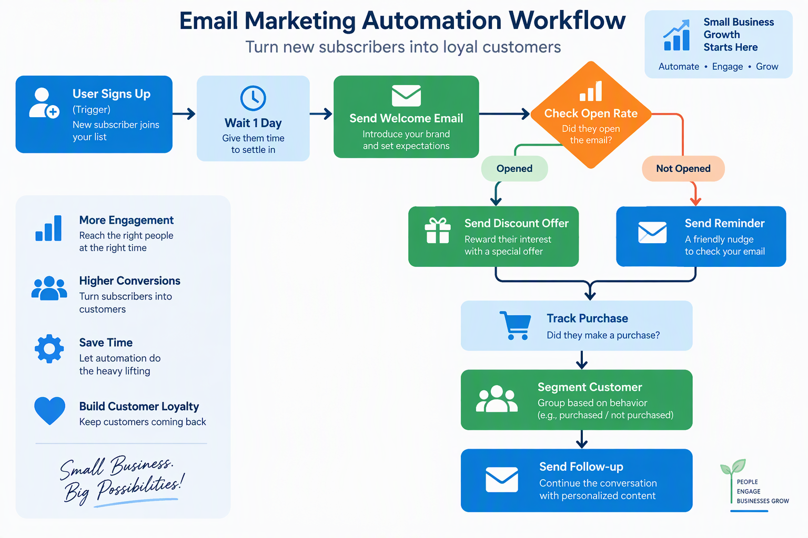
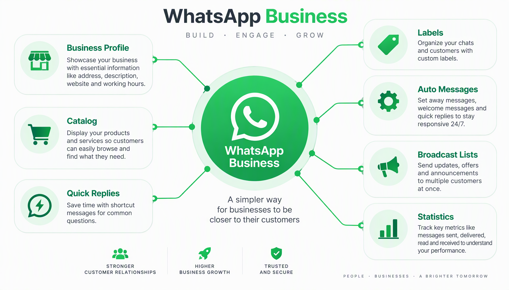
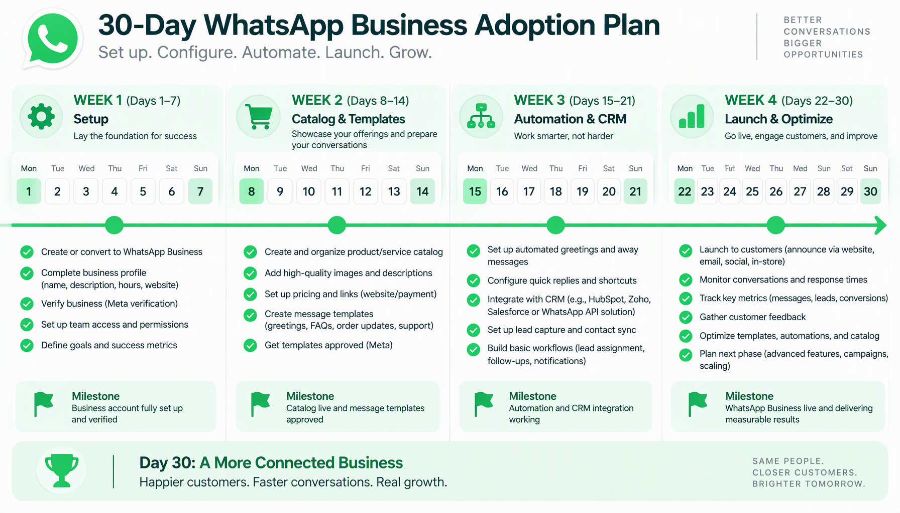

# Panduan Lengkap Operations Management untuk UMKM Indonesia

**Produk 62: Panduan Lengkap Operations Management untuk UMKM Indonesia**

Operasi bisnis yang berantakan bikin kamu rugi setiap hari. Bahan baku menumpuk di gudang, karyawan bingung harus ngapain, pesanan pelanggan telat terus, dan kamu sebagai pemilik bisnis habis waktu buat灭火 masalah kecil yang seharusnya nggak perlu ada.

Buku ini bukan teori dari textbook luar negeri yang nggak relevan sama kondisi UMKM di Indonesia. Ini panduan praktis yang dirancang khusus buat kamu yang menjalankan bisnis dengan sumber daya terbatas, tim kecil, dan tekanan kompetisi yang makin keras setiap hari.

Dari konveksi di Yogyakarta sampai catering di Jakarta, dari workshop furniture di Jepara sampai toko online di Surabaya, semua bisnis butuh operasi yang rapi. Buku ini kasih kamu framework, tools, dan langkah konkret buat ngatur operasi bisnismu supaya lebih efisien, lebih murah, dan lebih cepat.

Siap? Mari kita mulai dari fondasi.

---

# BAGIAN 1: FONDASI OPERATIONS MANAGEMENT

---

## Bab 1: Mengapa Operations Management adalah Kunci Efisiensi Bisnis

Bayangkan kamu punya warung nasi goreng. Setiap malam kamu jual 50 porsi. Tapi setiap malam juga kamu buang 5 kilogram nasi karena kebanyakan masak, kehabisan telur di tengah rush hour, dan pelanggan harus nunggu 20 menit padahal kamu janji 10 menit.

Itu bukan masalah resep atau marketing. Itu masalah operasi.

Operations management adalah cara kamu mengatur semua proses dalam bisnis supaya output yang kamu hasilkan maksimal dengan input yang seminimal mungkin. Simpelnya: kerjain lebih banyak, pakai lebih sedikit, dan bikin pelanggan senang.

Banyak pemilik UMKM di Indonesia mikir operations management itu cuma buat pabrik besar atau korporasi. Padahal, setiap kali kamu mutusin bahan baku apa yang harus dibeli hari ini, setiap kali kamu atur jadwal karyawan, setiap kali kamu cek stok gudang, kamu sedang melakukan operations management. Pertanyaannya bukan apakah kamu butuh operations management, tapi apakah kamu melakukannya dengan benar.

Data dari Kementerian Koperasi dan UKM menunjukkan lebih dari 64 juta UMKM berkontribusi 61% terhadap PDB Indonesia. Tapi mayoritas dari mereka masih beroperasi secara reaktif, bukan proaktif. Mereka nunggu masalah muncul baru bertindak. Operations management yang baik mengubah pola itu jadi preventif. Kamu antisipasi masalah sebelum terjadi.

**Tiga Pilar Operations Management untuk UMKM**

Pilar pertama adalah **efisiensi proses**. Setiap langkah dalam bisnismu, dari menerima pesanan sampai mengirim produk ke tangan pelanggan, harus punya tujuan yang jelas. Kalau ada langkah yang nggak nambah nilai, hapus atau perbaiki. Contoh sederhana: kalau kamu harus jalan 30 meter setiap kali mau ambil kemasan produk, tata ulang workspace kamu supaya kemasan ada dalam jangkauan tangan.

Pilar kedua adalah **konsistensi output**. Pelanggan datang balik bukan karena produkmu sempurna sekali, tapi karena produkmu konsisten. Hari ini enak, besok juga enak. Minggu ini kualitasnya bagus, minggu depan juga bagus. Konsistensi itu hasil dari sistem operasi yang terstandar, bukan dari keberuntungan atau mood karyawan.

Pilar ketiga adalah **pengukuran dan perbaikan**. Kamu nggak bisa memperbaiki apa yang nggak kamu ukur. Berapa unit yang kamu produksi per jam? Berapa persen produk yang cacat? Berapa lama waktu dari order sampai delivery? Kalau kamu nggak tahu angka-angka ini, kamu buta. Operations management kasih kamu kacamata.

**Operations Management vs Kebiasaan Lama**

Banyak UMKM yang masih ngandalkan "feeling" dalam mengambil keputusan operasional. "Kayaknya stok masih banyak" atau "Sepertinya kita perlu tambah orang". Feeling itu bukan data. Operations management ganti feeling dengan angka.

Contoh nyata: seorang pemilik toko kue di Bandung merasa produksi hariannya 100 kue sudah maksimal. Setelah diukur dengan time-and-motion study sederhana, ternyata 40% waktu produksi habis buat cari-cari alat dan bahan karena penempatan workspace yang nggak efisien. Setelah ditata ulang, produksi naik jadi 140 kue per hari tanpa tambah karyawan atau jam kerja.

**Mengapa Operations Management Berbeda dari Disiplin Bisnis Lainnya**

Marketing mengurus bagaimana produk sampai ke pelanggan. Finance mengurus bagaimana uang dikelola. HR mengurus bagaimana orang-orang dalam organisasi berkembang. Operations mengurus bagaimana produk atau jasa itu sendiri diciptakan. Tanpa operasi yang baik, marketing tidak punya produk untuk dijual, finance tidak punya revenue untuk dikelola, dan HR tidak punya pekerjaan yang berarti untuk diberikan ke karyawan.

Operations management adalah tulang punggung bisnis. Ini bukan hiperbola. Kamu bisa punya ide produk terbaik di dunia, tapi kalau kamu tidak bisa memproduksinya secara konsisten, tepat waktu, dan dengan biaya yang masuk akal, ide itu tidak akan pernah jadi bisnis yang viable.

**Dimensi Kinerja Operasional**

Ada lima dimensi yang menentukan seberapa baik operasi bisnismu berjalan.

**Cost**. Berapa biaya yang kamu keluarkan untuk menghasilkan satu unit produk atau jasa? Cost yang terlalu tinggi menggerus margin. Operations management mencari cara untuk menurunkan cost tanpa mengorbankan kualitas.

**Quality**. Apakah produk atau jasa yang kamu hasilkan memenuhi standar yang dijanjikan ke pelanggan? Quality yang buruk berarti rework, retur, komplain, dan reputasi yang hancur.

**Speed**. Seberapa cepat kamu bisa merespons pesanan pelanggan? Lead time yang pendek adalah keunggulan kompetitif, terutama di era marketplace online di mana pelanggan terbiasa dengan pengiriman cepat.

**Dependability**. Apakah kamu bisa diandalkan untuk mengirim tepat waktu, setiap waktu? Dependability membangun kepercayaan. Pelanggan yang percaya kamu selalu on-time akan terus order tanpa mencari alternatif.

**Flexibility**. Seberapa cepat kamu bisa beradaptasi dengan perubahan? Pesanan mendadak, perubahan desain, volume yang naik turun. Bisnis yang fleksibel bisa menangani semua ini tanpa chaos.

Kelima dimensi ini saling terkait. Menurunkan cost bisa mempengaruhi quality. Meningkatkan speed bisa mempengaruhi dependability. Tantangan operations management adalah menemukan keseimbangan optimal untuk konteks bisnismu.

**Apa yang Akan Kamu Dapatkan dari Buku Ini**

Buku ini dirancang sebagai panduan langkah demi langkah. Setiap bab fokus pada satu aspek operations management, dimulai dari konsep dasar, dilanjutkan dengan implementasi praktis, dan ditutup dengan checklist yang bisa langsung kamu pakai.

Kamu akan belajar cara mendesain proses bisnis yang efisien, mengatur tata letak workspace, merencanakan kapasitas produksi, mengelola supply chain, mengontrol inventory, menjaga kualitas, mengatur jadwal, menerapkan lean operations, memanfaatkan teknologi, mengukur performa, dan yang paling penting, semua ini disesuaikan dengan konteks dan keterbatasan UMKM Indonesia.

Kalau kamu siap untuk berhenti firefighting dan mulai membangun sistem operasi yang bikin bisnismu jalan lebih smooth, lanjut ke Bab 2. Kita mulai dari process design.

---

## Bab 2: Process Design dan Workflow

Proses bisnis itu seperti resep masakan. Kalau resepnya jelas, siapa pun yang masak hasilnya akan sama. Kalau resepnya cuma ada di kepala satu orang, begitu orang itu sakit atau resign, bisnis kamu kacau.

Process design adalah seni mendesain urutan kerja yang paling efisien untuk menghasilkan output yang kamu inginkan. Workflow adalah cara kerja itu mengalir dari satu langkah ke langkah berikutnya.

**Mulai dari Pemetaan Proses**

Langkah pertama dalam process design adalah memetakan proses yang sudah ada. Ambil kertas besar atau papan tulis, lalu tuliskan setiap langkah yang terjadi dalam bisnismu dari awal sampai akhir.

Contoh untuk bisnis konveksi: terima order, cek ketersediaan bahan, potong kain, jahit, quality check, setrika, packing, kirim. Delapan langkah. Sekarang tanya untuk setiap langkah: siapa yang mengerjakan, berapa lama, alat apa yang dipakai, dan apa output-nya.

Setelah peta proses jadi, kamu akan mulai melihat masalah. Ada langkah yang berulang tanpa perlu. Ada langkah yang nunggu terlalu lama. Ada langkah yang sebenarnya bisa digabung. Ini yang disebut bottleneck dan waste.

**Identifikasi Value-Added vs Non-Value-Added**

Setiap langkah dalam proses bisa dikategorikan jadi dua. Value-added artinya langkah itu langsung menambah nilai yang bersedia dibayar pelanggan. Non-value-added artinya langkah itu nggak menambah nilai dari perspektif pelanggan.

Dalam bisnis konveksi, menjahit itu value-added. Memindahkan kain dari gudang ke ruang jahit itu non-value-added. Idealnya, kamu ingin meminimalkan langkah non-value-added sebanyak mungkin.

Sebuah UMKM keripik di Malang menemukan bahwa dari 12 langkah proses produksi mereka, hanya 5 yang value-added. Sisanya adalah memindahkan bahan, menunggu antrian mesin, dan mencari alat. Setelah proses di-redesign, mereka potong jadi 7 langkah total dan output naik 35%.

**Prinsip Process Design untuk UMKM**

Prinsip pertama: **simplicity**. Jangan bikin proses lebih rumit dari yang diperlukan. Kalau kamu cuma punya 5 karyawan, nggak perlu sistem approval 3 lapis untuk keputusan pembelian bahan baku Rp 500 ribu.

Prinsip kedua: **standardization**. Setiap langkah harus punya standar yang jelas. "Potong kain sesuai pola" itu terlalu umum. "Potong kain mengikuti garis pola A dengan margin jahit 1 cm di setiap sisi" itu spesifik dan bisa diulang oleh siapa pun.

Prinsip ketiga: **flexibility**. Proses yang kaku akan pecah begitu ada perubahan. Di Indonesia, perubahan itu hal yang biasa. Supplier telat kirim, listrik mati, pesanan mendadak naik. Prosesmu harus punya buffer untuk hal-hal ini.

**Membuat Standard Operating Procedure (SOP)**

SOP bukan dokumen 50 halaman yang nggak pernah dibaca. Untuk UMKM, SOP yang efektif itu singkat, visual, dan praktis. Satu halaman untuk satu proses. Gunakan flowchart, foto, atau bahkan video pendek.

Format SOP sederhana:
- Judul proses
- Tujuan (apa output yang diharapkan)
- Langkah-langkah (nomor urut, satu kalimat per langkah)
- Alat dan bahan yang dibutuhkan
- Standar kualitas (toleransi yang diterima)
- Siapa yang bertanggung jawab

Tempel SOP di area kerja. Bukan di binder yang dikunci di lemari. Kalau SOP-nya tentang cara mengoperasikan mesin, tempel di sebelah mesin. Kalau tentang prosedur penerimaan barang, tempel di area gudang.

**Workflow Optimization**

Setelah proses didesain dan SOP dibuat, langkah berikutnya adalah mengoptimalkan workflow. Perhatikan aliran kerja dari satu stasiun ke stasiun berikutnya.

Tanda workflow yang buruk: barang menumpuk di satu titik, orang bolak-balik tanpa tujuan, sering terjadi kesalahan komunikasi antar bagian, dan pelanggan menunggu terlalu lama.

Tanda workflow yang baik: barang mengalir lancar tanpa hambatan, setiap orang tahu apa yang harus dikerjakan selanjutnya, informasi mengalir tanpa harus diteriakkan, dan lead time dari order ke delivery konsisten.

Tools sederhana yang bisa kamu pakai: kanban board. Tiga kolom (To Do, In Progress, Done) di papan fisik atau pakai aplikasi gratis seperti Trello. Setiap tugas jadi satu kartu. Kamu bisa lihat dengan cepat di mana bottleneck terjadi.

**Tools Tambahan untuk Process Design**

Selain flowchart dan SOP, ada beberapa tools yang bisa membantumu mendesain dan memperbaiki proses.

**Checksheet**. Formulir sederhana untuk mencatat frekuensi masalah atau kejadian. Setiap kali ada cacat, karyawan tinggal centang kategori yang sesuai. Setelah seminggu, kamu punya data visual tentang jenis cacat yang paling sering terjadi.

**Fishbone Diagram (Ishikawa)**. Saat kamu menemukan masalah, gunakan fishbone untuk mengidentifikasi akar penyebab. Gambar tulang ikan: kepala ikan adalah masalah, tulang-tulang besar adalah kategori penyebab (manusia, metode, mesin, material, lingkungan), dan tulang-tulang kecil adalah penyebab spesifik dalam setiap kategori.

**Spaghetti Diagram**. Gambar garis di layout workspace setiap kali seseorang bergerak dari satu titik ke titik lain. Setelah satu shift, kamu akan lihat pola pergerakan yang ruwet seperti spageti. Ini visual yang powerful untuk menunjukkan seberapa tidak efisien layout saat ini dan menjadi dasar untuk perbaikan.

**Redesign Proses: Studi Mini**

Sebuah UMKM makanan ringan di Semarang punya proses produksi yang memakan waktu 6 jam untuk satu batch. Setelah dianalisis, ternyata 2 jam dihabiskan untuk menunggu adonan istirahat, dan selama 2 jam itu tidak ada pekerjaan lain yang bisa dilakukan.

Solusinya: redesign proses supaya selama adonan istirahat, tim melakukan persiapan bahan untuk batch berikutnya dan pembersihan alat. Hasilnya, waktu produksi per batch turun jadi 4 jam. Output harian naik dari 3 batch jadi 4 batch tanpa overtime.

Proses design bukan kegiatan sekali selesai. Setiap 3 sampai 6 bulan, review ulang prosesmu. Tanya ke tim: ada langkah yang bisa dihilangkan? Ada cara yang lebih cepat? Ada tools yang bisa membantu? Proses yang baik adalah proses yang terus diperbaiki.

**Kesalahan Umum dalam Process Design**

Beberapa jebakan yang sering jatuh di UMKM Indonesia saat mendesain proses.

Jebakan pertama: meniru proses perusahaan besar. Kamu bukan Toyota. Kamu bukan Samsung. Proses yang cocok untuk perusahaan dengan ribuan karyawan dan budget unlimited belum tentu cocok untuk bisnismu yang punya 10 karyawan dan modal terbatas. Ambil prinsipnya, tapi sesuaikan skalanya.

Jebakan kedua: over-engineering. Proses yang terlalu detail dan kaku justru menghambat. Kalau setiap keputusan kecil butuh approval 3 lapis, kamu akan lambat. Untuk UMKM, kecepatan adalah keunggulan. Proses harus cukup terstruktur untuk konsistensi, tapi cukup fleksibel untuk adaptasi cepat.

Jebakan ketiga: tidak melibatkan orang yang menjalankan proses. Kamu sebagai owner mungkin mendesain proses dari atas. Tapi karyawan yang menjalankan setiap hari tahu detail yang kamu tidak tahu. Libatkan mereka dalam desain proses. Mereka akan lebih committed menjalankan proses yang mereka bantu rancang.

Jebakan keempat: menganggap proses sebagai dokumen sekali buat. Proses yang tidak pernah di-review dan di-update akan jadi usang. Bisnis berubah, pasar berubah, teknologi berubah. Prosesmu juga harus berubah. Jadikan review proses sebagai agenda rutin, bukan kegiatan darurat.

---

## Bab 3: Facility Layout dan Workspace Organization

Tata letak workspace直接影响 efisiensi operasional. Jarak antara satu stasiun kerja dengan stasiun berikutnya, posisi penyimpanan bahan, alur pergerakan orang dan barang, semuanya mempengaruhi kecepatan produksi, biaya operasional, dan bahkan keselamatan kerja.

Untuk UMKM, constraint-nya jelas: ruang terbatas dan budget terbatas. Tapi justru karena itu, layout yang tepat jadi lebih krusial. Setiap meter persegi harus produktif.

**Prinsip Dasar Layout**

Prinsip pertama adalah **flow**. Barang dan orang harus bergerak dalam satu arah sebisa mungkin. Hindari alur bolak-balik. Dalam konteks dapur catering, misalnya, alur yang benar adalah: bahan masuk dari belakang, disimpan, dicuci, dipotong, dimasak, di-plating, lalu keluar dari depan. Bukan bahan masuk dari depan, dipindahkan ke belakang, lalu dibawa ke depan lagi untuk di-plating.

Prinsip kedua adalah **proximity**. Tempatkan stasiun kerja yang sering berinteraksi berdekatan. Kalau proses packing selalu mengikuti quality check, tempatkan keduanya berdampingan. Jangan pisahkan mereka dengan ruangan lain.

Prinsip ketiga adalah **safety**. Jalur evakuasi harus jelas. Bahan kimia atau alat tajam harus disimpan terpisah dari area makan. Ventilasi harus memadai terutama untuk bisnis yang menghasilkan asap atau debu.

**Tipe Layout dan Kapan Menggunakannya**

Layout berbasis produk (product layout) cocok untuk bisnis yang memproduksi barang serupa dalam volume besar. Mesin dan stasiun kerja diatur mengikuti urutan produksi. Contoh: konveksi yang memproduksi kaos polos dalam jumlah ratusan per hari.

Layout berbasis proses (process layout) cocok untuk bisnis yang menangani berbagai jenis produk dengan proses berbeda. Mesin atau alat yang sama dikelompokkan bersama. Contoh: bengkel las yang mengerjakan berbagai jenis pesanan custom.

Layout posisi tetap (fixed-position layout) cocok untuk produk yang terlalu besar atau berat untuk dipindahkan. Pekerja dan alat yang datang ke lokasi produk. Contoh: jasa katering besar atau usaha mebel yang membuat lemari built-in.

Untuk sebagian besar UMKM, kombinasi dari ketiganya yang paling masuk akal. Area pemotongan diatur seperti product layout karena polanya standar, sementara area custom finishing diatur seperti process layout karena setiap pesanan berbeda.

**5S Methodology untuk Workspace**

5S adalah framework Jepang yang sangat applicable untuk UMKM Indonesia. Lima langkahnya:

**Seiri (Sort)**. Pisahkan yang dibutuhkan dan tidak dibutuhkan dari area kerja. Setiap bulan, keluarkan semua barang dari workspace. Hanya masukkan kembali yang benar-benar dipakai dalam 30 hari terakhir. Sisanya simpan di tempat lain atau jual.

**Seiton (Set in Order)**. Setiap barang punya tempat. Labeli semua penyimpanan. Gunakan shadow board untuk tools. Warna-warnai area berbeda. Prinsipnya: siapa pun harus bisa menemukan dan mengembalikan barang dalam 30 detik.

**Seiso (Shine)**. Bersihkan workspace setiap hari. Ini bukan cuma soal estetika. Lantai yang bersih mengurangi risiko kecelakaan. Mesin yang bersih bekerja lebih baik dan lebih awet. Jadwalkan 15 menit di akhir shift untuk pembersihan.

**Seiketsu (Standardize)**. Buat standar untuk tiga S pertama. Foto workspace yang "benar" dan tempel sebagai referensi. Buat checklist harian. Standar ini harus sama untuk semua shift dan semua orang.

**Shitsuke (Sustain)**. Ini yang paling sulit. Disiplin untuk mempertahankan 4S pertama. Butuh komitmen dari pemilik bisnis dan supervisor. Audit internal mingguan, reward untuk tim terbersih, dan konsekuensi untuk yang mengabaikan.

**Layout untuk Bisnis Jasa**

Bisnis jasa seperti salon, laundry, atau bengkel juga butuh layout yang tepat. Prinsipnya sama: alur pelanggan harus jelas dan efisien. Pelanggan masuk, dilayani, selesai, keluar. Jangan sampai pelanggan yang sudah selesai harus melewati area pelanggan yang sedang menunggu.

Untuk laundry, contoh layout yang efisien: area penerimaan di depan, langsung terhubung ke area sortir dan pencucian, lalu ke area pengeringan dan setrika, dan terakhir ke area folding dan penyerahan. Pelanggan drop di depan, ambil di depan. Barang mengalir ke belakang dan kembali ke depan.

**Ergonomi untuk Produktivitas**

Workspace yang tidak ergonomis bikin karyawan cepat lelah dan rentan cedera. Untuk UMKM, ini berarti penurunan produktivitas dan potensi biaya medis.

Beberapa penyesuaian sederhana: tinggi meja kerja sesuai tinggi rata-rata karyawan, pencahayaan yang cukup (minimal 300 lux untuk kerja detail), lantai anti-slip di area basah, dan kursi yang mendukung postur tubuh yang benar untuk pekerjaan yang banyak duduk.

Investasi ergonomis tidak harus mahal. Bantal kecil untuk kursi yang keras, lampu tambahan untuk area yang gelap, dan matras anti-fatigue untuk karyawan yang berdiri seharian. Total investasinya mungkin Rp 2 juta, tapi pengurangan keluhan sakit punggung dan peningkatan produktivitas akan terasa dalam hitungan minggu.

**Layout untuk Bisnis Retail**

Toko retail juga perlu memperhatikan layout. Prinsip utamanya: arahkan pergerakan pelanggan supaya mereka melihat sebanyak mungkin produk. Supermarket menempatkan produk kebutuhan pokok (beras, minyak, telur) di bagian belakang toko supaya pelanggan melewati semua produk lain sebelum sampai ke tujuan utama.

Untuk toko kecil, prinsipnya sama: produk dengan margin tinggi tempatkan di area yang paling terlihat. Produk yang jadi tujuan utama pelanggan tempatkan di area yang mengharuskan mereka melewati display lainnya. Kasir di posisi yang memungkinkan satu orang mengawasi seluruh toko untuk mencegah kehilangan.

**Indikator Layout yang Perlu Diperbaiki**

Kamu tahu layout-mu bermasalah kalau: karyawan menempuh lebih dari 1 km per shift untuk aktivitas rutin, sering terjadi tabrakan atau saling tunggu antar orang di area kerja, ada area yang selalu penuh sementara area lain kosong, pelanggan atau pengunjung tampak bingung mencari arah, dan waktu siklus produksi lebih panjang dari yang seharusnya.

Solusi tidak selalu renovasi total. Kadang cukup memindahkan satu meja kerja, mengubah arah alur barang, atau menambah rak penyimpanan di titik yang strategis. Observasi selama satu hari penuh sudah cukup untuk mengidentifikasi perubahan kecil yang berdampak besar.

---

## Bab 4: Capacity Planning dan Demand Forecasting

Kamu pernah mengalami dua skenario ini? Skenario pertama: pelanggan pesan 200 unit tapi kamu cuma bisa produksi 100. Kamu kehilangan penjualan dan kepercayaan pelanggan. Skenario kedua: kamu stok bahan untuk 500 unit tapi yang laku cuma 200. Bahan baku menganggur, uang kamu tertanam, dan beberapa bahan bahkan kadaluarsa.

Kedua skenario ini punya satu akar masalah: ketidakmampuan mencocokkan kapasitas dengan permintaan. Capacity planning dan demand forecasting adalah jawabannya.

**Memahami Kapasitas Bisnis**

Kapasitas adalah jumlah maksimum output yang bisa dihasilkan bisnismu dalam periode tertentu. Tapi kapasitas bukan angka tunggal. Ada kapasitas desain (output maksimum teoritis) dan kapasitas efektif (output maksimum realistis setelah memperhitungkan istirahat, maintenance, dan gangguan).

Untuk menghitung kapasitas, mulai dari bottleneck. Bottleneck adalah langkah dalam proses yang paling lambat. Output keseluruhan bisnismu dibatasi oleh bottleneck ini.

Contoh: dalam bisnis konveksi, kapasitas potong kain 200 potong per hari, kapasitas jahit 150 potong per hari, kapasitas finishing 300 potong per hari. Bottleneck-nya adalah jahit di 150 potong. Berapapun kapasitas langkah lain, output maksimum per hari tetap 150 potong karena jahit tidak bisa lebih cepat.

**Demand Forecasting Sederhana**

Kamu tidak perlu software mahal untuk meramalkan permintaan. Metode sederhana yang bisa langsung dipakai:

**Moving Average**. Ambil rata-rata penjualan 3 bulan terakhir. Kalau Januari jual 120 unit, Februari 150 unit, Maret 130 unit, maka perkiraan April adalah (120+150+130)/3 = 133 unit. Metode ini cocok untuk bisnis dengan permintaan yang relatif stabil.

**Weighted Moving Average**. Sama seperti moving average, tapi bulan terbaru dapat bobot lebih besar. Kalau bobotnya 50% untuk bulan terbaru, 30% untuk bulan sebelumnya, dan 20% untuk dua bulan lalu, maka perkiraan April adalah (130x0.5) + (150x0.3) + (120x0.2) = 65 + 45 + 24 = 134 unit. Metode ini lebih responsif terhadap tren.

**Seasonal Adjustment**. Untuk bisnis yang dipengaruhi musim (baju lebaran, kue natal, minuman dingin di musim panas), kalikan forecast dengan faktor musiman. Hitung faktor musiman dari data tahun lalu: berapa persen penjualan bulan tertentu dibandingkan rata-rata tahunan.

**Strategi Capacity Management**

Setelah tahu kapasitas dan forecast permintaan, kamu punya beberapa pilihan strategi.

Kalau permintaan konsisten di atas kapasitas, kamu perlu menambah kapasitas. Opsi: tambah shift, beli mesin tambahan, outsource sebagian proses, atau rekrut karyawan baru. Pertimbangkan ROI dari setiap opsi sebelum memutuskan.

Kalau permintaan fluktuatif, gunakan strategi leveling. Saat permintaan rendah, fokus pada maintenance, training, dan perbaikan proses. Saat permintaan tinggi, manfaatkan kapasitas penuh dan pertimbangkan overtime. Simpan buffer inventory saat permintaan rendah untuk menghadapi lonjakan.

Kalau permintaan tidak pasti, jaga kapasitas fleksibel. Gunakan karyawan kontrak atau freelance untuk lonjakan. Jangan invest di kapasitas tetap kalau demand masih volatile.

**Tools Sederhana untuk Capacity Planning**

Spreadsheet sudah cukup untuk kebanyakan UMKM. Buat tabel dengan kolom: produk, kapasitas per hari per produk, jumlah hari kerja, total kapasitas bulanan, forecast permintaan, dan gap (selisih kapasitas dan demand).

Update tabel ini setiap bulan. Dari sini kamu bisa lihat bulan mana yang kapasitasnya kurang dan bulan mana yang berlebih. Keputusan pembelian bahan, penambahan shift, dan investasi alat semuanya bisa didasarkan pada data ini.

**Menghindari Jebakan Overcapacity dan Undercapacity**

Undercapacity bikin kamu kehilangan penjualan. Overcapacity bikin kamu buang uang untuk kapasitas yang tidak terpakai. Dua-duanya berbahaya.

Aturan praktis: targetkan utilisasi kapasitas 75-85%. Di bawah 70%, kamu overcapacity dan harus cari cara memanfaatkan kapasitas atau kurangi biaya tetap. Di atas 90%, kamu terlalu ketat dan tidak punya buffer untuk gangguan atau lonjakan mendadak.

Untuk UMKM di Indonesia yang menghadapi banyak ketidakpastian (listrik mati, supplier telat, jalan rusak), buffer 15-25% ini sangat penting. Jangan pernah operasikan di 100% kapasitas tanpa rencana cadangan.

**Menghitung Kapasitas untuk Bisnis Jasa**

Bisnis jasa juga perlu capacity planning, meskipun "output"-nya lebih abstrak. Untuk salon, kapasitasnya adalah jumlah pelanggan yang bisa dilayani per hari. Untuk konsultan, kapasitasnya adalah jumlah klien yang bisa ditangani per minggu. Untuk laundry, kapasitasnya adalah kilogram pakaian yang bisa dicuci per hari.

Hitung kapasitas berdasarkan bottleneck. Dalam salon, bottleneck biasanya jumlah kursi dan stylist. Kalau kamu punya 3 kursi dan 3 stylist, dan setiap potong rambut butuh 45 menit, maka kapasitas per hari (8 jam kerja) adalah: 3 stylist x (8 jam / 0,75 jam per potong) = 3 x 10,7 = 32 potong per hari.

Kalau demand rata-rata 40 potong per hari, kamu overcapacity. Opsi: tambah stylist, perpanjang jam operasional, atau kurangi waktu layanan (misalnya tawarkan paket express dengan harga premium).

**Break-Even Analysis untuk Keputusan Kapasitas**

Sebelum menambah kapasitas (beli mesin baru, rekrut orang, sewa tempat tambahan), hitung break-even point-nya. Break-even adalah level penjualan di mana total revenue sama dengan total cost. Di atas break-even, kamu profit. Di bawah break-even, kamu rugi.

Rumus break-even (dalam unit) = biaya tetap / (harga jual per unit - biaya variabel per unit).

Contoh: kamu pertimbangkan beli mesin baru seharga Rp 50 juta. Mesin ini menambah kapasitas 100 unit per hari. Biaya tetap tambahan (cicilan, listrik, maintenance) Rp 5 juta per bulan. Harga jual per unit Rp 50 ribu, biaya variabel per unit Rp 30 ribu. Break-even = Rp 5 juta / (Rp 50 ribu - Rp 30 ribu) = Rp 5 juta / Rp 20 ribu = 250 unit per bulan.

Kalau kamu yakin bisa jual minimal 250 unit tambahan per bulan, investasi mesin ini layak. Kalau demand tambahan hanya 150 unit per bulan, tunggu sampai pasar tumbuh atau cari cara lain untuk meningkatkan kapasitas tanpa investasi besar.

---

## Bab 5: Supply Chain Management untuk UMKM

Supply chain adalah jaringan dari hulu ke hilir yang mengalirkan bahan baku sampai ke tangan pelanggan. Untuk UMKM, supply chain sering jadi sumber masalah terbesar. Supplier telat, bahan tidak sesuai spek, harga naik tiba-tiba, ongkir mahal.

Tapi supply chain yang dikelola dengan benar bisa jadi keunggulan kompetitif. Kalau kamu bisa dapat bahan lebih murah, lebih cepat, dan lebih konsisten dari kompetitor, kamu menang.

**Memetakan Supply Chain Kamu**

Mulai dari daftar semua supplier yang kamu pakai. Untuk setiap supplier, catat: apa yang mereka suplai, berapa lead time (waktu dari order sampai barang datang), berapa minimum order, kualitas rata-rata, dan seberapa reliable mereka.

Setelah daftar ini ada, kamu bisa lihat pola. Apakah kamu terlalu bergantung pada satu supplier? Apakah ada supplier yang sering telat? Apakah ada bahan yang lead time-nya terlalu panjang sehingga kamu harus stok berlebihan?

**Strategi Sourcing**

Single sourcing (satu supplier untuk satu bahan) punya kelebihan: hubungan lebih dekat, harga mungkin lebih murah karena volume order terkonsentrasi, dan koordinasi lebih mudah. Tapi risikonya besar. Kalau supplier ini punya masalah, produksi kamu berhenti.

Multiple sourcing (beberapa supplier untuk bahan yang sama) mengurangi risiko tapi menambah kompleksitas. Kamu harus manage beberapa hubungan, dan volume order per supplier lebih kecil sehingga bargaining power berkurang.

Untuk UMKM, rekomendasi praktis: gunakan minimal dua supplier untuk bahan kritis yang kalau habis akan menghentikan produksi. Satu supplier utama (70% volume) dan satu supplier cadangan (30% volume). Ini memberi kamu opsi kalau supplier utama bermasalah.

**Negosiasi dengan Supplier**

Kekuatan negosiasi UMKM biasanya terbatas karena volume order kecil. Tapi ada beberapa taktik yang bisa dipakai.

Pertama, bayar tepat waktu. Supplier lebih suka pelanggan yang bayar on time daripada yang nawar murah tapi bayar telat. Reputasi pembayaran yang baik bisa kasih kamu prioritas saat barang langka.

Kedua, konsolidasi order. Daripada order kecil-kecil setiap minggu, kumpulkan kebutuhan 2 minggu dalam satu order. Volume lebih besar berarti bargaining power lebih baik, dan ongkir per unit lebih murah.

Ketiga, bangun hubungan personal. Di Indonesia, hubungan personal sangat berpengaruh. Kunjungi supplier, kenal orangnya, dan jaga komunikasi. Saat ada krisis dan barang langka, supplier akan prioritaskan pelanggan yang mereka kenal dan sukai.

**Mengelola Lead Time**

Lead time adalah total waktu dari kamu memesan bahan sampai bahan itu siap digunakan. Lead time yang panjang memaksa kamu stok lebih banyak, yang berarti modal tertanam lebih banyak.

Cara mengurangi lead time: komunikasi lebih sering dengan supplier (konfirmasi order, update status pengiriman), pertimbangkan supplier yang lebih dekat secara geografis (meski harga sedikit lebih mahal, penghematan dari stok yang lebih lean bisa lebih besar), dan standarisasi bahan baku (semakin unik bahan yang kamu minta, semakin lama lead time-nya).

**Supply Chain Risk Management**

Risiko supply chain yang paling umum untuk UMKM Indonesia: keterlambatan pengiriman, kualitas bahan tidak konsisten, kenaikan harga mendadak, dan gangguan logistik (banjir, macet, pelabuhan penuh).

Mitigasinya: selalu punya safety stock untuk bahan kritis (minimal 1 minggu konsumsi), diversifikasi supplier untuk bahan utama, kontrak harga dengan supplier kunci kalau memungkinkan, dan punya rencana cadangan untuk skenario terburuk.

Sebuah UMKM makanan di Surabaya pernah kehilangan 80% bahan baku karena banjir di route pengiriman. Setelah kejadian itu, mereka mulai simpan bahan kering untuk 2 minggu dan punya perjanjian dengan supplier alternatif di kota yang berbeda. Ketika pandemi mengganggu supply chain utama, mereka masih bisa beroperasi karena sudah punya cadangan.

**Kolaborasi dengan Supplier untuk Inovasi**

Hubungan dengan supplier tidak harus transaksional. Supplier yang baik bisa jadi partner inovasi. Mereka tahu material lebih baik dari kamu dan sering punya ide tentang substitusi bahan yang lebih murah, material baru yang lebih tahan lama, atau teknik pengolahan yang lebih efisien.

Luangkan waktu setiap kuartal untuk duduk bersama supplier utama. Bahas: apakah ada bahan baru yang bisa meningkatkan kualitas produk? Apakah ada cara untuk mengurangi waste dalam pengiriman? Apakah ada volume order yang bisa dikonsolidasikan untuk efisiensi biaya?

Sebuah UMKM tas di Garut berhasil menurunkan biaya bahan baku 18% setelah berdiskusi dengan supplier kulit tentang alternatif grade yang secara visual sama tapi secara harga 20% lebih murah. Inovasi ini tidak akan pernah muncul kalau hubungan dengan supplier murni transaksional.

**Logistik dan Distribusi**

Untuk UMKM yang menjual ke seluruh Indonesia, logistik adalah komponen biaya yang signifikan. Mengelola logistik dengan baik bisa menghemat 15-25% dari total biaya pengiriman.

Strategi logistik untuk UMKM: negosiasi kontrak dengan kurir untuk volume discount, gunakan layanan agregator pengiriman yang membandingkan harga dari berbagai kurir, kelompokkan pengiriman berdasarkan zona untuk efisiensi, dan pertimbangkan gudang konsinyasi di kota-kota utama kalau volume pengiriman ke area tersebut sudah signifikan.

Track ongkos kirim per pesanan sebagai KPI. Kalau ongkos kirim per pesanan naik, investigasi: apakah ada cara packaging yang lebih efisien? Apakah ada kurir alternatif? Apakah ada opsi konsolidasi pengiriman yang belum dimanfaatkan?

**Musim dan Fluktuasi Supply Chain**

Di Indonesia, supply chain dipengaruhi oleh faktor musiman yang kuat. Menjelang Lebaran, permintaan bahan baku melonjak dan harga naik. Saat musim hujan, pengiriman ke beberapa wilayah bisa terlambat berhari-hari. Saat tahun baru, beberapa supplier tutup dan baru beroperasi minggu kedua Januari.

Antisipasi ini dengan perencanaan yang matang. Untuk Lebaran, order bahan baku 1-2 bulan sebelumnya. Untuk musim hujan, tambahkan safety stock dan siapkan rute alternatif. Untuk periode tutup supplier, pastikan stok cukup untuk menutupi periode tersebut.

Buat kalender supply chain tahunan yang mencatat periode-periode kritis ini. Share ke tim pengadaan dan produksi. Dengan perencanaan yang tepat, fluktuasi musiman bisa diantisipasi tanpa mengganggu operasi.

**Integrasi Supply Chain dengan Operasional**

Supply chain bukan departemen terpisah. Keputusan operasional mempengaruhi supply chain dan sebaliknya. Kalau kamu memutuskan untuk menambah variasi produk, supply chain jadi lebih kompleks. Kalau kamu ubah jadwal produksi, jadwal pengiriman bahan juga harus disesuaikan.

Komunikasi antara tim operasional dan tim pengadaan harus rutin. Meeting mingguan 30 menit untuk review kebutuhan bahan minggu depan, status pesanan yang sedang berjalan, dan masalah yang perlu diantisipasi sudah cukup untuk menjaga keselarasan.

---

# BAGIAN 2: IMPLEMENTASI DAN KONTROL

---

## Bab 6: Inventory Management dan Control

Inventory adalah uang yang diparkir di gudang. Terlalu banyak inventory berarti uang kamu menganggur, risiko kerusakan dan kadaluarsa tinggi, dan ruang kerja penuh. Terlalu sedikit inventory berarti kamu kehabisan bahan saat produksi berjalan, kehilangan penjualan, dan pelanggan kecewa.

Menemukan titik keseimbangan adalah inti dari inventory management.

**Klasifikasi Inventory**

Tidak semua inventory sama. Metode ABC分类 membantu kamu fokus pada item yang paling berpengaruh.

**Kategori A**: 20% dari total item tapi 80% dari total nilai inventory. Ini bahan-bahan mahal atau bahan utama yang paling banyak dipakai. Untuk kategori ini, kontrol harus ketat. Hitung stok setiap hari atau setiap minggu. Forecast demand harus akurat. Order harus tepat waktu.

**Kategori B**: 30% dari total item dan 15% dari total nilai. Kontrol moderat. Review stok setiap 2 minggu. Safety stock yang wajar.

**Kategori C**: 50% dari total item tapi cuma 5% dari total nilai. Kontrol longgar. Order dalam jumlah besar untuk mengurangi frekuensi order. Review stok bulanan.

Contoh untuk bisnis bakery: tepung dan butter masuk kategori A (mahal dan dipakai setiap hari). Gula dan telur masuk kategori B. Cetakan, kertas roti, dan packaging masuk kategori C.

**Metode Penghitungan Stok**

Periodic counting: hitung semua stok pada interval tertentu (mingguan, bulanan). Simpel tapi kamu tidak tahu selisih stok di antara waktu penghitungan.

Perpetual inventory: catat setiap masuk dan keluar secara real-time. Lebih akurat tapi butuh disiplin pencatatan. Untuk UMKM, ini bisa dilakukan dengan spreadsheet sederhana yang diupdate setiap kali ada transaksi inventory.

Cycle counting: hitung sebagian stok setiap hari berdasarkan jadwal. Kategori A dihitung setiap minggu, kategori B setiap 2 minggu, kategori C setiap bulan. Ini memberikan akurasi tinggi tanpa harus tutup gudang untuk stock opname besar.

**Menentukan Reorder Point**

Reorder point adalah level stok di mana kamu harus order lagi. Rumusnya sederhana:

Reorder Point = (Rata-rata pemakaian per hari x Lead time dalam hari) + Safety Stock

Contoh: kamu pakai 20 kg tepung per hari, lead time dari supplier 3 hari, dan safety stock 30 kg. Reorder point = (20 x 3) + 30 = 90 kg. Setiap stok tepung menyentuh 90 kg, kamu harus order.

Safety stock sendiri dihitung dari variabilitas demand dan lead time. Kalau demand dan lead time sangat stabil, safety stock bisa kecil. Kalau keduanya fluktuatif, safety stock harus lebih besar.

**Economic Order Quantity (EOQ)**

EOQ membantu kamu menentukan jumlah order yang paling ekonomis. Order terlalu sering berarti biaya order tinggi (ongkir, administrasi). Order terlalu jarang berarti biaya simpan tinggi (gudang, risiko rusak, modal tertanam).

Rumus EOQ = akar dari (2 x permintaan tahunan x biaya per order / biaya simpan per unit per tahun).

Untuk UMKM, hitung EOQ untuk bahan kategori A. Untuk kategori B dan C, pendekatan sederhana sudah cukup: order untuk 2-4 minggu pemakaian.

**Praktik Inventory Management Harian**

Pertama, First In First Out (FIFO). Barang yang pertama masuk harus pertama keluar. Ini krusial untuk bahan makanan, bahan kimia, dan apapun yang punya masa kadaluarsa. Rak atau gudang harus didesain supaya barang lama otomatis keluar duluan.

Kedua, label semua item. Nama barang, kode, tanggal masuk, dan tanggal kadaluarsa (jika ada). Tidak ada alasan untuk barang tanpa label di gudang yang terorganisir.

Ketiga, pisahkan area karantina. Barang yang baru datang jangan langsung dicampur dengan stok lama. Tunggu inspeksi kualitas selesai. Barang yang rusak atau akan diretur juga harus dipisahkan supaya tidak terpakai secara tidak sengaja.

Keempat, kunci gudang. Hanya orang tertentu yang boleh masuk dan keluar barang. Ini mencegah kehilangan, pencurian, dan penggunaan bahan yang tidak terkontrol.

**Inventory untuk Bisnis Jasa**

Bisnis jasa juga punya inventory, meskipun bentuknya berbeda. Salon punya persediaan shampoo, cat rambut, dan produk perawatan. Bengkel punya spare parts. Konsultan punya template dan material pendukung.

Prinsipnya sama: klasifikasi ABC, reorder point, dan FIFO. Perbedaannya adalah jenis barangnya lebih sedikit dan lead time biasanya lebih pendek, sehingga manajemen inventory cenderung lebih sederhana.

**Dead Stock dan Cara Menanganinya**

Setiap bisnis punya dead stock: barang yang sudah lama tidak bergerak dan mungkin tidak akan pernah terpakai. Dead stock mengikat modal, memakan ruang gudang, dan berisiko rusak atau kadaluarsa.

Identifikasi dead stock secara berkala. Aturan praktis: kalau sebuah item tidak bergerak dalam 6 bulan terakhir, kategorikan sebagai dead stock. Untuk item ini, ada beberapa opsi: jual dengan diskon (lebih baik dapat uang kembali daripada hilang total), donasikan (bisa dapat manfaat pajak), atau bundle dengan produk lain untuk menghabiskan stok.

Cegah dead stock di masa depan dengan memperbaiki forecasting. Setiap kali kamu order bahan baru, tanyakan: apakah ini untuk demand yang sudah terprediksi atau untuk eksperimen? Kalau untuk eksperimen, order dalam jumlah kecil dulu. Validasi demand sebelum order dalam jumlah besar.

**Audit Inventory**

Lakukan stock opname minimal sebulan sekali untuk item kategori A, setiap 2 bulan untuk kategori B, dan setiap 3 bulan untuk kategori C. Bandingkan stok fisik dengan catatan di sistem. Investigasi selisih yang signifikan.

Selisih inventory biasanya disebabkan oleh: pencurian (internal atau eksternal), kesalahan pencatatan, kerusakan yang tidak dilaporkan, atau penyusutan yang tidak terukur. Dengan audit rutin, kamu bisa deteksi dan address masalah-masalah ini sebelum menjadi besar.

Untuk UMKM dengan budget terbatas, audit inventory tidak harus mahal. Waktu kamu sebagai owner atau satu jam dari supervisor sudah cukup. Yang penting konsisten dan ditindaklanjuti.

**Inventory Turnover Ratio sebagai Alat Evaluasi**

Inventory turnover ratio mengukur berapa kali stok kamu berputar (terjual dan diganti) dalam satu periode. Rumusnya: harga pokok penjualan dibagi rata-rata nilai inventory.

Turnover yang tinggi berarti inventory kamu bergerak cepat. Ini bagus karena modal tidak tertahan lama di gudang. Turnover yang rendah berarti ada stok yang lambat bergerak. Ini bisa jadi tanda over-purchasing, demand yang turun, atau produk yang sudah tidak relevan.

Benchmark turnover ratio bervariasi per industri. Untuk makanan dan minuman, 12-20 kali per tahun itu normal. Untuk retail umum, 4-8 kali. Untuk manufaktur, 6-12 kali. Bandingkan turnover ratiomu dengan benchmark industri untuk evaluasi apakah manajemen inventory kamu sudah efisien.

Kalau turnover ratio-mu di bawah benchmark, ada peluang perbaikan yang signifikan. Mulai dari identifikasi slow-moving items, perbaiki forecasting demand, dan sesuaikan reorder point. Setiap peningkatan turnover berarti pengurangan modal yang tertahan di gudang, yang bisa dialihkan ke investasi yang lebih produktif.

---

## Bab 7: Quality Management dan Assurance

Kualitas bukan kemewahan. Untuk UMKM, kualitas yang konsisten adalah cara paling efektif untuk bersaing melawan bisnis yang lebih besar. Kamu mungkin tidak punya budget marketing sebesar mereka, tapi kalau produkmu lebih konsisten, pelanggan akan tetap datang.

Quality management bukan berarti produk sempurna tanpa cacat. Itu standar yang tidak realistis untuk kebanyakan UMKM. Quality management berarti kamu punya standar yang jelas, kamu mengukur terhadap standar itu, dan kamu punya sistem untuk memperbaiki ketika ada penyimpangan.

**Menetapkan Standar Kualitas**

Standar kualitas harus spesifik dan terukur. "Produk harus bagus" bukan standar. "Produk harus bebas dari noda, jahitan rapi dengan toleransi penyimpangan maksimum 2 mm, dan warna sesuai sampel approved" itu standar.

Libatkan pelanggan dalam menetapkan standar. Apa yang mereka anggap berkualitas? Apa yang membuat mereka komplain? Apa yang membuat mereka tidak mau order lagi? Jawaban dari pertanyaan-pertanyaan ini jadi dasar standar kualitas kamu.

Dokumentasikan standar dalam bentuk visual. Foto produk yang "lulus" dan foto produk yang "tidak lulus" dengan penjelasan apa yang salah. Tempel di area kerja supaya setiap karyawan bisa referensi.

**Quality Control vs Quality Assurance**

Quality control (QC) adalah inspeksi produk jadi untuk memisahkan yang bagus dari yang cacat. Ini reaktif. Cacat sudah terjadi, kamu cuma memfilter.

Quality assurance (QA) adalah sistem untuk mencegah cacat terjadi sejak awal. Ini proaktif. Kamu mendesain proses supaya cacat tidak mungkin atau sangat sulit terjadi.

UMKM biasanya terlalu bergantung pada QC. Mereka cek produk di akhir proses dan buang atau perbaiki yang cacat. Ini mahal karena bahan, waktu, dan tenaga yang sudah dikeluarkan untuk produk cacat itu sia-sia.

Pendekatan yang lebih baik: geser fokus ke QA. Pasang check point di beberapa titik kritis dalam proses, bukan cuma di akhir. Kalau kamu bikin keripik, cek kualitas di tahap penerimaan bahan (bahan baku bagus?), di tahap pengolahan (suhu dan waktu sesuai?), dan di tahap packaging (seal rapat, berat sesuai?).

**Statistical Quality Control Sederhana**

Kamu tidak perlu jadi ahli statistik untuk menggunakan tools quality control. Dua tools yang paling berguna untuk UMKM:

**Control Chart**. Catat pengukuran kualitas (berat produk, dimensi, waktu proses) dari waktu ke waktu. Plot di grafik dengan upper control limit dan lower control limit. Kalau pengukuran masih dalam batas, proses terkontrol. Kalau keluar batas, ada masalah yang harus diinvestigasi.

**Pareto Analysis**. Kumpulkan data cacat selama sebulan. Kategorikan jenis cacat. Hitung frekuensi masing-masing. Urutkan dari yang paling sering ke paling jarang. Biasanya 20% jenis cacat menyumbang 80% total cacat. Fokus perbaiki yang paling sering dulu.

**Membangun Budaya Kualitas**

Kualitas bukan tanggung jawab satu orang atau satu departemen. Kualitas adalah tanggung jawab semua orang. Tapi budaya kualitas tidak muncul dengan sendirinya.

Pemilik bisnis harus memberi contoh. Kalau kamu sebagai owner mengorbankan kualitas demi kecepatan, tim kamu juga akan begitu. Kalau kamu konsisten menolak produk yang di bawah standar meskipun deadline mepet, tim kamu akan paham bahwa kualitas memang prioritas.

Reward karyawan yang menemukan cacat atau mengusulkan perbaikan kualitas. Jangan marah karyawan yang melaporkan masalah. Kalau mereka takut melapor, masalah akan tersembunyi sampai meledak di tangan pelanggan.

**Menangani Komplain Pelanggan**

Komplain pelanggan adalah data kualitas gratis. Setiap komplain memberitahu kamu di mana sistemmu gagal.

Buat sistem pencatatan komplain yang sederhana. Catat: tanggal, jenis produk, jenis masalah, dan tindakan yang diambil. Setiap bulan, review data komplain. Cari pola. Kalau 60% komplain tentang produk yang penyok saat sampai, kamu punya masalah di packaging, bukan di produksi.

Respon komplain dengan cepat dan profesional. Akui masalah, minta maaf tanpa banyak alasan, jelaskan apa yang akan kamu lakukan untuk mencegah terulang, dan beri kompensasi yang wajar. Pelanggan yang komplainnya ditangani dengan baik seringkali jadi lebih loyal dari pelanggan yang tidak pernah punya masalah.

**Root Cause Analysis: 5 Why**

Saat kamu menemukan cacat atau masalah kualitas, jangan hanya perbaiki gejalanya. Cari akar penyebabnya supaya masalah yang sama tidak terulang.

Teknik 5 Why sangat efektif dan mudah dipakai. Tanya "kenapa" lima kali berturut-turut sampai kamu menemukan akar penyebab.

Contoh: produk cacat (kenapa?) karena jahitan miring (kenapa?) karena pola bergeser saat dipotong (kenapa?) karena meja potong tidak rata (kenapa?) karena kaki meja sudah aus (kenapa?) karena tidak ada jadwal maintenance peralatan.

Akar masalahnya bukan operator yang ceroboh, tapi tidak ada sistem maintenance. Solusinya: buat jadwal maintenance preventif untuk semua peralatan. Ini mencegah masalah yang sama terulang di masa depan.

**Cost of Quality**

Kualitas punya biaya. Tapi kualitas yang buruk juga punya biaya, dan biasanya jauh lebih besar. Memahami cost of quality membantu kamu memutuskan berapa investasi yang masuk akal untuk sistem kualitas.

Biaya pencegahan: training, SOP, maintenance preventif, quality planning. Biaya penilaian: inspeksi, testing, quality audit. Biaya kegagalan internal: rework, scrap, downtime karena cacat. Biaya kegagalan eksternal: retur, komplain, garansi, kehilangan pelanggan.

UMKM biasanya fokus pada biaya kegagalan eksternal (karena paling terlihat) dan mengabaikan biaya pencegahan. Padahal, setiap Rp 1 yang diinvestasikan di pencegahan bisa menghemat Rp 10-100 di biaya kegagalan. Ini bukan teori, ini matematika sederhana.

---

## Bab 8: Workforce Management dan Productivity

Di UMKM Indonesia, mengelola orang adalah tantangan terbesar. Kamu bekerja dengan sumber daya manusia yang terbatas, akses training yang minim, dan turnover yang tinggi. Tapi justru manusia adalah aset terbesar dalam operasi bisnismu.

Produktivitas bukan tentang memeras orang bekerja lebih keras. Produktivitas adalah membuat setiap jam kerja menghasilkan output lebih banyak dengan kualitas yang sama atau lebih baik. Ini dicapai melalui sistem, bukan tekanan.

**Perencanaan Tenaga Kerja**

Mulai dari menghitung berapa orang yang kamu butuhkan dan skill apa yang diperlukan. Jangan rekrut berdasarkan feeling. Hitung berdasarkan beban kerja.

Rumus sederhana: jumlah orang = total beban kerja (dalam jam) / jam kerja efektif per orang per periode.

Contoh: kalau kamu butuh 200 jam kerja per minggu untuk memenuhi semua pesanan, dan setiap karyawan bekerja 40 jam per minggu (setelah dikurangi istirahat dan waktu non-produktif, jam efektif mungkin 32 jam), maka kamu butuh 200/32 = 6,25, dibulatkan jadi 7 orang.

Tapi ingat, ini jumlah minimum. Kamu perlu buffer untuk absensi, cuti, dan lonjakan pesanan. Tambahkan 10-15% dari jumlah minimum sebagai buffer.

**Training dan Development**

UMKM sering skip training karena dianggap mahal dan memakan waktu. Padahal, karyawan yang tidak terlatih jauh lebih mahal. Mereka lambat, banyak kesalahan, dan bahan baku terbuang.

Training tidak harus formal dan mahal. On-the-job training yang terstruktur sudah sangat efektif. Tentukan skill yang harus dikuasai, assign mentor (bisa kamu sendiri atau karyawan senior), dan tetapkan target waktu penguasaan.

Cross-training juga penting. Latih karyawan untuk bisa mengerjakan lebih dari satu posisi. Kalau satu orang sakit atau resign, ada yang bisa ganti. Kamu tidak akan hostage pada satu orang untuk satu fungsi kritis.

**Mengukur Produktivitas**

Produktivitas = output / input. Input bisa berupa jam kerja, jumlah orang, atau biaya tenaga kerja. Output bisa berupa unit produksi, nilai penjualan, atau jumlah pesanan yang diselesaikan.

Contoh: kalau 5 karyawan memproduksi 200 unit dalam 40 jam kerja (8 jam x 5 orang), produktivitasnya adalah 200/40 = 5 unit per jam orang.

Ukur produktivitas secara rutin (mingguan atau bulanan) dan track trennya. Kalau produktivitas turun, investigasi penyebabnya. Mungkin ada masalah di proses, peralatan rusak, karyawan demotivasi, atau ada bottleneck baru.

**Kompensasi dan Insentif**

Gaji pokok penting, tapi insentif berbasis performa bisa mendorong produktivitas lebih jauh. Untuk UMKM, skema insentif tidak harus rumit.

Insentif berbasis output: bonus per unit di atas target harian. Ini cocok untuk pekerjaan produksi yang outputnya mudah diukur.

Insentif berbasis kualitas: bonus kalau tingkat cacat di bawah threshold. Ini mencegah karyawan mengejar kuantitas tapi mengorbankan kualitas.

Insentif berbasis tim: bonus kalau target tim tercapai. Ini mendorong kolaborasi dan saling bantu antar anggota tim.

Yang penting, skema insentif harus transparan. Karyawan harus bisa hitung sendiri berapa bonus yang mereka dapat. Kalau mereka tidak paham cara perhitungannya, insentif tidak akan memotivasi.

**Menangani Turnover**

Turnover tinggi sangat mahal. Setiap kali karyawan keluar, kamu kehilangan investasi training, butuh waktu untuk rekrut dan train pengganti, dan selama masa transisi produktivitas turun.

Penyebab turnover yang paling umum di UMKM Indonesia: gaji di bawah pasar, lingkungan kerja yang toxic, tidak ada jenjang karir, dan perlakuan yang tidak adil.

Yang bisa kamu kontrol: ciptakan lingkungan kerja yang menghargai karyawan, bayar secara adil dan tepat waktu, beri kesempatan berkembang, dan perlakukan semua orang secara konsisten. Kamu tidak selalu bisa bayar setinggi perusahaan besar, tapi kamu bisa tawarkan lingkungan kerja yang lebih baik.

**Komunikasi dan Koordinasi Tim**

Untuk tim kecil (5-15 orang), komunikasi informal biasanya cukup. Tapi begitu tim mulai tumbuh, kamu butuh struktur komunikasi yang lebih jelas.

Daily standup: 10 menit di awal shift. Setiap orang sebutkan apa yang akan dikerjakan hari ini dan apakah ada hambatan. Ini memastikan semua orang aligned dan masalah terdeteksi dini.

Weekly review: 30-60 menit di akhir minggu. Review target vs aktual, identifikasi masalah, dan rencanakan minggu depan.

Monthly townhall: 1-2 jam di akhir bulan. Share hasil bisnis, rencana ke depan, dan beri ruang untuk karyawan bertanya dan memberi masukan.

**Membangun Tim yang Self-Managed**

Tujuan akhir workforce management adalah membangun tim yang bisa berjalan tanpa kamu harus mengawasi setiap detail. Ini bukan berarti kamu lepas tangan, tapi kamu bisa fokus pada strategi dan pertumbuhan sementara tim menangani operasional harian.

Caranya: delegasi keputusan, bukan hanya tugas. Kalau kamu cuma delegasi tugas ("potong kain ini 50 lembar"), karyawan hanya mengerjakan apa yang disuruh. Kalau kamu delegasi keputusan ("pastikan kain siap untuk jahit besok pagi"), karyawan berpikir tentang cara terbaik mencapai hasil yang diinginkan.

Mulai dari keputusan kecil. Biarkan tim memutuskan urutan kerja mereka sendiri, cara menyelesaikan masalah rutin, dan alokasi tugas internal. Seiring waktu dan kepercayaan terbangun, perluas ke keputusan yang lebih besar.

**Mengukur Kepuasan Kerja**

Karyawan yang puas bekerja lebih produktif, lebih kreatif, dan lebih loyal. Untuk UMKM yang tidak mampu bayar setinggi korporasi, kepuasan kerja jadi faktor penentu retensi.

Survei kepuasan sederhana bisa dilakukan setiap 3 bulan. Lima pertanyaan: apakah kamu merasa pekerjaanmu berarti? apakah kamu punya tools yang dibutuhkan untuk bekerja dengan baik? apakah kamu mendapat apresiasi yang cukup? apakah kamu melihat kesempatan berkembang di sini? apakah kamu merekomendasikan tempat ini sebagai tempat kerja ke temanmu?

Jawaran anonim. Review hasilnya. Dan yang paling penting, tindak lanjuti. Karyawan yang sudah repot-repot isi survei akan kecewa kalau tidak ada perubahan yang terlihat.

---

## Bab 9: Scheduling dan Timeline Management

Jadwal yang buruk bikin kamu kehilangan uang. Karyawan menganggur karena bahan belum datang, mesin idle karena tidak ada order yang siap diproses, dan pelanggan marah karena pesanan telat. Semua ini bisa dicegah dengan scheduling yang tepat.

Scheduling adalah tentang menentukan kapan setiap aktivitas harus dilakukan, oleh siapa, dan dengan sumber daya apa.

**Jadwal Produksi**

Untuk bisnis manufaktur atau produksi, jadwal produksi adalah jantung operasi. Jadwal yang baik menjawab: apa yang diproduksi, berapa banyak, kapan mulai, kapan selesai, dan siapa yang mengerjakan.

Mulai dari kapasitas dan demand. Kamu sudah tahu dari Bab 4 berapa kapasitas dan forecast permintaan. Sekarang breakdown forecast bulanan menjadi jadwal mingguan dan harian.

Prioritaskan pesanan berdasarkan deadline dan profitabilitas. Pesanan dengan deadline paling dekat dan margin tertinggi harus dijadwalkan duluan. Tapi jangan sampai pesanan kecil terus-menerus didesak ke belakang. Pelanggan kecil hari ini bisa jadi pelanggan besar besok.

**Gantt Chart Sederhana**

Gantt chart adalah visualisasi jadwal dalam bentuk bar di timeline. Setiap bar mewakili satu tugas atau pesanan, panjang bar menunjukkan durasi, dan posisi bar menunjukkan kapan tugas itu dimulai dan selesai.

Kamu bisa buat Gantt chart di spreadsheet. Kolom kiri: daftar tugas atau pesanan. Baris atas: tanggal atau hari. Setiap tugas digambar sebagai bar yang membentang dari tanggal mulai sampai tanggal selesai.

Gantt chart membantu kamu melihat konflik jadwal (dua tugas butuh mesin yang sama di waktu yang sama), slack time (waktu luang yang bisa dimanfaatkan), dan critical path (urutan tugas yang kalau satu terlambat akan menggeser seluruh jadwal).

**Mengelola Deadline**

Banyak UMKM yang hidup dalam budaya "deadline besok, mulai hari ini". Ini bukan heroik, ini manajemen yang buruk.

Aturan praktis: mundur dari deadline pelanggan. Kalau pelanggan minta barang tanggal 30, dan kamu butuh 5 hari produksi plus 2 hari pengiriman, kamu harus mulai produksi paling lambat tanggal 23. Tambahkan buffer 2 hari untuk gangguan, jadi mulai tanggal 21.

Buat lead time matrix untuk setiap jenis produk. Produk A butuh 3 hari, produk B butuh 5 hari, produk C butuh 7 hari. Saat pesanan masuk, langsung cek: apakah lead time cukup? Kalau tidak, komunikasikan ke pelanggan di awal, bukan di hari H.

**Shift Scheduling**

Untuk bisnis yang beroperasi dengan shift, scheduling yang adil dan efisien itu penting. Karyawan butuh kepastian jadwal supaya bisa mengatur kehidupan pribadi. Bisnis butuh coverage yang cukup di setiap shift.

Buat jadwal minimal 1 minggu di depan. Pertimbangkan: permintaan per shift (shift sibuk butuh lebih banyak orang), skill yang dibutuhkan (jangan taruh semua junior di shift yang butuh kecepatan), dan preferensi karyawan (swap shift harus diizinkan dengan prosedur yang jelas).

Tools sederhana: spreadsheet dengan nama karyawan di baris dan tanggal di kolom. Isi dengan shift (Pagi/Siang/Malam/Off). Tempel di area yang semua orang bisa lihat.

**Mengatasi Gangguan Jadwal**

Gangguan pasti terjadi. Mesin rusak, karyawan sakit, pesanan darurat masuk, bahan terlambat. Yang membedakan bisnis yang baik adalah seberapa cepat mereka recover dari gangguan.

Miliki rencana cadangan. Kalau mesin utama rusak, siapa yang bisa diperbaiki dan berapa lama? Kalau karyawan kunci tidak masuk, siapa yang bisa cover? Kalau bahan belum datang, apakah ada supplier alternatif yang bisa kirim hari itu juga?

Buffer dalam jadwal juga penting. Jangan jadwal 100% kapasitas. Sisakan 10-15% untuk gangguan. Kalau tidak ada gangguan, buffer itu bisa dipakai untuk maintenance preventif atau training.

**Priority Matrix untuk Penjadwalan**

Saat pesanan menumpuk dan kapasitas terbatas, kamu butuh cara untuk menentukan mana yang harus dikerjakan duluan. Priority matrix membantu keputusan ini.

Dua dimensi yang dipakai: urgensi (kapan deadline) dan profitabilitas (margin per pesanan). Pesanan dengan deadline dekat dan margin tinggi harus diprioritaskan. Pesanan dengan deadline jauh dan margin rendah bisa dijadwalkan belakangan.

Tapi ada nuansa: jangan selalu prioritaskan margin tinggi. Pelanggan dengan order kecil hari ini bisa jadi klien korporat besok. Pertimbangkan juga hubungan jangka panjang, potensi repeat order, dan referensi yang bisa mereka berikan.

Aturan praktis: 80% kapasitas untuk pesanan prioritas tinggi (deadline dekat, margin bagus, pelanggan setia). 20% kapasitas untuk pesanan yang secara finansial kurang menarik tapi strategis untuk hubungan jangka panjang.

**Komunikasi Jadwal ke Pelanggan**

Banyak UMKM yang ragu memberikan estimasi waktu yang realistis ke pelanggan. Mereka takut kehilangan order kalau bilang "butuh 7 hari" padahal kompetitor bilang "3 hari".

Komunikasikan lead time yang jujur. Kalau kamu bisa konsisten deliver dalam 7 hari, pelanggan akan lebih menghargai kepastian itu daripada janji 3 hari yang sering meleset. Kepercayaan lebih berharga daripada kecepatan yang tidak konsisten.

Update pelanggan secara proaktif tentang status pesanan mereka. Tidak perlu menunggu mereka tanya. Kirim update: "Pesanan Anda sedang dalam tahap produksi, estimasi selesai hari Kamis, pengiriman hari Jumat." Ini mengurangi kecemasan pelanggan dan membangun kepercayaan.

---

## Bab 10: Lean Operations dan Waste Reduction

Lean bukan berarti memotong budget sampai tulang. Lean berarti menghilangkan semua aktivitas yang tidak menambah nilai dari perspektif pelanggan. Setiap rupiah dan setiap menit yang dihabiskan untuk aktivitas non-value-added adalah pemborosan.

Konsep lean berasal dari Toyota Production System, tapi prinsipnya universal dan sangat applicable untuk UMKM Indonesia. Kamu tidak perlu jadi perusahaan otomotif untuk mendapat manfaat dari lean thinking.

**Tujuh Jenis Waste (Muda)**

Waste pertama: **Overproduction**. Memproduksi lebih banyak atau lebih cepat dari yang dibutuhkan. Ini waste paling berbahaya karena memicu waste lainnya. Barang yang diproduksi berlebihan harus disimpan (biaya gudang), bisa rusak (biaya kerugian), dan mengikat modal (biaya opportunity).

Waste kedua: **Waiting**. Waktu tunggu antar proses. Karyawan menunggu bahan, mesin menunggu operator, pesanan menunggu approval. Setiap detik menunggu adalah detik yang tidak produktif.

Waste ketiga: **Transportation**. Pemindahan barang yang tidak perlu. Setiap kali barang dipindahkan, ada risiko kerusakan dan waktu terbuang. Layout yang buruk (Bab 3) adalah penyebab utama waste ini.

Waste keempat: **Over-processing**. Melakukan lebih dari yang dibutuhkan pelanggan. Kemasan premium untuk produk yang dijual di pasar tradisional. Quality check 5 lapis untuk produk sederhana. Finishing yang pelanggan pun tidak minta.

Waste kelima: **Inventory**. Stok berlebihan. Bahan baku yang menumpuk, barang jadi yang tidak bergerak, spare parts yang tidak pernah dipakai. Inventory berlebihan mengikat modal dan berisiko rusak atau usang.

Waste keenam: **Motion**. Pergerakan orang yang tidak perlu. Berjalan bolak-balik, membungkuk, meraih, mencari tools. Ini terkait erat dengan ergonomi dan layout workspace.

Waste ketujuh: **Defects**. Produk cacat yang harus diperbaiki atau dibuang. Setiap cacat berarti bahan, waktu, dan tenaga yang sudah dikeluarkan sia-sia.

**Implementasi Lean di UMKM**

Mulai dari gemba walk. Gemba artinya "tempat kerja aktual". Setiap hari, luangkan 15 menit untuk berjalan di area kerja dan mengamati. Cari waste. Jangan tanya "apa yang salah", tapi tanya "apa yang membuat pekerjaanmu sulit atau lambat".

Setelah identifikasi waste, prioritaskan. Mana yang paling besar dampaknya? Mana yang paling mudah diperbaiki? Mulai dari yang mudah dan berdampak besar (quick wins) untuk membangun momentum.

Contoh quick wins: reorganisasi tools supaya dalam jangkauan tangan (mengurangi waste motion), buat checklist standar supaya tidak ada langkah yang terlewat (mengurangi waste defects), dan koordinasi jadwal pengiriman bahan supaya datang tepat waktu (mengurangi waste waiting dan inventory).

**5S sebagai Fondasi Lean**

5S yang dibahas di Bab 3 adalah fondasi dari lean operations. Workspace yang bersih, terorganisir, dan terstandar adalah prasyarat untuk efisiensi. Tanpa 5S, upaya lean lainnya akan sulit berhasil karena dasar yang tidak kuat.

**Value Stream Mapping**

Value stream mapping (VSM) adalah alat untuk memvisualisasikan seluruh aliran material dan informasi dari bahan baku sampai ke pelanggan.

Caranya: gambar dua baris. Baris atas: aliran material dari supplier sampai ke pelanggan. Baris bawah: aliran informasi (order, jadwal, instruksi kerja). Untuk setiap langkah, catat: waktu proses, waktu tunggu, dan persentase value-added.

Setelah peta jadi, hitung ratio value-added time terhadap total lead time. Biasanya untuk UMKM Indonesia, ratio-nya sangat rendah, sekitar 10-20%. Artinya 80-90% waktu adalah non-value-added. Di sinilah peluang perbaikan.

**Kaizen: Perbaikan Terus-Menerus**

Kaizen berarti perbaikan terus-menerus dalam langkah-langkah kecil. Bukan perubahan besar yang mahal dan berisiko, tapi perbaikan kecil yang dilakukan setiap hari oleh setiap orang.

Budayakan kebiasaan bertanya: "Ada cara yang lebih baik untuk melakukan ini?" Setiap karyawan, dari yang paling junior sampai paling senior, harus merasa empowered untuk mengusulkan perbaikan.

Sediakan kotak saran atau grup WhatsApp untuk usulan perbaikan. Review usulan setiap minggu. Implementasi yang feasible. Reward yang berdampak. Bahkan penghematan Rp 50 ribu per bulan kalau dikalikan 12 bulan dan dikalikan jumlah usulan yang terimplementasi bisa jadi signifikan.

**Visual Management**

Visual management adalah membuat informasi terlihat sehingga siapa pun bisa memahami status operasional dalam hitungan detik.

Contoh penerapannya: papan status produksi yang menunjukkan target vs aktual per jam, lampu indikator di mesin (hijau = berjalan normal, kuning = perlambat, merah = berhenti), garis di lantai yang menunjukkan batas area penyimpanan, dan label warna untuk kategori inventory.

Untuk UMKM, visual management tidak harus mahal. Papan tulis putih dengan spidol warna-warni sudah cukup. Yang penting informasi yang kritis terlihat oleh semua orang tanpa harus buka komputer atau tanya ke supervisor.

**Poka-Yoke: Mencegah Kesalahan Sebelum Terjadi**

Poka-yoke adalah konsep Jepang untuk "mistake-proofing". Ide dasarnya: desain proses atau alat sehingga kesalahan hampir tidak mungkin terjadi.

Contoh sederhana: colokan listrik didesain sehingga hanya bisa ditancapkan dalam satu orientasi. Kamu tidak bisa salah colok. Dalam konteks produksi: jig atau cetakan yang hanya bisa menerima bahan dalam posisi yang benar, checklist digital yang tidak bisa di-submit kalau ada field wajib yang kosong, dan barcode scanner yang bunyi alarm kalau produk yang di-scan tidak sesuai dengan pesanan.

Untuk UMKM, poka-yoke bisa diterapkan dengan biaya rendah. Satu contoh: kalau karyawan sering lupa langkah dalam proses, buat checklist fisik yang harus di-centang sebelum lanjut ke langkah berikutnya. Biaya: nol. Dampaknya: pengurangan cacat yang signifikan.

**SMED: Quick Changeover**

SMED (Single Minute Exchange of Die) adalah teknik untuk mengurangi waktu pergantian setup mesin atau proses. Dalam konteks UMKM, ini relevan kalau kamu memproduksi beberapa varian produk dan harus ganti setup antar varian.

Contoh: bisnis percetakan yang harus ganti plat cetak untuk setiap desain. Kalau pergantian memakan waktu 1 jam dan dilakukan 5 kali sehari, itu 5 jam hilang. Dengan teknik SMED, pisahkan aktivitas internal (yang harus dilakukan saat mesin berhenti) dan eksternal (yang bisa disiapkan saat mesin masih jalan). Siapkan semua material dan tools sebelum mesin berhenti. Standarisasi komponen yang bisa dipertukarkan. Target: kurangi waktu setup 50% atau lebih.

---

## Bab 11: Technology dan Automation dalam Operations

Teknologi bukan monopoli perusahaan besar. UMKM pun bisa memanfaatkan teknologi untuk meningkatkan efisiensi operasi. Yang penting bukan seberapa canggih teknologinya, tapi seberapa tepat solusinya untuk masalah yang kamu hadapi.

Di Indonesia, adopsi teknologi di kalangan UMKM masih rendah. Data dari Badan Pusat Statistik menunjukkan kurang dari 20% UMKM yang menggunakan teknologi digital dalam operasional harian. Ini bukan karena teknologinya mahal. Banyak tools yang gratis atau sangat terjangkau. Hambatan utamanya adalah pengetahuan dan kebiasaan.

**Level Otomasi untuk UMKM**

Level pertama: **manual**. Semua dikerjakan tangan atau dengan alat sederhana. Tidak ada teknologi digital. Ini titik awal kebanyakan UMKM.

Level kedua: **bantuan digital**. Menggunakan spreadsheet untuk pencatatan, WhatsApp untuk komunikasi dengan pelanggan dan supplier, dan media sosial untuk marketing. Belum terintegrasi, tapi sudah lebih baik dari manual penuh.

Level ketiga: **aplikasi bisnis**. Menggunakan software akuntansi (Jurnal, BukuWarung), aplikasi kasir (Moka, Pawoon), atau platform manajemen proyek (Trello, Notion). Mulai ada sistem tapi masih terpisah-pisah.

Level keempat: **terintegrasi**. Semua sistem terhubung. Order dari marketplace otomatis masuk ke sistem inventory, otomatis trigger pembelian bahan kalau stok rendah, dan otomatis update jadwal produksi. Ini level yang harus kamu tuju.

**Tools Teknologi yang Worth It untuk UMKM**

Untuk **pencatatan dan akuntansi**: aplikasi kasir online yang terintegrasi dengan pembukuan. Harga mulai dari Rp 100-300 ribu per bulan. ROI-nya jelas: kamu tahu real-time berapa penjualan, berapa biaya, dan berapa profit.

Untuk **inventory management**: spreadsheet yang terstruktur sudah cukup untuk bisnis dengan kurang dari 100 SKU. Di atas itu, pertimbangkan software inventory seperti Kibiy atau Stockee yang harganya terjangkau.

Untuk **komunikasi tim**: grup WhatsApp sudah biasa. Untuk komunikasi yang lebih terstruktur, coba Slack (gratis untuk basic) atau Microsoft Teams (gratis dengan akun Microsoft).

Untuk **scheduling dan task management**: Trello (gratis), Google Calendar (gratis), atau Notion (gratis untuk personal use). Pilih satu yang tim kamu nyaman pakai.

Untuk **analisis data**: Google Sheets dengan formula dan pivot table sudah sangat powerful. Kamu bisa analisis tren penjualan, hitung produktivitas, dan buat forecast tanpa software mahal.

**Kapan Harus Otomasi**

Tidak semua proses perlu diotomasi. Otomasi masuk akal ketika:

Proses dilakukan berulang dengan pola yang sama setiap kali. Contoh:生成 invoice setelah pesanan dikonfirmasi.

Proses memakan waktu banyak tapi low-skill. Contoh: input data dari formulir order ke spreadsheet.

Risiko human error tinggi dan konsekuensinya besar. Contoh: perhitungan dosis bahan kimia dalam produksi.

Proses membutuhkan kecepatan yang tidak bisa dicapai manusia. Contoh: notifikasi ke pelanggan saat pesanan dikirim.

Sebelum otomasi, pastikan prosesnya sudah distandarisasi dulu. Mengotomasi proses yang berantakan hanya akan menghasilkan kekacauan yang lebih cepat.

**Implementasi Teknologi Tanpa Drama**

Kesalahan terbesar dalam adopsi teknologi: memaksakan sistem baru tanpa melibatkan pengguna (karyawan). Mereka yang akan pakai setiap hari harus dilibatkan dalam pemilihan dan pengujian.

Langkah implementasi: identifikasi masalah yang mau diselesaikan, riset tools yang tersedia (manfaatkan free trial), pilih satu yang paling cocok, train tim secara bertahap, dan damping selama masa transisi.

Jangan ganti semua sistem sekaligus. Mulai dari satu area, buktikan berhasil, lalu perluas. Tim yang sudah merasakan manfaat di satu area akan lebih terbuka untuk adopsi di area lain.

**Data Security untuk UMKM**

UMKM sering merasa terlalu kecil untuk jadi target serangan siber. Ini mitos. Justru UMKM sering jadi target karena keamanan yang lemah.

Minimal yang harus kamu lakukan: backup data secara rutin (gunakan cloud storage seperti Google Drive yang gratis 15 GB), gunakan password yang kuat dan berbeda untuk setiap akun, aktifkan two-factor authentication untuk akun-akun kritis, dan batasi akses data sensitif hanya ke orang yang membutuhkan.

---

## Bab 12: Performance Metrics dan KPI

Kamu tidak bisa memperbaiki apa yang tidak kamu ukur. Performance metrics dan Key Performance Indicators (KPI) adalah alat ukur yang memberitahu kamu apakah operasi bisnismu sehat atau sakit, membaik atau memburuk.

Banyak UMKM yang hanya mengukur satu metrik: revenue. Revenue penting, tapi revenue saja tidak memberitahu kamu apa yang terjadi di dalam operasi. Revenue bisa naik karena harga naik, tapi kalau biaya juga naik lebih cepat, profit malah turun.

**KPI untuk Operations**

KPI yang relevan untuk operasi UMKM:

**Productivity**. Output per jam kerja atau output per orang. Ini mengukur seberapa efisien tim kamu mengubah input menjadi output. Track mingguan dan bandingkan dengan baseline.

**Cost per Unit**. Total biaya produksi dibagi jumlah unit yang dihasilkan. Ini mencakup bahan baku, tenaga kerja langsung, dan overhead. Kalau cost per unit naik, ada yang harus diperbaiki.

**Lead Time**. Waktu dari order diterima sampai produk dikirim. Pelanggan peduli dengan ini. Semakin pendek dan konsisten lead time, semakin tinggi kepuasan pelanggan.

**Quality Rate**. Persentase produk yang lulus quality check tanpa perlu rework. Target: di atas 95%. Kalau di bawah 90%, ada masalah serius di proses.

**On-Time Delivery**. Persentase pesanan yang dikirim tepat waktu sesuai janji. Target: di atas 95%. Ini mencerminkan seberapa baik kamu mengelola jadwal, kapasitas, dan supply chain.

**Inventory Turnover**. Berapa kali inventory kamu berputar dalam setahun. Rumus: harga pokok penjualan dibagi rata-rata nilai inventory. Semakin tinggi turnover, semakin efisien kamu mengelola stok.

**Waste Percentage**. Persentase bahan baku yang terbuang atau produk yang cacat dari total produksi. Track per jenis waste untuk identifikasi area perbaikan.

**Membuat Dashboard Sederhana**

Dashboard adalah visualisasi KPI yang bisa dilihat dengan cepat. Kamu tidak perlu software mahal. Spreadsheet dengan chart sudah cukup.

Buat satu sheet untuk ringkasan dashboard. Tampilkan 5-7 KPI utama dengan angka aktual, target, dan status (hijau kalau on target, kuning kalau sedikit di bawah, merah kalau jauh di bawah). Update mingguan.

Tempel print-out dashboard di area yang semua orang bisa lihat. Transparansi ini membuat tim sadar bagaimana performa mereka dan memotivasi perbaikan.

**Baseline dan Target Setting**

Sebelum kamu bisa set target, kamu perlu baseline. Baseline adalah pengukuran performa saat ini sebelum ada perbaikan. Habiskan 1-2 minggu untuk mengukur semua KPI dalam kondisi normal.

Setelah baseline ada, set target yang realistif. Jangan langsung target sempurna. Target 5-10% perbaikan dari baseline untuk kuartal pertama sudah ambisius tapi achievable.

Target harus SMART: Specific (jelas apa yang diukur), Measurable (dalam angka), Achievable (bisa dicapai), Relevant (berkaitan dengan tujuan bisnis), dan Time-bound (punya deadline).

**Review dan Tindak Lanjut**

KPI yang tidak di-review secara rutin tidak berguna. Jadwalkan review mingguan (15 menit, fokus pada angka yang merah) dan review bulanan (1 jam, analisis tren dan akar masalah).

Saat KPI merah, jangan langsung salahkan orang. Investigasi dulu: apakah targetnya tidak realistis? Apakah ada faktor eksternal? Apakah prosesnya yang bermasalah? Apakah training yang kurang? Baru setelah akar masalah ketemu, ambil tindakan perbaikan.

**Balanced Scorecard untuk UMKM**

Balanced scorecard adalah framework yang mengukur performa dari empat perspektif: finansial, pelanggan, proses internal, dan pembelajaran/pengembangan.

Untuk UMKM, versi sederhana:
- **Finansial**: revenue growth, profit margin, cost per unit
- **Pelanggan**: on-time delivery, customer satisfaction, repeat order rate
- **Proses Internal**: productivity, quality rate, lead time, waste percentage
- **Pembelajaran**: training hours per employee, employee turnover, improvement suggestions implemented

Review keempat perspektif setiap bulan. Kalau satu perspektif hijau tapi yang lain merah, ada ketidakseimbangan yang harus diperbaiki.

---

# BAGIAN 3: OPTIMASI DAN SCALE

---

## Bab 13: Integrasi dengan Sistem Bisnis Lain

Operations management tidak berdiri sendiri. Operasi terhubung dengan marketing, finance, HR, dan customer service. Kalau operasimu efisien tapi marketing salah target pasar, hasilnya tetap buruk. Kalau operasimu cepat tapi finance tidak manage cash flow, bisnis tetap bisa kolaps.

Integrasi berarti memastikan semua fungsi bisnis bergerak ke arah yang sama dengan informasi yang sama.

**Operasi dan Marketing**

Marketing menjanjikan apa yang harus bisa dipenuhi oleh operasi. Kalau marketing kampanyekan "pengiriman 1 hari" tapi operasi butuh 3 hari untuk produksi, kamu punya masalah.

Solusinya: komunikasi rutin antara tim marketing dan operasi. Sebelum launch kampanye atau promo, cek dulu: apakah operasi mampu memenuhi demand yang mungkin naik? Berapa lead time yang realistis untuk dijanjikan ke pelanggan?

Sebaliknya, operasi harus tahu apa yang dijual dan ke siapa. Kalau ada perubahan produk baru atau segment pasar baru, operasi harus disiapkan. Feedback dari pelanggan yang dikumpulkan marketing juga harus sampai ke operasi untuk perbaikan kualitas.

**Operasi dan Finance**

Setiap keputusan operasi punya implikasi finansial. Membeli bahan dalam jumlah besar dapat diskon tapi mengikat cash flow. Menambah shift meningkatkan output tapi menambah biaya tenaga kerja. Investasi di mesin baru meningkatkan efisiensi tapi butuh modal di depan.

Tim operasi harus paham dasar-dasar finansial: perbedaan antara biaya tetap dan variabel, konsep break-even, dan dampak keputusan operasi terhadap cash flow. Sebaliknya, tim finance harus paham constraint operasional supaya tidak membuat kebijakan yang menghambat produksi.

Meeting bulanan antara operasi dan finance sangat disarankan. Agenda: review biaya operasional bulan lalu, forecast bulan depan, dan diskusi investasi yang direncanakan.

**Operasi dan HR**

Karyawan adalah penggerak operasi. Keputusan operasional mempengaruhi beban kerja, jadwal, dan kebutuhan skill karyawan. HR harus tahu rencana operasi supaya bisa siapkan rekrutmen, training, dan pengelolaan jadwal yang sesuai.

Sebaliknya, operasi harus memberi feedback ke HR tentang performa karyawan, kebutuhan training, dan isu-isu SDM di area operasional. Employee engagement dan kepuasan kerja langsung mempengaruhi produktivitas dan kualitas.

**Operasi dan Customer Service**

Customer service adalah garis depan yang menerima feedback dari pelanggan. Komplain tentang kualitas, keterlambatan, atau kesalahan pesanan semuanya harus sampai ke tim operasi sebagai data untuk perbaikan.

Buat sistem tiket atau pencatatan yang menghubungkan komplain pelanggan dengan akar masalah di operasi. Setiap komplain dikategorikan: kualitas produk, ketepatan waktu, kelengkapan pesanan, atau lainnya. Data ini dianalisis bulanan untuk identifikasi area perbaikan prioritas.

**Feedback Loop yang Efektif**

Integrasi yang baik menciptakan feedback loop. Data dari customer service menginformasi perbaikan operasi. Perbaikan operasi meningkatkan kualitas dan kecepatan delivery. Delivery yang baik mengurangi komplain. Komplain yang berkurang memberi tim customer service ruang untuk fokus pada layanan proaktif, bukan firefighting.

Loop ini harus dipelihara secara sadar. Buat meeting bulanan yang mempertemukan perwakilan operasi dan customer service. Review data komplain bersama. Identifikasi pola. Tetapkan tindakan perbaikan. Dan follow up di meeting berikutnya.

**Teknologi sebagai Enabler Integrasi**

Untuk membuat semua fungsi ini terintegrasi, teknologi berperan sebagai enabler. Database yang sama diakses oleh semua fungsi. Dashboard yang menampilkan KPI dari semua perspektif. Notifikasi otomatis ketika ada masalah di satu area yang mempengaruhi area lain.

Contoh konkret: ketika inventory bahan baku menyentuh reorder point, sistem otomatis notify tim pengadaan. Ketika ada pesanan masuk dengan deadline ketat, sistem otomatis cek kapasitas produksi dan alert kalau ada konflik. Ketika customer service input komplain, sistem otomatis kategorikan dan kirim ke tim operasi yang relevan.

Ini bukan mimpi. Tools yang dibutuhkan sudah tersedia dengan harga terjangkau untuk UMKM. Yang diperlukan adalah kemauan untuk membangun sistem dan disiplin untuk menjalankannya secara konsisten.

**Sistem Informasi Terintegrasi**

Untuk UMKM, sistem informasi terintegrasi tidak harus berarti ERP mahal. Kombinasi tools yang saling terhubung sudah cukup.

Contoh stack yang affordable: aplikasi kasir (Moka) yang terhubung ke pembukuan (Jurnal), inventory di-sync via API atau Zapier, dan komunikasi tim via WhatsApp Business. Total biaya mungkin Rp 500 ribu sampai Rp 1 juta per bulan, jauh lebih murah dari ERP enterprise.

Yang penting, data mengalir tanpa perlu input manual berulang. Order masuk sekali, otomatis tercatat di semua sistem yang relevan. Ini mengurangi kesalahan input dan menghemat waktu.

---

## Bab 14: Continuous Improvement dan Innovation

Bisnis yang tidak berubah akan tertinggal. Continuous improvement bukan proyek satu kali, tapi mindset yang tertanam dalam budaya perusahaan. Setiap hari, setiap orang, mencari cara untuk melakukan sesuatu dengan lebih baik.

Di Jepang, ini disebut Kaizen. Di Indonesia, kamu bisa sebut itu "selalu cari cara yang lebih baik". Prinsipnya sama: perbaikan kecil yang konsisten lebih berharga dari perubahan besar yang jarang terjadi.

**Framework Continuous Improvement**

Framework PDCA (Plan-Do-Check-Act) adalah siklus perbaikan yang paling sederhana dan efektif.

**Plan**: identifikasi masalah atau peluang perbaikan. Analisis akar masalah. Rencanakan solusi. Tetapkan target yang ingin dicapai.

**Do**: implementasi solusi dalam skala kecil dulu. Test di satu area atau satu lini produk sebelum rollout penuh.

**Check**: ukur hasil implementasi. Bandingkan dengan target. Apakah ada perbaikan? Apakah ada efek samping yang tidak diharapkan?

**Act**: kalau hasilnya baik, standarisasi solusi dan rollout ke seluruh area. Kalau hasilnya kurang, pelajari kenapa dan mulai siklus PDCA baru.

**Inovasi Proses vs Inovasi Produk**

UMKM sering fokus pada inovasi produk (varian baru, desain baru, rasa baru) tapi mengabaikan inovasi proses. Padahal, inovasi proses bisa memberikan keunggulan yang lebih sustainable.

Contoh inovasi proses: mengganti manual cutting dengan die-cutting machine untuk konsistensi dan kecepatan. Mengubah sistem order dari telepon ke WhatsApp otomatis untuk mengurangi kesalahan. Menggunakan pre-mixed bahan untuk mengurangi waktu persiapan.

Inovasi proses tidak harus teknologi tinggi. Kadang inovasinya adalah urutan langkah yang berbeda, kombinasi tugas yang lebih efisien, atau cara penyimpanan yang lebih pintar.

**Benchmarking**

Benchmarking berarti belajar dari yang terbaik. Tidak harus dari industri yang sama. Prinsip universal bisa diterapkan lintas industri.

Kunjungi bisnis lain (yang bukan kompetitor langsung). Perhatikan bagaimana mereka mengatur workflow, mengelola inventory, atau melayani pelanggan. Tanya apa yang berhasil dan apa yang tidak. Adaptasi yang relevan untuk bisnismu.

Ikuti pameran dagang, webinar, dan komunitas UMKM. Banyak pemilik bisnis yang senang berbagi pengalaman. Satu ide yang kamu ambil dari benchmarking bisa menghemat jutaan rupiah.

**Mengelola Perubahan**

Setiap perbaikan adalah perubahan. Dan perubahan sering ditolak oleh orang yang harus menjalankannya.

Untuk mengatasi resistensi: libatkan tim sejak tahap perencanaan. Jelaskan mengapa perubahan diperlukan dan apa manfaatnya untuk mereka (bukan hanya untuk perusahaan). Train mereka sebelum perubahan diimplementasi. Dan yang paling penting, rayakan keberhasilan kecil untuk membangun momentum.

Komunikasi yang transparan selama proses perubahan sangat krusial. Orang menolak perubahan bukan karena mereka malas, tapi karena mereka takut. Takut tidak bisa, takut kehilangan kenyamanan, atau takut perubahan akan memperburuk situasi. Address fears ini secara langsung dan jujur.

**Menciptakan Urgency Tanpa Tekanan Berlebihan**

Untuk memulai continuous improvement, orang perlu alasan. Kenapa harus berubah kalau sekarang baik-baik saja? Menciptakan urgency bukan dengan menakut-nakuti, tapi dengan menunjukkan data.

Tunjukkan ke tim: "Kita buang Rp 3 juta per bulan untuk bahan yang terbuang. Itu setara dengan gaji dua karyawan." Atau: "Lead time kita 45 hari, kompetitor 25 hari. Dalam 2 tahun, kalau kita tidak berubah, pelanggan akan pindah semua."

Data yang konkret dan relevan menciptakan urgency yang autentik. Orang bergerak bukan karena disuruh, tapi karena mereka paham bahwa perubahan diperlukan untuk kelangsungan bisnis dan pekerjaan mereka sendiri.

**Membangun Learning Organization**

Learning organization adalah organisasi yang secara sistematis menangkap, mendistribusikan, dan menerapkan pengetahuan.

Praktiknya untuk UMKM: dokumentasi lessons learned setelah setiap proyek atau insiden besar. Bukan laporan formal, tapi catatan singkat: apa yang terjadi, apa yang dipelajari, dan apa yang akan dilakukan berbeda lain kali.

Sharing session bulanan di mana tim berbagi temuan atau tips baru. Rotasi tugas supaya orang paham seluruh proses, bukan hanya bagiannya sendiri. Dan yang paling penting, pemilik bisnis harus menunjukkan willingness untuk belajar dan berubah juga.

---

## Bab 15: Studi Kasus Nyata UMKM Indonesia

Teori tanpa contoh nyata cuma wacana. Di bab ini, kita bedah tiga bisnis UMKM Indonesia yang berhasil mentransformasi operasi mereka. Bukan bisnis fiktif, bukan contoh dari textbook Amerika. Ini bisnis nyata dengan tantangan nyata di konteks Indonesia.

**Studi Kasus 1: Konveksi Batik "Sekar Jagad" di Yogyakarta**

Latar belakang: Sekar Jagad adalah konveksi batik yang berdiri sejak 2015. Memproduksi batik cap dan tulis untuk pasar lokal dan online. Tim terdiri dari 25 karyawan dengan kapasitas produksi 350 potong per hari sebelum perbaikan. Owner, Pak Hadi, menghadapi masalah: waste bahan baku tinggi (25%), produktivitas stagnan, dan deadline sering tergeser.

Diagnosa: Setelah dilakukan value stream mapping, ditemukan bahwa dari total waktu produksi 8 jam, hanya 3,5 jam yang value-added. Sisanya terbuang untuk mencari alat dan bahan (1,2 jam), menunggu antrian di stasiun pencelupan (1,5 jam), dan perpindahan yang tidak perlu (1,8 jam).

Layout workspace berbentuk U menyebabkan pekerja berjalan rata-rata 2,5 km per shift hanya untuk memindahkan kain antar stasiun kerja. Stasiun pencelupan yang hanya punya 2 bak menjadi bottleneck karena 6 kelompok kerja harus antri.

Implementasi: Langkah pertama adalah re-layout workspace dari bentuk U menjadi linear mengikuti alur produksi. Jarak tempuh berkurang dari 2,5 km menjadi 800 meter per shift. Alat dan bahan ditempatkan di samping setiap stasiun kerja menggunakan sistem kanban dua-bin.

Bottleneck di stasiun pencelupan diatasi dengan menambah 1 bak pencelupan (investasi Rp 8 juta) dan mengatur jadwal pencelupan supaya tidak ada kelompok yang menunggu. Waktu tunggu turun dari 1,5 jam menjadi 20 menit.

SOP visual dibuat untuk setiap proses. Foto hasil yang "benar" dan "salah" ditempel di setiap stasiun. Sistem quality check dipindah dari akhir proses ke tiga titik: setelah pemolaan, setelah pencelupan, dan setelah pengeringan.

Hasil setelah 6 bulan: waste bahan baku turun dari 25% menjadi 15% (reduksi 40%). Output harian naik dari 350 menjadi 560 potong (peningkatan 60%). On-time delivery naik dari 65% menjadi 92%. Biaya produksi per potong turun 22%. ROI dari investasi perbaikan (re-layout, tambahan bak, training) tercapai dalam 4 bulan.

Pelajaran kunci: bottleneck tidak selalu di proses yang paling lambat. Kadang bottleneck ada di antrian yang tidak terlihat karena tidak ada sistem penjadwalan. Perbaikan kecil di titik yang tepat menghasilkan dampak yang disproportionately besar.

**Detail Implementasi yang Bisa Ditiru**

Dari kasus Sekar Jagad, ada beberapa praktik spesifik yang bisa langsung kamu adaptasi. Pertama, metode two-bin untuk inventory bahan kecil. Siapkan dua wadah untuk setiap item. Pakai dari wadah pertama sampai habis, lalu order baru dan pakai dari wadah kedua. Saat wadah kedua habis, order baru datang dan isi ulang wadah pertama. Simple tapi efektif mencegah kehabisan stok.

Kedua, visual SOP dengan foto. Daripada SOP teks panjang yang tidak dibaca, tempel foto hasil yang benar dan salah di setiap stasiun kerja. Karyawan bisa langsung bandingkan pekerjaannya dengan standar visual tanpa harus baca manual.

Ketiga, quality check multi-titik. Jangan tunggu produk selesai baru cek kualitas. Pasang check point di 3-4 tahap kritis. Semakin awal cacat terdeteksi, semakin murah biaya perbaikannya. Cacat di bahan baku bisa ditolak ke supplier. Cacat di proses awal bisa diperbaiki sebelum jadi produk jadi. Cacat di produk jadi berarti semua biaya sudah terbuang.

**Studi Kasus 2: Catering Service "Dapur Nusantara" di Jakarta**

Latar belakang: Dapur Nusantara melayani catering harian untuk kantor-kantor di kawasan Sudirman dan Thamrin. 40 karyawan tersebar di 3 cabang. Rata-rata 320 order per hari dengan 50 variasi menu. Owner, Bu Ratna, menghadapi masalah: on-time delivery hanya 78%, komplain pelanggan meningkat, dan biaya operasional membengkak.

Diagnosa: Analisis kitchen workflow mengungkapkan bahwa chef harus berjalan rata-rata 4 km per shift untuk mengambil bahan dan peralatan. Layout dapur mengikuti desain rumah tinggal yang dikonversi, bukan dirancang untuk efisiensi produksi makanan. Area penyimpanan bahan di lantai 2, sementara area masak di lantai 1.

Tidak ada sistem batch cooking. Setiap pesanan diproses individual dari nol, yang menyebabkan peak hour (jam 10-12) menjadi chaos. Koki saling tumpang tindih di area yang sama sementara area lain kosong.

Implementasi: Re-layout dapur mengikuti prinsip assembly line. Area persiapan bahan (cuci, potong, timbang) di satu sisi. Area memasak di tengah dengan kompor dan oven tersusun sesuai urutan menu. Area plating dan packaging di sisi lain, langsung terhubung ke area pengiriman.

Bahan untuk menu yang paling sering dipesan (top 10 menu yang menyumbang 70% order) disimpan di area yang paling mudah dijangkau. Sistem batch cooking diterapkan: bahan dasar (bumbu, kaldu, nasi) disiapkan dalam batch besar di pagi hari, lalu di-portion sesuai pesanan saat waktu masak.

Sistem order terintegrasi dibangun menggunakan spreadsheet Google Sheets yang terhubung ke form order online. Order masuk otomatis terkategorikan per menu dan per waktu pengiriman. Chef bisa lihat ringkasan: "Nasi goreng 45 porsi, delivery jam 11.30" tanpa harus baca satu per satu.

Training cross-function dilakukan: 3 orang admin bisa bantu packaging saat rush hour, dan 2 orang driver bisa bantu quality check. Ini memberikan fleksibilitas saat demand naik mendadak.

Hasil setelah 8 bulan: on-time delivery naik dari 78% menjadi 96%. Komplain pelanggan turun 70%. Output harian naik dari 320 menjadi 420 order tanpa menambah jam kerja. Biaya overtime turun 45%. Customer retention rate naik dari 60% menjadi 82%.

Pelajaran kunci: untuk bisnis jasa makanan, layout kitchen bukan soal estetika tapi soal kecepatan dan konsistensi. Batch cooking bukan berarti makanan kurang segar, tapi tentang mempersiapkan bahan dasar dengan konsisten dan assembling saat order masuk.

**Detail Implementasi yang Bisa Ditiru**

Dari kasus Dapur Nusantara, ada beberapa praktik yang bisa kamu adaptasi untuk bisnis jasa atau makanan. Pertama, assembly line kitchen. Prinsipnya: setiap orang punya stasiun dan tanggung jawab yang jelas. Satu orang fokus di potong, satu di masak, satu di plating. Tidak ada yang berlarian ke sana kemari. Ini mengurangi gerakan yang tidak perlu dan meningkatkan kecepatan.

Kedua, menu engineering. Identifikasi top 10 menu yang paling sering dipesan. Untuk menu-menu ini, siapkan bahan dasar dalam batch besar di pagi hari. Bumbu dasar, kaldu, nasi, protein yang sudah di-portion. Saat order masuk, tinggal assemble dan finish. Menu custom yang jarang dipesan tetap diproses dari nol.

Ketiga, sistem order terintegrasi. Daripada terima order via telepon, chat, dan kertas secara terpisah, buat satu pintu masuk. Form online yang langsung terkategori per menu dan per waktu delivery. Ini mengurangi kesalahan pencatatan dan memudahkan planning produksi.

Keempat, cross-training untuk fleksibilitas. Latih karyawan untuk bisa mengerjakan minimal 2 posisi berbeda. Saat ada yang absen atau saat rush hour, orang bisa digeser tanpa mengganggu operasi. Ini juga mengurangi kebosanan dan meningkatkan engagement karyawan.

**Studi Kasus 3: Furniture Workshop "Jepara Woodcraft" di Jepara**

Latar belakang: Jepara Woodcraft memproduksi furniture custom dan semi-custom untuk pasar ekspor (terutama Eropa dan Timur Tengah). 20 karyawan dengan kemampuan produksi 15 container per bulan. Owner, Mas Agung, menghadapi masalah: lead time produksi rata-rata 45 hari (kompetitor bisa 25 hari), kualitas tidak konsisten, dan biaya material tinggi.

Diagnosa: Supply chain analysis menunjukkan bahwa 60% lead time 45 hari adalah waktu tunggu material. Kayu jati dipesan dari beberapa supplier kecil tanpa jadwal yang terkoordinasi. Kadang kayu datang terlalu cepat (menumpuk di gudang, risiko cacat kayu meningkat) dan kadang terlambat (produksi berhenti).

Proses produksi terbagi menjadi 7 tahap: desain, pemotongan, pembentukan, perakitan, penghalusan, finishing, dan quality control. Setiap tahap dijalankan secara sequential tanpa overlap. Tidak ada parallel processing untuk komponen yang independent.

Kualitas finishing sangat bergantung pada skill individu pekerja. Tidak ada standar ketebalan cat, jumlah lapis, atau teknik aplikasi yang terdokumentasi. Hasilnya, satu meja bisa berbeda warna dengan meja lain dari order yang sama.

Implementasi: Supply chain di-restruktur. Dari 8 supplier kayu menjadi 3 supplier utama dengan kontrak jangka panjang (6 bulan). Kontrak menetapkan harga, kualitas minimum, dan jadwal pengiriman mingguan. Safety stock kayu dinaikkan dari 1 minggu menjadi 2 minggu untuk mengantisipasi keterlambatan.

Proses produksi diubah dari sequential menjadi parallel dimana memungkinkan. Komponen kaki, badan, dan laci diproduksi secara bersamaan oleh tim berbeda, baru dirakit setelah semua komponen siap. Ini mengurangi waktu tunggu antar tahap secara signifikan.

Standar finishing didokumentasikan dengan detail: jenis ampelas untuk setiap tahap (80, 150, 240 grit), jumlah lapis stain (2 lapis, masing-masing kering 4 jam), ketebalan top coat (minimal 0,3 mm diukur dengan wet film thickness gauge), dan teknik aplikasi (spray untuk permukaan datar, kuas untuk detail).

Quality gate ditambahkan di 4 titik: setelah pemotongan (dimensi sesuai gambar?), setelah perakitan (kuat dan siku?), sebelum finishing (permukaan halus?), dan setelah finishing (warna dan ketebalan sesuai standar?).

Hasil setelah 12 bulan: lead time turun dari 45 hari menjadi 22 hari (reduksi 51%). Kualitas konsisten, ditandai dengan penurunan reject rate finishing dari 18% menjadi 4%. Biaya material turun 12% karena kontrak jangka panjang dan waste yang berkurang. Order ekspor naik 35% karena reputasi konsistensi dan kecepatan. ROI dari seluruh investasi (kontrak supplier, tools quality, training finishing) tercapai dalam 7 bulan.

Pelajaran kunci: untuk bisnis yang bergantung pada material alam seperti kayu, supply chain management bukan hanya soal harga tapi soal konsistensi dan ketepatan waktu. Standarisasi proses yang detail adalah kunci untuk kualitas yang konsisten, terutama untuk finishing yang sangat subjektif.

**Detail Implementasi yang Bisa Ditiru**

Dari kasus Jepara Woodcraft, ada beberapa praktik yang bisa kamu adaptasi, terutama kalau bisnismu bergantung pada material alam atau proses yang sangat bergantung pada skill individu.

Pertama, kontrak supplier jangka panjang. Daripada beli kayu dari pasar spot setiap kali butuh, buat kontrak 6-12 bulan dengan supplier terpilih. Kunci harga (atau minimal range harga), tetapkan standar kualitas minimum, dan jadwalkan pengiriman rutin. Ini memberi kamu kepastian supply dan harga, dua hal yang paling sering mengganggu produksi UMKM.

Kedua, parallel processing. Identifikasi komponen produk yang bisa diproduksi secara independen. Dalam furniture, kaki meja, badan meja, dan laci bisa dikerjakan oleh tim berbeda secara bersamaan. Baru dirakit setelah semua komponen siap. Ini mengurangi lead time secara dramatis dibanding sequential processing di mana satu tim mengerjakan semua tahap satu per satu.

Ketiga, standar finishing yang terukur. "Cat tebal" itu subjektif. "Cat 0,3 mm diukur dengan wet film thickness gauge" itu objektif. Setiap proses yang sebelumnya bergantung pada feeling individu harus diterjemahkan ke standar yang terukur. Ini memungkinkan siapa pun yang terlatih untuk menghasilkan kualitas yang sama.

Keempat, quality gate multi-titik. Jangan hanya cek kualitas di akhir. Pasang check point di setiap tahap kritis. Cacat yang terdeteksi di tahap pemotongan jauh lebih murah diperbaiki daripada cacat yang baru ketahuan setelah finishing. Investasi di quality gate selalu ROI positif karena menghemat biaya rework dan scrap.

---

## Bab 16: Roadmap 30 Hari dan Next Steps

Sekarang kamu sudah punya pengetahuan dari Bab 1 sampai Bab 15. Saatnya eksekusi. Bab ini memberikan dua hal: roadmap 30 hari untuk memulai implementasi operations management, dan ROI calculator untuk menghitung apakah investasi kamu worth it.

**ROADMAP 30 HARI: Operations Management Implementation**

**Minggu 1: Process Audit dan Baseline Measurement (Hari 1-7)**

Hari 1-2: Lakukan gemba walk. Amati seluruh proses dari bahan masuk sampai produk keluar. Catat setiap langkah, siapa yang mengerjakan, berapa lama, dan apa yang terjadi. Foto dan video area kerja.

Hari 3: Buat process map. Visualisasikan seluruh alur kerja. Tandai setiap langkah sebagai value-added atau non-value-added. Hitung total waktu value-added vs total lead time.

Hari 4-5: Ukur baseline KPI. Catat: output per hari, cost per unit, lead time, quality rate, on-time delivery, dan waste percentage. Gunakan data 30 hari terakhir kalau ada, atau ukur langsung selama 2 hari.

Hari 6-7: Identifikasi top 5 masalah. Urutkan berdasarkan dampak finansial. Hitung estimasi kerugian per masalah per bulan. Ini menjadi prioritas perbaikan kamu.

Output minggu 1: dokumen process map, baseline KPI, dan daftar 5 masalah prioritas dengan estimasi dampak finansial.

**Minggu 2: Identify Bottlenecks dan Quick Wins (Hari 8-14)**

Hari 8-9: Analisis bottleneck. Dari process map, identifikasi langkah yang paling lambat, yang paling sering menunggu, dan yang paling banyak rework. Hitung kapasitas setiap langkah dan bandingkan dengan demand.

Hari 10-11: Identifikasi quick wins. Cari 3-5 perbaikan yang bisa dilakukan dalam 1-2 hari dengan biaya minimal tapi dampak signifikan. Contoh: reorganisasi workspace, buat SOP visual sederhana, atau ubah urutan langkah.

Hari 12-13: Implementasi quick wins. Kerjakan perbaikan yang sudah diidentifikasi. Libatkan tim yang terdampak. Dokumentasikan before dan after.

Hari 14: Review hasil quick wins. Ukur dampaknya. Bandingkan dengan baseline. Hitung penghematan atau peningkatan yang dihasilkan.

Output minggu 2: analisis bottleneck, 3-5 quick wins yang sudah diimplementasi, dan data dampak awal.

**Minggu 3: Implement Improvements dan Training (Hari 15-21)**

Hari 15-16: Rancang perbaikan sistemik. Untuk masalah yang tidak bisa diselesaikan dengan quick wins, rancang solusi yang lebih komprehensif. Ini bisa berupa perubahan layout, penambahan equipment, atau redesign proses.

Hari 17-18: Buat atau perbarui SOP. Untuk setiap proses yang berubah, buat SOP baru. Untuk proses yang sudah ada tapi belum terdokumentasi, buat SOP-nya sekarang. Gunakan format visual.

Hari 19-20: Training tim. Latih semua karyawan yang terdampak perubahan. Gunakan metode: jelaskan mengapa, tunjukkan bagaimana, biarkan mereka praktik, dan koreksi. Jangan hanya kasih baca SOP.

Hari 21: Setup sistem tracking. Buat dashboard KPI sederhana (bisa di spreadsheet). Tentukan siapa yang update, kapan, dan dimana ditampilkan.

Output minggu 3: perbaikan sistemik yang diimplementasi, SOP yang sudah dibuat/diupdate, tim yang sudah terlatih, dan dashboard KPI yang siap digunakan.

**Minggu 4: Monitor, Measure, dan Optimize (Hari 22-30)**

Hari 22-25: Monitor implementasi. Setiap hari, cek apakah proses baru dijalankan sesuai SOP. Catat deviasi dan investigasi penyebabnya. Bantu tim yang masih kesulitan.

Hari 26-27: Ukur KPI minggu pertama setelah implementasi penuh. Bandingkan dengan baseline minggu 1. Hitung persentase perbaikan untuk setiap KPI.

Hari 28-29: Identifikasi area perbaikan selanjutnya. Dari monitoring, kamu akan menemukan masalah baru atau masalah lama yang belum sepenuhnya terselesaikan. Prioritaskan dan rencanakan siklus perbaikan berikutnya.

Hari 30: Review dan rayakan. Presentasikan hasil 30 hari ke seluruh tim. Tunjukkan angka perbaikan. Akui kontribusi setiap orang. Rayakan keberhasilan sekecil apapun. Dan umumkan rencana 30 hari berikutnya.

Output minggu 4: data KPI setelah implementasi, daftar area perbaikan selanjutnya, dan rencana siklus berikutnya.

**Tips Sukses Menjalankan Roadmap 30 Hari**

Beberapa tips praktis untuk memastikan roadmap ini berhasil:

Libatkan tim sejak hari pertama. Jangan kerjakan sendirian. Operations management adalah usaha kolektif. Kalau tim tidak dilibatkan, mereka akan resisten terhadap perubahan. Ajak mereka berdiskusi, minta masukan, dan beri mereka peran dalam implementasi.

Dokumentasikan segalanya. Foto before dan after. Catat angka sebelum dan sesudah perbaikan. Dokumentasi ini berguna untuk dua hal: mengukur ROI dan memotivasi tim ketika mereka melihat progress yang sudah dicapai.

Rayakan kemenangan kecil. Kalau quick wins di minggu 2 berhasil menurunkan waste 5%, rayakan. Beli gorengan untuk tim, ucapkan terima kasih secara publik, atau kasih bonus kecil. Momentum dari kemenangan kecil akan mendorong semangat untuk perbaikan yang lebih besar.

Jangan tunggu sempurna. Roadmap 30 hari bukan tentang mencapai operasi sempurna. Ini tentang membangun kebiasaan mengukur, menganalisis, dan memperbaiki. Kebiasaan ini yang akan membawa bisnismu ke level berikutnya secara berkelanjutan.

Siapkan budget kecil. Beberapa perbaikan butuh investasi. Mungkin Rp 500 ribu untuk label dan papan visual, Rp 2 juta untuk peralatan sederhana, atau Rp 3 juta untuk training. Total Rp 5-10 juta untuk 30 hari pertama sudah cukup untuk memulai. Bandingkan dengan potensi penghematan 20-35% dari biaya operasional, investasi ini kembali dalam hitungan bulan.

**ROI CALCULATOR: Operations Improvement**

Menghitung ROI membantu kamu memutuskan apakah investasi dalam perbaikan operasi worth it, dan membantu kamu mengkomunikasikan nilai perbaikan ini ke stakeholder.

**Template Perhitungan ROI**

Komponen investasi (biaya):
- Biaya konsultasi atau training: Rp ...
- Biaya peralatan atau tools baru: Rp ...
- Biaya implementasi (waktu tim, overtime): Rp ...
- Biaya software atau teknologi: Rp ...
- Total investasi: Rp ...

Komponen return (manfaat):
- Penghematan biaya bahan baku per bulan: Rp ...
- Penghematan biaya tenaga kerja per bulan: Rp ...
- Penghematan biaya waste/rework per bulan: Rp ...
- Peningkatan revenue dari kapasitas tambahan per bulan: Rp ...
- Peningkatan revenue dari customer retention per bulan: Rp ...
- Total manfaat per bulan: Rp ...

Perhitungan:
- Payback period = Total investasi / Total manfaat per bulan
- ROI tahunan = (Total manfaat tahunan - Total investasi) / Total investasi x 100%

**Contoh Kasus: Investasi Rp 25 Juta**

Sebuah UMKM makanan beku menginvestasikan Rp 25 juta untuk perbaikan operasi. Rincian investasi:
- Training lean manufacturing untuk owner dan supervisor (2 hari): Rp 5 juta
- Peralatan baru (sealer otomatis dan timbangan digital): Rp 12 juta
- Re-layout workspace dan pembuatan SOP: Rp 3 juta
- Software inventory dan produksi: Rp 5 juta (lisensi 1 tahun)

Setelah 12 bulan implementasi, hasilnya:
- Cost reduction 35%: biaya produksi turun dari Rp 40 juta per bulan menjadi Rp 26 juta per bulan (penghematan Rp 14 juta per bulan)
- Revenue increase 45%: dari kapasitas tambahan dan kualitas yang lebih konsisten, revenue naik dari Rp 60 juta per bulan menjadi Rp 87 juta per bulan (penambahan Rp 27 juta per bulan)

Perhitungan ROI:
- Total investasi: Rp 25 juta
- Total manfaat bulanan: Rp 14 juta (penghematan) + Rp 27 juta (penambahan revenue) = Rp 41 juta per bulan
- Tapi tidak semua revenue increase adalah profit. Asumsikan margin 30%, maka profit tambahan dari revenue increase = Rp 27 juta x 30% = Rp 8,1 juta per bulan
- Total manfaat bersih per bulan: Rp 14 juta + Rp 8,1 juta = Rp 22,1 juta
- Total manfaat tahunan: Rp 22,1 juta x 12 = Rp 265,2 juta
- ROI = (Rp 265,2 juta - Rp 25 juta) / Rp 25 juta x 100% = 960%

Payback period = Rp 25 juta / Rp 22,1 juta = 1,1 bulan. Investasi balik modal dalam sedikit lebih dari 1 bulan.

**Metrics yang Harus Di-track**

Untuk menghitung ROI secara akurat, kamu perlu track metrik-metrik berikut sebelum dan sesudah implementasi:

**Productivity**: unit yang diproduksi per jam kerja. Bandingkan rata-rata sebelum dan sesudah.

**Cost per Unit**: total biaya produksi dibagi jumlah unit. Ini harus turun setelah perbaikan.

**Lead Time**: waktu dari order sampai delivery. Ini harus lebih pendek dan lebih konsisten.

**Quality Rate**: persentase produk yang lulus tanpa rework. Ini harus naik.

**On-Time Delivery**: persentase pesanan yang dikirim tepat waktu. Ini harus naik.

**Waste Percentage**: persentase bahan yang terbuang. Ini harus turun.

**Inventory Turnover**: berapa kali stok berputar per tahun. Ini harus naik (lebih efisien).

Buat tabel perbandingan sebelum dan sesudah untuk setiap metrik. Hitung delta (perubahan) dan konversi ke nilai finansial. Inilah dasar perhitungan ROI kamu.

**Cara Menghitung Dampak Finansial dari Setiap Perbaikan**

Setiap perbaikan operasional pada akhirnya harus bisa diterjemahkan ke angka rupiah. Ini bukan soal mengurangi segalanya menjadi uang, tapi tentang berbicara dalam bahasa yang dimengerti semua stakeholder, termasuk dirimu sendiri sebagai pemilik bisnis.

Untuk menghitung dampak finansial dari peningkatan produktivitas: kalau sebelumnya 5 karyawan menghasilkan 200 unit per hari dan sekarang menghasilkan 260 unit per hari (peningkatan 30%), maka kamu bisa memenuhi demand tambahan 60 unit tanpa menambah orang. Kalau profit per unit Rp 20 ribu, itu tambahan profit Rp 1,2 juta per hari atau Rp 30 juta per bulan (asumsi 25 hari kerja).

Untuk menghitung dampak finansial dari penurunan waste: kalau sebelumnya 15% bahan baku terbuang dan sekarang turun jadi 8%, maka penghematan adalah 7% dari total biaya bahan baku. Kalau biaya bahan baku Rp 50 juta per bulan, penghematan Rp 3,5 juta per bulan atau Rp 42 juta per tahun.

Untuk menghitung dampak finansial dari peningkatan quality: kalau sebelumnya 10% produk harus dirework dengan biaya rata-rata Rp 15 ribu per unit, dan sekarang turun jadi 3%, maka penghematan adalah 7% dikali jumlah produksi dikali biaya rework per unit. Untuk produksi 5000 unit per bulan, penghematan = 7% x 5000 x Rp 15 ribu = Rp 5,25 juta per bulan.

Semua angka ini terakumulasi. Total penghematan dan tambahan profit inilah yang menjadi return atas investasi perbaikan operasi kamu.

**Kesalahan Umum dalam Perhitungan ROI**

Hindari beberapa kesalahan ini saat menghitung ROI. Pertama, jangan hanya hitung manfaat langsung. Manfaat tidak langsung seperti peningkatan kepuasan pelanggan, penurunan komplain, dan perbaikan reputasi juga punya nilai finansial meskipun lebih sulit diukur.

Kedua, jangan abaikan biaya tersembunyi. Selain biaya investasi awal, ada biaya maintenance, biaya training ulang saat ada karyawan baru, dan biaya waktu yang dihabiskan owner untuk mengawasi implementasi.

Ketiga, jangan gunakan asumsi yang terlalu optimis. Kalau kamu memperkirakan perbaikan akan meningkatkan produktivitas 30%, lebih baik gunakan estimasi konservatif 20% untuk perhitungan ROI. Kalau hasilnya tetap positif dengan asumsi konservatif, investasi itu layak.

**Next Steps Setelah 30 Hari**

Roadmap 30 hari adalah awal, bukan akhir. Operations management adalah perjalanan berkelanjutan. Setelah 30 hari pertama, berikut langkah selanjutnya:

Bulan 2-3: fokus pada perbaikan yang lebih sistemik. Implementasi perubahan layout, investasi equipment, atau restrukturisasi supply chain yang sudah direncanakan di minggu 3.

Bulan 4-6: perluas ke area lain. Kalau kamu sudah memperbaiki produksi, sekarang giliran warehouse, pengiriman, atau customer service. Terapkan prinsip yang sama: peta proses, ukur baseline, identifikasi waste, dan perbaiki.

Bulan 7-12: integrasi dan otomasi. Hubungkan sistem-sistem yang sudah diperbaiki. Otomasi proses yang berulang. Bangun dashboard yang real-time.

Tahun 2: scale up. Dengan operasi yang sudah efisien, kamu siap untuk menambah kapasitas, membuka cabang, atau masuk pasar baru. Fondasi operasi yang kuat memungkinkan kamu scale tanpa kehilangan kualitas.

**Membangun Operations Playbook Bisnismu**

Setelah 30 hari pertama dan beberapa bulan implementasi, kamu akan punya kumpulan praktik terbaik yang spesifik untuk bisnismu. Dokumentasikan semua ini dalam satu playbook.

Playbook ini berisi: process map untuk setiap proses utama, SOP visual untuk setiap stasiun kerja, standar kualitas untuk setiap produk, jadwal maintenance preventif untuk setiap peralatan, prosedur eskalasi untuk setiap jenis masalah, dan KPI target untuk setiap area.

Playbook ini hidup. Update setiap kali ada perbaikan proses. Tambahkan pelajaran baru setiap kali ada masalah yang diselesaikan. Jadikan ini referensi utama untuk training karyawan baru dan panduan pengambilan keputusan operasional.

**Mencari Mentor dan Komunitas**

Perjalanan operations management tidak harus dilakukan sendirian. Cari mentor yang sudah lebih dulu menerapkan operasi yang efisien. Bisa dari komunitas UMKM, asosiasi industri, atau bahkan dari supplier yang sudah berpengalaman dengan banyak klien.

Bergabung dengan komunitas UMKM yang aktif. Share pengalaman, tanya ketika stuck, dan belajar dari keberhasilan dan kegagalan orang lain. Banyak pemilik bisnis yang senang berbagi karena mereka tahu perjuangan yang kamu hadapi.

Investasi waktu dan energi untuk networking ini akan terbayar. Satu ide dari sesama pemilik bisnis bisa menghemat kamu berbulan-bulan trial and error.

**Mempertahankan Momentum Jangka Panjang**

Tantangan terbesar dalam operations management bukan memulai, tapi mempertahankan. Semangat di minggu-minggu pertama biasanya tinggi. Tapi setelah 3-6 bulan, kebiasaan lama mulai merayap kembali. SOP tidak lagi diikuti. KPI tidak lagi diukur. Perbaikan yang sudah dicapai pelan-pelan mundur.

Untuk mempertahankan momentum, kamu butuh sistem akuntabilitas. Assign satu orang sebagai "champion" untuk setiap area perbaikan. Champion ini bertanggung jawab memastikan SOP dijalankan, KPI diukur, dan masalah ditindaklanjuti.

Review bulanan dengan seluruh tim juga penting. Bukan untuk mencari kesalahan, tapi untuk merayakan progress dan mengidentifikasi area yang perlu perhatian. Buat review ini menarik, bukan membosankan. Sediakan makanan, biarkan orang berbagi cerita sukses mereka, dan akui kontribusi setiap orang.

Yang paling menentukan adalah komitmen owner. Kalau kamu sebagai pemilik bisnis menunjukkan bahwa operations management adalah prioritas, tim akan mengikuti. Kalau kamu mulai mengabaikan KPI dan membiarkan SOP dilanggar, seluruh sistem akan runtuh. Konsistensi dari atas adalah kunci sustainability.

**Membangun Tim Operations yang Solid**

Seiring bisnismu tumbuh, kamu tidak bisa handle semua sendiri. Kamu butuh orang-orang yang bisa dipercaya untuk menjalankan operasi harian. Membangun tim operations yang solid adalah investasi jangka panjang.

Rekrut berdasarkan attitude, train berdasarkan skill. Orang dengan attitude yang baik (disiplin, teliti, mau belajar) bisa dilatih skill operasional. Tapi orang yang skill-nya bagus tapi attitude-nya buruk akan jadi racun bagi tim.

Berikan insentif yang jelas untuk tim operations. Bonus berbasis KPI, kesempatan promosi, dan pengakuan publik. Orang yang merasa dihargai akan bekerja lebih keras dan lebih loyal.

Investasi di pengembangan tim juga penting. Kirim mereka ke workshop, beri akses ke materi belajar online, dan biarkan mereka eksperimen dengan cara-cara baru. Tim yang terus berkembang akan membawa bisnismu ke level berikutnya.

**Referensi dan Sumber Belajar Lanjutan**

Buku ini memberikan fondasi yang kuat. Untuk kamu yang ingin mendalami lebih lanjut, beberapa topik yang bisa dieksplorasi: Total Quality Management (TQM) untuk pendekatan kualitas yang lebih komprehensif, Six Sigma untuk reduksi variasi proses dengan metode statistik, Theory of Constraints untuk identifikasi dan eliminasi bottleneck secara sistematis, dan Agile Operations untuk bisnis yang membutuhkan fleksibilitas tinggi.

Komunitas dan asosiasi seperti HIPMI (Himpunan Pengusaha Muda Indonesia), KADIN (Kamar Dagang dan Indonesia), dan berbagai komunitas UMKM di media sosial bisa jadi tempat untuk belajar dari praktisi lain. Banyak webinar gratis dan workshop terjangkau yang ditawarkan oleh organisasi-organisasi ini.

Yang paling berharga bukan hanya pengetahuan, tapi implementasi. Setiap konsep yang kamu baca di buku ini hanya berguna kalau diterapkan. Mulai dari satu hal kecil hari ini. Besok tambah satu lagi. Dalam setahun, bisnismu akan berbeda drastis.

**Kata Penutup**

Perjalanan 16 bab ini bukan tentang menghafal teori. Ini tentang mengambil satu atau dua ide yang paling relevan untuk bisnismu, lalu menerapkannya dengan konsisten. Kamu tidak perlu jadi ahli operations management. Kamu hanya perlu lebih baik dari dirimu kemarin, dan lebih baik dari kompetitormu hari ini.

Bisnis UMKM Indonesia punya potensi luar biasa. Dengan 64 juta unit usaha, kontribusi terhadap PDB yang dominan, dan kemampuan beradaptasi yang luar biasa, UMKM adalah tulang punggung ekonomi bangsa. Tapi potensi saja tidak cukup. Eksekusi yang disiplin dan operasi yang efisien yang akan mengubah potensi menjadi kesuksesan nyata.

Kamu sudah punya panduan ini. Sekarang giliran kamu yang bertindak.

**Daftar Periksa Implementasi per Bab**

Untuk memudahkan kamu memulai, berikut ringkasan tindakan utama dari setiap bab:

Bab 1: Tentukan 3 KPI operasional yang paling relevan untuk bisnismu. Mulai ukur hari ini.

Bab 2: Buat process map untuk satu proses utama. Identifikasi 3 langkah non-value-added yang bisa dihilangkan.

Bab 3: Lakukan gemba walk selama 1 jam. Gambar spaghetti diagram pergerakan orang dan barang. Identifikasi satu perubahan layout yang bisa langsung dilakukan.

Bab 4: Hitung kapasitas aktual bisnismu. Bandingkan dengan demand rata-rata 3 bulan terakhir. Tentukan apakah kamu overcapacity atau undercapacity.

Bab 5: Daftar semua supplier. Evaluasi reliability masing-masing. Identifikasi satu bahan kritis yang perlu supplier cadangan.

Bab 6: Lakukan klasifikasi ABC untuk inventory. Hitung reorder point untuk 5 item kategori A.

Bab 7: Tetapkan standar kualitas tertulis untuk produk utamamu. Buat visual SOP dan tempel di area kerja.

Bab 8: Hitung produktivitas per orang. Identifikasi satu skill gap yang perlu ditraining.

Bab 9: Buat jadwal produksi mingguan. Komunikasikan lead time yang realistis ke pelanggan.

Bab 10: Identifikasi waste terbesar di bisnismu. Implementasi satu quick win minggu ini.

Bab 11: Evaluasi level otomasimu. Pilih satu proses yang bisa didigitalisasi bulan ini.

Bab 12: Buat dashboard KPI sederhana. Update mingguan selama sebulan penuh.

Bab 13: Jadwalkan meeting integrasi dengan satu fungsi bisnis lain yang paling kritis.

Bab 14: Implementasi satu siklus PDCA. Dokumentasikan hasilnya.

Setiap tindakan ini kecil dan bisa dilakukan dalam 1-2 jam. Tapi kalau kamu lakukan secara konsisten, dampaknya akan terakumulasi menjadi transformasi operasional yang signifikan.

**Checklist Kesiapan Operations Management**

Gunakan checklist ini untuk mengevaluasi kesiapan operasi bisnismu:

1. Apakah semua proses utama sudah dipetakan dan didokumentasikan?
2. Apakah ada SOP tertulis (atau visual) untuk setiap proses kunci?
3. Apakah kamu tahu kapasitas maksimum bisnismu per hari/minggu/bulan?
4. Apakah kamu mengukur KPI operasional secara rutin?
5. Apakah ada sistem inventory yang terstruktur (ABC, reorder point, FIFO)?
6. Apakah quality check dilakukan di beberapa titik proses, bukan hanya di akhir?
7. Apakah karyawan di-cross-train untuk lebih dari satu posisi?
8. Apakah jadwal produksi dibuat minimal 1 minggu di depan?
9. Apakah ada sistem untuk mencatat dan menindaklanjuti komplain pelanggan?
10. Apakah kamu melakukan review operasi bulanan?

Kalau kamu jawab "ya" untuk 8-10 item, operasi bisnismu sudah baik. 5-7 item: ada ruang perbaikan yang signifikan. Di bawah 5 item: kamu perlu mulai dari Bab 1 dan ikuti roadmap 30 hari.

**Penutup**

Operations management bukan tentang menjadi sempurna. Ini tentang menjadi lebih baik setiap hari. Setiap persen waste yang dikurangi, setiap menit lead time yang dipersingkat, setiap titik quality rate yang dinaikkan, semuanya berdampak pada bottom line dan kepuasan pelanggan.

Kamu tidak perlu implementasi semua yang ada di buku ini sekaligus. Pilih satu area, kuasai, lalu pindah ke area berikutnya. Yang penting mulai dan konsisten.

Bisnis UMKM Indonesia yang bisa bersaing bukan yang punya modal terbesar atau tim terbanyak. Tapi yang operasinya paling efisien dan paling cepat beradaptasi. Dengan panduan ini, kamu punya semua yang dibutuhkan untuk membangun operasi kelas dunia, dimulai dari bisnismu sendiri.

Sekarang tutup buku ini dan mulai kerjakan Hari 1 di roadmap 30 hari. Waktu terbaik untuk mulai memperbaiki operasi bisnismu adalah hari ini.
