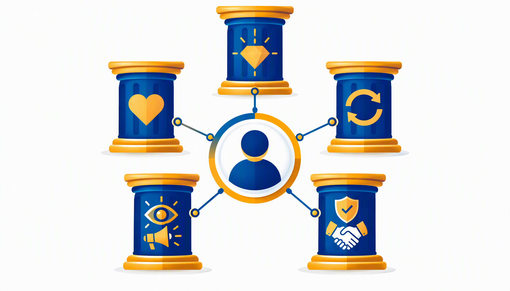
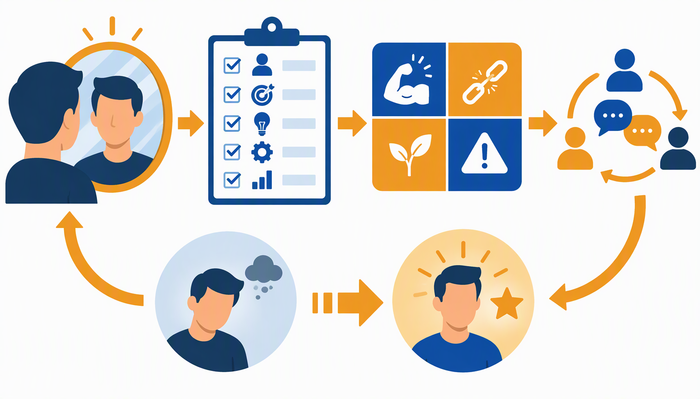
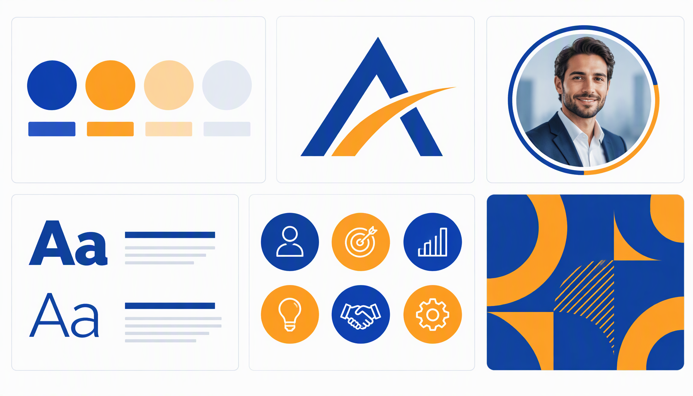
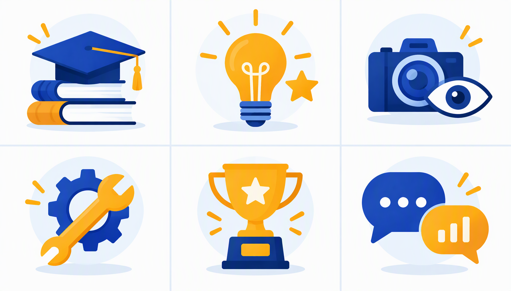
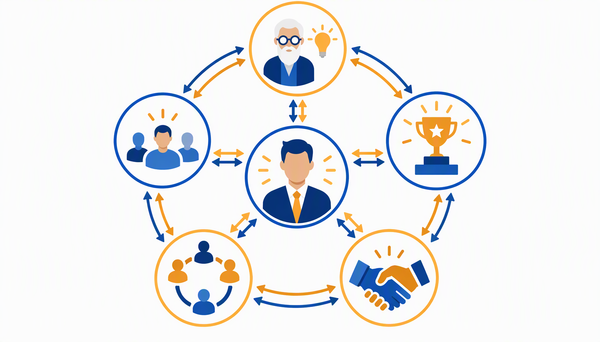
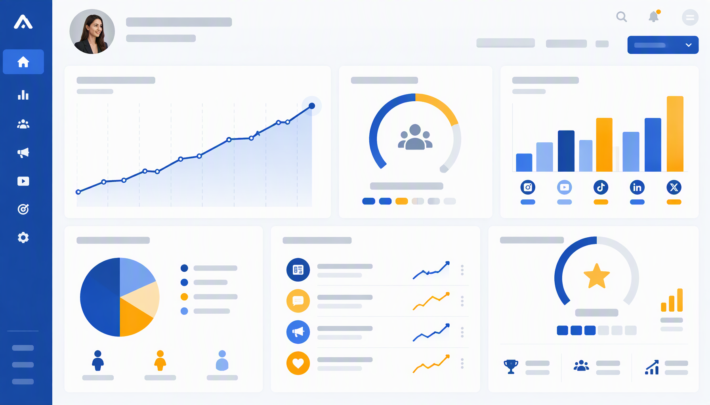
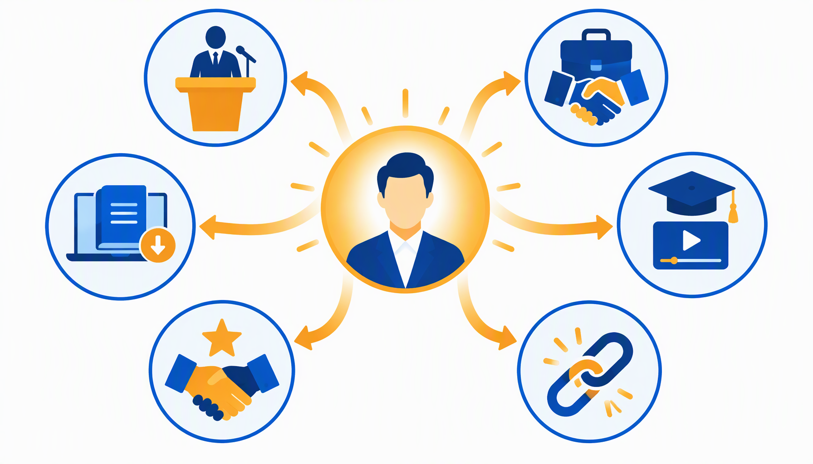
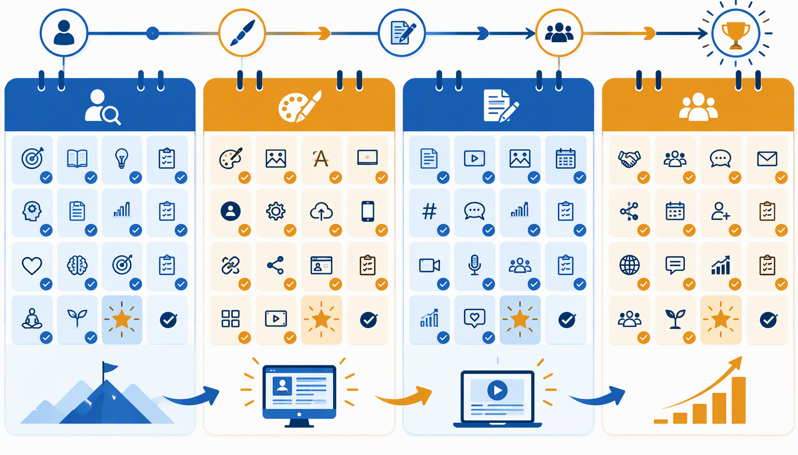

# PANDUAN LENGKAP PERSONAL BRANDING UNTUK UMKM INDONESIA

**Penulis:** Siraj Nur Ihrom
**Edisi:** SNISHOP.COM Edition 2026
**Target Pembaca:** Pemilik dan pengelola UMKM di Indonesia yang ingin membangun personal brand untuk mengembangkan bisnis

---

## DAFTAR ISI

**BAGIAN 1: FONDASI PERSONAL BRANDING**

- Bab 1: Apa Itu Personal Branding dan Mengapa Penting untuk UMKM
- Bab 2: Mengapa UMKM Indonesia Harus Memiliki Personal Brand
- Bab 3: Audit Diri dan Brand Assessment
- Bab 4: Mendefinisikan Identitas Brand dan Nilai-Nilai Inti

**BAGIAN 2: STRATEGI DAN EKSEKUSI**

- Bab 5: Membangun Identitas Visual yang Kuat
- Bab 6: Strategi Konten untuk Personal Branding
- Bab 7: Memilih Platform yang Tepat
- Bab 8: Networking dan Konsistensi Konten

**BAGIAN 3: SCALING DAN MONETISASI**

- Bab 9: Mengukur Keberhasilan dengan Analytics
- Bab 10: Monetisasi dan Scaling Pengaruh Anda

**LENGKAPAN**

- Studi Kasus: Tiga Kisah Sukses Personal Branding Indonesia
- Kalkulator ROI Personal Branding
- Rencana Implementasi 30 Hari

---

# BAGIAN 1: FONDASI PERSONAL BRANDING

---

## BAB 1: APA ITU PERSONAL BRANDING DAN MENGAPA PENTING UNTUK UMKM

### Memahami Personal Branding

Personal branding adalah proses sengaja membentuk dan memengaruhi persepsi publik terhadap seseorang sebagai otoritas di bidangnya. Bagi pelaku UMKM, personal branding bukan sekadar tren media sosial, melainkan strategi bisnis yang membedakan Anda dari ribuan kompetitor serupa.

Tom Peters pertama kali mempopulerkan istilah ini pada tahun 1997 melalui artikelnya di Fast Company. Sejak saat itu, konsep personal branding berkembang dari sekadar teknik karier menjadi fondasi bisnis modern. Di Indonesia, fenomena ini semakin relevan seiring pertumbuhan ekonomi digital yang melampaui 77 miliar dolar AS pada tahun 2025.

Personal branding yang efektif menjawab tiga pertanyaan mendasar dari calon pelanggan Anda:

1. **Siapa Anda?** Identitas yang jelas dan mudah dipahami.
2. **Apa keahlian Anda?** Nilai spesifik yang Anda tawarkan.
3. **Mengapa harus percaya?** Bukti sosial dan rekam jejak yang mendukung.

### Personal Branding vs Brand Perusahaan

Banyak pelaku UMKM bingung membedakan personal branding dengan branding perusahaan. Perbedaan utamanya terletak pada subjek dan skalabilitas.

| Aspek | Personal Brand | Brand Perusahaan |
|-------|---------------|-----------------|
| Subjek | Individu | Organisasi |
| Sifat | Autentik, personal | Terstruktur, korporat |
| Fleksibilitas | Tinggi, adaptif | Terbatas, prosedural |
| Kepercayaan | Berdasarkan hubungan personal | Berdasarkan reputasi institusi |
| Biaya awal | Rendah hingga nol | Membutuhkan investasi signifikan |

Kedua jenis branding ini saling melengkapi. Personal brand pemilik UMKM sering kali menjadi penggerak utama brand perusahaan. Contoh nyata dapat dilihat pada bisnis kuliner di Indonesia, di mana wajah pemilik sering kali menjadi daya tarik utama pelanggan.

### Empat Pilar Personal Branding

Personal branding yang kokoh berdiri di atas empat pilar utama:

**Pilar pertama: Keahlian (Expertise).** Anda harus memiliki kompetensi nyata di bidang yang dipilih. Keahlian ini bukan sekadar klaim, melainkan kemampuan yang bisa dibuktikan melalui hasil kerja, testimoni pelanggan, atau sertifikasi profesional. Seorang pemilik UMKM kopi misalnya, perlu menunjukkan pemahaman mendalam tentang biji kopi, metode penyeduhan, dan cita rasa.

**Pilar kedua: Autentisitas (Authenticity).** Audiens Indonesia sangat peka terhadap kepalsuan. Mereka bisa membedakan konten yang tulus dari yang dibuat-buat. Autentisitas berarti menampilkan diri apa adanya, termasuk mengakui kekurangan dan proses belajar. Ceritakan perjalanan bisnis Anda secara jujur, termasuk kegagalan yang pernah dialami dan pelajaran yang didapat.

**Pilar ketiga: Konsistensi (Consistency).** Personal brand dibangun melalui pengulangan pesan yang konsisten. Ini mencakup konsistensi visual, nada bicara, frekuensi konten, dan nilai yang disampaikan. Pelanggan harus bisa mengenali brand Anda dalam waktu tiga detik melihat konten, baik dari warna, font, maupun gaya bahasa.

**Pilar keempat: Nilai tambah (Value).** Setiap konten dan interaksi harus memberikan nilai bagi audiens. Nilai ini bisa berupa edukasi, hiburan, inspirasi, atau solusi atas masalah yang mereka hadapi. Ketika audiens merasa diuntungkan oleh kehadiran Anda, mereka akan secara alami menjadi pendukung dan promotor brand Anda.

### Mitos Seputar Personal Branding

Sebelum melangkah lebih jauh, penting untuk meluruskan beberapa kesalahpahaman umum:

**Mitos 1: Personal branding hanya untuk selebritas dan influencer.** Kenyataannya, setiap pelaku bisnis bisa dan perlu membangun personal brand. Anda tidak perlu menjadi terkenal terlebih dahulu. Justru personal branding adalah jalan menuju pengenalan publik.

**Mitos 2: Personal branding berarti pamer kekayaan.** Ini adalah distorsi besar. Personal branding yang efektif berfokus pada berbagi pengetahuan, pengalaman, dan nilai. Menampilkan gaya hidup mewah tanpa substansi justru merusak kredibilitas.

**Mitos 3: Personal branding adalah proses instan.** Membangun brand yang kuat membutuhkan waktu minimal enam bulan hingga dua tahun. Kesabaran dan konsistensi adalah kunci utama.

**Mitos 4: Personal branding hanya untuk bisnis B2C.** Pelaku bisnis B2B justru sangat diuntungkan oleh personal branding. Keputusan pembelian B2B di Indonesia sangat dipengaruhi oleh kepercayaan personal terhadap individu di balik perusahaan.

**Mitos 5: Saya terlalu kecil untuk punya personal brand.** Setiap bisnis dimulai dari skala kecil. Personal branding justru menjadi alat untuk tumbuh dari kecil menjadi besar. Banyak pengusaha sukses Indonesia yang memulai dari nol dan membangun brand secara bertahap.

---

## BAB 2: MENGAPA UMKM INDONESIA HARUS MEMILIKI PERSONAL BRAND

### Lanskap Bisnis Digital Indonesia

Indonesia memiliki lebih dari 64 juta UMKM yang menyumbang 61 persen terhadap Produk Domestik Bruto nasional. Di tengah persaingan ketat ini, personal branding menjadi diferensiator paling efektif yang tidak memerlukan modal besar.

Perilaku konsumen Indonesia telah berubah secara drastis. Riset menunjukkan bahwa 78 persen konsumen Indonesia melakukan riset online sebelum melakukan pembelian. Mereka tidak hanya mencari produk, tetapi juga mencari sosok di balik produk tersebut. Kepercayaan terhadap individu sering kali melebihi kepercayaan terhadap merek korporat.

### Lima Alasan Strategis Personal Branding untuk UMKM

**Alasan pertama: Diferensiasi di pasar yang jenuh.** Ketika ratusan UMKM menawarkan produk serupa, personal brand menjadi pembeda utama. Pelanggan tidak lagi memilih berdasarkan harga semata, tetapi berdasarkan hubungan emosional dan kepercayaan terhadap sosok di balik bisnis. Contoh, dua kedai kopi di jalan yang sama bisa menjual produk identik dengan harga bersaing. Yang membuat pelanggan memilih satu atas yang lain adalah karakter dan cerita yang dibangun pemiliknya.

**Alasan kedua: Kepercayaan sebagai mata uang baru.** Konsumen Indonesia sangat mengutamakan kepercayaan dalam bertransaksi. Survei Edelman Trust Barometer menunjukkan bahwa 67 persen responden Indonesia lebih percaya pada individu yang kompeten daripada merek besar. Personal brand memungkinkan Anda membangun kepercayaan ini secara sistematis melalui konten yang edukatif dan transparan.

**Alasan ketiga: Efisiensi biaya pemasaran.** Dibandingkan iklan berbayar yang membutuhkan anggaran besar dan berhenti menghasilkan begitu dana dihentikan, personal brand adalah aset jangka panjang. Konten yang Anda buat hari ini bisa terus mendatangkan pelanggan baru berbulan-bulan bahkan bertahun-tahun ke depan. Ini adalah investasi, bukan pengeluaran.

**Alasan keempat: Ketahanan bisnis.** Bisnis yang bergantung pada satu saluran pemasaran sangat rentan terhadap perubahan algoritma atau kebijakan platform. Personal brand yang kuat menciptakan komunitas loyal yang mengikuti Anda ke mana pun Anda pergi, baik itu platform baru, perubahan bisnis, atau bahkan krisis.

**Alasan kelima: Peluang kolaborasi dan kemitraan.** Personal brand yang terpositioning dengan baik menarik peluang kolaborasi dari berbagai pihak. Brand besar, media, penyelenggara acara, dan sesama pengusaha akan secara proaktif mencari Anda untuk kerja sama yang saling menguntungkan.

### Personal Branding dalam Konteks Budaya Indonesia

Budaya bisnis Indonesia memiliki karakteristik unik yang memengaruhi strategi personal branding:

**Budaya kekeluargaan.** Masyarakat Indonesia menghargai pendekatan personal dan kekeluargaan. Personal brand yang menampilkan sisi humanis, cerita keluarga, dan nilai-nilai kebersamaan akan lebih mudah diterima. Tunjukkan bahwa di balik bisnis Anda ada manusia nyata dengan nilai dan prinsip yang sama dengan pelanggan.

**Budaya hormat dan sopan santun.** Nada komunikasi dalam personal branding Indonesia perlu memperhatikan etika kesopanan. Ini bukan berarti tidak bisa tampil berani, tetapi cara penyampaian harus tetap menghormati audiens. Kritik terhadap kompetitor, misalnya, lebih baik disampaikan melalui perbandingan edukatif daripada serangan langsung.

**Budaya lisan dan cerita.** Indonesia memiliki tradisi lisan yang kuat. Storytelling menjadi senjata utama dalam personal branding. Ceritakan asal-usul bisnis, tantangan yang dihadapi, momen-momen breakthrough, dan visi ke depan. Audiens Indonesia sangat responsif terhadap narasi yang autentik dan menginspirasi.

**Gotong royong.** Nilai kolaborasi dan saling membantu sangat mengakar dalam budaya Indonesia. Personal brand yang menunjukkan semangat gotong royong, misalnya melalui program pemberdayaan komunitas atau berbagi ilmu secara gratis, akan mendapatkan simpati dan dukungan audiens.

### Kapan Harus Mulai?

Jawabannya sederhana: sekarang. Setiap hari Anda menunda, kompetitor lain sedang membangun brand mereka. Kabar baiknya, memulai di era digital ini tidak pernah semudah sekarang. Anda hanya membutuhkan ponsel, koneksi internet, dan keberanian untuk tampil. Tidak perlu peralatan mahal atau tim profesional di awal perjalanan.

---

## BAB 3: AUDIT DIRI DAN BRAND ASSESSMENT

### Mengapa Audit Diri Penting

Sebelum membangun personal brand, Anda perlu memahami posisi awal Anda. Audit diri adalah proses evaluasi menyeluruh terhadap siapa Anda saat ini, apa yang Anda tawarkan, dan bagaimana persepsi orang lain terhadap Anda. Tanpa audit ini, strategi branding Anda akan kehilangan arah dan fondasi.

### Langkah 1: Inventarisasi Keahlian dan Pengalaman

Mulailah dengan membuat daftar lengkap keahlian Anda. Gunakan kerangka berikut:

**Keahlian teknis (Hard Skills).** Catat semua kemampuan teknis yang relevan dengan bisnis Anda. Seorang pemilik UMKM fashion misalnya, bisa mencantumkan pemahaman tentang tekstil, desain pola, teknik jahit, manajemen produksi, dan tren mode.

**Keahlian interpersonal (Soft Skills).** Identifikasi kemampuan sosial yang mendukung bisnis Anda. Kepemimpinan, komunikasi, negosiasi, empati, dan kemampuan memecahkan masalah adalah contoh soft skills yang sangat bernilai dalam personal branding.

**Pengalaman unik.** Setiap orang memiliki pengalaman yang membedakan mereka dari orang lain. Mungkin Anda pernah bekerja di industri tertentu, menyelesaikan proyek luar biasa, atau mengatasi tantangan bisnis yang tidak biasa. Pengalaman-pengalaman ini adalah bahan cerita yang sangat berharga.

**Pencapaian terukur.** Kumpulkan data pencapaian Anda. Berapa pelanggan yang sudah dilayani? Berapa pendapatan yang dihasilkan? Berapa banyak produk yang sudah dibuat? Angka konkret memberikan kredibilitas yang jauh lebih kuat daripada klaim umum.

### Langkah 2: Analisis SWOT Personal

Terapkan analisis SWOT yang biasa digunakan dalam bisnis untuk mengevaluasi diri Anda:

**Strengths (Kekuatan).** Apa yang Anda lakukan lebih baik dari kebanyakan orang di industri Anda? Apa sumber daya unik yang Anda miliki? Apa yang sering dipuji orang dari Anda? Tuliskan minimal lima kekuatan utama.

**Weaknesses (Kelemahan).** Area apa yang perlu diperbaiki? Keterampilan apa yang masih kurang? Kebiasaan apa yang menghambat kemajuan Anda? Jujurlah dalam mengidentifikasi kelemahan, karena kesadaran adalah langkah pertama menuju perbaikan.

**Opportunities (Peluang).** Tren apa di industri Anda yang bisa dimanfaatkan? Kesenjangan apa di pasar yang bisa Anda isi? Jaringan apa yang bisa Anda akses? Identifikasi minimal tiga peluang yang realistis.

**Threats (Ancaman).** Siapa kompetitor utama Anda? Perubahan apa di industri yang bisa mengancam bisnis? Apa risiko terbesar yang dihadapi? Memahami ancaman memungkinkan Anda mempersiapkan strategi mitigasi.

### Langkah 3: Memahami Persepsi Saat Ini

Bagaimana orang lain memandang Anda saat ini? Untuk menjawab ini, kumpulkan umpan balik dari beberapa sumber:

**Umpan balik langsung.** Tanyakan kepada lima hingga sepuluh orang terdekat, termasuk pelanggan, rekan bisnis, dan teman, tentang kesan pertama mereka terhadap Anda. Apa yang mereka anggap sebagai kekuatan utama Anda? Dalam hal apa mereka akan merekomendasikan Anda?

**Jejak digital.** Cari nama Anda di Google dan semua platform media sosial. Apa yang muncul? Apakah hasil pencarian mencerminkan citra yang ingin Anda bangun? Catat semua temuan Anda sebagai baseline untuk perbaikan.

**Jejak offline.** Bagaimana reputasi Anda di komunitas lokal, asosiasi bisnis, atau kelompok sosial? Reputasi offline sering kali menjadi fondasi bagi persepsi online.

### Langkah 4: Menentukan Positioning

Berdasarkan hasil audit, rumuskan positioning statement Anda menggunakan formula ini:

"Saya membantu [target audiens spesifik] untuk [masalah yang diselesaikan] melalui [keahlian unik Anda] sehingga [hasil yang dijanjikan]."

Contoh positioning untuk beberapa jenis UMKM:

- "Saya membantu ibu rumah tangga di kota kecil untuk memulai bisnis kuliner rumahan yang menguntungkan melalui resep-resep praktis dan bimbingan pemasaran digital."
- "Saya membantu pemilik toko pakaian untuk mengelola inventaris dan meningkatkan penjualan melalui sistem kasir digital yang mudah digunakan."
- "Saya membantu petani muda untuk mengoptimalkan hasil panen melalui teknologi pertanian sederhana dan pendampingan agronomi."

Positioning yang baik harus spesifik, realistis, dan berbeda dari kompetitor. Hindari positioning yang terlalu umum seperti "Saya membantu semua orang dalam segala hal."

### Langkah 5: Menetapkan Tujuan Brand

Tentukan apa yang ingin Anda capai melalui personal branding Anda dalam 12 bulan ke depan. Tujuan ini harus mengikuti kerangka SMART:

**Specific (Spesifik).** Jelaskan secara detail apa yang ingin dicapai. Bukan "ingin terkenal," melainkan "ingin dikenal sebagai ahli kopi specialty di Jawa Barat."

**Measurable (Terukur).** Tentukan indikator kuantitatif. Berapa jumlah followers yang ditargetkan? Berapa engagement rate? Berapa leads yang ingin dihasilkan?

**Achievable (Dapat dicapai).** Tujuan harus ambisius namun realistis. Meningkatkan followers dari 100 menjadi 100.000 dalam sebulan tidak realistis, tetapi menjadi 1.000 dalam enam bulan sangat mungkin.

**Relevant (Relevan).** Tujuan brand harus selaras dengan tujuan bisnis secara keseluruhan. Jika tujuan bisnis adalah meningkatkan penjualan produk, maka tujuan brand harus mendukung hal tersebut.

**Time-bound (Berbatas waktu).** Tetapkan deadline yang jelas untuk setiap tujuan. Tanpa tenggat waktu, tujuan hanya menjadi harapan tanpa dorongan untuk bertindak.

---

## BAB 4: MENDIFINISIKAN IDENTITAS BRAND DAN NILAI-NILAI INTI

### Identitas Brand Lebih dari Sekadar Logo

Banyak pelaku UMKM menganggap identitas brand sebatas logo dan warna. Padahal, identitas brand mencakup keseluruhan persepsi yang ingin Anda tanamkan di benak audiens. Ini termasuk suara, nada bicara, nilai yang diperjuangkan, pengalaman yang dijanjikan, dan bahkan emosi yang ingin dibangkitkan.

### Lima Elemen Identitas Brand

**Elemen 1: Archetype Brand.** Carl Jung mengidentifikasi dua belas archetype kepribadian yang bisa diterapkan dalam branding. Memilih archetype yang tepat membantu Anda membangun karakter brand yang konsisten dan mudah dikenali.

Dua belas archetype tersebut adalah:

- **The Innocent (Si Polos).** Optimis, jujur, sederhana. Cocok untuk brand yang menekankan kejujuran dan ketulusan. Contoh: UMKM produk organik yang menekankan kemurnian bahan.
- **The Explorer (Si Penjelajah).** Petualang, mandiri, berani. Cocok untuk brand yang mendorong inovasi dan keberanian. Contoh: UMKM outdoor gear atau travel lokal.
- **The Sage (Si Bijaksana).** Analitis, berpengetahuan luas, reflektif. Cocok untuk brand edukasi dan konsultasi. Contoh: UMKM konsultan bisnis atau kursus online.
- **The Hero (Si Pahlawan).** Berani, tangguh, inspiratif. Cocok untuk brand yang memotivasi dan memberdayakan. Contoh: UMKM fitness atau pelatihan kepemimpinan.
- **The Outlaw (Si Pemberontak).** Revolusioner, berani, tidak konvensional. Cocok untuk brand yang mendobrak status quo. Contoh: UMKM fashion alternatif atau startup teknologi disruptif.
- **The Magician (Si Pesulap).** Visioner, karismatik, transformatif. Cocok untuk brand yang menjanjikan perubahan ajaib. Contoh: UMKM produk kecantikan atau wellness.
- **The Everyman (Si Rakyat Biasa).** Rendah hati, relatable, apa adanya. Cocok untuk brand yang menekankan kedekatan dengan masyarakat. Contoh: UMKM kuliner tradisional atau warung keluarga.
- **The Lover (Si Pencinta).** Romantis, sensual, penuh gairah. Cocok untuk brand yang menekankan keindahan dan kenikmatan. Contoh: UMKM cokelat artisan atau bunga.
- **The Jester (Si Pelawak).** Humoris, ceria, menghibur. Cocok untuk brand yang menggunakan humor sebagai diferensiator. Contoh: UMKM merchandise lucu atau konten hiburan.
- **The Caregiver (Si Pengasuh).** Peduli, protektif, murah hati. Cocok untuk brand yang menekankan pelayanan dan kepedulian. Contoh: UMKM produk bayi atau layanan kesehatan.
- **The Creator (Si Pencipta).** Kreatif, imajinatif, inovatif. Cocok untuk brand yang menekankan orisinalitas dan karya. Contoh: UMKM kerajinan tangan atau desain.
- **The Ruler (Si Penguasa).** Berwibawa, terkendali, bertanggung jawab. Cocok untuk brand yang menekankan kepemimpinan dan kualitas premium. Contoh: UMKM produk luxury atau konsultan eksekutif.

Pilih satu archetype utama yang paling merepresentasikan diri Anda dan bisnis Anda. Archetype ini akan menjadi panduan untuk semua keputusan branding selanjutnya, mulai dari gaya komunikasi hingga visual yang digunakan.

**Elemen 2: Suara dan Nada Bicara (Voice and Tone).** Bagaimana cara Anda berkomunikasi dengan audiens? Apakah formal dan profesional, atau santai dan akrab? Apakah humoris atau serius? Apakah menggunakan bahasa Indonesia baku atau campuran bahasa sehari-hari?

Untuk konteks UMKM Indonesia, beberapa pendekatan yang efektif:

- **Gaya bercerita (storytelling).** Gunakan pendekatan naratif dalam setiap komunikasi. Ceritakan pengalaman, pelajaran, dan perjalanan bisnis dengan bahasa yang mudah dipahami.
- **Bahasa yang inklusif.** Gunakan sapaan yang membuat audiens merasa diterima dan dihargai. Istilah seperti "Teman-teman," "Sahabat," atau "Rekan UMKM" menciptakan kedekatan.
- **Konsistensi lintas platform.** Gaya bicara Anda di Instagram harus sama dengan di LinkedIn, WhatsApp, atau saat bertemu langsung. Inkonsistensi menciptakan kebingungan dan mengurangi kepercayaan.

**Elemen 3: Nilai-Nilai Inti (Core Values).** Tentukan tiga hingga lima nilai yang menjadi fondasi brand Anda. Nilai-nilai ini harus autentik dan tercermin dalam setiap tindakan Anda. Contoh nilai inti untuk UMKM:

- Kejujuran dan transparansi dalam berbisnis
- Kualitas di atas kuantitas
- Kepedulian terhadap lingkungan dan komunitas
- Inovasi berkelanjutan
- Pelayanan yang memanusiakan pelanggan

**Elemen 4: Unique Selling Proposition (USP).** Apa yang membuat Anda benar-benar berbeda dari kompetitor? USP bukan sekadar klaim "kami yang terbaik," melainkan perbedaan spesifik yang bisa dibuktikan. Rumuskan USP Anda dalam satu kalimat yang mudah diingat.

**Elemen 5: Brand Promise.** Apa janji Anda kepada pelanggan? Janji ini harus spesifik, realistis, dan bisa ditepati secara konsisten. Brand promise menjadi standar yang Anda tetapkan untuk diri sendiri dan menjadi acuan pelanggan dalam mengevaluasi Anda.

### Menyusun Brand Story

Cerita brand adalah narasi yang menghubungkan semua elemen identitas menjadi satu kesatuan yang bermakna. Brand story yang efektif memiliki struktur berikut:

**Asal-usul (Origin).** Bagaimana bisnis Anda dimulai? Apa motivasi di baliknya? Cerita asal-usul yang jujur dan relatable menciptakan ikatan emosional dengan audiens. Tidak perlu cerita yang dramatis, yang penting autentik.

**Perjuangan (Struggle).** Tantangan apa yang pernah Anda hadapi? Bagaimana Anda mengatasinya? Kerentanan yang ditampilkan dengan tepat justru memperkuat koneksi dengan audiens. Orang lebih mudah terhubung dengan seseorang yang pernah jatuh dan bangkit daripada yang selalu tampil sempurna.

**Transformasi (Transformation).** Bagaimana bisnis dan diri Anda berubah dari waktu ke waktu? Apa pelajaran terbesar yang didapat? Narasi transformasi menunjukkan bahwa Anda terus berkembang dan belajar.

**Visi (Vision).** Ke mana Anda ingin membawa bisnis dan audiens Anda? Visi yang inspiratif membuat orang ingin menjadi bagian dari perjalanan Anda.

### Latihan Praktis: Menyusun Brand Identity Canvas

Ambil selembar kertas atau buka dokumen baru, dan isi elemen-elemen berikut:

1. **Nama personal brand:** (bisa nama asli atau nama yang diposisikan)
2. **Tagline:** (satu kalimat yang merangkum siapa Anda)
3. **Archetype utama:** (pilih satu dari dua belas archetype di atas)
4. **Tiga nilai inti:** (prinsip yang tidak bisa ditawar)
5. **USP:** (satu hal yang membedakan Anda dari semua orang)
6. **Brand promise:** (janji spesifik kepada audiens)
7. **Target audiens:** (siapa yang ingin Anda layani, sedetail mungkin)
8. **Suara brand:** (tiga kata yang menggambarkan gaya komunikasi Anda)
9. **Warna brand:** (dua hingga tiga warna yang merepresentasikan Anda)
10. **Visi lima tahun:** (di mana Anda ingin berada lima tahun dari sekarang)

Isi setiap elemen dengan jujur dan spesifik. Canvas ini akan menjadi peta panduan untuk semua aktivitas branding Anda selanjutnya.

---

# BAGIAN 2: STRATEGI DAN EKSEKUSI

---

## BAB 5: MEMBANGUN IDENTITAS VISUAL YANG KUAT

### Mengapa Visual Itu Penting

Manusia memproses informasi visual 60.000 kali lebih cepat daripada teks. Dalam konteks personal branding di media sosial, Anda hanya memiliki waktu kurang dari tiga detik untuk menarik perhatian audiens. Identitas visual yang kuat memastikan tiga detik tersebut tidak terbuang sia-sia.

### Elemen-Elemen Identitas Visual

**Palet Warna.** Pilih dua hingga empat warna yang akan menjadi ciri khas brand Anda. Warna memengaruhi emosi dan persepsi secara subconscious. Berikut panduan psikologi warna untuk konteks Indonesia:

- **Merah:** Energi, keberanian, semangat. Cocok untuk brand makanan dan minuman karena merah merangsang nafsu makan.
- **Biru:** Kepercayaan, profesionalisme, ketenangan. Banyak digunakan oleh brand jasa dan konsultasi.
- **Hijau:** Alam, kesehatan, pertumbuhan. Ideal untuk brand produk organik, wellness, atau edukasi.
- **Kuning:** Kebahagiaan, optimisme, kehangatan. Efektif untuk brand yang ingin tampil ceria dan ramah.
- **Hitam:** Kemewahan, elegansi, kekuatan. Cocok untuk brand premium atau luxury.
- **Putih:** Kesucian, kebersihan, kesederhanaan. Sering digunakan sebagai warna latar untuk memberikan ruang napas visual.

Pastikan palet warna Anda konsisten di semua platform dan materi komunikasi. Gunakan warna utama untuk elemen paling penting dan warna sekunder untuk aksen.

**Tipografi.** Font yang Anda pilih menyampaikan pesan tentang karakter brand Anda. Secara umum, font terbagi dalam beberapa kategori:

- **Serif** (contoh: Times New Roman, Georgia): Memberikan kesan tradisional, elegan, dan terpercaya.
- **Sans-serif** (contoh: Arial, Helvetica, Open Sans): Memberikan kesan modern, bersih, dan mudah dibaca di layar digital.
- **Script** (contoh: Pacifico, Dancing Script): Memberikan kesan personal, kreatif, dan hangat. Gunakan dengan hemat karena sulit dibaca dalam teks panjang.
- **Display** (contoh: Bebas Neue, Montserrat Bold): Memberikan kesan berani dan menonjol. Cocok untuk judul dan heading.

Pilih maksimal dua font: satu untuk judul dan satu untuk teks isi. Konsistensi tipografi memperkuat pengenalan brand.

**Gaya Fotografi.** Tentukan arah visual untuk semua foto dan gambar yang Anda publikasikan. Apakah Anda lebih suka foto yang terang dan bersih, gelap dan dramatis, hangat dan vintage, atau berwarna dan pop? Buat panduan sederhana yang bisa Anda ikuti setiap kali membuat konten visual.

Beberapa prinsip fotografi untuk personal brand UMKM Indonesia:

- Gunakan pencahayaan alami sebanyak mungkin. Cahaya matahari pagi (jam 7 hingga 9) dan sore (jam 4 hingga 6) menghasilkan kualitas terbaik.
- Jaga kebersihan latar belakang. Background yang berantakan mengalihkan perhatian dari pesan utama.
- Tampilkan wajah Anda secara konsisten. Audiens membangun kepercayaan melalui kontak mata dan ekspresi wajah.
- Gunakan filter atau preset yang sama untuk semua foto. Konsistensi visual menciptakan kesan profesional.

**Logo Personal.** Meskipun tidak wajib, logo personal bisa memperkuat identitas brand Anda. Logo ini bisa berupa monogram dari inisial nama, ilustrasi wajah sederhana, atau simbol yang merepresentasikan nilai brand. Jika anggaran terbatas, Anda bisa membuat logo sederhana menggunakan alat desain gratis seperti Canva.

### Membuat Template Konten Visual

Untuk menjaga konsistensi tanpa harus mendesain dari nol setiap kali, buatlah template konten:

**Template Instagram Feed.** Siapkan tiga hingga lima template berbeda untuk jenis konten yang berbeda: kutipan inspiratif, tips edukatif, promosi produk, cerita pribadi, dan testimoni pelanggan. Setiap template harus menggunakan palet warna dan tipografi brand Anda.

**Template Instagram Story.** Story template biasanya lebih santai dan interaktif. Siapkan template untuk polling, tanya jawab, countdown, dan share konten.

**Template Presentasi.** Jika Anda sering memberikan presentasi atau webinar, siapkan template slide yang konsisten. Template ini mencerminkan profesionalisme dan memudahkan audiens mengenali brand Anda.

**Template Dokumen.** Untuk proposal, invoice, atau dokumen bisnis lainnya, gunakan header dan footer yang mencantumkan identitas brand Anda.

### Alat Desain untuk Non-Desainer

Anda tidak perlu menjadi desainer profesional untuk menciptakan visual yang menarik. Beberapa alat yang bisa digunakan:

- **Canva.** Platform desain paling populer dengan ribuan template gratis. Canva memiliki antarmuka drag-and-drop yang sangat mudah digunakan, bahkan untuk pemula. Versi Pro menyediakan fitur tambahan seperti background remover dan brand kit.
- **Adobe Express.** Alternatif dari Adobe yang menawarkan template berkualitas tinggi dan terintegrasi dengan ekosistem Adobe.
- **Figma.** Alat desain kolaboratif yang lebih advanced namun tetap bisa digunakan untuk keperluan personal branding. Figma gratis untuk penggunaan individu.
- **CapCut.** Untuk editing video pendek, CapCut menyediakan fitur yang lengkap dan mudah digunakan, termasuk template yang siap pakai.

---

## BAB 6: STRATEGI KONTEN UNTUK PERSONAL BRANDING

### Konten Adalah Jantung Personal Branding

Jika personal branding adalah bangunan, maka konten adalah batu batanya. Tanpa konten yang berkualitas dan konsisten, brand Anda tidak akan terbentuk. Strategi konten yang baik memastikan setiap piece konten yang Anda buat memiliki tujuan, menjangkau audiens yang tepat, dan berkontribusi pada pencapaian tujuan bisnis.

### Kerangka Konten 80/20

Aturan 80/20 dalam personal branding berarti:

- **80 persen konten bernilai.** Edukasi, inspirasi, hiburan, tips, cerita pengalaman, behind the scene. Konten ini tidak menjual secara langsung tetapi membangun kepercayaan dan otoritas.
- **20 persen konten promosi.** Penawaran produk, layanan, atau ajakan bertindak. Konten ini secara eksplisit mengajak audiens untuk menjadi pelanggan.

Mengapa tidak 100 persen promosi? Karena audiens media sosial tidak ingin terus-menerus dijual. Mereka ingin mendapatkan nilai dari setiap konten yang mereka konsumsi. Jika Anda terus-menerus mempromosikan produk tanpa memberikan nilai, audiens akan berhenti mengikuti Anda.

### Enam Jenis Konten Pilar

Tetapkan enam pilar konten yang menjadi fondasi strategi Anda. Setiap pilar mewakili topik atau tema yang akan Anda bahas secara konsisten. Contoh pilar konten untuk UMKM kopi:

1. **Edukasi kopi.** Cara menyeduh, mengenal jenis biji, perbedaan metode roasting.
2. **Behind the scene.** Proses produksi, keseharian di kedai, perjalanan ke petani.
3. **Cerita pelanggan.** Testimoni, momen spesial pelanggan di kedai Anda.
4. **Tips bisnis UMKM.** Pengalaman menjalankan bisnis kopi, pelajaran yang didapat.
5. **Tren dan budaya.** Perkembangan industri kopi, budaya ngopi di Indonesia.
6. **Promosi.** Menu baru, penawaran khusus, event yang akan datang.

### Format Konten yang Efektif

Setiap platform memiliki format konten yang paling efektif. Berikut panduan umum:

**Konten edukasi (Carousel/Thread).** Format ini ideal untuk menyampaikan informasi step-by-step. Di Instagram, carousel dengan 5 hingga 10 slide sangat efektif. Di Twitter/X, thread dengan 5 hingga 15 tweet bekerja dengan baik. Pastikan slide atau tweet pertama menarik perhatian dan memancing audiens untuk melanjutkan membaca.

**Konten video pendek (Reels/TikTok/Shorts).** Video pendek berdurasi 15 hingga 60 detik adalah format dengan jangkauan organik tertinggi saat ini. Gunakan video pendek untuk tips cepat, behind the scene, atau momen inspiratif. Tiga detik pertama sangat krusial karena menentukan apakah audiens akan terus menonton atau scroll melewati konten Anda.

**Konten cerita (Caption panjang/Newsletter).** Cerita panjang yang mendalam cocok untuk membangun koneksi emosional. Di Instagram, caption panjang dengan storytelling yang kuat bisa menghasilkan engagement yang tinggi. Alternatifnya, newsletter mingguan melalui Substack atau platform email marketing memungkinkan Anda menyampaikan cerita yang lebih komprehensif.

**Konten interaktif (Polling/Q&A/Live).** Format ini melibatkan audiens secara langsung. Instagram Story polling, Q&A session, dan live streaming adalah cara efektif untuk membangun komunitas dan mendapatkan umpan balik langsung. Konten interaktif juga meningkatkan algoritma karena platform menilai audiens Anda aktif dan engaged.

**Konten user-generated (Testimoni/Review).** Biarkan pelanggan Anda menjadi promotor. Repost konten yang dibuat pelanggan tentang produk atau layanan Anda. Testimoni nyata jauh lebih persuasif daripada klaim sendiri.

**Konten kurasi (Repost/Share).** Bagikan konten relevan dari sumber terpercaya dengan menambahkan perspektif Anda sendiri. Ini menunjukkan bahwa Anda aktif mengikuti perkembangan industri dan bersedia mengakui keahlian orang lain.

### Kalender Konten

Konsistensi adalah kunci dalam personal branding. Buat kalender konten untuk memastikan Anda memiliki rencana yang terstruktur:

**Frekuensi minimum yang disarankan:**

- Instagram Feed: 3 hingga 5 kali per minggu
- Instagram Story: 3 hingga 7 kali per hari (bisa berupa repost atau konten ringan)
- TikTok: 1 hingga 2 kali per hari
- LinkedIn: 3 hingga 5 kali per minggu
- YouTube: 1 hingga 2 kali per minggu (video panjang)
- YouTube Shorts: 3 hingga 5 kali per minggu

**Rutinitas mingguan yang disarankan:**

- Senin: Konten edukasi (tips atau tutorial)
- Selasa: Behind the scene atau cerita pribadi
- Rabu: Konten interaktif (polling, Q&A, atau quiz)
- Kamis: Testimoni pelanggan atau studi kasus
- Jumat: Konten promosi (penawaran atau peluncuran produk)
- Sabtu: Konten ringan atau hiburan yang relevan
- Minggu: Refleksi mingguan atau rencana ke depan

### Teknik Copywriting untuk Konten Personal Brand

Kemampuan menulis copy yang menarik sama pentingnya dengan visual yang bagus. Berikut teknik yang bisa langsung diterapkan:

**Formula AIDA (Attention, Interest, Desire, Action).**
- Attention: Kalimat pertama harus memikat. Gunakan angka, pertanyaan provokatif, atau pernyataan kontroversial.
- Interest: Paragraf kedua mengembangkan ketertarikan dengan fakta atau cerita yang relevan.
- Desire: Bangun keinginan dengan menunjukkan manfaat dan hasil yang bisa didapat.
- Action: Tutup dengan ajakan bertindak yang jelas dan spesifik.

**Formula PAS (Problem, Agitate, Solution).**
- Problem: Identifikasi masalah yang dihadapi audiens.
- Agitate: Perbesar masalah dengan menunjukkan konsekuensi jika tidak ditangani.
- Solution: Tawarkan solusi yang Anda miliki sebagai jawaban atas masalah tersebut.

**Formula StoryBrand.**
- Karakter: Audiens Anda adalah pahlawan cerita.
- Masalah: Identifikasi tantangan yang mereka hadapi.
- Guide: Anda adalah pemandu yang membantu mereka.
- Plan: Berikan langkah-langkah jelas.
- Call to Action: Ajak mereka mengambil langkah pertama.

### Konten Lokal yang Relevan

Untuk audiens Indonesia, konten yang mengangkat kearifan lokal dan konteks sehari-hari akan lebih mudah diterima. Beberapa ide:

- Ceritakan pengalaman berbisnis di Indonesia dengan segala tantangan uniknya.
- Bahas tradisi dan budaya lokal yang relevan dengan bisnis Anda.
- Gunakan bahasa Indonesia yang baik namun tetap santai dan mudah dipahami.
- Angkat isu-isu yang sedang tren di masyarakat Indonesia.
- Libatkan audiens dengan pertanyaan yang relevan dengan kehidupan sehari-hari mereka.

---

## BAB 7: MEMILIH PLATFORM YANG TEPAT

### Lanskap Platform Digital di Indonesia

Tidak semua platform media sosial cocok untuk setiap personal brand. Memilih platform yang tepat sama pentingnya dengan menciptakan konten yang berkualitas. Fokus pada dua hingga tiga platform utama dan kuasai mereka sebelum berekspansi ke platform lain.

### Panduan Platform Utama

**Instagram.**

Instagram tetap menjadi platform visual paling populer di Indonesia dengan lebih dari 100 juta pengguna aktif. Platform ini ideal untuk personal brand yang mengandalkan estetika visual, seperti fashion, kuliner, kecantikan, travel, dan gaya hidup.

Fitur-fitur kunci Instagram untuk personal branding:
- Feed untuk konten utama yang terkurasi.
- Stories untuk konten harian yang lebih casual dan interaktif.
- Reels untuk video pendek dengan jangkauan organik tinggi.
- Live untuk interaksi real-time dengan audiens.
- Guides untuk mengkurasi konten edukatif.

Strategi Instagram untuk UMKM:
- Posting secara konsisten, minimal tiga kali seminggu.
- Gunakan hashtag yang relevan dan spesifik, campuran antara hashtag populer dan niche.
- Respon semua komentar dan direct message untuk membangun hubungan.
- Kolaborasi dengan akun lain melalui fitur Collab.
- Manfaatkan Instagram Shopping jika Anda menjual produk fisik.

**TikTok.**

TikTok telah menjadi fenomena global dengan lebih dari 127 juta pengguna di Indonesia. Algoritma TikTok yang unik memungkinkan konten dari akun baru untuk mendapatkan jutaan views tanpa followers terlebih dahulu. Ini menjadikannya platform ideal untuk membangun personal brand dari nol.

Karakteristik konten TikTok yang sukses:
- Durasi pendek, 15 hingga 60 detik untuk konten awal.
- Hook dalam tiga detik pertama untuk mencegah audiens scroll.
- Musik dan sound trending sebagai latar.
- Gaya autentik dan tidak terlalu diproduksi.
- Konten yang menghibur sekaligus mendidik (edutainment).

Strategi TikTok untuk personal branding UMKM:
- Ikuti tren yang relevan dengan niche Anda dan tambahkan perspektif unik.
- Buat seri konten yang membuat audiens kembali untuk episode selanjutnya.
- Gunakan fitur duet dan stitch untuk berkolaborasi dengan kreator lain.
- Posting pada jam prime time Indonesia, yaitu pukul 12.00 hingga 13.00 dan 19.00 hingga 21.00 WIB.
- Konsisten posting minimal satu kali sehari di fase awal pembangunan brand.

**LinkedIn.**

LinkedIn adalah platform profesional yang sering diabaikan oleh pelaku UMKM Indonesia. Padahal, LinkedIn sangat powerful untuk personal branding B2B, konsultasi, dan positioning sebagai thought leader.

Konten LinkedIn yang efektif:
- Artikel panjang tentang insight industri.
- Cerita pembelajaran dari pengalaman bisnis.
- Posting tentang tren dan analisis pasar.
- Testimoni dan rekomendasi dari klien atau rekan bisnis.
- Pencapaian dan milestone bisnis.

Strategi LinkedIn untuk UMKM:
- Lengkapi profil secara menyeluruh, termasuk foto profesional, headline yang jelas, dan ringkasan yang menarik.
- Terbitkan artikel LinkedIn Pulse minimal dua kali sebulan.
- Aktif berkomentar pada posting orang lain di industri Anda.
- Bangun jaringan dengan profesional dan pelaku bisnis lain.
- Gunakan fitur LinkedIn Newsletter untuk konten rutin.

**YouTube.**

YouTube adalah platform video jangka panjang yang memiliki kekuatan luar biasa dalam membangun otoritas dan kepercayaan. Konten YouTube bersifat evergreen, artinya video yang Anda buat hari ini bisa terus menghasilkan views dan subscribers bertahun-tahun ke depan.

Jenis konten YouTube untuk personal branding UMKM:
- Tutorial dan how-to yang mendalam.
- Vlog behind the scene bisnis Anda.
- Wawancara dengan ahli atau pelaku bisnis lain.
- Review produk atau layanan di industri Anda.
- Podcast atau diskusi tentang topik yang relevan.

Strategi YouTube:
- Buat video berkualitas minimal 8 hingga 15 menit untuk konten utama.
- Optimasi judul, deskripsi, dan tag untuk SEO YouTube.
- Gunakan thumbnail yang menarik dan konsisten secara visual.
- Posting secara rutin, minimal satu kali seminggu.
- Manfaatkan YouTube Shorts untuk konten pendek yang menjangkau audiens baru.

### Platform Pendukung

Selain empat platform utama, pertimbangkan platform berikut sesuai kebutuhan:

**WhatsApp Business.** Di Indonesia, WhatsApp bukan sekadar aplikasi pesan, melainkan alat bisnis utama. Gunakan WhatsApp Business untuk berkomunikasi langsung dengan pelanggan, mengirim broadcast promosi, dan menyediakan layanan pelanggan. Fitur katalog WhatsApp memungkinkan Anda menampilkan produk secara terorganisir.

**Shopee dan Tokopedia.** Untuk UMKM yang menjual produk fisik, marketplace ini adalah saluran penting. Personal branding di marketplace bisa dilakukan melalui foto produk yang profesional, deskripsi yang informatif, dan respons cepat terhadap pertanyaan pelanggan.

**Twitter/X.** Platform ini cocok untuk personal brand yang ingin terlibat dalam percakapan publik, berbagi pemikiran singkat, dan membangun jaringan dengan jurnalis, influencer, dan opinion leader.

**Podcast.** Meskipun belum sepopuler di negara Barat, podcast mulai tumbuh di Indonesia. Platform seperti Spotify dan Apple Podcasts bisa menjadi saluran untuk membangun otoritas melalui konten audio yang mendalam.

### Menyesuaikan Konten untuk Setiap Platform

Satu konten inti bisa diadaptasi ke berbagai platform. Proses ini disebut content repurposing. Contoh alur repurposing:

1. Rekam video YouTube berdurasi 10 menit tentang tips mengelola UMKM.
2. Potong menjadi tiga hingga lima klip pendek untuk TikTok dan Reels.
3. Tulis ringkasan menjadi posting LinkedIn dan Instagram carousel.
4. Buat thread Twitter/X dari poin-poin utama.
5. Kirim newsletter berisi versi lengkap kepada subscriber email.
6. Jadikan transkrip sebagai artikel blog untuk SEO.

Dengan pendekatan ini, satu produksi konten menghasilkan setidaknya enam piece konten untuk platform berbeda. Ini menghemat waktu dan energi sambil memastikan kehadiran yang konsisten di berbagai saluran.

---

## BAB 8: NETWORKING DAN KONSISTENSI KONTEN

### Networking sebagai Fondasi Personal Brand

Personal branding bukan aktivitas soliter. Anda membangun brand di tengah komunitas, dan komunitas itulah yang akan mendukung, menyebarkan, dan memperkuat brand Anda. Networking yang efektif adalah investasi jangka panjang yang menghasilkan peluang bisnis, kolaborasi, dan pertumbuhan personal.

### Strategi Networking untuk Pelaku UMKM Indonesia

**Bergabung dengan komunitas bisnis lokal.** Indonesia memiliki ekosistem komunitas bisnis yang sangat aktif. Beberapa yang patut dipertimbangkan:

- **KADIN (Kamar Dagang dan Indonesia).** Organisasi payung bagi dunia usaha Indonesia dengan cabang di setiap provinsi.
- **HIPMI (Himpunan Pengusaha Muda Indonesia).** Jaringan pengusaha muda dengan program pelatihan dan networking rutin.
- **APINDO (Asosiasi Pengusaha Indonesia).** Organisasi yang menjembatani pengusaha dengan pemerintah.
- **Komunitas UMKM daerah.** Setiap kota dan kabupaten biasanya memiliki forum UMKM yang aktif mengadakan gathering dan pelatihan.
- **Komunitas online.** Grup Facebook, Telegram, dan WhatsApp khusus UMKM sangat banyak dan aktif. Bergabunglah dengan grup yang relevan dengan industri Anda.

**Aktif di acara industri.** Seminar, workshop, expo, dan meetup adalah tempat bertemu langsung dengan sesama pelaku bisnis dan calon pelanggan. Beberapa tips untuk memaksimalkan acara networking:

- Siapkan elevator pitch, yaitu perkenalan diri dalam 30 detik yang menarik dan informatif.
- Bawa kartu nama fisik maupun digital (bisa menggunakan QR code).
- Fokus pada membangun hubungan, bukan langsung menjual.
- Tindak lanjuti setiap kenalan baru dalam waktu 24 hingga 48 jam setelah acara.
- Hadiri acara secara rutin untuk membangun kehadiran yang konsisten.

**Membangun hubungan dengan influencer dan media.** Tidak perlu influencer besar untuk memulai. Micro-influencer dengan 5.000 hingga 50.000 followers sering kali memiliki engagement rate yang lebih tinggi dan audiens yang lebih tertarget. Pendekatan yang bisa dilakukan:

- Kenali konten mereka dan berikan komentar yang bermakna.
- Tawarkan kolaborasi yang saling menguntungkan.
- Kirim produk atau sample untuk di-review.
- Bangun hubungan personal sebelum meminta bantuan promosi.

**Mentorship dan belajar dari yang lebih berpengalaman.** Mencari mentor adalah salah satu investasi terbaik dalam pengembangan personal brand. Mentor bisa memberikan perspektif baru, membuka jaringan, dan membantu Anda menghindari kesalahan yang sudah mereka alami. Cara menemukan mentor:

- Identifikasi sosok yang Anda kagumi di industri Anda.
- Dekati mereka secara organik melalui interaksi di media sosial atau acara.
- Tawarkan nilai terlebih dahulu sebelum meminta bimbingan.
- Bergabung dengan program mentorship yang diselenggarakan oleh organisasi bisnis atau pemerintah.

### Konsistensi: Kunci yang Tidak Bisa Ditawar

Konsistensi dalam personal branding berarti dua hal: konsistensi pesan dan konsistensi kehadiran.

**Konsistensi pesan.** Setiap konten yang Anda buat harus selaras dengan nilai, positioning, dan archetype brand Anda. Jika brand Anda diposisikan sebagai ahli keuangan yang serius, konten hiburan yang berlebihan bisa merusak kredibilitas. Ini bukan berarti Anda tidak bisa bersenang-senang, tetapi pastikan semua konten tetap dalam koridor identitas brand.

**Konsistensi kehadiran.** Algoritma media sosial récompense akun yang aktif secara konsisten. Lebih baik posting tiga kali seminggu sepanjang tahun daripada posting setiap hari selama seminggu lalu menghilang sebulan. Buat jadwal yang realistis dan bisa Anda pertahankan dalam jangka panjang.

### Sistem Produksi Konten yang Berkelanjutan

Salah satu tantangan terbesar dalam personal branding adalah kelelahan konten (content burnout). Untuk mengatasinya, bangun sistem produksi konten yang efisien:

**Batch production.** Alih-alih membuat konten satu per satu setiap hari, luangkan satu hari dalam seminggu untuk memproduksi konten untuk seluruh minggu. Misalnya, hari Senin untuk merencanakan topik, hari Selasa untuk syuting atau membuat desain, hari Rabu hingga Minggu untuk menjadwalkan dan mempublikasikan.

**Content bank.** Simpan ide konten yang muncul secara spontan dalam sebuah daftar. Ketika Anda butuh konten mendadak, tinggal ambil dari bank ide ini. Content bank bisa berupa catatan di ponsel, spreadsheet, atau aplikasi manajemen proyek.

**Repurposing system.** Seperti dibahas di Bab 7, satu konten inti bisa diadaptasi ke berbagai format dan platform. Buat SOP repurposing agar proses ini berjalan otomatis.

**Delegasi.** Seiring bisnis berkembang, delegasikan tugas-tugas produksi konten yang bisa ditangani orang lain. Anda tetap sebagai wajah dan suara brand, tetapi produksi teknis bisa dibantu oleh freelancer atau tim.

### Mengatasi Hambatan dalam Konsistensi

**Hambatan 1: Tidak punya waktu.** Solusinya bukan mencari waktu lebih banyak, tetapi mengalokasikan waktu yang ada dengan lebih efektif. Blokir waktu khusus untuk konten di kalender Anda dan perlakukan sebagai meeting penting yang tidak bisa dibatalkan.

**Hambatan 2: Kehabisan ide.** Ide konten tidak datang dari kekosongan. Konsumilah konten di industri Anda, perhatikan pertanyaan yang sering diajukan pelanggan, ikuti tren yang relevan, dan catat setiap inspirasi yang muncul. Dengan waktu, Anda akan memiliki database ide yang tidak pernah habis.

**Hambatan 3: Takut dikritik.** Semakin besar brand Anda, semakin besar pula kemungkinan mendapat kritik. Hadapi kritik dengan profesional. Kritik yang membangun adalah bahan pembelajaran, sementara kritik yang tidak konstruktif bisa diabaikan dengan anggun.

**Hambatan 4: Merasa tidak cukup baik.** Imposter syndrome sangat umum di kalangan pelaku UMKM. Ingatlah bahwa Anda tidak perlu menjadi sempurna untuk memulai. Personal branding adalah perjalanan, bukan tujuan. Setiap langkah kecil yang konsisten lebih berharga daripada rencana besar yang tidak pernah dieksekusi.

---

# BAGIAN 3: SCALING DAN MONETISASI

---

## BAB 9: MENGUKUR KEBERHASILAN DENGAN ANALYTICS

### Mengapa Pengukuran Itu Penting

Tanpa pengukuran, Anda tidak tahu apakah strategi personal branding Anda berhasil atau tidak. Analytics memberikan data objektif yang menggantikan asumsi dan perasaan. Dengan data, Anda bisa membuat keputusan yang lebih tepat tentang konten, platform, dan strategi ke depan.

### Metrik Utama Personal Branding

**Metrik kesadaran (Awareness Metrics).**

- **Jangkauan (Reach).** Berapa banyak orang unik yang melihat konten Anda. Jangkauan yang meningkat menunjukkan brand Anda semakin dikenal.
- **Impresi.** Berapa kali konten Anda ditampilkan, termasuk oleh orang yang sama. Rasio impresi terhadap jangkauan menunjukkan seberapa sering konten Anda dilihat berulang.
- **Pertumbuhan followers.** Berapa banyak pengikut baru yang Anda dapatkan dalam periode tertentu. Pertumbuhan yang konsisten lebih berharga daripada lonjakan tiba-tiba yang tidak berkelanjutan.
- **Brand mentions.** Berapa kali nama Anda atau brand Anda disebut oleh orang lain di media sosial.

**Metrik keterlibatan (Engagement Metrics).**

- **Engagement rate.** Persentase audiens yang berinteraksi dengan konten Anda (like, komentar, share, save). Engagement rate di atas 3 persen umumnya dianggap baik.
- **Komentar.** Jumlah dan kualitas komentar menunjukkan seberapa dalam audiens terhubung dengan konten Anda.
- **Share dan save.** Ketika audiens membagikan atau menyimpan konten Anda, itu adalah indikator nilai yang sangat tinggi.
- **Click-through rate (CTR).** Persentase orang yang mengklik tautan yang Anda bagikan.

**Metrik konversi (Conversion Metrics).**

- **Leads yang dihasilkan.** Berapa banyak calon pelanggan yang menghubungi Anda melalui saluran personal brand.
- **Penjualan dari personal brand.** Berapa revenue yang bisa ditelusuri langsung dari aktivitas personal branding Anda.
- **Biaya per akuisisi (CPA).** Berapa biaya yang Anda keluarkan untuk mendapatkan satu pelanggan baru melalui personal branding.
- **Customer lifetime value (CLV).** Berapa nilai total seorang pelanggan yang berasal dari personal brand selama mereka berbisnis dengan Anda.

### Alat Analytics untuk Setiap Platform

**Instagram Insights.** Tersedia gratis untuk akun bisnis dan kreator. Memberikan data tentang jangkauan, impresi, engagement, pertumbuhan followers, dan demografi audiens. Manfaatkan data ini untuk memahami konten jenis apa yang paling resonan dengan audiens Anda.

**TikTok Analytics.** Menampilkan views, likes, shares, comments, dan data demografi pengikut. TikTok juga memberikan insight tentang waktu terbaik untuk posting dan video mana yang paling banyak ditonton.

**LinkedIn Analytics.** Menampilkan data tentang views profil, impresi posting, dan demografi audiens profesional Anda. LinkedIn juga menunjukkan dari mana pengunjung profil Anda berasal, yang berguna untuk memahami jaringan Anda.

**YouTube Analytics.** Platform analytics paling komprehensif. Menampilkan watch time, audience retention, traffic sources, demografi penonton, dan data pendapatan. Perhatikan retention curve untuk memahami di menit berapa penonton meninggalkan video Anda.

**Google Analytics.** Untuk mengukur traffic dari personal brand ke website Anda. Setup UTM parameters pada setiap tautan yang Anda bagikan di media sosial untuk melacak sumber traffic secara akurat.

### Evaluasi Berkala dan Penyesuaian Strategi

**Review mingguan.** Luangkan 15 menit setiap minggu untuk melihat metrik utama. Catat konten mana yang berperforma baik dan mana yang kurang. Identifikasi pola dan gunakan untuk perencanaan minggu berikutnya.

**Review bulanan.** Lakukan analisis mendalam setiap bulan. Bandingkan metrik bulan ini dengan bulan sebelumnya. Evaluasi apakah strategi yang dijalankan menghasilkan hasil yang diharapkan. Sesuaikan rencana bulan berikutnya berdasarkan temuan.

**Review kuartalan.** Setiap tiga bulan, lakukan evaluasi strategis. Apakah personal brand Anda bergerak ke arah tujuan yang ditetapkan? Apakah positioning masih relevan? Apakah ada peluang baru yang perlu dieksplorasi? Review kuartalan adalah momen untuk menyesuaikan arah jangka panjang.

### Tanda-Tanda Personal Brand Anda Berhasil

Beberapa indikator kualitatif yang menunjukkan personal branding Anda bekerja:

- Orang mengenali Anda tanpa perkenalan formal.
- Anda menerima undangan untuk kolaborasi, podcast, atau acara tanpa harus meminta.
- Pelanggan baru menyebutkan bahwa mereka menemukan Anda melalui konten media sosial.
- Media atau blogger menghubungi Anda untuk wawancara atau fitur.
- Kompetitor mulai meniru gaya atau pendekatan Anda.
- Anda merasa lebih percaya diri dalam negosiasi bisnis.
- Jaringan profesional Anda terus bertambah secara organik.

### Kesalahan Umum dalam Pengukuran

**Vanity metrics.** Jangan terjebak pada metrik yang terlihat mengesankan tetapi tidak berdampak pada bisnis. Jumlah followers yang besar tidak berarti apa-apa jika tidak menghasilkan engagement atau konversi. Fokus pada metrik yang benar-benar mempengaruhi tujuan bisnis Anda.

**Membandingkan diri dengan orang lain.** Setiap personal brand memiliki perjalanan yang unik. Membandingkan metrik Anda dengan orang lain yang sudah lebih dulu memulai hanya akan menciptakan frustrasi. Bandingkan diri Anda dengan diri Anda sendiri di periode sebelumnya.

**Mengabaikan data kualitatif.** Angka tidak menceritakan segalanya. Komentar yang mendalam, pesan langsung dari audiens, dan feedback lisan sama pentingnya dengan metrik kuantitatif. Dengarkan apa yang dikatakan audiens Anda, bukan hanya berapa banyak like yang mereka berikan.

---

## BAB 10: MONETISASI DAN SCALING PENGARUH ANDA

### Dari Pengaruh Menjadi Pendapatan

Personal branding yang kuat membuka berbagai jalur monetisasi. Namun penting untuk dipahami bahwa monetisasi adalah hasil dari kepercayaan dan nilai yang sudah Anda bangun, bukan tujuan awal. Fokuslah pada pemberian nilai terlebih dahulu, dan peluang pendapatan akan mengikuti secara alami.

### Tujuh Jalur Monetisasi Personal Brand

**Jalur 1: Speaking dan Narasumber.**

Ketika personal brand Anda terpositioning sebagai otoritas di bidang tertentu, undangan berbicara akan datang secara alami. Mulai dari acara komunitas kecil, webinar online, hingga konferensi besar. Honor speaking di Indonesia bervariasi dari gratis untuk acara komunitas hingga puluhan juta rupiah untuk konferensi besar.

Tips untuk memulai jalur speaking:
- Tawarkan diri untuk berbicara di acara-acara komunitas lokal secara gratis untuk membangun portofolio.
- Siapkan minimal tiga topik presentasi yang berbeda dan relevan dengan keahlian Anda.
- Rekam setiap penampilan speaking Anda sebagai bahan promosi.
- Bergabung dengan komunitas speaker seperti Toastmasters atau Indonesian Speaking Community.
- Buat profil di platform speaker bureau lokal.

**Jalur 2: Konsultasi dan Coaching.**

Personal brand yang kuat menciptakan kepercayaan, dan kepercayaan menciptakan permintaan untuk bimbingan personal. Anda bisa menawarkan konsultasi satu-satu, coaching program, atau advisory services.

Model pricing konsultasi:
- **Sesi tunggal.** Bayar per sesi, cocok untuk audiens yang ingin mencoba terlebih dahulu. Kisaran harga: 300.000 hingga 2.000.000 rupiah per jam tergantung keahlian dan reputasi.
- **Paket bulanan.** Langganan konsultasi rutin, biasanya empat sesi per bulan. Kisaran harga: 1.000.000 hingga 8.000.000 rupiah per bulan.
- **Program intensif.** Program coaching terstruktur selama beberapa minggu atau bulan. Kisaran harga: 5.000.000 hingga 50.000.000 rupiah per program.

**Jalur 3: Produk Digital.**

Produk digital adalah salah satu bentuk monetisasi paling scalable karena biaya produksi hanya sekali dan bisa dijual tanpa batas. Jenis produk digital yang bisa Anda buat:

- **E-book dan panduan.** Tulis pengetahuan Anda menjadi buku digital yang bisa dijual melalui platform seperti Gumroad, Karyakarsa, atau langsung melalui website Anda.
- **Kursus online.** Rekam seri video pembelajaran dan jual melalui platform seperti Udemy, Skillshare, atau platform kursus mandiri menggunakan Thinkific atau Teachable.
- **Template dan tools.** Buat template yang bisa digunakan orang lain, seperti template bisnis plan, template desain, spreadsheet manajemen keuangan, atau checklist operasional.
- **Webinar berbayar.** Selenggarakan sesi webinar mendalam dengan tiket berbayar. Platform seperti Zoom dengan integrasi payment gateway memudahkan pelaksanaan webinar berbayar.

**Jalur 4: Afiliasi dan Partnership.**

Ketika personal brand Anda memiliki audiens yang percaya pada rekomendasi Anda, brand-brand akan tertarik untuk berkolaborasi. Model kolaborasi afiliasi:

- **Affiliate marketing.** Promosikan produk atau layanan orang lain dan dapatkan komisi dari setiap penjualan yang terjadi melalui link Anda. Platform seperti Shopee Affiliate dan Tokopedia Affiliate menyediakan program ini.
- **Sponsored content.** Brand membayar Anda untuk membuat konten yang mempromosikan produk atau layanan mereka. Harga bervariasi dari 500.000 hingga ratusan juta rupiah per posting, tergantung ukuran dan engagement audiens Anda.
- **Brand ambassador.** Kerja sama jangka panjang dengan brand tertentu. Anda menjadi wajah brand tersebut dan menerima kompensasi bulanan atau tahunan.
- **Reseller dan dropship.** Jual produk orang lain dengan margin keuntungan. Personal brand yang kuat memudahkan penjualan karena audiens sudah percaya pada selera dan rekomendasi Anda.

**Jalur 5: Komunitas Berbayar.**

Membangun komunitas eksklusif yang beranggotakan orang-orang yang tertarik dengan keahlian Anda. Anggota membayar biaya bulanan atau tahunan untuk mengakses konten premium, networking, dan bimbingan langsung.

Platform yang bisa digunakan:
- Grup Telegram premium dengan bot manajemen anggota.
- Discord server dengan channel eksklusif.
- Platform membership seperti Patreon atau Karyakarsa.
- Website sendiri dengan sistem membership.

**Jalur 6: Buku Fisik dan Merchandise.**

Meskipun terdengar tradisional, buku fisik masih memiliki prestise dan kredibilitas yang tinggi di Indonesia. Menerbitkan buku tentang keahlian Anda memperkuat positioning sebagai otoritas. Merchandise branded seperti kaos, mug, atau tote bag juga bisa menjadi sumber pendapatan sekaligus alat promosi.

**Jalur 7: Lisensi dan Franchise Keahlian.**

Pada tahap lanjut, Anda bisa melisensikan metodologi, sistem, atau framework yang Anda kembangkan kepada pihak lain. Ini adalah bentuk monetisasi tertinggi karena memanfaatkan intellectual property yang Anda bangun melalui personal brand.

### Strategi Scaling Personal Brand

**Scaling tim.** Di tahap awal, Anda mengerjakan semuanya sendiri. Seiring pertumbuhan, rekrut tim untuk menangani aspek-aspek tertentu. Prioritas perekrutan:

1. **Asisten media sosial.** Untuk mengelola penjadwalan konten, membalas komentar, dan mengumpulkan data analytics.
2. **Content creator atau editor.** Untuk membantu produksi konten visual dan video.
3. **Community manager.** Untuk mengelola komunitas dan hubungan dengan audiens.
4. **Business development.** Untuk mencari peluang kemitraan dan monetisasi.

**Scaling sistem.** Otomatisasi adalah kunci scaling yang efisien. Beberapa tools yang bisa membantu:

- **Penjadwalan konten.** Gunakan tools seperti Buffer, Hootsuite, atau Later untuk menjadwalkan konten di berbagai platform sekaligus.
- **Email marketing.** Otomatisasi newsletter dan follow-up email menggunakan Mailchimp, ConvertKit, atau platform lokal seperti Qontak.
- **Customer relationship management.** Kelahui hubungan dengan pelanggan dan mitra bisnis menggunakan CRM sederhana seperti HubSpot Free atau Notion.
- **Analytics dashboard.** Gabungkan data dari berbagai platform ke satu dashboard menggunakan Google Data Studio atau Supermetrics.

**Scaling jangkauan.** Untuk memperluas jangkauan personal brand:

- **Ekspansi platform.** Setelah menguasai satu platform, tambahkan platform baru secara bertahap.
- **Kolaborasi lintas niche.** Bekerja sama dengan personal brand dari industri berbeda untuk menjangkau audiens baru.
- **Konten multibahasa.** Pertimbangkan membuat konten dalam bahasa Inggris untuk menjangkau audiens internasional.
- **Public relations.** Kirim press release ke media, ajukan diri sebagai narasumber podcast, atau tulis kolom tamu di publikasi ternama.
- **Buku dan publikasi.** Menulis buku adalah cara klasik namun sangat efektif untuk memperluas kredibilitas dan jangkauan.

### Menjaga Autentisitas Saat Scaling

Semakin besar personal brand Anda, semakin penting untuk menjaga autentisitas. Beberapa prinsip yang perlu dipegang:

- Tetap terlibat langsung dalam interaksi dengan audiens, setidaknya untuk komentar dan pesan yang paling bermakna.
- Jangan delegasikan pengambilan keputusan kreatif kepada tim. Anda adalah jiwa dari brand Anda.
- Terus belajar dan berkembang. Audiens mengharapkan Anda untuk tetap relevan dan up-to-date.
- Jaga keseimbangan antara konten yang diinginkan audiens dan konten yang autentik bagi Anda.
- Ingat mengapa Anda memulai. Ketika bisnis berkembang, reconnect dengan misi dan nilai-nilai awal Anda.

---

# STUDI KASUS: TIGA KISAH SUKSES PERSONAL BRANDING INDONESIA

### Studi Kasus 1: Reza Nurhilman dari Keripik Maicih ke Personal Brand Pengusaha Muda

Reza Nurhilman memulai bisnis keripik pedas Maicih dari garasi rumah pada tahun 2010 dengan modal terbatas. Yang membedakan Reza dari pengusaha UMKM lainnya adalah keberaniannya untuk membangun personal brand sejak hari pertama.

**Strategi yang diterapkan:**

Reza aktif berbagi cerita perjalanannya membangun Maicih di media sosial. Ia tidak hanya memposting foto produk, tetapi juga cerita di balik setiap keputusan bisnis, termasuk kegagalan dan pelajaran yang didapat. Pendekatan ini menciptakan narasi yang membuat orang tertarik mengikuti perjalanannya.

Ia memanfaatkan Twitter dan Instagram untuk berinteraksi langsung dengan pelanggan dan sesama pengusaha muda. Kontennya bukan sekadar promosi, tetapi juga tips berbisnis, motivasi, dan cerita inspiratif. Reza secara konsisten memposisikan diri sebagai pengusaha muda yang rendah hati dan mau berbagi.

**Hasil yang dicapai:**

Personal brand Reza berkembang jauh melampaui produk keripiknya. Ia diundang berbicara di berbagai acara bisnis, menjadi narasumber media, dan membangun jaringan yang luas. Maicih sendiri tumbuh menjadi merek yang dikenal nasional, sebagian besar berkat kekuatan cerita dan personal brand di baliknya.

**Pelajaran untuk UMKM:**

Personal brand tidak harus sempurna sejak awal. Yang penting adalah autentisitas dan konsistensi. Ceritakan perjalanan Anda apa adanya, dan audiens akan menghargai kejujuran tersebut.

### Studi Kasus 2: Tasya Farasa dan Personal Brand Lifestyle yang Autentik

Tasya Farasa memulai dari blog pribadi yang menceritakan kehidupan sehari-harinya sebagai ibu muda. Dengan konsistensi dan pendekatan yang autentik, ia membangun personal brand yang kuat di bidang parenting, lifestyle, dan wellness.

**Strategi yang diterapkan:**

Tasya fokus pada konten yang memberikan nilai nyata bagi audiensnya. Setiap posting di Instagram dan YouTube mengandung tips yang bisa langsung diterapkan, bukan sekadar pamer gaya hidup. Ia juga sangat transparan tentang tantangan menjadi ibu bekerja dan pengusaha, yang membuat audiensnya merasa terhubung secara emosional.

Kolaborasi dengan brand-brand dilakukan secara selektif, hanya yang selaras dengan nilai-nilai yang ia perjuangkan. Selektivitas ini menjaga kepercayaan audiens dan memperkuat positioning sebagai sosok yang autentik.

**Hasil yang dicapai:**

Tasya berhasil membangun bisnis-bisnis yang didukung oleh personal brandnya, termasuk lini produk wellness dan komunitas ibu-ibu modern. Pengaruhnya melampaui media sosial dan berdampak nyata pada bisnis yang ia bangun.

**Pelajaran untuk UMKM:**

Personal brand yang kuat memungkinkan Anda meluncurkan berbagai produk dan bisnis dengan kepercayaan yang sudah terbangun. Kunci utamanya adalah konsistensi nilai dan selektivitas dalam setiap keputusan branding.

### Studi Kasus 3: Nadiem Makarim dan Transformasi Personal Brand Pendiri Menjadi Pemimpin Nasional

Sebelum menjadi Menteri Pendidikan, Nadiem Makarim membangun personal brand yang sangat kuat sebagai founder Gojek. Brand pribadinya identik dengan inovasi, keberanian, dan dampak sosial.

**Strategi yang diterapkan:**

Nadiem sangat selektif dalam berkomunikasi publik. Setiap penampilan dan pernyataannya dirancang untuk memperkuat narasi sebagai pemimpin yang visioner dan berorientasi pada solusi. Ia menggunakan LinkedIn dan Twitter untuk berbagi pemikiran tentang teknologi, startup, dan dampak sosial.

Yang membuat personal brand Nadiem berbeda adalah fokusnya pada misi dan dampak, bukan pada pencapaian pribadi. Setiap cerita yang ia sampaikan dikaitkan dengan visi yang lebih besar tentang memperbaiki kehidupan orang Indonesia.

**Hasil yang dicapai:**

Personal brand Nadiem melampaui Gojek itu sendiri. Ketika ia ditunjuk sebagai menteri, banyak orang yang mendukungnya bukan karena afiliasi politiknya, tetapi karena kepercayaan pada karakter dan visi yang dibangun melalui personal brand selama bertahun-tahun.

**Pelajaran untuk UMKM:**

Personal brand yang berfokus pada misi dan dampak memiliki kekuatan yang jauh lebih besar daripada yang berfokus pada diri sendiri. Ketika audiens merasa bahwa Anda berjuang untuk sesuatu yang lebih besar dari diri Anda, mereka akan dengan sukarela menjadi pendukung dan promotor brand Anda.

---

# KALKULATOR ROI PERSONAL BRANDING

### Menghitung Nilai Investasi Personal Branding

Banyak pelaku UMKM ragu berinvestasi dalam personal branding karena tidak bisa menghitung return-nya. Bagian ini memberikan kerangka praktis untuk mengukur ROI personal branding Anda.

### Komponen Biaya Investasi

**Biaya waktu.** Hitung jam yang Anda alokasikan per minggu untuk aktivitas personal branding, kemudian kalikan dengan nilai waktu Anda per jam.

| Aktivitas | Jam/Minggu | Nilai/Jam (Rp) | Total/Minggu (Rp) |
|-----------|-----------|----------------|-------------------|
| Pembuatan konten | 5 | 50.000 | 250.000 |
| Interaksi dengan audiens | 3 | 50.000 | 150.000 |
| Networking dan kolaborasi | 2 | 50.000 | 100.000 |
| Belajar dan riset | 2 | 50.000 | 100.000 |
| **Total** | **12** | | **600.000** |

**Biaya langsung.**

| Item | Biaya/Bulan (Rp) |
|------|------------------|
| Tools desain (Canva Pro atau alternatif) | 150.000 |
| Tools penjadwalan konten | 200.000 |
| Fotografi dan produksi konten | 500.000 |
| Internet dan komunikasi | 300.000 |
| Kursus dan pelatihan | 250.000 |
| **Total** | **1.400.000** |

**Total investasi bulanan: Rp 3.800.000** (biaya waktu Rp 2.400.000 + biaya langsung Rp 1.400.000)

### Komponen Return

**Return langsung (terukur).**

| Sumber Return | Estimasi/Bulan (Rp) |
|--------------|---------------------|
| Peningkatan penjualan dari brand awareness | 5.000.000 |
| Pelanggan baru dari referral media sosial | 3.000.000 |
| Pendapatan dari speaking engagements | 2.000.000 |
| Pendapatan dari produk digital | 1.500.000 |
| Kolaborasi dan sponsorship | 1.000.000 |
| **Total Return Langsung** | **12.500.000** |

**Return tidak langsung (jangka panjang).**

- Peningkatan nilai brand perusahaan
- Jaringan profesional yang lebih luas
- Peluang kemitraan strategis
- Penghematan biaya pemasaran (karena word of mouth)
- Akses yang lebih mudah ke pendanaan dan investor

### Perhitungan ROI

**ROI Bulanan = (Total Return - Total Investasi) / Total Investasi x 100%**

ROI = (12.500.000 - 3.800.000) / 3.800.000 x 100% = 229%

Artinya, setiap rupiah yang Anda investasikan dalam personal branding menghasilkan return sebesar 2,29 rupiah. Ini adalah perhitungan konservatif. ROI aktual bisa jauh lebih tinggi seiring dengan pertumbuhan brand Anda.

### Payback Period

Dengan investasi awal untuk membangun fondasi brand (logo, website, peralatan konten) sebesar Rp 5.000.000 dan return bulanan Rp 12.500.000, payback period investasi awal adalah kurang dari satu bulan. Tentu saja, angka ini akan bervariasi tergantung pada industri, lokasi, dan tahap bisnis Anda.

### Template Perhitungan ROI Anda Sendiri

Untuk menghitung ROI personal branding Anda sendiri, gunakan template berikut:

**Langkah 1: Hitung total investasi bulanan Anda.**
- Waktu yang diinvestasikan (jam) x nilai waktu Anda per jam = biaya waktu
- Tambahkan semua biaya langsung (tools, kursus, produksi)
- Total investasi = biaya waktu + biaya langsung

**Langkah 2: Hitung total return bulanan Anda.**
- Tambahkan semua pendapatan yang bisa ditelusuri ke personal brand
- Estimasi peningkatan penjualan yang berasal dari brand awareness
- Tambahkan pendapatan dari jalur monetisasi (speaking, konsultasi, produk digital)

**Langkah 3: Hitung ROI.**
- ROI = (Return - Investasi) / Investasi x 100%
- Lakukan perhitungan ini setiap bulan untuk melacak tren

**Langkah 4: Evaluasi dan optimasi.**
- Jika ROI positif, tingkatkan investasi di area yang paling menghasilkan.
- Jika ROI negatif, evaluasi strategi dan alokasi sumber daya Anda.

---

# RENCANA IMPLEMENTASI 30 HARI

### Minggu 1: Fondasi (Hari 1 hingga 7)

**Hari 1: Audit diri.** Luangkan waktu2 jam untuk mengerjakan audit diri seperti dijelaskan di Bab 3. Tuliskan keahlian, pengalaman, pencapaian, dan analisis SWOT personal Anda.

**Hari 2: Tentukan positioning.** Rumuskan positioning statement Anda. Identifikasi target audiens spesifik dan nilai unik yang Anda tawarkan.

**Hari 3: Tentukan identitas brand.** Pilih archetype, tentukan nilai inti, rumuskan brand promise, dan tentukan palet warna serta tipografi brand Anda.

**Hari 4: Setup akun media sosial.** Optimalkan profil Anda di platform yang dipilih. Gunakan foto yang profesional, tulis bio yang jelas, dan cantumkan tautan ke bisnis Anda.

**Hari 5: Buat brand identity canvas.** Selesaikan canvas yang dijelaskan di Bab 4. Simpan di tempat yang mudah diakses sebagai referensi.

**Hari 6: Riset kompetitor.** Identifikasi tiga hingga lima personal brand di industri Anda yang sudah sukses. Pelajari strategi mereka, catat apa yang berhasil dan apa yang bisa Anda lakukan dengan lebih baik.

**Hari 7: Buat rencana konten.** Tentukan enam pilar konten Anda dan buat ide konten untuk dua minggu ke depan.

### Minggu 2: Produksi Konten Pertama (Hari 8 hingga 14)

**Hari 8: Buat template visual.** Desain tiga hingga lima template konten menggunakan Canva atau alat desain pilihan Anda. Pastikan template ini konsisten dengan identitas brand.

**Hari 9: Produksi konten batch.** Buat konten untuk seminggu ke depan. Tulis caption, siapkan visual, dan jadwalkan posting.

**Hari 10: Mulai posting.** Publikasikan konten pertama Anda. Jangan tunggu sempurna, yang penting mulai.

**Hari 11: Interaksi.** Luangkan minimal 30 menit untuk berinteraksi dengan audiens. Balas komentar, kirim pesan, dan berkomentar di akun orang lain.

**Hari 12: Networking online.** Bergabung dengan tiga hingga lima grup atau komunitas online yang relevan. Perkenalkan diri dan mulai berpartisipasi dalam diskusi.

**Hari 13: Evaluasi minggu pertama.** Lihat metrik konten Anda. Apa yang berhasil? Apa yang perlu diperbaiki?

**Hari 14: Produksi batch minggu kedua.** Ulangi proses produksi konten untuk minggu kedua dengan perbaikan berdasarkan evaluasi.

### Minggu 3: Ekspansi dan Kolaborasi (Hari 15 hingga 21)

**Hari 15: Mulai video pendek.** Buat dan publikasikan video pendek pertama Anda di TikTok atau Instagram Reels. Durasi 15 hingga 30 detik sudah cukup.

**Hari 16: Tulis konten panjang.** Buat satu posting LinkedIn atau artikel blog tentang topik keahlian Anda. Tunjukkan kedalaman pengetahuan Anda.

**Hari 17: Kolaborasi pertama.** Hubungi satu personal brand atau influencer untuk kolaborasi. Bisa berupa collab post, shoutout, atau wawancara.

**Hari 18: Live session pertama.** Lakukan live streaming di Instagram atau platform pilihan Anda. Topiknya bisa sesi tanya jawab, tutorial, atau behind the scene.

**Hari 19: Email atau newsletter.** Jika Anda belum memiliki mailing list, mulailah membangunnya. Kirim email pertama kepada kontak yang Anda miliki.

**Hari 20: Networking offline.** Hadiri satu acara bisnis atau komunitas. Bawa kartu nama dan elevator pitch Anda.

**Hari 21: Evaluasi bulan kedua.** Analisis pertumbuhan followers, engagement rate, dan leads yang dihasilkan. Bandingkan dengan minggu-minggu sebelumnya.

### Minggu 4: Optimasi dan Perencanaan Jangka Panjang (Hari 22 hingga 30)

**Hari 22: Review konten terbaik.** Identifikasi tiga konten dengan performa terbaik. Analisis mengapa konten-konten ini berhasil dan rencanakan konten serupa.

**Hari 23: Optimasi profil.** Berdasarkan pembelajaran tiga minggu, perbarui bio, foto, dan informasi profil Anda di semua platform.

**Hari 24: Sistem otomatisasi.** Setup tools penjadwalan konten dan otomatisasi email. Ini akan menghemat waktu Anda secara signifikan.

**Hari 25: Rencana monetisasi.** Tentukan jalur monetisasi yang ingin Anda fokuskan dalam tiga bulan ke depan. Buat rencana aksi spesifik.

**Hari 26: Delegasi.** Identifikasi tugas-tugas yang bisa didelegasikan. Cari freelancer atau asisten yang bisa membantu produksi konten.

**Hari 27: Konten evergreen.** Buat satu konten yang akan tetap relevan selama berbulan-bulan. Ini bisa berupa panduan lengkap, tutorial, atau kumpulan tips.

**Hari 28: Jangkauan media.** Kirim press release atau pitch cerita ke satu media atau blog industri. Tawarkan diri sebagai narasumber untuk topik yang Anda kuasai.

**Hari 29: Perencanaan bulan kedua.** Buat rencana konten dan strategi untuk 30 hari berikutnya berdasarkan semua pembelajaran.

**Hari 30: Refleksi dan perayaan.** Evaluasi perjalanan 30 hari Anda. Catat pencapaian, pelajaran, dan rencana ke depan. Rayakan kemajuan yang sudah dibuat, sekecil apa pun.

### Checklist Harian Personal Branding

Gunakan checklist ini setiap hari selama dan setelah 30 hari implementasi:

- [ ] Publikasikan minimal satu konten di platform utama
- [ ] Interaksi dengan audiens selama minimal 15 menit
- [ ] Berkomentar atau berinteraksi dengan minimal tiga akun lain di industri
- [ ] Catat ide konten yang muncul sepanjang hari
- [ ] Review metrik utama secara sekilas
- [ ] Lakukan satu tindakan networking (online atau offline)

---

# PENUTUP

Personal branding bukan destination, melainkan journey. Tidak ada titik di mana Anda bisa mengatakan "brand saya sudah selesai." Brand yang kuat terus berkembang seiring dengan pertumbuhan Anda sebagai individu dan sebagai pengusaha.

Mulailah dari mana Anda berada, gunakan apa yang Anda miliki, dan lakukan apa yang bisa Anda lakukan. Sempurnanya adalah musuh dari baiknya. Lebih baik memiliki personal brand yang sederhana namun konsisten daripada rencana besar yang tidak pernah dieksekusi.

Ingatlah bahwa setiap personal brand besar di Indonesia dimulai dari langkah pertama. Reza Nurhilman memulai dari garasi. Tasya Farasa memulai dari blog pribadi. Nadiem Makarim memulai dari ide sederhana tentang ojek yang lebih baik. Yang membedakan mereka dari jutaan UMKM lainnya adalah keberanian untuk tampil, konsistensi untuk terus berkarya, dan ketulusan untuk memberikan nilai.

Sekarang giliran Anda. Ambil panduan ini, terapkan langkah demi langkah, dan bangun personal brand yang tidak hanya mengembangkan bisnis Anda, tetapi juga memberikan dampak positif bagi komunitas dan ekonomi Indonesia.

---

# TENTANG PENULIS

**Siraj Nur Ihrom** adalah founder dan pemimpin visi di balik SNISHOP.COM, platform yang berdedikasi untuk memberdayakan UMKM Indonesia melalui edukasi digital dan tools bisnis yang praktis. Dengan pengalaman mendalam di bidang teknologi, pemasaran digital, dan pengembangan bisnis, Siraj berkomitmen untuk membuat pengetahuan yang sebelumnya eksklusif bagi perusahaan besar menjadi terjangkau dan dapat diterapkan oleh pelaku UMKM di seluruh Indonesia.

Panduan ini adalah bagian dari seri publikasi SNISHOP.COM Edition 2026 yang dirancang untuk memberikan kerangka kerja praktis dan actionable bagi pelaku UMKM Indonesia dalam membangun dan mengembangkan bisnis mereka di era digital.

---

# HAK CIPTA

Copyright 2026 Siraj Nur Ihrom / SNISHOP.COM. Seluruh hak cipta dilindungi undang-undang.

Tidak ada bagian dari publikasi ini yang boleh direproduksi, didistribusikan, atau transmitted dalam bentuk apapun, termasuk fotokopi, rekaman, atau metode elektronik dan mekanis, tanpa izin tertulis sebelumnya dari penerbit, kecuali untuk penggunaan singkat dalam review atau analisis kritis.

Permintaan izin harus ditujukan kepada:
SNISHOP.COM
Content Production Division
Jakarta, Indonesia

Edisi: SNISHOP.COM Edition 2026
Cetakan pertama: Januari 2026

**Penafian:** Informasi dalam buku ini disediakan sebagaimana adanya untuk tujuan edukasi. Penulis dan penerbit tidak memberikan jaminan atas hasil yang mungkin dicapai dari penerapan strategi yang dibahas. Setiap keputusan bisnis yang diambil berdasarkan informasi dalam buku ini merupakan tanggung jawab pembaca sepenuhnya.

ISBN: Akan diterbitkan
Klasifikasi: Bisnis dan Kewirausahaan / Pemasaran Digital / UMKM Indonesia
