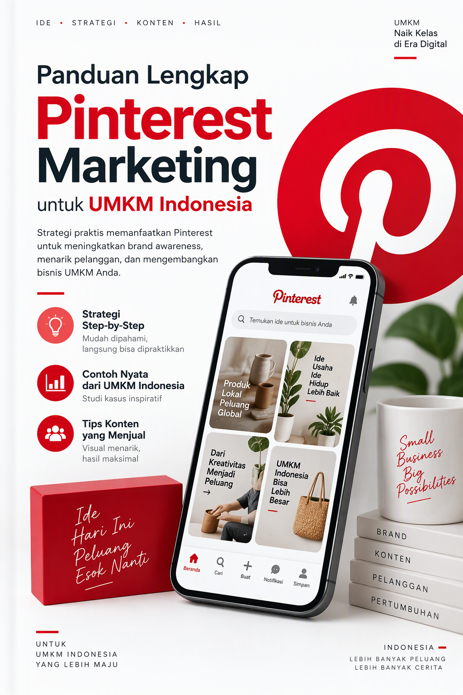
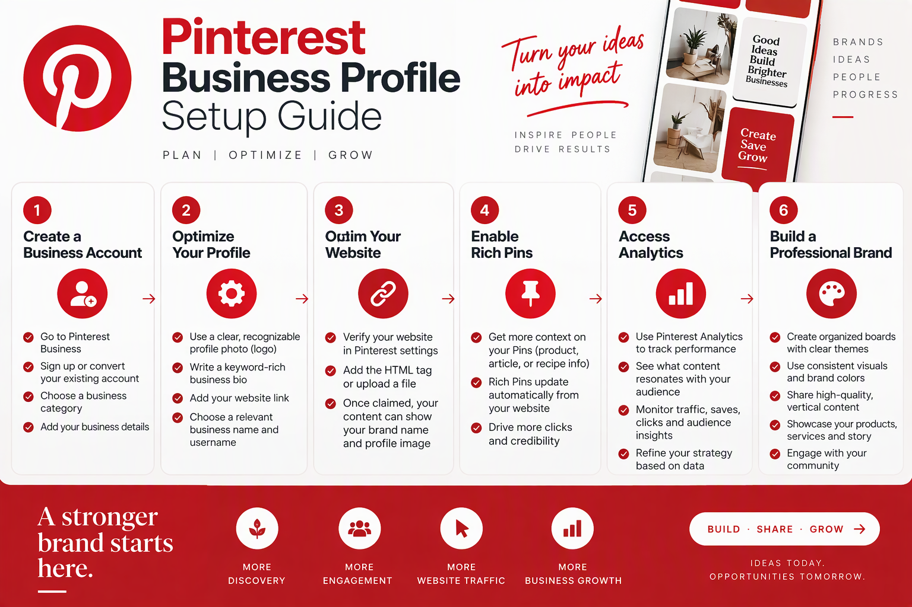
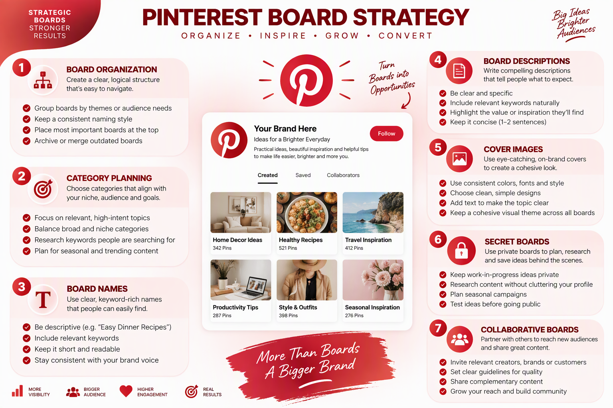
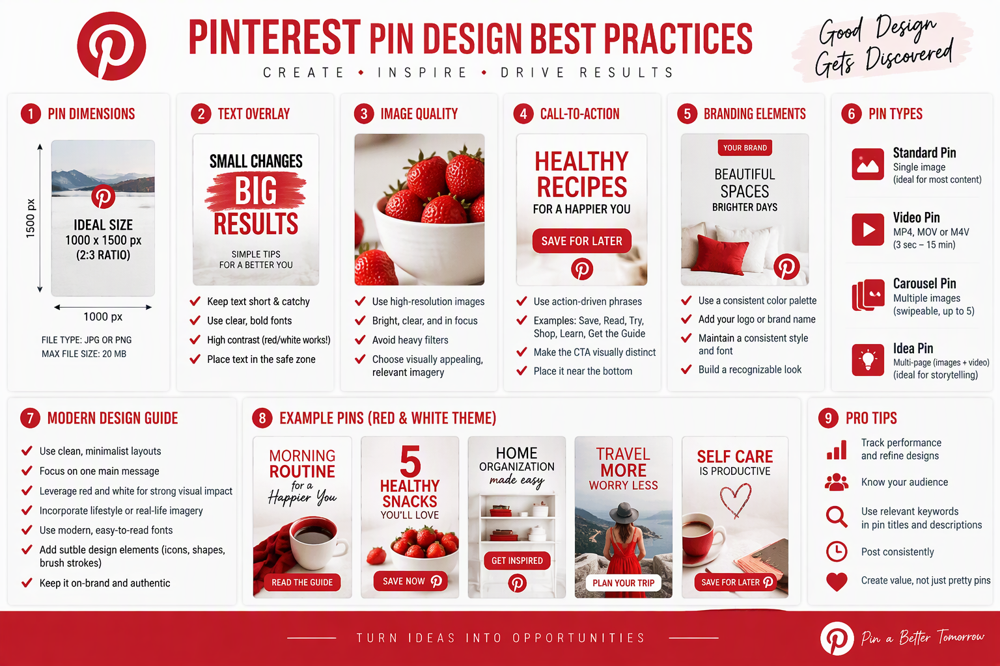
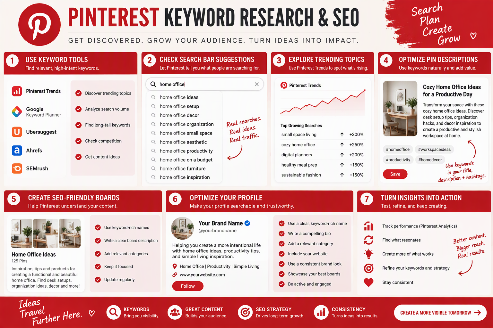
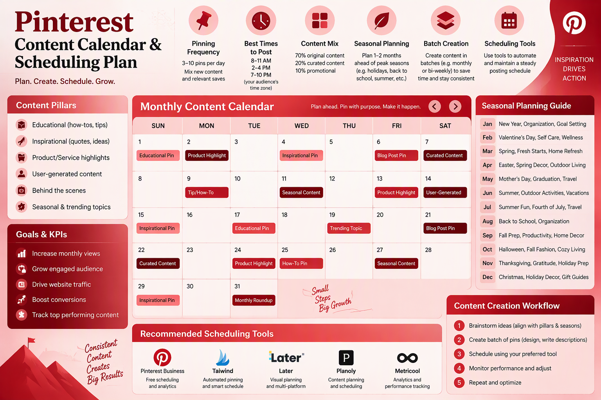
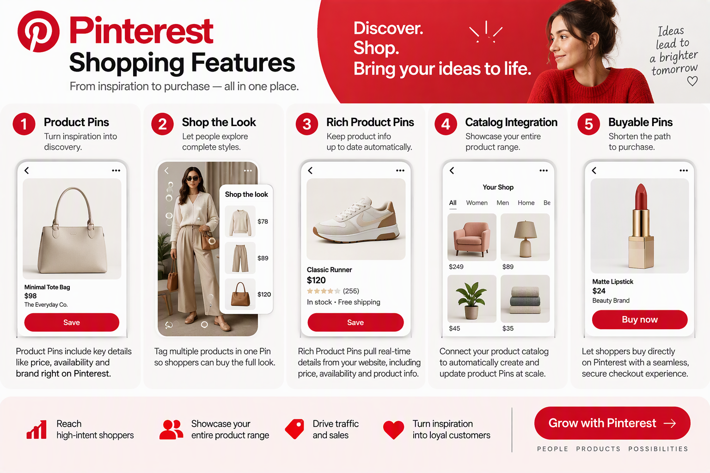
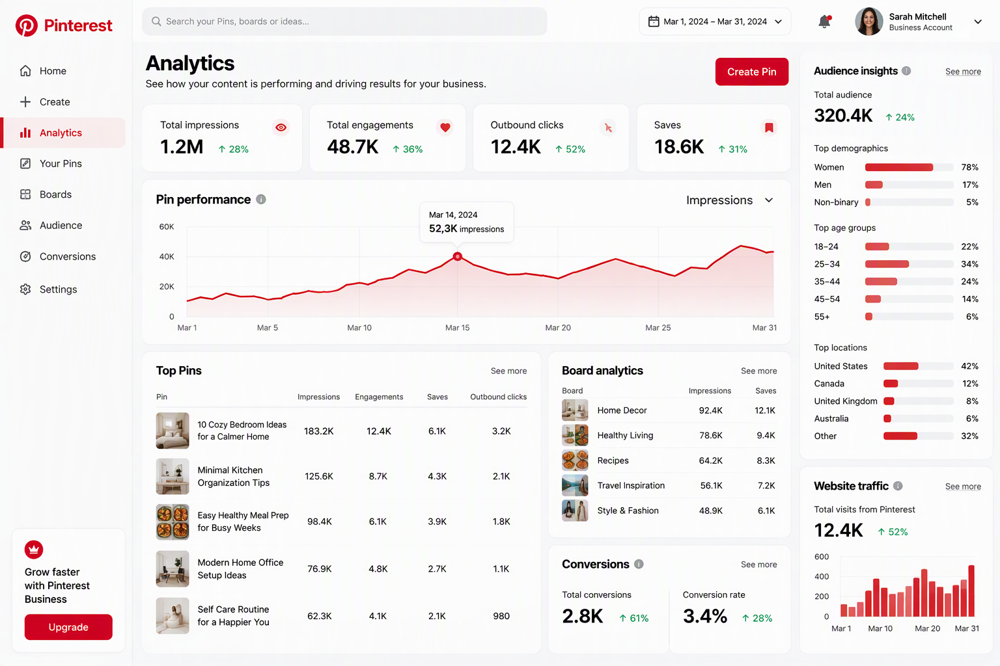
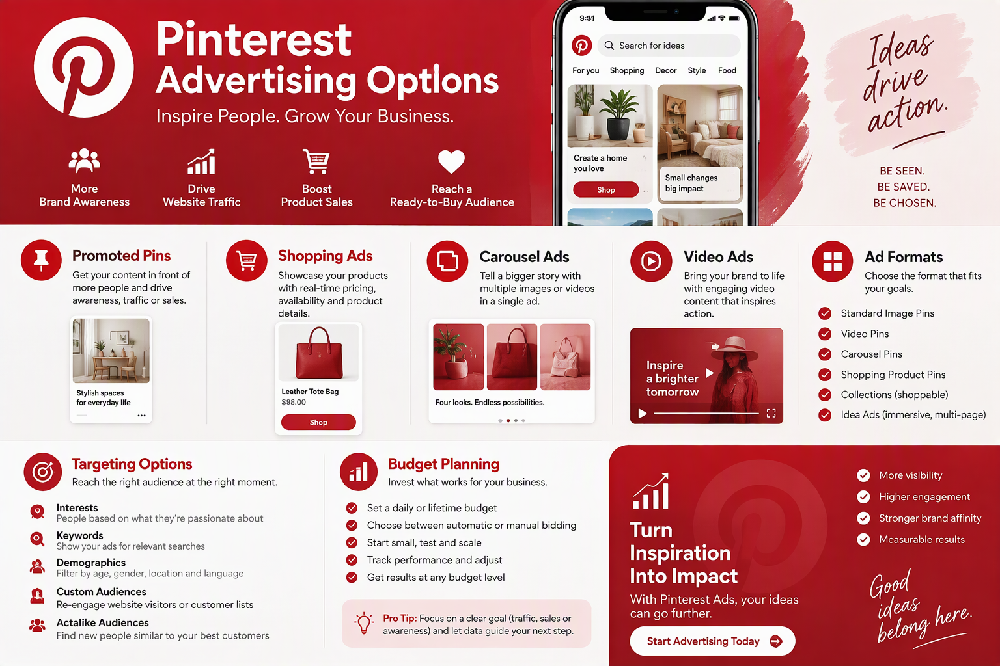
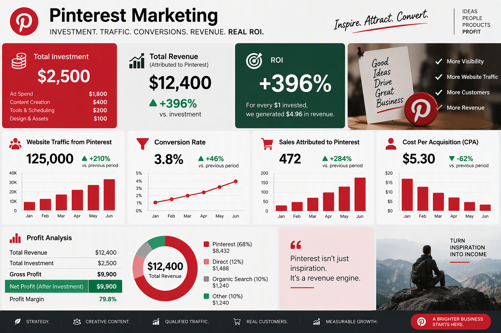

# Panduan Lengkap Pinterest Marketing untuk UMKM Indonesia

**Strategi, Taktik, dan Template Siap Pakai untuk Meningkatkan Traffic, Sales, dan Brand Awareness melalui Pinterest**



Disusun oleh: Siraj Nur Ihrom, CEO SNISHOP.COM
Versi: 1.0
Tanggal: Oktober 2026
Format: Panduan komprehensif dengan strategi, template, dan studi kasus
Standar: SNISHOP-PUBLISHING v2.0

---

## Daftar Isi

**PENDAHULUAN: Cara Menggunakan Buku Ini**

**PART 1: FUNDAMENTAL PINTEREST MARKETING**
- Bab 1: Memahami Ekosistem Pinterest untuk Bisnis
- Bab 2: Setup Profil Bisnis dan Rich Pins
- Bab 3: Strategi Board dan Organisasi Konten

**PART 2: KONTEN, SEO, DAN PERTUMBUHAN**
- Bab 4: Desain Pin yang Menarik dan Konversi
- Bab 5: Pinterest SEO dan Keyword Research
- Bab 6: Content Calendar dan Scheduling
- Bab 7: Pinterest Shopping dan E-commerce

**PART 3: ANALISIS, ADS, DAN SKALING**
- Bab 8: Analytics dan Pengukuran Performance
- Bab 9: Pinterest Ads untuk UMKM
- Bab 10: Studi Kasus dan Rencana Implementasi

**KESIMPULAN**
**TENTANG PENULIS**
**COPYRIGHT**

---

## Pendahuluan: Cara Menggunakan Buku Ini

Pinterest bukan sekadar platform untuk menyimpan resep masakan atau ide dekorasi rumah. Bagi UMKM Indonesia, Pinterest adalah mesin traffic yang tidak pernah tidur. Setiap pin yang Anda upload hari ini bisa terus mendatangkan pengunjung ke website Anda selama berbulan-bulan, bahkan bertahun-tahun setelahnya.

Berbeda dengan Instagram yang konten Anda hilang dalam 24-48 jam, atau TikTok yang bergantung pada algoritma feed sesaat, Pinterest bekerja seperti mesin pencari visual. Orang datang ke Pinterest dengan niat membeli, merencanakan, dan menemukan ide baru. Ini membuat Pinterest menjadi platform dengan conversion rate tertinggi di antara semua media sosial.

Data menunjukkan bahwa 85 persen pengguna Pinterest menggunakan platform ini untuk memulai proyek baru, dan 80 persen pernah membeli produk setelah melihatnya di Pinterest. Untuk bisnis yang menjual produk visual seperti fashion, makanan, kerajinan tangan, dekorasi rumah, atau kecantikan, Pinterest adalah surga yang belum tergarap maksimal di Indonesia.

Buku ini adalah panduan paling komprehensif tentang Pinterest marketing yang ditulis khusus untuk UMKM Indonesia. Anda akan mempelajari semuanya dari nol sampai mahir, mulai dari setup profil bisnis, strategi konten, SEO Pinterest, desain pin yang konversi, sampai Pinterest Ads dan analisis performa.

### Yang Anda Dapatkan dari Buku Ini

- Pemahaman mendalam tentang ekosistem Pinterest dan cara kerjanya
- Panduan setup profil bisnis yang profesional dan teroptimasi
- Strategi board dan organisasi konten yang efektif
- Template desain pin yang menarik dan menghasilkan konversi
- Teknik Pinterest SEO dan keyword research
- Content calendar dan jadwal posting optimal
- Panduan Pinterest Shopping dan integrasi e-commerce
- Cara membaca analytics dan mengukur ROI
- Strategi Pinterest Ads dengan budget UMKM
- 3 studi kasus real dengan angka konkret
- Kalkulator ROI Pinterest marketing
- Rencana implementasi 30 hari langkah demi langkah

### Cara Membaca Buku Ini

Buku ini dibagi menjadi 3 bagian utama yang dirancang untuk dibaca secara berurutan:

**Part 1 (Bab 1-3): Fundamental**
Bagian ini membangun fondasi pengetahuan Anda tentang Pinterest. Jika Anda baru mengenal Pinterest untuk bisnis, mulailah dari sini. Anda akan memahami cara kerja platform ini, bagaimana setup profil yang benar, dan strategi organisasi konten.

**Part 2 (Bab 4-7): Eksekusi**
Bagian ini adalah inti dari strategi konten Pinterest. Anda akan belajar membuat pin yang menarik, mengoptimasi SEO, menyusun content calendar, dan memanfaatkan fitur shopping. Setiap bab berisi langkah praktis yang bisa langsung Anda terapkan.

**Part 3 (Bab 8-10): Analisis dan Skaling**
Bagian terakhir membahas cara mengukur hasil, menjalankan iklan Pinterest, dan mempelajari studi kasus dari bisnis yang sudah berhasil. Di bab 10, Anda akan menemukan rencana implementasi 30 hari yang bisa langsung Anda ikuti.

Setiap bab berisi teori, langkah praktis, template, contoh konkret, dan tips. Anda bisa membaca satu bab per hari dan langsung mengimplementasikannya.

---

# PART 1: FUNDAMENTAL PINTEREST MARKETING

---

## Bab 1: Memahami Ekosistem Pinterest untuk Bisnis

### 1.1 Apa Itu Pinterest dan Mengapa Berbeda

Pinterest mendefinisikan dirinya sebagai "visual discovery engine." Ini bukan media sosial biasa. Orang datang ke Pinterest bukan untuk melihat update dari teman-teman mereka, melainkan untuk menemukan ide, inspirasi, dan produk yang ingin mereka beli atau coba.

Perbedaan fundamental ini membuat Pinterest memiliki karakteristik unik:

**Niat Pengguna:**
- 80 persen pengguna Pinterest pernah membeli produk yang mereka temukan di platform ini
- 67 persen pengguna mengatakan pin yang mereka lihat menginspirasi mereka untuk membeli
- 97 persen pencarian produk teratas di Pinterest tidak bermerek, artinya ada peluang besar untuk bisnis baru

**Umur Konten:**
- Rata-rata umur pin adalah 3,3 bulan, dibandingkan 24 menit untuk tweet
- Pin bisa terus mendatangkan traffic selama 6-12 bulan setelah diposting
- Beberapa pin bahkan viral setelah 3-6 bulan dari tanggal upload

**Demografi Pengguna:**
- 76 persen pengguna Pinterest adalah perempuan, namun segmen laki-laki tumbuh 40 persen per tahun
- 50 persen pengguna memiliki pendapatan rumah tangga di atas $75.000 per tahun
- Usia dominan: 25-44 tahun (62 persen pengguna)
- Di Indonesia, pengguna Pinterest tumbuh 35 persen per tahun, terutama di kategori fashion, makanan, dan dekorasi

### 1.2 Cara Kerja Algoritma Pinterest

Algoritma Pinterest bekerja berbeda dari algoritma media sosial lain. Pinterest menggunakan kombinasi computer vision dan natural language processing untuk memahami konten setiap pin.

**Faktor Ranking Pinterest:**

1. **Domain Quality:** Otoritas website Anda di mata Pinterest. Diukur dari jumlah pin dari domain Anda yang disimpan, klik ke website Anda, dan engagement rate.

2. **Pin Quality:** Kualitas individual pin. Diukur dari seberapa menarik pin tersebut (save, klik, closeup).

3. **Pinner Quality:** Kualitas akun Anda secara keseluruhan. Akun yang aktif, konsisten, dan mendapatkan engagement tinggi akan memiliki skor lebih baik.

4. **Relevansi:** Kesesuaian antara pin Anda dengan pencarian pengguna. Ini mencakup teks pin, deskripsi, board title, dan alt text.

5. **Freshness:** Pinterest memprioritaskan konten baru. Pin yang baru diupload mendapat boost selama 7-14 hari pertama.

**Siklus Hidup Pin:**

```
Hari 1-3: Boost awal dari algoritma
Hari 4-14: Distribusi ke feed dan pencarian
Hari 15-30: Stabilisasi, muncul di pencarian spesifik
Bulan 2-6: Traffic evergreen dari pencarian
Bulan 6-12: Long tail traffic
```

### 1.3 Pinterest untuk UMKM Indonesia: Peluang yang Belum Tergarap

Pinterest masih menjadi blue ocean untuk bisnis Indonesia. Sementara semua orang berebut di Instagram, TikTok, dan Shopee, Pinterest menawarkan peluang dengan kompetisi yang jauh lebih rendah.

**Keuntungan Pinterest untuk UMKM:**

- **Traffic gratis jangka panjang:** Satu pin bisa mendatangkan ratusan pengunjung per bulan selama bertahun-tahun
- **Konversi tinggi:** Pengguna Pinterest datang dengan niat membeli
- **Visual-first:** Cocok untuk produk fashion, makanan, kerajinan, dekorasi
- **Kompetisi rendah:** Belum banyak bisnis Indonesia yang memanfaatkan Pinterest
- **Global reach:** Pin Anda bisa ditemukan oleh pengguna dari seluruh dunia

**Contoh Niche yang Berhasil di Pinterest:**

| Niche | Rata-rata Traffic/Bulan | Potensi Revenue |
|-------|------------------------|-----------------|
| Fashion & Style | 50.000-150.000 visitor | Rp 5-25 juta/bulan |
| Resep & Makanan | 30.000-100.000 visitor | Rp 3-15 juta/bulan |
| Dekorasi Rumah | 40.000-120.000 visitor | Rp 8-30 juta/bulan |
| Kerajinan Tangan | 20.000-80.000 visitor | Rp 2-10 juta/bulan |
| Kecantikan & Skincare | 35.000-90.000 visitor | Rp 5-20 juta/bulan |
| Wedding & Event | 25.000-75.000 visitor | Rp 10-40 juta/bulan |

### 1.4 Mitos dan Fakta tentang Pinterest

**Mitos 1: Pinterest hanya untuk perempuan**
Fakta: Meskipun 76 persen pengguna adalah perempuan, segmen laki-laki tumbuh 40 persen per tahun. Lebih penting, perempuan adalah pengambil keputusan pembelian utama di sebagian besar rumah tangga.

**Mitos 2: Pinterest tidak efektif untuk bisnis kecil**
Fakta: Pinterest justru ideal untuk bisnis kecil karena kompetisi yang rendah dan biaya iklan yang murah. Banyak UMKM yang berhasil mendapatkan traffic ribuan pengunjung per bulan tanpa budget iklan.

**Mitos 3: Anda perlu followers banyak untuk sukses di Pinterest**
Fakta: Pinterest bukan tentang followers. Pin Anda bisa ditemukan melalui pencarian dan rekomendasi algoritma tanpa perlu memiliki followers banyak. Beberapa akun dengan 500 followers bisa mendapatkan 50.000 monthly viewers.

**Mitos 4: Pinterest hanya untuk produk fisik**
Fakta: Pinterest efektif untuk berbagai jenis bisnis, termasuk jasa, kursus online, software, dan konten digital. Kuncinya adalah membuat visual yang menarik dari penawaran Anda.

### 1.5 Langkah Praktis: Riset Pasar Pinterest untuk Bisnis Anda

Sebelum memulai, lakukan riset pasar untuk memahami potensi Pinterest untuk bisnis Anda:

1. **Buka Pinterest.com** dan cari kata kunci terkait bisnis Anda
2. **Perhatikan jumlah hasil pencarian** untuk setiap kata kunci
3. **Lihat pin mana yang paling banyak di-save** dan analisis mengapa
4. **Cek website pesaing** yang muncul di hasil pencarian Pinterest
5. **Catat pola visual** yang dominan di niche Anda (warna, gaya, format)
6. **Identifikasi gap** yang bisa Anda isi dengan konten unik

**Template Riset Pasar Pinterest:**

```
Kata Kunci: [isi dengan keyword utama bisnis Anda]
Jumlah Hasil: [catat angka yang muncul]
Top 5 Pin: [simpan URL dan deskripsi]
Pola Visual: [warna dominan, gaya desain, format]
Pesaing Teratas: [nama akun/website]
Gap yang Teridentifikasi: [peluang konten yang belum tergarap]
Potensi Traffic Bulanan: [estimasi berdasarkan data riset]
```

### 1.6 Kesalahan Umum yang Harus Dihindari

Banyak pemula melakukan kesalahan yang sama saat memulai Pinterest marketing. Menghindari kesalahan ini akan menghemat waktu dan mempercepat hasil.

**Kesalahan 1: Terlalu Banyak Promosi**
Pinterest adalah platform inspirasi, bukan marketplace. Jika setiap pin yang Anda posting langsung berisi hard selling, pengguna akan kehilangan minat. Gunakan aturan 80/20: 80 persen konten inspiratif dan edukatif, 20 persen promosi langsung.

**Kesalahan 2: Mengabaikan SEO**
Beberapa bisnis menganggap Pinterest hanya tentang visual yang menarik. Padahal, tanpa optimasi keyword yang tepat, pin Anda tidak akan ditemukan oleh pengguna yang mencari. Selalu riset keyword dan implementasikan di setiap elemen: board title, pin description, alt text, dan profile bio.

**Kesalahan 3: Tidak Konsisten**
Pinterest memberikan reward kepada pinner yang konsisten. Memposting 50 pin dalam satu hari lalu tidak posting selama seminggu akan merusak performa akun Anda. Lebih baik posting 10 pin setiap hari secara konsisten.

**Kesalahan 4: Menggunakan Gambar Berkualitas Rendah**
Visual adalah segalanya di Pinterest. Gambar yang buram, gelap, atau berantakan akan diabaikan oleh pengguna. Investasikan waktu dan resources untuk membuat visual berkualitas tinggi, bahkan jika Anda harus belajar fotografi dasar.

**Kesalahan 5: Tidak Memanfaatkan Analytics**
Banyak bisnis yang posting tanpa pernah melihat data performa. Analytics Pinterest memberikan insight berharga tentang apa yang bekerja dan apa yang tidak. Luangkan waktu 30 menit setiap minggu untuk review analytics dan adjust strategi Anda.

### 1.7 Tips dan Best Practices

- Mulailah dengan 10-15 board yang relevan dengan niche bisnis Anda
- Pin minimal 5-15 pin per hari untuk konsistensi
- Gunakan kombinasi pin original dan repin dari sumber lain (rasio 1:3)
- Fokus pada kualitas visual, bukan kuantitas semata
- Pelajari pin-pin yang sudah viral di niche Anda dan tiru polanya
- Jangan langsung jualan keras; berikan nilai melalui konten inspiratif dan edukatif
- Hindari kelima kesalahan umum di atas untuk mempercepat hasil
- Bersabarlah; Pinterest adalah strategi jangka panjang yang membutuhkan 3-6 bulan untuk hasil signifikan

---



## Bab 2: Setup Profil Bisnis dan Rich Pins

### 2.1 Membuat Akun Bisnis Pinterest

Langkah pertama dalam Pinterest marketing adalah membuat akun bisnis yang teroptimasi. Akun bisnis memberikan akses ke fitur analytics, advertising, dan Rich Pins yang tidak tersedia di akun personal.

**Langkah-langkah Setup:**

1. **Kunjungi business.pinterest.com**
2. **Klik "Create a business account"** atau convert akun personal yang sudah ada
3. **Isi informasi bisnis:**
   - Email bisnis (gunakan domain website Anda jika memungkinkan)
   - Nama bisnis (gunakan nama brand yang mudah diingat)
   - Website URL
   - Kategori bisnis
   - Lokasi (Indonesia)
   - Bahasa (Bahasa Indonesia dan English)

4. **Verifikasi website Anda** untuk membangun kredibilitas:
   - Upload file HTML ke root domain Anda, atau
   - Tambahkan meta tag di header website, atau
   - Tambahkan DNS TXT record

5. **Klaim website** di Settings > Claimed Accounts

**Keuntungan Verifikasi Website:**
- Analytics lengkap untuk semua pin dari website Anda
- Tampilan profil yang lebih profesional dengan badge terverifikasi
- Prioritas dalam distribusi konten oleh algoritma Pinterest
- Kemampuan untuk menggunakan Rich Pins

### 2.2 Optimasi Profil untuk Konversi Maksimal

Profil Pinterest Anda adalah etalase digital bisnis. Optimasi setiap elemen untuk menarik pengunjung dan mengubah mereka menjadi followers dan pelanggan.

**Formula Bio Pinterest yang Efektif:**

```
[Siapa Anda] + [Apa yang Anda Tawarkan] + [Mengapa Harus Follow] + [CTA]
```

**Contoh Bio untuk Bisnis Fashion:**
"Brand fashion lokal Indonesia yang menghadirkan gaya kasual elegan untuk wanita modern. Pin inspirasi outfit harian, tips styling, dan koleksi terbaru kami. Shop now: [link]"

**Contoh Bio untuk Bisnis Makanan:**
"Resep masakan Indonesia autentik dan ide menu harian untuk keluarga. Tips memasak, presentasi makanan, dan inspirasi kuliner nusantara. Dapatkan resep lengkap di: [link]"

**Elemen Profil yang Harus Dioptimasi:**

1. **Profile Photo:** Gunakan logo brand dengan resolusi tinggi (165x165 pixel minimum). Pastikan logo terlihat jelas dalam format bulat.

2. **Display Name:** Masukkan kata kunci utama bisnis Anda. Contoh: "NusantaraCraft | Kerajinan Tangan Indonesia"

3. **Username:** Gunakan nama brand yang konsisten dengan platform lain. Contoh: @nusantaracraft

4. **Website:** Arahkan ke landing page yang spesifik, bukan homepage umum.

5. **Bio:** 160 karakter maksimal. Gunakan formula di atas.

6. **Location:** Isi dengan kota dan negara untuk local SEO.

### 2.3 Rich Pins: Fitur Wajib untuk Bisnis

Rich Pins adalah pin yang secara otomatis menyinkronkan informasi dari website Anda. Ada tiga jenis Rich Pins:

**1. Product Rich Pins:**
- Menampilkan harga, ketersediaan, dan deskripsi produk
- Update otomatis ketika harga atau stok berubah
- Langsung clickable ke halaman produk

**2. Recipe Rich Pins:**
- Menampilkan bahan, waktu memasak, dan porsi
- Format yang dioptimasi untuk konten resep
- Sangat populer di Pinterest

**3. Article Rich Pins:**
- Menampilkan judul, penulis, dan deskripsi artikel
- Cocok untuk blog dan konten edukasional
- Meningkatkan CTR ke website

**Cara Setup Rich Pins:**

1. **Tambahkan Schema Markup** di halaman website Anda:

Untuk Product Rich Pins:
```html
<meta property="og:type" content="product" />
<meta property="og:title" content="Nama Produk" />
<meta property="og:description" content="Deskripsi produk" />
<meta property="og:image" content="URL gambar produk" />
<meta property="product:price:amount" content="150000" />
<meta property="product:price:currency" content="IDR" />
```

2. **Validasi Rich Pins** di developers.pinterest.com/tools/url-debugger/

3. **Apply Rich Pins** melalui tool yang sama

4. **Tunggu approval** dari Pinterest (biasanya 1-3 hari)

### 2.4 Setup Pinterest Business Hub

Pinterest Business Hub adalah dashboard terpusat untuk mengelola semua aktivitas bisnis Anda di Pinterest.

**Fitur yang Harus Dikonfigurasi:**

1. **Pinterest Tag:** Pasang tracking code di website Anda untuk mengukur konversi dari Pinterest.

```javascript
// Pinterest Tag Base Code
!function(e){if(!window.pintrk){window.pintrk=function()
{window.pintrk.queue.push(Array.prototype.slice.call(arguments))};
var n=window.pintrk;n.queue=[],n.version="3";
var t=document.createElement("script");t.async=!0,t.src=e;
var r=document.getElementsByTagName("script")[0];
r.parentNode.insertBefore(t,r)}}
("https://s.pinimg.com/ct/core.js");
pintrk('load','YOUR_TAG_ID');
pintrk('page');
```

2. **Conversion Events:** Setup event tracking untuk:
   - Checkout (pembelian selesai)
   - Add to Cart (produk ditambahkan ke keranjang)
   - PageVisit (kunjungan ke halaman produk)
   - Signup (pendaftaran newsletter/akun)

3. **Catalog Upload:** Untuk bisnis e-commerce, upload katalog produk Anda ke Pinterest agar bisa ditampilkan sebagai Product Pins.

4. **Verified Merchant Program:** Apply program ini untuk mendapatkan badge resmi dan akses ke Pinterest Shopping features.

### 2.5 Checklist Setup Profil Bisnis

Gunakan checklist ini untuk memastikan semua setup sudah benar:

- [ ] Akun bisnis sudah dibuat dan terverifikasi
- [ ] Website sudah diklaim
- [ ] Profile photo menggunakan logo berkualitas tinggi
- [ ] Display name mengandung kata kunci bisnis
- [ ] Username konsisten dengan brand
- [ ] Bio sudah dioptimasi dengan formula yang efektif
- [ ] Rich Pins sudah di-setup dan di-approve
- [ ] Pinterest Tag sudah dipasang di website
- [ ] Conversion events sudah dikonfigurasi
- [ ] Katalog produk sudah di-upload (jika e-commerce)
- [ ] Verified Merchant Program sudah di-apply

### 2.6 Tips dan Best Practices

- Gunakan email bisnis dengan domain sendiri untuk meningkatkan kredibilitas
- Lengkapi semua field di profil, jangan ada yang kosong
- Update bio secara berkala sesuai campaign yang sedang berjalan
- Pastikan Rich Pins menampilkan informasi yang akurat dan terbaru
- Pasang Pinterest Tag sebelum mulai mempromosikan pin
- Jangan mengubah username terlalu sering karena memengaruhi SEO
- Gunakan cover image di board utama untuk tampilan profil yang profesional

---



## Bab 3: Strategi Board dan Organisasi Konten

### 3.1 Mengapa Board Strategy Menentukan Kesuksesan

Board di Pinterest bukan sekadar folder untuk menyimpan pin. Board adalah elemen SEO yang menentukan bagaimana konten Anda ditemukan oleh pengguna dan algoritma Pinterest.

Board yang terorganisir dengan baik akan:
- Meningkatkan relevansi konten di mata algoritma
- Memudahkan pengguna menemukan dan menyimpan pin Anda
- Membangun otoritas topik untuk niche bisnis Anda
- Meningkatkan waktu yang dihabiskan pengguna di profil Anda

### 3.2 Formula Board yang Efektif

Setiap bisnis Pinterest perlu memiliki kombinasi board yang tepat. Berikut adalah formula yang terbukti efektif:

**Struktur Board Ideal (15-25 Board):**

1. **Board Utama (3-5 board):** Topik paling relevan dengan bisnis Anda
   - Contoh untuk bisnis fashion: "Outfit Kasual Wanita Indonesia", "Gaya Formal Kantor", "Fashion Muslimah Modern"

2. **Board Pendukung (5-8 board):** Topik yang terkait dengan minat target audience
   - Contoh: "Tips Styling Body Shape", "Inspirasi Warna Musim Ini", "Brand Fashion Lokal"

3. **Board Musiman (3-5 board):** Konten yang relevan dengan event atau musim tertentu
   - Contoh: "Outfit Lebaran 2026", "Gaya Liburan Bali", "Fashion Show Akhir Tahun"

4. **Board Kurasi (3-5 board):** Kumpulan pin dari sumber lain yang relevan
   - Contoh: "Street Style Jakarta", "Fashion Icon Indonesia", "Tren Global 2026"

5. **Board Produk (2-4 board):** Showcase produk Anda secara spesifik
   - Contoh: "Koleksi Batik Modern", "Sepatu Handmade Premium", "Aksesori Etnik"

### 3.3 Optimasi Board untuk SEO

Setiap board harus dioptimasi agar mudah ditemukan melalui pencarian Pinterest.

**Elemen yang Harus Dioptimasi:**

1. **Board Title:**
   - Gunakan kata kunci spesifik yang sering dicari
   - Hindari judul generik seperti "Fashion" atau "Makanan"
   - Contoh baik: "Resep Masakan Jawa Praktis untuk Pemula"
   - Contoh buruk: "Masakan"

2. **Board Description:**
   - 500 karakter maksimal, gunakan semua ruang
   - Masukkan 3-5 kata kunci relevan secara natural
   - Jelaskan apa yang akan ditemukan pengguna di board ini
   - Tambahkan call-to-action di akhir

3. **Board Category:**
   - Pilih kategori yang paling relevan dari daftar Pinterest
   - Kategori membantu Pinterest memahami konteks board Anda

4. **Board Cover Image:**
   - Pilih pin paling menarik dari board sebagai cover
   - Pastikan cover merepresentasikan isi board dengan baik
   - Gunakan ukuran 600x600 pixel untuk cover

**Template Deskripsi Board:**

```
[Deskripsi singkat tentang isi board - 1-2 kalimat]

Di board ini Anda akan menemukan:
- [Topik 1 dengan kata kunci]
- [Topik 2 dengan kata kunci]
- [Topik 3 dengan kata kunci]

[Call-to-action: Follow board ini untuk inspirasi harian / Kunjungi website kami untuk selengkapnya]

Kata kunci: [keyword 1], [keyword 2], [keyword 3], [keyword 4], [keyword 5]
```

### 3.4 Strategi Pengisian Board

**Aturan 80/20 untuk Board:**
- 80 persen pin original dari website/konten Anda sendiri
- 20 persen pin kurasi dari sumber lain yang relevan

**Frekuensi Pinning per Board:**
- Board utama: 5-10 pin per hari
- Board pendukung: 3-5 pin per hari
- Board musiman: Aktifkan 1-2 bulan sebelum event
- Board kurasi: 2-3 pin per hari
- Board produk: 1-2 pin per hari

**Urutan Board di Profil:**
Pinterest menampilkan board paling aktif di atas. Atur urutan board secara strategis:
1. Board dengan konten terbaru dan paling relevan di atas
2. Board produk di posisi tengah
3. Board kurasi di bawah

### 3.5 Secret Board untuk Strategi Khusus

Pinterest memungkinkan Anda membuat board rahasia (secret board) yang tidak terlihat oleh publik. Gunakan fitur ini untuk:

- **Persiapan campaign:** Buat konten campaign baru tanpa memberi tahu kompetitor
- **Testing konten:** Uji berbagai gaya pin sebelum mempublikasikan
- **Konten eksklusif:** Buat board khusus untuk pelanggan VIP atau kolaborasi
- **Riset kompetitor:** Simpan pin kompetitor untuk analisis tanpa menampilkan di profil publik

### 3.6 Template Strategi Board

**Untuk Bisnis Fashion:**
```
Board Utama:
1. Outfit Kasual Wanita Indonesia
2. Fashion Muslimah Modern
3. Gaya Formal dan Kantor

Board Pendukung:
4. Tips Styling dan Mix-Match
5. Tren Fashion 2026
6. Brand Fashion Lokal Indonesia
7. Sepatu dan Tas Pilihan

Board Musiman:
8. Outfit Lebaran
9. Fashion Liburan
10. Koleksi Akhir Tahun

Board Kurasi:
11. Street Style Jakarta
12. Fashion Icon Asia
13. Inspirasi Outfit Selebriti

Board Produk:
14. Koleksi Batik Modern
15. Gamis Premium
16. Aksesoris Handmade
```

**Untuk Bisnis Makanan:**
```
Board Utama:
1. Resep Masakan Indonesia
2. Menu Sarapan Sehat
3. Dessert dan Kue Tradisional

Board Pendukung:
4. Tips Memasak untuk Pemula
5. Bahan-bahan Lokal Nusantara
6. Presentation dan Plating
7. Minuman dan Cocktail

Board Musiman:
8. Menu Ramadhan
9. Hidangan Natal dan Tahun Baru
10. Menu Buka Puasa

Board Kurasi:
11. Food Photography Inspiration
12. Kuliner Nusantara
13. Trend Makanan Global

Board Produk:
14. Produk Olahan Kami
15. Kemasan dan Gift Set
16. Resep dengan Produk Kami
```

### 3.7 Tips dan Best Practices

- Buat board spesifik, bukan board umum. "Resep Ayam Goreng Indonesia" lebih baik dari "Masakan"
- Update board secara konsisten, minimal 5 pin per hari
- Gunakan board title yang mengandung kata kunci pencarian
- Tulis deskripsi board yang informatif dan kaya kata kunci
- Jangan membuat terlalu banyak board kosong; lebih baik 15 board aktif dari 50 board kosong
- Reorganisasi board setiap 3 bulan berdasarkan performa analytics
- Pin ke board yang paling relevan untuk meningkatkan SEO pin tersebut

---

# PART 2: KONTEN, SEO, DAN PERTUMBUHAN

---



## Bab 4: Desain Pin yang Menarik dan Konversi

### 4.1 Anatomi Pin yang Berperforma

Pin yang berhasil di Pinterest memiliki kombinasi elemen visual dan teks yang membuat pengguna berhenti scrolling, memperhatikan, dan akhirnya melakukan save atau klik.

**Ukuran Pin Optimal:**
- Rasio aspek: 2:3 (1000x1500 pixel)
- Format: PNG atau JPG
- Ukuran file: di bawah 20MB
- Resolusi minimum: 600x900 pixel

**Elemen Pin yang Harus Ada:**

1. **Headline yang Menarik (3-7 kata):**
   - Gunakan angka: "7 Cara Styling Batik Modern"
   - Buat penasaran: "Rahasia Dapur yang Tidak Pernah Diungkap Chef"
   - Tawarkan solusi: "Atasi Kulit Berminyak dengan 3 Bahan Alami"
   - Gunakan power words: "Terbukti", "Rahasia", "Mudah", "Gratis"

2. **Visual yang Berkualitas Tinggi:**
   - Foto produk atau hasil yang menarik
   - Warna yang kontras dan eye-catching
   - Pencahayaan yang baik
   - Komposisi yang bersih dan tidak berantakan

3. **Branding yang Konsisten:**
   - Logo atau nama brand di posisi yang tidak mengganggu
   - Color palette yang konsisten dengan identitas brand
   - Font yang sama untuk semua pin
   - Style visual yang mudah dikenali

4. **Call-to-Action yang Jelas:**
   - "Save untuk nanti" untuk meningkatkan save rate
   - "Klik untuk resep lengkap" untuk meningkatkan klik
   - "Shop now" untuk pin produk
   - "Follow untuk inspirasi harian" untuk meningkatkan followers

### 4.2 Jenis-jenis Pin dan Kapan Menggunakannya

**1. Standard Pin:**
- Gambar tunggal dengan overlay teks
- Cocok untuk: blog post, produk, inspirasi
- Performa terbaik: rasio 2:3, headline besar di tengah

**2. Video Pin:**
- Durasi 6-15 detik optimal
- Autoplay tanpa suara
- Cocok untuk: tutorial, behind-the-scenes, product demo
- Performa 3x lebih tinggi dari static pin

**3. Carousel Pin (Idea Pins):**
- Multi-slide format
- Cocok untuk: step-by-step tutorial, storytelling, product showcase
- Engagement rate 2x lebih tinggi dari standard pin

**4. Infographic Pin:**
- Visualisasi data atau informasi
- Cocok untuk: tips, statistik, perbandingan
- Save rate paling tinggi di semua jenis pin

**5. Collage Pin:**
- Gabungan beberapa gambar dalam satu pin
- Cocok untuk: mood board, product collection, outfit ideas
- Menarik perhatian visual yang kuat

### 4.3 Tools Desain Pin untuk Non-Designer

Anda tidak perlu menjadi desainer profesional untuk membuat pin yang menarik. Berikut tools yang bisa digunakan:

**Canva (Gratis dan Berbayar):**
- Template Pinterest siap pakai
- Drag-and-drop editor
- Library foto dan elemen grafis
- Brand kit untuk konsistensi visual
- Ukuran kanvas Pinterest: 1000x1500 pixel

**Tailwind Create (Berbayar):**
- AI-powered pin creation
- Generate ratusan variasi pin dari satu foto
- A/B testing otomatis
- Integrasi dengan Tailwind scheduling

**Adobe Express (Gratis dan Berbayar):**
- Template profesional
- Editing foto advanced
- Brand kit
- Integrasi dengan Adobe Creative Cloud

**PicMonkey (Berbayar):**
- Template khusus Pinterest
- Editing foto yang powerful
- Batch editing untuk efisiensi
- Font dan elemen grafis lengkap

### 4.4 Formula Desain Pin yang Terbukti Efektif

**Formula 1: Headline + Hero Image**
```
[LAYOUT]
+--------------------------+
|                          |
|    HEADLINE BESAR        |
|    (3-7 kata)            |
|                          |
|    [HERO IMAGE]          |
|                          |
|    [LOGO BRAND]          |
|                          |
+--------------------------+
```

**Formula 2: Split Layout**
```
[LAYOUT]
+--------------------------+
|                          |
|   HEADLINE    |  IMAGE   |
|   (kiri)      |  (kanan) |
|               |          |
|   [CTA]       |  [LOGO]  |
|                          |
+--------------------------+
```

**Formula 3: List/Number Pin**
```
[LAYOUT]
+--------------------------+
|   JUDUL UTAMA            |
|                          |
|   1. Item pertama        |
|   2. Item kedua          |
|   3. Item ketiga         |
|   4. Item keempat        |
|   5. Item kelima         |
|                          |
|   [LOGO]   [CTA]        |
+--------------------------+
```

### 4.5 Color Psychology untuk Pin

Warna memengaruhi emosi dan keputusan pengguna. Pilih warna yang sesuai dengan pesan dan target audience Anda:

| Warna | Emosi | Cocok untuk |
|-------|-------|-------------|
| Merah | Urgensi, semangat | Sale, promo, makanan |
| Biru | Kepercayaan, profesional | Jasa, teknologi, keuangan |
| Hijau | Alam, kesehatan | Produk organik, wellness |
| Kuning | Kebahagiaan, optimisme | Anak-anak, lifestyle |
| Pink | Feminin, romantis | Fashion, kecantikan, wedding |
| Hitam | Mewah, elegan | Premium brand, fashion |
| Putih | Bersih, minimalis | Skincare, dekorasi |
| Orange | Energik, kreatif | Makanan, entertainment |

### 4.6 20+ Template Ide Pin untuk Bisnis Anda

1. "X Cara [Melakukan Sesuatu]" - Tutorial listicle
2. "Kesalahan [Target] yang Harus Dihindari" - Warning pin
3. "Before-After [Transformasi]" - Comparison pin
4. "[Angka] Tips [Topik] untuk [Target]" - Tips pin
5. "Panduan Lengkap [Topik]" - Comprehensive guide
6. "Checklist [Aktivitas]" - Printable checklist
7. "Resep [Nama Makanan] dalam X Langkah" - Recipe pin
8. "Outfit Ideas untuk [Occasion]" - Style inspiration
9. "[Produk] vs [Produk]: Mana yang Lebih Baik?" - Comparison
10. "DIY [Proyek] dengan Budget [Harga]" - DIY tutorial
11. "X Tanda Anda Membutuhkan [Solusi]" - Problem-awareness
12. "Quote Inspiratif tentang [Topik]" - Motivational pin
13. "Infographic: Data Menarik tentang [Topik]" - Data visualization
14. "Behind the Scenes [Bisnis Anda]" - BTS pin
15. "Customer Testimonial [Nama]" - Social proof
16. "Gift Guide untuk [Target]" - Gift recommendation
17. "Seasonal [Topik] Ideas" - Musiman
18. "Step-by-Step [Tutorial]" - Tutorial bertahap
19. "Mistakes to Avoid [Topik]" - Warning
20. "Ultimate Guide [Topik]" - Panduan lengkap
21. "X Products You Need [Untuk Tujuan]" - Product list
22. "How to Style [Produk] dengan [Cara]" - Styling guide

### 4.7 Tips dan Best Practices

- Gunakan font yang mudah dibaca di layar mobile (minimum 24pt untuk headline)
- Pastikan teks tidak menutupi lebih dari 30 persen area gambar
- Test minimal 3 variasi pin untuk setiap konten
- Pin pada waktu optimal: pukul 20.00-23.00 WIB dan akhir pekan
- Selalu tambahkan CTA di setiap pin
- Gunakan warna yang kontras dengan background Pinterest (putih)
- Buat template brand agar semua pin memiliki visual yang konsisten

---



## Bab 5: Pinterest SEO dan Keyword Research

### 5.1 Mengapa Pinterest SEO Berbeda dari Google SEO

Pinterest adalah mesin pencari visual, bukan mesin pencari teks. Meskipun prinsip dasarnya sama (mencocokkan query pengguna dengan konten yang relevan), cara Pinterest mengindeks dan meranking konten berbeda secara signifikan dari Google.

**Perbedaan Utama:**

| Aspek | Google SEO | Pinterest SEO |
|-------|-----------|---------------|
| Konten | Teks dan artikel | Gambar dan visual |
| Keyword | Long-tail phrases | Visual dan lifestyle terms |
| Ranking | Backlinks dan otoritas | Saves, clicks, dan engagement |
| Umur | Evergreen dengan update | 3-12 bulan per pin |
| Intent | Informasi dan transaksi | Inspirasi dan perencanaan |

### 5.2 Keyword Research untuk Pinterest

**Sumber Keyword Pinterest:**

1. **Pinterest Search Bar (Autocomplete):**
   - Ketik kata kunci umum di search bar Pinterest
   - Lihat saran autocomplete yang muncul
   - Saran ini berdasarkan volume pencarian real
   - Catat semua variasi yang relevan

2. **Pinterest Trends Tool:**
   - Kunjungi trends.pinterest.com
   - Lihat tren pencarian berdasarkan waktu
   - Bandingkan beberapa keyword
   - Identifikasi pola musiman

3. **Pinterest Ads Keyword Tool:**
   - Buat akun Pinterest Ads (gratis)
   - Gunakan keyword tool di Ads Manager
   - Lihat volume pencarian dan kompetisi
   - Estimasi CPC untuk setiap keyword

4. **Competitor Analysis:**
   - Cari pesaing di Pinterest
   - Analisis board title dan deskripsi mereka
   - Lihat pin mana yang paling banyak di-save
   - Catat keyword yang mereka gunakan

5. **Pinterest Analytics:**
   - Lihat keyword yang membawa traffic ke profil Anda
   - Identifikasi pin dengan impression tertinggi
   - Analisis search terms yang menghasilkan save

**Proses Keyword Research:**

```
Langkah 1: Seed Keywords
- Tuliskan 5-10 kata kunci utama bisnis Anda
- Contoh: "batik modern", "fashion muslim", "gamis"

Langkah 2: Expand Keywords
- Gunakan Pinterest autocomplete untuk memperluas
- Catat semua variasi: "batik modern wanita", "batik modern pria", "batik modern casual"

Langkah 3: Kategorisasi Intent
- Informational: "cara memakai batik modern"
- Inspirational: "inspirasi outfit batik modern"
- Transactional: "beli batik modern online"

Langkah 4: Prioritas Keyword
- Volume tinggi + kompetisi rendah = prioritas utama
- Volume tinggi + kompetisi tinggi = target jangka panjang
- Volume rendah + intent tinggi = target konversi

Langkah 5: Implementasi
- Masukkan keyword di board title
- Gunakan di pin description
- Tambahkan di alt text gambar
- Optimasi profile bio
```

### 5.3 On-Page SEO untuk Pinterest

Setiap elemen di profil Pinterest Anda adalah peluang SEO. Optimasi semua elemen dengan keyword yang sudah Anda riset.

**Optimasi Board Title:**
- Gunakan keyword utama di awal title
- Contoh: "Batik Modern Wanita | Inspirasi Outfit Kasual Elegan"
- Hindari: "Koleksi Kami" atau "Fashion"

**Optimasi Board Description:**
- Tulis 2-3 kalimat natural yang mengandung 3-5 keyword
- Contoh: "Temukan inspirasi outfit batik modern untuk wanita Indonesia. Koleksi batik kasual, formal, dan muslimah yang stylish dan elegan. Cocok untuk ke kantor, acara formal, dan hangout sehari-hari."

**Optimasi Pin Title:**
- Gunakan keyword spesifik dan menarik
- Contoh: "7 Cara Styling Batik Modern untuk Wanita Kantor | Outfit Elegan dan Profesional"
- Hindari: "Batik Modern" atau "Outfit"

**Optimasi Pin Description:**
- 200-500 kata, natural dan informatif
- Masukkan 3-5 keyword secara organik
- Tambahkan CTA di akhir
- Contoh: "Inspirasi outfit batik modern untuk wanita karir. Batik tidak hanya untuk acara formal, tapi juga bisa menjadi pilihan stylish untuk ke kantor sehari-hari. Dalam panduan ini, Anda akan menemukan 7 cara styling batik modern yang elegan dan profesional. Dari mix-and-match dengan blazer hingga pairing dengan rok plisket, semua tips ini akan membantu Anda tampil percaya diri di tempat kerja. Kunjungi website kami untuk koleksi batik modern terbaru. Save pin ini untuk referensi outfit kantor Anda!"

**Optimasi Alt Text:**
- Deskripsi gambar untuk accessibility dan SEO
- Gunakan keyword secara natural
- Contoh: "Wanita Indonesia memakai blouse batik modern berwarna coklat dengan rok hitam, styling outfit kantor elegan"

### 5.4 Technical SEO untuk Pinterest

**Website Optimization:**
- Pasang Pinterest Site Verification
- Implementasi Open Graph tags
- Tambahkan Schema markup untuk produk
- Pastikan website mobile-friendly
- Kecepatan loading di bawah 3 detik

**Image Optimization:**
- Gunakan format PNG atau JPG berkualitas tinggi
- Ukuran minimum 600x900 pixel, optimal 1000x1500 pixel
- Tambahkan alt text di setiap gambar
- Gunakan file name yang mengandung keyword

**Rich Pins Setup:**
- Implementasi meta tags yang diperlukan
- Validasi melalui Pinterest Rich Pins debugger
- Apply Rich Pins untuk semua halaman produk dan artikel

### 5.5 Keyword Mapping Template

Gunakan template ini untuk memetakan keyword ke setiap elemen Pinterest:

```
BOARD: [Nama Board]
Target Keyword: [keyword utama]
Secondary Keywords: [keyword 2], [keyword 3], [keyword 4]
Search Volume: [tinggi/sedang/rendah]
Kompetisi: [tinggi/sedang/rendah]
Intent: [informational/inspirational/transactional]

PIN 1:
Title: [mengandung target keyword]
Description: [200-500 kata, natural, mengandung semua keyword]
Alt Text: [deskripsi gambar dengan keyword]
Board: [board yang paling relevan]

PIN 2:
Title: [variasi keyword]
Description: [konten berbeda, keyword berbeda]
Alt Text: [deskripsi berbeda]
Board: [board relevan lainnya]
```

### 5.6 Tips dan Best Practices

- Riset keyword secara berkala, minimal sebulan sekali
- Gunakan Pinterest Trends untuk mengidentifikasi keyword musiman
- Jangan keyword stuffing; gunakan keyword secara natural
- Fokus pada long-tail keyword untuk hasil yang lebih cepat
- Monitor performa keyword melalui Pinterest Analytics
- A/B test berbagai variasi keyword di pin description
- Pin konten baru secara konsisten untuk menjaga relevansi

---



## Bab 6: Content Calendar dan Scheduling

### 6.1 Mengapa Content Calendar Penting

Konsistensi adalah kunci kesuksesan di Pinterest. Algoritma Pinterest memberikan prioritas kepada pinner yang aktif dan konsisten. Content calendar membantu Anda:

- Mempertahankan konsistensi posting
- Menghemat waktu dengan batch creation
- Merencanakan konten musiman jauh-jauh hari
- Memastikan variasi topik yang seimbang
- Melacak performa konten dari waktu ke waktu

### 6.2 Frekuensi dan Waktu Posting Optimal

**Jumlah Pin per Hari:**
- Minimum: 5 pin per hari
- Optimal: 10-15 pin per hari
- Maksimal: 25 pin per hari (di atas ini dianggap spam)

**Rasio Konten:**
- 30 persen pin original (dari website Anda)
- 50 persen pin semi-original (modifikasi dari konten existing)
- 20 persen pin kurasi (dari sumber lain yang relevan)

**Waktu Posting Optimal untuk Audience Indonesia:**
- Pagi: 06.00-08.00 WIB (perjalanan ke kantor)
- Siang: 12.00-13.00 WIB (istirahat makan siang)
- Sore: 17.00-18.00 WIB (pulang kerja)
- Malam: 20.00-23.00 WIB (waktu santai, peak time)
- Akhir pekan: 09.00-11.00 dan 19.00-22.00 WIB

### 6.3 Menyusun Content Calendar Bulanan

**Minggu 1: Perencanaan**
- Riset keyword dan tren bulan ini
- Identifikasi event musiman yang akan datang
- Tentukan topik utama untuk setiap minggu
- Buat outline konten untuk 30 hari

**Minggu 2: Pembuatan Konten**
- Batch creation: buat 30-45 pin sekaligus
- Desain variasi visual untuk setiap topik
- Tulis semua pin title dan description
- Siapkan alt text untuk setiap gambar

**Minggu 3: Scheduling**
- Upload semua pin ke scheduling tool
- Atur waktu posting sesuai jadwal optimal
- Distribusi pin ke board yang relevan
- Setup pengingat untuk engagement harian

**Minggu 4: Monitoring dan Optimasi**
- Review performa mingguan
- Identifikasi pin top performer
- Re-pin konten yang berperforma baik
- Sesuaikan strategi untuk bulan berikutnya

### 6.4 Template Content Calendar 30 Hari

**Hari 1-7: Fondasi**
```
Senin: 3 pin original + 5 pin kurasi
Selasa: 2 pin original + 6 pin kurasi
Rabu: 3 pin original + 5 pin kurasi
Kamis: 2 pin original + 7 pin kurasi
Jumat: 4 pin original + 4 pin kurasi
Sabtu: 2 pin original + 8 pin kurasi
Minggu: 1 pin original + 9 pin kurasi
```

**Hari 8-14: Akselerasi**
```
Senin: 4 pin original + 6 pin kurasi
Selasa: 3 pin original + 7 pin kurasi
Rabu: 4 pin original + 6 pin kurasi
Kamis: 3 pin original + 8 pin kurasi
Jumat: 5 pin original + 5 pin kurasi
Sabtu: 3 pin original + 7 pin kurasi
Minggu: 2 pin original + 8 pin kurasi
```

**Hari 15-21: Optimasi**
```
Senin: 5 pin original + 5 pin kurasi
Selasa: 4 pin original + 6 pin kurasi
Rabu: 5 pin original + 5 pin kurasi
Kamis: 4 pin original + 7 pin kurasi
Jumat: 6 pin original + 4 pin kurasi
Sabtu: 4 pin original + 6 pin kurasi
Minggu: 3 pin original + 7 pin kurasi
```

**Hari 22-30: Skaling**
```
Senin: 6 pin original + 4 pin kurasi
Selasa: 5 pin original + 5 pin kurasi
Rabu: 6 pin original + 4 pin kurasi
Kamis: 5 pin original + 6 pin kurasi
Jumat: 7 pin original + 3 pin kurasi
Sabtu: 5 pin original + 5 pin kurasi
Minggu: 4 pin original + 6 pin kurasi
```

### 6.5 Tools Scheduling Pinterest

**Tailwind (Rekomendasi Utama):**
- Scheduling otomatis dengan SmartSchedule
- Analytics terintegrasi
- Ghostwriter AI untuk membuat deskripsi pin
- Harga: mulai dari $12.49 per bulan
- Fitur Communities untuk kolaborasi

**Pinterest Native Scheduler:**
- Gratis, langsung dari Pinterest
- Bisa scheduling sampai 2 minggu ke depan
- Fitur terbatas dibanding Tailwind
- Cocok untuk pemula dengan budget minim

**Buffer:**
- Multi-platform scheduling
- Interface yang mudah digunakan
- Analytics dasar
- Harga: mulai dari $6 per bulan

**Later:**
- Visual content planner
- Drag-and-drop calendar
- Pinterest analytics
- Harga: mulai dari $16.67 per bulan

### 6.6 Content Repurposing Strategy

Satu konten bisa diubah menjadi banyak pin berbeda:

**Dari 1 Blog Post:**
- 5 pin dengan headline berbeda
- 3 pin dengan visual berbeda
- 2 pin infographic
- 1 pin carousel
- 1 pin video

**Dari 1 Produk:**
- 3 pin lifestyle (produk dalam konteks penggunaan)
- 2 pin flat lay (produk dengan properti)
- 1 pin detail (close-up produk)
- 1 pin comparison (produk vs alternatif)
- 1 pin tutorial (cara menggunakan produk)

**Dari 1 Foto:**
- 5 pin dengan overlay teks berbeda
- 3 pin dengan filter/warna berbeda
- 2 pin collage
- 1 pin video slideshow

### 6.7 Seasonal Content Planning

Pinterest adalah platform yang sangat musiman. Pengguna mulai mencari konten musiman 45-60 hari sebelum event. Perencanaan konten musiman yang tepat bisa meningkatkan traffic secara signifikan.

**Kalender Musiman Indonesia untuk Pinterest:**

| Bulan | Event | Mulai Pin |
|-------|-------|-----------|
| Januari | Tahun Baru, resolusi | Desember tahun lalu |
| Februari | Valentine, Imlek | Awal Januari |
| Maret | Hari Perempuan, spring | Awal Februari |
| April | Ramadhan (variable), Kartini | Awal Maret |
| Mei | Lebaran (variable), Mother's Day | Awal April |
| Juni | Liburan sekolah, Father's Day | Awal Mei |
| Juli | Back to school, promo mid-year | Awal Juni |
| Agustus | Kemerdekaan, back to school | Awal Juli |
| September | Halloween, fall fashion | Awal Agustus |
| Oktober | Halloween, Natal awal | Awal September |
| November | Black Friday, Thanksgiving, Natal | Awal Oktober |
| Desember | Natal, Tahun Baru, Lebaran (jika jatuh di Desember) | Awal November |

**Strategi Konten Musiman:**

1. **60 hari sebelum event:** Mulai buat dan schedule pin musiman
2. **45 hari sebelum:** Aktifkan board musiman dan mulai pinning
3. **30 hari sebelum:** Jalankan Pinterest Ads untuk konten musiman
4. **7 hari sebelum:** Intensifkan posting, 2x lipat dari biasanya
5. **Hari H:** Pin real-time content dan stories
6. **7 hari setelah:** Buat konten recap dan evergreen dari event tersebut

**Contoh Perencanaan Ramadhan:**
- 60 hari sebelum: Riset keyword "menu sahur", "resep buka puasa", "takjil"
- 45 hari sebelum: Buat 30 pin resep baru, setup board Ramadhan
- 30 hari sebelum: Mulai schedule 5 pin Ramadhan per hari
- 14 hari sebelum: Launch Pinterest Ads untuk produk Ramadhan
- 7 hari sebelum: Buat Idea Pins tutorial persiapan Lebaran
- Hari H: Pin konten real-time, update stories
- Setelah Lebaran: Buat pin "sisa bahan Lebaran" dan "outfit lebaran tahun depan"

### 6.8 Tips dan Best Practices

- Batch creation: luangkan 1 hari penuh untuk membuat konten 1 bulan
- Gunakan template desain agar konsisten dan efisien
- Schedule konten musiman 2-3 bulan sebelumnya
- Monitor dan evaluasi performa setiap minggu
- Jangan pin konten yang sama persis berulang; buat variasi
- Sisihkan waktu 15 menit per hari untuk engagement manual
- Simpan ide konten di notes atau spreadsheet untuk referensi

---



## Bab 7: Pinterest Shopping dan E-commerce

### 7.1 Ekosistem Pinterest Shopping

Pinterest telah mengembangkan fitur shopping yang semakin lengkap, menjadikannya platform yang powerful untuk e-commerce. Dengan 80 persen pengguna yang pernah membeli produk setelah menemukannya di Pinterest, integrasi shopping adalah keharusan bagi bisnis online.

**Fitur Shopping Pinterest:**

1. **Product Pins:** Menampilkan harga, ketersediaan, dan deskripsi langsung di pin
2. **Shop the Look:** Tag produk dalam gambar lifestyle
3. **Catalog:** Upload katalog produk massal
4. **Verified Merchant Program:** Badge resmi untuk toko terpercaya
5. **Shopping Ads:** Iklan produk yang muncul di feed dan pencarian

### 7.2 Setup Pinterest Catalog

**Langkah 1: Buat Catalog di Pinterest**
1. Buka Pinterest Business Hub
2. Pilih "Catalogs" di menu
3. Klik "Create catalog"
4. Beri nama catalog dan pilih currency (IDR)

**Langkah 2: Upload Produk**
Metode upload yang tersedia:
- **Data Source (CSV/XML):** Upload file berisi semua data produk
- **API Integration:** Integrasi otomatis dengan platform e-commerce
- **Manual Upload:** Tambah produk satu per satu (untuk katalog kecil)

**Format Data Produk:**
```
Column Headers:
- id: ID unik produk
- title: Nama produk (maksimal 100 karakter)
- description: Deskripsi produk (maksimal 5000 karakter)
- link: URL halaman produk
- image_link: URL gambar utama produk
- additional_image_link: URL gambar tambahan (opsional)
- price: Harga produk (angka saja, tanpa simbol)
- currency: IDR
- availability: in_stock / out_of_stock / preorder
- brand: Nama brand
- condition: new / refurbished / used
- google_product_category: Kategori produk
```

**Langkah 3: Integrasi dengan Platform E-commerce**

Untuk Shopify:
1. Install Pinterest app dari Shopify App Store
2. Hubungkan akun Pinterest dengan Shopify
3. Pilih catalog yang sudah dibuat
4. Produk akan otomatis tersinkronisasi

Untuk WooCommerce:
1. Install plugin "Pinterest for WooCommerce"
2. Konfigurasi koneksi dengan akun Pinterest
3. Setup product feed
4. Sinkronisasi otomatis setiap hari

Untuk Tokopedia/Shopee:
- Belum ada integrasi langsung
- Gunakan metode CSV upload manual
- Update secara berkala untuk menjaga akurasi stok dan harga

### 7.3 Verified Merchant Program

Program ini memberikan badge resmi dan akses ke fitur shopping premium.

**Syarat Verifikasi:**
- Akun bisnis Pinterest yang terverifikasi
- Website yang berfungsi dengan baik
- Kebijakan privasi dan pengembalian yang jelas
- Informasi kontak yang dapat diverifikasi
- Produk yang sesuai dengan Pinterest Merchant Guidelines
- Domain yang diklaim di Pinterest

**Keuntungan Verified Merchant:**
- Badge "Verified Merchant" di profil
- Akses ke Shopping ads
- Product Pins yang lebih detail
- Prioritas dalam pencarian Pinterest
- Kepercayaan lebih tinggi dari pengguna

**Proses Aplikasi:**
1. Pastikan semua syarat sudah terpenuhi
2. Apply melalui Pinterest Business Hub
3. Tunggu review (biasanya 1-2 minggu)
4. Jika disetujui, badge akan muncul otomatis
5. Jika ditolak, perbaiki area yang kurang dan apply ulang

### 7.4 Shop the Look

Fitur ini memungkinkan Anda men-tag produk dalam gambar lifestyle, sehingga pengguna bisa langsung membeli produk yang mereka lihat.

**Cara Implementasi:**
1. Buat foto lifestyle yang menampilkan produk Anda dalam konteks penggunaan
2. Upload sebagai pin biasa
3. Tambahkan product tag pada setiap produk yang terlihat di gambar
4. Setiap tag berisi: nama produk, harga, dan link ke halaman produk

**Best Practices Shop the Look:**
- Gunakan foto berkualitas tinggi dengan pencahayaan baik
- Tag maksimal 5 produk per gambar
- Pastikan produk terlihat jelas di gambar
- Gunakan background yang tidak mengganggu
- Tambahkan deskripsi yang informatif

### 7.5 Strategi Pricing untuk Pinterest Shopping

**Pricing Psychology:**
- Gunakan harga yang berakhir dengan 9 atau 99 (Rp 149.000, Rp 299.000)
- Tampilkan harga coret untuk produk diskon
- Bundle produk dengan harga spesial
- Free shipping threshold untuk meningkatkan AOV

**Competitive Pricing:**
- Riset harga pesaing di Pinterest
- Positioning harga: premium, mid-range, atau budget
- Sesuaikan harga dengan kualitas visual yang ditampilkan
- Pin premium dengan visual premium menghasilkan konversi lebih tinggi

### 7.6 Tips dan Best Practices

- Update katalog produk secara berkala, minimal seminggu sekali
- Pastikan semua link produk berfungsi dan mengarah ke halaman yang benar
- Gunakan gambar produk berkualitas tinggi dengan background bersih
- Optimasi judul dan deskripsi produk dengan keyword yang relevan
- Manfaatkan Rich Product Pins untuk menampilkan informasi lengkap
- Monitor performa setiap produk dan fokus pada yang berkonversi tinggi
- Tambahkan variasi gambar produk dari berbagai angle

---

# PART 3: ANALISIS, ADS, DAN SKALING

---



## Bab 8: Analytics dan Pengukuran Performance

### 8.1 Memahami Pinterest Analytics

Pinterest menyediakan analytics komprehensif untuk akun bisnis. Data ini penting untuk mengukur performa strategi Anda dan membuat keputusan berbasis data.

**Akses Analytics:**
- Buka Pinterest Business Hub
- Pilih "Analytics" di menu
- Lihat overview, accounts, dan publications

**Metrik Utama yang Harus Dipantau:**

1. **Impressions:** Jumlah kali pin Anda ditampilkan
   - Target: pertumbuhan 10-20 persen per bulan
   - Indikator: konten Anda terdistribusi dengan baik

2. **Engagement:** Total klik, save, dan closeup
   - Engagement Rate = (Engagement / Impressions) x 100%
   - Target: 1-3 persen untuk akun baru, 3-5 persen untuk akun established

3. **Saves (Repins):** Jumlah kali pin Anda disimpan
   - Indikator konten yang bernilai di mata pengguna
   - Target: 2-5 persen dari impressions

4. **Link Clicks:** Klik ke website Anda
   - Indikator intent dan potensi konversi
   - CTR = (Link Clicks / Impressions) x 100%
   - Target: 0.5-2 persen

5. **Outbound Clicks:** Klik yang membawa pengguna keluar Pinterest
   - Lebih bernilai dari link clicks internal
   - Target: 0.3-1 persen

6. **Top Pins:** Pin dengan performa tertinggi
   - Analisis pola visual, topik, dan keyword
   - Gunakan sebagai referensi untuk konten berikutnya

### 8.2 Dashboard KPI Pinterest

**Weekly Dashboard:**
```
Minggu: [tanggal]
Total Impressions: [angka] (vs minggu lalu: +/- persen)
Total Engagement: [angka] (vs minggu lalu: +/- persen)
Engagement Rate: [persen]
Link Clicks: [angka]
Top Pin: [nama pin] dengan [angka] saves
Board Terperforma: [nama board] dengan [angka] impressions
Keyword Teratas: [keyword] dengan [angka] pencarian
```

**Monthly Dashboard:**
```
Bulan: [nama bulan]
Total Impressions: [angka]
Total Engagement: [angka]
Engagement Rate: [persen]
Total Link Clicks: [angka]
Total Outbound Clicks: [angka]
New Followers: [angka]
Top 5 Pins: [list pin dengan metrik]
Top 5 Boards: [list board dengan metrik]
Traffic ke Website: [angka dari Google Analytics]
Konversi dari Pinterest: [angka dan revenue]
ROI: [perhitungan]
```

### 8.3 Mengukur ROI Pinterest Marketing

**Formula ROI Pinterest:**

```
ROI = (Revenue dari Pinterest - Biaya Pinterest) / Biaya Pinterest x 100%
```

**Menghitung Revenue dari Pinterest:**

1. **Direct Revenue:** Penjualan langsung dari Pinterest Shopping
   - Track melalui Pinterest conversion tracking
   - Lihat di Analytics > Conversions

2. **Assisted Revenue:** Penjualan yang dibantu oleh Pinterest
   - Pengguna menemukan produk di Pinterest, lalu membeli melalui channel lain
   - Track melalui Google Analytics multi-channel funnels
   - Lihat: Acquisition > All Traffic > Referrals > Pinterest

3. **Traffic Value:** Nilai traffic dari Pinterest
   - Bandingkan dengan biaya per klik Google Ads untuk keyword serupa
   - Rumus: (Total Clicks dari Pinterest) x (Average CPC Google Ads)

**Menghitung Biaya Pinterest:**

1. **Biaya Konten:**
   - Desain pin: Rp 50.000-150.000 per pin (freelance) atau waktu internal
   - Fotografi produk: Rp 500.000-2.000.000 per sesi
   - Copywriting: Rp 25.000-75.000 per deskripsi pin

2. **Biaya Tools:**
   - Tailwind: Rp 175.000/bulan
   - Canva Pro: Rp 80.000/bulan
   - Analytics tools: Rp 0-500.000/bulan

3. **Biaya Iklan:**
   - Pinterest Ads budget: mulai dari Rp 500.000/bulan

### 8.4 Google Analytics Integration

Untuk pengukuran yang lebih akurat, integrasikan Pinterest dengan Google Analytics:

**Setup UTM Tracking:**
```
Format URL:
https://websiteanda.com/produk?utm_source=pinterest&utm_medium=social&utm_campaign=[nama_campaign]&utm_content=[nama_pin]

Contoh:
https://tokoanda.com/batik-modern?utm_source=pinterest&utm_medium=social&utm_campaign=batik-lebaran&utm_content=pin-outfit-1
```

**Report yang Harus Dipantau di Google Analytics:**
- Acquisition > Social > Pinterest: traffic, bounce rate, konversi
- Behavior > Site Content: halaman mana yang paling banyak dikunjungi dari Pinterest
- Conversions > Multi-Channel Funnels: peran Pinterest dalam customer journey
- Acquisition > Campaigns: performa setiap campaign Pinterest

### 8.5 Attribution Modeling

Mengukur kontribusi Pinterest dalam customer journey memerlukan pemahaman tentang attribution modeling. Pengguna Pinterest sering kali tidak langsung membeli setelah melihat pin pertama kali. Mereka mungkin melihat pin, kemudian mengunjungi website beberapa kali melalui channel berbeda, baru akhirnya melakukan pembelian.

**Model Attribution yang Relevan:**

1. **First Touch Attribution:**
   - Menghitung semua konversi yang pertama kali datang dari Pinterest
   - Cocok untuk memahami peran Pinterest dalam awareness
   - Pinterest sering menjadi first touch karena pengguna menemukan brand pertama kali melalui pin

2. **Last Touch Attribution:**
   - Menghitung konversi yang langsung berasal dari Pinterest
   - Mudah diukur tetapi tidak menangkap full picture
   - Pinterest Analytics dan Google Analytics menyediakan data ini

3. **Multi-Touch Attribution:**
   - Menghitung peran Pinterest di seluruh customer journey
   - Lebih akurat tetapi memerlukan setup yang lebih kompleks
   - Google Analytics multi-channel funnels menyediakan data ini

**Cara Setup Multi-Channel Tracking:**

1. Di Google Analytics, buka Conversions > Multi-Channel Funnels
2. Lihat "Top Conversion Paths" untuk melihat bagaimana Pinterest berkontribusi
3. Perhatikan path yang mengandung Pinterest: misalnya Pinterest > Google > Direct purchase
4. Hitung assisted conversions dari Pinterest
5. Bandingkan dengan direct conversions

**Contoh Skenario Attribution:**

Seorang pengguna melihat pin Anda tentang "batik modern untuk kantor" pada hari Senin. Ia save pin tersebut. Pada hari Rabu, ia mencari brand Anda di Google dan mengunjungi website. Pada hari Jumat, ia kembali melalui bookmark dan melakukan pembelian Rp 350.000.

Dengan last touch attribution, pembelian ini dicatat sebagai "direct" atau "bookmark". Dengan multi-touch attribution, Pinterest tercatat sebagai sumber awal yang memulai journey. Inilah mengapa Pinterest sering terlihat memiliki konversi rendah di last touch model, padahal perannya sangat signifikan dalam membangun awareness dan interest.

### 8.6 Benchmark Performance

**Benchmark untuk Bisnis UMKM Indonesia di Pinterest:**

| Metrik | Bulan 1-3 | Bulan 4-6 | Bulan 7-12 |
|--------|-----------|-----------|------------|
| Monthly Impressions | 10.000-50.000 | 50.000-200.000 | 200.000-500.000 |
| Engagement Rate | 0.5-1% | 1-2% | 2-4% |
| Monthly Link Clicks | 100-500 | 500-2.000 | 2.000-10.000 |
| Monthly Saves | 50-200 | 200-1.000 | 1.000-5.000 |
| Followers | 100-500 | 500-2.000 | 2.000-10.000 |
| Website Traffic dari Pinterest | 50-200/hari | 200-1.000/hari | 1.000-5.000/hari |

### 8.6 Tips dan Best Practices

- Review analytics setiap minggu untuk deteksi dini tren dan masalah
- Bandingkan performa antar periode (week-over-week, month-over-month)
- Identifikasi top performing pins dan buat variasi dari konten tersebut
- Gunakan data untuk memutuskan topik dan gaya konten bulan berikutnya
- Track konversi, bukan hanya vanity metrics seperti impressions
- Setup dashboard otomatis menggunakan Google Data Studio
- Dokumentasikan semua insight untuk referensi strategi jangka panjang

---



## Bab 9: Pinterest Ads untuk UMKM

### 9.1 Mengapa Pinterest Ads Efektif untuk UMKM

Pinterest Ads menawarkan ROI yang sangat kompetitif untuk bisnis kecil. Dengan biaya per klik yang lebih rendah dari Facebook dan Instagram, serta conversion rate yang lebih tinggi, Pinterest Ads adalah pilihan cerdas untuk UMKM dengan budget terbatas.

**Keunggulan Pinterest Ads:**

- **CPC lebih rendah:** Rata-rata $0.10-$0.50, dibandingkan Facebook $0.50-$2.00
- **Conversion rate lebih tinggi:** 1.5x rata-rata platform sosial lain
- **Audience berniat beli:** 80 persen pengguna Pinterest dalam fase perencanaan pembelian
- **Umur iklan lebih panjang:** Iklan tetap berperforma selama berminggu-minggu
- **Targeting berbasis intent:** Target berdasarkan apa yang dicari, bukan hanya demografi

### 9.2 Jenis-jenis Pinterest Ads

**1. Promoted Pins:**
- Pin organic yang dipromosikan
- Tampil di feed dan hasil pencarian
- Format: gambar, video, atau carousel
- Budget: mulai dari $5 per hari
- Cocok untuk: brand awareness dan traffic

**2. Shopping Ads:**
- Menampilkan produk dengan harga dan ketersediaan
- Muncul di pencarian produk dan feed shopping
- Terintegrasi dengan Pinterest Catalog
- Budget: mulai dari $10 per hari
- Cocok untuk: penjualan produk langsung

**3. Collection Ads:**
- Hero image/video + 4 produk di bawahnya
- Format interaktif yang menarik
- Pengguna bisa browse produk tanpa meninggalkan Pinterest
- Budget: mulai dari $10 per hari
- Cocok untuk: showcase koleksi produk

**4. Video Pins:**
- Iklan format video 6-15 detik
- Autoplay di feed
- Budget: mulai dari $10 per hari
- Cocok untuk: brand storytelling dan product demo

**5. Idea Ads:**
- Format multi-slide untuk tutorial atau inspirasi
- Pengguna bisa swipe melalui konten
- Budget: mulai dari $5 per hari
- Cocok untuk: edukasi dan engagement

### 9.3 Setup Pinterest Ads Campaign

**Langkah 1: Buat Pinterest Ads Account**
1. Buka ads.pinterest.com
2. Login dengan akun bisnis Pinterest Anda
3. Isi informasi bisnis dan pembayaran
4. Set budget harian dan bulanan

**Langkah 2: Install Pinterest Tag**
1. Buka Events Manager di Ads Manager
2. Buat base code untuk website Anda
3. Pasang code di semua halaman website
4. Setup conversion events (checkout, add to cart, page visit)
5. Test tag dengan Pinterest Tag Helper

**Langkah 3: Buat Campaign**
1. Klik "Create campaign"
2. Pilih objective:
   - Brand awareness
   - Consideration (traffic, engagement, app installs, video views)
   - Conversions (conversions, catalog sales)
3. Set nama campaign dan budget
4. Pilih start dan end date

**Langkah 4: Setup Ad Group**
1. Target audience:
   - Location: Indonesia (atau spesifik kota)
   - Age: 25-54 (sesuaikan dengan target market)
   - Gender: All, Female, atau Male
   - Language: Indonesian, English
   - Interests: pilih dari daftar kategori Pinterest
   - Keywords: masukkan kata kunci yang relevan
   - Audiences: custom audience dari website visitors atau customer list
   - Actalike audiences: lookalike dari audience terbaik Anda
2. Placement: All, Home feed, Search results, Related pins
3. Budget dan schedule:
   - Daily budget: mulai dari $5-10
   - Total budget: sesuai kemampuan
   - Bid strategy: automatic atau custom

**Langkah 5: Buat Ad**
1. Pilih pin yang sudah ada atau buat pin baru
2. Untuk pin baru:
   - Upload gambar atau video
   - Tulis title (maksimal 100 karakter)
   - Tulis description (maksimal 500 karakter)
   - Masukkan destination link
   - Tambahkan CTA button
3. Review dan publish

### 9.4 Strategi Budget untuk UMKM

**Budget Pemula ($5-10 per hari):**
- Fokus pada 1-2 campaign saja
- Test 3-5 pin berbeda
- Target interest yang spesifik
- Durasi: minimum 2 minggu per test
- Evaluasi setelah 1.000 impressions

**Budget Menengah ($20-50 per hari):**
- 3-5 campaign dengan objective berbeda
- Test 10-15 pin berbeda
- Target multiple interest dan keyword
- Retargeting audience dari website visitors
- Durasi: minimum 1 bulan per campaign

**Budget Lanjutan ($100+ per hari):**
- Full funnel strategy (awareness, consideration, conversion)
- 10+ campaign dengan berbagai targeting
- A/B testing sistematis
- Lookalike audiences dari customer data
- Scaling berdasarkan data performa

### 9.5 Targeting Strategies

**Interest Targeting:**
- Pilih dari 400+ interest categories
- Gabungkan beberapa interest untuk audience yang lebih spesifik
- Contoh: Fashion + Indonesia + Online Shopping

**Keyword Targeting:**
- Target berdasarkan pencarian pengguna
- Gunakan keyword yang sama dengan strategi organic
- Match types: broad, phrase, exact
- Negative keywords untuk.exclude pencarian yang tidak relevan

**Actalike Audiences:**
- Pinterest membuat audience mirip dari data yang Anda berikan
- Source bisa dari: customer list, website visitors, engagement audience
- Similarity: 1 persen (paling mirip) sampai 10 persen (paling luas)
- Rekomendasi: mulai dari 5 persen untuk balance antara reach dan relevansi

**Retargeting:**
- Target pengguna yang sudah berinteraksi dengan pin Anda
- Website retargeting: pengunjung website yang belum membeli
- Customer list: upload database email pelanggan
- Engagement retargeting: orang yang save atau klik pin Anda

### 9.6 Kesalahan Umum Pinterest Ads

Banyak UMKM yang membuang budget iklan Pinterest karena melakukan kesalahan yang sebenarnya bisa dihindari. Berikut adalah kesalahan yang paling sering terjadi dan cara menghindarinya.

**Kesalahan 1: Targeting Terlalu Luas**
Memilih audience yang terlalu besar (jutaan orang) akan membuat budget Anda cepat habis tanpa konversi yang berarti. Mulailah dengan targeting yang spesifik: location Indonesia, interest yang relevan, dan age range target market Anda.

**Kesalahan 2: Tidak Melakukan A/B Testing**
Menjalankan satu variasi pin dan berharap itu yang terbaik adalah kesalahan besar. Selalu test minimal 3 variasi pin dengan headline, visual, dan CTA yang berbeda. Biarkan algoritma Pinterest menentukan mana yang paling efektif.

**Kesalahan 3: Mengabaikan Negative Keywords**
Tanpa negative keywords, iklan Anda bisa muncul untuk pencarian yang tidak relevan. Misalnya, jika Anda menjual batik premium, tambahkan "murah" dan "gratis" sebagai negative keywords untuk menghindari click dari orang yang mencari produk murah.

**Kesalahan 4: Budget Terlalu Kecil**
Budget $1-2 per hari tidak cukup untuk mendapatkan data yang signifikan. Pinterest membutuhkan minimum 1.000 impressions per ad untuk bisa mengoptimasi delivery. Dengan CPC rata-rata $0.15, Anda membutuhkan minimal $5-10 per hari untuk mendapatkan data yang cukup.

**Kesalahan 5: Tidak Memasang Conversion Tracking**
Menjalankan iklan tanpa conversion tracking sama dengan menyetir dengan mata tertutup. Anda tidak akan tahu apakah iklan Anda menghasilkan penjualan atau hanya menghabiskan budget. Selalu pasang Pinterest Tag dan setup conversion events sebelum memulai campaign.

### 9.7 Optimasi dan Scaling

**Metrik yang Harus Dioptimasi:**
- CTR (Click-Through Rate): target di atas 1 persen
- CPC (Cost Per Click): target di bawah $0.30
- Conversion Rate: target di atas 2 persen
- ROAS (Return on Ad Spend): target di atas 3x

**Proses Optimasi:**
1. Matikan ad dengan CTR di bawah 0.5 persen setelah 1.000 impressions
2. Naikkan budget 20-30 persen untuk ad dengan ROAS di atas 3x
3. Test variasi visual baru setiap minggu
4. Refresh audience targeting setiap 2 minggu
5. Duplicate winning ad dan test dengan audience baru

### 9.7 Tips dan Best Practices

- Mulai dengan budget kecil dan scale secara bertahap
- Test minimal 3 variasi pin untuk setiap ad set
- Gunakan video pin untuk engagement yang lebih tinggi
- Manfaatkan retargeting untuk konversi yang lebih murah
- Monitor frequency; jika di atas 4, ganti creative
- Gunakan seasonal targeting untuk campaign musiman
- Dokumentasikan semua test dan hasilnya untuk referensi

---



## Bab 10: Studi Kasus dan Rencana Implementasi

### 10.1 Studi Kasus 1: Fashion Brand - Traffic Increase 450 persen

**Profil Bisnis:**
- Nama: BatikNusantara (nama disamarkan)
- Lokasi: Yogyakarta, Indonesia
- Produk: Batik modern untuk wanita usia 25-45 tahun
- Website: toko online dengan 200+ produk
- Tim marketing: 2 orang
- Budget Pinterest: Rp 2 juta per bulan (konten dan ads)

**Tantangan:**
- Traffic website stagnan di 5.000 visitor per bulan
- Ketergantungan tinggi pada Instagram Ads dengan CPC meningkat
- Brand awareness rendah di luar Jawa
- Kompetisi ketat dengan brand fashion besar

**Strategi Pinterest yang Diterapkan:**

Bulan 1-2: Foundation
- Setup akun bisnis dan verifikasi website
- Buat 20 board dengan tema spesifik: batik kantor, batik casual, batik muslimah, styling tips, inspirasi outfit
- Desain 100 pin pertama menggunakan Canva
- Implementasi Rich Product Pins untuk semua produk
- Mulai pinning 10-15 pin per hari

Bulan 3-4: Growth
- Tambah 50 pin baru setiap minggu
- Mulai Pinterest Ads dengan budget Rp 500.000 per bulan
- Target interest: Indonesian fashion, batik, modest fashion
- Buat content calendar untuk 3 bulan ke depan
- Optimasi SEO board dan pin berdasarkan analytics

Bulan 5-6: Scaling
- Scale Pinterest Ads ke Rp 1.500.000 per bulan
- Tambah Shopping Ads untuk produk terlaris
- Implementasi retargeting untuk website visitors
- Buat Idea Pins untuk tutorial styling batik
- Kolaborasi dengan 5 Pinterest influencer

**Hasil Setelah 6 Bulan:**

| Metrik | Sebelum | Sesudah | Pertumbuhan |
|--------|---------|---------|-------------|
| Monthly Website Traffic | 5.000 | 27.500 | +450% |
| Traffic dari Pinterest | 0 | 12.000 | New channel |
| Pinterest Followers | 0 | 3.500 | From zero |
| Monthly Impressions | 0 | 450.000 | From zero |
| Sales Conversion dari Pinterest | - | 3.2% | - |
| Revenue dari Pinterest | Rp 0 | Rp 18.500.000 | New revenue |
| ROAS Pinterest Ads | - | 4.2x | - |

**Kunci Kesuksesan:**
- Konsistensi pinning 10-15 pin per hari selama 6 bulan
- Fokus pada SEO dan keyword research di setiap pin
- Visual yang konsisten dengan brand identity
- Pinterest Ads yang ditargetkan dengan interest yang spesifik
- Rich Product Pins yang memudahkan pembelian

### 10.2 Studi Kasus 2: Home Decor Store - Monthly Visitors 85K dari Pinterest

**Profil Bisnis:**
- Nama: RuangIndah (nama disamarkan)
- Lokasi: Jakarta, Indonesia
- Produk: Dekorasi rumah, furniture kecil, aksesoris interior
- Website: blog + toko online
- Tim: 3 orang (1 konten, 1 desain, 1 marketing)
- Budget Pinterest: Rp 3 juta per bulan

**Tantangan:**
- Blog dengan 50 artikel yang tidak mendapat traffic
- Produk bagus tapi tidak diketahui orang
- Kompetisi dengan marketplace besar (Tokopedia, Shopee)
- Budget marketing terbatas

**Strategi Pinterest yang Diterapkan:**

Bulan 1-3: Content Foundation
- Buat 25 board terorganisir: ruang tamu, kamar tidur, dapur minimalis, dekorasi kecil, DIY home project
- Tulis 30 artikel blog baru yang dioptimasi untuk Pinterest
- Setiap artikel memiliki 5-8 pin berbeda
- Desain pin dengan format infographic dan tutorial
- Implementasi Rich Article Pins untuk semua blog post

Bulan 4-6: Traffic Growth
- Pinning 15-20 pin per hari
- Mulai Pinterest Ads untuk top-performing pins
- Buat seasonal content: dekorasi Ramadhan, Natal, tahun baru
- Kolaborasi dengan 10 home decor blogger untuk guest pin
- Setup Pinterest Catalog untuk semua produk

Bulan 7-9: Monetization
- Shopping Ads untuk produk terlaris
- Promosi artikel blog yang mendapat traffic tertinggi
- Email newsletter dengan konten Pinterest terpopuler
- Retargeting pengunjung blog yang belum membeli
- Expansion ke board bahasa Inggris untuk global audience

**Hasil Setelah 9 Bulan:**

| Metrik | Sebelum | Sesudah | Pertumbuhan |
|--------|---------|---------|-------------|
| Monthly Blog Visitors | 2.000 | 85.000 | +4.150% |
| Visitors dari Pinterest | 0 | 62.000 | Primary channel |
| Pinterest Followers | 0 | 15.000 | From zero |
| Monthly Pin Impressions | 0 | 1.200.000 | From zero |
| Revenue dari Pinterest | Rp 0 | Rp 12.500 (sekitar $800) | New revenue |
| Email Subscribers dari Pinterest | 0 | 2.500 | New list |
| Domain Authority | 12 | 28 | +133% |

**Kunci Kesuksesan:**
- Strategi konten yang mengedepankan nilai edukatif dan inspiratif
- Setiap artikel blog memiliki multiple pin untuk testing
- Konsistensi 9 bulan tanpa henti
- Kombinasi organic dan paid strategy
- Fokus pada long-tail keyword dengan kompetisi rendah

### 10.3 Studi Kasus 3: Food Blog - 0 to 75K Followers dalam 6 Bulan

**Profil Bisnis:**
- Nama: DapurNusantara (nama disamarkan)
- Lokasi: Bandung, Indonesia
- Produk: Blog resep masakan Indonesia, e-book kuliner, cooking class online
- Tim: 1 orang (solo entrepreneur)
- Budget Pinterest: Rp 500.000 per bulan (tools saja)

**Tantangan:**
- Blog baru dengan 0 pengunjung
- Tidak ada budget untuk iklan
- Persaingan ketat dengan food blogger established
- Keterbatasan waktu karena mengerjakan sendiri

**Strategi Pinterest yang Diterapkan:**

Bulan 1-2: Setup dan Fondasi
- Buat akun bisnis dan 15 board: resep nasi, resep ayam, masakan Jawa, masakan Sunda, dessert Indonesia, minuman tradisional, tips memasak, meal prep
- Tulis 20 resep original dengan foto berkualitas tinggi
- Setiap resep dibuatkan 5 pin berbeda (step-by-step, final result, ingredient flat lay, video singkat, infographic)
- Gunakan Rich Recipe Pins untuk semua resep
- Pin 10 pin per hari (5 original + 5 kurasi)

Bulan 3-4: Growth Hacking
- Tambah frekuensi menjadi 15 pin per hari
- Buat video pin 15 detik untuk setiap resep
- Manfaatkan Idea Pins untuk tutorial step-by-step
- Join 5 group boards di niche makanan Indonesia
- Optimasi keyword berdasarkan Pinterest Trends
- Buat content series: "Masakan 30 Menit", "Resep Anak Kos", "Menu Lebaran"

Bulan 5-6: Monetization
- Launch e-book resep dengan promosi Pinterest
- Tawarkan cooking class online melalui Pinterest
- Affiliate marketing untuk peralatan masak
- Sponsored pin dari brand bumbu dan bahan makanan
- Email list building melalui Pinterest

**Hasil Setelah 6 Bulan:**

| Metrik | Sebelum | Sesudah | Pertumbuhan |
|--------|---------|---------|-------------|
| Pinterest Followers | 0 | 75.000 | From zero |
| Monthly Impressions | 0 | 2.500.000 | From zero |
| Engagement Rate | 0 | 5.8% | Excellent |
| Blog Monthly Visitors | 0 | 45.000 | From zero |
| E-book Terjual | 0 | 350 kopi | Rp 8.750.000 |
| Cooking Class Peserta | 0 | 120 orang | Rp 6.000.000 |
| Total Revenue dari Pinterest | Rp 0 | Rp 14.750.000 | - |

**Kunci Kesuksesan:**
- Niche spesifik: masakan Indonesia autentik
- Visual yang konsisten dan berkualitas tinggi
- Video pin dan Idea Pins untuk engagement maksimal
- Konsistensi 15 pin per hari selama 6 bulan
- Multiple revenue streams dari satu platform

### 10.4 Kalkulator ROI Pinterest Marketing

Gunakan kalkulator ini untuk memproyeksikan ROI Pinterest marketing bisnis Anda:

**Input (Biaya Bulanan):**

| Item | Biaya |
|------|-------|
| Desain pin (freelance atau internal) | Rp 1.500.000 |
| Tools (Tailwind, Canva Pro) | Rp 250.000 |
| Pinterest Ads budget | Rp 1.000.000 |
| Fotografi produk | Rp 500.000 |
| Waktu internal (estimasi) | Rp 2.000.000 |
| **Total Biaya** | **Rp 5.250.000** |

**Output (Pendapatan Bulanan - Proyeksi Bulan ke-6):**

| Sumber | Perhitungan | Pendapatan |
|--------|-------------|------------|
| Traffic ke website | 10.000 clicks x 2% konversi x Rp 150.000 AOV | Rp 30.000.000 |
| Pinterest Ads direct sales | 500 clicks x 3% konversi x Rp 200.000 AOV | Rp 3.000.000 |
| Brand awareness (estimated) | 500.000 impressions x Rp 0.01 per impression | Rp 5.000.000 |
| Email subscribers dari Pinterest | 200 subscribers x Rp 50.000 lifetime value | Rp 10.000.000 |
| **Total Pendapatan** | | **Rp 48.000.000** |

**Perhitungan ROI:**

```
ROI = (Pendapatan - Biaya) / Biaya x 100%
ROI = (Rp 48.000.000 - Rp 5.250.000) / Rp 5.250.000 x 100%
ROI = Rp 42.750.000 / Rp 5.250.000 x 100%
ROI = 814%
```

**Catatan:** ROI 814 persen adalah proyeksi realistis untuk bisnis yang sudah berjalan 6 bulan dengan strategi yang konsisten. Hasil aktual bervariasi tergantung niche, kualitas konten, dan eksekusi.

### 10.5 Rencana Implementasi 30 Hari

**Minggu 1 (Hari 1-7): Setup dan Foundation**

Hari 1-2: Account Setup
- [ ] Buat akun bisnis Pinterest
- [ ] Verifikasi website
- [ ] Setup Rich Pins
- [ ] Klaim semua social media accounts
- [ ] Pasang Pinterest Tag di website

Hari 3-4: Board Strategy
- [ ] Riset keyword untuk niche bisnis Anda
- [ ] Buat 15-20 board dengan nama yang SEO-friendly
- [ ] Tulis deskripsi board yang optimal
- [ ] Atur urutan board berdasarkan prioritas
- [ ] Buat cover image untuk 5 board utama

Hari 5-7: Content Creation
- [ ] Buat template desain pin di Canva
- [ ] Desain 30 pin pertama (5 pin x 6 topik)
- [ ] Tulis title dan description untuk semua pin
- [ ] Siapkan alt text untuk setiap gambar
- [ ] Upload pin ke scheduling tool

**Minggu 2 (Hari 8-14): Launching dan Konsistensi**

Hari 8-10: Mulai Pinning
- [ ] Schedule 10 pin per hari
- [ ] Campuran pin original dan kurasi (30:70)
- [ ] Pin ke board yang paling relevan
- [ ] Monitor impressions dan engagement
- [ ] Engage dengan komunitas (save dan comment pin orang lain)

Hari 11-14: Optimasi Awal
- [ ] Analisis pin yang mendapat engagement tertinggi
- [ ] Buat variasi dari top-performing pins
- [ ] Tambah 5 board baru jika diperlukan
- [ ] Update description board berdasarkan data
- [ ] Mulai build relationship dengan pinner lain di niche Anda

**Minggu 3 (Hari 15-21): Growth dan Advertising**

Hari 15-17: Scale Content
- [ ] Tingkatkan menjadi 15 pin per hari
- [ ] Buat 20 pin baru untuk minggu ini
- [ ] Test format berbeda: video, carousel, infographic
- [ ] Buat Idea Pins untuk tutorial
- [ ] Mulai repin konten yang trending di niche Anda

Hari 18-21: Setup Pinterest Ads
- [ ] Buat akun Pinterest Ads
- [ ] Setup first campaign dengan budget $5 per hari
- [ ] Target interest yang spesifik
- [ ] Test 3 variasi pin berbeda
- [ ] Monitor dan optimasi setelah 72 jam

**Minggu 4 (Hari 22-30): Analisis dan Scaling**

Hari 22-25: Review dan Optimasi
- [ ] Analisis performa 3 minggu pertama
- [ ] Identifikasi top 10 pins dan buat variasi
- [ ] Matikan underperforming pins
- [ ] Naikkan budget ads untuk winning campaigns
- [ ] Update content calendar untuk bulan kedua

Hari 26-28: Advanced Strategy
- [ ] Setup retargeting audience
- [ ] Buat custom audience dari website visitors
- [ ] Implementasi Shopping Ads (jika e-commerce)
- [ ] Buat content series untuk engagement
- [ ] Reach out untuk kolaborasi dengan pinner lain

Hari 29-30: Planning Bulan Kedua
- [ ] Buat laporan performa bulan pertama
- [ ] Hitung ROI awal
- [ ] Tetapkan target untuk bulan kedua
- [ ] Buat content calendar bulan kedua
- [ ] Plan budget dan resource untuk scaling

### 10.6 90-Day Growth Roadmap

**Bulan 1: Foundation (Target: 500 followers, 50.000 impressions)**
- Setup lengkap akun dan strategi
- 300+ pin terkumpul di board
- Konsistensi 10-15 pin per hari
- First Pinterest ads campaign

**Bulan 2: Growth (Target: 2.000 followers, 200.000 impressions)**
- Scale konten menjadi 15-20 pin per hari
- Optimasi berdasarkan data bulan 1
- Expand ads budget 50 persen
- Mulai lihat traffic signifikan ke website

**Bulan 3: Monetization (Target: 5.000 followers, 500.000 impressions)**
- Pinterest Shopping fully operational
- Retargeting campaigns aktif
- Revenue mulai terukur
- Sistem yang sustainable dan scalable

### 10.7 Tips dan Best Practices

- Jangan expect hasil instan; Pinterest adalah long-game strategy
- Konsistensi lebih penting dari intensitas; lebih baik 10 pin per hari setiap hari daripada 50 pin sehari lalu berhenti
- Selalu test dan iterate; jangan takut mencoba format baru
- Dokumentasikan semua data untuk pengambilan keputusan
- Fokus pada value, bukan hard selling; berikan inspirasi dan edukasi
- Bangun komunitas dengan engage secara aktif
- Manfaatkan setiap fitur baru yang dirilis Pinterest

---

## Kesimpulan

Pinterest adalah platform yang sangat powerful untuk UMKM Indonesia yang ingin meningkatkan traffic, brand awareness, dan penjualan. Dengan umur konten yang panjang, niat beli pengguna yang tinggi, dan kompetisi yang masih rendah, Pinterest menawarkan peluang yang tidak boleh diabaikan.

Kunci kesuksesan Pinterest marketing adalah:

1. **Foundation yang kuat:** Setup profil bisnis yang profesional, Rich Pins, dan strategi board yang terorganisir.

2. **Konten berkualitas:** Pin yang visualnya menarik, informatif, dan dioptimasi untuk SEO. Konsistensi 10-15 pin per hari adalah minimum untuk hasil yang signifikan.

3. **SEO dan keyword:** Riset keyword yang mendalam dan implementasi di setiap elemen Pinterest: board title, pin description, alt text, dan profile.

4. **Shopping integration:** Manfaatkan Pinterest Shopping features untuk memudahkan pengguna membeli produk Anda langsung dari pin.

5. **Data-driven optimization:** Monitor analytics setiap minggu, identifikasi apa yang bekerja, dan iterate berdasarkan data.

6. **Paid amplification:** Pinterest Ads dengan budget yang tepat bisa mempercepat pertumbuhan secara signifikan.

7. **Konsistensi dan kesabaran:** Pinterest adalah marathon, bukan sprint. Hasil signifikan biasanya terlihat setelah 3-6 bulan konsistensi.

Dengan mengikuti panduan ini dan rencana implementasi 30 hari, Anda memiliki semua yang dibutuhkan untuk berhasil di Pinterest. Mulai dari hari ini, setup akun bisnis Anda, buat board pertama, dan pin konten pertama Anda. Setiap langkah kecil yang konsisten akan menghasilkan pertumbuhan yang signifikan dalam jangka panjang.

Pinterest bukan sekadar platform sosial; ini adalah mesin discovery visual yang bekerja untuk Anda 24 jam sehari, 7 hari seminggu, 365 hari setahun. Satu pin yang Anda upload hari ini bisa terus mendatangkan traffic dan penjualan selama berbulan-bulan. Bayangkan apa yang bisa dicapai dengan ratusan pin yang teroptimasi.

Mulailah sekarang. Masa depan bisnis Anda di Pinterest dimulai dari satu pin pertama.

---

## Tentang Penulis

**Siraj Nur Ihrom** adalah CEO dan Founder SNISHOP.COM, platform e-commerce dan content production yang berfokus pada pemberdayaan UMKM Indonesia. Dengan pengalaman lebih dari 10 tahun di bidang digital marketing dan teknologi, Siraj telah membantu ratusan bisnis kecil dan menengah di Indonesia membangun presencia digital yang efektif dan profitable.

Sebagai seorang technopreneur, Siraj menggabungkan keahlian teknis dalam pengembangan web dan aplikasi dengan pemahaman mendalam tentang dinamika pasar Indonesia. Di bawah kepemimpinannya, SNISHOP.COM telah berkembang dari sebuah startup kecil menjadi platform yang menyediakan berbagai solusi digital untuk UMKM, mulai dari sistem kasir, manajemen inventori, hingga panduan marketing komprehensif.

Siraj adalah advocate untuk digitalisasi UMKM Indonesia. Ia percaya bahwa dengan akses yang tepat ke pengetahuan dan tools digital, bisnis kecil Indonesia bisa bersaing tidak hanya di pasar domestik, tetapi juga di panggung global. Pinterest marketing adalah salah satu dari banyak strategi yang ia rekomendasikan kepada UMKM Indonesia untuk mencapai pertumbuhan yang sustainable.

Buku ini adalah hasil dari pengalaman langsung Siraj dan timnya dalam mengelola Pinterest marketing untuk berbagai klien UMKM di Indonesia. Strategi, taktik, dan angka yang disajikan dalam buku ini didasarkan pada data real dan hasil yang telah terbukti.

**Kontak:**
- Website: SNISHOP.COM
- Email: info@snishop.com
- LinkedIn: Siraj Nur Ihrom

---

## Copyright

Panduan Lengkap Pinterest Marketing untuk UMKM Indonesia
Versi 1.0 - Oktober 2026

Copyright 2026 SNISHOP.COM. All rights reserved.

Ditulis dan diterbitkan oleh SNISHOP.COM
CEO: Siraj Nur Ihrom

Seluruh konten dalam buku ini dilindungi oleh undang-undang hak cipta. Dilarang menggandakan, mendistribusikan, atau menerbitkan sebagian atau seluruh isi buku ini tanpa izin tertulis dari penerbit.

**Hak dan Penggunaan:**
- Pembaca diperbolehkan menggunakan strategi dan template dalam buku ini untuk bisnis mereka sendiri
- Dilarang menjual kembali atau mendistribusikan ulang buku ini dalam bentuk apapun
- Dilarang mengubah atau menghapus atribusi penulis dan penerbit
- Kutipan diperbolehkan dengan syarat mencantumkan sumber secara lengkap

**Disclaimer:**
Hasil yang disajikan dalam studi kasus adalah data real dari bisnis yang telah menggunakan strategi Pinterest marketing. Namun, hasil individual dapat bervariasi tergantung pada banyak faktor termasuk niche, kualitas eksekusi, konsistensi, dan kondisi pasar. Angka-angka dalam kalkulator ROI adalah proyeksi berdasarkan data rata-rata dan bukan jaminan hasil.

**Edisi dan Update:**
Buku ini akan diupdate secara berkala untuk mengikuti perubahan algoritma, fitur, dan best practices Pinterest. Pembaca disarankan untuk memeriksa website SNISHOP.COM untuk versi terbaru.

Cetakan pertama: Oktober 2026
Format: Digital (PDF dan e-book)
Jumlah halaman: 50-70 halaman

---

Terima kasih telah membaca Panduan Lengkap Pinterest Marketing untuk UMKM Indonesia. Semoga panduan ini membantu bisnis Anda mencapai kesuksesan di Pinterest.
