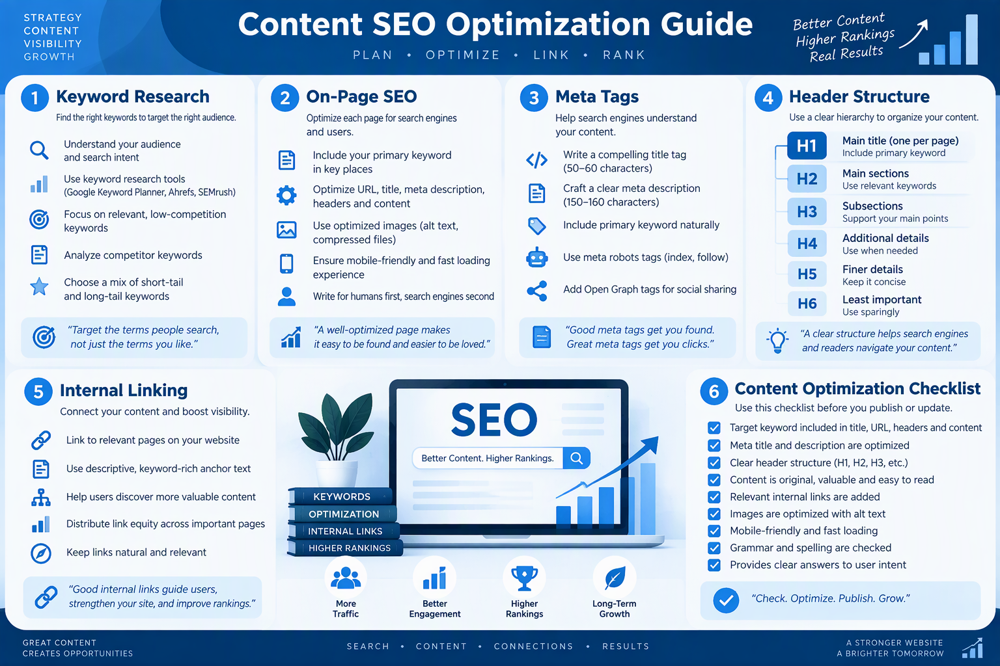

# Panduan Lengkap Podcasting untuk Bisnis UMKM

**Oleh: Siraj Nur Ihrom**
CEO SNISHOP.COM


---

Hak Cipta 2025 SNISHOP.COM. Seluruh hak cipta dilindungi undang-undang.

Tidak ada bagian dari buku ini yang boleh direproduksi, disimpan dalam sistem penyimpanan, atau diteruskan dalam bentuk apa pun tanpa izin tertulis dari penerbit.

Cetakan Pertama: Desember 2025

---

## DAFTAR ISI

**BAGIAN 1: FONDASI PODCASTING**

- Bab 1: Mengapa Podcasting untuk Bisnis UMKM
- Bab 2: Merencanakan Podcast Bisnis
- Bab 3: Peralatan Podcast Budget-Friendly

**BAGIAN 2: PRODUKSI DAN DISTRIBUSI**

- Bab 4: Teknik Recording dan Editing
- Bab 5: Format Konten Podcast
- Bab 6: Distribusi ke Semua Platform
- Bab 7: Cover Art dan Branding Podcast

**BAGIAN 3: PERTUMBUHAN DAN MONETISASI**

- Bab 8: Strategi Growing Audience
- Bab 9: Monetisasi Podcast Bisnis
- Bab 10: Scaling dan Advanced Strategy

**LENGKAPAN**

- Studi Kasus
- Kalkulator ROI Podcast
- Rencana Implementasi 30 Hari
- Kesimpulan
- Tentang Penulis
- Copyright Page

---

# BAGIAN 1: FONDASI PODCASTING

---

## BAB 1: Mengapa Podcasting untuk Bisnis UMKM


### 1.1 Landasan Konsep: Audio sebagai Media Intim

Podcasting bukan sekadar tren. Ini adalah media yang membangun kedekatan emosional antara pembicara dan pendengar. Berbeda dengan konten visual yang bisa di-skip dalam hitungan detik, audio menemani pendengar dalam aktivitas sehari-hari. Saat seseorang mendengarkan podcast, mereka secara sukarela memberikan waktu 20 hingga 60 menit perhatian mereka. Ini adalah tingkat engagement yang tidak bisa dicapai oleh banner iklan atau bahkan video pendek.

Untuk pelaku UMKM, podcasting menawarkan sesuatu yang langka: akses langsung ke pikiran dan hati calon pelanggan tanpa harus membayar iklan mahal. Dalam dunia pemasaran digital yang semakin bising, audio menjadi saluran yang tenang namun sangat efektif.

### 1.2 Statistik Podcasting di Indonesia dan Dunia

Mari kita lihat angka-angka yang menunjukkan kekuatan podcasting:

- Jumlah pendengar podcast global mencapai 547 juta orang pada tahun 2024, meningkat 18 persen dari tahun sebelumnya.
- Di Indonesia, pendengar podcast aktif diperkirakan mencapai 42 juta orang pada tahun 2025, dengan pertumbuhan tahunan sekitar 25 persen.
- Rata-rata pendengar podcast Indonesia menghabiskan 6 jam 45 menit per minggu untuk mendengarkan podcast.
- Demografi pendengar podcast Indonesia: 65 persen berusia 25-44 tahun, 55 persen perempuan, dan 72 persen memiliki daya beli menengah ke atas.
- 54 persen pendengar podcast Indonesia melakukan pembelian setelah mendengar rekomendasi dari podcast yang mereka ikuti.

Angka-angka ini menunjukkan bahwa podcasting bukan hanya soal jumlah pendengar, tetapi juga kualitas audiens yang sangat relevan dengan target pasar UMKM.

### 1.3 Mengapa Audio Lebih Efektif untuk Membangun Kepercayaan

Penelitian dari Edison Research menunjukkan bahwa 73 persen pendengar podcast menganggap host podcast sebagai "teman" atau "mentor". Ini berbeda jauh dengan persepsi terhadap iklan tradisional. Ketika seorang host merekomendasikan produk atau jasa, pendengar menerimanya sebagai saran dari orang yang mereka percayai.

Ada tiga alasan psikologis mengapa audio sangat efektif:

**Pertama, keintiman suara.** Suara manusia membawa nuansa emosi yang tidak bisa ditangkap oleh teks. Ketika pendengar mendengar antusiasme, ketulusan, dan keahlian dalam suara Anda, kepercayaan terbangun secara otomatis.

**Kedua, parasocial relationship.** Pendengar podcast yang mendengarkan Anda setiap minggu selama 30 menit akan merasa mengenal Anda secara personal, meskipun mereka belum pernah bertemu. Hubungan parasosial ini adalah fondasi kepercayaan yang kuat.

**Ketiga, konteks konsumsi.** Podcast didengarkan saat berkendara, berolahraga, atau mengerjakan pekerjaan rumah. Dalam konteks ini, pendengar berada dalam mode reseptif dan lebih terbuka terhadap informasi baru.

### 1.4 Peluang Khusus untuk UMKM

UMKM di Indonesia menghadapi tantangan besar dalam bersaing dengan brand besar. Budget pemasaran terbatas, sumber daya manusia minim, dan persaingan harga semakin ketat. Podcasting menawarkan solusi untuk semua masalah ini:

**Biaya rendah, dampak tinggi.** Anda bisa memulai podcast dengan investasi awal di bawah Rp 1 juta. Bandingkan dengan biaya iklan Facebook yang bisa menghabiskan Rp 5-10 juta per bulan untuk hasil yang belum tentu konsisten.

**Konten evergreen.** Episode podcast yang Anda rekam hari ini bisa terus didengarkan bertahun-tahun ke depan. Satu episode berkualitas bisa menghasilkan ribuan pendengar selama bertahun-tahun tanpa biaya tambahan.

**Otoritas dan diferensiasi.** Dengan menjadi host podcast di niche Anda, Anda memposisikan diri sebagai ahli. Ketika calon pelanggan membutuhkan produk atau jasa di bidang Anda, merekalah yang pertama kali terlintas di pikiran.

### 1.5 Contoh Nyata: UMKM yang Sukses dengan Podcasting

Sebuah toko kopi kecil di Yogyakarta memulai podcast tentang dunia kopi pada tahun 2023. Dengan budget recording nol rupiah (menggunakan kamar tidur sebagai studio), mereka menghasilkan 120 episode dalam setahun. Hasilnya: kunjungan ke toko meningkat 340 persen, penjualan online naik 280 persen, dan mereka berhasil membuka 3 cabang baru.

Kisah sukses seperti ini bukan kebetulan. Ini adalah hasil dari strategi podcasting yang dijalankan secara konsisten dan terarah. Dan Anda bisa melakukannya juga.

### 1.6 Langkah Praktis Memulai

Berikut langkah pertama yang bisa Anda lakukan hari ini:

1. Tentukan satu topik yang Anda kuasai dan relevan dengan bisnis Anda.
2. Identifikasi tiga masalah utama yang dihadapi pelanggan Anda terkait topik tersebut.
3. Rekam satu episode percobaan berdurasi 10 menit menggunakan smartphone Anda.
4. Dengarkan kembali dan evaluasi: apakah konten ini bermanfaat? Apakah suara Anda terdengar jelas?
5. Bagikan ke lima orang terdekat dan minta feedback jujur.

### 1.7 Tips dan Best Practices

- Jangan menunggu peralatan sempurna untuk memulai. Konten yang baik lebih penting dari kualitas audio yang sempurna.
- Fokus pada satu niche spesifik. Podcast yang mencoba menjangkau semua orang pada akhirnya tidak menjangkau siapa-siapa.
- Komitmen minimal 12 episode sebelum mengevaluasi hasil. Kebanyakan podcaster berhenti di episode ke-5, padahal momentum baru terbentuk setelah episode ke-10.
- Dengarkan podcast-podcast sukses di niche Anda untuk memahami format dan gaya yang bekerja.

### 1.8 Checklist Bab 1

- [ ] Saya memahami mengapa podcasting efektif untuk bisnis saya
- [ ] Saya telah mencatat statistik yang relevan untuk meyakinkan diri dan tim
- [ ] Saya telah mengidentifikasi satu topik utama untuk podcast
- [ ] Saya telah merekam satu episode percobaan
- [ ] Saya berkomitmen untuk minimal 12 episode pertama

---

## BAB 2: Merencanakan Podcast Bisnis


### 2.1 Landasan Konsep: Perencanaan adalah Kunci

Podcast yang sukses tidak dimulai dengan menekan tombol record. Ia dimulai dengan perencanaan matang yang menjawab pertanyaan: siapa yang akan mendengarkan, mengapa mereka mau mendengarkan, dan apa yang akan mereka dapatkan. Tanpa jawaban jelas untuk ketiga pertanyaan ini, podcast Anda akan kehilangan arah dan akhirnya ditinggalkan pendengar.

### 2.2 Menentukan Niche Podcast

Niche adalah fondasi dari podcast Anda. Niche yang tepat harus memenuhi tiga kriteria:

**Kriteria pertama: keahlian Anda.** Anda harus memiliki pengetahuan atau pengalaman yang cukup untuk berbicara tentang topik ini secara konsisten. Tidak perlu menjadi ahli dunia, tapi Anda harus tahu lebih banyak dari rata-rata target pendengar Anda.

**Kriteria kedua: minat pasar.** Niche Anda harus memiliki audiens yang cukup besar dan aktif mencari konten tentang topik tersebut. Gunakan Google Trends, keyword research tools, dan forum diskusi untuk memvalidasi minat ini.

**Kriteria ketiga: relevansi bisnis.** Niche podcast harus terhubung dengan produk atau jasa yang Anda jual. Tujuannya bukan hanya mendapatkan pendengar, tetapi mendapatkan pendengar yang pada akhirnya menjadi pelanggan.

Contoh niche podcast untuk berbagai jenis UMKM:

| Jenis UMKM | Niche Podcast | Contoh Judul |
|---|---|---|
| Toko kopi | Dunia kopi dan budaya ngopi | "Secangkir Cerita" |
| Jasa keuangan | Literasi keuangan untuk pemula | "Dompet Cerdas" |
| Fashion | Tips berpenampilan profesional | "Style Story" |
| Kuliner | Resep dan bisnis makanan | "Dapur Untung" |
| Kecantikan | Perawatan kulit dan kosmetik | "Glow Up Guide" |
| Properti | Investasi properti untuk pemula | "Properti Pasti Cuan" |

### 2.3 Mengenal Target Audience

Membuat persona pendengar adalah langkah kritis. Persona yang detail akan memandu setiap keputusan kreatif Anda, dari pemilihan topik hingga gaya bahasa.

Template persona pendengar:

**Nama persona:** Rina, pemilik warung makan
**Usia:** 28-35 tahun
**Pekerjaan:** Pemilik usaha kuliner kecil
**Pendapatan:** Rp 5-15 juta per bulan
**Tantangan:** Kesulitan mengelola keuangan usaha, bingung cara marketing digital
**Kebiasaan mendengarkan:** Saat menyiapkan bahan masakan pagi hari, saat perjalanan ke pasar
**Motivasi mendengarkan:** Ingin belajar tips bisnis yang praktis dan langsung bisa diterapkan
**Hambatan:** Tidak punya banyak waktu, mudah bosan dengan konten terlalu teoritis

Dengan persona seperti ini, Anda bisa merancang episode yang sangat spesifik: durasi 20-25 menit, topik praktis, contoh nyata, dan gaya bahasa yang santai namun informatif.

### 2.4 Memilih Format Podcast

Ada beberapa format podcast yang bisa Anda pilih:

**Solo episode.** Anda berbicara sendirian tentang satu topik. Kelebihan: kontrol penuh atas konten, mudah dijadwalkan. Kekurangan: butuh energi tinggi, kurang variasi.

**Interview.** Anda mewawancarai narasumber. Kelebihan: konten beragam, narasumber bisa membantu promosi. Kekurangan: butuh waktu koordinasi, kualitas tergantung narasumber.

**Co-hosted.** Anda dan satu atau lebih co-host tetap. Kelebihan: dinamika percakapan natural, beban kerja terbagi. Kekurangan: butuh komitmen bersama, perbedaan visi bisa jadi masalah.

**Storytelling.** Anda menceritakan kisah dengan narasi yang terstruktur. Kelebihan: sangat engaging, mudah viral. Kekurangan: butuh skill menulis naskah, produksi lebih lama.

**Rekomendasi untuk pemula:** Mulailah dengan format solo atau interview. Keduanya paling mudah diproduksi dan paling cepat untuk membangun konsistensi.

### 2.5 Menentukan Nama Podcast

Nama podcast adalah first impression. Nama yang baik harus:

- Mudah diucapkan dan diingat (maksimal 3-4 kata)
- Mencerminkan topik dan tone podcast
- Belum digunakan oleh podcast lain (cek di Spotify dan Apple Podcasts)
- Tersedia sebagai username di media sosial
- SEO-friendly (mengandung kata kunci yang relevan)

Proses brainstorming nama podcast:

1. Tulis 20 kata kunci yang terkait dengan niche Anda.
2. Gabungkan kata-kata tersebut menjadi 10 kombinasi nama.
3. Saring menjadi 5 nama terbaik berdasarkan kriteria di atas.
4. Cek ketersediaan di semua platform podcast dan media sosial.
5. Pilih satu dan lakukan "uji telepon": sebutkan nama podcast Anda ke seseorang lewat telepon. Apakah mereka langsung paham dan bisa mengejanya?

### 2.6 Menyusun Strategi Konten Awal

Sebelum merekam episode pertama, siapkan 10 judul episode pertama Anda. Ini akan menjadi roadmap yang menjaga konsistensi Anda.

Template perencanaan 10 episode pertama:

| Episode | Judul | Topik Utama | Format | Durasi Target |
|---|---|---|---|---|
| 1 | Selamat Datang di [Nama Podcast] | Perkenalan dan overview topik | Solo | 15 menit |
| 2 | [Topik Fundamental 1] | Dasar-dasar yang harus dipahami | Solo | 20 menit |
| 3 | Wawancara dengan [Narasumber] | Pengalaman sukses di bidang ini | Interview | 30 menit |
| 4 | [Topik Fundamental 2] | Kesalahan umum yang harus dihindari | Solo | 20 menit |
| 5 | Studi Kasus: [Nama] | Bedah kasus nyata | Solo | 25 menit |
| 6 | [Topik Praktis 1] | Tutorial langkah demi langkah | Solo | 25 menit |
| 7 | Wawancara dengan [Narasumber] | Tips dari praktisi berpengalaman | Interview | 30 menit |
| 8 | [Topik Tren] | Perkembangan terbaru di industri ini | Solo | 20 menit |
| 9 | Tanya Jawab Pendengar | Menjawab pertanyaan dari audiens | Solo | 25 menit |
| 10 | Refleksi dan Rencana ke Depan | Rangkuman dan preview season berikutnya | Solo | 20 menit |

### 2.7 Tips dan Best Practices

- Riset minimal 10 podcast kompetitor di niche Anda. Catat apa yang mereka lakukan dengan baik dan apa yang bisa Anda lakukan lebih baik.
- Jangan meniru podcast lain secara mentah-mentah. Ambil inspirasi, lalu tambahkan keunikan Anda sendiri.
- Buat dokumen "podcast bible" yang berisi panduan tone, gaya bahasa, dan aturan editorial. Ini penting jika nanti Anda bekerja dengan tim.
- Siapkan buffer 3-5 episode yang sudah direkam sebelum Anda meluncurkan podcast. Ini memberi Anda napas jika ada minggu yang sibuk.

### 2.8 Checklist Bab 2

- [ ] Niche podcast sudah ditentukan dan divalidasi
- [ ] Persona pendengar sudah dibuat secara detail
- [ ] Format podcast sudah dipilih
- [ ] Nama podcast sudah ditentukan dan dicek ketersediaannya
- [ ] 10 episode pertama sudah direncanakan
- [ ] Podcast bible sudah dibuat

---

## BAB 3: Peralatan Podcast Budget-Friendly


### 3.1 Landasan Konsep: Kualitas Audio adalah Investasi

Kualitas audio yang buruk adalah alasan nomor satu pendengar meninggalkan podcast. Penelitian dari Buzzsprout menunjukkan bahwa 63 persen pendengar akan berhenti mendengarkan podcast jika kualitas audionya buruk. Namun, Anda tidak perlu mengeluarkan puluhan juta rupiah untuk mendapatkan audio yang layak. Dengan budget yang tepat, Anda bisa menghasilkan kualitas audio yang profesional.

### 3.2 Pilihan Mikrofon Berdasarkan Budget

**Budget di bawah Rp 200.000:**
Gunakan earphone bawaan smartphone atau earphone dengan mikrofon built-in. Ini bukan solusi ideal, tapi cukup untuk memulai. Yang terpenting adalah merekam di ruangan yang tenang dan menjaga jarak mulut ke mikrofon sekitar 5-8 cm.

**Budget Rp 200.000 - Rp 500.000:**
Boya BY-M1 adalah pilihan terbaik di rentang harga ini. Mikrofon lavalier ini menghasilkan kualitas audio yang jauh lebih baik dari earphone biasa. Harganya sekitar Rp 150.000-200.000 dan kompatibel dengan smartphone maupun laptop.

**Budget Rp 500.000 - Rp 1.500.000:**
Samson Q2U atau Audio-Technica ATR2100x adalah pilihan ideal. Keduanya adalah mikrofon USB/XLR yang bisa langsung dicolokkan ke laptop tanpa perlu audio interface. Kualitas audionya sudah sangat layak untuk podcast profesional. Harga: Rp 800.000-1.200.000.

**Budget Rp 1.500.000 - Rp 3.000.000:**
Blue Yeti atau Rode NT-USB Mini menawarkan kualitas audio yang luar biasa. Blue Yeti (Rp 1.500.000-2.000.000) memiliki beberapa pola pickup yang fleksibel. Rode NT-USB Mini (Rp 1.800.000-2.200.000) lebih compact dengan kualitas audio yang sangat jernih.

### 3.3 Headphone dan Monitor Audio

Anda memerlukan headphone untuk monitoring audio saat recording. Pilihan:

- **Budget rendah:** KZ ZSN Pro X (Rp 250.000). In-ear monitor dengan kualitas suara yang sangat baik untuk harganya.
- **Budget menengah:** Audio-Technica ATH-M20x (Rp 700.000). Headphone over-ear yang nyaman untuk sesi recording panjang.
- **Budget tinggi:** Sony MDR-7506 (Rp 1.400.000). Standar industri untuk monitoring audio di studio profesional.

Penting: gunakan headphone closed-back untuk mencegah suara dari headphone bocor ke mikrofon.

### 3.4 Software Recording dan Editing

**Opsi gratis:**

- **Audacity** (Windows/Mac/Linux). Software recording dan editing open-source yang paling populer. Fiturnya lengkap: multi-track recording, noise reduction, equalizer, compressor, dan berbagai efek lainnya.
- **GarageBand** (Mac/iOS). Gratis untuk pengguna Apple. Interface yang intuitif dan fitur yang cukup untuk podcasting profesional.
- **Ocenaudio** (Windows/Mac/Linux). Alternatif Audacity dengan interface yang lebih modern dan ringan.

**Opsi berbayar:**

- **Adobe Audition** (Rp 320.000/bulan). Software profesional dengan fitur lengkap. Cocok jika Anda sudah berlangganan Adobe Creative Cloud.
- **Reaper** (USD 60 untuk lisensi diskon). Sangat powerful dan ringan. Banyak podcaster profesional menggunakan Reaper.
- **Hindenburg Journalist** (USD 95). Dirancang khusus untuk podcasting dan jurnalisme audio. Interface yang sederhana tapi fitur yang sangat relevan.

**Rekomendasi untuk pemula:** Audacity. Gratis, fitur lengkap, dan tutorialnya sangat banyak di YouTube.

### 3.5 Setup Ruangan Recording

Ruangan recording lebih penting dari mikrofon mahal. Ruangan yang bergema akan menghasilkan audio yang buruk, bahkan dengan mikrofon seharga Rp 5 juta. Sebaliknya, ruangan yang teredam baik bisa menghasilkan audio yang layak bahkan dengan mikrofon murah.

Prinsip dasar treatment ruangan:

1. **Pilih ruangan terkecil di rumah Anda.** Ruangan kecil memiliki lebih sedikit refleksi suara. Lemari pakaian adalah pilihan yang sangat baik.
2. **Tambahkan material penyerap suara.** Karpet, gorden tebal, bantal, busa, dan pakaian yang digantung bisa mengurangi gema secara signifikan.
3. **Hindari permukaan keras yang sejajar.** Dinding kosong, lantai keramik, dan jendela besar memantulkan suara. Tutup dengan material lunak.
4. **Matikan sumber kebisingan.** AC, kipas angin, kulkas, dan perangkat elektronik lainnya menghasilkan noise yang terekam oleh mikrofon.

Setup recording budget rendah yang efektif:

| Item | Estimasi Biaya |
|---|---|
| Mikrofon Boya BY-M1 | Rp 180.000 |
| Stand mikrofon darurat (dari kawat) | Rp 0 |
| Ruangan: lemari pakaian dengan gantungan baju | Rp 0 |
| Headphone KZ ZSN Pro X | Rp 250.000 |
| Software: Audacity | Rp 0 |
| Pop filter dari kaos kaki dan hanger | Rp 0 |
| **Total** | **Rp 430.000** |

### 3.6 Pop Filter dan Aksesoris Penting

Pop filter mencegah suara letupan dari huruf-huruf konsonan tertentu (p, b, t, d) yang disebut plosive. Anda bisa membeli pop filter profesional seharga Rp 50.000-100.000, atau membuatnya sendiri dari kaos kaki bersih dan hanger kawat.

Aksesoris lain yang berguna:

- **Boom arm mikrofon** (Rp 150.000-300.000). Menjaga mikrofon tetap stabil dan pada posisi yang tepat.
- **Shock mount** (Rp 80.000-150.000). Mengurangi getaran yang berpindah ke mikrofon.
- **Kabel XLR berkualitas** (Rp 50.000-100.000). Jika Anda menggunakan mikrofon XLR, kabel yang baik mengurangi noise.

### 3.7 Tips dan Best Practices

- Tes rekaman di berbagai lokasi rumah Anda. Bandingkan hasilnya dan pilih lokasi dengan gema dan noise paling sedikit.
- Rekam 30 detik "room tone" (suara ruangan tanpa ada yang berbicara) di awal setiap sesi recording. Ini berguna untuk proses editing.
- Selalu gunakan headphone saat recording. Anda perlu mendengar apa yang didengar oleh mikrofon.
- Simpan file recording dalam format WAV atau AIFF (bukan MP3) untuk menjaga kualitas audio selama proses editing.

### 3.8 Checklist Bab 3

- [ ] Mikrofon sudah dipilih sesuai budget
- [ ] Headphone sudah disiapkan
- [ ] Software recording sudah diinstal dan dicoba
- [ ] Ruangan recording sudah di-setup dan dites
- [ ] Pop filter dan aksesoris sudah disiapkan
- [ ] Satu episode tes sudah direkam dan dievaluasi

---

# BAGIAN 2: PRODUKSI DAN DISTRIBUSI

---

## BAB 4: Teknik Recording dan Editing


### 4.1 Landasan Konsep: Recording yang Benar Menghemat Waktu Editing

Banyak pemula fokus pada editing dan mengabaikan teknik recording yang baik. Padahal, recording yang baik mengurangi waktu editing hingga 70 persen. Jika Anda merekam dengan teknik yang benar, editing hanya perlu pembersihan minor. Jika recording Anda buruk, tidak ada software editing yang bisa memperbaikinya secara sempurna.

### 4.2 Teknik Recording: Persiapan Pra-Recording

**Persiapan naskah dan outline.**
Jangan merekam tanpa persiapan. Minimal, siapkan outline berisi poin-poin utama yang akan dibahas. Untuk episode solo, buat outline dengan struktur:

- Pembuka (30-60 detik): sapa pendengar, perkenalkan diri, sampaikan topik episode
- Isi utama (15-25 menit): 3-5 poin utama dengan penjelasan dan contoh
- Penutup (30-60 detik): rangkuman, call to action, penutup

**Persiapan teknis.**
Sebelum menekan tombol record:

1. Pastikan mikrofon terhubung dan terdeteksi oleh software.
2. Atur input level mikrofon di kisaran -12 dB hingga -6 dB. Jangan sampai menyentuh 0 dB (clipping).
3. Pakai headphone dan tes monitoring audio.
4. Rekam 10 detik tes, dengarkan kembali, pastikan tidak ada noise atau masalah.
5. Matikan notifikasi smartphone dan komputer.
6. Siapkan air minum suhu ruang untuk menjaga tenggorokan.

### 4.3 Teknik Recording: Saat Berbicara

**Jarak mulut ke mikrofon.**
Jarak ideal adalah 15-20 cm (sekitar satu jengkal) dari mikrofon. Terlalu dekat menghasilkan suara bass berlebihan dan plosive. Terlalu jauh menghasilkan suara tipis dan banyak room noise.

**Posisi mikrofon.**
Letakkan mikrofon sedikit di bawah atau sejajar dengan mulut, dengan sudut sedikit mengarah ke atas. Jangan berbicara langsung ke depan mikrofon (untuk menghindari plosive), tapi agak menyamping sekitar 15-30 derajat.

**Kecepatan bicara.**
Kecepatan ideal untuk podcast adalah 150-170 kata per menit. Ini sedikit lebih lambat dari kecepatan percakapan normal. Bicara terlalu cepat membuat pendengar kesulitan mengikuti, bicara terlalu lambat membuat pendengar bosan.

**Variasi intonasi.**
Suara yang monoton adalah pembunuh podcast. Gunakan variasi intonasi untuk menjaga perhatian pendengar. Tekankan kata-kata penting, gunakan jeda untuk efek dramatis, dan ubah tempo sesuai konteks.

**Mengelola kesalahan.**
Jika Anda melakukan kesalahan, jangan berhenti recording. Cukup diam selama 3 detik, lalu ulangi kalimat dari awal. Jeda 3 detik akan terlihat jelas di waveform dan memudahkan Anda menemukan titik edit.

### 4.4 Editing Dasar dengan Audacity

**Langkah 1: Import dan organize.**
Buka Audacity, import file recording Anda (File > Import > Audio). Jika Anda memiliki intro, outro, atau segmen musik, import juga ke track terpisah.

**Langkah 2: Noise reduction.**
Pilih segmen "room tone" yang sudah Anda rekam di awal. Klik Effect > Noise Reduction > Get Noise Profile. Kemudian pilih seluruh track (Ctrl+A), buka Effect > Noise Reduction lagi, dan Apply dengan setting default (Noise reduction: 12 dB, Sensitivity: 6.0, Frequency smoothing: 3).

**Langkah 3: Hapus kesalahan dan jeda panjang.**
Identifikasi bagian yang perlu dihapus (kesalahan bicara, batuk, notifikasi). Gunakan Selection Tool untuk memilih bagian tersebut, lalu tekan Delete. Untuk jeda yang terlalu panjang, pilih dan hapus sebagian, sisakan jeda 0.5-1 detik antar segmen.

**Langkah 4: Equalization (EQ).**
Klik Effect > Filter Curve EQ. Gunakan preset "Bass Boost" ringan untuk menambah kehangatan suara, atau buat custom curve: naikkan frekuensi 80-150 Hz sebanyak 2-3 dB, turunkan frekuensi 300-500 Hz sebanyak 1-2 dB untuk mengurangi suara "muddy", naikkan frekuensi 3000-5000 Hz sebanyak 1-2 dB untuk menambah kejernihan.

**Langkah 5: Compression.**
Klik Effect > Compressor. Setting yang direkomendasikan: Threshold: -18 dB, Noise Floor: -40 dB, Ratio: 3:1, Attack Time: 0.2 sec, Release Time: 1.0 sec. Compression membuat volume suara lebih konsisten, sehingga pendengar tidak perlu bolak-balik mengatur volume.

**Langkah 6: Normalization.**
Klik Effect > Normalize. Set target level ke -3 dB. Ini memastikan volume podcast Anda konsisten dengan podcast lain di platform.

**Langkah 7: Export.**
File > Export > Export as MP3. Pilih bitrate 128 kbps untuk file yang lebih kecil, atau 192 kbps untuk kualitas lebih tinggi. Format mono (bukan stereo) untuk podcast solo, karena tidak ada perbedaan posisi suara.

### 4.5 Template Struktur Episode

Template ini bisa Anda gunakan untuk setiap episode:

```
STRUKTUR EPISODE PODCAST
=========================

[00:00 - 00:30] INTRO
- Musik intro (5-10 detik)
- Sapaan: "Halo dan selamat datang di [Nama Podcast]"
- Perkenalan singkat host
- Preview topik hari ini

[00:30 - 02:00] PEMBUKAAN
- Hook: fakta menarik atau pertanyaan provokatif
- Konteks: mengapa topik ini penting
- Apa yang akan pendengar pelajari

[02:00 - 18:00] KONTEN UTAMA
- Poin 1: [Judul] + penjelasan + contoh
- Poin 2: [Judul] + penjelasan + contoh
- Poin 3: [Judul] + penjelasan + contoh

[18:00 - 20:00] RANGKUMAN DAN CTA
- Rangkuman 3 poin utama
- Call to action: follow, review, share
- Preview episode berikutnya

[20:00 - 20:30] PENUTUP
- Terima kasih
- Musik outro
```

### 4.6 Tips dan Best Practices

- Rekam di waktu yang sama setiap hari untuk konsistensi kualitas suara. Suara Anda berubah sepanjang hari, dan recording di waktu yang sama memudahkan editing.
- Minum air putih 30 menit sebelum recording. Hindari kopi dan susu karena bisa menghasilkan suara "klik" di tenggorokan.
- Berdiri atau duduk tegak saat recording. Postur yang baik memengaruhi kualitas suara.
- Simpan project file editing Anda. Jika nanti perlu merevisi, Anda tidak perlu mengulang dari awal.

### 4.7 Checklist Bab 4

- [ ] Outline episode sudah disiapkan sebelum recording
- [ ] Setting level mikrofon sudah benar (-12 dB sampai -6 dB)
- [ ] Room tone sudah direkam
- [ ] Noise reduction sudah diterapkan
- [ ] EQ dan compression sudah di-setting
- [ ] Episode sudah di-export dalam format MP3 128 kbps atau lebih tinggi
- [ ] Episode sudah didengarkan kembali secara utuh sebelum dipublikasikan

---

## BAB 5: Format Konten Podcast


### 5.1 Landasan Konsep: Format Menentukan Engagement

Format podcast bukan sekadar kemasan. Format yang tepat membuat konten Anda lebih mudah dicerna, lebih engaging, dan lebih mudah diproduksi secara konsisten. Memilih format yang sesuai dengan kekuatan Anda dan preferensi audiens adalah keputusan strategis yang memengaruhi seluruh perjalanan podcast Anda.

### 5.2 Format Solo: Kekuatan Satu Suara

Episode solo adalah format paling sederhana dan paling cepat untuk memulai. Anda berbicara sendiri tentang satu topik selama 15-30 menit.

**Kapan menggunakan format solo:**
- Menjelaskan konsep atau teori
- Berbagi pengalaman pribadi
- Memberikan tutorial langkah demi langkah
- Merespons pertanyaan pendengar
- Mengomentari isu terkini di industri Anda

**Tips untuk episode solo yang engaging:**
- Buat outline yang detail. Episode solo tanpa persiapan akan terasa berantakan.
- Gunakan storytelling. Bungkus informasi dalam cerita agar lebih mudah diingat.
- Bayangkan Anda sedang berbicara dengan satu orang spesifik (persona pendengar Anda).
- Variasi kecepatan dan volume suara untuk menghindari monoton.
- Selingi dengan pertanyaan retoris untuk menjaga pendengar tetap terlibat.

**Contoh episode solo yang efektif:**
Judul: "5 Kesalahan Keuangan yang Menghancurkan UMKM di Tahun Pertama"
Durasi: 22 menit
Struktur: Pembuka dengan statistik (2 menit), lima kesalahan masing-masing 3-4 menit dengan contoh nyata, penutup dengan rangkuman dan CTA (2 menit).

### 5.3 Format Interview: Belajar dari Ahli

Format interview membawa perspektif baru dan memperkaya konten podcast Anda. Narasumber juga bisa menjadi saluran promosi silang, karena mereka kemungkinan besar akan membagikan episode tersebut ke audiens mereka.

**Cara mencari narasumber:**
- Pelanggan setia Anda yang memiliki cerita menarik
- Praktisi lain di industri yang sama atau terkait
- Penulis buku atau blogger di niche Anda
- Pemilik UMKM lain yang sukses dan mau berbagi
- Komunitas online di niche Anda

**Template pertanyaan interview:**
1. Bisa ceritakan latar belakang Anda dan bagaimana Anda memulai di bidang ini?
2. Apa tantangan terbesar yang Anda hadapi di awal?
3. Bisa bagikan satu momen penting yang mengubah arah bisnis Anda?
4. Apa kesalahan yang paling sering Anda lihat dilakukan pemula di bidang ini?
5. Jika Anda bisa mulai dari nol lagi, apa yang akan Anda lakukan berbeda?
6. Apa satu saran praktis yang bisa pendengar terapkan minggu ini?

**Tips interview yang baik:**
- Riset narasumber sebelum interview. Jangan bertanya hal yang bisa Anda temukan di Google.
- Kirimkan daftar pertanyaan utama kepada narasumber 3-5 hari sebelum recording agar mereka bisa mempersiapkan jawaban.
- Dengarkan aktif. Respons apa yang dikatakan narasumber, jangan hanya membaca pertanyaan berikutnya dari daftar.
- Siapkan pertanyaan cadangan: "Ada hal lain yang ingin Anda tambahkan?"

### 5.4 Format Co-Hosted: Dinamika Percakapan

Podcast dengan dua atau lebih host tetap memiliki energi yang berbeda. Percakapan terasa lebih natural dan dinamis, serta beban produksi terbagi.

**Cara memilih co-host:**
- Seseorang yang memiliki pengetahuan atau perspektif berbeda dari Anda
- Orang yang nyaman berbicara di depan mikrofon
- Komitmen waktu yang sama (karena Anda perlu recording bersama)
- Chemistry yang baik (tes dengan 2-3 kali recording percobaan)

**Aturan dasar co-hosted podcast:**
- Bagi peran: siapa membuka, siapa menyampaikan poin utama, siapa menutup
- Tentukan sinyal non-verbal untuk pergantian bicara (mengangguk, mengangkat tangan)
- Jangan saling memotong kecuali untuk menambahkan konteks singkat
- Lakukan briefing 10 menit sebelum recording untuk menyelaraskan ekspektasi

### 5.5 Format Storytelling: Kekuatan Narasi

Format storytelling adalah yang paling engaging tapi juga paling sulit diproduksi. Anda menceritakan kisah dengan struktur naratif yang memiliki awal, tengah, dan akhir.

**Elemen storytelling yang efektif:**
- Karakter: seseorang yang pendengar bisa dukung atau kagumi
- Konflik: tantangan atau masalah yang harus diatasi
- Turning point: momen kritis yang mengubah segalanya
- Resolusi: bagaimana karakter mengatasi masalah
- Pelajaran: insight yang bisa pendengar terapkan

**Contoh episode storytelling:**
"Bagaimana Bu Sari dari Surabaya Mengubah Warung Tegal Menjadi Franchise 50 Cabang"
Struktur: Perkenalan Bu Sari dan warungnya (3 menit), masa-masa sulit dan hampir bangkrut (5 menit), momen turning point ketika seorang pelanggan memberi saran (3 menit), proses transformasi (7 menit), kondisi sekarang dan pelajaran yang bisa dipetik (5 menit).

### 5.6 Format Panel Diskusi

Format panel melibatkan 3-5 orang yang mendiskusikan satu topik dari berbagai sudut pandang. Format ini cocok untuk membahas isu kontroversial atau tren terkini.

**Keunggulan format panel:**
- Multiple perspektif membuat diskusi lebih kaya
- Interaksi antar panelis menciptakan dinamika yang menarik
- Setiap panelis membawa audiensnya sendiri

**Tantangan format panel:**
- Koordinasi jadwal lebih sulit
- Butuh moderator yang kuat untuk menjaga diskusi tetap fokus
- Durasi cenderung lebih panjang (45-60 menit)
- Mixing audio dari beberapa sumber membutuhkan skill tambahan

### 5.7 Rekomendasi Kombinasi Format

Untuk podcast bisnis UMKM, kombinasi terbaik adalah:

- 50 persen episode solo (tutorial, tips, insight)
- 30 persen episode interview (narasumber tamu)
- 10 persen episode storytelling (kasus nyata)
- 10 persen format lain (panel, Q&A, review)

Kombinasi ini menjaga variasi tanpa mengorbankan konsistensi dan kemudahan produksi.

### 5.8 Tips dan Best Practices

- Jangan mengubah-ubah format terlalu sering di 12 episode pertama. Biarkan pendengar terbiasa dengan format Anda.
- Apapun format yang Anda pilih, pastikan audio quality tetap konsisten.
- Catat episode mana yang menggunakan format apa, dan track performanya. Data akan menunjukkan format apa yang paling disukai audiens Anda.

### 5.9 Checklist Bab 5

- [ ] Format utama podcast sudah dipilih
- [ ] Template struktur episode sudah dibuat
- [ ] Daftar calon narasumber sudah disiapkan (minimal 10 nama)
- [ ] Satu episode percobaan sudah direkam dalam format pilihan
- [ ] Rencana kombinasi format sudah disusun

---

## BAB 6: Distribusi ke Semua Platform


### 6.1 Landasan Konsep: Di Mana Pendengar Anda Berada

Membuat podcast yang hebat hanya setengah dari persamaan. Setengah lainnya adalah memastikan podcast tersebut bisa ditemukan dan didengarkan oleh target audiens Anda. Distribusi yang tepat menempatkan podcast Anda di semua platform yang digunakan oleh calon pendengar.

### 6.2 Memahami RSS Feed

RSS (Really Simple Syndication) feed adalah jantung distribusi podcast. RSS feed adalah file XML yang berisi informasi tentang podcast Anda dan semua episodenya. Dari satu RSS feed, podcast Anda bisa muncul di puluhan platform sekaligus.

**Cara kerja RSS feed:**
1. Anda mengupload file MP3 episode ke hosting podcast.
2. Hosting podcast mengupdate RSS feed Anda dengan informasi episode baru.
3. Platform podcast (Spotify, Apple Podcasts, dll.) membaca RSS feed Anda secara berkala.
4. Ketika mereka mendeteksi episode baru, episode tersebut otomatis muncul di platform mereka.

Artinya: Anda cukup mengupload episode sekali, dan podcast Anda otomatis terdistribusi ke semua platform.

### 6.3 Memilih Hosting Podcast

Hosting podcast adalah tempat Anda menyimpan file audio dan mengelola RSS feed. Pilihan hosting populer:

**Hosting gratis:**

- **Anchor (sekarang Spotify for Podcasters).** Gratis tanpa batas storage dan bandwidth. Terintegrasi langsung dengan Spotify. Fitur: analytics dasar, distribusi otomatis ke Spotify. Kekurangan: branding Anchor, fitur terbatas.
- **Podbean (free tier).** Gratis dengan batas 5 jam total audio. Distribusi ke semua platform utama. Cocok untuk mencoba-coba.

**Hosting berbayar:**

- **Podbean (Rp 130.000/bulan).** Unlimited hosting, distribusi ke semua platform, analytics detail, monetization tools.
- **Buzzsprout (mulai Rp 180.000/bulan).** Interface yang sangat user-friendly, magic mastering (auto-enhance audio), distribusi ke semua platform.
- **Libsyn (mulai Rp 75.000/bulan).** Salah satu hosting tertua dan paling terpercaya. Analytics detail, integrasi luas.
- **Transistor (mulai Rp 280.000/bulan).** Mendukung multiple podcasts dalam satu akun, analytics canggih, website podcast gratis.

**Rekomendasi untuk pemula:** Spotify for Podcasters (gratis) untuk memulai, upgrade ke Buzzsprout atau Podbean ketika podcast sudah memiliki pendengar tetap.

### 6.4 Distribusi ke Platform Utama

**Spotify.**
Platform podcast terbesar di Indonesia. Cara submit:
1. Upload episode ke hosting podcast dan dapatkan RSS feed URL.
2. Buka spotify.com/podcasts dan klik "Submit your podcast".
3. Masukkan RSS feed URL dan verifikasi email Anda.
4. Spotify akan memverifikasi RSS feed (biasanya dalam 1-5 hari kerja).
5. Setelah disetujui, episode baru akan otomatis muncul.

**Apple Podcasts.**
Platform podcast terbesar kedua dan paling berpengaruh secara global. Cara submit:
1. Siapkan RSS feed URL dari hosting Anda.
2. Buka Apple Podcasts Connect (podcastsconnect.apple.com).
3. Klik tanda tambah dan masukkan RSS feed URL.
4. Verifikasi dan submit. Apple akan mereview (1-5 hari kerja).
5. Setelah disetujui, podcast Anda muncul di Apple Podcasts.

**Google Podcasts (sekarang terintegrasi dengan YouTube Music).**
Google telah menggabungkan Google Podcasts ke YouTube Music. Cara submit:
1. Upload ke hosting podcast terlebih dahulu.
2. Podcast Anda akan otomatis terindeks oleh YouTube Music jika RSS feed Anda memenuhi standar.
3. Pastikan RSS feed Anda memiliki tag yang benar (title, description, artwork, episode type).

**YouTube.**
Podcast dalam format video (atau static image dengan audio) bisa diupload ke YouTube. Langkah:
1. Buat video sederhana dari cover art dan audio podcast (bisa menggunakan Canva atau video editor).
2. Upload ke YouTube dengan judul dan deskripsi yang mengandung kata kunci.
3. Tambahkan timestamp di deskripsi untuk memudahkan navigasi.
4. YouTube menjangkau audiens yang sangat besar dan podcast Anda bisa ditemukan melalui pencarian YouTube.

**Platform lain yang perlu dipertimbangkan:**
- Deezer (populer di Eropa dan beberapa segmen pasar Indonesia)
- SoundCloud (untuk audiens musik dan kreatif)
- Amazon Music/Audible (pasar global yang besar)
- NOICE (platform podcast lokal Indonesia)

### 6.5 Optimasi Metadata untuk Discoverability

Metadata yang baik membuat podcast Anda mudah ditemukan. Elemen metadata yang perlu dioptimasi:

**Judul podcast.** Harus mengandung kata kunci utama. Contoh: "Dompet Cerdas: Tips Keuangan untuk UMKM" lebih baik dari sekadar "Dompet Cerdas".

**Deskripsi podcast.** Tulis 150-300 kata yang menjelaskan apa yang akan pendengar dapatkan. Sertakan kata kunci secara natural. Contoh:

"Dompet Cerdas adalah podcast mingguan untuk pemilik UMKM Indonesia yang ingin mengelola keuangan bisnis dengan lebih baik. Setiap episode, kami membahas tips praktis tentang pembukuan, arus kas, pajak, dan strategi keuangan lainnya yang langsung bisa Anda terapkan. Cocok untuk pemilik warung, toko online, restoran, dan usaha kecil lainnya yang ingin bisnisnya lebih profitable."

**Judul episode.** Gunakan format yang konsisten dan mengandung kata kunci. Contoh: "Ep. 15 - Cara Mengatur Arus Kas UMKM agar Tidak Boncos" lebih baik dari "Episode 15".

**Deskripsi episode.** Tulis ringkasan 100-200 kata untuk setiap episode. Sertakan poin-poin utama yang dibahas dan link ke sumber daya yang disebutkan.

**Tags dan kategori.** Pilih kategori yang paling relevan (Business, Education, Marketing, dll.) dan tambahkan tags yang sesuai.

### 6.6 Tips dan Best Practices

- Submit podcast Anda ke minimal 5 platform berbeda. Jangan hanya mengandalkan satu platform.
- Upload episode ke hosting 24-48 jam sebelum jadwal rilis untuk memberi waktu platform memperbarui feed mereka.
- Selalu tambahkan show notes di setiap episode. Ini berguna untuk SEO dan memberikan konteks bagi pendengar.
- Pertimbangkan membuat transkrip episode. Ini meningkatkan SEO secara signifikan dan membuat konten Anda bisa ditemukan melalui pencarian teks.

### 6.7 Checklist Bab 6

- [ ] Hosting podcast sudah dipilih dan akun sudah dibuat
- [ ] RSS feed sudah dibuat dan diverifikasi
- [ ] Podcast sudah di-submit ke Spotify
- [ ] Podcast sudah di-submit ke Apple Podcasts
- [ ] Podcast sudah di-submit ke YouTube Music
- [ ] Podcast sudah di-submit ke YouTube (sebagai video)
- [ ] Metadata (judul, deskripsi, tags) sudah dioptimasi
- [ ] Show notes template sudah disiapkan

---

## BAB 7: Cover Art dan Branding Podcast



### 7.1 Landasan Konsep: Visual yang Menarik Perhatian

Cover art adalah hal pertama yang dilihat calon pendengar saat menemukan podcast Anda di platform. Dalam hitungan detik, mereka memutuskan apakah podcast Anda menarik atau tidak. Cover art yang profesional meningkatkan kredibilitas dan menarik lebih banyak klik.

### 7.2 Spesifikasi Cover Art

Setiap platform memiliki persyaratan cover art yang sedikit berbeda, tapi standar umum adalah:

- Ukuran: 3000 x 3000 piksel (1:1 ratio)
- Format: JPEG atau PNG
- Warna: RGB
- Minimum 1400 x 1400 piksel (syarat minimum Apple Podcasts)
- Tidak boleh mengandung konten ofensif atau menyesatkan

**Rekomendasi:** Buat cover art dengan ukuran 3000 x 3000 piksel. Ini memenuhi semua persyaratan platform dan tetap tajam saat ditampilkan dalam ukuran kecil di smartphone.

### 7.3 Prinsip Desain Cover Art yang Efektif

**Prinsip pertama: sederhana dan bold.** Cover art podcast ditampilkan dalam ukuran sangat kecil di smartphone (sekitar 100 x 100 piksel di daftar episode). Desain yang rumit akan terlihat berantakan. Gunakan elemen visual yang sedikit tapi besar dan jelas.

**Prinsip kedua: tipografi yang mudah dibaca.** Nama podcast harus bisa dibaca bahkan dalam ukuran kecil. Pilih font yang bold dan sans-serif. Hindari font dekoratif yang sulit dibaca dalam ukuran kecil. Kontras antara teks dan background harus tinggi.

**Prinsip ketiga: konsisten dengan brand.** Cover art harus selaras dengan identitas visual bisnis Anda secara keseluruhan. Gunakan palet warna dan gaya yang sama dengan brand Anda yang lain.

**Prinsip keempat: wajah manusia meningkatkan engagement.** Penelitian menunjukkan bahwa cover art dengan wajah host (ekspresi ramah atau percaya diri) cenderung mendapatkan lebih banyak klik. Ini karena wajah manusia menarik perhatian secara alami dan membangun koneksi emosional.

### 7.4 Membuat Cover Art dengan Canva

Canva adalah tool desain paling accessible untuk UMKM. Berikut langkah membuat cover art podcast di Canva:

1. Buka Canva dan buat desain baru dengan ukuran 3000 x 3000 piksel.
2. Pilih template "Podcast Cover" atau mulai dari kanvas kosong.
3. Pilih background: gunakan warna solid, gradient, atau foto berkualitas tinggi.
4. Tambahkan nama podcast dengan font yang bold dan mudah dibaca.
5. Tambahkan tagline singkat (opsional), maksimal 5-7 kata.
6. Tambahkan foto host (opsional tapi direkomendasikan).
7. Tambahkan elemen visual pendukung: ikon, ilustrasi, atau bentuk geometris.
8. Pastikan semua elemen terlihat jelas saat desain di-zoom out ke ukuran kecil.
9. Export dalam format PNG dengan kualitas tinggi.

**Estimasi biaya:** Canva Pro Rp 79.000/bulan. Atau gunakan Canva gratis yang sudah memiliki cukup banyak template dan elemen.

### 7.5 Intro dan Outro Musik

Musik intro dan outro adalah bagian dari identitas sonic podcast Anda. Musik ini menandai awal dan akhir episode, menciptakan ritual yang dikenali oleh pendengar.

**Sumber musik gratis dan legal:**

- **YouTube Audio Library.** Ratusan track musik gratis yang bisa digunakan untuk podcast. Filter berdasarkan genre, mood, dan durasi.
- **Free Music Archive.** Koleksi musik Creative Commons yang sangat besar.
- **Incompetech.** Musik gratis dari Kevin MacLeod, dengan atribusi.
- **Pixabay Music.** Musik gratis berkualitas tinggi tanpa perlu atribusi.

**Sumber musik berbayar:**

- **Epidemic Sound** (Rp 200.000/bulan). Koleksi musik yang sangat besar, kualitas tinggi, lisensi mencakup semua penggunaan.
- **Artlist** (USD 166/tahun). Musik berkualitas tinggi dengan lisensi seumur hidup.
- **AudioJungle** (mulai USD 5 per track). Beli per track, cocok jika budget terbatas.

**Durasi intro ideal:** 5-15 detik. Intro yang terlalu panjang membuat pendengar tidak sabar. Intro yang terlalu singkat tidak memberikan efek penanda.

**Elemen intro yang efektif:**
- Musik yang mencerminkan tone podcast (energik untuk bisnis, tenang untuk self-improvement)
- Nama podcast yang diucapkan atau ditampilkan
- Tagline singkat (opsional)
- Nama host (opsional)

### 7.6 Membangun Identitas Sonic

Identitas sonic lebih dari sekadar intro dan outro. Ini mencakup seluruh pengalaman audio podcast Anda:

- **Voice tone:** Bagaimana Anda berbicara (formal, santai, energik, tenang)
- **Pacing:** Kecepatan bicara yang konsisten
- **Sound design:** Efek suara, transisi, dan elemen audio lainnya
- **Musik:** Genre dan mood musik yang konsisten di seluruh episode

Identitas sonic yang kuat membuat podcast Anda langsung dikenali bahkan sebelum host berbicara. Bayangkan seperti jingle "McDonald's, I'm Lovin' It" - beberapa nada saja sudah cukup untuk mengenali brand.

### 7.7 Tips dan Best Practices

- Buat 3-5 variasi cover art dan tanyakan pendapat 10-20 orang dari target audiens Anda. Pilih yang paling banyak disuka.
- Dengarkan intro podcast-podcast sukses di niche Anda untuk memahami standar dan ekspektasi pendengar.
- Gunakan musik yang konsisten di seluruh episode. Mengganti musik intro di tengah jalan bisa membingungkan pendengar setia.
- Pastikan Anda memiliki lisensi yang tepat untuk semua musik yang digunakan. Menggunakan musik berhak cipta tanpa izin bisa menyebabkan podcast Anda di-takedown.

### 7.8 Checklist Bab 7

- [ ] Cover art sudah dibuat dengan ukuran 3000 x 3000 piksel
- [ ] Cover art sudah dites dalam ukuran kecil (100 x 100 piksel) dan tetap terbaca
- [ ] Intro musik sudah dipilih atau dibuat (durasi 5-15 detik)
- [ ] Outro musik sudah dipilih atau dibuat (durasi 5-10 detik)
- [ ] Lisensi musik sudah dipastikan legal
- [ ] Identitas sonic podcast sudah konsisten
- [ ] Cover art sudah di-upload ke semua platform podcast

---

# BAGIAN 3: PERTUMBUHAN DAN MONETISASI

---

## BAB 8: Strategi Growing Audience


### 8.1 Landasan Konsep: Pertumbuhan yang Terukur

Membangun audiens podcast tidak terjadi secara kebetulan. Butuh strategi yang dijalankan secara konsisten dan terukur. Pada bab ini, kita akan membahas taktik-taktik spesifik yang telah terbukti efektif untuk mengembangkan audiens podcast bisnis.

### 8.2 SEO Podcast: Agar Podcast Anda Ditemukan

**Optimasi judul episode.**
Judul episode adalah elemen SEO paling penting. Setiap judul harus mengandung kata kunci yang dicari oleh target pendengar Anda.

Contoh optimasi judul:
- Buruk: "Episode 12 - Ngobrol Bareng Pak Budi"
- Baik: "Ep. 12 - Tips Negosiasi dengan Supplier untuk UMKM | Bersama Budi Santoso"

Judul yang baik mengandung: nomor episode, topik utama dengan kata kunci, nama narasumber (jika ada), dan target audiens.

**Optimasi deskripsi episode.**
Deskripsi episode harus 150-300 kata dan mengandung kata kunci secara natural. Tulis seperti ringkasan artikel blog yang informatif.

**Pemanfaatan show notes.**
Show notes adalah halaman web yang menyertai setiap episode. Jika hosting podcast Anda menyediakan halaman show notes, optimalkan halaman ini seperti artikel blog: gunakan heading, subheading, bullet points, dan kata kunci.

### 8.3 Cross-Promotion: Meminjam Audiens Orang Lain

Cross-promotion adalah cara tercepat untuk menjangkau audiens baru. Prinsipnya sederhana: Anda mempromosikan podcast orang lain, dan mereka mempromosikan podcast Anda.

**Jenis cross-promotion:**

- **Podcast swap.** Anda merekam iklan 30-60 detik untuk podcast lain, dan mereka merekam iklan untuk podcast Anda. Iklan ini ditayangkan di episode masing-masing.
- **Guest appearance.** Anda menjadi narasumber di podcast lain, dan sebaliknya. Ini lebih efektif dari podcast swap karena Anda memberikan nilai langsung kepada audiens.
- **Shoutout.** Saling merekomendasikan podcast di media sosial atau di akhir episode.

**Cara mencari partner cross-promotion:**
1. Daftar 20 podcast di niche yang sama atau beririsan dengan podcast Anda.
2. Dengarkan beberapa episode mereka untuk memahami kualitas dan audiens.
3. Kirim email atau DM yang sopan, jelaskan podcast Anda dan tawarkan cross-promotion.
4. Mulai dengan podcast yang memiliki jumlah pendengar serupa dengan Anda.

### 8.4 Strategi Media Sosial

**Instagram dan TikTok.**
Platform visual ini bisa digunakan untuk mempromosikan podcast dengan cara:

- Buat quote cards dari insight terbaik di podcast (3-5 quote per episode).
- Buat video pendek 30-60 detik yang berisi cuplikan audio menarik dari podcast, dengan caption visual.
- Buat carousel yang merangkum poin-poin utama episode.
- Gunakan Instagram Stories untuk behind-the-scenes proses recording.
- Buat Reels/TikTok yang menjawab satu pertanyaan dari episode podcast, dengan CTA "dengarkan episode lengkapnya di bio".

**Facebook.**
- Buat grup Facebook yang terkait dengan topik podcast. Grup ini menjadi komunitas dan saluran distribusi episode baru.
- Bagikan episode baru di profil pribadi dan halaman bisnis.
- Ikuti dan berpartisipasi aktif di grup Facebook yang relevan dengan niche Anda.

**LinkedIn.**
- Sangat efektif untuk podcast bisnis B2B.
- Tulis artikel LinkedIn yang mengintegrasikan insight dari podcast Anda.
- Bagikan episode di feed LinkedIn dengan caption yang memberikan value.

**Twitter/X.**
- Buat thread yang merangkum poin-poin utama episode.
- Tag narasumber saat membagikan episode baru.
- Ikuti dan berinteraksi dengan komunitas podcast di niche Anda.

### 8.5 Community Building

Komunitas yang loyal adalah aset terbesar podcast Anda. Anggota komunitas bukan hanya pendengar, tapi juga promotor yang menyebarkan podcast Anda secara organik.

**Cara membangun komunitas:**

1. **Grup WhatsApp atau Telegram.** Buat grup eksklusif untuk pendengar setia. Bagikan konten eksklusif, behind-the-scenes, dan kesempatan berinteraksi langsung.
2. **Sesi tanya jawab rutin.** Dedikasikan satu episode per bulan untuk menjawab pertanyaan dari pendengar. Ini membuat pendengar merasa didengarkan.
3. **Event online.** Adakan live session, webinar, atau meetup virtual untuk pendengar podcast.
4. **User-generated content.** Minta pendengar mengirimkan cerita, pertanyaan, atau saran topik. Feature konten mereka di episode podcast.
5. **Program referral.** Berikan insentif bagi pendengar yang mengajak teman untuk mendengarkan podcast Anda.

### 8.6 Strategi Launch yang Efektif

Jangan hanya merilis episode satu per satu. Lakukan launch yang strategis:

**Strategi "3 episode sekaligus":**
Saat meluncurkan podcast, rilis 3 episode sekaligus di hari pertama. Ini memberi pendengar baru kesempatan untuk langsung "binge listening" dan memahami value podcast Anda. Satu episode tidak cukup untuk membuat seseorang menjadi pendengar setia.

**Strategi "pre-launch hype":**
- H-14: umumkan di semua media sosial bahwa Anda akan meluncurkan podcast.
- H-7: bagikan cover art dan trailer podcast (30-60 detik).
- H-3: bagikan sneak peek isi episode pertama.
- H-1: ingatkan lagi dan minta followers untuk subscribe di hari-H.
- Hari-H: rilis 3 episode sekaligus, bagikan di semua channel.
- H+1 sampai H+7: bagikan testimonial dari pendengar awal, behind-the-scenes, dan highlight dari episode.

### 8.7 Tips dan Best Practices

- Konsistensi adalah segalanya. Rilis episode di hari dan jam yang sama setiap minggu. Pendengar akan mengharapkan episode baru di waktu tersebut.
- Selalu minta pendengar untuk subscribe, rate, dan review di akhir setiap episode. Banyak pendengar tidak melakukan ini karena tidak diminta.
- Balas setiap review yang masuk. Ini menunjukkan bahwa Anda menghargai pendengar dan mendorong orang lain untuk meninggalkan review.
- Analisis data download untuk memahami episode mana yang paling populer, dan buat lebih banyak konten serupa.

### 8.8 Checklist Bab 8

- [ ] Strategi SEO podcast sudah diterapkan pada setiap episode
- [ ] Minimal 5 partner cross-promotion sudah diidentifikasi
- [ ] Akun media sosial untuk podcast sudah dibuat dan dioptimasi
- [ ] Konten promosi (quote cards, video pendek) sudah disiapkan
- [ ] Grup komunitas (WhatsApp/Telegram) sudah dibuat
- [ ] Strategi launch sudah direncanakan
- [ ] Jadwal rilis episode sudah ditetapkan dan dikomunikasikan

---

## BAB 9: Monetisasi Podcast Bisnis


### 9.1 Landasan Konsep: Podcast sebagai Mesin Pendapatan

Podcast bukan hanya alat branding. Dengan strategi yang tepat, podcast bisa menjadi sumber pendapatan yang signifikan. Yang penting dipahami: monetisasi podcast bisnis berbeda dari monetisasi podcast hiburan. Untuk podcast bisnis, pendapatan utama bukan dari iklan, tapi dari konversi pendengar menjadi pelanggan produk atau jasa Anda.

### 9.2 Lead Generation: Monetisasi Terselubung yang Paling Efektif

Untuk podcast bisnis UMKM, lead generation adalah bentuk monetisasi paling powerful. Setiap pendengar adalah calon pelanggan potensial. Tugas Anda adalah mengubah mereka dari pendengar menjadi leads, dan dari leads menjadi pelanggan.

**Cara mengubah pendengar menjadi leads:**

1. **Lead magnet di setiap episode.** Tawarkan resource gratis (e-book, checklist, template) yang bisa didownload dengan meninggalkan email. Sebutkan lead magnet ini di setiap episode: "Download checklist lengkap di [URL] dengan memasukkan email Anda."

2. **Landing page khusus.** Buat landing page yang didedikasikan untuk pendengar podcast. Tawarkan sesuatu yang eksklusif untuk mereka.

3. **Call to action yang spesifik.** Di setiap episode, berikan satu CTA yang jelas: "Kunjungi website kami di [URL] dan gunakan kode PODCAST untuk mendapatkan diskon 15 persen."

**Contoh perhitungan lead generation:**
- Podcast dengan 1.000 download per episode
- 5 persen pendengar mengunjungi landing page = 50 visitor
- 20 persen visitor meninggalkan email = 10 leads baru per episode
- 10 leads x 4 episode per bulan = 40 leads per bulan
- 10 persen leads menjadi pelanggan = 4 pelanggan baru per bulan
- Jika nilai rata-rata pelanggan adalah Rp 2.000.000, maka pendapatan = Rp 8.000.000 per bulan

### 9.3 Sponsorship dan Iklan

Sponsorship menjadi relevan ketika podcast Anda sudah memiliki audiens yang cukup besar (minimal 1.000 download per episode).

**Model pricing sponsorship:**
- CPM (Cost Per Mille): biaya per 1.000 download. Rate CPM podcast di Indonesia berkisar Rp 50.000 - Rp 200.000.
- Flat rate: harga tetap per episode, biasanya berdasarkan rata-rata download.

**Jenis placement iklan:**
- **Pre-roll** (15-30 detik di awal episode, sebelum konten). Rate tertinggi karena paling banyak didengar.
- **Mid-roll** (30-60 detik di tengah episode). Rate premium, engagement tinggi karena pendengar sudah invested dalam konten.
- **Post-roll** (15-30 detik di akhir episode). Rate terendah karena banyak pendengar sudah pergi.

**Cara mencari sponsor:**
1. Buat media kit yang berisi: statistik podcast (download, demografi pendengar), deskripsi audiens, rate card, dan contoh placement.
2. Hubungi brand yang target pasarnya sesuai dengan demografi pendengar Anda.
3. Mulai dengan brand lokal atau UMKM lain yang memiliki audiens serupa.
4. Tawarkan episode percobaan dengan harga diskon agar sponsor bisa melihat hasilnya.

**Contoh perhitungan sponsorship:**
- Podcast dengan rata-rata 2.000 download per episode
- CPM Rp 100.000
- 1 mid-roll per episode x 4 episode per bulan = 8.000.000 impressions
- Pendapatan sponsorship = 8 x Rp 100.000 = Rp 800.000 per bulan

### 9.4 Affiliate Marketing

Anda merekomendasikan produk atau jasa di podcast dan mendapatkan komisi dari setiap penjualan yang terjadi melalui link atau kode referral Anda.

**Program affiliate yang cocok untuk podcast bisnis:**
- Tool dan software bisnis (hosting, email marketing, accounting)
- Buku-buku bisnis dan pengembangan diri
- Kursus online dan webinar
- Produk yang relevan dengan niche podcast Anda

**Tips affiliate marketing di podcast:**
- Hanya rekomendasikan produk yang benar-benar Anda gunakan dan percayai.
- Ceritakan pengalaman pribadi Anda menggunakan produk tersebut.
- Berikan kode promo eksklusif untuk pendengar podcast Anda.
- Sertakan link affiliate di show notes setiap episode.

**Contoh perhitungan affiliate:**
- Merekomendasikan tool email marketing dengan komisi Rp 50.000 per signup
- Dari 2.000 pendengar, 2 persen signup melalui link Anda = 40 signup
- Pendapatan affiliate = 40 x Rp 50.000 = Rp 2.000.000 per bulan

### 9.5 Premium Content dan Membership

Tawarkan konten eksklusif bagi pendengar yang bersedia membayar. Model ini cocok jika Anda memiliki audiens yang sangat loyal.

**Jenis premium content:**
- Episode bonus yang tidak tersedia di platform publik
- Akses ke komunitas eksklusif (grup WhatsApp/Telegram premium)
- Q&A session bulanan khusus member
- Early access ke episode baru
- Materi tambahan (slide, worksheet, template)

**Pricing premium content:**
- Tier dasar: Rp 25.000-50.000/bulan untuk konten bonus
- Tier menengah: Rp 100.000-200.000/bulan untuk konten bonus plus komunitas
- Tier premium: Rp 300.000-500.000/bulan untuk akses langsung ke host

**Platform untuk premium content:**
- Spotify for Podcasters (fitur subscriber built-in)
- Patreon (platform membership paling populer)
- Saweria atau Karyakarsa (platform lokal Indonesia)

### 9.6 Menjual Produk dan Jasa Sendiri

Ini adalah bentuk monetisasi paling menguntungkan untuk podcast bisnis. Podcast Anda menjadi saluran pemasaran untuk produk dan jasa Anda sendiri.

**Cara mengintegrasikan penjualan ke podcast:**
- Dedikasikan 2-3 menit di setiap episode untuk menceritakan produk/jasa Anda secara natural.
- Buat episode khusus yang membahas masalah yang dipecahkan oleh produk Anda.
- Interview pelanggan Anda dan biarkan mereka menceritakan pengalaman mereka.
- Tawarkan diskon atau bonus eksklusif untuk pendengar podcast.

**Contoh perhitungan penjualan produk sendiri:**
- Podcast dengan 3.000 download per episode
- 3 persen pendengar membeli produk seharga Rp 500.000 = 90 penjualan
- Pendapatan = 90 x Rp 500.000 = Rp 45.000.000 per bulan

### 9.7 Diversifikasi Pendapatan

Podcast yang matang biasanya memiliki beberapa sumber pendapatan sekaligus:

| Sumber Pendapatan | Persentase | Estimasi Bulanan |
|---|---|---|
| Penjualan produk/jasa sendiri | 50 persen | Rp 22.500.000 |
| Lead generation | 20 persen | Rp 8.000.000 |
| Affiliate marketing | 15 persen | Rp 2.000.000 |
| Sponsorship | 10 persen | Rp 800.000 |
| Premium content | 5 persen | Rp 1.500.000 |
| **Total** | **100 persen** | **Rp 34.800.000** |

### 9.8 Tips dan Best Practices

- Jangan memonetisasi terlalu dini. Fokuslah membangun audiens yang loyal terlebih dahulu (minimal 500 download per episode) sebelum mencari sponsor.
- Jangan mengorbankan kualitas konten untuk iklan. Pendengar bisa merasakan ketika host hanya peduli pada uang.
- Selalu transparan tentang konten berbayar. Beri tahu pendengar ketika ada segment yang disponsori.
- Track semua sumber pendapatan dan hitung ROI podcast Anda secara berkala.

### 9.9 Checklist Bab 9

- [ ] Lead magnet sudah disiapkan dan landing page sudah dibuat
- [ ] CTA untuk setiap episode sudah direncanakan
- [ ] Program affiliate yang relevan sudah diidentifikasi
- [ ] Media kit untuk sponsorship sudah disiapkan
- [ ] Strategi penjualan produk sendiri melalui podcast sudah direncanakan
- [ ] Sistem tracking pendapatan sudah disiapkan

---

## BAB 10: Scaling dan Advanced Strategy


### 10.1 Landasan Konsep: Dari Solo Operator ke Sistem yang Berjalan Sendiri

Setelah podcast Anda berjalan selama 6-12 bulan dan menghasilkan pendapatan, saatnya memikirkan scaling. Scaling berarti membangun sistem dan tim yang memungkinkan podcast terus berjalan dengan kualitas tinggi tanpa Anda harus melakukan semuanya sendiri.

### 10.2 Delegasi dan Outsourcing

Tugas-tugas yang bisa Anda outsource:

**Editing audio.**
Freelance audio editor bisa menangani editing, mixing, dan mastering episode Anda. Biaya: Rp 100.000-300.000 per episode (tergantung durasi dan kompleksitas). Platform untuk mencari editor: Fiverr, Projects.co.id, Fastwork.

**Penulisan show notes dan deskripsi episode.**
Virtual assistant bisa menulis show notes berdasarkan transkrip episode. Biaya: Rp 30.000-50.000 per episode.

**Desain cover art episode individual.**
Beberapa podcast membuat cover art unik untuk setiap episode. Desainer lepas bisa menangani ini dengan biaya Rp 50.000-150.000 per desain.

**Manajemen media sosial.**
Social media manager bisa menangani promosi episode di semua platform. Biaya: Rp 1.000.000-3.000.000 per bulan.

**Transkripsi.**
Transkripsi episode berguna untuk SEO, accessibility, dan repurposing konten. Layanan transkripsi otomatis: Rp 10.000-30.000 per episode. Untuk transkripsi manual yang lebih akurat: Rp 50.000-100.000 per episode.

**Estimasi budget outsourcing bulanan (4 episode/bulan):**

| Item | Biaya per Episode | Total Bulanan |
|---|---|---|
| Audio editor | Rp 200.000 | Rp 800.000 |
| Show notes writer | Rp 40.000 | Rp 160.000 |
| Social media manager | - | Rp 1.500.000 |
| Transkripsi | Rp 20.000 | Rp 80.000 |
| **Total** | | **Rp 2.540.000** |

### 10.3 Repurposing Content: Satu Konten, Banyak Format

Satu episode podcast bisa diubah menjadi 10-15 konten berbeda untuk berbagai platform:

**Dari 1 episode podcast (durasi 30 menit), Anda bisa menghasilkan:**

1. 1 episode podcast penuh (audio)
2. 1 video untuk YouTube (dengan visual waveform atau video recording)
3. 3-5 quote cards untuk Instagram
4. 3-5 video pendek (Reels/TikTok) dari cuplikan terbaik
5. 1 artikel blog dari transkrip episode
6. 1 thread Twitter/X dari poin-poin utama
7. 1 carousel Instagram dari insight utama
8. 1 email newsletter yang merangkum episode
9. 1 LinkedIn post dari pelajaran utama
10. 1 infografis dari data atau statistik yang dibahas

**Workflow repurposing:**
1. Rekam episode podcast.
2. Upload ke hosting podcast untuk distribusi otomatis.
3. Generate transkrip otomatis.
4. Dari transkrip, identifikasi 3-5 cuplikan terbaik (30-60 detik masing-masing).
5. Buat video pendek dari cuplikan tersebut.
6. Tulis artikel blog berdasarkan transkrip.
7. Buat quote cards dan carousel dari poin-poin utama.
8. Kirim email newsletter ke subscribers.
9. Posting di semua platform media sosial dengan jadwal yang tersebar sepanjang minggu.

### 10.4 Podcast Network: Berkembang Bersama Podcaster Lain

Podcast network adalah kumpulan podcast yang dikelola secara bersama. Network memungkinkan berbagi sumber daya, cross-promotion, dan daya tawar yang lebih tinggi terhadap sponsor.

**Keuntungan bergabung dengan network:**
- Berbagi biaya produksi dan operasional
- Cross-promotion antar podcast dalam network
- Daya tawar sponsorship yang lebih tinggi (menawarkan paket multi-podcast)
- Berbagi pengetahuan dan best practices
- Akses ke peralatan dan studio yang sama

**Cara membangun network:**
1. Mulai dengan 2-3 podcast yang saling melengkapi (bukan kompetitor langsung).
2. Buat perjanjian kerjasama yang jelas: pembagian biaya, hak kepemilikan, dan pengambilan keputusan.
3. Standarisasi kualitas audio dan proses produksi di seluruh podcast dalam network.
4. Buat brand network yang kuat dan website yang menampilkan semua podcast.

### 10.5 Analytics dan Pengukuran

Untuk menskalakan podcast, Anda perlu memahami data. Metrik utama yang perlu Anda track:

**Metrik pertumbuhan:**
- Total download per episode (tren dari waktu ke waktu)
- Jumlah subscriber
- Pertumbuhan per bulan (persentase)
- Sumber traffic (platform mana yang paling banyak menghasilkan pendengar)

**Metrik engagement:**
- Average consumption (berapa persen episode yang didengar oleh pendengar)
- Drop-off points (di menit ke berapa pendengar berhenti mendengarkan)
- Completion rate (persentase pendengar yang mendengarkan episode sampai selesai)

**Metrik monetisasi:**
- Conversion rate (pendengar yang melakukan CTA)
- Revenue per episode
- Customer acquisition cost (total biaya podcast dibagi jumlah pelanggan baru)
- Lifetime value pelanggan dari podcast

**Tools analytics:**
- Analytics bawaan dari hosting podcast (Podbean, Buzzsprout, dll.)
- Spotify for Podcasters Analytics (detail dan gratis)
- Google Analytics (untuk tracking traffic dari podcast ke website)
- Spreadsheet untuk tracking manual metrik yang tidak tersedia di tools

### 10.6 Scaling Timeline

**Bulan 1-3: Fondasi**
- Rilis 12 episode pertama
- Fokus pada kualitas konten dan konsistensi
- Target: 200-500 download per episode

**Bulan 4-6: Pertumbuhan**
- Implementasi strategi SEO dan cross-promotion
- Mulai membangun komunitas
- Target: 500-1.000 download per episode

**Bulan 7-9: Monetisasi**
- Mulai monetisasi (lead generation, affiliate)
- Outsource editing audio
- Target: 1.000-2.000 download per episode

**Bulan 10-12: Scaling**
- Tambahkan sumber pendapatan baru
- Repurposing content secara sistematis
- Pertimbangkan podcast network
- Target: 2.000-5.000 download per episode

### 10.7 Tips dan Best Practices

- Dokumentasikan semua proses produksi dalam SOP (Standard Operating Procedure). Ini memudahkan delegasi dan onboarding anggota tim baru.
- Review analytics setiap bulan. Identifikasi episode mana yang paling sukses dan pahami mengapa.
- Jangan menambah sumber pendapatan baru sebelum sumber pendapatan sebelumnya berjalan otomatis.
- Investasi dalam pendidikan: ikuti kursus podcasting, attend konferensi, dan terus belajar dari podcaster yang lebih berpengalaman.

### 10.8 Checklist Bab 10

- [ ] SOP produksi podcast sudah didokumentasikan
- [ ] Editor audio freelance sudah ditemukan dan di-onboard
- [ ] Sistem repurposing content sudah berjalan
- [ ] Dashboard analytics sudah disiapkan
- [ ] KPI dan target pertumbuhan sudah ditetapkan
- [ ] Rencana scaling 12 bulan sudah dibuat
- [ ] Budget outsourcing sudah dihitung dan disetujui

---

# STUDI KASUS

---

## Studi Kasus 1: UMKM Kuliner "Dapur Bu Sari" - 500+ Pelanggan dari Podcast


### Latar Belakang

Bu Sari adalah pemilik warung makan sederhana di Semarang yang menjual makanan tradisional Jawa. Sebelum memulai podcast, pemasarannya hanya mengandalkan mulut ke mulut dan WhatsApp status. Penjualan stagnan di sekitar Rp 8 juta per bulan dengan margin keuntungan sekitar 25 persen.

### Perjalanan Podcast

Pada bulan Januari 2024, Bu Sari memulai podcast "Dapur Bu Sari" yang membahas resep masakan Jawa, tips mengelola usaha kuliner, dan cerita di balik makanan tradisional. Episode pertama direkam menggunakan smartphone di dapur warungnya, dengan budget nol rupiah.

Format podcast: solo episode 20-25 menit, dirilis setiap hari Rabu pukul 06.00 pagi (sesuai kebiasaan target audiens yang mendengarkan saat menyiapkan sarapan).

### Strategi yang Diterapkan

1. **Konten yang memberikan value.** Setiap episode berisi minimal satu resep atau tips yang langsung bisa dipraktikkan.
2. **CTA yang konsisten.** Di setiap episode, Bu Sari mengajak pendengar untuk mengunjungi warungnya atau memesan melalui WhatsApp.
3. **Kode promo eksklusif.** Pendengar podcast mendapat diskon 10 persen dengan menyebutkan "saya dengar dari podcast".
4. **Cross-promotion.** Bu Sari menjadi narasumber di 5 podcast kuliner lain dalam 6 bulan pertama.
5. **Komunitas WhatsApp.** Grup WhatsApp untuk pendengar setia yang mendapat info menu spesial dan resep eksklusif.

### Hasil Setelah 12 Bulan

| Metrik | Sebelum Podcast | Setelah 12 Bulan |
|---|---|---|
| Download per episode | 0 | 1.800 rata-rata |
| Total subscriber | 0 | 3.200 |
| Pelanggan baru dari podcast | 0 | 547 |
| Pendapatan bulanan | Rp 8.000.000 | Rp 22.000.000 |
| Jumlah cabang | 1 | 3 |

### Analisis ROI

- Total investasi: Rp 430.000 (peralatan) + Rp 0 (editing sendiri) = Rp 430.000
- Tambahan pendapatan per bulan: Rp 14.000.000
- Tambahan pendapatan per tahun: Rp 168.000.000
- ROI tahun pertama: 38.900 persen

Kunci kesuksesan Bu Sari adalah konsistensi (tidak pernah melewatkan satu episode pun selama 12 bulan) dan konten yang benar-benar memberikan value kepada pendengar.

---

## Studi Kasus 2: Business Coach "Pak Hadi" - Rp 15 Juta per Bulan dari Podcast


### Latar Belakang

Pak Hadi adalah seorang business coach yang membantu UMKM meningkatkan penjualan. Sebelum podcast, ia mengandalkan referral dan iklan Facebook dengan biaya Rp 3-5 juta per bulan. Hasilnya tidak konsisten dan customer acquisition cost terus meningkat.

### Perjalanan Podcast

Pada bulan Maret 2024, Pak Hadi meluncurkan podcast "Bisnis Bertumbuh" yang membahas strategi pemasaran, manajemen keuangan, dan pengembangan bisnis untuk UMKM. Format: kombinasi solo episode dan interview dengan pelaku bisnis sukses.

### Strategi Monetisasi

1. **Jasa coaching sebagai produk utama.** Podcast menjadi saluran utama untuk mendapatkan klien coaching.
2. **Kursus online.** Di bulan ke-6, Pak Hadi meluncurkan kursus online "30 Hari Bisnis Melesat" seharga Rp 1.500.000.
3. **Affiliate.** Merekomendasikan tool-tool bisnis dan mendapatkan komisi.
4. **Premium membership.** Grup Telegram premium Rp 200.000/bulan untuk akses konten eksklusif dan Q&A bulanan.

### Hasil Setelah 12 Bulan

| Sumber Pendapatan | Pendapatan per Bulan |
|---|---|
| Jasa coaching (8 klien baru dari podcast) | Rp 8.000.000 |
| Kursus online (5 penjualan/bulan) | Rp 7.500.000 |
| Premium membership (35 member) | Rp 7.000.000 |
| Affiliate marketing | Rp 1.200.000 |
| Sponsorship (2 sponsor tetap) | Rp 2.000.000 |
| **Total** | **Rp 25.700.000** |

### Analisis Biaya dan ROI

| Komponen | Biaya Bulanan |
|---|---|
| Audio editor freelance | Rp 800.000 |
| Social media manager | Rp 1.500.000 |
| Hosting podcast (Buzzsprout) | Rp 180.000 |
| Tools dan software | Rp 200.000 |
| Iklan Facebook (sebelum podcast) | Rp 4.000.000 |
| **Total biaya podcast** | **Rp 2.680.000** |

- Pendapatan bulanan dari podcast: Rp 25.700.000
- Biaya bulanan: Rp 2.680.000
- Profit bulanan: Rp 23.020.000
- ROI bulanan: 859 persen

Pak Hadi berhasil mengurangi ketergantungan pada iklan Facebook dan membangun saluran akuisisi klien yang lebih sustainable melalui podcast.

---

## Studi Kasus 3: Brand Fashion "Kayla Studio" - Komunitas 2.000+ Member Lewat Podcast


### Latar Belakang

Kayla Studio adalah brand fashion lokal di Bandung yang menjual pakaian wanita muslim. Sebelum podcast, mereka bergantung pada Instagram dan marketplace dengan persaingan yang sangat ketat. Customer retention rendah dan biaya akuisisi pelanggan baru terus naik.

### Perjalanan Podcast

Pada bulan Juni 2024, Kayla Studio meluncurkan podcast "Style & Story" yang membahas fashion muslim, tips berpenampilan percaya diri, dan cerita inspiratif dari perempuan pengusaha. Format: kombinasi interview dengan perempuan inspiratif dan solo episode tentang tips fashion.

### Strategi Community Building

1. **Podcast sebagai pintu masuk komunitas.** Setiap episode mengajak pendengar untuk bergabung dengan komunitas "Kayla Circle" di Telegram.
2. **Konten eksklusif untuk member.** Member Kayla Circle mendapat akses ke episode bonus, preview koleksi baru, dan diskon khusus.
3. **Event bulanan.** Live session bulanan dengan host podcast dan narasumber spesial.
4. **User-generated content.** Member didorong untuk berbagi foto outfit mereka dan di-feature di podcast.
5. **Ambassador program.** Member aktif dijadikan brand ambassador dengan benefit khusus.

### Hasil Setelah 12 Bulan

| Metrik | Sebelum Podcast | Setelah 12 Bulan |
|---|---|---|
| Member komunitas | 0 | 2.340 |
| Subscriber podcast | 0 | 4.500 |
| Rata-rata download per episode | 0 | 2.800 |
| Repeat purchase rate | 15 persen | 48 persen |
| Revenue dari member komunitas | Rp 0 | Rp 35.000.000/bulan |

### Analisis Dampak

- Customer acquisition cost turun 62 persen karena podcast dan komunitas menghasilkan referral organik.
- Customer lifetime value naik 3,2 kali karena repeat purchase rate yang lebih tinggi.
- Brand awareness meningkat signifikan: pencarian Google untuk "Kayla Studio" naik 450 persen.
- Kayla Studio berhasil membuka 2 toko offline baru yang sebagian besar traffiknya berasal dari pendengar podcast.

Kunci kesuksesan Kayla Studio adalah penggunaan podcast bukan sebagai saluran penjualan langsung, tapi sebagai alat community building. Komunitas yang kuat kemudian menghasilkan penjualan berulang dan referral organik.

---

# KALKULATOR ROI PODCAST


## Cara Menggunakan Kalkulator ROI

Kalkulator ini membantu Anda menghitung potensi return on investment dari podcast bisnis Anda. Masukkan angka-angka yang relevan dengan bisnis Anda ke dalam formula di bawah.

## Komponen Biaya (Investasi)

### Biaya Awal (One-Time)

| Komponen | Estimasi Biaya |
|---|---|
| Mikrofon (Samson Q2U) | Rp 900.000 |
| Headphone (KZ ZSN Pro X) | Rp 250.000 |
| Pop filter dan boom arm | Rp 200.000 |
| Treatment ruangan sederhana | Rp 150.000 |
| Desain cover art (Canva Pro 1 bulan) | Rp 79.000 |
| **Total Biaya Awal** | **Rp 1.579.000** |

### Biaya Bulanan (Recurring)

| Komponen | Estimasi Biaya |
|---|---|
| Hosting podcast (Buzzsprout) | Rp 180.000 |
| Audio editor freelance (4 episode) | Rp 800.000 |
| Musik lisensi (Epidemic Sound) | Rp 200.000 |
| Tool desain (Canva Pro) | Rp 79.000 |
| Promosi media sosial (opsional) | Rp 300.000 |
| **Total Biaya Bulanan** | **Rp 1.559.000** |

## Komponen Pendapatan

### Skenario Konservatif (Bulan ke-6)

Asumsi: 500 download per episode, 4 episode per bulan

| Sumber Pendapatan | Perhitungan | Pendapatan |
|---|---|---|
| Lead generation | 500 x 4 x 3 persen x 10 persen x Rp 1.000.000 | Rp 600.000 |
| Affiliate marketing | 500 x 4 x 1 persen x Rp 50.000 | Rp 100.000 |
| Penjualan produk sendiri | 500 x 4 x 1 persen x Rp 300.000 | Rp 600.000 |
| **Total Pendapatan** | | **Rp 1.300.000** |

ROI bulanan = (Rp 1.300.000 - Rp 1.559.000) / Rp 1.559.000 = -17 persen (masih investasi)

### Skenario Moderat (Bulan ke-12)

Asumsi: 2.000 download per episode, 4 episode per bulan

| Sumber Pendapatan | Perhitungan | Pendapatan |
|---|---|---|
| Lead generation | 2.000 x 4 x 5 persen x 10 persen x Rp 1.500.000 | Rp 6.000.000 |
| Affiliate marketing | 2.000 x 4 x 2 persen x Rp 50.000 | Rp 800.000 |
| Sponsorship | 2.000 x 4 x Rp 100.000 CPM | Rp 800.000 |
| Penjualan produk sendiri | 2.000 x 4 x 2 persen x Rp 500.000 | Rp 8.000.000 |
| Premium content | 50 member x Rp 100.000 | Rp 5.000.000 |
| **Total Pendapatan** | | **Rp 20.600.000** |

ROI bulanan = (Rp 20.600.000 - Rp 1.559.000) / Rp 1.559.000 = 1.222 persen

### Skenario Optimis (Bulan ke-18)

Asumsi: 5.000 download per episode, 4 episode per bulan

| Sumber Pendapatan | Perhitungan | Pendapatan |
|---|---|---|
| Lead generation | 5.000 x 4 x 5 persen x 12 persen x Rp 2.000.000 | Rp 24.000.000 |
| Affiliate marketing | 5.000 x 4 x 3 persen x Rp 75.000 | Rp 450.000 |
| Sponsorship | 5.000 x 4 x Rp 150.000 CPM | Rp 3.000.000 |
| Penjualan produk sendiri | 5.000 x 4 x 3 persen x Rp 750.000 | Rp 45.000.000 |
| Premium content | 150 member x Rp 150.000 | Rp 22.500.000 |
| **Total Pendapatan** | | **Rp 94.950.000** |

ROI bulanan = (Rp 94.950.000 - Rp 2.500.000) / Rp 2.500.000 = 3.698 persen

## Contoh Perhitungan Lengkap: UMKM Jasa Desain Grafis

**Profil:**
- Bisnis: Jasa desain grafis untuk UMKM
- Harga rata-rata per proyek: Rp 3.000.000
- Kapasitas: maksimal 10 proyek per bulan
- Target: mendapatkan 3 klien baru per bulan dari podcast

**Perhitungan:**

Biaya investasi awal: Rp 1.579.000
Biaya bulanan: Rp 1.559.000

Pendapatan dari podcast:
- 3 klien baru per bulan x Rp 3.000.000 = Rp 9.000.000 per bulan
- Total pendapatan tahun pertama: Rp 9.000.000 x 12 = Rp 108.000.000
- Total biaya tahun pertama: Rp 1.579.000 + (Rp 1.559.000 x 12) = Rp 20.287.000
- Profit tahun pertama: Rp 108.000.000 - Rp 20.287.000 = Rp 87.713.000
- ROI tahun pertama: (Rp 87.713.000 / Rp 20.287.000) x 100 persen = 432 persen

**Break-even point:** Bulan ke-1 (karena biaya awal sudah tertutup oleh 1 klien pertama)

## Template Kalkulator untuk Bisnis Anda

Isi tabel di bawah dengan angka-angka dari bisnis Anda:

```
BIAYA:
- Investasi awal: Rp ____________
- Biaya bulanan: Rp ____________

PENDAPATAN PER BULAN:
- Jumlah download per episode: ____________
- Jumlah episode per bulan: ____________
- Persentase pendengar yang membeli produk: ____ persen
- Harga rata-rata produk/jasa: Rp ____________
- Pendapatan dari penjualan = download x episode x persentase x harga = Rp ____________

- Jumlah leads yang dihasilkan: ____________
- Persentase leads yang menjadi klien: ____ persen
- Nilai rata-rata klien: Rp ____________
- Pendapatan dari lead gen = leads x persentase x nilai = Rp ____________

- Total pendapatan bulanan: Rp ____________

ROI BULANAN:
- Profit = Total pendapatan - Biaya bulanan = Rp ____________
- ROI = (Profit / Biaya bulanan) x 100 persen = ____ persen
```

---

# RENCANA IMPLEMENTASI 30 HARI


## MINGGU 1: PERENCANAAN DAN PERSIAPAN (Hari 1-7)

### Hari 1: Riset dan Validasi
- Tentukan niche podcast Anda berdasarkan tiga kriteria: keahlian, minat pasar, relevansi bisnis
- Riset 10 podcast kompetitor di niche Anda
- Catat kekuatan dan kelemahan masing-masing
- Tulis alasan mengapa orang akan mendengarkan podcast Anda

### Hari 2: Persona Audiens
- Buat persona pendengar yang detail (nama, usia, pekerjaan, tantangan, kebiasaan)
- Tuliskan 10 masalah utama yang dihadapi persona Anda
- Tentukan bagaimana podcast Anda bisa menyelesaikan masalah tersebut

### Hari 3: Format dan Nama
- Pilih format podcast (solo, interview, co-hosted, atau campuran)
- Brainstorm 20 nama podcast, saring menjadi 5 terbaik
- Cek ketersediaan nama di Spotify, Apple Podcasts, dan media sosial
- Pilih nama final

### Hari 4: Perencanaan Konten
- Buat outline 10 episode pertama
- Untuk setiap episode, tuliskan: judul, topik utama, 3-5 poin pembahasan, CTA
- Tentukan durasi target untuk setiap episode

### Hari 5: Pembelian Peralatan
- Beli mikrofon sesuai budget (minimal Boya BY-M1 atau Samson Q2U)
- Beli headphone (minimal KZ ZSN Pro X)
- Download dan instal Audacity
- Siapkan ruangan recording

### Hari 6: Setup Teknis
- Setup ruangan recording dengan treatment sederhana
- Tes recording dengan berbagai posisi mikrofon
- Pelajari dasar-dasar Audacity (import, cut, noise reduction, export)
- Rekam 1 menit audio tes dan evaluasi

### Hari 7: Latihan Recording
- Rekam episode percobaan penuh (tidak untuk dipublikasikan)
- Dengarkan kembali dan catat area yang perlu diperbaiki
- Rekam ulang bagian yang kurang satisfactory
- Evaluasi: kualitas suara, kejelasan, pacing, energi

## MINGGU 2: PRODUKSI EPISODE PERDANA (Hari 8-14)

### Hari 8: Recording Episode 1
- Siapkan outline detail episode 1
- Lakukan pemanasan suara (5 menit)
- Rekam episode 1 (target durasi sesuai rencana)
- Simpan file recording dalam format WAV

### Hari 9: Editing Episode 1
- Import file ke Audacity
- Apply noise reduction
- Hapus kesalahan dan jeda panjang
- Apply EQ dan compression
- Normalize ke -3 dB
- Export sebagai MP3 128 kbps

### Hari 10: Recording Episode 2
- Ulangi proses recording untuk episode 2
- Terapkan pelajaran dari episode 1
- Fokus pada perbaikan area yang masih lemah

### Hari 11: Editing Episode 2
- Edit episode 2 dengan proses yang sama
- Bandingkan kualitas dengan episode 1
- Pastikan konsistensi audio quality

### Hari 12: Recording Episode 3 dan 4
- Rekam episode 3 dan 4 sekaligus (jika energi memungkinkan)
- Ini memberikan buffer 2 episode tambahan

### Hari 13: Editing Episode 3 dan 4
- Edit kedua episode
- Dengarkan semua 4 episode secara berurutan untuk memastikan konsistensi

### Hari 14: Persiapan Aset Visual
- Buat cover art podcast menggunakan Canva (3000 x 3000 piksel)
- Pilih atau buat musik intro dan outro (5-15 detik)
- Buat template quote cards untuk promosi media sosial
- Buat template show notes

## MINGGU 3: SETUP DISTRIBUTI DAN BRANDING (Hari 15-21)

### Hari 15: Setup Hosting Podcast
- Daftar akun di hosting podcast (Spotify for Podcasters atau Buzzsprout)
- Upload cover art dan isi metadata podcast (judul, deskripsi, kategori)
- Verifikasi RSS feed

### Hari 16: Submit ke Spotify
- Submit RSS feed ke Spotify for Podcasters
- Verifikasi email dan tunggu approval
- Setup profil Spotify for Podcasters

### Hari 17: Submit ke Apple Podcasts
- Submit RSS feed ke Apple Podcasts Connect
- Verifikasi dan tunggu approval (1-5 hari kerja)

### Hari 18: Submit ke Platform Lain
- Submit ke YouTube Music
- Submit ke Amazon Music
- Submit ke platform lokal (NOICE, dll.)

### Hari 19: Setup Media Sosial
- Buat akun Instagram khusus podcast
- Buat akun TikTok khusus podcast
- Buat halaman Facebook untuk podcast
- Setup bio dan profil yang konsisten di semua platform

### Hari 20: Persiapan Launch
- Tulis pengumuman launch untuk semua media sosial
- Siapkan daftar 20 orang yang akan diminta feedback dan promosi
- Buat grup WhatsApp/Telegram untuk pendengar awal
- Siapkan email ke network pribadi tentang peluncuran podcast

### Hari 21: Final Check
- Pastikan semua platform sudah menyetujui podcast Anda
- Upload episode 1-3 ke hosting (untuk strategi launch 3 episode sekaligus)
- Cek semua metadata dan pastikan tidak ada kesalahan
- Siapkan mental untuk launch besok

## MINGGU 4: LAUNCH DAN PROMOSI AWAL (Hari 22-30)

### Hari 22: LAUNCH DAY
- Rilis episode 1, 2, dan 3 sekaligus
- Umumkan di semua media sosial pribadi dan bisnis
- Kirim pesan personal ke 20 orang yang sudah di-list
- Bagikan di semua grup WhatsApp yang relevan
- Posting di status WhatsApp dan Stories Instagram

### Hari 23: Promosi Episode 1
- Buat dan posting quote card dari episode 1
- Buat video pendek 30 detik dari cuplikan terbaik episode 1
- Kirim email ke network tentang podcast baru Anda
- Engagement di postingan podcast: like, comment, share

### Hari 24: Promosi Episode 2
- Ulangi proses promosi untuk episode 2
- Reach out ke 5 podcast lain untuk potential cross-promotion
- Bagikan behind-the-scenes proses recording di Stories

### Hari 25: Promosi Episode 3 dan Evaluasi Awal
- Promosikan episode 3
- Cek analytics: berapa download, dari mana traffic berasal
- Baca dan balas semua review atau komentar yang masuk
- Catat feedback dari pendengar awal

### Hari 26: Recording Episode 5-8
- Rekam episode 5 sampai 8 untuk stok 2 minggu ke depan
- Terapkan semua pelajaran dari 4 episode pertama
- Tingkatkan kualitas secara bertahap

### Hari 27: Editing dan Jadwal
- Edit episode 5-8
- Jadwalkan rilis episode 5-8 (satu per minggu)
- Siapkan show notes dan materi promosi untuk masing-masing episode

### Hari 28: Networking dan Cross-Promotion
- Hubungi 5 podcaster lain untuk cross-promotion
- Tawarkan untuk menjadi guest di podcast mereka
- Bergabung dengan komunitas podcaster Indonesia di media sosial

### Hari 29: Evaluasi Bulan Pertama
- Review semua analytics: download, subscriber, engagement
- Identifikasi episode mana yang paling populer dan mengapa
- Catat tantangan yang dihadapi dan solusi yang ditemukan
- Sesuaikan strategi berdasarkan data

### Hari 30: Perencanaan Bulan Kedua
- Buat rencana konten untuk 4 episode berikutnya
- Tetapkan target untuk bulan kedua (download, subscriber, leads)
- Evaluasi budget dan ROI bulan pertama
- Rayakan pencapaian! Anda sudah menyelesaikan 30 hari pertama

## Milestone 30 Hari

| Target | Milestone |
|---|---|
| Hari 7 | Peralatan siap, ruangan recording ready, 1 episode tes selesai |
| Hari 14 | 4 episode sudah direkam dan diedit, cover art dan intro musik siap |
| Hari 21 | Podcast live di minimal 3 platform, media sosial siap |
| Hari 30 | 3 episode terpublikasi, minimal 50 download total, 10 subscriber pertama |

---

# KESIMPULAN

Podcasting adalah salah satu alat pemasaran paling powerful yang tersedia untuk UMKM saat ini. Dengan investasi yang relatif kecil, Anda bisa membangun saluran komunikasi yang intim dengan calon pelanggan, memposisikan diri sebagai ahli di bidang Anda, dan menghasilkan pendapatan yang signifikan.

Kunci kesuksesan podcasting bukan pada peralatan mahal atau teknik produksi yang sempurna. Kunci utamanya adalah tiga hal: konsistensi, value, dan kesabaran.

**Konsistensi** berarti merilis episode secara teratur tanpa putus. Pendengar membutuhkan kepastian bahwa Anda akan hadir setiap minggu dengan konten baru. Tanpa konsistensi, tidak ada pertumbuhan.

**Value** berarti setiap episode harus memberikan sesuatu yang berharga kepada pendengar. Apakah itu pengetahuan baru, inspirasi, hiburan, atau solusi untuk masalah mereka. Jika pendengar tidak mendapatkan value, mereka akan pergi.

**Kesabaran** berarti memahami bahwa pertumbuhan podcast membutuhkan waktu. Jangan mengharapkan ribuan download di bulan pertama. Fokuslah pada perbaikan berkelanjutan dan biarkan compound effect bekerja.

Anda sekarang memiliki panduan lengkap untuk memulai, menjalankan, dan memonetisasi podcast bisnis Anda. Dari perencanaan, produksi, distribusi, hingga scaling. Semua yang Anda butuhkan ada di buku ini.

Langkah selanjutnya sederhana: mulai hari ini. Jangan menunggu sempurna. Rekam episode pertama Anda minggu ini, publikasikan, dan terus perbaiki seiring berjalannya waktu.

Podcast Anda menunggu untuk didengarkan. Dunia menunggu untuk mendengar apa yang Anda sampaikan. Mulailah sekarang.

---

# TENTANG PENULIS

**Siraj Nur Ihrom** adalah CEO dan Founder SNISHOP.COM, platform yang berdedikasi untuk memberdayakan UMKM Indonesia melalui teknologi dan edukasi digital. Dengan pengalaman lebih dari satu dekade di bidang teknologi dan bisnis digital, Siraj telah membantu ribuan pelaku UMKM untuk bertransformasi digital dan mengembangkan bisnis mereka.

Sebagai seorang entrepreneur yang memulai dari bawah, Siraj memahami tantangan yang dihadapi oleh pelaku UMKM di Indonesia. Dari keterbatasan modal, kurangnya akses terhadap pengetahuan bisnis yang praktis, hingga kesulitan bersaing di era digital. SNISHOP.COM hadir sebagai jawaban atas tantangan-tantangan tersebut.

Melalui berbagai produk digital yang dihasilkan oleh SNISHOP, termasuk panduan, template, dan tools bisnis, Siraj berkomitmen untuk membuat pengetahuan bisnis yang berkualitas dapat diakses oleh semua pelaku UMKM di Indonesia, dari Sabang sampai Merauke.

Panduan Podcasting ini adalah bagian dari komitmen tersebut. Siraj percaya bahwa setiap pelaku UMKM memiliki cerita yang layak didengar, dan podcasting adalah media yang sempurna untuk menyampaikannya.

---

# COPYRIGHT PAGE

**Panduan Lengkap Podcasting untuk Bisnis UMKM**

Hak Cipta 2025 SNISHOP.COM. Seluruh hak cipta dilindungi undang-undang.

Diterbitkan oleh SNISHOP.COM
Jakarta, Indonesia

Tidak ada bagian dari buku ini yang boleh direproduksi, disimpan dalam sistem penyimpanan, atau diteruskan dalam bentuk apa pun, baik secara elektronik maupun mekanis, termasuk fotokopi, rekaman, atau penggunaan media penyimpanan informasi lainnya, tanpa izin tertulis dari penerbit, kecuali dalam kasus ulasan singkat yang disertakan dalam kritik atau artikel tertentu.

**Penulis:** Siraj Nur Ihrom
**Editor:** Tim SNISHOP Content
**Desain Cover:** Tim Desain SNISHOP

**Edisi Pertama:** Desember 2025

**Disclaimer:** Informasi yang disajikan dalam buku ini didasarkan pada pengetahuan dan pengalaman penulis pada saat penulisan. Hasil yang disebutkan dalam studi kasus adalah nyata namun hasil individual dapat bervariasi tergantung pada berbagai faktor termasuk namun tidak terbatas pada dedikasi, konsistensi, dan kondisi pasar. Buku ini tidak merupakan jaminan keberhasilan. Pembaca bertanggung jawab penuh atas keputusan dan tindakan yang diambil berdasarkan informasi dalam buku ini.

**Kontek:**
Website: snishop.com
Email: info@snishop.com

Cetakan pertama, Desember 2025

---

Akhir naskah
