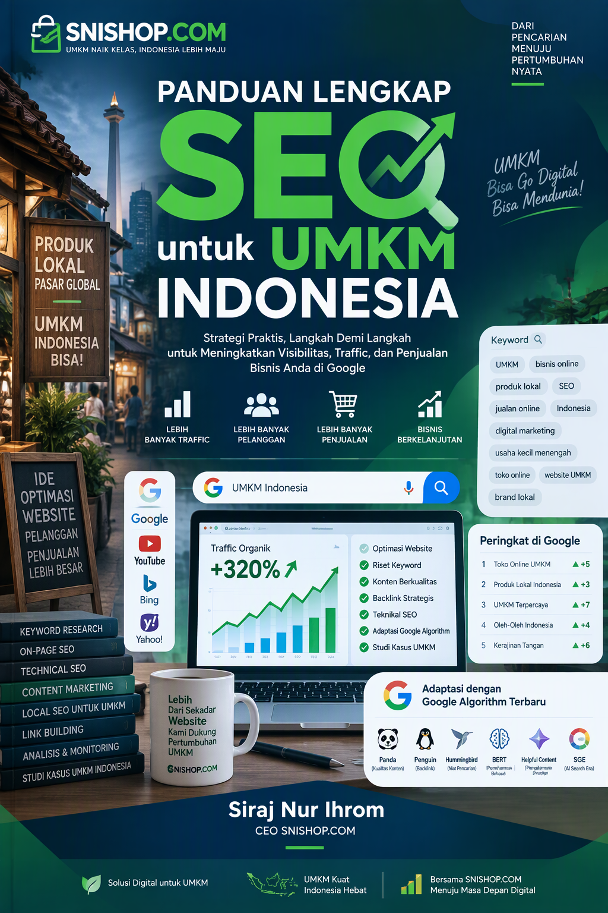
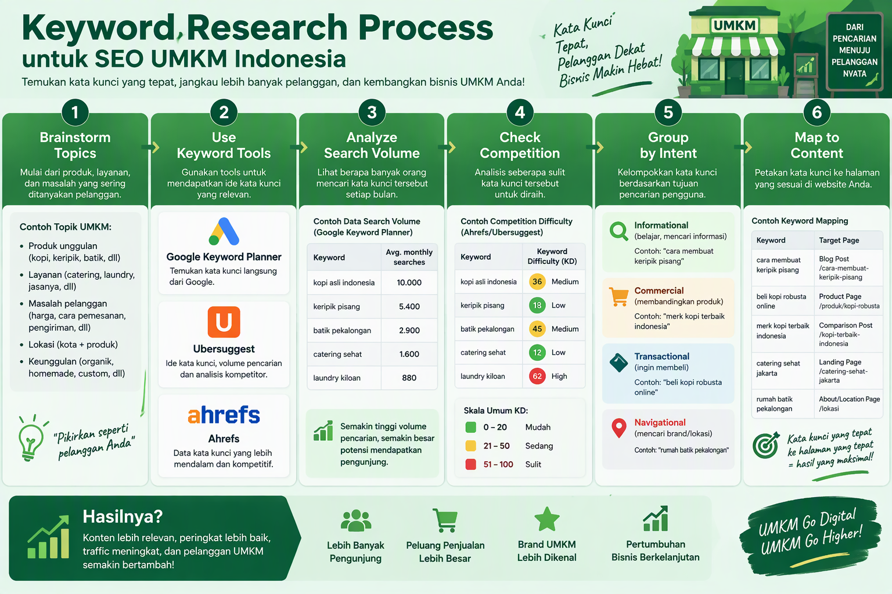
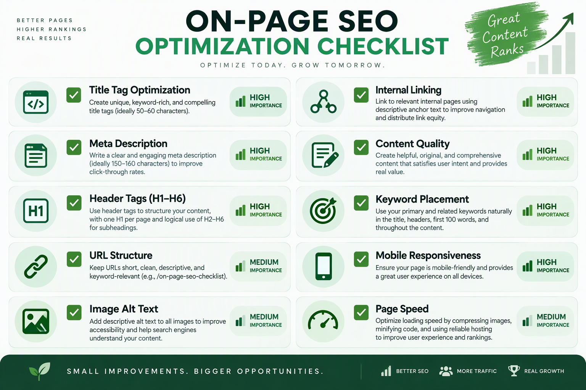
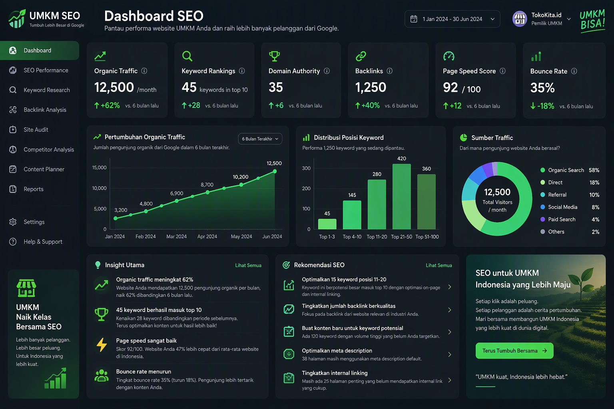
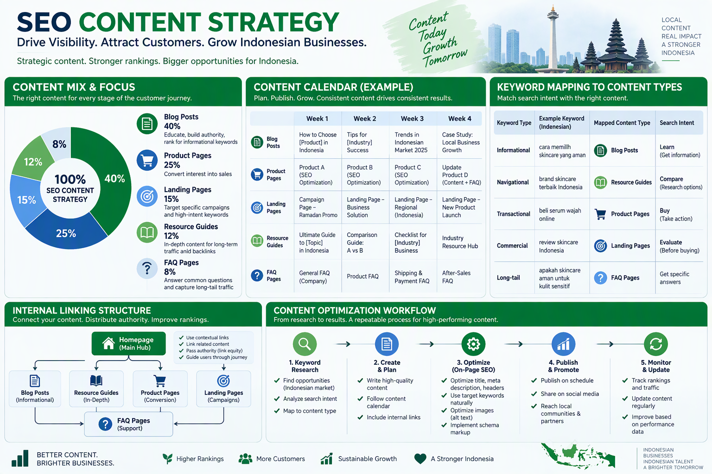
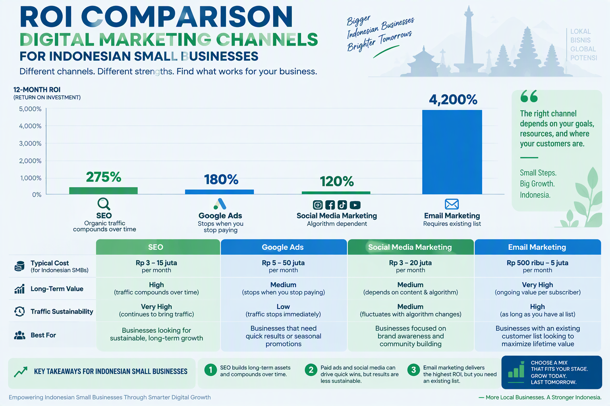

# Panduan Lengkap SEO untuk UMKM Indonesia

**Strategi Search Engine Optimization untuk Meningkatkan Traffic Organik dan Penjualan**

**Oleh: Siraj Nur Ihrom, CEO SNISHOP.COM**



---

**Catatan untuk peninjau**: Panduan ini mencakup strategi SEO lengkap untuk UMKM Indonesia, dari technical SEO hingga content optimization dan link building.

---

## Daftar Isi

**Bagian I: Foundation**
- Bab 1: Mengapa SEO Penting untuk UMKM Indonesia
- Bab 2: Memahami Cara Kerja Search Engine
- Bab 3: Riset Keyword yang Efektif

**Bagian II: Technical SEO**
- Bab 4: On-Page Optimization
- Bab 5: Technical SEO dan Site Health
- Bab 6: Mobile-First dan Page Speed

**Bagian III: Content dan Authority**
- Bab 7: Content Strategy untuk SEO
- Bab 8: Link Building dan Authority
- Bab 9: Local SEO untuk Bisnis Lokal

**Bagian IV: Advanced**
- Bab 10: Analytics, ROI, dan Implementation Plan

---

## Bagian I: Foundation

### Bab 1: Mengapa SEO Penting untuk UMKM Indonesia

Di era digital, 93% pengalaman online dimulai dari search engine. Untuk UMKM Indonesia yang ingin bersaing, SEO bukan lagi pilihan, tapi keharusan.

**Mengapa SEO Krusial untuk UMKM:**

**1. Cost-Effective Marketing**
Berbeda dengan Google Ads yang berhenti menghasilkan traffic saat budget habis, SEO memberikan traffic organik yang berkelanjutan. Setelah ranking bagus, Anda bisa mendapatkan ribuan visitor per bulan tanpa biaya iklan.

**2. High-Intent Traffic**
Orang yang mencari di Google sudah memiliki intent. Mereka mencari solusi, produk, atau jasa. Jika website Anda muncul di halaman pertama, Anda mendapatkan akses ke calon pelanggan yang siap membeli.

**3. Credibility dan Trust**
Website yang muncul di halaman pertama Google dianggap lebih kredibel. Konsumen Indonesia cenderung trust bisnis yang muncul di pencarian organik dibandingkan iklan berbayar.

**4. Competitive Advantage**
Banyak UMKM Indonesia belum mengoptimasi SEO. Ini adalah kesempatan emas untuk mendominasi pencarian lokal dan nasional sebelum kompetitor melakukannya.

**5. Long-Term Asset**
SEO adalah investasi jangka panjang. Konten yang Anda buat hari ini bisa terus menghasilkan traffic dan penjualan selama bertahun-tahun.

**Statistik SEO untuk UMKM Indonesia:**
- 70-80% pengguna mengabaikan iklan berbayar
- 53% traffic website berasal dari organic search
- 75% pengguna tidak scroll melewati halaman pertama
- 61% marketers认为 SEO adalah prioritas utama
- ROI rata-rata SEO: 275% (vs 180% Google Ads)

**SEO vs Paid Advertising:**

| Aspek | SEO (Organic) | Google Ads (Paid) |
|-------|---------------|-------------------|
| Cost | Investment waktu | Biaya per klik |
| Traffic Duration | Berkelanjutan | Berhenti saat budget habis |
| Credibility | Tinggi (organic) | Sedang (labelled "Ad") |
| ROI | 275% (long-term) | 180% (short-term) |
| Time to Results | 3-6 bulan | Instant |
| Control | Algoritma Google | Budget dan bidding |
| Compounding | Ya (traffic grows) | Tidak |

**Kenapa UMKM Indonesia Harus Mulai SEO Sekarang:**

**1. Digital Adoption Meningkat**
Pengguna internet Indonesia mencapai 210 juta jiwa (77% populasi) di 2026. Setiap hari, jutaan orang mencari produk dan jasa di Google.

**2. Mobile-First Behavior**
85% pengguna internet Indonesia mengakses via mobile. Google menggunakan mobile-first indexing, artinya website yang mobile-friendly akan ranking lebih baik.

**3. Local Search Dominance**
"Near me" searches meningkat 200% dalam 2 tahun terakhir. UMKM dengan local SEO yang kuat akan mendominasi pencarian lokal.

**4. Competitor Gap**
Banyak kompetitor UMKM belum optimal di SEO. Ini adalah golden opportunity untuk mengambil market share.

**5. Cost Efficiency**
UMKM biasanya memiliki budget marketing terbatas. SEO memberikan ROI tertinggi karena traffic organik tidak berbayar.

---

### Bab 2: Memahami Cara Kerja Search Engine

Sebelum mengoptimasi website untuk SEO, penting memahami bagaimana search engine bekerja. Google menggunakan 3 proses utama: Crawling, Indexing, dan Ranking.

**3 Pilar Search Engine:**

**1. Crawling (Penjelajahan)**
Google mengirim bot (Googlebot) untuk menjelajahi website Anda. Bot ini mengikuti link dari satu halaman ke halaman lain, membaca konten, dan mengumpulkan informasi.

**Faktor yang Mempengaruhi Crawling:**
- Sitemap XML yang submit ke Google Search Console
- Internal linking structure yang jelas
- Robots.txt yang tidak memblokir halaman penting
- Website speed (bot punya crawl budget)
- Mobile-friendliness

**2. Indexing (Pengindeksan)**
Setelah di-crawl, konten disimpan di database Google (index). Google menganalisis konten untuk memahami topik, keyword, dan relevansi.

**Faktor yang Mempengaruhi Indexing:**
- Content quality dan originality
- Meta tags (title, description)
- Header tags (H1, H2, H3)
- Image alt text
- Structured data (schema markup)
- Canonical tags (untuk menghindari duplicate content)

**3. Ranking (Peringkat)**
Ketika user melakukan pencarian, Google memilih halaman paling relevan dari index dan mengurutkannya berdasarkan 200+ ranking factors.

**Faktor Ranking Utama:**
- Relevance (kesesuaian konten dengan query)
- Authority (backlinks dan trust signals)
- User Experience (page speed, mobile-friendly, Core Web Vitals)
- Content Quality (depth, freshness, engagement)
- Technical Health (crawlability, indexability, security)

**Algoritma Google yang Perlu Diketahui:**

**1. Google Panda (2011)**
- Menilai kualitas konten
- Penalti untuk thin content, duplicate content, low-quality content
- Solusi: Buat konten original, comprehensive, dan valuable

**2. Google Penguin (2012)**
- Menilai kualitas backlink
- Penalti untuk spammy links, paid links, link schemes
- Solusi: Build natural backlinks dari sumber berkualitas

**3. Google Hummingbird (2013)**
- Memahami semantic search dan user intent
- Fokus pada meaning, bukan exact keyword match
- Solusi: Buat konten yang menjawab pertanyaan user

**4. Google Mobile (2015)**
- Mobile-friendly websites ranking lebih tinggi
- Mobile-first indexing
- Solusi: Responsive design, fast mobile loading

**5. Google RankBrain (2015)**
- AI untuk memahami query kompleks
- Belajar dari user behavior (CTR, dwell time, bounce rate)
- Solusi: Optimize untuk user experience, bukan hanya keyword

**6. Google BERT (2019)**
- Memahami context dan nuance bahasa
- Fokus pada natural language
- Solusi: Tulis konten conversational, jawab pertanyaan spesifik

**7. Core Web Vitals (2021)**
- User experience metrics (LCP, FID, CLS)
- Page speed dan visual stability
- Solusi: Optimize loading performance, interactivity, visual stability

**8. Helpful Content Update (2022)**
- Prioritize konten yang dibuat untuk manusia, bukan search engine
- Penalti untuk SEO-first content
- Solusi: Fokus pada value dan expertise

**Bagaimana Google Menilai Website Anda:**

**Quality Signals:**
- Expertise, Authoritativeness, Trustworthiness (E-A-T)
- Content depth dan comprehensiveness
- User engagement metrics
- Backlink profile quality
- Technical health

**Negative Signals:**
- Thin content
- Duplicate content
- Keyword stuffing
- Spammy backlinks
- Slow page speed
- Poor mobile experience
- Intrusive interstitials

---

### Bab 3: Riset Keyword yang Efektif



Riset keyword adalah fondasi SEO. Keyword yang tepat akan mendatangkan traffic yang relevan dan berpotensi konversi.

**Proses Riset Keyword:**

**Step 1: Brainstorm Seed Keywords**
Mulai dengan topik umum yang relevan dengan bisnis Anda:
- Produk/jasa yang Anda jual
- Masalah yang Anda selesaikan
- Pertanyaan yang sering ditanyakan customer
- Istilah yang digunakan target audience

**Contoh untuk Toko Online Fashion:**
- "baju wanita"
- "dress muslimah"
- "atasan wanita murah"
- "gamis terbaru"
- "baju kerja wanita"

**Step 2: Expand dengan Keyword Tools**
Gunakan tools untuk menemukan variasi keyword:

**Free Tools:**
- Google Keyword Planner: Search volume dan competition
- Google Trends: Trend musiman dan regional
- Google Autocomplete: Suggestions saat mengetik
- Google "People Also Ask": Pertanyaan terkait
- Ubersuggest (free version): Keyword ideas dan difficulty

**Paid Tools:**
- Ahrefs: Comprehensive keyword research dan competitor analysis
- SEMrush: Keyword database dan gap analysis
- Moz Keyword Explorer: Difficulty score dan SERP analysis
- Long Tail Pro: Long-tail keyword finder

**Step 3: Analyze Search Volume dan Competition**

**Search Volume:**
- High volume (10K+ searches/bulan): Kompetitif, butuh waktu lama untuk ranking
- Medium volume (1K-10K searches/bulan): Moderate competition, achievable
- Low volume (<1K searches/bulan): Low competition, quick wins

**Keyword Difficulty (KD):**
- KD 0-30: Easy, cocok untuk website baru
- KD 30-50: Medium, butuh konten berkualitas dan beberapa backlinks
- KD 50-70: Hard, butuh authority dan banyak backlinks
- KD 70-100: Very Hard, hanya untuk website dengan high authority

**Step 4: Understand User Intent**

**4 Jenis Search Intent:**

**1. Informational Intent**
User mencari informasi
- Keywords: "cara", "tutorial", "panduan", "apa itu", "bagaimana"
- Contoh: "cara memulai bisnis online"
- Content type: Blog post, guide, tutorial

**2. Navigational Intent**
User mencari website spesifik
- Keywords: nama brand, nama website
- Contoh: "snishop login", "tokopedia"
- Content type: Homepage, branded pages

**3. Commercial Investigation**
User meneliti sebelum membeli
- Keywords: "terbaik", "review", "perbandingan", "vs"
- Contoh: "platform ecommerce terbaik untuk UMKM"
- Content type: Comparison article, review, buying guide

**4. Transactional Intent**
User siap membeli
- Keywords: "beli", "harga", "diskon", "murah", "order"
- Contoh: "beli baju muslimah online murah"
- Content type: Product page, landing page, category page

**Step 5: Group dan Map Keywords**

**Keyword Clustering:**
Kelompokkan keywords berdasarkan topik dan intent:

**Cluster 1: Baju Muslimah**
- Primary: "baju muslimah"
- Secondary: "gamis terbaru", "dress muslimah", "atasan muslim"
- Intent: Commercial/Transactional
- Map to: Category page

**Cluster 2: Cara Mix and Match**
- Primary: "cara mix and match baju muslimah"
- Secondary: "tips mix and match", "outfit ideas muslimah"
- Intent: Informational
- Map to: Blog post

**Step 6: Prioritize Keywords**

**Priority Matrix:**

**High Priority:**
- Search volume: 1K-10K
- KD: 0-50
- Intent: Transactional/Commercial
- Relevance: High

**Medium Priority:**
- Search volume: 100-1K
- KD: 30-60
- Intent: Informational/Commercial
- Relevance: Medium

**Low Priority:**
- Search volume: <100
- KD: >60
- Intent: Navigational (untuk brand lain)
- Relevance: Low

**Contoh Riset Keyword untuk UMKM:**

**UMKM Restoran:**
- Primary: "restoran dekat saya" (Local, High Volume)
- Secondary: "restoran keluarga [kota]", "restoran halal [kota]"
- Long-tail: "restoran keluarga halal di Bandung dengan tempat anak"
- Intent: Transactional (siap makan)

**UMKM Jasa Digital Marketing:**
- Primary: "jasa digital marketing" (Commercial, Medium Volume)
- Secondary: "digital marketing agency", "social media marketing jasa"
- Long-tail: "jasa digital marketing untuk UMKM di Jakarta"
- Intent: Commercial Investigation (sedang meneliti)

**UMKM Toko Online:**
- Primary: "toko online [produk]" (Transactional, High Volume)
- Secondary: "beli [produk] online", "harga [produk] murah"
- Long-tail: "beli baju muslimah murah gratis ongkir"
- Intent: Transactional (siap beli)

**Tools untuk Riset Keyword:**

**Google Keyword Planner:**
- Free dengan Google Ads account
- Search volume data
- Competition level
- Keyword ideas
- CPC estimates

**Ubersuggest:**
- Free version tersedia
- Keyword suggestions
- Search volume
- SEO difficulty
- Paid difficulty
- Content ideas

**Ahrefs Keywords Explorer:**
- Comprehensive keyword database
- Accurate search volume
- Keyword difficulty score
- SERP analysis
- Click data
- Parent topic

**SEMrush Keyword Magic Tool:**
- 20 billion keyword database
- Keyword grouping
- Intent classification
- Competitive density
- Trend data

**AnswerThePublic:**
- Question-based keywords
- Preposition keywords
- Comparison keywords
- Visual keyword map
- Great for content ideas

**Best Practices Riset Keyword:**

**Do's:**
- Fokus pada long-tail keywords (lebih spesifik, conversion rate lebih tinggi)
- Consider user intent (informational vs transactional)
- Analyze competitor keywords
- Group keywords by topic (clustering)
- Update riset setiap 3-6 bulan
- Track keyword rankings secara rutin

**Don'ts:**
- Jangan target keyword yang terlalu kompetitif di awal
- Jangan keyword stuffing (memasukkan keyword secara berlebihan)
- Jangan abaikan search intent
- Jangan hanya fokus pada search volume
- Jangan copy competitor keywords tanpa analisis
- Jangan neglect local keywords (untuk bisnis lokal)

---

## Bagian II: Technical SEO

### Bab 4: On-Page Optimization



On-page SEO adalah optimasi yang dilakukan di halaman website Anda. Ini adalah fondasi yang harus dikuasai sebelum lanjut ke technical SEO dan link building.

**Elemen On-Page SEO:**

**1. Title Tag**

**Fungsi:** Judul halaman yang muncul di SERP (Search Engine Results Page)

**Best Practices:**
- Panjang: 50-60 karakter (agar tidak terpotong di SERP)
- Include primary keyword di awal
- Unique untuk setiap halaman
- Menarik untuk diklik (gunakan power words)
- Include brand name di akhir (opsional)

**Formula Title Tag:**
```
Primary Keyword - Secondary Keyword | Brand Name
```

**Contoh:**
- "Baju Muslimah Terbaru 2026 - Koleksi Gamis Elegan | SNISHOP"
- "Jasa Digital Marketing untuk UMKM | Strategi SEO & Ads | SNISHOP"
- "Restoran Keluarga Halal di Bandung | Tempat Nyaman & Lezat | Resto ABC"

**2. Meta Description**

**Fungsi:** Deskripsi singkat yang muncul di bawah title tag di SERP

**Best Practices:**
- Panjang: 150-160 karakter
- Include primary keyword
- Call-to-action yang jelas
- Unique untuk setiap halaman
- Menjawab "mengapa harus klik halaman ini?"

**Formula Meta Description:**
```
[Benefit] + [Keyword] + [Call-to-Action]
```

**Contoh:**
- "Temukan koleksi baju muslimah terbaru 2026 dengan desain elegan dan harga terjangkau. Gratis ongkir ke seluruh Indonesia. Belanja sekarang!"
- "Tingkatkan penjualan UMKM Anda dengan strategi digital marketing yang terbukti efektif. Konsultasi gratis hari ini!"

**3. Header Tags (H1, H2, H3, H4, H5, H6)**

**Fungsi:** Struktur hierarki konten

**Best Practices:**
- H1: Satu per halaman, include primary keyword
- H2: Sub-heading utama, include secondary keywords
- H3-H6: Sub-sub-heading untuk detail
- Hierarkis (H1 → H2 → H3, jangan skip)
- Descriptive dan clear

**Contoh Struktur:**
```
H1: Panduan Lengkap SEO untuk UMKM Indonesia
H2: Bab 1: Mengapa SEO Penting untuk UMKM
H3: 1. Cost-Effective Marketing
H3: 2. High-Intent Traffic
H3: 3. Credibility dan Trust
H2: Bab 2: Memahami Cara Kerja Search Engine
H3: 1. Crawling
H3: 2. Indexing
H3: 3. Ranking
```

**4. URL Structure**

**Fungsi:** Alamat halaman yang mudah dibaca user dan search engine

**Best Practices:**
- Short dan descriptive
- Include primary keyword
- Gunakan hyphen (-) sebagai separator, bukan underscore (_)
- Avoid dynamic parameters (?id=123)
- Lowercase semua
- Avoid stop words (di, ke, dari, yang, dan) jika tidak perlu

**Contoh URL:**
- Baik: `/panduan-seo-umkm`
- Baik: `/baju-muslimah-terbaru`
- Buruk: `/page?id=123`
- Buruk: `/Panduan_SEO_UMKM_Indonesia`

**5. Image Optimization**

**Fungsi:** Meningkatkan page speed dan accessibility

**Best Practices:**
- Compress images (max 200KB per image)
- Use WebP format (lebih kecil dari JPEG/PNG)
- Descriptive file names: `baju-muslimah-merah.jpg` (bukan `IMG_1234.jpg`)
- Alt text yang descriptive dan include keyword (jika relevan)
- Lazy loading untuk images below the fold
- Responsive images (srcset untuk berbagai screen sizes)

**Contoh Alt Text:**
- Baik: `alt="Koleksi baju muslimah merah dengan desain elegan"`
- Buruk: `alt="image1"` atau `alt=""`

**6. Internal Linking**

**Fungsi:** Membantu Google memahami struktur website dan mendistribusikan link equity

**Best Practices:**
- Link ke halaman terkait yang relevan
- Gunakan descriptive anchor text (bukan "klik di sini")
- 3-5 internal links per halaman
- Link dari halaman high-authority ke halaman yang perlu boost
- Avoid orphan pages (halaman tanpa internal link)

**Contoh Anchor Text:**
- Baik: "baca panduan lengkap SEO untuk UMKM"
- Buruk: "klik di sini" atau "baca lebih lanjut"

**7. Content Quality**

**Fungsi:** Memberikan value kepada user dan memenuhi search intent

**Best Practices:**
- Comprehensive (cover topic secara mendalam)
- Original (bukan copy-paste)
- Well-researched (data dan fakta akurat)
- Engaging (mudah dibaca, gunakan subheadings, bullet points)
- Fresh (update konten secara berkala)
- Match search intent (informational, commercial, transactional)

**Content Length Guidelines:**
- Blog post: 1.500-2.500 kata (untuk comprehensive guide)
- Product page: 300-500 kata (deskripsi + specs + benefits)
- Landing page: 500-1.000 kata (value proposition + CTA)
- FAQ page: 100-200 kata per question

**8. Keyword Placement**

**Fungsi:** Signal ke Google tentang topik halaman

**Best Practices:**
- Title tag (primary keyword di awal)
- Meta description (primary keyword)
- H1 heading (primary keyword)
- First 100 words (primary keyword)
- H2/H3 headings (secondary keywords)
- Throughout content (natural density 1-2%)
- URL (primary keyword)
- Image alt text (primary/secondary keywords)

**Keyword Density:**
- Ideal: 1-2% (keyword muncul 1-2 kali per 100 kata)
- Avoid: Keyword stuffing (>3% density)

**Contoh:**
Untuk keyword "baju muslimah":
- 1.000 kata konten → "baju muslimah" muncul 10-20 kali (natural)
- Bukan: "baju muslimah" muncul 50+ kali (stuffing)

**9. Schema Markup (Structured Data)**

**Fungsi:** Membantu Google memahami konten dan menampilkan rich snippets

**Jenis Schema untuk UMKM:**

**Product Schema:**
```json
{
  "@context": "https://schema.org",
  "@type": "Product",
  "name": "Gamis Muslimah Elegan",
  "image": "https://example.com/gamis.jpg",
  "description": "Gamis muslimah dengan desain elegan...",
  "brand": {
    "@type": "Brand",
    "name": "SNISHOP Fashion"
  },
  "offers": {
    "@type": "Offer",
    "price": "299000",
    "priceCurrency": "IDR",
    "availability": "https://schema.org/InStock"
  }
}
```

**LocalBusiness Schema:**
```json
{
  "@context": "https://schema.org",
  "@type": "Restaurant",
  "name": "Resto ABC",
  "image": "https://example.com/resto.jpg",
  "address": {
    "@type": "PostalAddress",
    "streetAddress": "Jl. Merdeka No. 1",
    "addressLocality": "Bandung",
    "addressRegion": "Jawa Barat",
    "postalCode": "40111"
  },
  "telephone": "+62-22-1234567",
  "openingHours": "Mo-Su 10:00-22:00"
}
```

**Article Schema:**
```json
{
  "@context": "https://schema.org",
  "@type": "Article",
  "headline": "Panduan Lengkap SEO untuk UMKM",
  "author": {
    "@type": "Person",
    "name": "Siraj Nur Ihrom"
  },
  "datePublished": "2026-10-23",
  "image": "https://example.com/seo-guide.jpg"
}
```

**FAQ Schema:**
```json
{
  "@context": "https://schema.org",
  "@type": "FAQPage",
  "mainEntity": [
    {
      "@type": "Question",
      "name": "Apa itu SEO?",
      "acceptedAnswer": {
        "@type": "Answer",
        "text": "SEO adalah..."
      }
    }
  ]
}
```

**Tools untuk Test Schema:**
- Google Rich Results Test
- Schema Markup Validator
- Google Search Console (Enhancements report)

**10. User Experience Signals**

**Fungsi:** Google menilai kualitas halaman berdasarkan user behavior

**Positive Signals:**
- High CTR (Click-Through Rate) dari SERP
- Long dwell time (user spend time di halaman)
- Low bounce rate (user explore halaman lain)
- High engagement (scroll, click, share)

**Negative Signals:**
- Low CTR
- Short dwell time (user langsung back)
- High bounce rate (user langsung leave)
- Pogo-sticking (user klik hasil lain setelah ke halaman Anda)

**Cara Meningkatkan UX Signals:**
- Hook di 100 kata pertama (buat user ingin baca lebih lanjut)
- Subheadings yang clear (mudah scan konten)
- Visual elements (images, videos, infographics)
- Internal links (ajak user explore halaman lain)
- Fast loading (user tidak sabar)
- Mobile-friendly (85% user Indonesia mobile)

---

### Bab 5: Technical SEO dan Site Health

Technical SEO memastikan website Anda bisa di-crawl dan di-index dengan baik oleh Google. Tanpa technical foundation yang kuat, on-page optimization tidak akan maksimal.

**Elemen Technical SEO:**

**1. XML Sitemap**

**Fungsi:** Daftar semua halaman penting di website Anda untuk Google

**Best Practices:**
- Include hanya canonical URLs (bukan duplicate)
- Update otomatis saat ada halaman baru
- Submit ke Google Search Console
- Max 50.000 URLs per sitemap file
- Include lastmod date
- Priority dan changefreq (opsional)

**Contoh XML Sitemap:**
```xml
<?xml version="1.0" encoding="UTF-8"?>
<urlset xmlns="http://www.sitemaps.org/schemas/sitemap/0.9">
  <url>
    <loc>https://example.com/</loc>
    <lastmod>2026-10-23</lastmod>
    <changefreq>daily</changefreq>
    <priority>1.0</priority>
  </url>
  <url>
    <loc>https://example.com/panduan-seo</loc>
    <lastmod>2026-10-23</lastmod>
    <changefreq>monthly</changefreq>
    <priority>0.8</priority>
  </url>
</urlset>
```

**Tools untuk Generate Sitemap:**
- Yoast SEO (WordPress plugin)
- XML-Sitemaps.com (online generator)
- Screaming Frog (desktop crawler)
- Ahrefs Site Audit (automated)

**2. Robots.txt**

**Fungsi:** Instruksi untuk Googlebot tentang halaman mana yang boleh/tidak boleh di-crawl

**Best Practices:**
- Place di root directory (example.com/robots.txt)
- Allow semua halaman penting
- Disallow halaman yang tidak perlu di-index (admin, login, dll)
- Jangan disallow CSS/JS (Google perlu render halaman)
- Reference sitemap location

**Contoh Robots.txt:**
```
User-agent: *
Allow: /
Disallow: /admin/
Disallow: /login/
Disallow: /cart/
Disallow: /checkout/

Sitemap: https://example.com/sitemap.xml
```

**3. HTTPS dan Security**

**Fungsi:** Enkripsi data dan trust signal untuk Google

**Best Practices:**
- Migrate dari HTTP ke HTTPS
- Install SSL certificate (free dari Let's Encrypt)
- Redirect semua HTTP ke HTTPS (301 redirect)
- Update internal links ke HTTPS
- Submit HTTPS version ke Google Search Console
- Enable HSTS (HTTP Strict Transport Security)

**Mengapa HTTPS Penting:**
- Google ranking factor (minor, tapi tetap penting)
- User trust (browser menampilkan "Secure" badge)
- Data protection (enkripsi informasi sensitif)
- Required untuk fitur web modern (PWA, AMP, dll)

**4. Page Speed Optimization**

**Fungsi:** Meningkatkan user experience dan ranking

**Core Web Vitals:**

**LCP (Largest Contentful Paint):**
- Target: <2.5 detik
- Mengukur loading performance
- Cara improve:
  - Optimize images (compress, WebP, lazy load)
  - Minify CSS/JS
  - Use CDN
  - Enable caching
  - Reduce server response time

**FID (First Input Delay):**
- Target: <100ms
- Mengukur interactivity
- Cara improve:
  - Reduce JavaScript execution time
  - Break up long tasks
  - Use web workers
  - Defer non-critical JavaScript

**CLS (Cumulative Layout Shift):**
- Target: <0.1
- Mengukur visual stability
- Cara improve:
  - Always include size attributes pada images/videos
  - Reserve space for ads/embeds
  - Avoid inserting content above existing content
  - Use transform untuk animations

**Tools untuk Test Page Speed:**
- Google PageSpeed Insights
- GTmetrix
- WebPageTest
- Google Search Console (Core Web Vitals report)
- Lighthouse (Chrome DevTools)

**5. Mobile-Friendliness**

**Fungsi:** Google menggunakan mobile-first indexing

**Best Practices:**
- Responsive design (satu website untuk semua device)
- Touch-friendly buttons (min 48x48px)
- Readable text tanpa zoom (min 16px font)
- No horizontal scrolling
- Fast mobile loading
- Avoid intrusive interstitials (pop-up yang menutupi konten)

**Test Mobile-Friendliness:**
- Google Mobile-Friendly Test
- Chrome DevTools (Device Mode)
- Test di real devices (iOS dan Android)

**6. Crawl Errors dan Indexing Issues**

**Jenis Crawl Errors:**

**404 (Not Found):**
- Halaman tidak ada
- Solusi: Redirect ke halaman terkait atau create custom 404 page

**500 (Server Error):**
- Server problem
- Solusi: Check server logs, fix errors

**Soft 404:**
- Halaman return 200 OK tapi konten seperti 404
- Solusi: Return proper 404 status code

**Blocked by Robots.txt:**
- Googlebot tidak bisa akses halaman
- Solusi: Review robots.txt, allow jika halaman penting

**Duplicate Content:**
- Konten sama di multiple URLs
- Solusi: Canonical tags, 301 redirects, atau consolidate

**Tools untuk Monitor Crawl Errors:**
- Google Search Console (Coverage report)
- Screaming Frog (desktop crawler)
- Ahrefs Site Audit (automated)
- SEMrush Site Audit (automated)

**7. Canonical Tags**

**Fungsi:** Menunjukkan versi utama dari halaman yang duplicate

**Contoh:**
```html
<link rel="canonical" href="https://example.com/panduan-seo" />
```

**Kapan Gunakan Canonical:**
- Product pages dengan multiple URLs (warna, ukuran)
- Pagination (halaman 1, 2, 3)
- URL dengan tracking parameters (?utm_source=...)
- HTTP dan HTTPS versions
- WWW dan non-WWW versions

**8. Hreflang Tags (untuk Multi-Language)**

**Fungsi:** Menunjukkan bahasa dan region targeting untuk setiap halaman

**Contoh:**
```html
<link rel="alternate" hreflang="id" href="https://example.com/id/panduan-seo" />
<link rel="alternate" hreflang="en" href="https://example.com/en/seo-guide" />
<link rel="alternate" hreflang="x-default" href="https://example.com/panduan-seo" />
```

**Kapan Gunakan Hreflang:**
- Website multi-bahasa
- Target multiple countries
- Regional variations (Indonesia vs Malaysia)

**9. Structured Data (Schema Markup)**

**Fungsi:** Membantu Google memahami konten dan menampilkan rich snippets

**Jenis Schema untuk UMKM:**
- Product schema (untuk e-commerce)
- LocalBusiness schema (untuk bisnis lokal)
- Article schema (untuk blog)
- FAQ schema (untuk FAQ pages)
- Review schema (untuk testimonials)
- Breadcrumb schema (untuk navigation)
- Organization schema (untuk company info)

**Tools untuk Generate Schema:**
- Google Structured Data Markup Helper
- Schema.org (documentation)
- JSON-LD Generator
- Yoast SEO (WordPress, auto-generate schema)

**10. Site Architecture**

**Fungsi:** Struktur website yang logis untuk user dan search engines

**Best Practices:**
- Flat structure (max 3 clicks dari homepage ke halaman manapun)
- Logical categories (group related content)
- Breadcrumb navigation (user tahu posisi mereka)
- Internal linking (hubungkan halaman terkait)
- XML sitemap (daftar semua halaman penting)

**Contoh Site Architecture:**
```
Homepage
├── Category 1: Baju Muslimah
│   ├── Subcategory 1.1: Gamis
│   ├── Subcategory 1.2: Tunik
│   └── Subcategory 1.3: Atasan
├── Category 2: Aksesoris
│   ├── Subcategory 2.1: Hijab
│   └── Subcategory 2.2: Tas
├── Blog
│   ├── Post 1: Cara Mix and Match
│   └── Post 2: Trend Fashion 2026
└── About
    ├── Our Story
    └── Contact
```

**Checklist Technical SEO:**

**Crawlability:**
- [ ] XML sitemap created dan submitted
- [ ] Robots.txt configured correctly
- [ ] No crawl errors di Google Search Console
- [ ] All important pages are indexable
- [ ] No orphan pages (halaman tanpa internal link)

**Indexability:**
- [ ] HTTPS implemented
- [ ] Canonical tags on all pages
- [ ] No duplicate content issues
- [ ] Hreflang tags (jika multi-language)
- [ ] Pagination handled correctly

**Performance:**
- [ ] Page speed <3 detik (desktop dan mobile)
- [ ] Core Web Vitals dalam threshold yang baik
- [ ] Images optimized (compressed, WebP, lazy load)
- [ ] CSS/JS minified dan deferred
- [ ] CDN enabled

**Mobile:**
- [ ] Responsive design
- [ ] Mobile-friendly test passed
- [ ] Touch-friendly buttons
- [ ] Readable text size
- [ ] No intrusive interstitials

**Security:**
- [ ] SSL certificate installed
- [ ] HTTPS everywhere
- [ ] HSTS enabled
- [ ] Regular security updates
- [ ] Backup system

**Structure:**
- [ ] Flat site architecture (max 3 clicks)
- [ ] Logical categories
- [ ] Breadcrumb navigation
- [ ] Internal linking strategy
- [ ] Clean URL structure

---

### Bab 6: Mobile-First dan Page Speed



85% pengguna internet Indonesia mengakses via mobile. Google menggunakan mobile-first indexing, artinya versi mobile website Anda yang di-index dan di-ranking.

**Mengapa Mobile-First Critical:**

**1. User Behavior Indonesia:**
- 85% mobile internet users
- Average session duration: 3 menit 45 detik (mobile)
- 53% users leave jika loading >3 detik
- 70% mobile searches lead to action within 1 hour

**2. Google Mobile-First Indexing:**
- Google menggunakan mobile version untuk indexing dan ranking
- Jika mobile version berbeda dari desktop, Google akan index mobile version
- Website yang tidak mobile-friendly akan ranking lebih rendah

**3. Competitive Advantage:**
- Banyak UMKM Indonesia belum optimize mobile
- Mobile-first website akan ranking lebih baik
- User experience lebih baik → conversion rate lebih tinggi

**Mobile Optimization Checklist:**

**1. Responsive Design**

**Pendekatan:**
- Mobile-first design (design untuk mobile dulu, lalu scale up)
- Fluid grids (layout menyesuaikan screen size)
- Flexible images (images scale dengan container)
- Media queries (CSS rules untuk different breakpoints)

**Breakpoints Umum:**
```css
/* Mobile */
@media (max-width: 576px) { ... }

/* Tablet */
@media (min-width: 577px) and (max-width: 768px) { ... }

/* Desktop */
@media (min-width: 769px) { ... }

/* Large Desktop */
@media (min-width: 1200px) { ... }
```

**Tools untuk Test Responsive:**
- Chrome DevTools (Device Mode)
- Google Mobile-Friendly Test
- Responsive Design Checker (online)
- BrowserStack (test di real devices)

**2. Touch-Friendly Elements**

**Best Practices:**
- Button size: min 48x48px (9x9mm)
- Spacing between buttons: min 8px
- Links yang clickable (bukan hanya text)
- Avoid hover-only interactions (tidak ada hover di mobile)
- Use tap-friendly form inputs

**Contoh CSS:**
```css
button, .btn {
  min-width: 48px;
  min-height: 48px;
  padding: 12px 24px;
  margin: 4px;
}

a {
  padding: 8px; /* Make entire area clickable */
}
```

**3. Readable Text**

**Best Practices:**
- Font size: min 16px untuk body text
- Line height: 1.5-1.6x
- Contrast ratio: min 4.5:1 (untuk accessibility)
- Avoid long paragraphs (max 3-4 lines)
- Use subheadings untuk break up text

**Contoh CSS:**
```css
body {
  font-size: 16px;
  line-height: 1.6;
  color: #333; /* Good contrast dengan white background */
}

h1, h2, h3 {
  line-height: 1.3;
  margin-bottom: 0.5em;
}

p {
  margin-bottom: 1em;
}
```

**4. Fast Mobile Loading**

**Target:**
- First Contentful Paint (FCP): <1.8 detik
- Largest Contentful Paint (LCP): <2.5 detik
- Time to Interactive (TTI): <3.8 detik
- Total Blocking Time (TBT): <200ms
- Cumulative Layout Shift (CLS): <0.1

**Strategi Optimize Mobile Speed:**

**Image Optimization:**
- Compress images (tools: TinyPNG, ImageOptim)
- Use WebP format (30% smaller dari JPEG)
- Lazy loading (load images saat di-scroll)
- Responsive images (srcset untuk different screen sizes)
- Avoid images yang terlalu besar (max 200KB per image)

**Contoh HTML:**
```html

```

**Minify CSS dan JavaScript:**
- Remove whitespace, comments, unused code
- Tools: UglifyJS, CSSNano, Terser
- Combine files (reduce HTTP requests)
- Defer non-critical JavaScript
- Async loading untuk third-party scripts

**Contoh HTML:**
```html
<!-- Defer non-critical JS -->
<script src="script.js" defer></script>

<!-- Async third-party scripts -->
<script src="analytics.js" async></script>
```

**Enable Caching:**
- Browser caching (Cache-Control headers)
- Server-side caching (Redis, Memcached)
- CDN caching (Cloudflare, AWS CloudFront)
- Static asset caching (images, CSS, JS)

**Contoh .htaccess (Apache):**
```apache
<IfModule mod_expires.c>
  ExpiresActive On
  ExpiresByType image/jpg "access plus 1 year"
  ExpiresByType image/jpeg "access plus 1 year"
  ExpiresByType image/gif "access plus 1 year"
  ExpiresByType image/png "access plus 1 year"
  ExpiresByType image/webp "access plus 1 year"
  ExpiresByType text/css "access plus 1 month"
  ExpiresByType application/javascript "access plus 1 month"
</IfModule>
```

**Use CDN (Content Delivery Network):**
- Serve assets dari server terdekat dengan user
- Reduce latency
- Improve load time
- Handle traffic spikes

**CDN Providers:**
- Cloudflare (free plan available)
- AWS CloudFront
- Google Cloud CDN
- Akamai
- Fastly

**5. Avoid Intrusive Interstitials**

**Google Penalti untuk:**
- Pop-up yang menutupi konten utama saat page load
- Interstitial yang sulit di-dismiss
- Pop-up yang muncul sebelum user scroll

**Acceptable Interstitials:**
- Cookie consent notices
- Age verification (untuk konten adult)
- Login prompts (untuk konten behind paywall)
- App install banners (jika tidak terlalu intrusive)

**Best Practices:**
- Use banner ads di top/bottom (bukan full-screen pop-up)
- Make interstitials easy to dismiss (clear "X" button)
- Delay interstitials (tampilkan setelah user engage)
- Limit frequency (jangan tampilkan setiap visit)

**6. Mobile-Specific Features**

**Accelerated Mobile Pages (AMP):**
- Lightweight HTML untuk mobile
- Load instant (cached di Google)
- Required untuk beberapa features (Top Stories carousel)
- Trade-off: Limited design flexibility

**Progressive Web Apps (PWA):**
- Web app dengan native app features
- Offline support
- Push notifications
- Home screen installation
- Fast loading (cached)

**Mobile Payment Integration:**
- E-wallet integration (GoPay, OVO, DANA)
- QR code payment
- One-click checkout
- Mobile-optimized payment forms

**Tools untuk Mobile Optimization:**

**Testing:**
- Google Mobile-Friendly Test
- Chrome DevTools (Device Mode)
- BrowserStack (real device testing)
- WebPageTest (mobile speed test)

**Performance:**
- Google PageSpeed Insights (mobile score)
- GTmetrix (waterfall analysis)
- Lighthouse (comprehensive audit)
- Web Vitals Report (Chrome UX Report)

**Monitoring:**
- Google Search Console (Mobile Usability report)
- Google Analytics (mobile vs desktop metrics)
- Real User Monitoring (RUM) tools

**Checklist Mobile-First Optimization:**

**Design:**
- [ ] Responsive design implemented
- [ ] Mobile-first approach
- [ ] Touch-friendly buttons (48x48px min)
- [ ] Readable text (16px min)
- [ ] No horizontal scrolling
- [ ] No intrusive interstitials

**Performance:**
- [ ] Page speed <3 detik (mobile)
- [ ] Images optimized (compressed, WebP, lazy load)
- [ ] CSS/JS minified dan deferred
- [ ] Caching enabled
- [ ] CDN implemented
- [ ] Core Web Vitals optimized

**User Experience:**
- [ ] Easy navigation (hamburger menu)
- [ ] Clickable phone numbers
- [ ] Clickable email addresses
- [ ] Mobile-friendly forms
- [ ] No Flash content
- [ ] Viewport meta tag set

**Testing:**
- [ ] Tested di multiple devices
- [ ] Tested di multiple browsers
- [ ] Google Mobile-Friendly Test passed
- [ ] PageSpeed score >90 (mobile)
- [ ] Real user testing conducted

---

## Bagian III: Content dan Authority

### Bab 7: Content Strategy untuk SEO



Content adalah raja dalam SEO. Google ranking halaman yang memberikan value terbaik untuk user. Content strategy yang efektif akan mendatangkan traffic organik yang berkelanjutan.

**Prinsip Content untuk SEO:**

**1. User-First, Not Search Engine-First**
Google's Helpful Content Update (2022) memprioritaskan konten yang dibuat untuk manusia, bukan search engine. Fokus pada memberikan value, bukan memanipulasi ranking.

**2. E-A-T (Expertise, Authoritativeness, Trustworthiness)**
Google menilai kualitas konten berdasarkan:
- Expertise: Apakah penulis ahli di bidangnya?
- Authoritativeness: Apakah website/source dipercaya?
- Trustworthiness: Apakah konten akurat dan reliable?

**3. Comprehensive dan In-Depth**
Konten yang panjang dan mendalam (2.000+ kata) cenderung ranking lebih baik karena lebih lengkap menjawab pertanyaan user.

**4. Fresh dan Updated**
Google menyukai konten yang fresh. Update konten secara berkala untuk menjaga relevansi dan ranking.

**5. Engaging dan Shareable**
Konten yang menarik akan mendapatkan shares, links, dan engagement. Ini adalah ranking factors penting.

**Jenis Konten untuk SEO:**

**1. Blog Posts (40% dari content strategy)**

**Tujuan:**
- Menjawab pertanyaan user
- Build authority dan trust
- Drive organic traffic
- Generate leads

**Jenis Blog Posts:**
- How-to guides: "Cara Memulai Bisnis Online untuk Pemula"
- Listicles: "10 Tools SEO Terbaik untuk UMKM"
- Case studies: "Bagaimana Toko X Meningkatkan Penjualan 300% dengan SEO"
- Industry news: "Update Algoritma Google 2026: Apa yang Berubah?"
- Opinion pieces: "Mengapa SEO Lebih Penting dari Ads untuk UMKM"

**Best Practices:**
- Panjang: 1.500-2.500 kata (comprehensive)
- Structure: H1, H2, H3 yang jelas
- Visual: Images, infographics, videos
- Internal links: 3-5 links ke halaman terkait
- CTA: Clear call-to-action di akhir
- Meta: Optimize title tag dan meta description

**2. Product Pages (25% dari content strategy)**

**Tujuan:**
- Rank untuk transactional keywords
- Convert visitors menjadi customers
- Showcase products/services

**Best Practices:**
- Unique product descriptions (jangan copy dari manufacturer)
- High-quality images (multiple angles)
- Customer reviews dan ratings
- Clear pricing dan availability
- Related products (cross-sell)
- Schema markup (Product schema)

**3. Landing Pages (15% dari content strategy)**

**Tujuan:**
- Rank untuk commercial keywords
- Capture leads
- Drive conversions

**Best Practices:**
- Single focus (satu CTA utama)
- Benefit-oriented copy
- Social proof (testimonials, case studies)
- Clear value proposition
- Mobile-optimized forms
- Fast loading speed

**4. Resource Pages (12% dari content strategy)**

**Tujuan:**
- Build authority
- Attract backlinks
- Provide value

**Jenis Resource Pages:**
- Guides: "Panduan Lengkap SEO untuk UMKM"
- Templates: "50 Template Copywriting untuk Instagram"
- Checklists: "Technical SEO Checklist"
- Tools: "Kalkulator ROI Email Marketing"
- Glossaries: "Istilah-istilah Digital Marketing"

**Best Practices:**
- Comprehensive dan in-depth
- Well-organized dan easy to navigate
- Downloadable resources (PDF, Excel)
- Regularly updated
- Promote untuk build backlinks

**5. FAQ Pages (8% dari content strategy)**

**Tujuan:**
- Answer specific questions
- Rank untuk question-based keywords
- Appear di featured snippets
- Improve user experience

**Best Practices:**
- Group questions by topic
- Concise answers (2-3 sentences)
- FAQ schema markup
- Link to detailed content
- Update berdasarkan new questions

**Content Creation Process:**

**Step 1: Keyword Research**
- Identify target keywords
- Analyze search intent
- Check competition
- Estimate traffic potential

**Step 2: Content Planning**
- Define content type (blog, product, landing, dll)
- Outline structure (H1, H2, H3)
- Identify supporting keywords
- Plan visuals (images, infographics)

**Step 3: Content Creation**
- Write comprehensive draft
- Optimize untuk target keyword
- Add visuals dan multimedia
- Include internal dan external links
- Proofread dan edit

**Step 4: On-Page Optimization**
- Optimize title tag
- Write compelling meta description
- Add header tags (H1, H2, H3)
- Optimize images (alt text, file size)
- Add schema markup

**Step 5: Publishing dan Promotion**
- Publish konten
- Share di social media
- Email ke subscribers
- Outreach untuk backlinks
- Monitor performance

**Step 6: Update dan Maintain**
- Review analytics (traffic, rankings, conversions)
- Update konten secara berkala
- Refresh outdated information
- Add new sections jika perlu
- Monitor competitor content

**Content Calendar:**

**Weekly:**
- 2 blog posts (1.500-2.000 kata each)
- 5 social media posts (promote blog content)
- 1 email newsletter (feature blog content)

**Monthly:**
- 1 comprehensive guide (3.000+ kata)
- 1 case study atau success story
- 1 resource page atau template
- Content audit dan update

**Quarterly:**
- Review content performance
- Update top-performing content
- Identify content gaps
- Plan next quarter content

**Content Optimization Checklist:**

**Keyword Optimization:**
- [ ] Primary keyword di title tag
- [ ] Primary keyword di H1
- [ ] Primary keyword di first 100 words
- [ ] Secondary keywords di H2/H3
- [ ] Natural keyword density (1-2%)
- [ ] LSI keywords (related terms)

**Content Quality:**
- [ ] Comprehensive (cover topic in-depth)
- [ ] Original (bukan copy-paste)
- [ ] Well-researched (data dan fakta)
- [ ] Engaging (easy to read)
- [ ] Actionable (practical tips)
- [ ] Up-to-date (current information)

**Structure:**
- [ ] Clear hierarchy (H1 → H2 → H3)
- [ ] Short paragraphs (2-3 sentences)
- [ ] Bullet points dan numbered lists
- [ ] Subheadings untuk scannability
- [ ] Visual elements (images, videos)
- [ ] Internal links (3-5 per page)

**Technical:**
- [ ] Meta description (150-160 characters)
- [ ] URL structure (short, descriptive)
- [ ] Image optimization (alt text, file size)
- [ ] Schema markup (jika relevan)
- [ ] Mobile-friendly
- [ ] Fast loading

**User Experience:**
- [ ] Hook di opening (grab attention)
- [ ] Clear value proposition
- [ ] Easy navigation
- [ ] Readable fonts dan colors
- [ ] CTA yang jelas
- [ ] Social sharing buttons

**Content Ideas untuk UMKM Indonesia:**

**Toko Online Fashion:**
- "10 Trend Fashion Muslim 2026 yang Wajib Dicoba"
- "Cara Mix and Match Baju Muslimah untuk Berbagai Occasion"
- "Panduan Memilih Bahan Baju yang Nyaman untuk Iklim Tropis"
- "5 Kesalahan Fashion yang Sering Dilakukan Wanita Indonesia"
- "Outfit Ideas untuk Ngantor: Stylish tapi Tetap Sopan"

**Restoran:**
- "Resep Rahasia Rendang Padang yang Bikin Nagih"
- "10 Restoran Halal Terbaik di [Kota] untuk Keluarga"
- "Tips Memilih Catering untuk Acara Pernikahan"
- "Manfaat Makan Makanan Tradisional untuk Kesehatan"
- "Behind the Scene: Proses Masak di Dapur Kami"

**Jasa Digital Marketing:**
- "Panduan Lengkap SEO untuk UMKM Pemula"
- "5 Strategi Instagram Marketing yang Terbukti Efektif"
- "Cara Meningkatkan Penjualan Online dengan Email Marketing"
- "ROI Digital Marketing: Bagaimana Mengukur Keberhasilan"
- "Trend Digital Marketing 2026 yang Wajib Diketahui"

**Tools untuk Content Creation:**

**Writing:**
- Google Docs (collaborative writing)
- Hemingway Editor (readability check)
- Grammarly (grammar dan style)
- ChatGPT (content ideas dan drafting)

**Visuals:**
- Canva (graphic design)
- Unsplash (free stock photos)
- Piktochart (infographics)
- Loom (video recording)

**SEO:**
- Yoast SEO (WordPress plugin)
- Surfer SEO (content optimization)
- Clearscope (content grading)
- Frase (content research)

**Research:**
- AnswerThePublic (question research)
- AlsoAsked (related questions)
- Google Trends (trend analysis)
- BuzzSumo (content research)

---

### Bab 8: Link Building dan Authority

Link building adalah proses mendapatkan backlink dari website lain ke website Anda. Backlink adalah salah satu ranking factor terpenting di Google.

**Mengapa Backlinks Penting:**

**1. Vote of Confidence**
Backlink seperti "vote" dari website lain. Semakin banyak website berkualitas yang link ke Anda, semakin Google percaya bahwa konten Anda berharga.

**2. Authority Building**
Backlinks dari website dengan high authority akan transfer authority ke website Anda. Ini meningkatkan domain authority dan ranking potential.

**3. Referral Traffic**
Backlinks tidak hanya untuk SEO. Mereka juga mendatangkan referral traffic dari website yang link ke Anda.

**4. Indexing**
Googlebot menemukan halaman baru dengan mengikuti links. Backlinks membantu Google menemukan dan meng-index halaman Anda lebih cepat.

**Jenis-Jenis Backlink:**

**1. Natural Editorial Links**
- Didapat secara organik karena konten berkualitas
- Tidak ada outreach atau request
- Paling valuable untuk SEO
- Contoh: Blog yang cite research Anda

**2. Manual Outreach Links**
- Didapat melalui outreach ke website lain
- Request untuk link ke konten Anda
- Butuh effort dan relationship
- Contoh: Guest posting, resource page links

**3. Self-Created Links**
- Anda create sendiri (forum signatures, blog comments, directory submissions)
- Low quality dan bisa jadi spammy
- Google tidak recommend
- Contoh: Blog comment spam, directory links

**4. Paid Links**
- Bayar untuk backlink
- Melanggar Google guidelines
- Risk tinggi untuk penalti
- Contoh: Link schemes, paid reviews

**Quality vs Quantity:**

**High-Quality Backlink Ciri-ciri:**
- Dari website dengan high domain authority (DA 50+)
- Relevan dengan niche/industry Anda
- Dari halaman yang trusted (bukan spammy)
- Natural anchor text (bukan exact match keyword)
- Dofollow link (pass link equity)
- Dari website dengan real traffic

**Low-Quality Backlink Ciri-ciri:**
- Dari website dengan low domain authority (DA <20)
- Tidak relevan dengan niche Anda
- Dari spammy atau penalized websites
- Exact match anchor text (keyword stuffing)
- Nofollow link (tidak pass link equity)
- Dari website tanpa real traffic

**Target:**
- Quality over quantity
- 10 high-quality backlinks > 100 low-quality backlinks
- Focus pada relevance dan authority

**Strategi Link Building untuk UMKM:**

**1. Content Marketing (Most Effective)**

**Cara Kerja:**
- Create konten yang sangat valuable dan shareable
- Orang akan naturally link ke konten Anda
- Tidak perlu outreach agresif

**Jenis Konten yang Menarik Backlinks:**
- Original research dan data
- Comprehensive guides
- Infographics dan visual content
- Tools dan calculators
- Case studies dan success stories
- Industry reports

**Contoh:**
- "Research: 100 UMKM Indonesia dan Strategi Digital Marketing Mereka"
- "Panduan Lengkap SEO untuk UMKM: 10.000 Kata"
- "Infographic: Trend E-commerce Indonesia 2026"
- "Tool: Kalkulator ROI Email Marketing"

**2. Guest Posting**

**Cara Kerja:**
- Write artikel untuk website lain di niche Anda
- Include link ke website Anda di dalam konten atau author bio
- Build relationship dengan website owners

**Best Practices:**
- Target websites yang relevan dan reputable
- Write high-quality, valuable content (bukan spam)
- Follow guidelines dari website target
- Build relationship, bukan hanya link
- 1-2 guest posts per bulan (jangan berlebihan)

**Cara Find Guest Posting Opportunities:**
- Google search: "write for us" + [niche]
- Google search: "guest post" + [niche]
- Analyze competitor backlinks (lihat mana yang accept guest posts)
- Join industry communities dan forums

**3. Broken Link Building**

**Cara Kerja:**
- Find broken links di website lain
- Reach out ke website owner
- Suggest your content sebagai replacement

**Tools:**
- Ahrefs Broken Link Checker
- Check My Links (Chrome extension)
- Broken Link Checker (WordPress plugin)

**Outreach Email Template:**
```
Subject: Broken link di [Page URL]

Hi [Name],

Saya sedang browsing artikel Anda tentang [Topic] dan menemukan broken link di [Section]:

[Broken URL]

Kebetulan saya punya konten yang relevan tentang [Topic]:
[Your URL]

Mungkin bisa jadi replacement yang bagus untuk broken link tersebut.

Terima kasih!

Salam,
[Your Name]
```

**4. Resource Page Link Building**

**Cara Kerja:**
- Find resource pages di niche Anda
- Suggest your content sebagai addition

**Google Search Queries:**
- "resources" + [niche]
- "useful links" + [niche]
- "recommended resources" + [niche]

**5. Skyscraper Technique**

**Cara Kerja:**
- Find popular content di niche Anda
- Create konten yang lebih baik (more comprehensive, more up-to-date, better design)
- Reach out ke orang-orang yang link ke konten asli

**Steps:**
1. Research: Find top-ranking content untuk target keyword
2. Create: Buat konten yang 10x lebih baik
3. Outreach: Contact orang-orang yang link ke konten asli
4. Follow-up: Reminder jika tidak ada response

**6. Local Link Building (untuk Bisnis Lokal)**

**Cara Kerja:**
- Get listed di local directories
- Sponsor local events
- Partner dengan bisnis lokal lain
- Join local organizations

**Local Directory Submissions:**
- Google My Business
- Yelp Indonesia
- Yellow Pages Indonesia
- Foursquare
- Local chambers of commerce
- Industry-specific directories

**7. HARO (Help A Reporter Out)**

**Cara Kerja:**
- Journalists mencari sources untuk artikel mereka
- Anda respond sebagai expert
- Jika dikutip, Anda dapat backlink

**Platforms:**
- HARO (helpareporter.com)
- Qwoted
- Source of Sources
- Terkel

**8. Testimonials dan Reviews**

**Cara Kerja:**
- Write testimonials untuk produk/jasa yang Anda gunakan
- Submit ke company
- Mereka mungkin publish dengan link ke website Anda

**Best Practices:**
- Write genuine, detailed testimonials
- Include your name dan website
- Target companies yang reputable
- Follow up jika tidak ada response

**Link Building Outreach:**

**Email Template untuk Guest Posting:**
```
Subject: Guest post idea untuk [Website Name]

Hi [Name],

Saya [Your Name] dari [Your Website]. Saya sering membaca artikel di [Website Name] dan sangat terkesan dengan kualitas kontennya, terutama artikel [Specific Article].

Saya punya ide guest post yang mungkin cocok untuk audience Anda:

**Judul:** [Proposed Title]
**Outline:**
- Point 1
- Point 2
- Point 3

Artikel ini akan memberikan value karena [Reason].

Saya bisa kirim draft dalam [Timeframe]. Apa Anda tertarik?

Terima kasih sudah mempertimbangkan!

Salam,
[Your Name]
[Your Website]
[Your Social Media]
```

**Email Template untuk Resource Page:**
```
Subject: Resource tambahan untuk [Page Topic]

Hi [Name],

Saya sedang browsing resource page Anda tentang [Topic] dan menemukan daftar yang sangat lengkap.

Saya punya resource yang mungkin bisa menambah value untuk audience Anda:

**[Your Resource Title]**
[Brief description]
[URL]

Resource ini [Why it's valuable]. Saya pikir akan cocok dengan daftar yang sudah ada.

Terima kasih sudah mempertimbangkan!

Salam,
[Your Name]
```

**Link Building Don'ts:**

**Avoid:**
- Buying links (melanggar Google guidelines)
- Link exchanges ("I link to you, you link to me")
- Private blog networks (PBNs)
- Automated link building (spam tools)
- Low-quality directory submissions
- Blog comment spam
- Forum spam
- Paid reviews tanpa disclosure

**Risk:**
- Google penalty (manual action)
- Ranking drop
- De-indexing
- Reputation damage

**Tools untuk Link Building:**

**Research:**
- Ahrefs: Backlink analysis, competitor research
- SEMrush: Backlink audit, link building opportunities
- Moz Link Explorer: Domain authority, link analysis
- Majestic: Trust flow, citation flow

**Outreach:**
- Hunter.io: Find email addresses
- Mailshake: Email outreach automation
- BuzzStream: Link building outreach
- NinjaOutreach: Influencer outreach

**Monitoring:**
- Google Search Console: Backlink report
- Ahrefs Alerts: New backlink notifications
- SEMrush Backlink Audit: Toxic link detection
- Moz Link Alerts: New links monitoring

**Metrics untuk Track:**

**1. Domain Authority (DA)**
- Score 0-100
- Prediksi ranking potential
- Target: DA 30+ untuk UMKM

**2. Page Authority (PA)**
- Score 0-100 per halaman
- Prediksi halaman ranking potential
- Target: PA 30+ untuk important pages

**3. Referring Domains**
- Jumlah unique domains yang link ke Anda
- Quality over quantity
- Target: 50+ referring domains

**4. Backlink Quality**
- DA/PA of linking pages
- Relevance to your niche
- Anchor text diversity
- Dofollow vs nofollow ratio

**5. Organic Traffic**
- Traffic dari search engines
- Correlate dengan link building efforts
- Target: 20% MoM growth

---

### Bab 9: Local SEO untuk Bisnis Lokal

Local SEO adalah optimasi untuk muncul di pencarian lokal. Ini critical untuk UMKM dengan physical location (restoran, toko, jasa, dll).

**Mengapa Local SEO Penting:**

**1. "Near Me" Searches Meningkat:**
- 200% peningkatan "near me" searches dalam 2 tahun terakhir
- 76% orang yang search lokal visit bisnis dalam 24 jam
- 28% dari pencarian tersebut result dalam purchase

**2. Mobile Local Searches:**
- 88% mobile searches result dalam phone call atau visit dalam 24 jam
- 72% orang yang melakukan local search visit toko dalam radius 5 miles

**3. Google Maps Dominance:**
- Google Maps adalah local search engine #1
- Local pack (3 hasil teratas) mendapat 44% clicks
- Map results mendapat 31% clicks

**Local SEO Ranking Factors:**

**1. Google My Business (GMB) Optimization**

**Importance:** Faktor #1 untuk local SEO

**Optimization Checklist:**
- [ ] Claim dan verify GMB listing
- [ ] Complete semua informasi (nama, alamat, telepon, website)
- [ ] Pilih kategori yang tepat (primary + secondary)
- [ ] Write compelling business description
- [ ] Upload high-quality photos (logo, cover, interior, exterior, products)
- [ ] Set accurate business hours (regular + special hours)
- [ ] Enable messaging
- [ ] Add products/services dengan harga
- [ ] Create posts secara rutin (weekly)
- [ ] Respond ke semua reviews (positif dan negatif)

**Best Practices:**
- NAP consistency (Name, Address, Phone) di semua platforms
- Update GMB profile secara rutin (posts, photos, offers)
- Monitor insights (views, searches, actions)
- Use Q&A section untuk FAQ
- Add attributes (WiFi, parking, wheelchair accessible, dll)

**2. Local Citations**

**Definition:** Mention bisnis Anda di website lain (directories, social media, blogs)

**Importance:** Faktor #2 untuk local SEO

**Types of Citations:**
- Structured citations (directories dengan NAP)
- Unstructured citations (mentions di blog posts, news articles)

**Top Citation Sources untuk Indonesia:**
- Google My Business
- Yelp Indonesia
- Yellow Pages Indonesia
- Foursquare
- Facebook Places
- Instagram Location
- TripAdvisor (untuk hospitality)
- Zomato (untuk restaurants)
- Industry-specific directories

**Citation Building Strategy:**
- Submit ke top 50 local directories
- Ensure NAP consistency
- Update outdated citations
- Monitor new citations
- Disavow spammy citations

**3. Online Reviews**

**Importance:** Faktor #3 untuk local SEO

**Impact:**
- 88% consumers trust online reviews sebanyak personal recommendations
- Businesses dengan 4+ stars mendapat 57% lebih banyak clicks
- Review quantity dan quality mempengaruhi ranking

**Review Generation Strategy:**
- Ask customers untuk review (email, SMS, in-person)
- Make it easy (direct link ke GMB review page)
- Respond ke semua reviews (show you care)
- Incentivize (discount untuk next purchase) - hati-hati dengan Google policies
- Monitor reviews secara rutin

**Review Response Templates:**

**Positive Review:**
```
Terima kasih atas review bintang 5, [Customer Name]! Kami senang Anda menikmati [Product/Service]. Ditunggu kunjungan selanjutnya!

Salam,
[Business Name]
```

**Negative Review:**
```
Halo [Customer Name], terima kasih atas feedback Anda. Kami mohon maaf atas pengalaman yang kurang memuaskan. Kami ingin memperbaiki masalah ini. Mohon hubungi kami di [Contact] agar kami bisa follow up.

Salam,
[Business Name]
```

**4. Local Content**

**Importance:** Faktor #4 untuk local SEO

**Types of Local Content:**
- Blog posts tentang local events, news, attractions
- Landing pages untuk each location (jika multi-location)
- Case studies dari local customers
- Guides untuk local area ("Best Places to Visit in [City]")
- Local partnerships dan sponsorships

**Local Content Ideas:**
- "10 Tempat Wisata Terbaik di [Kota]"
- "Panduan Kuliner [Kota]: 20 Restoran Wajib Coba"
- "Event Bulanan di [Kota]: Jadwal dan Lokasi"
- "Profil Pelanggan Sukses dari [Kota]"
- "Behind the Scene: Bisnis Kami di [Kota]"

**5. Local Link Building**

**Importance:** Faktor #5 untuk local SEO

**Strategies:**
- Sponsor local events (dapat link dari event website)
- Join local chamber of commerce (directory link)
- Partner dengan local businesses (cross-promotion)
- Contribute to local blogs/news (guest posting)
- Create local scholarships/contests (earn links dari educational sites)

**Local Link Building Ideas:**
- Sponsor youth sports team (link dari team website)
- Host local workshop/event (link dari attendees' blogs)
- Partner dengan local charity (link dari charity website)
- Write guest post untuk local newspaper (link dari news site)
- Create local resource page (earn links dari community sites)

**Google My Business Optimization:**

**Step 1: Claim dan Verify**
- Go to google.com/business
- Click "Manage now"
- Enter business name dan location
- Verify via postcard, phone, atau email

**Step 2: Complete Information**
- Business name (exact match dengan signage)
- Address (exact match dengan website)
- Phone number (local number, bukan 1-800)
- Website URL (homepage atau location-specific page)
- Business hours (regular + special hours)
- Category (primary + secondary)
- Attributes (WiFi, parking, accessibility, dll)

**Step 3: Add Photos dan Videos**
- Logo (high resolution)
- Cover photo (representative of business)
- Interior photos (show atmosphere)
- Exterior photos (help customers find you)
- Product photos (showcase offerings)
- Team photos (humanize your business)
- Videos (virtual tour, product demos)

**Step 4: Create Posts**
- Weekly posts (events, offers, updates)
- Include call-to-action button
- Add high-quality images
- Use relevant keywords
- Monitor performance di insights

**Step 5: Manage Reviews**
- Respond ke semua reviews (positif dan negatif)
- Thank customers untuk positive reviews
- Address concerns di negative reviews
- Use reviews untuk improve business
- Monitor review trends

**Step 6: Monitor Insights**
- Views: Berapa kali GMB profile dilihat
- Searches: Bagaimana customers menemukan Anda
- Actions: Apa yang customers lakukan (call, website visit, directions)
- Photos: Berapa banyak photos yang dilihat
- Posts: Performance dari posts Anda

**Local SEO Tools:**

**GMB Management:**
- Google My Business app (mobile management)
- Google Posts (social media untuk GMB)
- Google Q&A (customer questions)
- Google Insights (analytics untuk GMB)

**Citation Management:**
- Moz Local (citation building)
- BrightLocal (local SEO tools)
- Yext (citation management)
- Whitespark (local citation finder)

**Review Management:**
- ReviewTrackers (monitor reviews)
- Birdeye (review generation)
- Podium (review management)
- Grade.us (review monitoring)

**Rank Tracking:**
- BrightLocal (local rank tracking)
- Whitespark (local rank tracker)
- Moz Local (rank tracking)
- SEMrush (local rank tracking)

**Local SEO Checklist:**

**Google My Business:**
- [ ] Claimed dan verified
- [ ] Complete information
- [ ] Accurate NAP (Name, Address, Phone)
- [ ] Primary dan secondary categories
- [ ] Business description (750 characters)
- [ ] High-quality photos (10+ images)
- [ ] Business hours (regular + special)
- [ ] Products/services listed
- [ ] Posts created (weekly)
- [ ] Reviews responded

**Citations:**
- [ ] Listed di top 50 directories
- [ ] NAP consistent di semua citations
- [ ] Outdated citations updated
- [ ] Spammy citations removed
- [ ] Industry-specific directories added

**On-Page Local SEO:**
- [ ] Location-specific landing pages
- [ ] NAP di footer setiap halaman
- [ ] LocalBusiness schema markup
- [ ] Google Maps embed
- [ ] Local content (blog posts tentang area)
- [ ] Local keywords di title tags dan meta descriptions

**Reviews:**
- [ ] Review generation strategy
- [ ] Review response templates
- [ ] Review monitoring system
- [ ] Review display di website
- [ ] Review schema markup

**Local Links:**
- [ ] Local sponsorships
- [ ] Chamber of commerce membership
- [ ] Local partnerships
- [ ] Guest posts di local blogs
- [ ] Local event participation

---

## Bagian IV: Advanced

### Bab 10: Analytics, ROI, dan Implementation Plan



SEO tanpa analytics adalah seperti menyetir tanpa dashboard. Anda perlu track performance untuk tahu apakah strategi Anda berhasil dan di mana perlu optimasi.

**Key SEO Metrics:**

**1. Organic Traffic**

**Definition:** Jumlah visitor yang datang dari search engines

**How to Track:**
- Google Analytics → Acquisition → All Traffic → Channels → Organic Search

**Benchmarks:**
- Month 1-3: Baseline (belum ada perubahan signifikan)
- Month 4-6: 10-20% growth (jika optimasi on-page)
- Month 7-12: 30-50% growth (jika content marketing + link building)

**Goals:**
- 20% MoM (Month-over-Month) growth
- 100% YoY (Year-over-Year) growth

**2. Keyword Rankings**

**Definition:** Posisi website Anda di SERP untuk target keywords

**How to Track:**
- Google Search Console → Performance
- Ahrefs Rank Tracker
- SEMrush Position Tracking
- Moz Rank Tracker

**Benchmarks:**
- Page 1 (Top 10): Excellent
- Page 2 (11-20): Good
- Page 3 (21-30): Average
- Page 4+ (31+): Needs improvement

**Goals:**
- Top 3 untuk primary keywords
- Top 10 untuk secondary keywords
- 50% keywords di Page 1

**3. Click-Through Rate (CTR)**

**Definition:** Persentase orang yang klik hasil pencarian Anda

**How to Calculate:**
CTR = (Clicks / Impressions) x 100%

**Benchmarks by Position:**
- Position 1: 31.7% CTR
- Position 2: 24.7% CTR
- Position 3: 18.7% CTR
- Position 4: 13.6% CTR
- Position 5: 9.5% CTR
- Position 6-10: 3-6% CTR

**Goals:**
- CTR di atas average untuk posisi Anda
- Improve CTR 10-20% dengan optimize title tags dan meta descriptions

**4. Bounce Rate**

**Definition:** Persentase visitor yang leave setelah view 1 halaman

**How to Track:**
- Google Analytics → Behavior → Site Content → All Pages

**Benchmarks:**
- 26-40%: Excellent
- 41-55%: Average
- 56-70%: Above average
- 70%+: High (needs improvement)

**Goals:**
- Bounce rate <50%
- Improve dengan better content, internal linking, dan page speed

**5. Average Session Duration**

**Definition:** Rata-rata waktu yang dihabiskan visitor di website

**How to Track:**
- Google Analytics → Audience → Overview

**Benchmarks:**
- 1-2 menit: Good
- 2-3 menit: Very good
- 3+ menit: Excellent

**Goals:**
- Average session duration >2 menit
- Improve dengan engaging content dan internal linking

**6. Pages per Session**

**Definition:** Rata-rata jumlah halaman yang dilihat per session

**How to Track:**
- Google Analytics → Audience → Overview

**Benchmarks:**
- 1-2 pages: Average
- 2-3 pages: Good
- 3+ pages: Excellent

**Goals:**
- Pages per session >2
- Improve dengan internal linking dan related content

**7. Conversion Rate**

**Definition:** Persentase visitor yang complete desired action

**How to Track:**
- Google Analytics → Conversions → Goals

**Types of Conversions:**
- E-commerce: Purchase
- Lead generation: Form submission
- Content: Newsletter signup
- Engagement: Comment, share

**Benchmarks:**
- E-commerce: 1-3%
- Lead generation: 2-5%
- Content: 5-10%

**Goals:**
- Conversion rate di atas industry average
- Improve dengan better CTAs, landing pages, dan user experience

**8. Backlink Profile**

**Definition:** Jumlah dan quality backlinks ke website Anda

**How to Track:**
- Ahrefs → Backlink Profile
- SEMrush → Backlink Analytics
- Moz Link Explorer
- Google Search Console → Links

**Metrics:**
- Total backlinks
- Referring domains
- Domain authority
- Anchor text distribution
- Dofollow vs nofollow ratio

**Goals:**
- 50+ referring domains (untuk UMKM)
- DA 30+ (untuk website established)
- Natural anchor text distribution
- 70% dofollow, 30% nofollow

**9. Page Speed**

**Definition:** Waktu yang dibutuhkan halaman untuk load

**How to Track:**
- Google PageSpeed Insights
- GTmetrix
- WebPageTest
- Google Search Console → Core Web Vitals

**Metrics:**
- First Contentful Paint (FCP): <1.8s
- Largest Contentful Paint (LCP): <2.5s
- Time to Interactive (TTI): <3.8s
- Cumulative Layout Shift (CLS): <0.1

**Goals:**
- PageSpeed score >90 (mobile dan desktop)
- All Core Web Vitals dalam "good" range

**10. ROI (Return on Investment)**

**Definition:** Return dari SEO efforts dibandingkan dengan cost

**How to Calculate:**
```
ROI = ((Revenue from SEO - Cost of SEO) / Cost of SEO) x 100%

Example:
Revenue from SEO: Rp 100.000.000/bulan
Cost of SEO: Rp 10.000.000/bulan (tools + content + link building)
ROI = ((100.000.000 - 10.000.000) / 10.000.000) x 100% = 900%
```

**Benchmarks:**
- SEO ROI average: 275%
- Excellent SEO ROI: 500%+
- Top-performing SEO: 1000%+

**Goals:**
- ROI >275% (industry average)
- Track monthly untuk monitor improvement

**SEO Analytics Tools:**

**Google Tools (Free):**
- Google Analytics: Traffic dan conversion tracking
- Google Search Console: Search performance dan technical issues
- Google PageSpeed Insights: Page speed analysis
- Google Tag Manager: Event tracking

**Paid Tools:**
- Ahrefs: Comprehensive SEO suite (rank tracking, backlink analysis, keyword research)
- SEMrush: All-in-one SEO platform (rank tracking, site audit, competitor analysis)
- Moz Pro: SEO software (rank tracking, site audit, keyword research)
- BrightLocal: Local SEO tools (rank tracking, citation building, review management)

**Reporting Tools:**
- Google Data Studio: Custom dashboards
- Supermetrics: Data integration
- AgencyAnalytics: Client reporting
- DashThis: Marketing dashboards

**SEO Dashboard:**

**Weekly Dashboard:**
- Organic traffic (vs previous week)
- Keyword rankings (top 10, top 20, top 50)
- New backlinks acquired
- Technical issues (crawl errors, 404s)
- Content published

**Monthly Dashboard:**
- Organic traffic growth (MoM, YoY)
- Keyword ranking improvements
- Backlink profile growth
- Conversion rate dari organic traffic
- Revenue from SEO
- ROI calculation
- Content performance (top pages)

**Quarterly Review:**
- Strategic goals achievement
- Competitor analysis
- Industry trends
- Budget allocation
- Team performance
- Tool effectiveness

**ROI Calculation untuk SEO:**

**Direct Revenue:**
- E-commerce sales dari organic traffic
- Lead generation dari organic traffic
- Phone calls dari local SEO

**Indirect Revenue:**
- Brand awareness (organic search visibility)
- Customer lifetime value (repeat purchases)
- Referral value (organic traffic yang share content)

**Cost of SEO:**
- Tools dan software
- Content creation (writers, designers)
- Link building (outreach, guest posting)
- Technical SEO (developers, audits)
- Agency atau consultant fees
- Internal team salaries

**ROI Formula:**
```
ROI = ((Total Revenue from SEO - Total Cost of SEO) / Total Cost of SEO) x 100%

Example Calculation:
Revenue:
- E-commerce sales: Rp 50.000.000
- Lead generation: Rp 30.000.000
- Indirect value: Rp 20.000.000
Total Revenue: Rp 100.000.000

Cost:
- Tools: Rp 2.000.000
- Content: Rp 3.000.000
- Link building: Rp 2.000.000
- Agency fees: Rp 3.000.000
Total Cost: Rp 10.000.000

ROI = ((100.000.000 - 10.000.000) / 10.000.000) x 100% = 900%
```

**SEO Implementation Plan:**

**Phase 1: Foundation (Bulan 1-2)**

**Week 1-2: Technical Audit**
- [ ] Crawl website dengan Screaming Frog
- [ ] Identify technical issues (404s, redirects, duplicate content)
- [ ] Check site speed (PageSpeed Insights)
- [ ] Verify mobile-friendliness
- [ ] Review site architecture
- [ ] Check indexation status (Google Search Console)

**Week 3-4: Keyword Research**
- [ ] Brainstorm seed keywords
- [ ] Use keyword tools untuk expand list
- [ ] Analyze search volume dan competition
- [ ] Understand user intent
- [ ] Group keywords by topic (clustering)
- [ ] Prioritize keywords (high volume, low competition)
- [ ] Map keywords to pages

**Week 5-6: On-Page Optimization**
- [ ] Optimize title tags (primary keyword di awal)
- [ ] Write compelling meta descriptions
- [ ] Structure content dengan header tags (H1, H2, H3)
- [ ] Optimize images (alt text, file size)
- [ ] Improve internal linking
- [ ] Add schema markup (jika relevan)
- [ ] Fix URL structure

**Week 7-8: Content Creation**
- [ ] Create content calendar
- [ ] Write 4 blog posts (1.500-2.000 kata each)
- [ ] Optimize product/service pages
- [ ] Create landing pages untuk priority keywords
- [ ] Add FAQ pages
- [ ] Update existing content (refresh outdated info)

**Phase 2: Growth (Bulan 3-4)**

**Month 3: Content Marketing**
- [ ] Publish 8 blog posts (2 per minggu)
- [ ] Create 1 comprehensive guide (3.000+ kata)
- [ ] Create 1 infographic
- [ ] Create 1 case study
- [ ] Optimize existing content (update, expand)
- [ ] Promote content via social media

**Month 4: Link Building**
- [ ] Identify link building opportunities
- [ ] Create linkable assets (research, tools, guides)
- [ ] Outreach untuk guest posting (5-10 websites)
- [ ] Broken link building (find dan fix broken links)
- [ ] Resource page link building
- [ ] Monitor backlink profile

**Phase 3: Authority (Bulan 5-6)**

**Month 5: Local SEO (jika applicable)**
- [ ] Claim dan verify Google My Business
- [ ] Optimize GMB profile (photos, posts, reviews)
- [ ] Build local citations (50+ directories)
- [ ] Generate customer reviews
- [ ] Create location-specific content
- [ ] Build local backlinks

**Month 6: Advanced Optimization**
- [ ] Advanced technical SEO (hreflang, canonical, pagination)
- [ ] Content optimization (update top-performing content)
- [ ] Link building campaign (scale up efforts)
- [ ] Conversion rate optimization (improve CTAs, landing pages)
- [ ] User experience optimization (page speed, mobile, navigation)
- [ ] Competitor analysis (identify gaps dan opportunities)

**Phase 4: Scale (Bulan 7-12)**

**Month 7-9: Content Scale**
- [ ] Publish 12 blog posts per bulan (3 per minggu)
- [ ] Create 2 comprehensive guides per bulan
- [ ] Create 1 infographic per bulan
- [ ] Create 1 case study per bulan
- [ ] Update existing content secara berkala
- [ ] Expand ke new topics dan keywords

**Month 10-12: Authority Scale**
- [ ] Aggressive link building (20+ backlinks per bulan)
- [ ] Guest posting di high-authority websites
- [ ] Digital PR (press releases, media outreach)
- [ ] Influencer outreach (collaborations, interviews)
- [ ] Partnership building (cross-promotions)
- [ ] Community engagement (forums, Q&A sites)

**Ongoing Tasks:**

**Weekly:**
- Monitor keyword rankings
- Check organic traffic
- Respond to reviews
- Publish new content
- Promote content on social media
- Check for technical issues

**Monthly:**
- Analyze SEO performance
- Update content calendar
- Review backlink profile
- Check competitor rankings
- Adjust strategy based on data
- Report ROI

**Quarterly:**
- Comprehensive SEO audit
- Strategic planning
- Budget review
- Tool evaluation
- Team performance review
- Goal setting for next quarter

**SEO Budget Allocation untuk UMKM:**

**Small Budget (Rp 5.000.000/bulan):**
- Tools: Rp 1.000.000 (20%)
- Content creation: Rp 2.000.000 (40%)
- Link building: Rp 1.500.000 (30%)
- Technical SEO: Rp 500.000 (10%)

**Medium Budget (Rp 15.000.000/bulan):**
- Tools: Rp 3.000.000 (20%)
- Content creation: Rp 6.000.000 (40%)
- Link building: Rp 4.500.000 (30%)
- Technical SEO: Rp 1.500.000 (10%)

**Large Budget (Rp 30.000.000/bulan):**
- Tools: Rp 6.000.000 (20%)
- Content creation: Rp 12.000.000 (40%)
- Link building: Rp 9.000.000 (30%)
- Technical SEO: Rp 3.000.000 (10%)

**Expected Results Timeline:**

**Month 1-3:**
- Technical issues fixed
- On-page optimization complete
- 10-20 blog posts published
- Keyword rankings mulai improve (page 2-3)
- Organic traffic: 10-20% growth

**Month 4-6:**
- Content library established (30-50 posts)
- Link building efforts mulai show results
- Keyword rankings improve (page 1-2)
- Organic traffic: 30-50% growth
- First conversions dari organic traffic

**Month 7-12:**
- Authority established (DA 30+)
- Strong backlink profile (50+ referring domains)
- Keyword rankings dominate page 1
- Organic traffic: 100-200% growth
- Significant revenue dari SEO

**Year 2:**
- Industry authority (DA 50+)
- Comprehensive backlink profile (200+ referring domains)
- Top rankings untuk competitive keywords
- Organic traffic: 300-500% growth (vs Year 1)
- SEO menjadi primary revenue channel

---

## Penutup

SEO adalah investasi jangka panjang yang memberikan return tertinggi dalam digital marketing. Untuk UMKM Indonesia, SEO bukan lagi pilihan tapi keharusan untuk bersaing di era digital.

Kunci sukses SEO untuk UMKM:

**1. Foundation First**
Kuasai technical SEO dan on-page optimization sebelum lanjut ke advanced tactics. Website yang sehat adalah fondasi untuk ranking yang baik.

**2. Content is King**
Buat konten yang valuable, comprehensive, dan relevan dengan target audience. Content marketing adalah strategi jangka panjang yang memberikan hasil berkelanjutan.

**3. Quality Over Quantity**
10 backlink berkualitas lebih baik dari 100 backlink spammy. Fokus pada building authority dan trust, bukan hanya angka.

**4. User Experience Matters**
Google semakin fokus pada user experience. Website yang fast, mobile-friendly, dan easy to navigate akan ranking lebih baik.

**5. Local SEO untuk Bisnis Lokal**
Jika Anda memiliki physical location, local SEO adalah must. Google My Business optimization dan local citations akan membantu Anda dominasi pencarian lokal.

**6. Patience and Consistency**
SEO adalah marathon, bukan sprint. Butuh 3-6 bulan untuk melihat hasil signifikan. Konsistensi dalam execution adalah kunci.

**7. Data-Driven Decisions**
Track metrics, analyze performance, dan adjust strategy based on data. Jangan guess, gunakan analytics untuk guide decisions.

**8. Stay Updated**
Algoritma Google terus berubah. Stay updated dengan latest trends dan best practices. Adaptasi adalah kunci untuk maintain rankings.

**Langkah Selanjutnya:**

**Untuk yang Baru Mulai:**
1. Audit technical SEO website Anda
2. Riset keywords yang relevan
3. Optimize on-page elements (title tags, meta descriptions, headers)
4. Create content calendar
5. Publish 2-4 blog posts per bulan

**Untuk yang Sudah Jalan:**
1. Analyze current performance (traffic, rankings, conversions)
2. Identify gaps dan opportunities
3. Scale content production (8-12 posts per bulan)
4. Aggressive link building campaign
5. Optimize untuk conversions

**Untuk yang Advanced:**
1. Comprehensive technical audit
2. Competitor analysis dan gap identification
3. Advanced content strategy (pillar pages, topic clusters)
4. Digital PR dan influencer outreach
5. International SEO (jika applicable)

SEO adalah salah satu marketing channel dengan ROI tertinggi. Dengan strategi yang tepat dan execution yang konsisten, UMKM Indonesia bisa bersaing dengan perusahaan besar di search engines. Mulailah hari ini, dan nikmati hasilnya dalam 6-12 bulan ke depan.

---

## Tentang Penulis

**Siraj Nur Ihrom** adalah Founder & Lead Developer SNISHOP, platform ERP untuk UMKM Indonesia. Dengan pengalaman 10+ tahun di bidang teknologi dan bisnis, Siraj membantu ribuan UMKM bertransformasi digital dan meningkatkan penjualan melalui strategi marketing yang efektif.

**SNISHOP.COM** menyediakan solusi lengkap untuk UMKM Indonesia:
- Platform ERP untuk manajemen bisnis
- Digital marketing tools
- E-commerce integration
- AI-powered automation
- Business analytics

**Kontak:**
- Website: snishop.com
- Email: siraj@snishop.com
- LinkedIn: Siraj Nur Ihrom
- Instagram: @snishop.com

---

**Hak Cipta 2026 SNISHOP.COM. Semua hak dilindungi.**

Dokumen ini dilindungi oleh undang-undang hak cipta. Dilarang menggandakan, mendistribusikan, atau menggunakan bagian manapun dari dokumen ini tanpa izin tertulis dari SNISHOP.COM.

**CEO: Siraj Nur Ihrom**
