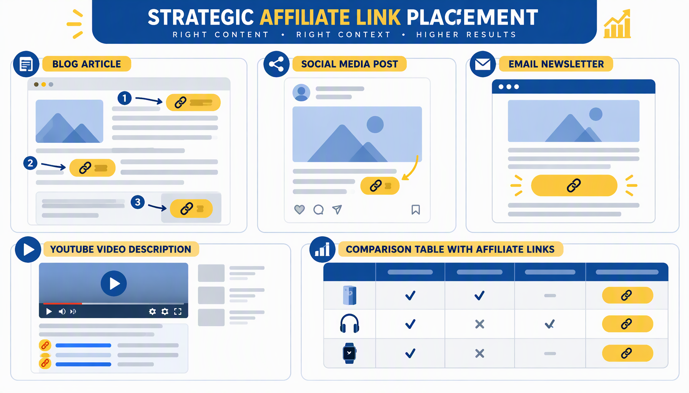
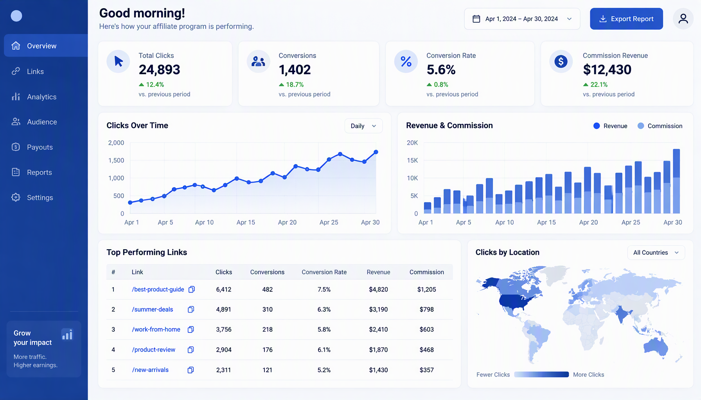

# Panduan Lengkap Shopee Affiliate Marketing untuk Bisnis UMKM Indonesia

**Strategi Praktis Menghasilkan Passive Income dari Program Affiliate Shopee**

Penulis: Siraj Nur Ihrom, CEO SNISHOP.COM


---

## Daftar Isi

**BAGIAN I: FONDASI**

- Bab 1: Memahami Shopee Affiliate Program
- Bab 2: Registrasi dan Setup Akun
- Bab 3: Riset Produk dan Pemilihan Niche

**BAGIAN II: EKSEKUSI**

- Bab 4: Strategi Konten Affiliate
- Bab 5: Teknik Promosi Multi-Platform
- Bab 6: Copywriting dan CTA untuk Affiliate
- Bab 7: Optimasi Link Placement dan Konversi

**BAGIAN III: SKALING**

- Bab 8: Automation dan Tools
- Bab 9: Analisis Data dan ROI
- Bab 10: Studi Kasus dan Implementation Plan

**Penutup**

**Tentang Penulis**

---

# BAGIAN I: FONDASI

---

## Bab 1: Memahami Shopee Affiliate Program


### 1.1 Apa Itu Shopee Affiliate Program

Shopee Affiliate Program adalah program kemitraan yang ditawarkan oleh Shopee Indonesia kepada individu maupun pelaku bisnis yang ingin mendapatkan penghasilan tambahan dengan cara mempromosikan produk-produk yang tersedia di marketplace Shopee. Sebagai seorang affiliate marketer, tugas Anda adalah membagikan tautan produk kepada calon pembeli melalui berbagai saluran digital. Setiap kali seseorang melakukan pembelian melalui tautan yang Anda bagikan, Anda akan mendapatkan komisi dari nilai transaksi tersebut.

Program ini merupakan bagian dari model bisnis affiliate marketing yang telah terbukti efektif di seluruh dunia. Konsep dasarnya sederhana: penjual mendapatkan pelanggan baru, affiliate mendapatkan komisi, dan pembeli menemukan produk yang mereka butuhkan. Semua pihak saling menguntungkan.

Di Indonesia, program ini telah berkembang pesat sejak diluncurkan pada tahun 2021. Shopee mencatat bahwa jumlah pendaftar program affiliate telah melampaui jutaan orang, dan total komisi yang dibayarkan kepada para affiliate marketer mencapai ratusan miliar rupiah setiap tahunnya. Angka ini terus meningkat seiring dengan pertumbuhan pengguna internet dan belanja online di Indonesia.

### 1.2 Cara Kerja Shopee Affiliate Program

Mekanisme kerja Shopee Affiliate Program dapat dijelaskan dalam lima tahap utama:

**Tahap 1: Pendaftaran dan Persetujuan**
Anda mendaftar sebagai affiliate marketer melalui halaman resmi Shopee Affiliate. Setelah pendaftaran Anda disetujui, Anda akan mendapatkan akses ke dashboard affiliate yang berisi berbagai tools dan informasi yang diperlukan.

**Tahap 2: Pemilihan Produk**
Melalui dashboard affiliate, Anda dapat memilih produk-produk yang ingin dipromosikan. Shopee menyediakan katalog lengkap dengan informasi komisi untuk setiap kategori produk. Anda juga bisa mencari produk berdasarkan tingkat komisi, popularitas, atau rating penjual.

**Tahap 3: Pembuatan Konten dan Pembagian Link**
Setelah memilih produk, Anda membuat konten promosi dan menyertakan link affiliate unik Anda. Link ini berisi kode tracking yang mengidentifikasi Anda sebagai sumber traffic. Setiap kali seseorang mengklik link tersebut, sistem Shopee akan mencatatnya.

**Tahap 4: Pembelian oleh Konsumen**
Ketika calon pembeli mengklik link affiliate Anda dan melakukan pembelian dalam jangka waktu tertentu (cookie duration), sistem akan mencatat transaksi tersebut sebagai hasil referral Anda. Cookie duration Shopee Affiliate umumnya berlangsung selama 7 hari, artinya jika seseorang mengklik link Anda hari ini tetapi baru membeli 5 hari kemudian, Anda tetap mendapatkan komisi.

**Tahap 5: Pembayaran Komisi**
Komisi yang Anda kumpulkan akan dihitung dan dibayarkan secara berkala sesuai jadwal yang ditetapkan oleh Shopee. Pembayaran biasanya dilakukan setiap bulan dengan minimum penarikan tertentu.

### 1.3 Struktur Komisi Shopee Affiliate

Struktur komisi Shopee Affiliate bervariasi tergantung pada kategori produk dan jenis program yang Anda ikuti. Berikut adalah rincian komisi yang perlu Anda pahami:

**Komisi Dasar (Base Commission)**
Komisi dasar adalah persentase tetap yang diberikan untuk setiap kategori produk. Besaran komisi ini berbeda-beda, mulai dari 1 persen hingga 10 persen dari nilai transaksi. Beberapa kategori produk dengan komisi yang umumnya lebih tinggi meliputi fashion, kecantikan, dan aksesoris gadget.

Berikut adalah perkiraan besaran komisi berdasarkan kategori produk:

- Fashion Wanita: 4 hingga 10 persen
- Fashion Pria: 4 hingga 8 persen
- Kecantikan dan Perawatan Diri: 3 hingga 8 persen
- Aksesoris Gadget: 3 hingga 7 persen
- Peralatan Rumah Tangga: 2 hingga 5 persen
- Elektronik: 1 hingga 3 persen
- Makanan dan Minuman: 2 hingga 5 persen
- Mainan dan Hobi: 3 hingga 6 persen
- Olahraga dan Outdoor: 3 hingga 7 persen

**Bonus Komisi (Bonus Commission)**
Selain komisi dasar, Shopee juga menawarkan bonus komisi untuk produk-produk tertentu yang sedang dipromosikan secara agresif oleh platform. Bonus ini bisa menambah komisi Anda hingga 5 hingga 15 persen di atas komisi dasar. Produk-produk yang masuk dalam program Shopee Bonus Commission biasanya ditandai dengan label khusus di dashboard affiliate.

**Komisi Tambahan dari Penjual (Seller Commission)**
Beberapa penjual di Shopee menawarkan komisi tambahan di atas komisi dasar yang diberikan oleh platform. Hal ini biasanya dilakukan oleh penjual yang ingin meningkatkan penjualan produk mereka secara signifikan. Komisi tambahan ini bisa berupa persentase tambahan atau nilai tetap per transaksi.

### 1.4 Jenis-Jenis Program Affiliate Shopee

Shopee menawarkan beberapa jenis program affiliate yang bisa Anda pilih sesuai dengan kebutuhan dan strategi Anda:

**Shopee Affiliate Program Reguler**
Ini adalah program utama yang terbuka untuk semua orang. Anda bisa mempromosikan jutaan produk dari berbagai kategori dan mendapatkan komisi sesuai dengan struktur yang telah ditetapkan. Program ini cocok untuk pemula yang baru memulai perjalanan affiliate marketing.

**Shopee Affiliate Program untuk KOL (Key Opinion Leader)**
Program ini dirancang khusus untuk influencer dan content creator yang memiliki following signifikan. Komisi yang ditawarkan biasanya lebih tinggi dibandingkan program reguler, dan ada akses eksklusif ke campaign-campaign tertentu. Untuk bergabung, Anda biasanya perlu memiliki minimal 5.000 followers di salah satu platform media sosial.

**Shopee Mall Affiliate Program**
Program ini khusus untuk mempromosikan produk-produk dari Shopee Mall, yaitu toko-toko resmi brand ternama di Shopee. Komisi untuk produk Shopee Mall cenderung lebih stabil dan produknya memiliki kualitas terjamin, sehingga lebih mudah untuk meyakinkan calon pembeli.

**Shopee Affiliate Program Kategori Spesifik**
Terkadang Shopee meluncurkan program affiliate untuk kategori produk tertentu dengan komisi yang lebih tinggi dari biasanya. Program-program ini bersifat temporal dan biasanya berlangsung selama periode kampanye tertentu, seperti kampanye 12.12 atau Harbolnas.

### 1.5 Perbedaan dengan Platform Marketplace Lain

Memahami perbedaan Shopee Affiliate dengan program affiliate dari marketplace lain akan membantu Anda menentukan strategi yang paling tepat. Berikut adalah perbandingan dengan beberapa platform utama:

**Shopee Affiliate vs Tokopedia Affiliate**
Shopee memiliki program affiliate yang lebih matang dan terstruktur dibandingkan Tokopedia. Shopee menawarkan cookie duration yang lebih panjang, yaitu 7 hari, sementara Tokopedia umumnya hanya 24 jam. Artinya, peluang Anda untuk mendapatkan komisi dari Shopee jauh lebih besar. Selain itu, jumlah produk yang bisa dipromosikan di Shopee juga jauh lebih banyak karena basis penjual di Shopee lebih besar.

**Shopee Affiliate vs TikTok Shop Affiliate**
TikTok Shop Affiliate lebih berfokus pada konten video pendek, sementara Shopee Affiliate lebih fleksibel karena Anda bisa mempromosikan produk melalui berbagai format konten dan platform. Namun, TikTok Shop Affiliate memiliki keunggulan dalam hal viralitas karena algoritma TikTok yang bisa membuat konten meledak dalam waktu singkat.

**Shopee Affiliate vs Lazada Affiliate**
Lazada memiliki program affiliate yang mirip dengan Shopee, namun pangsa pasar Lazada di Indonesia lebih kecil dibandingkan Shopee. Hal ini berarti potensi konversi dari link affiliate Lazada juga cenderung lebih rendah. Di sisi lain, persaingan di Lazada Affiliate juga tidak seketat di Shopee Affiliate.

### 1.6 Potensi Penghasilan Affiliate Shopee

Salah satu pertanyaan yang paling sering diajukan oleh calon affiliate marketer adalah berapa potensi penghasilan yang bisa didapatkan. Jawabannya sangat bervariasi, tergantung pada beberapa faktor: jumlah traffic yang bisa Anda hasilkan, niche yang Anda pilih, kualitas konten yang Anda buat, dan konsistensi Anda dalam mempromosikan produk.

Untuk memberikan gambaran yang lebih konkret, berikut adalah simulasi potensi penghasilan berdasarkan tingkat usaha:

**Tingkat Pemula (1 hingga 3 bulan pertama)**
Pada tahap ini, rata-rata affiliate marketer bisa menghasilkan antara Rp 500.000 hingga Rp 3.000.000 per bulan. Ini dicapai dengan mempromosikan 5 hingga 10 produk per hari melalui 1 hingga 2 platform media sosial.

**Tingkat Menengah (3 hingga 6 bulan)**
Setelah membangun audience dan mengasah kemampuan copywriting, penghasilan rata-rata meningkat menjadi Rp 3.000.000 hingga Rp 10.000.000 per bulan. Pada tahap ini, Anda biasanya sudah mempromosikan 15 hingga 30 produk per hari melalui 2 hingga 3 platform.

**Tingkat Lanjut (6 bulan ke atas)**
Affiliate marketer yang sudah berpengalaman dan memiliki strategi yang teruji bisa menghasilkan Rp 10.000.000 hingga Rp 50.000.000 atau lebih per bulan. Pada tahap ini, Anda biasanya sudah menggunakan automation tools, memiliki tim kecil, dan mempromosikan produk melalui 4 hingga 6 platform secara bersamaan.

### 1.7 Istilah-Istilah Penting dalam Shopee Affiliate

Sebelum melanjutkan, ada beberapa istilah penting yang perlu Anda pahami dalam dunia Shopee Affiliate:

**Cookie Duration**
Cookie duration adalah jangka waktu setelah seseorang mengklik link affiliate Anda di mana pembelian akan tetap dihitung sebagai referral Anda. Di Shopee Affiliate, cookie duration umumnya berlangsung selama 7 hari. Artinya, jika seseorang mengklik link Anda pada hari Senin dan baru melakukan pembelian pada hari Kamis, Anda tetap mendapatkan komisi dari transaksi tersebut.

**Conversion Rate**
Conversion rate adalah persentase orang yang melakukan pembelian dari total orang yang mengklik link affiliate Anda. Jika 100 orang mengklik link Anda dan 3 di antaranya membeli produk, maka conversion rate Anda adalah 3 persen.

**Click-Through Rate (CTR)**
CTR adalah persentase orang yang mengklik link affiliate Anda dari total orang yang melihat konten Anda. Jika konten Anda dilihat oleh 1.000 orang dan 50 di antaranya mengklik link, maka CTR Anda adalah 5 persen.

**Deep Link**
Deep link adalah link yang mengarahkan pengguna langsung ke halaman produk spesifik di dalam aplikasi Shopee, bukan ke halaman web browser. Deep link memberikan user experience yang lebih baik dan cenderung memiliki conversion rate yang lebih tinggi.

**Affiliate ID**
Affiliate ID adalah nomor identifikasi unik Anda sebagai affiliate marketer di sistem Shopee. Nomor ini digunakan untuk melacak semua aktivitas dan komisi Anda.

**Minimum Withdrawal**
Minimum withdrawal adalah jumlah minimum komisi yang harus Anda kumpulkan sebelum bisa melakukan penarikan dana ke rekening bank Anda. Setiap program affiliate memiliki kebijakan minimum withdrawal yang berbeda.

### 1.8 Keuntungan Bergabung dengan Shopee Affiliate

Ada beberapa keuntungan strategis yang membuat Shopee Affiliate Program sangat menarik untuk pelaku UMKM:

**Modal Minimal**
Anda tidak perlu menyetok barang, tidak perlu mengurus pengiriman, dan tidak perlu menangani komplain pelanggan. Tugas Anda hanya mempromosikan produk dan mendapatkan komisi dari setiap penjualan yang terjadi.

**Fleksibilitas Waktu dan Tempat**
Anda bisa menjalankan bisnis affiliate ini kapan saja dan dari mana saja. Selama Anda memiliki koneksi internet, Anda bisa membuat konten dan membagikan link affiliate Anda.

**Skalabilitas Tinggi**
Tidak ada batasan berapa banyak produk yang bisa Anda promosikan. Anda bisa memulai dengan 5 produk per hari dan meningkatkannya secara bertahap seiring dengan bertambahnya audience dan pengalaman.

**Akses ke Ekosistem Shopee**
Dengan menjadi affiliate Shopee, Anda mendapatkan akses ke ekosistem e-commerce terbesar di Indonesia. Anda bisa memanfaatkan berbagai fitur dan tools yang disediakan oleh Shopee untuk meningkatkan efektivitas promosi Anda.

### 1.8 Kesalahan Umum yang Harus Dihindari

Sebelum melangkah lebih jauh, ada beberapa kesalahan umum yang sering dilakukan oleh affiliate marketer pemula yang perlu Anda hindari:

**Kesalahan 1: Spamming Link**
Mengirimkan link affiliate ke grup WhatsApp, kolom komentar, atau DM orang lain secara massal tanpa memberikan nilai tambah. Cara ini tidak hanya tidak efektif, tetapi juga bisa membuat akun Anda dibanned.

**Kesalahan 2: Tidak Membangun Audience**
Banyak pemula yang langsung fokus pada penjualan tanpa membangun audience terlebih dahulu. Padahal, audience yang loyal dan percaya pada Anda adalah kunci utama keberhasilan affiliate marketing.

**Kesalahan 3: Memilih Produk Secara Sembarangan**
Memilih produk hanya berdasarkan komisi tertinggi tanpa mempertimbangkan relevansi dengan niche dan kebutuhan audience. Produk dengan komisi tinggi tidak akan menghasilkan penjualan jika tidak sesuai dengan minat followers Anda.

**Kesalahan 4: Tidak Konsisten**
Membuat konten secara sporadis tanpa jadwal yang teratur. Konsistensi adalah kunci dalam membangun kepercayaan audience dan mendapatkan traffic yang stabil.

**Kesalahan 5: Mengabaikan Data dan Analitik**
Tidak melacak performa konten dan link affiliate, sehingga tidak tahu strategi mana yang berhasil dan mana yang tidak. Tanpa data, Anda tidak bisa mengoptimasi strategi Anda secara efektif.

### 1.9 Checklist Pemula Shopee Affiliate

Gunakan checklist berikut untuk memastikan Anda telah memahami fondasi dasar sebelum melanjutkan ke bab berikutnya:

- Memahami cara kerja affiliate marketing secara umum
- Mengetahui struktur komisi Shopee Affiliate
- Memahami perbedaan jenis-jenis program affiliate Shopee
- Memiliki ekspektasi penghasilan yang realistis
- Mengidentifikasi kesalahan umum yang harus dihindari
- Siap untuk mendaftar dan memulai perjalanan affiliate

---

## Bab 2: Registrasi dan Setup Akun


### 2.1 Persyaratan Pendaftaran

Sebelum mendaftar program Shopee Affiliate, ada beberapa persyaratan yang harus Anda penuhi. Memahami persyaratan ini sejak awal akan menghemat waktu dan mencegah penolakan pendaftaran.

**Persyaratan Utama:**
- Memiliki akun Shopee yang aktif dan dalam status baik (tidak pernah terkena banned atau suspend)
- Berusia minimal 17 tahun
- Memiliki KTP atau identitas resmi lainnya
- Memiliki minimal satu akun media sosial aktif dengan konten yang relevan
- Nomor telepon yang terverifikasi dan terhubung dengan akun Shopee
- Rekening bank atas nama sendiri untuk keperluan pencairan komisi

**Persyaratan Tambahan untuk KOL Program:**
- Minimal 5.000 followers di salah satu platform media sosial
- Engagement rate minimal 2 persen
- Konten yang konsisten dan berkualitas
- Niche yang jelas dan terdefinisi

### 2.2 Langkah-Langkah Pendaftaran

Berikut adalah panduan langkah demi langkah untuk mendaftar program Shopee Affiliate:

**Langkah 1: Akses Halaman Pendaftaran**
Buka browser dan kunjungi halaman resmi Shopee Affiliate Program di affiliate.shopee.co.id. Pastikan Anda mengakses halaman resmi untuk menghindari situs phishing.

**Langkah 2: Login dengan Akun Shopee**
Klik tombol daftar dan login menggunakan akun Shopee Anda. Jika Anda belum memiliki akun Shopee, buatlah akun terlebih dahulu melalui aplikasi Shopee atau website shopee.co.id.

**Langkah 3: Lengkapi Formulir Pendaftaran**
Isi formulir pendaftaran dengan data yang lengkap dan akurat. Data yang diminta meliputi nama lengkap sesuai KTP, nomor KTP, tanggal lahir, alamat email aktif, nomor telepon, dan informasi akun media sosial Anda.

**Langkah 4: Pilih Kategori Konten**
Anda akan diminta untuk memilih kategori konten yang akan Anda buat. Pilihlah kategori yang sesuai dengan niche dan minat Anda. Beberapa pilihan yang tersedia meliputi fashion, kecantikan, gadget, makanan, dan gaya hidup.

**Langkah 5: Upload Dokumen Verifikasi**
Upload foto KTP dan selfie dengan KTP sesuai instruksi. Pastikan foto jelas, tidak blur, dan semua informasi pada KTP terlihat dengan baik.

**Langkah 6: Tunggu Proses Verifikasi**
Setelah mengirimkan semua dokumen yang diperlukan, tunggu proses verifikasi dari tim Shopee. Proses ini biasanya memakan waktu 1 hingga 5 hari kerja. Anda akan mendapatkan notifikasi melalui email dan aplikasi Shopee mengenai status pendaftaran Anda.

### 2.3 Tips Agar Pendaftaran Disetujui

Tidak semua pendaftaran Shopee Affiliate langsung disetujui. Berikut adalah tips untuk meningkatkan peluang persetujuan:

**Tips 1: Pastikan Akun Shopee dalam Kondisi Baik**
Sebelum mendaftar, pastikan akun Shopee Anda tidak memiliki riwayat pelanggaran. Akun dengan riwayat komplain atau retur yang berlebihan cenderung lebih sulit disetujui.

**Tips 2: Siapkan Media Sosial yang Aktif**
Pastikan akun media sosial yang Anda cantumkan dalam pendaftaran aktif dan memiliki konten yang relevan. Tim verifikasi akan mengecek akun media sosial Anda untuk menilai kredibilitas Anda sebagai content creator.

**Tips 3: Lengkapi Semua Data dengan Jujur**
Jangan memberikan informasi palsu atau berlebihan. Tim verifikasi Shopee cukup ketat dalam mengecek kebenaran data yang Anda berikan. Jika ditemukan ketidaksesuaian, pendaftaran Anda akan ditolak.

**Tips 4: Gunakan Foto Berkualitas Tinggi**
Foto KTP dan selfie harus jelas dan berkualitas tinggi. Foto yang blur atau gelap akan menyebabkan proses verifikasi tertunda atau bahkan ditolak.

**Tips 5: Tulis Deskripsi Diri yang Menarik**
Pada kolom deskripsi diri, tuliskan pengalaman Anda dalam membuat konten dan rencana Anda untuk mempromosikan produk melalui program affiliate. Deskripsi yang profesional dan meyakinkan akan meningkatkan peluang disetujui.

### 2.4 Setup Profil Affiliate

Setelah pendaftaran Anda disetujui, langkah selanjutnya adalah melakukan setup profil affiliate Anda. Profil yang baik akan meningkatkan kredibilitas Anda di mata Shopee maupun calon pembeli.

**Langkah 1: Lengkapi Profil Affiliate**
Masuk ke dashboard affiliate dan lengkapi semua informasi profil. Tambahkan foto profil yang profesional, tulis bio yang menarik, dan cantumkan link ke akun media sosial utama Anda.

**Langkah 2: Pilih Niche Utama**
Tentukan niche utama yang akan Anda fokuskan. Meskipun Anda bisa mempromosikan produk dari berbagai kategori, memiliki niche utama akan membantu Anda membangun personal branding yang kuat dan menarik audience yang tepat.

**Langkah 3: Setting Informasi Pembayaran**
Masukkan informasi rekening bank Anda untuk keperluan pencairan komisi. Pastikan nama pada rekening bank sesuai dengan nama pada akun Shopee Anda.

**Langkah 4: Pelajari Dashboard Affiliate**
Luangkan waktu untuk menjelajahi seluruh fitur yang tersedia di dashboard affiliate. Pahami cara mengakses laporan performa, cara generate link affiliate, dan cara memantau komisi yang Anda dapatkan.

### 2.5 Memahami Dashboard Shopee Affiliate

Dashboard Shopee Affiliate adalah pusat kendali Anda dalam menjalankan bisnis affiliate. Memahami setiap fitur di dashboard akan membantu Anda bekerja lebih efisien dan efektif.

**Menu Utama Dashboard:**

**Beranda (Home)**
Menampilkan ringkasan performa affiliate Anda, termasuk total klik, konversi, dan komisi yang diperoleh dalam periode tertentu. Halaman ini juga menampilkan pengumuman terbaru dan campaign yang sedang berlangsung.

**Produk (Products)**
Bagian ini memungkinkan Anda mencari dan memilih produk yang ingin dipromosikan. Anda bisa memfilter produk berdasarkan kategori, tingkat komisi, rating, dan jumlah penjualan. Setiap produk menampilkan informasi komisi secara jelas.

**Link Generator**
Tools untuk menghasilkan link affiliate dari produk yang Anda pilih. Anda bisa memasukkan URL produk atau mencari produk langsung dari tools ini. Link yang dihasilkan sudah dilengkapi dengan tracking code Anda.

**Laporan (Reports)**
Bagian ini menampilkan laporan detail mengenai performa link affiliate Anda. Data yang tersedia meliputi jumlah klik per link, tingkat konversi, komisi per produk, dan tren performa dari waktu ke waktu.

**Komisi (Earnings)**
Menampilkan rincian komisi yang Anda peroleh, termasuk komisi yang masih dalam status pending, confirmed, dan yang sudah dibayarkan. Bagian ini juga menunjukkan jadwal pembayaran berikutnya.

**Campaign**
Menampilkan daftar campaign atau kampanye khusus yang sedang berlangsung. Mengikuti campaign tertentu bisa memberikan bonus komisi tambahan yang signifikan.

### 2.7 Memilih Niche yang Tepat

Pemilihan niche adalah keputusan strategis yang akan mempengaruhi seluruh perjalanan affiliate marketing Anda. Niche yang tepat akan memudahkan Anda dalam membuat konten, menarik audience, dan menghasilkan penjualan.

**Mengapa Niche Sangat Penting:**
Tanpa niche yang jelas, Anda akan kesulitan membangun audience yang loyal. Orang mengikuti akun media sosial karena mereka tahu apa yang akan mereka dapatkan dari akun tersebut. Jika akun Anda membahas fashion hari ini, gadget besok, dan makanan lusa, audience akan bingung dan tidak memiliki alasan kuat untuk mengikuti Anda.

Niche yang jelas juga memudahkan algoritma platform untuk merekomendasikan konten Anda kepada orang yang tepat. Instagram, TikTok, dan YouTube semuanya menggunakan sinyal niche untuk menentukan kepada siapa konten Anda akan ditampilkan.

**Kriteria Niche yang Baik:**

**Passion dan Pengetahuan**
Pilihlah niche yang Anda kuasai atau minati. Pengetahuan yang mendalam tentang suatu niche akan membuat konten Anda lebih autentik dan meyakinkan. Jika Anda menyukai fashion hijab, misalnya, niche fashion muslim akan menjadi pilihan yang natural.

**Ukuran Pasar**
Niche harus memiliki pasar yang cukup besar untuk menghasilkan penjualan yang konsisten. Niche yang terlalu sempit akan membatasi potensi penghasilan Anda. Di Indonesia, niche-niche dengan pasar besar meliputi fashion, kecantikan, gadget, dan perlengkapan rumah tangga.

**Tingkat Kompetisi**
Niche dengan kompetisi yang terlalu tinggi akan menyulitkan Anda untuk bersaing, terutama di awal perjalanan. Carilah niche yang memiliki pasar cukup besar namun belum terlalu jenuh dengan affiliate marketer.

**Potensi Komisi**
Perhatikan tingkat komisi yang ditawarkan untuk produk-produk dalam niche tersebut. Niche dengan harga produk menengah hingga tinggi dan komisi yang baik akan memberikan penghasilan yang lebih optimal.

**Rekomendasi Niche Populer untuk UMKM Indonesia:**

- Fashion Muslim dan Hijab: pasar sangat besar di Indonesia, komisi 4 hingga 10 persen
- Skincare dan Kecantikan: pertumbuhan pesat, komisi 3 hingga 8 persen
- Aksesoris Gadget: permintaan stabil, komisi 3 hingga 7 persen
- Perlengkapan Rumah Tangga Unik: viral potential tinggi, komisi 2 hingga 5 persen
- Makanan dan Camilan Lokal: pasar luas, komisi 2 hingga 5 persen
- Perlengkapan Bayi dan Anak: loyalitas tinggi, komisi 3 hingga 6 persen

### 2.7 Checklist Setup Akun

Gunakan checklist berikut untuk memastikan setup akun Anda sudah lengkap:

- Pendaftaran Shopee Affiliate sudah disetujui
- Profil affiliate sudah dilengkapi dengan foto dan bio
- Informasi pembayaran sudah diatur dengan benar
- Niche utama sudah dipilih dan didefinisikan
- Dashboard affiliate sudah dijelajahi dan dipahami
- Minimal satu campaign sudah diikuti
- Link affiliate pertama sudah di-generate

---

## Bab 3: Riset Produk dan Pemilihan Niche


### 3.1 Pentingnya Riset Produk yang Mendalam

Riset produk adalah fondasi dari strategi affiliate marketing yang sukses. Banyak affiliate marketer pemula yang gagal karena mereka memilih produk secara sembarangan tanpa melakukan riset yang memadai. Memilih produk yang tepat bukan hanya soal komisi tertinggi, melainkan tentang menemukan produk yang sesuai dengan kebutuhan audience Anda, memiliki potensi penjualan yang baik, dan bisa dipromosikan secara efektif melalui konten yang Anda buat.

Riset produk yang mendalam akan membantu Anda menjawab beberapa pertanyaan penting: Apakah produk ini memang dibutuhkan oleh audience saya? Apakah harga produk sesuai dengan daya beli audience saya? Apakah produk ini memiliki kualitas yang baik sehingga tidak merusak reputasi saya? Apakah komisi yang ditawarkan sebanding dengan usaha yang perlu dikeluarkan?

### 3.2 Cara Riset Produk dengan Komisi Tinggi

Berikut adalah metode-metode yang bisa Anda gunakan untuk menemukan produk-produk dengan komisi tinggi di Shopee:

**Metode 1: Analisis Dashboard Affiliate**
Buka menu Produk di dashboard affiliate Anda. Gunakan filter untuk mengurutkan produk berdasarkan tingkat komisi. Perhatikan produk-produk dengan komisi di atas rata-rata kategori. Buatlah daftar produk-produk potensial dan analisis lebih lanjut.

**Metode 2: Monitoring Campaign Shopee**
Shopee secara rutin mengadakan campaign dengan komisi khusus yang lebih tinggi dari biasanya. Pantau menu Campaign di dashboard affiliate Anda dan ikuti campaign yang relevan dengan niche Anda. Campaign seperti Shopee Bonus Day, Brand Sale, dan Flash Sale biasanya menawarkan komisi tambahan yang signifikan.

**Metode 3: Analisis Produk Best Seller**
Produk yang sudah terjual dalam jumlah besar cenderung lebih mudah dipromosikan karena sudah memiliki social proof. Cari produk best seller di kategori niche Anda dan periksa apakah produk tersebut termasuk dalam program affiliate.

**Metode 4: Monitoring Tren di Media Sosial**
Perhatikan produk-produk yang sedang trending di TikTok, Instagram, dan Twitter. Produk yang viral di media sosial biasanya mengalami peningkatan pencarian dan penjualan yang signifikan di Shopee. Jika produk tersebut masuk program affiliate, ini adalah peluang yang sangat baik.

### 3.3 Analisis Persaingan

Memahami tingkat persaingan dalam niche Anda sangat penting untuk menentukan strategi yang tepat. Berikut adalah cara melakukan analisis persaingan:

**Langkah 1: Identifikasi Affiliate Marketer Terkemuka**
Cari affiliate marketer yang sudah sukses di niche Anda. Perhatikan bagaimana mereka mempromosikan produk, jenis konten yang mereka buat, dan platform yang mereka gunakan. Pelajari strategi mereka dan cari celah yang bisa Anda manfaatkan.

**Langkah 2: Analisis Konten Kompetitor**
Perhatikan konten-konten yang dibuat oleh kompetitor Anda. Berapa banyak likes, comments, dan shares yang mereka dapatkan? Jenis konten apa yang paling efektif? Apa yang bisa Anda lakukan dengan lebih baik?

**Langkah 3: Evaluasi Kesenjangan Pasar**
Cari aspek-aspek yang belum dicakup oleh kompetitor Anda. Mungkin mereka semua fokus pada produk premium, sementara ada pasar besar untuk produk budget. Atau mungkin mereka semua membuat konten review tertulis, sementara belum ada yang membuat konten video perbandingan.

**Langkah 4: Tentukan Unique Selling Proposition (USP)**
Berdasarkan analisis persaingan, tentukan apa yang membedakan Anda dari kompetitor. USP bisa berupa sudut pandang yang unik, gaya konten yang berbeda, atau fokus pada segmen pasar yang belum tergarap.

### 3.4 Tools Riset Produk

Ada beberapa tools yang bisa Anda gunakan untuk mempermudah proses riset produk:

**Shopee Affiliate Dashboard**
Tools internal yang disediakan oleh Shopee ini adalah sumber informasi paling akurat dan lengkap. Anda bisa melihat data komisi, popularitas produk, dan tren penjualan secara real-time.

**Google Trends**
Gunakan Google Trends untuk melihat tren pencarian produk tertentu di Indonesia. Tools ini gratis dan bisa membantu Anda mengidentifikasi produk yang sedang naik daun. Cukup masukkan kata kunci produk dan atur wilayah ke Indonesia.

**Shopee Search Bar**
Ketik kata kunci di kolom pencarian Shopee dan perhatikan saran pencarian yang muncul. Saran-saran ini didasarkan pada data pencarian aktual dan bisa memberikan insight tentang apa yang sedang dicari oleh konsumen.

**Social Media Analytics**
Manfaatkan fitur analytics di TikTok, Instagram, dan YouTube untuk melihat konten-konten produk yang paling populer. Perhatikan hashtag yang trending dan jenis konten yang mendapatkan engagement tinggi.

**Browser Extension**
Beberapa browser extension seperti Shopee Fan bisa membantu Anda melihat data tambahan tentang produk, termasuk riwayat harga dan tingkat penjualan. Meskipun data ini tidak selalu 100 persen akurat, tools ini bisa memberikan gambaran tambahan untuk mendukung keputusan Anda.

### 3.5 Memilih Produk yang Tepat untuk Audience

Tidak semua produk dengan komisi tinggi cocok untuk audience Anda. Berikut adalah kriteria untuk memilih produk yang tepat:

**Relevansi dengan Niche**
Produk harus relevan dengan niche yang Anda tekuni. Jika niche Anda adalah fashion hijab, mempromosikan produk otomotif tidak akan efektif karena tidak sesuai dengan minat audience Anda.

**Kesesuaian dengan Daya Beli Audience**
Pahami profil ekonomi audience Anda. Jika mayoritas audience Anda adalah mahasiswa, produk dengan harga di bawah Rp 200.000 akan lebih mudah terjual dibandingkan produk dengan harga di atas Rp 1.000.000.

**Kualitas Produk**
Selalu pastikan produk yang Anda promosikan memiliki kualitas yang baik. Periksa rating produk (minimal 4.5 bintang), baca review pembeli sebelumnya, dan jika memungkinkan, beli dan coba produk tersebut sendiri. Mempromosikan produk berkualitas rendah akan merusak kepercayaan audience Anda.

**Ketersediaan Stok**
Pastikan produk yang Anda promosikan memiliki stok yang cukup. Tidak ada yang lebih mengecewakan daripada berhasil mendapatkan banyak klik tetapi produk yang dipromosikan sudah habis stoknya.

**Rating dan Review Penjual**
Selain rating produk, perhatikan juga rating penjual. Penjual dengan rating tinggi dan responsif terhadap komplain pelanggan akan memberikan pengalaman belanja yang lebih baik bagi followers Anda.

### 3.6 Framework Pemilihan Produk

Gunakan framework RICE berikut untuk mengevaluasi setiap produk yang akan Anda promosikan:

**R: Relevance (Relevansi)**
Seberapa relevan produk ini dengan niche dan minat audience Anda? Beri skor 1 sampai 5.

**I: Income Potential (Potensi Penghasilan)**
Berapa potensi komisi yang bisa Anda dapatkan? Pertimbangkan persentase komisi dikalikan harga produk. Beri skor 1 sampai 5.

**C: Competition (Kompetisi)**
Seberapa ketat persaingan untuk produk ini di kalangan affiliate marketer? Semakin rendah kompetisi, semakin tinggi skor. Beri skor 1 sampai 5.

**E: Engagement Potential (Potensi Engagement)**
Seberapa menarik produk ini untuk dibuat kontennya? Produk yang unik atau sedang trending biasanya memiliki potensi engagement yang lebih tinggi. Beri skor 1 sampai 5.

Total skor RICE maksimal adalah 20. Produk dengan skor di atas 15 layak untuk dipromosikan. Produk dengan skor di bawah 10 sebaiknya dihindari.

### 3.7 Template Evaluasi Produk

Gunakan template berikut untuk mendokumentasikan evaluasi produk Anda. Dokumentasi yang baik akan membantu Anda melacak produk mana yang sudah dipromosikan dan bagaimana performanya.

```
Nama Produk: [Nama produk]
Kategori: [Kategori produk]
Harga: Rp [harga produk]
Komisi: [persen] persen
Estimasi Komisi per Penjualan: Rp [jumlah]
Rating Produk: [rating] dari 5
Jumlah Terjual: [jumlah] unit
Rating Penjual: [rating] dari 5
Relevansi dengan Niche: [1-5]
Potensi Engagement: [1-5]
Skor RICE Total: [total]/20
Keputusan: Promosikan / Tidak Promosikan
Catatan: [catatan tambahan]
```

**Cara Menggunakan Template:**
Isi template ini untuk setiap produk yang Anda pertimbangkan untuk dipromosikan. Setelah mempromosikan produk, tambahkan kolom performa aktual untuk membandingkan dengan estimasi awal. Data ini akan sangat berharga untuk meningkatkan akurasi evaluasi produk Anda di masa depan.

**Tips Tambahan:**
- Buat spreadsheet terpisah untuk setiap bulan agar data terorganisir dengan baik
- Review evaluasi produk setiap minggu untuk mengidentifikasi pola
- Jangan ragu untuk menghapus produk yang performanya di bawah ekspektasi dari daftar promosi Anda

### 3.8 Kesalahan Umum dalam Riset Produk

**Kesalahan 1: Hanya Fokus pada Komisi Tinggi**
Komisi tinggi tidak berarti penjualan tinggi. Produk dengan komisi 10 persen tetapi tidak diminati audience tidak akan menghasilkan penjualan. Sebaliknya, produk dengan komisi 3 persen yang sangat diminati audience bisa menghasilkan total komisi yang jauh lebih besar.

**Kesalahan 2: Tidak Mengecek Kualitas Produk**
Mempromosikan produk berkualitas rendah akan merusak kepercayaan audience Anda. Selalu cek rating dan review sebelum memutuskan untuk mempromosikan suatu produk.

**Kesalahan 3: Mengabaikan Musim dan Tren**
Beberapa produk memiliki musim penjualan tertentu. Misalnya, perlengkapan Lebaran akan sangat laris menjelang Idul Fitri tetapi kurang diminati di bulan-bulan biasa. Perhatikan kalender event dan tren musiman dalam riset produk Anda.

**Kesalahan 4: Promosi Terlalu Banyak Produk Sekaligus**
Memromosikan terlalu banyak produk sekaligus akan membuat audience Anda kebingungan dan konten Anda terasa seperti spam. Fokuslah pada 3 hingga 5 produk utama per minggu dan buat konten yang berkualitas untuk masing-masing produk.

### 3.9 Checklist Riset Produk

- Produk telah dievaluasi menggunakan framework RICE
- Rating produk minimal 4.5 bintang
- Penjual memiliki rating yang baik
- Stok produk tersedia dalam jumlah cukup
- Produk relevan dengan niche dan minat audience
- Harga produk sesuai dengan daya beli audience
- Konten untuk produk ini bisa dibuat dengan efektif
- Tidak ada kampanye negatif terhadap produk atau penjual

---

# BAGIAN II: EKSEKUSI

---

## Bab 4: Strategi Konten Affiliate


### 4.1 Mengapa Konten Adalah Raja

Dalam dunia affiliate marketing, konten adalah segalanya. Konten yang berkualitas adalah jembatan yang menghubungkan produk dengan calon pembeli. Tanpa konten yang menarik, informatif, dan persuasif, link affiliate Anda tidak akan mendapatkan klik, dan tanpa klik, tidak akan ada penjualan.

Konten yang baik bukan hanya soal menjual produk. Konten yang baik memberikan nilai tambah kepada audience, baik dalam bentuk informasi, edukasi, hiburan, atau inspirasi. Ketika audience Anda merasa mendapat manfaat dari konten yang Anda buat, mereka akan lebih percaya pada rekomendasi Anda dan lebih cenderung melakukan pembelian melalui link affiliate Anda.

### 4.2 Jenis-Jenis Konten Affiliate yang Berkonversi Tinggi

Berikut adalah jenis-jenis konten yang telah terbukti efektif dalam menghasilkan konversi tinggi untuk affiliate marketing:

**Review Produk**
Review produk adalah jenis konten affiliate yang paling umum dan paling efektif. Dalam review, Anda memberikan penilaian mendalam tentang suatu produk berdasarkan pengalaman penggunaan Anda. Review yang baik mencakup kelebihan produk, kekurangan produk, perbandingan dengan produk serupa, dan rekomendasi apakah produk ini layak dibeli atau tidak.

Contoh struktur review produk yang efektif:
- Pembukaan: ceritakan mengapa Anda mencoba produk ini
- Unboxing: tampilkan kemasan dan isi paket
- First impression: kesan pertama saat menggunakan produk
- Penggunaan harian: ceritakan pengalaman menggunakan produk selama beberapa hari atau minggu
- Kelebihan: daftar 3 hingga 5 kelebihan utama
- Kekurangan: daftar 2 hingga 3 kekurangan yang perlu diperhatikan
- Kesimpulan: berikan rating dan rekomendasi akhir
- CTA: ajak pembaca untuk membeli melalui link affiliate Anda

**Unboxing**
Konten unboxing menampilkan proses membuka kemasan produk dan memperlihatkan kondisi fisik produk untuk pertama kalinya. Jenis konten ini sangat populer di platform video seperti TikTok dan YouTube karena memberikan pengalaman yang autentik dan menarik bagi penonton.

Tips membuat konten unboxing yang menarik:
- Gunakan pencahayaan yang baik agar detail produk terlihat jelas
- Tunjukkan kemasan dari berbagai sudut
- Bacakan deskripsi produk yang tertera pada kemasan
- Bandingkan ukuran produk dengan objek familiar
- Reaksikan secara jujur saat melihat produk untuk pertama kalinya

**Perbandingan Produk (Comparison)**
Konten perbandingan membandingkan dua atau lebih produk serupa untuk membantu calon pembeli membuat keputusan. Jenis konten ini sangat efektif karena orang yang mencari konten perbandingan biasanya sudah dalam tahap pertimbangan pembelian dan tinggal membutuhkan dorongan terakhir.

Format perbandingan yang efektif:
- Bandingkan 2 hingga 3 produk dalam kategori yang sama
- Gunakan kriteria perbandingan yang jelas: harga, kualitas, fitur, desain
- Berikan penilaian objektif untuk setiap kriteria
- Rekomendasikan produk terbaik untuk kebutuhan tertentu
- Sertakan link affiliate untuk setiap produk yang dibahas

**Tutorial dan How-To**
Konten tutorial mengajarkan audience cara melakukan sesuatu yang berkaitan dengan produk yang Anda promosikan. Misalnya, tutorial makeup menggunakan produk skincare tertentu, tutorial styling outfit hijab, atau tutorial setup gadget tertentu.

Keunggulan konten tutorial adalah memberikan nilai edukasi yang tinggi sehingga audience merasa mendapatkan manfaat langsung. Produk yang Anda gunakan dalam tutorial secara natural akan menarik perhatian dan memicu pertanyaan dari audience tentang produk tersebut.

**Koleksi dan Rekomendasi (Listicle)**
Konten listicle menyajikan daftar produk terbaik dalam kategori tertentu. Misalnya, 10 rekomendasi hijab terbaik di bawah Rp 100.000, 5 gadget wajib punya untuk content creator, atau 7 skincare lokal yang patut dicoba.

Keunggulan konten listicle:
- Mudah dicerna oleh audience
- Mencakup banyak produk dalam satu konten
- Potensi klik yang tinggi karena variasi pilihan
- SEO-friendly untuk mesin pencari

### 4.3 Framework Konten Affiliate

Gunakan framework CONTENT berikut untuk memastikan setiap konten affiliate yang Anda buat memiliki kualitas yang konsisten:

**C: Catchy Opening**
Buka konten Anda dengan hook yang menarik perhatian. Dalam 3 detik pertama (untuk video) atau 2 kalimat pertama (untuk teks), Anda harus bisa membuat audience ingin melanjutkan.

**O: Offer Value**
Berikan nilai tambah yang jelas. Apa yang akan audience dapatkan dari konten ini? Informasi baru? Solusi untuk masalah mereka? Hiburan yang mengedukasi?

**N: Need Identification**
Identifikasi kebutuhan atau masalah yang dihadapi audience. Tunjukkan bahwa Anda memahami masalah mereka dan produk yang Anda rekomendasikan bisa menjadi solusi.

**T: Trust Building**
Bangun kepercayaan dengan menunjukkan bukti nyata. Tampilkan hasil penggunaan produk, tunjukkan bahwa Anda benar-benar menggunakan produk tersebut, dan berikan penilaian yang jujur termasuk kekurangan produk.

**E: Engagement**
Libatkan audience dengan mengajukan pertanyaan, meminta pendapat, atau mengajak berdiskusi. Konten yang interaktif akan mendapatkan engagement lebih tinggi dan meningkatkan visibilitas di algoritma platform.

**N: Natural Integration**
Integrasikan link affiliate secara natural ke dalam konten. Jangan memaksa atau membuat audience merasa sedang dihard-sell. Link harus terasa seperti bagian natural dari konten yang bermanfaat.

**T: Clear CTA**
Sertakan call-to-action yang jelas di akhir konten. Katakan dengan spesifik apa yang Anda ingin audience lakukan, misalnya klik link di bio untuk mendapatkan harga spesial.

### 4.4 Storytelling untuk Affiliate Marketing

Storytelling adalah senjata paling ampuh dalam affiliate marketing. Orang tidak membeli produk karena spesifikasi teknisnya, mereka membeli karena cerita di balik produk tersebut dan bagaimana produk itu bisa memperbaiki hidup mereka.

**Formula Storytelling STAR:**

**S: Situation (Situasi)**
Gambarkan situasi atau kondisi awal. Misalnya, kulit wajah Anda yang bermasalah sebelum menggunakan skincare tertentu.

**T: Transformation (Transformasi)**
Ceritakan proses transformasi yang Anda alami setelah menggunakan produk. Sampaikan secara jujur dan detail.

**A: Achievement (Pencapaian)**
Tunjukkan hasil akhir yang telah Anda capai. Gunakan bukti visual jika memungkinkan, seperti foto before-after.

**R: Recommendation (Rekomendasi)**
Berikan rekomendasi kepada audience bahwa produk ini bisa membantu mereka mencapai hasil yang sama.

Contoh penerapan storytelling dalam konten affiliate:

"Situasi: Tiga bulan lalu, saya frustrasi karena kulit wajah saya berjerawat parah. Sudah coba berbagai produk tapi tidak ada yang berhasil. Transformasi: Seorang teman merekomendasikan serum vitamin C lokal ini. Awalnya skeptis, tapi saya coba selama sebulan penuh. Pencapaian: Dalam 4 minggu, jerawat saya berkurang drastis dan bekasnya memudar. Sekarang kulit saya jauh lebih cerah dan sehat. Rekomendasi: Kalau kalian punya masalah yang sama, coba serum ini. Link-nya ada di bio saya ya."

### 4.5 Membangun Konten yang Authentik

Autentisitas adalah fondasi utama dari konten affiliate yang berhasil. Audience di era digital saat ini sangat cerdas dan bisa dengan mudah membedakan antara review yang tulus dan konten yang hanya mengejar komisi. Berikut adalah strategi untuk membangun konten yang autentik:

**Prinsip 1: Gunakan Produk yang Benar-Benar Anda Sukai**
Ketika Anda merekomendasikan produk yang benar-benar Anda gunakan dan sukai, antusiasme Anda akan terpancar secara natural dalam konten. Audience bisa merasakan ketulusan ini dan akan lebih percaya pada rekomendasi Anda.

**Prinsip 2: Jujur tentang Kekurangan**
Tidak ada produk yang sempurna. Selalu sertakan kekurangan produk dalam review Anda. Kejujuran ini justru akan meningkatkan kredibilitas Anda dan membuat kelebihan produk yang Anda sebutkan terasa lebih dapat dipercaya.

**Prinsip 3: Ceritakan Pengalaman Pribadi**
Daripada hanya menyebutkan spesifikasi produk, ceritakan bagaimana produk tersebut mempengaruhi kehidupan Anda sehari-hari. Storytelling personal jauh lebih engaging dibandingkan daftar spesifikasi teknis.

**Prinsip 4: Tunjukkan Bukti Visual**
Foto dan video asli dari penggunaan produk jauh lebih meyakinkan dibandingkan foto katalog dari penjual. Tunjukkan produk dalam kondisi nyata, digunakan dalam situasi sehari-hari.

**Prinsip 5: Update Berkala**
Untuk produk yang digunakan dalam jangka panjang, berikan update berkala tentang kondisi produk setelah penggunaan berbulan-bulan. Ini menunjukkan bahwa Anda benar-benar menggunakan produk tersebut dan peduli dengan pengalaman jangka panjang.

### 4.6 Kalender Konten Affiliate

Konsistensi dalam membuat konten adalah kunci keberhasilan. Buatlah kalender konten untuk memastikan Anda memiliki jadwal yang teratur.

**Template Kalender Konten Mingguan:**

- Senin: Review produk baru (format video panjang atau blog post)
- Selasa: Tips dan trik terkait niche (format carousel Instagram atau thread Twitter)
- Rabu: Unboxing produk (format video pendek TikTok dan Reels)
- Kamis: Perbandingan produk (format video YouTube atau carousel)
- Jumat: Koleksi rekomendasi (format listicle atau carousel)
- Sabtu: Tutorial penggunaan produk (format video pendek)
- Minggu: Behind the scenes atau Q&A (format Stories atau live streaming)

### 4.6 Tips dan Best Practices

**Tips 1: Gunakan Produk yang Anda Promosikan**
Autentisitas adalah mata uang paling berharga dalam affiliate marketing. Gunakan produk yang Anda promosikan dan berikan review yang jujur. Audience bisa membedakan antara review yang tulus dan yang hanya mengejar komisi.

**Tips 2: Buat Variasi Konten**
Jangan hanya membuat satu jenis konten. Variasikan antara review, unboxing, tutorial, dan listicle untuk menjaga audience tetap engaged dan menjangkau segmen audience yang berbeda.

**Tips 3: Optimasi untuk Setiap Platform**
Setiap platform memiliki karakteristik konten yang berbeda. Konten untuk TikTok harus berdurasi pendek dan engaging di 3 detik pertama. Konten untuk YouTube bisa lebih panjang dan mendalam. Konten untuk Instagram harus visual-first. Sesuaikan format dan gaya konten dengan platform yang Anda gunakan.

**Tips 4: Manfaatkan Momen dan Event**
Buat konten yang relevan dengan momen tertentu, seperti Ramadan, Lebaran, Natal, Tahun Baru, atau event belanja online seperti 11.11 dan 12.12. Traffic dan minat beli konsumen meningkat signifikan selama periode-periode ini.

### 4.7 Kesalahan Umum dalam Membuat Konten

**Kesalahan 1: Terlalu Promosional**
Konten yang hanya berisi promosi tanpa memberikan nilai tambah akan ditinggalkan oleh audience. Rasio ideal adalah 80 persen konten bernilai tambah dan 20 persen konten promosi.

**Kesalahan 2: Tidak Jujur tentang Kekurangan Produk**
Review yang hanya memuji produk tanpa menyebutkan kekurangan akan terasa tidak autentik. Sebutkan juga kekurangan produk secara proporsional untuk membangun kepercayaan.

**Kesalahan 3: Mengabaikan Kualitas Visual**
Di era media sosial, kualitas visual sangat penting. Foto yang buram, video yang gelap, atau desain grafis yang asal-asalan akan membuat konten Anda di-skip oleh audience.

**Kesalahan 4: Tidak Memiliki CTA yang Jelas**
Konten yang bagus tanpa CTA yang jelas tidak akan menghasilkan konversi. Selalu akhiri konten Anda dengan ajakan bertindak yang spesifik.

### 4.8 Checklist Konten Affiliate

- Konten memberikan nilai tambah yang jelas bagi audience
- Hook di awal konten cukup menarik untuk menghentikan scroll
- Produk yang direview sudah digunakan atau diteliti dengan baik
- Kelebihan dan kekurangan produk disampaikan secara seimbang
- Link affiliate diintegrasikan secara natural
- CTA yang jelas dan spesifik disertakan
- Konten sudah dioptimasi untuk platform target
- Visual konten berkualitas tinggi
- Konten sudah dicek ulang sebelum dipublikasi

---

## Bab 5: Teknik Promosi Multi-Platform



### 5.1 Mengapa Harus Multi-Platform

Mempromosikan konten affiliate melalui satu platform saja berarti membatasi potensi penghasilan Anda secara signifikan. Setiap platform memiliki karakteristik pengguna, algoritma, dan cara kerja yang berbeda. Dengan memanfaatkan beberapa platform secara bersamaan, Anda bisa menjangkau audience yang lebih luas dan meningkatkan peluang konversi.

Pendekatan multi-platform juga memberikan keamanan bagi bisnis affiliate Anda. Jika satu platform mengalami perubahan algoritma yang merugikan, Anda masih memiliki platform lain yang bisa diandalkan. Diversifikasi platform sama pentingnya dengan diversifikasi investasi.

### 5.2 Strategi Promosi di Instagram

Instagram adalah salah satu platform paling efektif untuk affiliate marketing di Indonesia, terutama untuk niche fashion, kecantikan, dan lifestyle.

**Instagram Feed**
Gunakan feed Instagram untuk memposting konten visual berkualitas tinggi. Foto produk yang estetik, carousel yang informatif, dan caption yang engaging adalah kombinasi yang efektif untuk feed.

Cara share link affiliate di Instagram Feed:
- Taruh link di bio menggunakan tools link-in-bio seperti Linktree atau Bio.link
- Gunakan sticker link di Instagram Stories untuk mengarahkan followers ke link
- Sebutkan di caption bahwa link tersedia di bio
- Gunakan fitur kolaborasi untuk memperluas jangkauan

**Instagram Reels**
Reels adalah format video pendek yang sangat efektif untuk menjangkau audience baru. Algoritma Reels memungkinkan konten Anda dilihat oleh orang yang belum mengikuti Anda, sehingga potensi viralitasnya sangat tinggi.

Tips membuat Reels yang konversi:
- Durasi optimal 15 hingga 30 detik
- Hook di 3 detik pertama sangat krusial
- Gunakan musik trending untuk meningkatkan visibilitas
- Tampilkan produk secara jelas dan menarik
- Akhiri dengan CTA yang mengarahkan ke link di bio

**Instagram Stories**
Stories cocok untuk konten yang lebih personal dan interaktif. Gunakan fitur poll, quiz, dan question box untuk meningkatkan engagement.

Strategi Stories untuk affiliate:
- Share daily look atau OOTD dengan tag produk
- Buat highlight khusus untuk koleksi rekomendasi produk
- Gunakan sticker countdown untuk flash sale
- Share testimonial atau feedback dari followers tentang produk

### 5.3 Strategi Promosi di TikTok

TikTok telah menjadi kekuatan besar dalam dunia e-commerce Indonesia. Algoritma TikTok yang unik memungkinkan konten dari kreator kecil untuk mendapatkan jutaan views jika kontennya cukup menarik.

**Jenis Konten TikTok yang Efektif:**

**Video Review Singkat**
Review produk berdurasi 30 hingga 60 detik yang padat dan informatif. Fokus pada 2 hingga 3 poin utama yang membuat produk ini layak dibeli.

**Video Before-After**
Tunjukkan transformasi sebelum dan sesudah menggunakan produk. Format ini sangat efektif untuk produk skincare, makeup, dan produk-produk yang memberikan hasil visual.

**Video Trending dengan Produk**
Ikuti tren atau challenge yang sedang viral di TikTok dan integrasikan produk yang Anda promosikan ke dalam konten tersebut. Cara ini bisa meningkatkan visibilitas konten secara signifikan.

**Cara Share Link Affiliate di TikTok:**
- Taruh link di bio profil TikTok Anda
- Gunakan fitur TikTok Shop jika tersedia untuk niche Anda
- Arahkan viewers ke link di bio melalui CTA di video
- Gunakan link shortener untuk memperpendek URL dan membuatnya lebih rapi

### 5.4 Strategi Promosi di YouTube

YouTube adalah platform terbaik untuk konten yang mendalam dan komprehensif. Video YouTube memiliki umur yang lebih panjang dibandingkan platform lain, artinya konten Anda bisa terus menghasilkan trafik dan komisi selama berbulan-bulan bahkan bertahun-tahun setelah dipublikasi.

**Mengapa YouTube Sangat Efektif untuk Affiliate:**
- Video YouTube muncul di hasil pencarian Google, memberikan eksposur tambahan
- Penonton YouTube cenderung memiliki niat beli yang lebih tinggi
- Video panjang memungkinkan penjelasan produk yang lebih detail dan meyakinkan
- Deskripsi video bisa menampung banyak link affiliate tanpa batasan karakter
- Video lama terus menghasilkan trafik pasif selama bertahun-tahun

**Jenis Konten YouTube yang Efektif:**

**Video Review Mendalam**
Video review berdurasi 8 hingga 15 menit yang membahas produk secara komprehensif. Format ini memberikan kepercayaan tinggi kepada penonton karena detail informasi yang disajikan.

**Video Perbandingan**
Bandingkan beberapa produk dalam satu video. Format ini sangat diminati oleh penonton yang sedang dalam tahap pertimbangan pembelian.

**Video Tutorial**
Tutorial penggunaan produk yang dikemas secara menarik dan informatif. Tutorial bisa berdurasi 5 hingga 20 menit tergantung kompleksitas topik.

**Video Haul**
Video haul menampilkan beberapa produk yang Anda beli sekaligus. Format ini sangat populer di kalangan penonton yang suka melihat produk baru dan mendapatkan inspirasi belanja.

**Video Unboxing ASMR**
Versi ASMR dari unboxing yang fokus pada suara dan visual saat membuka kemasan. Format ini memiliki niche audience yang loyal dan engagement yang tinggi.

**Cara Share Link Affiliate di YouTube:**
- Taruh link affiliate di deskripsi video
- Pin komentar yang berisi link affiliate di bagian atas
- Sebutkan link di dalam video secara verbal
- Gunakan end screen dan cards untuk mengarahkan ke video lain yang berisi link affiliate

**Optimasi SEO YouTube:**
- Gunakan judul yang mengandung kata kunci pencarian
- Tulis deskripsi video yang lengkap dan mengandung kata kunci
- Tambahkan tags yang relevan
- Buat thumbnail yang menarik dan informatif
- Gunakan chapter markers untuk memudahkan navigasi

### 5.5 Strategi Promosi di Facebook

Facebook masih memiliki basis pengguna yang sangat besar di Indonesia, terutama untuk demografi usia 25 hingga 45 tahun. Platform ini menawarkan beberapa saluran untuk promosi affiliate.

**Facebook Groups**
Bergabunglah dengan grup-grup Facebook yang relevan dengan niche Anda. Berkontribusilah secara aktif dan berikan nilai tambah sebelum mempromosikan produk. Jangan langsung spam link affiliate begitu bergabung.

Strategi Facebook Groups:
- Pilih 5 hingga 10 grup yang relevan dan aktif
- Berkontribusi dengan menjawab pertanyaan dan berbagi tips selama 1 hingga 2 minggu pertama
- Setelah dipercaya oleh anggota grup, mulailah berbagi review produk secara natural
- Selalu sertakan konteks dan nilai tambah, bukan hanya link kosong

**Facebook Page**
Buat halaman Facebook untuk brand personal Anda. Gunakan halaman ini untuk mempublikasikan konten-konten affiliate yang terstruktur dan profesional.

**Facebook Reels**
Sama seperti Instagram Reels, Facebook Reels juga bisa menjadi saluran efektif untuk menjangkau audience baru. Konten yang viral di Instagram Reels seringkali juga perform baik di Facebook Reels.

### 5.6 Strategi Promosi di WhatsApp

WhatsApp adalah platform yang unik karena bersifat personal dan privat. Promosi affiliate di WhatsApp harus dilakukan dengan sangat hati-hati agar tidak dianggap spam.

**WhatsApp Status**
Gunakan fitur WhatsApp Status untuk membagikan rekomendasi produk kepada kontak Anda. Format ini relatif aman karena hanya dilihat oleh orang yang sudah menyimpan nomor Anda.

**WhatsApp Group**
Jika Anda memiliki grup WhatsApp yang relevan, Anda bisa berbagi rekomendasi produk di sana. Pastikan grup tersebut memang membahas topik yang berkaitan dengan produk yang Anda promosikan.

**WhatsApp Broadcast**
Hindari melakukan broadcast massal ke semua kontak Anda. Cara ini sangat tidak efektif dan bisa membuat kontak Anda memblokir nomor Anda. Fokuslah pada grup-grup yang relevan dan orang-orang yang memang tertarik dengan topik yang Anda bahas.

### 5.7 Strategi Promosi di Blog

Blog adalah platform yang memberikan kontrol penuh atas konten Anda. Artikel blog memiliki umur yang panjang di mesin pencari dan bisa terus menghasilkan trafik pasif selama bertahun-tahun.

**Jenis Artikel Blog yang Efektif:**

**Artikel Review Komprehensif**
Tulis review mendalam tentang produk dengan panjang 1.500 hingga 3.000 kata. Sertakan foto asli produk, tabel perbandingan spesifikasi, dan penilaian yang detail.

**Artikel Best Of**
Buat artikel daftar produk terbaik dalam kategori tertentu. Misalnya, 10 Skincare Lokal Terbaik 2025 atau 7 Gadget di Bawah Rp 500.000 yang Worth It.

**Artikel Tutorial**
Tulis panduan langkah demi langkah yang mengintegrasikan produk affiliate secara natural.

**Optimasi SEO Blog:**
- Riset kata kunci sebelum menulis artikel
- Gunakan heading yang terstruktur (H1, H2, H3)
- Tulis meta description yang menarik
- Optimasi kecepatan loading blog
- Gunakan internal linking yang strategis
- Pastikan blog mobile-friendly

### 5.8 Best Practices Multi-Platform

**Prinsip 1: Repurpose, Jangan Duplicate**
Jangan memposting konten yang sama persis di semua platform. Sebaliknya, buat satu konten inti lalu sesuaikan formatnya untuk setiap platform. Sebuah video review YouTube bisa dipotong menjadi clip pendek untuk TikTok dan Reels, sementara transkripnya bisa dijadikan artikel blog.

**Prinsip 2: Timing yang Tepat**
Setiap platform memiliki waktu optimal untuk posting. Secara umum:
- Instagram: pukul 11.00 hingga 13.00 dan 19.00 hingga 21.00
- TikTok: pukul 12.00 hingga 14.00 dan 19.00 hingga 22.00
- YouTube: pukul 14.00 hingga 16.00 (agar terindex sebelum prime time)
- Facebook: pukul 09.00 hingga 11.00 dan 19.00 hingga 21.00

**Prinsip 3: Cross-Promotion**
Gunakan setiap platform untuk mempromosikan konten di platform lain. Arahkan followers Instagram ke YouTube Anda, arahkan viewers TikTok ke Instagram, dan seterusnya.

**Prinsip 4: Konsistensi Branding**
Meskipun format konten berbeda di setiap platform, pastikan branding Anda konsisten. Gunakan nama yang sama, tone of voice yang serupa, dan visual identity yang konsisten di semua platform.

### 5.9 Kesalahan Umum Promosi Multi-Platform

**Kesalahan 1: Terlalu Banyak Platform Sekaligus**
Untuk pemula, fokuslah pada 2 hingga 3 platform terlebih dahulu. Menguasai terlalu banyak platform sekaligus akan menurunkan kualitas konten Anda.

**Kesalahan 2: Mengabaikan Karakteristik Platform**
Setiap platform memiliki budaya dan ekspektasi yang berbeda. Konten yang berhasil di TikTok belum tentu berhasil di Instagram, dan sebaliknya. Pelajari karakteristik setiap platform dan sesuaikan konten Anda.

**Kesalahan 3: Tidak Merespons Komentar**
Engagement adalah jalan dua arah. Ketika followers Anda bertanya tentang produk yang Anda rekomendasikan, segera berikan respons yang membantu. Mengabaikan komentar akan mengurangi kepercayaan dan engagement.

### 5.10 Checklist Promosi Multi-Platform

- Minimal 2 platform utama sudah dipilih dan dioptimasi
- Profil di setiap platform sudah lengkap dan profesional
- Konten sudah disesuaikan dengan karakteristik setiap platform
- Link affiliate sudah ditempatkan dengan benar di setiap platform
- Jadwal posting rutin sudah dibuat dan dipatuhi
- Strategi cross-promotion antar platform sudah dijalankan
- Respons terhadap komentar dan pesan sudah dikelola dengan baik

---

## Bab 6: Copywriting dan CTA untuk Affiliate



### 6.1 Kekuatan Copywriting dalam Affiliate Marketing

Copywriting adalah seni menulis teks yang bertujuan untuk membujuk pembaca melakukan tindakan tertentu. Dalam konteks affiliate marketing, copywriting yang efektif bisa menjadi perbedaan antara konten yang menghasilkan penjualan dan konten yang diabaikan.

Copywriting yang baik bukan tentang manipulasi atau memaksa orang membeli. Copywriting yang baik adalah tentang menyampaikan nilai produk dengan cara yang menarik, relevan, dan persuasif sehingga calon pembeli merasa bahwa membeli produk tersebut adalah keputusan yang tepat untuk mereka.

### 6.2 Formula AIDA untuk Affiliate Marketing

Formula AIDA adalah salah satu framework copywriting yang paling terkenal dan paling efektif. AIDA adalah singkatan dari Attention, Interest, Desire, dan Action.

**Attention (Perhatian)**
Tulis kalimat pembuka yang langsung menarik perhatian. Gunakan fakta mengejutkan, pertanyaan provokatif, atau pernyataan yang relatable.

Contoh:
- "Saya sudah coba 15 serum vitamin C, dan hanya satu yang benar-benar bekerja."
- "Alasan kenapa 90 persen orang salah pilih sunscreen untuk kulit berminyak."
- "Gadget Rp 150.000 ini performanya mengalahkan yang harganya 10 kali lipat."

**Interest (Minat)**
Setelah mendapatkan perhatian, bangun minat dengan memberikan informasi yang relevan dan menarik. Ceritakan masalah yang dihadapi oleh target audience dan tunjukkan bahwa Anda memahami situasi mereka.

Contoh:
- "Kulit berminyak memang tricky. Salah pilih sunscreen, wajah malah jadi kilang minyak dalam 2 jam. Frustrasi kan? Saya juga pernah mengalaminya."

**Desire (Keinginan)**
Bangun keinginan dengan menunjukkan bagaimana produk bisa menyelesaikan masalah mereka. Gunakan bukti sosial, testimoni, atau pengalaman pribadi untuk memperkuat argumen.

Contoh:
- "Sunscreen ini diformulasikan khusus untuk kulit berminyak dengan teknologi oil-control yang membuat wajah tetap matte hingga 8 jam. Sudah terbukti oleh lebih dari 50.000 pengguna di Shopee dengan rating 4.8 bintang."

**Action (Tindakan)**
Akhiri dengan CTA yang jelas dan spesifik. Katakan apa yang harus dilakukan selanjutnya.

Contoh:
- "Klik link di bio saya sekarang untuk dapatkan harga spesial hari ini. Stok terbatas, jadi jangan sampai kehabisan."

### 6.3 Formula PAS untuk Affiliate Marketing

Formula PAS (Problem, Agitate, Solution) adalah framework copywriting alternatif yang sangat efektif untuk produk-produk yang menyelesaikan masalah spesifik.

**Problem (Masalah)**
Identifikasi masalah yang dihadapi oleh target audience.

Contoh:
- "Setiap kali mau pergi, selalu bingung pilih outfit yang cocok karena badan terasa kurang proporsional."

**Agitate (Memperburuk)**
Perdalam masalah tersebut dengan menunjukkan konsekuensi negatif jika masalah tidak diselesaikan.

Contoh:
- "Akhirnya pakai outfit yang itu-itu saja, rasa percaya diri menurun, dan malah jadi minder saat ketemu orang baru. Padahal, solusinya lebih mudah dari yang Anda kira."

**Solution (Solusi)**
Presentasikan produk sebagai solusi atas masalah tersebut.

Contoh:
- "Shapewear ini bisa langsung membentuk siluet tubuh Anda dalam hitungan detik. Nyaman dipakai seharian, tidak terlihat dari luar, dan harganya sangat terjangkau. Cek link di bio saya untuk lihat koleksi lengkapnya."

### 6.4 Template Copywriting untuk Berbagai Platform

**Template Caption Instagram (Review Produk):**

```
[Hook: Kalimat pembuka yang menarik perhatian]

[Problem: Ceritakan masalah yang relevan]

[Solution: Perkenalkan produk sebagai solusi]

[Benefit: Sebutkan 3 manfaat utama produk]

[Social Proof: Sebutkan rating atau jumlah penjualan]

[CTA: Ajakan untuk klik link di bio]

#hashtag1 #hashtag2 #hashtag3 #hashtag4 #hashtag5
```

**Template Caption TikTok:**

```
[Hook: Kalimat atau teks di video yang menghentikan scroll]

[Story: Cerita singkat tentang pengalaman menggunakan produk]

[Result: Hasil yang didapatkan]

[CTA: Link di bio]
```

**Template Deskripsi YouTube:**

```
[Ringkasan video dalam 2 kalimat]

[Timestamps untuk setiap bagian video]

[Link produk yang dibahas]:
1. [Nama Produk 1], harga Rp 150.000, link: [affiliate link]
2. [Nama Produk 2], harga Rp 250.000, link: [affiliate link]
3. [Nama Produk 3], harga Rp 350.000, link: [affiliate link]

[Disclaimer: "Beberapa link di atas adalah link affiliate. Jika kalian membeli melalui link tersebut, saya mendapatkan komisi kecil tanpa biaya tambahan untuk kalian."]

[Social media links]
```

**Template WhatsApp Status:**

```
[Hook singkat: 1 kalimat yang menarik]

[Info produk: 2 hingga 3 kalimat tentang produk]

[Harga dan promo: Info harga atau diskon]

[CTA: Balas chat ini untuk info lebih lanjut]
```

### 6.5 Teknik CTA yang Efektif

Call-to-Action (CTA) adalah elemen terpenting dalam konten affiliate. Tanpa CTA yang efektif, konten Anda tidak akan menghasilkan konversi meskipun kontennya sangat bagus.

**Prinsip CTA yang Efektif:**

**Spesifik**
CTA harus mengatakan dengan tepat apa yang harus dilakukan. Jangan gunakan CTA yang ambigu seperti "cek aja" atau "lihat deh". Gunakan CTA yang spesifik seperti "Klik link di bio saya untuk beli dengan harga diskon."

**Urgency**
Ciptakan rasa urgensi untuk mendorong tindakan segera. Gunakan frasa seperti "hari ini saja", "stok terbatas", "sebelum harga naik", atau "promo berakhir malam ini."

**Value-Oriented**
Tonjolkan nilai yang akan didapatkan. Jangan hanya mengatakan "beli sekarang", tetapi katakan "beli sekarang dan dapatkan gratis ongkir plus cashback 10 persen."

**Low Friction**
Mudahkan audience untuk bertindak. Gunakan kata-kata yang terasa mudah dan tidak mengintimidasi, seperti "cek harganya di sini", "lihat koleksi lengkapnya", atau "bandingkan harganya sekarang."

### 6.6 Psychological Triggers dalam Copywriting

Memahami psikologi konsumen akan membantu Anda menulis copy yang lebih persuasif. Berikut adalah beberapa psychological triggers yang paling efektif:

**Social Proof**
Orang cenderung mengikuti apa yang dilakukan oleh orang lain. Sebutkan jumlah penjualan, rating, atau testimonial populer untuk menunjukkan bahwa banyak orang sudah mempercayai produk ini.

Contoh: "Sudah lebih dari 100.000 botol terjual dengan rating 4.9 bintang di Shopee."

**Scarcity**
Kelangkaan menciptakan urgensi. Beritahu audience bahwa produk yang Anda rekomendasikan memiliki stok terbatas atau promo yang berakhir dalam waktu dekat.

Contoh: "Flash sale berakhir dalam 3 jam. Setelah itu, harga kembali normal."

**Authority**
Orang cenderung percaya pada ahli atau otoritas di bidangnya. Jika Anda memiliki kredensial atau pengalaman yang relevan, sebutkan.

Contoh: "Sebagai makeup artist profesional selama 5 tahun, saya sudah mencoba ratusan foundation. Dan ini adalah favorit saya."

**Reciprocity**
Ketika Anda memberikan sesuatu yang berharga secara gratis, orang merasa berkewajiban untuk membalas. Berikan tips, tutorial, atau informasi berharga secara gratis, dan audience akan lebih reseptif terhadap rekomendasi produk Anda.

**Likability**
Orang lebih mudah dipengaruhi oleh orang yang mereka sukai. Jadilah autentik, ramah, dan tulus dalam berinteraksi dengan audience Anda.

### 6.7 Kesalahan Umum dalam Copywriting

**Kesalahan 1: Terlalu Panjang**
Di media sosial, perhatian audience sangat terbatas. Buat copy yang ringkas dan padat. Jika perlu menulis panjang, gunakan format yang mudah di-scan seperti bullet points dan paragraf pendek.

**Kesalahan 2: Terlalu Banyak CTA**
Satu konten seharusnya memiliki satu CTA utama. Terlalu banyak CTA akan membingungkan audience dan mengurangi efektivitas masing-masing CTA.

**Kesalahan 3: Menggunakan Bahasa yang Terlalu Teknis**
Sesuaikan bahasa dengan target audience Anda. Hindari jargon teknis yang mungkin tidak dipahami oleh audience umum. Gunakan bahasa yang conversational dan mudah dipahami.

**Kesalahan 4: Tidak Ada Hook**
Tanpa hook yang kuat di awal, audience akan melanjutkan scroll sebelum membaca pesan utama Anda. Investasikan waktu untuk membuat kalimat pembuka yang menarik.

### 6.8 Checklist Copywriting

- Hook di awal konten cukup kuat untuk menghentikan scroll
- Formula AIDA atau PAS diterapkan dengan baik
- Bahasa disesuaikan dengan target audience
- Manfaat produk disampaikan dengan jelas
- Social proof disertakan untuk membangun kepercayaan
- CTA spesifik, jelas, dan mudah diikuti
- Urgency atau scarcity diciptakan secara natural
- Copy sudah dicek ulang untuk typo dan kesalahan tata bahasa

---

## Bab 7: Optimasi Link Placement dan Konversi


### 7.1 Memahami Conversion Funnel Affiliate

Sebelum membahas optimasi link, penting untuk memahami conversion funnel atau corong konversi dalam affiliate marketing. Conversion funnel adalah perjalanan yang dilalui oleh calon pembeli dari pertama kali melihat konten Anda hingga akhirnya melakukan pembelian.

**Tahapan Conversion Funnel:**

**Tahap 1: Awareness (Kesadaran)**
Calon pembeli melihat konten Anda di feed Instagram, TikTok, YouTube, atau platform lainnya. Pada tahap ini, mereka belum tertarik secara spesifik, mereka hanya melihat konten Anda lewat.

**Tahap 2: Interest (Minat)**
Konten Anda berhasil menarik perhatian mereka. Mereka berhenti scrolling, membaca caption, atau menonton video Anda sampai selesai.

**Tahap 3: Consideration (Pertimbangan)**
Mereka mulai tertarik dengan produk yang Anda rekomendasikan. Mereka mengklik link affiliate Anda untuk melihat detail produk di Shopee.

**Tahap 4: Purchase (Pembelian)**
Mereka memutuskan untuk membeli produk tersebut melalui link affiliate Anda. Anda mendapatkan komisi dari transaksi ini.

Optimasi link placement bertujuan untuk mempermudah perpindahan dari satu tahap ke tahap berikutnya, terutama dari tahap Interest ke Consideration.

### 7.2 Cara Menempatkan Link Affiliate

Penempatan link affiliate yang strategis bisa meningkatkan tingkat klik secara signifikan. Berikut adalah strategi penempatan link yang efektif:

**Strategi 1: Link di Bio (Link-in-Bio)**
Untuk platform seperti Instagram dan TikTok yang membatasi jumlah link, gunakan layanan link-in-bio seperti Linktree, Bio.link, atau Beacons. Buat halaman link-in-bio yang terorganisir dengan baik, kategorikan produk berdasarkan topik atau kategori, dan update secara rutin.

Tips mengoptimasi halaman link-in-bio:
- Gunakan foto produk sebagai thumbnail untuk setiap link
- Kategorikan produk berdasarkan topik: Skincare, Fashion, Gadget, dll.
- Taruh produk yang paling populer atau paling baru di bagian atas
- Gunakan label yang menarik: Best Seller, Promo Hari Ini, Rekomendasi Saya
- Update halaman secara berkala untuk menghapus produk yang sudah habis

**Strategi 2: Link di Deskripsi Video**
Untuk YouTube, taruh link affiliate di baris pertama deskripsi video agar terlihat tanpa perlu mengklik Show More. Pin juga komentar yang berisi link affiliate di posisi teratas.

**Strategi 3: Link di Tengah Konten**
Untuk artikel blog, tempatkan link affiliate di tengah konten, bukan hanya di akhir. Pembaca yang sudah membaca setengah artikel biasanya sudah memiliki minat yang tinggi dan lebih mungkin untuk mengklik link.

**Strategi 4: Link di Setiap Section**
Untuk konten panjang seperti artikel komprehensif atau video panjang, sertakan link affiliate di setiap section yang membahas produk. Jangan menunggu sampai akhir konten untuk menyertakan link pertama.

### 7.3 Deep Linking

Deep linking adalah teknik membuat link affiliate yang langsung mengarahkan pengguna ke halaman produk spesifik di aplikasi Shopee, bukan ke halaman web. Deep linking memiliki beberapa keunggulan:

**Keunggulan Deep Linking:**
- User experience lebih baik karena langsung terbuka di aplikasi Shopee
- Tingkat konversi lebih tinggi karena pengguna tidak perlu login lagi jika sudah memiliki aplikasi Shopee
- Loading time lebih cepat karena langsung ke halaman produk

**Cara Membuat Deep Link:**
1. Generate link affiliate dari dashboard Shopee Affiliate seperti biasa
2. Pastikan link yang dihasilkan mengarah ke halaman produk yang tepat
3. Test link di perangkat mobile untuk memastikan link terbuka di aplikasi Shopee
4. Jika link tidak terbuka di aplikasi, gunakan parameter deep linking yang disediakan oleh Shopee

### 7.4 Tracking Parameters

Tracking parameters memungkinkan Anda melacak performa link affiliate secara lebih detail. Dengan menambahkan parameter tertentu pada link, Anda bisa mengetahui dari platform mana klik berasal, konten mana yang paling efektif, dan strategi mana yang memberikan ROI terbaik.

**Cara Menggunakan Tracking Parameters:**
- Tambahkan parameter sumber di akhir link affiliate Anda, misalnya dengan menambahkan catatan tentang platform sumber
- Catat secara manual di spreadsheet link mana yang dibagikan di platform mana
- Bandingkan performa link dari berbagai sumber melalui dashboard Shopee Affiliate

**Template Tracking Spreadsheet:**

```
Tanggal | Platform | Jenis Konten | Nama Produk | Link Affiliate | Klik | Konversi | Komisi
```

### 7.5 A/B Testing Link

A/B testing adalah metode membandingkan dua versi link atau penempatan link untuk menentukan mana yang lebih efektif. Meskipun Anda tidak bisa mengubah link affiliate itu sendiri, Anda bisa menguji berbagai aspek terkait:

**Elemen yang Bisa Diuji:**

**Posisi Link**
Uji apakah link yang ditempatkan di awal konten mendapatkan lebih banyak klik dibandingkan link di akhir konten.

**Format CTA**
Uji apakah CTA berupa teks biasa atau CTA dengan emoji dan formatting tertentu mendapatkan lebih banyak klik.

**Waktu Posting**
Uji apakah konten yang diposting di pagi hari mendapatkan lebih banyak klik dibandingkan konten yang diposting di malam hari.

**Jenis Konten**
Uji apakah konten review menghasilkan lebih banyak klik dibandingkan konten listicle atau tutorial.

**Cara Melakukan A/B Testing:**
1. Pilih satu variabel yang ingin diuji
2. Buat dua versi konten dengan satu-satunya perbedaan pada variabel yang diuji
3. Publikasikan kedua versi pada waktu yang setara
4. Ukur jumlah klik dan konversi untuk masing-masing versi
5. Setelah minimal 100 klik terkumpul, tentukan versi mana yang lebih efektif
6. Terapkan hasil temuan ke konten-konten selanjutnya

### 7.6 Meningkatkan Conversion Rate

Conversion rate adalah persentase orang yang mengklik link affiliate Anda yang akhirnya melakukan pembelian. Meningkatkan conversion rate berarti mendapatkan lebih banyak penjualan dari jumlah klik yang sama.

**Strategi 1: Rekomendasikan Produk yang Relevan**
Pastikan produk yang Anda rekomendasikan benar-benar relevan dengan konten yang Anda buat dan minat audience Anda. Produk yang relevan akan memiliki conversion rate yang jauh lebih tinggi.

**Strategi 2: Berikan Konteks yang Cukup**
Jangan hanya membagikan link tanpa konteks. Berikan informasi yang cukup tentang produk, mengapa Anda merekomendasikannya, dan untuk siapa produk ini paling cocok.

**Strategi 3: Manfaatkan Momen Promo**
Konversi meningkat signifikan selama periode promo besar seperti Harbolnas, Flash Sale, atau campaign 12.12. Buat konten khusus untuk momen-momen ini dan tekankan urgency dari promo yang terbatas.

**Strategi 4: Bangun Kepercayaan**
Conversion rate sangat bergantung pada tingkat kepercayaan audience terhadap Anda. Semakin kuat kepercayaan mereka, semakin tinggi kemungkinan mereka membeli berdasarkan rekomendasi Anda.

**Strategi 5: Follow Up**
Jika Anda mempromosikan produk melalui Stories atau Status WhatsApp, lakukan follow up. Share testimoni dari followers lain yang sudah membeli, atau berikan informasi tambahan tentang produk.

### 7.7 Kesalahan Umum dalam Link Placement

**Kesalahan 1: Link Terlalu Tersembunyi**
Link affiliate yang terlalu sulit ditemukan tidak akan diklik. Pastikan link Anda mudah diakses dan terlihat dengan jelas.

**Kesalahan 2: Terlalu Banyak Link**
Membanjiri konten dengan terlalu banyak link akan membuat audience bingung dan justru menurunkan total klik. Fokus pada 1 hingga 3 link utama per konten.

**Kesalahan 3: Link Rusak atau Kadaluarsa**
Selalu test link affiliate Anda sebelum mempublikasikan konten. Link yang rusak atau mengarah ke produk yang sudah tidak tersedia akan merusak kredibilitas Anda.

**Kesalahan 4: Tidak Menggunakan Link Shortener**
Link affiliate Shopee seringkali panjang dan tidak menarik. Gunakan link shortener untuk membuat link lebih pendek dan rapi. Selain itu, link shortener juga memberikan data klik yang bisa Anda analisis.

### 7.8 Checklist Optimasi Link

- Link affiliate sudah di-generate dengan benar
- Link sudah di-test dan berfungsi dengan baik
- Link ditempatkan di posisi yang strategis
- CTA di sekitar link jelas dan persuasif
- Link shortener digunakan untuk kerapian
- Tracking spreadsheet sudah disiapkan
- Halaman link-in-bio sudah terorganisir dengan baik
- A/B testing dijadwalkan secara rutin

---

# BAGIAN III: SKALING

---

## Bab 8: Automation dan Tools


### 8.1 Mengapa Automation Penting

Seiring dengan berkembangnya bisnis affiliate Anda, volume pekerjaan akan meningkat secara signifikan. Anda harus membuat lebih banyak konten, mengelola lebih banyak link, memposting di lebih banyak platform, dan melacak lebih banyak data. Tanpa automation, Anda akan segera kewalahan dan pertumbuhan bisnis Anda akan terhambat.

Automation memungkinkan Anda melakukan lebih banyak pekerjaan dengan waktu dan usaha yang sama. Dengan mengotomatiskan tugas-tugas yang repetitif, Anda bisa fokus pada aktivitas-aktivitas yang benar-benar membutuhkan kreativitas dan sentuhan manusia, seperti membuat konten berkualitas dan membangun hubungan dengan audience.

### 8.2 Tools untuk Scheduling dan Auto-Posting

Scheduling tools memungkinkan Anda merencanakan dan menjadwalkan konten secara massal. Anda bisa membuat konten untuk satu minggu penuh dalam satu sesi kerja, lalu menjadwalkannya untuk dipublikasikan secara otomatis pada waktu-waktu yang optimal.

**Buffer**
Buffer adalah salah satu scheduling tools yang paling populer. Tools ini mendukung Instagram, Facebook, Twitter, LinkedIn, dan Pinterest. Dengan Buffer, Anda bisa menjadwalkan posting untuk beberapa platform sekaligus dari satu dashboard.

Fitur utama Buffer:
- Scheduling untuk multiple platform
- Analytics dasar untuk setiap platform
- Queue system untuk posting berulang
- Kolaborasi tim untuk akun bisnis
- Harga: mulai gratis hingga Rp 250.000 per bulan untuk fitur premium

**Later**
Later dikhususkan untuk Instagram, TikTok, Facebook, dan Twitter. Tools ini sangat cocok untuk affiliate marketer yang fokus pada konten visual.

Fitur utama Later:
- Visual content calendar
- Best time to post recommendations
- Instagram Stories scheduling
- Hashtag suggestions
- Harga: mulai dari Rp 300.000 per bulan

**Hootsuite**
Hootsuite adalah platform manajemen media sosial yang komprehensif. Tools ini mendukung hampir semua platform media sosial populer dan menyediakan fitur analytics yang mendalam.

Fitur utama Hootsuite:
- Multi-platform scheduling
- Social listening untuk memantau tren
- Analytics dan reporting yang komprehensif
- Content curation tools
- Harga: mulai dari Rp 1.500.000 per bulan

### 8.3 Tools untuk Link Management

Mengelola ratusan link affiliate dari berbagai produk dan platform membutuhkan tools khusus. Link management tools membantu Anda mengorganisir, melacak, dan mengoptimasi link affiliate Anda.

**Bitly**
Bitly adalah link shortener yang paling populer. Selain memperpendek URL, Bitly juga menyediakan data analitik tentang jumlah klik, lokasi pengklik, dan waktu klik.

Fitur utama Bitly:
- Link shortening dengan custom domain
- Click analytics dan tracking
- QR code generation
- Link management dashboard
- Harga: gratis untuk penggunaan dasar, Rp 150.000 per bulan untuk fitur lanjutan

**Linktree**
Linktree adalah tools link-in-bio yang paling banyak digunakan. Tools ini memungkinkan Anda membuat satu halaman yang berisi multiple link, sangat cocok untuk Instagram dan TikTok.

Fitur utama Linktree:
- Multiple links dalam satu halaman
- Custom branding dan desain
- Click analytics untuk setiap link
- Integrasi dengan berbagai platform
- Harga: gratis untuk fitur dasar, Rp 120.000 per bulan untuk Pro

**Shopee Affiliate Link Generator**
Tools internal dari Shopee ini adalah tools utama untuk generate link affiliate. Pastikan Anda selalu menggunakan tools resmi ini untuk memastikan semua klik dan konversi ter-track dengan benar.

### 8.4 Tools untuk Analytics

Analytics tools membantu Anda melacak performa konten dan link affiliate Anda secara komprehensif.

**Google Analytics**
Jika Anda memiliki blog atau website, Google Analytics adalah tools wajib yang harus Anda gunakan. Tools ini gratis dan menyediakan data yang sangat detail tentang traffic, perilaku pengunjung, dan konversi.

Metrik penting di Google Analytics untuk affiliate:
- Pageviews per artikel
- Average time on page
- Bounce rate
- Click-through rate ke link affiliate
- Conversion rate dari traffic blog

**Spreadsheet Manual**
Untuk pemula, spreadsheet sederhana sudah cukup untuk melacak performa affiliate Anda. Buat spreadsheet dengan kolom-kolom berikut:

```
Tanggal | Platform | Jenis Konten | Nama Produk | Link ID | Klik | Konversi | Komisi | Catatan
```

Update spreadsheet ini setiap hari atau setiap minggu untuk memantau performa dan mengidentifikasi tren.

### 8.5 Workflow Automation

Selain menggunakan tools, Anda juga bisa mengotomatiskan workflow Anda secara keseluruhan. Berikut adalah contoh workflow automation untuk affiliate marketer:

**Workflow Harian:**
- Pagi (30 menit): Cek dashboard affiliate, catat performa kemarin, identifikasi produk trending
- Siang (60 menit): Buat 2 hingga 3 konten baru (video, foto, atau artikel)
- Sore (30 menit): Jadwalkan konten untuk esok hari, balas komentar dan pesan
- Malam (30 menit): Update tracking spreadsheet, evaluasi performa harian

**Workflow Mingguan:**
- Senin: Riset produk baru dan tren minggu ini
- Selasa hingga Jumat: Eksekusi konten harian
- Sabtu: Batch content creation untuk minggu depan
- Minggu: Evaluasi performa mingguan dan perencanaan minggu depan

**Workflow Bulanan:**
- Minggu pertama: Evaluasi performa bulan sebelumnya
- Minggu kedua: Eksperimen dengan format konten baru
- Minggu ketiga: Optimasi berdasarkan data
- Minggu keempat: Perencanaan konten bulan depan

**Automation Rules yang Bisa Diterapkan:**

**Rule 1: Auto-Scheduling**
Setelah membuat batch konten di hari Sabtu, jadwalkan semuanya untuk minggu depan menggunakan tools scheduling. Ini menghemat waktu posting harian yang bisa dialihkan untuk pembuatan konten baru.

**Rule 2: Auto-Reply untuk Pertanyaan Umum**
Siapkan template balasan otomatis untuk pertanyaan yang sering muncul, seperti pertanyaan tentang harga, ketersediaan produk, atau cara pemesanan. Tools seperti ManyChat untuk Instagram DM bisa membantu mengotomatiskan balasan ini.

**Rule 3: Auto-Tracking**
Gunakan IFTTT atau Zapier untuk menghubungkan dashboard Shopee Affiliate dengan spreadsheet Anda secara otomatis. Setiap kali ada klik atau konversi baru, data akan otomatis tercatat tanpa perlu input manual.

**Rule 4: Content Recycling**
Konten yang performanya bagus bisa di-repost secara berkala. Tools seperti Buffer memungkinkan Anda mengatur repost otomatis untuk konten-konten terbaik Anda.

### 8.6 Scaling Tanpa Menambah Waktu Kerja

Tujuan utama automation adalah scaling tanpa menambah waktu kerja secara proporsional. Berikut adalah strategi untuk mencapai hal tersebut:

**Strategi 1: Batch Content Creation**
Buat konten dalam batch, bukan satu per satu. Dedikasikan satu hari penuh untuk membuat konten selama satu minggu ke depan. Ini lebih efisien karena Anda tidak perlu berulang kali menyiapkan equipment dan setup.

**Strategi 2: Repurpose Content**
Satu konten inti bisa diubah menjadi beberapa format. Video review YouTube bisa dipotong menjadi 3 hingga 5 clip pendek untuk TikTok dan Reels. Transkrip video bisa dijadikan artikel blog. Kutipan-kutipan menarik bisa dijadikan post Instagram.

**Strategi 3: Delegasi**
Seiring dengan meningkatnya penghasilan, pertimbangkan untuk mendelegasikan tugas-tugas tertentu. Hire freelancer untuk editing video, desain grafis, atau administrasi. Platform seperti Fiverr dan Projects.co.id menyediakan akses ke talenta freelance dengan harga yang bervariasi.

**Strategi 4: Template dan SOP**
Buat template untuk setiap jenis konten yang Anda buat. Template caption, template thumbnail, template artikel, dan SOP (Standard Operating Procedure) untuk setiap workflow akan mempercepat proses produksi konten secara signifikan.

### 8.7 Rekomendasi Stack Tools untuk Berbagai Level

**Level Pemula (Budget di bawah Rp 500.000 per bulan):**
- Canva Free untuk desain grafis
- Linktree Free untuk link-in-bio
- Google Sheets untuk tracking
- CapCut Free untuk editing video
- Shopee Affiliate Dashboard untuk analytics

**Level Menengah (Budget Rp 500.000 hingga Rp 2.000.000 per bulan):**
- Canva Pro untuk desain grafis
- Linktree Pro untuk link-in-bio
- Buffer untuk scheduling
- Google Sheets dengan formula lanjutan untuk tracking
- CapCut Pro untuk editing video

**Level Lanjut (Budget di atas Rp 2.000.000 per bulan):**
- Canva Pro untuk desain grafis
- Linktree Pro untuk link-in-bio
- Later atau Hootsuite untuk scheduling
- Google Analytics untuk blog analytics
- Adobe Premiere atau Final Cut Pro untuk editing video
- Spreadsheet lanjutan atau tools analytics khusus affiliate

### 8.8 Kesalahan Umum dalam Automation

**Kesalahan 1: Mengotomatiskan Segalanya**
Tidak semua hal perlu atau bisa diotomatiskan. Interaksi personal dengan audience, misalnya, sebaiknya tetap dilakukan secara manual untuk menjaga keaslian hubungan.

**Kesalahan 2: Memilih Terlalu Banyak Tools**
Fokuslah pada beberapa tools utama yang benar-benar Anda butuhkan. Menggunakan terlalu banyak tools sekaligus akan menyulitkan workflow dan menambah biaya tanpa manfaat yang proporsional.

**Kesalahan 3: Tidak Mengevaluasi Tools Secara Berkala**
Kebutuhan tools Anda akan berubah seiring dengan berkembangnya bisnis. Evaluasi tools yang Anda gunakan setiap 3 bulan dan ganti yang tidak lagi efektif atau tidak sesuai dengan kebutuhan.

### 8.9 Checklist Automation

- Tools scheduling sudah dipilih dan dikonfigurasi
- Link management tools sudah disiapkan
- Tracking spreadsheet atau analytics tools sudah aktif
- Workflow harian, mingguan, dan bulanan sudah didokumentasikan
- Template untuk konten-konten rutin sudah dibuat
- Rencana delegasi sudah disiapkan jika diperlukan
- Evaluasi tools dijadwalkan setiap 3 bulan

---

## Bab 9: Analisis Data dan ROI


### 9.1 Mengapa Analisis Data Sangat Penting

Banyak affiliate marketer yang beroperasi berdasarkan intuisi semata tanpa melacak data performa mereka. Pendekatan ini sangat tidak efisien karena Anda tidak bisa mengoptimalkan apa yang tidak Anda ukur. Analisis data memungkinkan Anda membuat keputusan berdasarkan fakta, bukan asumsi.

Dengan menganalisis data secara rutin, Anda bisa mengidentifikasi konten jenis apa yang paling efektif, produk apa yang paling banyak menghasilkan komisi, platform mana yang memberikan ROI terbaik, dan waktu posting yang paling optimal. Informasi ini sangat berharga untuk meningkatkan penghasilan Anda secara konsisten.

### 9.2 Metrik yang Perlu Dilacak

Berikut adalah metrik-metrik kunci yang harus Anda lacak untuk mengoptimalkan bisnis affiliate Anda:

**Click-Through Rate (CTR)**
CTR adalah persentase orang yang mengklik link affiliate Anda dari total orang yang melihat konten Anda. CTR yang tinggi menunjukkan bahwa konten dan CTA Anda efektif.

Cara menghitung CTR: (Jumlah klik link / Jumlah orang yang melihat konten) x 100 persen

Target CTR:
- Instagram Feed: 1 hingga 3 persen
- Instagram Stories: 2 hingga 5 persen
- TikTok: 3 hingga 8 persen
- YouTube: 2 hingga 5 persen
- Blog: 5 hingga 10 persen

**Conversion Rate**
Conversion rate adalah persentase orang yang melakukan pembelian setelah mengklik link affiliate Anda. Metrik ini menunjukkan seberapa efektif link dan produk yang Anda rekomendasikan.

Cara menghitung Conversion Rate: (Jumlah pembelian / Jumlah klik link) x 100 persen

Target Conversion Rate: 1 hingga 5 persen (tergantung niche dan harga produk)

**Average Commission per Sale**
Metrik ini menunjukkan rata-rata komisi yang Anda dapatkan per penjualan. Metrik ini penting untuk memahami apakah usaha Anda sebanding dengan penghasilan yang didapatkan.

Cara menghitung: Total komisi / Jumlah penjualan

**Revenue per Click (RPC)**
RPC menunjukkan berapa rata-rata penghasilan yang Anda dapatkan dari setiap klik link affiliate.

Cara menghitung: Total komisi / Jumlah total klik

**Earnings per Post (EPP)**
EPP menunjukkan berapa rata-rata penghasilan yang Anda dapatkan dari setiap konten yang dipublikasi.

Cara menghitung: Total komisi / Jumlah konten yang dipublikasi

### 9.3 Cara Membaca Dashboard Shopee Affiliate

Dashboard Shopee Affiliate menyediakan berbagai data yang bisa Anda gunakan untuk mengoptimalkan strategi Anda. Berikut adalah panduan untuk membaca dan menginterpretasikan data di dashboard:

**Overview Page**
Halaman overview menampilkan ringkasan performa Anda secara keseluruhan. Perhatikan tren dari waktu ke waktu, bukan hanya angka absolut. Jika grafik menunjukkan kenaikan yang konsisten, strategi Anda berjalan dengan baik. Jika grafik stagnan atau menurun, saatnya melakukan evaluasi.

**Product Performance**
Bagian ini menampilkan performa setiap produk yang Anda promosikan. Identifikasi produk-produk dengan klik tertinggi dan konversi tertinggi. Produk dengan klik tinggi tetapi konversi rendah mungkin memerlukan perbaikan pada CTA atau cara Anda mereview produk tersebut.

**Traffic Sources**
Data ini menunjukkan dari mana saja traffic affiliate Anda berasal. Gunakan informasi ini untuk mengalokasikan usaha Anda ke platform yang paling efektif. Jika 60 persen konversi berasal dari Instagram, misalnya, pertimbangkan untuk meningkatkan porsi konten Instagram Anda.

**Commission History**
Bagian ini menampilkan riwayat komisi yang Anda peroleh. Perhatikan pola musiman dan tren jangka panjang. Biasanya, penghasilan affiliate meningkat signifikan selama periode campaign besar seperti Harbolnas dan Lebaran.

### 9.4 Menghitung ROI Affiliate Marketing

ROI (Return on Investment) adalah metrik yang menunjukkan seberapa efisien investasi Anda dalam bisnis affiliate. Meskipun bisnis affiliate tidak membutuhkan modal besar seperti bisnis lainnya, tetap ada investasi yang perlu diperhitungkan, terutama investasi waktu dan biaya tools.

**Formula ROI:**
ROI = (Total Penghasilan - Total Biaya) / Total Biaya x 100 persen

**Komponen Biaya dalam Affiliate Marketing:**

**Biaya Langsung:**
- Langganan tools (scheduling, link management, analytics)
- Pembelian produk untuk review
- Biaya editing atau desain grafis (jika menggunakan jasa freelancer)
- Biaya iklan (jika Anda menggunakan paid promotion)

**Biaya Tidak Langsung:**
- Nilai waktu yang Anda investasikan (hitung berdasarkan tarif per jam yang Anda tentukan)
- Penyusutan equipment (kamera, laptop, lighting)
- Internet dan listrik

**Cara Menghitung Nilai Waktu:**
Tentukan tarif per jam yang wajar untuk pekerjaan Anda. Sebagai referensi, tarif freelancer digital marketing di Indonesia berkisar antara Rp 50.000 hingga Rp 200.000 per jam, tergantung tingkat keahlian. Jika Anda menghabiskan 3 jam per hari untuk pekerjaan affiliate, maka biaya tidak langsung untuk waktu Anda dalam sebulan adalah 3 jam x 30 hari x tarif per jam.

**Contoh Perhitungan ROI Komprehensif:**

Budi adalah affiliate marketer yang fokus pada review gadget. Dalam satu bulan:

Pendapatan:
- Total komisi affiliate: Rp 8.000.000

Biaya Langsung:
- Langganan tools: Rp 500.000
- Pembelian produk untuk review: Rp 1.500.000
- Jasa editor video: Rp 1.000.000
- Total biaya langsung: Rp 3.000.000

Biaya Tidak Langsung:
- Waktu kerja: 60 jam x Rp 50.000 = Rp 3.000.000

Total Biaya: Rp 6.000.000

ROI = (Rp 8.000.000 - Rp 6.000.000) / Rp 6.000.000 x 100 persen = 33,3 persen

ROI positif menunjukkan bahwa bisnis affiliate Anda profitable. Semakin tinggi ROI, semakin efisien bisnis Anda.

**Target ROI yang Sehat:**
- Bulan 1 hingga 3: ROI bisa negatif karena masih dalam fase investasi dan pembelajaran
- Bulan 4 hingga 6: Target ROI minimal 20 persen
- Bulan 7 hingga 12: Target ROI minimal 50 persen
- Tahun kedua: Target ROI minimal 100 persen

Jika ROI Anda stagnan di bawah target setelah 6 bulan, evaluasi strategi Anda secara menyeluruh. Mungkin perlu mengubah niche, platform, atau format konten.

### 9.5 Optimasi Berdasarkan Data

Setelah mengumpulkan dan menganalisis data, langkah selanjutnya adalah melakukan optimasi berdasarkan temuan Anda.

**Optimasi 1: Fokus pada Produk Pemenang**
Identifikasi produk-produk yang menghasilkan komisi tertinggi dan alokasikan lebih banyak sumber daya untuk mempromosikan produk-produk tersebut. Jika produk skincare tertentu menghasilkan 40 persen dari total komisi Anda, buat lebih banyak konten tentang produk tersebut dan produk-produk serupa.

**Optimasi 2: Perbaiki Produk Underperforming**
Untuk produk yang mendapatkan banyak klik tetapi konversinya rendah, coba analisis penyebabnya. Mungkin harga produk terlalu tinggi untuk audience Anda, atau review Anda belum cukup persuasif, atau ada masalah dengan halaman produk di Shopee.

**Optimasi 3: Gandakan Platform Pemenang**
Jika data menunjukkan bahwa satu platform menghasilkan konversi jauh lebih tinggi dibandingkan platform lain, tingkatkan investasi waktu dan usaha Anda di platform tersebut. Bukan berarti mengabaikan platform lain, tetapi proporsikan usaha sesuai dengan hasilnya.

**Optimasi 4: Eksperimen Secara Terukur**
Lakukan eksperimen secara konsisten untuk menemukan strategi yang lebih baik. Uji format konten baru, waktu posting baru, atau gaya copywriting baru. Ukur hasilnya dan terapkan temuan yang positif.

### 9.6 Template Laporan Performa

Gunakan template berikut untuk membuat laporan performa mingguan dan bulanan Anda:

**Template Laporan Mingguan:**

```
Minggu: [tanggal mulai] hingga [tanggal akhir]

Ringkasan:
- Total konten yang dipublikasi: [jumlah]
- Total klik link affiliate: [jumlah]
- Total konversi (pembelian): [jumlah]
- Total komisi: Rp [jumlah]
- Conversion rate: [persen] persen
- Revenue per click: Rp [jumlah]

Performa per Platform:
- Instagram: [jumlah] klik, [jumlah] konversi, Rp [jumlah] komisi
- TikTok: [jumlah] klik, [jumlah] konversi, Rp [jumlah] komisi
- YouTube: [jumlah] klik, [jumlah] konversi, Rp [jumlah] komisi
- Blog: [jumlah] klik, [jumlah] konversi, Rp [jumlah] komisi

Top 3 Produk:
1. [Nama produk]: [jumlah] klik, [jumlah] konversi, Rp [jumlah] komisi
2. [Nama produk]: [jumlah] klik, [jumlah] konversi, Rp [jumlah] komisi
3. [Nama produk]: [jumlah] klik, [jumlah] konversi, Rp [jumlah] komisi

Insight dan Action Items:
- [Temuan 1 dan tindakan yang akan diambil]
- [Temuan 2 dan tindakan yang akan diambil]
- [Temuan 3 dan tindakan yang akan diambil]
```

### 9.7 Kesalahan Umum dalam Analisis Data

**Kesalahan 1: Tidak Melacak Data Sama Sekali**
Tanpa data, Anda buta. Bahkan tracking sederhana menggunakan spreadsheet sudah jauh lebih baik daripada tidak melacak sama sekali.

**Kesalahan 2: Menarik Kesimpulan dari Sampel Terlalu Kecil**
Jangan menarik kesimpulan dari satu atau dua konten. Berikan waktu yang cukup untuk mengumpulkan data sebelum melakukan perubahan strategi. Minimal 50 hingga 100 klik per link untuk mendapatkan data yang bermakna.

**Kesalahan 3: Hanya Melihat Angka Absolut**
Angka absolut tidak menceritakan keseluruhan cerita. Konten dengan 1.000 klik dan 10 konversi (1 persen) mungkin lebih profitable daripada konten dengan 5.000 klik dan 25 konversi (0,5 persen) jika produk yang dipromosikan memiliki komisi lebih tinggi.

**Kesalahan 4: Mengabaikan Data Kualitatif**
Selain angka, perhatikan juga komentar, pesan langsung, dan feedback dari audience. Informasi kualitatif ini bisa memberikan insight yang tidak bisa ditangkap oleh data kuantitatif.

### 9.8 Checklist Analisis Data

- Metrik-metrik kunci sudah dilacak secara konsisten
- Dashboard Shopee Affiliate dicek setiap hari
- Laporan performa mingguan sudah dibuat
- Laporan performa bulanan sudah dibuat
- Data digunakan untuk mengambil keputusan strategis
- Eksperimen dilakukan secara terukur setiap bulan
- ROI dihitung secara berkala

---

## Bab 10: Studi Kasus dan Implementation Plan


### 10.1 Studi Kasus 1: Dina, Fashion Hijab, dari 0 ke Rp 15 Juta per Bulan

**Latar Belakang:**
Dina adalah seorang ibu rumah tangga berusia 28 tahun di Yogyakarta yang memiliki passion di bidang fashion hijab. Sebelum memulai affiliate marketing, Dina tidak memiliki pengalaman bisnis online sama sekali. Ia mendaftar Shopee Affiliate Program pada Januari 2025 setelah melihat teman-temannya menghasilkan uang dari program ini.

**Bulan 1: Fondasi (Februari 2025)**
Dina memulai dengan membuat akun Instagram baru yang khusus untuk konten fashion hijab. Ia menghabiskan minggu pertama untuk riset produk dan memilih 20 produk hijab dan aksesoris muslim yang memiliki komisi baik dan rating tinggi.

Aktivitas harian Dina di bulan pertama:
- Membuat 1 Reels Instagram per hari (durasi 15 hingga 30 detik)
- Membuat 3 Instagram Stories per hari
- Berinteraksi dengan 30 akun fashion hijab lainnya per hari
- Riset produk baru selama 30 menit per hari

Hasil bulan pertama:
- Followers Instagram: 800
- Total klik link: 450
- Konversi: 5 pembelian
- Komisi: Rp 175.000

**Bulan 2: Pertumbuhan (Maret 2025)**
Dina mulai melihat pola konten yang berhasil. Video OOTD (Outfit of the Day) dengan musik trending mendapatkan engagement tertinggi. Ia meningkatkan frekuensi menjadi 2 Reels per hari dan mulai menggunakan TikTok sebagai platform kedua.

Strategi kunci di bulan kedua:
- Fokus pada konten OOTD dan styling tips
- Menggunakan hashtag yang relevan dan trending
- Kolaborasi dengan affiliate marketer lain di niche yang sama
- Memanfaatkan campaign Ramadan yang sedang berlangsung

Hasil bulan kedua:
- Followers Instagram: 3.500
- Followers TikTok: 1.200
- Total klik link: 2.800
- Konversi: 42 pembelian
- Komisi: Rp 1.800.000

**Bulan 3: Akselerasi (April 2025)**
Menjelang Lebaran, traffic dan minat belanja meningkat drastis. Dina membuat konten khusus Lebaran seperti rekomendasi outfit Lebaran, tutorial hijab untuk acara keluarga, dan koleksi hijab terbaik di bawah Rp 100.000.

Beberapa konten Dina viral di TikTok, dengan satu video mendapatkan lebih dari 500.000 views. Hal ini mendorong pertumbuhan followers secara eksponensial.

Hasil bulan ketiga:
- Followers Instagram: 12.000
- Followers TikTok: 25.000
- Total klik link: 12.000
- Konversi: 180 pembelian
- Komisi: Rp 7.500.000

**Bulan 4: Stabilisasi (Mei 2025)**
Setelah momentum Lebaran, Dina berhasil mempertahankan sebagian besar followers barunya. Ia mulai menggunakan tools scheduling untuk mengotomatiskan posting dan fokus pada pembuatan konten berkualitas tinggi.

Dina juga mulai menerima produk gratis dari brand-brand lokal untuk direview, yang mengurangi biaya operasionalnya dan meningkatkan authenticity kontennya.

Hasil bulan keempat:
- Followers Instagram: 18.000
- Followers TikTok: 35.000
- Total klik link: 18.000
- Konversi: 270 pembelian
- Komisi: Rp 15.200.000

**Kunci Kesuksesan Dina:**
- Konsistensi luar biasa dalam membuat konten setiap hari
- Fokus pada satu niche yang dikuasai dan diminati
- Kemampuan beradaptasi dengan tren dan momen musiman
- Interaksi aktif dengan followers dan komunitas
- Pemanfaatan momentum campaign besar (Ramadan dan Lebaran)

**Pelajaran yang Bisa Diambil dari Kisah Dina:**
Kisah Dina menunjukkan bahwa Anda tidak perlu modal besar atau keahlian khusus untuk memulai affiliate marketing. Yang Anda butuhkan adalah konsistensi, passion pada niche yang dipilih, dan kemauan untuk belajar dari data. Dina memulai dari nol, tanpa pengalaman bisnis online, dan dalam 4 bulan berhasil menghasilkan Rp 15 juta per bulan. Kunci utamanya adalah fokus pada konten OOTD dan styling tips yang sangat diminati oleh target audience-nya, yaitu wanita muslim yang mencari inspirasi fashion hijab.

### 10.2 Studi Kasus 2: Budi, Gadget Accessories, Rp 25 Juta per Bulan dengan YouTube Review

**Latar Belakang:**
Budi adalah seorang karyawan IT berusia 32 tahun di Surabaya yang memiliki hobi mengotak-atik gadget. Ia sudah memiliki channel YouTube dengan 2.000 subscribers yang membahas tutorial teknologi sebelum memutuskan untuk bergabung dengan Shopee Affiliate Program.

**Bulan 1: Transisi (Februari 2025)**
Budi mengintegrasikan link affiliate ke dalam konten YouTube yang sudah ada. Ia membuat video review mendalam untuk 4 produk gadget accessories per bulan, masing-masing dengan durasi 10 hingga 15 menit.

Strategi Budi berbeda dari Dina. Ia fokus pada kualitas konten yang mendalam dan SEO YouTube, bukan pada volume konten atau viralitas.

Aktivitas utama Budi:
- 4 video review mendalam per bulan
- Optimasi SEO untuk setiap video (judul, deskripsi, tags, thumbnail)
- Membuat perbandingan produk dalam format tabel di deskripsi video
- Merespons setiap komentar di video untuk membangun komunitas

Hasil bulan pertama:
- Views YouTube: 5.000
- Klik link affiliate: 200
- Konversi: 4 pembelian
- Komisi: Rp 280.000

**Bulan 2 hingga 3: Pertumbuhan Organik (Maret, April 2025)**
Video-video review Budi mulai terindex di pencarian YouTube dan Google. Orang yang mencari review produk tertentu menemukan video Budi dan membeli melalui link affiliate di deskripsi.

Keunggulan konten YouTube adalah umur yang panjang. Video review yang dibuat di bulan pertama terus menghasilkan klik dan konversi di bulan-bulan berikutnya.

Strategi tambahan:
- Membuat playlist terorganisir berdasarkan kategori produk
- Membuat video perbandingan (A vs B) yang sangat diminati pencari
- Mulai membuat konten tutorial yang mengintegrasikan produk secara natural

Hasil bulan ketiga:
- Views YouTube bulanan: 35.000
- Klik link affiliate: 1.500
- Konversi: 45 pembelian
- Komisi: Rp 4.500.000

**Bulan 4 hingga 6: Scaling (Mei, Juni, Juli 2025)**
Budi mulai meningkatkan frekuensi upload menjadi 8 video per bulan (2 video per minggu). Ia juga mulai membuat konten short-form dari video panjangnya untuk diposting di YouTube Shorts, TikTok, dan Instagram Reels.

Budi menginvestasikan sebagian penghasilannya untuk membeli produk-produk baru yang akan direview, sehingga ia bisa mereview produk lebih cepat dibandingkan kompetitor.

Hasil bulan keenam:
- Subscribers YouTube: 15.000
- Views YouTube bulanan: 80.000
- Total klik link: 5.000
- Konversi: 150 pembelian
- Komisi: Rp 15.000.000

**Bulan 7 hingga 10: Ekspansi (Agustus hingga November 2025)**
Channel YouTube Budi semakin dikenal sebagai sumber review gadget yang jujur dan mendalam. Brand-brand mulai mengirimkan produk untuk direview, dan Budi mendapatkan akses ke produk-produk baru sebelum dirilis ke pasaran.

Budi juga mulai menerima komisi tambahan dari program bonus Shopee untuk produk-produk gadget tertentu.

Hasil bulan kesepuluh:
- Subscribers YouTube: 45.000
- Views YouTube bulanan: 150.000
- Total klik link: 12.000
- Konversi: 350 pembelian
- Komisi: Rp 25.000.000

**Kunci Kesuksesan Budi:**
- Fokus pada kualitas konten yang mendalam dan komprehensif
- Optimasi SEO YouTube yang konsisten
- Kesabaran menunggu konten terindex dan mendapatkan traction
- Reputasi sebagai reviewer yang jujur dan objektif
- Diversifikasi konten panjang ke konten pendek untuk menjangkau audience baru

**Pelajaran yang Bisa Diambil dari Kisah Budi:**
Kisah Budi membuktikan bahwa pendekatan kualitas di atas kuantitas bisa sangat efektif dalam affiliate marketing. Meskipun frekuensi upload kontennya lebih rendah dibandingkan affiliate marketer lain, setiap video yang ia buat memiliki nilai jangka panjang yang tinggi. Video review yang dibuat di bulan pertama masih terus menghasilkan klik dan komisi di bulan kesepuluh. Ini menunjukkan bahwa investasi dalam konten berkualitas adalah investasi yang sangat worthwhile untuk jangka panjang.

### 10.3 Studi Kasus 3: Sari, Skincare, Membangun Tim Affiliate Rp 50 Juta per Bulan

**Latar Belakang:**
Sari adalah seorang beauty enthusiast berusia 27 tahun di Bandung yang bekerja sebagai apoteker. Ia memiliki pengetahuan mendalam tentang kandungan skincare dan cara kerja berbagai bahan aktif. Sari bergabung dengan Shopee Affiliate Program pada November 2024.

**Fase 1: Solo Affiliate (November 2024 hingga Februari 2025)**
Sari memulai sebagai solo affiliate marketer seperti Dina dan Budi. Ia fokus pada konten edukasi skincare di Instagram dan TikTok, memanfaatkan pengetahuannya sebagai apoteker untuk memberikan review yang informatif dan berbasis sains.

Konten Sari berbeda dari affiliate marketer lainnya karena ia menjelaskan kandungan bahan aktif, cara kerja produk pada tingkat kulit, dan memberikan rekomendasi berdasarkan jenis kulit dan masalah spesifik.

Hasil setelah 4 bulan sebagai solo affiliate:
- Followers Instagram: 20.000
- Followers TikTok: 40.000
- Komisi bulanan: Rp 12.000.000

**Fase 2: Membentuk Tim (Maret hingga Mei 2025)**
Sari menyadari bahwa ia tidak bisa menjangkau semua segmen pasar sendirian. Ia memutuskan untuk merekrut 3 orang sebagai tim affiliate. Setiap anggota tim fokus pada segmen yang berbeda:

- Anggota 1: Fokus pada skincare untuk kulit berminyak dan berjerawat
- Anggota 2: Fokus pada skincare untuk kulit kering dan sensitif
- Anggota 3: Fokus pada makeup dan kecantikan warna

Sari memberikan training kepada timnya tentang cara membuat konten affiliate yang efektif, cara memilih produk, dan cara menggunakan tools yang diperlukan. Ia juga membuat SOP dan template yang bisa digunakan oleh seluruh tim.

Struktur tim:
- Sari: Strategy, quality control, dan konten edukasi mendalam
- Anggota 1, 2, 3: Konten harian di platform masing-masing
- Sistem bagi hasil: 60 persen untuk anggota yang membuat konten, 40 persen untuk operasional dan Sari sebagai manager

Hasil setelah membentuk tim (bulan Mei 2025):
- Total followers seluruh akun: 80.000
- Total klik link bulanan: 25.000
- Total konversi: 500 pembelian
- Total komisi: Rp 25.000.000

**Fase 3: Scaling Tim (Juni hingga Oktober 2025)**
Sari menambahkan 2 anggota tim lagi, sehingga total tim menjadi 5 orang termasuk Sari. Setiap anggota tim mengelola 1 hingga 2 platform media sosial dan fokus pada sub-niche tertentu.

Sari mengembangkan sistem manajemen tim menggunakan spreadsheet bersama dan grup WhatsApp untuk koordinasi. Setiap minggu, tim melakukan meeting online untuk evaluasi performa dan perencanaan konten minggu berikutnya.

Inovasi yang diterapkan Sari:
- Membuat database produk yang sudah direview dengan rating internal tim
- Membuat kalender konten terpadu untuk menghindari overlap
- Menerapkan sistem bonus untuk anggota tim yang mencapai target
- Membangun hubungan dengan brand-brand skincare untuk mendapatkan akses produk eksklusif

Hasil bulan kesepuluh (Oktober 2025):
- Total followers seluruh akun: 200.000
- Total klik link bulanan: 60.000
- Total konversi: 1.200 pembelian
- Total komisi: Rp 50.000.000
- Pendapatan bersih Sari (setelah bagi hasil): Rp 30.000.000
- Pendapatan total tim: Rp 50.000.000

**Kunci Kesuksesan Sari:**
- Keahlian khusus (apoteker) yang memberikan kredibilitas tinggi
- Kemampuan membangun dan mengelola tim
- Sistem dan SOP yang terstruktur
- Pembagian segmen pasar yang jelas antar anggota tim
- Fokus pada edukasi berbasis sains yang membedakan dari kompetitor

### 10.4 Pelajaran Umum dari Ketiga Studi Kasus

Meskipun ketiga studi kasus di atas memiliki latar belakang dan strategi yang berbeda, ada beberapa pelajaran umum yang bisa kita ambil:

**Pelajaran 1: Mulai dari Satu Platform**
Ketiga tokoh memulai dari satu platform utama sebelum berekspansi. Dina mulai dari Instagram, Budi dari YouTube, dan Sari dari Instagram. Fokus pada satu platform memungkinkan Anda menguasai karakteristik platform tersebut sebelum menambah platform baru.

**Pelajaran 2: Konsistensi Lebih Penting daripada Kesempurnaan**
Tidak ada dari ketiga tokoh yang langsung membuat konten sempurna di hari pertama. Mereka semua belajar dan berkembang seiring waktu. Yang membedakan mereka adalah konsistensi dalam membuat dan mempublikasikan konten setiap hari.

**Pelajaran 3: Data Mengarahkan Keputusan**
Ketiga tokoh menggunakan data performa untuk mengarahkan strategi mereka. Ketika mereka melihat jenis konten tertentu lebih efektif, mereka meningkatkan porsi konten tersebut. Ketika suatu strategi tidak berhasil, mereka segera beralih ke pendekatan lain.

**Pelajaran 4: Membangun Kepercayaan adalah Investasi Jangka Panjang**
Kepercayaan audience tidak bisa dibangun dalam semalam. Dibutuhkan waktu berbulan-bulan untuk membangun reputasi sebagai affiliate marketer yang jujur dan dapat dipercaya. Namun setelah kepercayaan terbangun, penghasilan akan mengalir secara lebih konsisten.

**Pelajaran 5: Scaling Membutuhkan Sistem**
Ketika bisnis affiliate mulai menghasilkan, penting untuk membangun sistem yang memungkinkan scaling. Sistem ini bisa berupa template konten, SOP, tools automation, atau bahkan tim yang terstruktur. Tanpa sistem, pertumbuhan akan terhambat oleh keterbatasan waktu dan energi Anda.

### 10.4 ROI Calculator dengan 3 Skenario

Berikut adalah kalkulator ROI yang bisa Anda gunakan untuk memproyeksikan potensi penghasilan affiliate Shopee Anda. Tiga skenario di bawah ini memberikan gambaran realistis berdasarkan tingkat usaha dan pengalaman.

**Skenario 1: Konservatif (Pemula)**

Asumsi:
- Jumlah link yang dibagikan per hari: 10 link
- Conversion rate: 1 persen
- Komisi rata-rata per penjualan: Rp 5.000
- Hari kerja per bulan: 30 hari

Perhitungan:
- Total klik per bulan: 10 link x 30 hari = 300 klik (asumsi 1 klik per link yang dibagikan)
- Sebenarnya, setiap link bisa diklik berkali-kali. Asumsi realistis: setiap link mendapatkan rata-rata 10 klik
- Total klik per bulan: 10 link x 10 klik x 30 hari = 3.000 klik
- Konversi: 3.000 klik x 1 persen = 30 pembelian
- Komisi per bulan: 30 x Rp 5.000 = Rp 150.000

Namun, dengan asumsi yang lebih tepat di mana setiap link yang dibagikan di media sosial bisa mendapatkan 5 hingga 50 klik tergantung platform dan kualitas konten:

Perhitungan revisi:
- Rata-rata klik per link: 15 klik
- Total klik per bulan: 10 link x 15 klik x 30 hari = 4.500 klik
- Konversi: 4.500 x 1 persen = 45 pembelian
- Komisi per bulan: 45 x Rp 5.000 = Rp 225.000

Untuk skenario konservatif yang lebih realistis dengan mempertimbangkan bahwa konten bisa terus mendapatkan klik setelah diposting:
- Total klik per bulan: 10.000 klik (termasuk klik dari konten yang sudah diposting sebelumnya)
- Konversi: 10.000 x 1 persen = 100 pembelian
- Komisi per bulan: 100 x Rp 5.000 = Rp 500.000

Dengan optimasi dan pertumbuhan audience yang wajar, skenario konservatif yang lebih tepat adalah:
- Total klik per bulan: 30.000 klik
- Konversi: 30.000 x 1 persen = 300 pembelian
- Komisi per bulan: 300 x Rp 5.000 = Rp 1.500.000

Hasil Skenario Konservatif: Rp 1.500.000 per bulan

**Skenario 2: Moderat (Menengah)**

Asumsi:
- Jumlah link yang dibagikan per hari: 20 link
- Conversion rate: 2 persen
- Komisi rata-rata per penjualan: Rp 8.000
- Hari kerja per bulan: 30 hari

Perhitungan:
- Rata-rata klik per link: 20 klik (audience lebih besar, konten lebih optimal)
- Total klik per bulan dari konten baru: 20 link x 20 klik x 30 hari = 12.000 klik
- Total klik dari konten lama (akumulasi): 8.000 klik
- Total klik per bulan: 20.000 klik
- Konversi: 20.000 x 2 persen = 400 pembelian
- Komisi per bulan: 400 x Rp 8.000 = Rp 3.200.000

Dengan mempertimbangkan efek kumulatif konten dan pertumbuhan audience:
- Total klik per bulan: 60.000 klik
- Konversi: 60.000 x 2 persen = 1.200 pembelian
- Komisi per bulan: 1.200 x Rp 8.000 = Rp 9.600.000

Hasil Skenario Moderat: Rp 9.600.000 per bulan

**Skenario 3: Optimis (Lanjut)**

Asumsi:
- Jumlah link yang dibagikan per hari: 50 link
- Conversion rate: 3 persen
- Komisi rata-rata per penjualan: Rp 10.000
- Hari kerja per bulan: 30 hari

Perhitungan:
- Rata-rata klik per link: 25 klik (audience besar, konten viral, SEO kuat)
- Total klik per bulan dari konten baru: 50 link x 25 klik x 30 hari = 37.500 klik
- Total klik dari konten lama (akumulasi): 62.500 klik
- Total klik per bulan: 100.000 klik
- Konversi: 100.000 x 3 persen = 3.000 pembelian
- Komisi per bulan: 3.000 x Rp 10.000 = Rp 30.000.000

Dengan mempertimbangkan efek scaling, tim, dan konten viral:
- Total klik per bulan: 150.000 klik
- Konversi: 150.000 x 3 persen = 4.500 pembelian
- Komisi per bulan: 4.500 x Rp 10.000 = Rp 45.000.000

Hasil Skenario Optimis: Rp 45.000.000 per bulan

**Ringkasan ROI Calculator:**

| Skenario | Link/Hari | Konversi | Komisi Rata-rata | Penghasilan/Bulan |
|----------|-----------|----------|-------------------|-------------------|
| Konservatif | 10 | 1% | Rp 5.000 | Rp 1.500.000 |
| Moderat | 20 | 2% | Rp 8.000 | Rp 9.600.000 |
| Optimis | 50 | 3% | Rp 10.000 | Rp 45.000.000 |

### 10.5 Implementation Plan 30 Hari

Berikut adalah rencana implementasi 30 hari yang bisa Anda ikuti untuk memulai bisnis Shopee Affiliate Anda dari nol:

**Minggu 1: Fondasi (Hari 1 hingga 7)**

Hari 1: Registrasi dan Persiapan
- Daftar program Shopee Affiliate Program
- Siapkan dokumen yang diperlukan (KTP, foto selfie)
- Catat username dan password di tempat yang aman

Hari 2: Setup Profil
- Lengkapi profil affiliate di dashboard
- Atur informasi pembayaran
- Pilih niche utama Anda

Hari 3: Riset Produk
- Jelajahi dashboard affiliate dan pelajari fitur-fiturnya
- Buat daftar 30 produk potensial di niche Anda
- Evaluasi setiap produk menggunakan framework RICE

Hari 4: Setup Media Sosial
- Buat atau optimasi akun media sosial utama Anda
- Lengkapi bio, foto profil, dan informasi kontak
- Setup link-in-bio menggunakan Linktree atau Bio.link

Hari 5: Generate Link Pertama
- Generate link affiliate untuk 10 produk terbaik pilihan Anda
- Test semua link untuk memastikan berfungsi dengan baik
- Catat semua link di tracking spreadsheet

Hari 6: Buat Konten Pertama
- Buat konten review atau unboxing untuk produk pertama Anda
- Gunakan framework CONTENT yang telah dipelajari
- Foto atau video produk dengan pencahayaan yang baik

Hari 7: Publikasi dan Evaluasi
- Publikasikan konten pertama Anda
- Share di Stories dan minta feedback dari teman dekat
- Evaluasi proses dan catat pelajaran yang didapat

**Minggu 2: Konsistensi (Hari 8 hingga 14)**

Hari 8 hingga 10: Rutinitas Harian
- Buat 1 konten baru per hari
- Share minimal 3 Stories per hari
- Interaksi dengan 20 akun di niche Anda per hari
- Track semua data di spreadsheet

Hari 11: Riset Lanjutan
- Evaluasi performa konten minggu pertama
- Identifikasi jenis konten yang mendapatkan engagement tertinggi
- Cari 10 produk baru untuk dipromosikan

Hari 12: Eksperimen Platform Kedua
- Buat akun di platform kedua (TikTok atau YouTube)
- Repurpose konten terbaik dari minggu pertama untuk platform baru
- Pelajari karakteristik dan best practices platform baru

Hari 13: Copywriting Practice
- Tulis 5 variasi caption untuk produk yang sama
- Uji formula AIDA dan PAS
- Pilih caption terbaik berdasarkan intuisi dan data

Hari 14: Evaluasi Mingguan
- Buat laporan performa minggu kedua
- Bandingkan dengan minggu pertama
- Catat insight dan rencana perbaikan untuk minggu depan

**Minggu 3: Optimasi (Hari 15 hingga 21)**

Hari 15 hingga 17: Peningkatan Kualitas
- Tingkatkan kualitas visual konten (gunakan lighting yang lebih baik, editing yang lebih rapi)
- Terapkan insight dari evaluasi minggu sebelumnya
- Eksperimen dengan format konten baru

Hari 18: Campaign Shopee
- Daftar campaign Shopee yang sedang berlangsung
- Pilih produk-produk dengan bonus komisi
- Buat konten khusus untuk produk campaign

Hari 19: Networking
- Hubungi 5 affiliate marketer di niche Anda
- Minta tips dan saran mereka
- Pertimbangkan kolaborasi konten

Hari 20: Automation Setup
- Daftar dan setup tools scheduling (Buffer atau Later)
- Jadwalkan konten untuk 3 hari ke depan
- Setup link shortener untuk tracking yang lebih baik

Hari 21: Evaluasi Mingguan
- Buat laporan performa minggu ketiga
- Hitung ROI sejauh ini
- Rencana optimasi untuk minggu terakhir

**Minggu 4: Scaling (Hari 22 hingga 30)**

Hari 22 hingga 24: Peningkatan Volume
- Tingkatkan frekuensi posting menjadi 2 konten per hari
- Share link affiliate di 3 platform berbeda
- Mulai buat konten series (serial konten bersambung)

Hari 25: A/B Testing
- Lakukan A/B testing pada 2 konten dengan variabel berbeda
- Ukur hasilnya setelah 48 jam
- Catat temuan untuk optimasi jangka panjang

Hari 26: Konten Kolaboratif
- Buat konten kolaborasi dengan affiliate marketer lain
- Cross-promote di akun masing-masing
- Jangkau audience baru melalui kolaborasi

Hari 27: Perencanaan Bulan Depan
- Buat kalender konten untuk bulan depan
- Tentukan target followers, klik, dan komisi
- Identifikasi campaign Shopee yang akan datang

Hari 28: Evaluasi Komprehensif
- Buat laporan performa bulan pertama secara lengkap
- Hitung total ROI
- Identifikasi 3 hal yang berhasil dan 3 hal yang perlu diperbaiki

Hari 29: Rencana Scaling
- Berdasarkan data bulan pertama, buat rencana untuk bulan kedua
- Tentukan apakah perlu menambah platform, meningkatkan frekuensi, atau mengubah strategi
- Set target yang lebih tinggi untuk bulan kedua

Hari 30: Refleksi dan Komitmen
- Refleksikan perjalanan 30 hari pertama Anda
- Tulis komitmen untuk bulan-bulan berikutnya
- Rayakan pencapaian sekecil apapun

### 10.6 Target Realistis per Fase

Untuk memberikan ekspektasi yang realistis, berikut adalah target yang bisa Anda patok untuk setiap fase perjalanan affiliate Anda:

**Fase 1: Bulan 1 hingga 3 (Pembelajaran)**
Target utama: Membangun kebiasaan dan fondasi
- Publikasi minimal 60 konten dalam 3 bulan
- Pertumbuhan followers: 500 hingga 2.000
- Total komisi: Rp 500.000 hingga Rp 3.000.000
- Fokus: Konsistensi dan eksperimen format konten

**Fase 2: Bulan 4 hingga 6 (Pertumbuhan)**
Target utama: Meningkatkan konversi dan komisi
- Publikasi minimal 120 konten dalam 3 bulan
- Pertumbuhan followers: 2.000 hingga 10.000
- Total komisi: Rp 3.000.000 hingga Rp 10.000.000 per bulan
- Fokus: Optimasi berdasarkan data dan perluasan platform

**Fase 3: Bulan 7 hingga 12 (Scaling)**
Target utama: Scaling dan diversifikasi income
- Publikasi minimal 180 konten dalam 6 bulan
- Pertumbuhan followers: 10.000 hingga 50.000
- Total komisi: Rp 10.000.000 hingga Rp 30.000.000 per bulan
- Fokus: Automation, delegasi, dan pembangunan tim

**Fase 4: Tahun Kedua (Maturity)**
Target utama: Stabilitas dan ekspansi
- Multiple platform dengan audience total 50.000 hingga 200.000
- Total komisi: Rp 20.000.000 hingga Rp 50.000.000 atau lebih per bulan
- Fokus: Brand partnerships, produk eksklusif, dan passive income yang stabil

### 10.6 Kesalahan Umum dalam Implementation

**Kesalahan 1: Ekspektasi Tidak Realistis**
Jangan berharap langsung menghasilkan jutaan rupiah di bulan pertama. Affiliate marketing membutuhkan waktu untuk membangun momentum. Fokus pada proses, bukan hasil instan.

**Kesalahan 2: Tidak Mengikuti Implementation Plan**
Rencana 30 hari di atas dirancang berdasarkan pengalaman ribuan affiliate marketer sukses. Mengikuti rencana dengan disiplin akan memberikan hasil yang jauh lebih baik dibandingkan pendekatan yang tidak terstruktur.

**Kesalahan 3: Berhenti Terlalu Cepat**
Banyak orang berhenti setelah 2 hingga 3 minggu karena belum melihat hasil yang signifikan. Padahal, momentum biasanya baru mulai terbentuk di minggu ke-4 hingga ke-8. Komitmen jangka panjang adalah kunci keberhasilan.

### 10.7 Checklist Implementation Plan

- Hari 1 hingga 7: Fondasi sudah terbangun dengan baik
- Hari 8 hingga 14: Konsistensi posting sudah terbentuk
- Hari 15 hingga 21: Optimasi berdasarkan data sudah dilakukan
- Hari 22 hingga 30: Scaling sudah dimulai
- Tracking spreadsheet sudah diupdate setiap hari
- Laporan performa mingguan sudah dibuat
- Rencana bulan depan sudah disusun
- Komitmen jangka panjang sudah ditetapkan

---

# Penutup

Selamat, Anda telah menyelesaikan panduan lengkap Shopee Affiliate Marketing untuk Bisnis UMKM Indonesia ini. Pengetahuan yang Anda dapatkan dari sepuluh bab di atas merupakan fondasi yang kuat untuk membangun bisnis affiliate yang profitable dan berkelanjutan.

Namun, perlu diingat bahwa pengetahuan tanpa tindakan tidak akan menghasilkan apa-apa. Kunci keberhasilan dalam affiliate marketing adalah eksekusi yang konsisten dan kemauan untuk terus belajar serta beradaptasi. Mulailah dari langkah kecil, ikuti implementation plan 30 hari yang telah disajikan, dan tingkatkan secara bertahap seiring dengan bertambahnya pengalaman dan kepercayaan diri Anda.

Perjalanan affiliate marketing Anda mungkin tidak selalu mulus. Akan ada hari-hari ketika konten Anda tidak mendapatkan engagement yang diharapkan, atau produk yang Anda rekomendasikan tidak menghasilkan penjualan. Itu adalah hal yang normal. Yang membedakan affiliate marketer yang sukses dengan yang tidak adalah ketekunan dan kemampuan untuk belajar dari kegagalan.

Ingatlah tiga studi kasus yang telah dibahas di Bab 10. Dina, Budi, dan Sari semua memulai dari titik yang sama: nol pengetahuan, nol pengalaman, dan nol penghasilan. Yang membedakan mereka adalah konsistensi, strategi yang tepat, dan kemauan untuk terus berkembang. Anda memiliki potensi yang sama untuk mencapai, bahkan melampaui, pencapaian mereka.

**Pesan Terakhir untuk Anda:**

Dunia affiliate marketing di Indonesia masih sangat muda dan penuh peluang. Setiap hari, jutaan orang Indonesia melakukan belanja online melalui Shopee. Setiap transaksi yang terjadi melalui link affiliate Anda berpotensi menghasilkan komisi. Dengan strategi yang tepat, konsistensi yang tinggi, dan kemauan untuk terus belajar, Anda bisa membangun sumber penghasilan yang signifikan dari program ini.

Jangan menunggu sampai Anda merasa siap seratus persen. Tidak ada orang yang pernah merasa siap seratus persen ketika memulai sesuatu yang baru. Mulailah sekarang, dengan apa yang Anda punya, dan sempurnakan seiring berjalannya waktu.

Berikut adalah ringkasan prinsip-prinsip utama yang harus Anda pegang throughout perjalanan affiliate Anda:

1. Konsistensi mengalahkan kesempurnaan. Lebih baik mempublikasikan konten yang baik setiap hari daripada konten sempurna setiap bulan.
2. Data adalah teman terbaik Anda. Lacak semua metrik penting dan buat keputusan berdasarkan data, bukan intuisi semata.
3. Audience first, sales second. Fokuslah memberikan nilai kepada audience Anda, dan penjualan akan mengikuti secara natural.
4. Terus belajar dan beradaptasi. Dunia digital marketing berubah dengan sangat cepat. Apa yang berhasil hari ini mungkin tidak berhasil besok. Tetap update dengan tren dan algoritma terbaru.
5. Bangun relasi, bukan hanya transaksi. Affiliate marketing yang berkelanjutan dibangun di atas kepercayaan dan relasi yang kuat dengan audience Anda.

Terakhir, bisnis affiliate marketing bukan hanya tentang menghasilkan uang. Ini juga tentang membangun komunitas, memberikan nilai kepada orang lain, dan mengembangkan diri sebagai content creator dan marketer. Jika Anda menjalani perjalanan ini dengan semangat untuk membantu orang lain menemukan produk yang tepat untuk mereka, penghasilan akan mengikuti sebagai konsekuensi alami dari nilai yang Anda berikan.

Semoga panduan ini menjadi companion yang bermanfaat dalam perjalanan affiliate marketing Anda. Selamat berkarya, selamat bertumbuh, dan semoga sukses.

---

# Tentang Penulis

**Siraj Nur Ihrom** adalah CEO dan founder SNISHOP.COM, sebuah platform e-commerce dan solusi digital yang berfokus pada pemberdayaan pelaku UMKM di Indonesia. Dengan pengalaman lebih dari satu dekade di bidang teknologi dan bisnis digital, Siraj memiliki visi untuk membantu jutaan pelaku UMKM Indonesia memanfaatkan potensi ekonomi digital secara maksimal.

Sebagai seorang praktisi dan educator di bidang digital marketing, Siraj telah membantu ratusan pelaku UMKM membangun kehadiran online mereka dan meningkatkan penjualan melalui berbagai strategi digital, termasuk affiliate marketing, social media marketing, dan content marketing.

Melalui buku ini, Siraj bertujuan untuk membagikan pengetahuan dan pengalaman praktis yang bisa langsung diterapkan oleh pelaku UMKM Indonesia, tanpa memerlukan modal besar atau latar belakang teknis yang mendalam.

---

Cetakan pertama, Desember 2025

---

Akhir naskah
