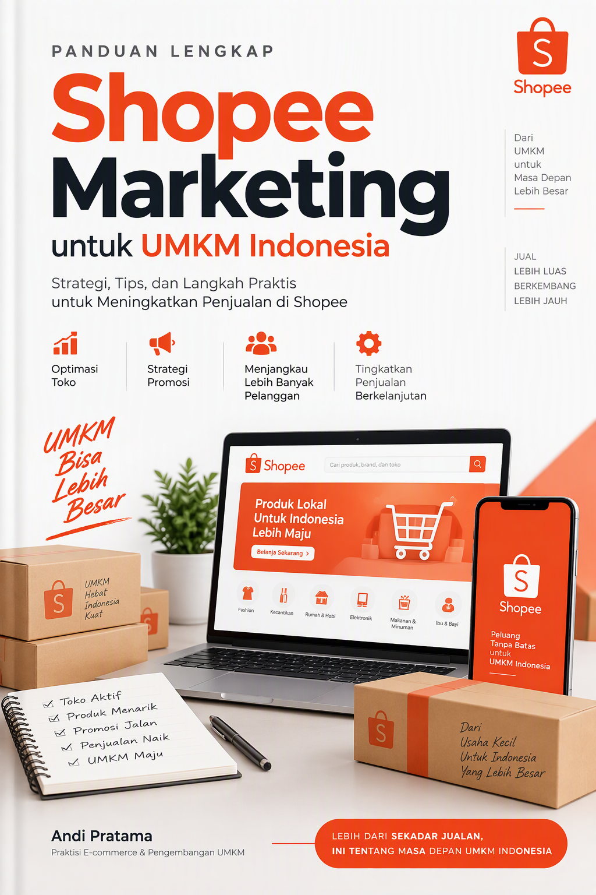
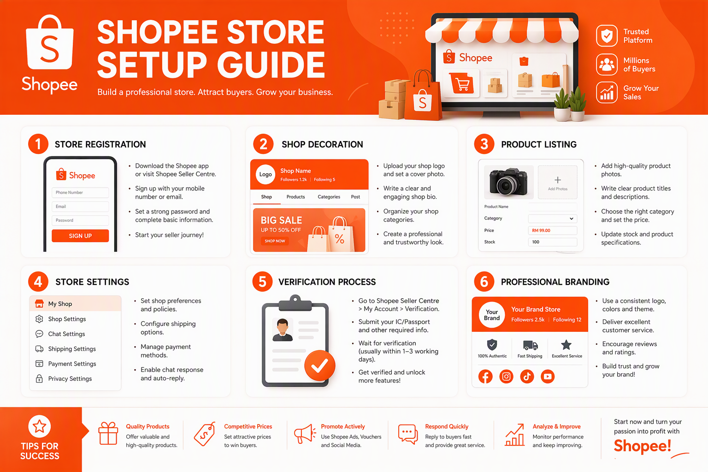
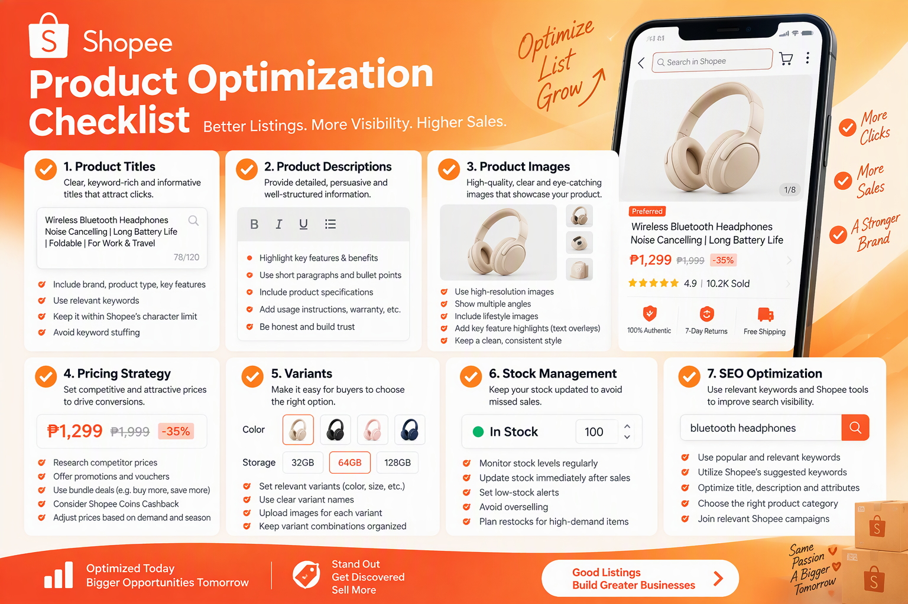
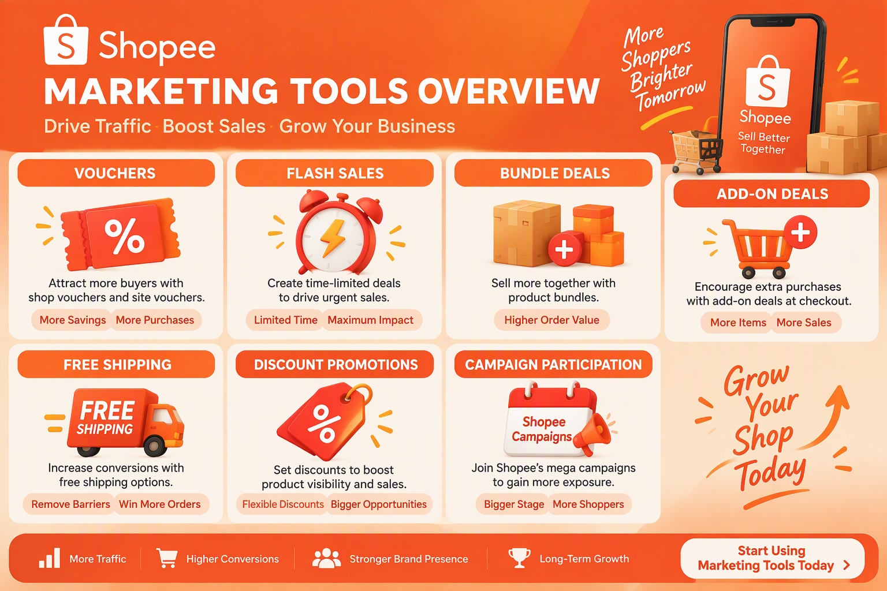
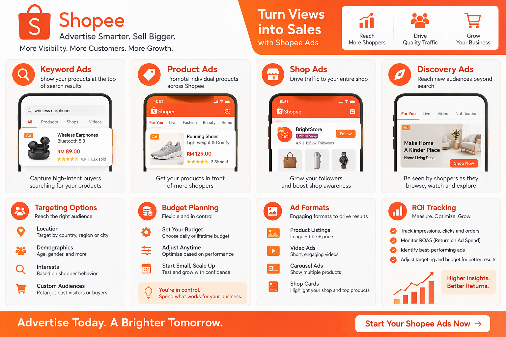
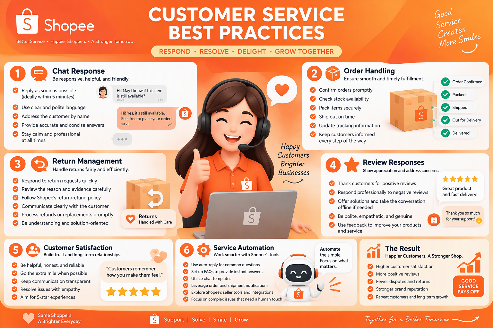
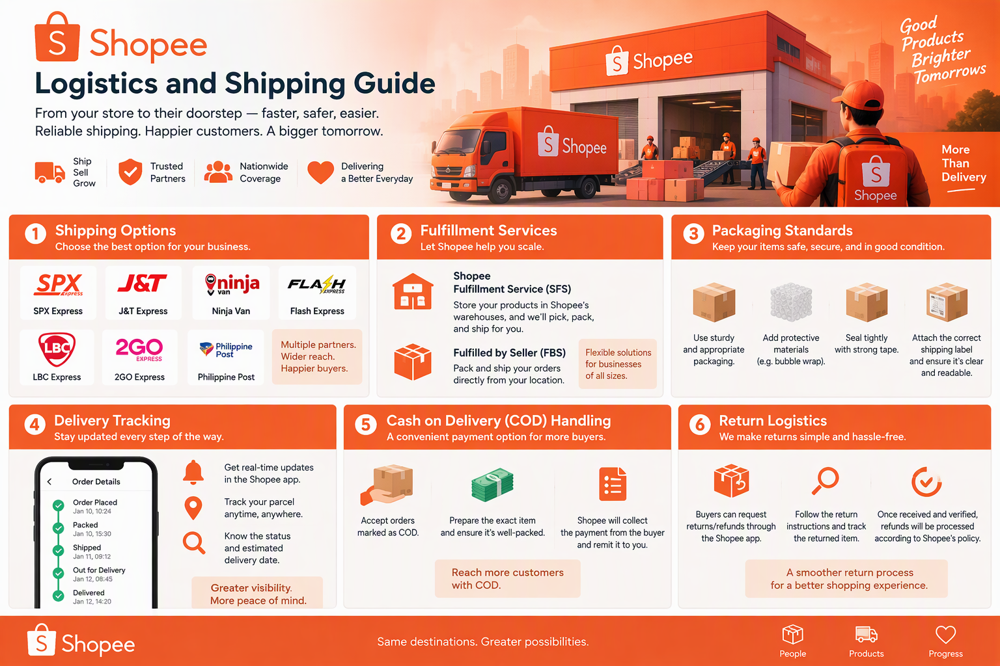
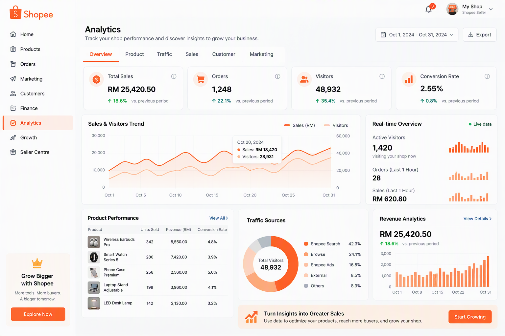
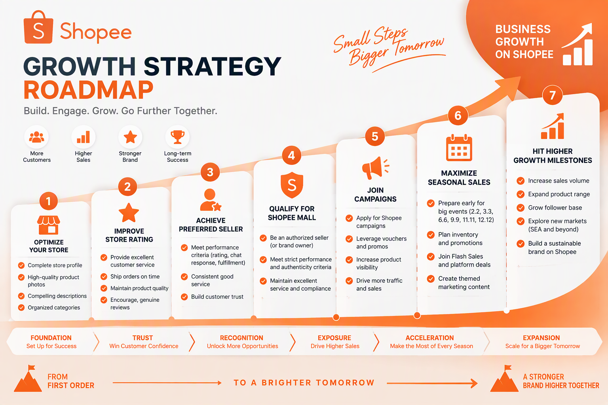
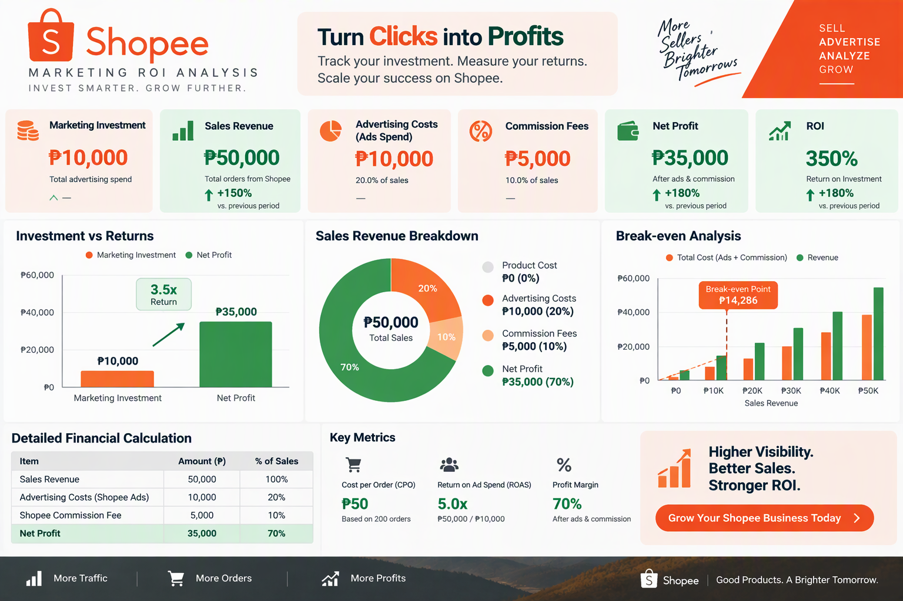

# Panduan Lengkap Shopee Marketing untuk UMKM Indonesia

**Strategi, Taktik, dan Template Siap Pakai untuk Meningkatkan Penjualan dan Brand Awareness di Shopee**

Disusun oleh: Siraj Nur Ihrom, Founder & Lead Developer SNISHOP
Versi: 1.0
Tanggal: Oktober 2026
Format: Panduan komprehensif dengan strategi, template, dan studi kasus
Standar: SNISHOP-PUBLISHING v2.0

---

## Tentang Buku Ini

Shopee telah menjadi marketplace terbesar di Asia Tenggara dengan lebih dari 350 juta pengguna aktif dan 2,5 juta seller aktif di Indonesia saja. Bagi UMKM, Shopee bukan sekadar tempat berjualan, melainkan ekosistem bisnis lengkap yang menyediakan tools marketing, logistik, pembayaran, dan analytics dalam satu platform terintegrasi.

Buku ini adalah panduan komprehensif Shopee marketing yang dirancang khusus untuk UMKM Indonesia. Anda akan mempelajari strategi proven, implementasi praktis, dan studi kasus real dari seller yang berhasil membangun bisnis jutaan rupiah di Shopee.

Yang Anda dapatkan dari buku ini:
- Panduan lengkap setup toko dan verifikasi seller
- Strategi optimasi product listing yang menjual
- Panduan marketing tools: voucher, flash sale, bundle deals
- Panduan Shopee Ads dari nol sampai mahir
- Strategi customer service dan chat response
- Panduan logistik dan pengiriman yang efisien
- Analytics dan pengukuran performance
- Growth strategy menuju Preferred Seller dan Shopee Mall
- Kalkulator ROI Shopee marketing
- Studi kasus 3 bisnis dengan hasil konkret
- Rencana implementasi 30 hari
- Template dan checklist siap pakai



## Cara Menggunakan Buku Ini

Buku ini dibagi menjadi 10 bab yang terstruktur dalam 3 bagian:

**PART 1: FUNDAMENTAL SHOPEE SELLING (Bab 1-3)**
- Memahami ekosistem Shopee dan peluang UMKM
- Setup toko dan verifikasi seller
- Optimasi product listing yang menjual

**PART 2: MARKETING TOOLS DAN STRATEGI (Bab 4-7)**
- Marketing tools: voucher, flash sale, bundle deals
- Shopee Ads: keyword ads, product ads, discovery ads
- Customer service dan chat response
- Logistik dan pengiriman yang efisien

**PART 3: ANALISIS, GROWTH, DAN SKALING (Bab 8-10)**
- Analytics dan pengukuran performance
- Growth strategy: Preferred Seller, Shopee Mall
- Studi kasus dan rencana implementasi

Setiap bab berisi:
- Teori dan konsep dasar
- Langkah-langkah praktis
- Template siap pakai
- Contoh real dari bisnis Indonesia
- Tips dan best practices

## Standar Kualitas Konten

Semua strategi dan template dalam buku ini mengikuti standar SNISHOP-PUBLISHING v2.0:
- Bahasa Indonesia yang natural dan profesional
- Strategi berbasis data dan hasil real
- Contoh konkret dengan angka dan metrik
- Tanpa frasa pengisi yang tidak berarti
- Tanpa emoji berlebihan atau simbol tidak profesional
- Struktur yang mudah diikuti dan diimplementasi

---

# PART 1: FUNDAMENTAL SHOPEE SELLING

---

## Bab 1: Memahami Ekosistem Shopee dan Peluang UMKM

### 1.1 Landscape E-commerce Indonesia

E-commerce Indonesia mengalami pertumbuhan luar biasa dalam satu dekade terakhir. Berdasarkan data dari e-Conomy SEA Report 2025, nilai Gross Merchandise Value (GMV) e-commerce Indonesia mencapai USD 53 miliar, menjadikannya yang terbesar di Asia Tenggara. Kontribusi UMKM terhadap angka ini sangat signifikan, dengan lebih dari 64 juta UMKM yang mulai beralih ke platform digital.

Faktor-faktor pendorong pertumbuhan:
- Penetrasi internet yang mencapai 78% dari populasi
- Pengguna smartphone aktif lebih dari 340 juta
- Adopsi pembayaran digital yang meningkat pesat
- Infrastruktur logistik yang terus membaik
- Perilaku konsumen yang semakin digital-first

### 1.2 Mengapa Shopee untuk UMKM

Shopee memiliki beberapa keunggulan kompetitif yang menjadikannya pilihan utama bagi UMKM Indonesia:

**Jangkauan pasar yang luas:**
- 2,5 juta seller aktif di Indonesia
- 50 juta+ pengunjung bulanan
- Tersedia di 34 provinsi dengan coverage yang luas
- Dukungan untuk pengiriman ke seluruh Indonesia

**Biaya masuk yang rendah:**
- Pendaftaran gratis tanpa biaya awal
- Komisi kompetitif mulai dari 1% hingga 6%
- Tidak ada biaya listing produk
- Tools marketing tersedia untuk semua level seller

**Ekosistem terintegrasi:**
- ShopeePay untuk pembayaran
- SPX Express untuk logistik
- Shopee Ads untuk advertising
- Shopee Live untuk live streaming commerce
- Shopee Video untuk konten pendek

### 1.3 Memahami Algoritma Shopee

Algoritma Shopee menentukan produk mana yang muncul di halaman pencarian dan rekomendasi. Memahami cara kerjanya adalah kunci untuk meningkatkan visibility.

**Faktor ranking utama:**

| Faktor | Bobot | Keterangan |
|--------|-------|------------|
| Relevansi kata kunci | Tinggi | Kesesuaian judul dan deskripsi dengan pencarian |
| Performance toko | Tinggi | Rating, chat response rate, pengiriman tepat waktu |
| Penjualan | Sedang-Tinggi | Volume penjualan dan growth rate |
| Engagement | Sedang | Click-through rate, waktu kunjungan, wishlist |
| Harga kompetitif | Sedang | Perbandingan harga dengan produk serupa |
| Gratis ongkir | Sedang | Ketersediaan program free shipping |

**Cara algoritma Shopee menampilkan produk:**

1. Pembeli melakukan pencarian dengan kata kunci tertentu
2. Shopee memfilter produk berdasarkan relevansi kata kunci
3. Produk di-ranking berdasarkan kombinasi performance dan relevansi
4. Produk dengan rating tinggi dan penjualan bagus mendapat boost
5. Produk yang aktif mengikuti program Shopee mendapat prioritas tambahan

### 1.4 Segmentasi Pasar dan Niche Selection

Memilih niche yang tepat adalah fondasi keberhasilan di Shopee. Berikut framework untuk memilih niche:

**Framework RICE untuk Niche Selection:**

- **Reach (Jangkauan):** Seberapa besar pasar yang bisa dijangkau?
- **Impact (Dampak):** Seberapa besar margin keuntungan yang bisa didapat?
- **Confidence (Keyakinan):** Seberapa yakin Anda bisa bersaing di niche ini?
- **Effort (Usaha):** Seberapa besar effort yang dibutuhkan untuk memulai?

**Contoh evaluasi niche:**

| Niche | Reach (1-10) | Impact (1-10) | Confidence (1-10) | Effort (1-10) | Skor RICE |
|-------|-------------|---------------|-------------------|---------------|-----------|
| Fashion Wanita | 9 | 6 | 7 | 5 | 7.2 |
| Elektronik | 7 | 8 | 5 | 8 | 5.8 |
| Skincare | 8 | 7 | 6 | 6 | 6.8 |
| Perlengkapan Rumah | 7 | 6 | 8 | 4 | 7.0 |
| Makanan Kemasan | 6 | 5 | 7 | 7 | 5.5 |

### 1.5 Kompetitor Analysis

Sebelum memulai, lakukan analisis kompetitor untuk memahami landscape persaingan.

**Langkah-langkah analisis kompetitor:**

1. Cari produk serupa di Shopee
2. Catat 10 seller teratas di niche Anda
3. Analisis elemen berikut dari setiap kompetitor:
   - Range harga dan strategi pricing
   - Jumlah produk yang dijual
   - Rating toko dan review
   - Kualitas foto produk
   - Deskripsi dan cara penulisan
   - Program marketing yang digunakan
   - Estimasi penjualan bulanan

**Template analisis kompetitor:**

```
Nama Toko: [Nama Kompetitor]
Jumlah Produk: [Jumlah]
Rating: [Rating]/5.0
Jumlah Penilaian: [Jumlah]
Range Harga: Rp [Min] - Rp [Max]
Estimasi Penjualan/bulan: [Jumlah]
Kekuatan: [Kelebihan mereka]
Kelemahan: [Kekurangan mereka]
Peluang untuk kita: [Apa yang bisa kita lakukan lebih baik]
```

### 1.6 Tren E-commerce yang Perlu Dipantau

Memahami tren terbaru membantu Anda tetap relevan dan mengambil peluang sebelum kompetitor.

**Tren utama e-commerce Indonesia 2025-2026:**

1. **Live commerce:** Penjualan melalui live streaming meningkat 300% year-over-year. Shopee Live menjadi fitur utama yang memungkinkan seller berinteraksi langsung dengan pembeli, mendemokan produk, dan memberikan penawaran eksklusif secara real-time.

2. **Video commerce:** Shopee Video memungkinkan seller membuat konten pendek untuk memamerkan produk. Format ini cocok untuk generasi muda yang lebih suka konten visual singkat.

3. **Social commerce:** Integrasi antara media sosial dan marketplace semakin erat. Pembeli menemukan produk di Instagram atau TikTok, lalu mencari dan membeli di Shopee.

4. **AI-powered shopping:** Shopee menggunakan AI untuk personalisasi rekomendasi, pencarian visual, dan chatbot customer service. Seller perlu memahami cara memanfaatkan fitur-fitur ini.

5. **Sustainable commerce:** Konsumen semakin peduli lingkungan. Produk ramah lingkungan dan packaging sustainable menjadi diferensiator yang efektif.

### 1.7 Tips dan Best Practices

- Mulai dari niche yang Anda kuasai atau memiliki passion di dalamnya
- Fokus pada 1-2 kategori terlebih dahulu sebelum ekspansi
- Pantau tren musiman dan manfaatkan momentum kampanye Shopee
- Bangun diferensiasi melalui kualitas produk dan pelayanan
- Jangan terjebak perang harga, fokus pada value yang Anda berikan
- Ikuti akun resmi Shopee Indonesia untuk update fitur dan kebijakan terbaru
- Bergabung dengan komunitas seller untuk sharing pengalaman dan strategi

---

## Bab 2: Setup Toko dan Verifikasi Seller

### 2.1 Proses Pendaftaran Akun Shopee

Membuat akun Shopee seller adalah langkah pertama yang harus dilakukan dengan benar untuk menghindari masalah di kemudian hari.

**Langkah-langkah pendaftaran:**

1. Download aplikasi Shopee dari Play Store atau App Store
2. Daftar menggunakan nomor HP atau email
3. Lengkapi profil dasar: username, foto profil, bio
4. Verifikasi nomor HP melalui kode OTP
5. Verifikasi email melalui link konfirmasi
6. Masuk ke Seller Centre melalui seller.shopee.co.id
7. Mulai proses setup toko

**Dokumen yang perlu disiapkan:**
- KTP atau paspor yang masih berlaku
- Nomor rekening bank atas nama pemilik toko
- Nomor HP aktif yang terdaftar di WhatsApp
- Email aktif untuk komunikasi bisnis
- NPWP (opsional, diperlukan untuk upgrade ke Shopee Mall)

### 2.2 Konfigurasi Toko

Setelah pendaftaran, langkah selanjutnya adalah mengonfigurasi toko agar terlihat profesional dan terpercaya.



**Elemen toko yang harus dikonfigurasi:**

**Nama toko:**
- Gunakan nama yang mudah diingat dan relevan dengan produk
- Maksimal 25 karakter
- Hindari angka dan simbol yang membingungkan
- Contoh: "Batik Nusantara Premium", "Dapur Cantik Collection"

**Deskripsi toko:**
- Jelaskan apa yang Anda jual
- Sampaikan keunggulan produk Anda
- Berikan informasi kontak dan jam operasional
- Gunakan kata kunci yang relevan

**Template deskripsi toko:**

```
[Nama Toko] - [Tagline singkat]

Kami menyediakan [jenis produk] berkualitas tinggi dengan harga terjangkau.

Keunggulan kami:
- [Keunggulan 1]
- [Keunggulan 2]
- [Keunggulan 3]

Jam operasional: Senin - Sabtu, 08.00 - 17.00 WIB
Chat response: Dalam 1-5 menit pada jam operasional

Terima kasih telah berbelanja di toko kami!
```

**Foto profil toko:**
- Gunakan logo toko dengan resolusi tinggi
- Ukuran minimal 300 x 300 pixel
- Background yang bersih dan kontras
- Konsisten dengan branding di platform lain

### 2.3 Verifikasi Seller

Verifikasi seller diperlukan untuk meningkatkan kepercayaan pembeli dan mengakses fitur-fitur premium.

**Level verifikasi Shopee:**

| Level | Persyaratan | Keuntungan |
|-------|------------|------------|
| Basic | KTP + Rekening Bank | Bisa berjualan normal |
| Verified | Basic + Video selfie | Badge verified, boost kepercayaan |
| Preferred | KPI tertentu | Label preferred, prioritas pencarian |
| Mall | Brand registration + NPWP | Label Shopee Mall, traffic premium |

**Langkah verifikasi basic:**

1. Buka Seller Centre > Pengaturan Toko
2. Pilih "Verifikasi Akun"
3. Upload foto KTP yang jelas
4. Lakukan video selfie sesuai instruksi
5. Masukkan informasi rekening bank
6. Tunggu proses verifikasi (1-3 hari kerja)

### 2.4 Setup Pembayaran

Mengatur metode pembayaran yang lengkap akan meningkatkan conversion rate secara signifikan.

**Metode pembayaran yang harus diaktifkan:**
- Transfer bank (BCA, Mandiri, BNI, BRI)
- ShopeePay
- COD (Cash on Delivery)
- Kartu kredit/debit
- Cicilan (untuk produk bernilai tinggi)
- Minimarket (Indomaret, Alfamart)

**Tips setup pembayaran:**
- Aktifkan semua metode pembayaran yang tersedia
- Pastikan rekening bank sudah terverifikasi
- Untuk COD, pastikan area pengiriman Anda tercover
- Pertimbangkan cicilan 0% untuk produk di atas Rp 500.000

### 2.5 Pengaturan Pengiriman

Pengaturan pengiriman yang tepat akan mempengaruhi biaya kirim yang ditanggung dan kecepatan pengiriman.

**Langkah pengaturan:**

1. Buka Seller Centre > Pengaturan Pengiriman
2. Atur alamat asal pengiriman (warehouse address)
3. Pilih kurir yang akan digunakan
4. Atur ukuran paket default
5. Aktifkan program gratis ongkir

**Kurir yang tersedia di Shopee:**
- SPX Express (kurir internal Shopee)
- JNE (REG, YES, JTR)
- J&T Express
- SiCepat (HALU, BEST, GOKIL)
- Anteraja
- Ninja Express
- Pos Indonesia

**Tips pengaturan pengiriman:**
- Aktifkan minimal 3 kurir untuk memberikan pilihan
- Gunakan SPX Express untuk subsidi ongkir dari Shopee
- Atur alamat warehouse sesuai lokasi stok Anda
- Pertimbangkan untuk menggunakan beberapa titik warehouse jika volume tinggi

### 2.6 Checklist Setup Toko

Gunakan checklist ini untuk memastikan toko Anda sudah siap berjualan:

- [ ] Akun Shopee sudah terdaftar dan terverifikasi
- [ ] Nama toko sudah diatur dan profesional
- [ ] Deskripsi toko sudah lengkap
- [ ] Foto profil toko sudah diupload
- [ ] Rekening bank sudah terhubung
- [ ] Metode pembayaran sudah diaktifkan semua
- [ ] Pengaturan pengiriman sudah dikonfigurasi
- [ ] Kurir minimal 3 sudah diaktifkan
- [ ] Program gratis ongkir sudah didaftarkan
- [ ] Alamat warehouse sudah benar
- [ ] Kebijakan retur dan garansi sudah diatur
- [ ] Chat auto-reply sudah dikonfigurasi

---

## Bab 3: Optimasi Product Listing yang Menjual

### 3.1 Anatomi Product Listing yang Optimal

Product listing adalah etalase digital produk Anda. Listing yang optimal akan meningkatkan click-through rate dan conversion rate secara signifikan.



**Elemen product listing:**

| Elemen | Pengaruh | Prioritas |
|--------|----------|-----------|
| Foto produk | Sangat tinggi | Wajib optimal |
| Judul produk | Tinggi | SEO dan klik |
| Harga | Tinggi | Kompetitif |
| Deskripsi | Sedang-tinggi | Konversi |
| Variant | Sedang | Kelengkapan |
| Kategori | Tinggi | Visibility |
| Atribut produk | Sedang | Filter pencarian |

### 3.2 Foto Produk yang Menjual

Foto produk adalah elemen paling kritis dalam decision-making pembeli. Data Shopee menunjukkan bahwa produk dengan foto berkualitas memiliki conversion rate 2-3x lebih tinggi.

**Standar foto produk Shopee:**

- Ukuran minimal: 800 x 800 pixel
- Format: JPG atau PNG
- Maksimal 9 foto per produk
- Foto pertama harus paling menarik (hero image)
- Background putih untuk foto utama

**Struktur 9 foto produk yang optimal:**

1. Hero image: Produk utama dengan background putih
2. Foto sudut berbeda: Tampak depan, samping, belakang
3. Close-up detail: Tekstur, bahan, jahitan
4. Foto ukuran: Produk dipegang tangan atau di samping objek referensi
5. Foto penggunaan: Produk sedang digunakan (lifestyle)
6. Foto perbandingan: Before-after atau perbandingan ukuran
7. Foto packaging: Cara pengemasan untuk meyakinkan keamanan
8. Foto sertifikat: BPOM, SNI, atau sertifikat keaslian
9. Foto informasi: Ukuran chart, komposisi bahan, cara perawatan

**Tips fotografi produk:**
- Gunakan cahaya natural atau softbox untuk hasil terbaik
- Background putih polos untuk foto utama
- Pastikan produk bersih dan tidak ada noda
- Gunakan tripod untuk konsistensi angle
- Edit minimal: brightness, contrast, white balance
- Jangan menggunakan filter berlebihan

### 3.3 Judul Produk yang SEO-Friendly

Judul produk menentukan apakah produk Anda muncul di pencarian dan apakah pembeli akan mengkliknya.

**Formula judul produk Shopee:**

```
[Kata Kunci Utama] + [Merek/Brand] + [Fitur Utama] + [Spesifikasi] + [Ukuran/Warna]
```

**Contoh judul yang optimal:**

- "Sepatu Lari Pria Nike Air Zoom Pegasus 40 - Hitam Putih - Size 40-45"
- "Tas Selempang Wanita Kulit Sintetis Premium - Model Korea - Free Dustbag"
- "Serum Wajah Vitamin C 20% Brightening Anti Aging - BPOM - 30ml"

**Panjang judul:**
- Minimum: 30 karakter
- Optimal: 60-100 karakter
- Maksimum: 120 karakter (batas Shopee)
- Gunakan ruang secara efisien, jangan bertele-tele

**Kata kunci yang harus ada:**
- Jenis produk (sepatu, tas, serum)
- Target pengguna (pria, wanita, anak)
- Fitur utama (anti air, kulit asli, organik)
- Spesifikasi penting (ukuran, warna, volume)

### 3.4 Deskripsi Produk yang Mengkonversi

Deskripsi produk yang baik menjawab semua pertanyaan pembeli dan menghilangkan keraguan sebelum mereka bertanya.

**Struktur deskripsi produk:**

```
[Hook - 1-2 kalimat menarik perhatian]

[Keunggulan produk - 3-5 bullet points]

[Spesifikasi detail]
- Bahan: [material]
- Ukuran: [dimensi]
- Berat: [gram]
- Warna: [pilihan warna]
- Isi paket: [kelengkapan]

[Informasi pengiriman]
- Pengiriman: [estimasi waktu]
- Packaging: [cara pengemasan]
- Garansi: [jika ada]

[FAQ singkat]
Q: [Pertanyaan umum 1]
A: [Jawaban]

Q: [Pertanyaan umum 2]
A: [Jawaban]

[Call-to-action]
Yuk order sekarang! Stok terbatas.
```

**Contoh deskripsi produk:**

```
Serum Vitamin C 20% untuk Mencerahkan dan Meratakan Warna Kulit

Serum vitamin C dengan konsentrasi 20% yang diformulasikan khusus untuk
kulit Asia. Hasil terlihat dalam 2 minggu pemakaian rutin.

Keunggulan:
- Mencerahkan kulit kusam dan meratakan warna
- Memudarkan noda hitam dan bekas jerawat
- Melindungi dari radikal bebas dan polusi
- Tekstur ringan, cepat meresap, tidak lengket
- Terdaftar BPOM, aman untuk kulit sensitif

Spesifikasi:
- Volume: 30ml
- Bahan aktif: Asam L-Askorbat 20%, Niacinamide 5%, Hyaluronic Acid
- Jenis kulit: Semua jenis kulit
- Masa pakai: 12 bulan setelah dibuka
- Produksi: Indonesia, terdaftar BPOM NA18241600xxx

Pengiriman:
- Dikirim dalam 1-2 hari kerja
- Packaging bubble wrap + kardus
- Garansi uang kembali jika produk rusak saat pengiriman

Order sekarang untuk kulit cerah dan sehat!
```

### 3.5 Penentuan Harga yang Strategis

Harga adalah faktor penentu kedua setelah foto produk dalam decision-making pembeli.

**Formula pricing di Shopee:**

```
Harga Jual = (HPP + Biaya Operasional + Margin Keuntungan) / (1 - Komisi Shopee)
```

**Komponen biaya:**

| Komponen | Persentase | Keterangan |
|----------|-----------|------------|
| HPP produk | 30-50% | Harga modal produk |
| Biaya operasional | 5-10% | Packaging, tenaga kerja, sewa |
| Komisi Shopee | 1-6% | Tergantung kategori |
| Biaya iklan | 5-15% | Shopee Ads budget |
| Margin keuntungan | 15-30% | Target profit bersih |

**Strategi pricing:**

1. **Cost-plus pricing:** HPP + markup tetap. Cocok untuk pemula.
2. **Competitive pricing:** Menyesuaikan dengan harga kompetitor. Cocok untuk pasar yang kompetitif.
3. **Value-based pricing:** Berdasarkan persepsi nilai pelanggan. Cocok untuk produk premium.
4. **Psychological pricing:** Harga berakhiran 9 atau 99. Contoh: Rp 99.000 bukan Rp 100.000.

### 3.6 Kategori dan Atribut Produk

Memilih kategori yang tepat memastikan produk Anda muncul di tempat yang benar dan bisa difilter oleh pembeli.

**Langkah memilih kategori:**

1. Buka halaman upload produk
2. Ketik nama produk di kolom pencarian kategori
3. Pilih kategori yang paling spesifik (jangan pilih kategori umum)
4. Lengkapi semua atribut yang diminta
5. Tambahkan variasi jika ada (warna, ukuran, model)

**Tips atribut produk:**
- Isi SEMUA atribut yang tersedia, jangan ada yang kosong
- Gunakan atribut untuk menonjolkan keunggulan produk
- Atribut yang lengkap meningkatkan filterability dan visibility
- Perhatikan atribut wajib vs opsional, prioritaskan yang wajib

### 3.7 Riset Kata Kunci untuk Shopee SEO

SEO di Shopee berbeda dengan SEO di Google. Algoritma pencarian Shopee memprioritaskan relevansi produk dengan kata kunci pencarian, performa penjualan, dan kualitas toko.

**Cara melakukan riset kata kunci:**

1. **Shopee search bar autocomplete:** Ketik kata kunci umum di kolom pencarian Shopee dan lihat saran yang muncul. Saran ini berdasarkan data pencarian real dari jutaan pengguna.

2. **Analisis kompetitor:** Lihat judul produk dari 10 seller teratas di niche Anda. Catat kata kunci yang mereka gunakan berulang kali.

3. **Shopee Ads keyword tool:** Jika Anda sudah menjalankan iklan, data dari Keyword Ads Auto memberikan insight kata kunci yang menghasilkan klik dan konversi.

4. **Tren pencarian Shopee:** Pantau fitur "Tren Pencarian" di Seller Centre untuk melihat kata kunci yang sedang populer.

**Jenis kata kunci di Shopee:**

| Jenis | Contoh | Volume | Competition |
|-------|--------|--------|-------------|
| Head keyword | "sepatu pria" | Sangat tinggi | Sangat tinggi |
| Mid-tail | "sepatu pria casual" | Tinggi | Sedang |
| Long-tail | "sepatu pria casual kulit asli" | Rendah | Rendah |
| Brand keyword | "sepatu Nike Air Max" | Sedang | Rendah |

**Strategi penempatan kata kunci:**

- Judul produk: Kata kunci utama + long-tail keyword
- Deskripsi: Kata kunci utama di 2 kalimat pertama, variasikan di seluruh deskripsi
- Atribut produk: Isi semua atribut yang relevan
- Kategori: Pilih kategori yang paling spesifik

**Template riset kata kunci:**

```
Produk: [Nama produk]
Kata kunci utama: [Kata kunci 1]
Kata kunci sekunder: [Kata kunci 2], [Kata kunci 3]
Long-tail keywords: [Kata kunci 4], [Kata kunci 5]
Kata kunci kompetitor: [Kata kunci 6], [Kata kunci 7]
Volume pencarian relatif: [Tinggi/Sedang/Rendah]
Competition level: [Tinggi/Sedang/Rendah]
```

### 3.8 Checklist Optimasi Product Listing

- [ ] Foto produk minimal 5, berkualitas tinggi
- [ ] Foto pertama (hero image) menarik dan profesional
- [ ] Judul mengandung kata kunci utama, 60-100 karakter
- [ ] Deskripsi lengkap dengan struktur yang jelas
- [ ] Harga kompetitif dengan margin yang sehat
- [ ] Kategori sudah dipilih dengan tepat dan spesifik
- [ ] Semua atribut produk sudah diisi lengkap
- [ ] Variasi produk (warna, ukuran) sudah ditambahkan
- [ ] Berat produk sudah diisi dengan benar
- [ ] Kondisi produk (baru/bekas) sudah dipilih
- [ ] Stok produk sudah diupdate
- [ ] Kata kunci riset sudah dilakukan dan diimplementasi
- [ ] Produk kompetitor sudah dianalisis sebagai referensi

---

# PART 2: MARKETING TOOLS DAN STRATEGI

---

## Bab 4: Marketing Tools: Voucher, Flash Sale, Bundle Deals

### 4.1 Memahami Marketing Tools Shopee

Shopee menyediakan berbagai marketing tools yang bisa digunakan seller untuk meningkatkan penjualan. Memahami kapan dan bagaimana menggunakan masing-masing tools adalah kunci keberhasilan.



**Overview marketing tools Shopee:**

| Tool | Fungsi | Best For |
|------|--------|----------|
| Voucher Toko | Diskon untuk pembeli | Meningkatkan conversion |
| Flash Sale | Penjualan terbatas waktu | Mendorong impulse buying |
| Bundle Deal | Diskon beli lebih banyak | Meningkatkan basket size |
| Add-on Deal | Produk tambahan dengan diskon | Cross-selling |
| Follow Prize | Hadiah untuk follower baru | Menambah follower toko |
| Shake Prize | Hadiah dari game Shopee Shake | Engagement |
| Gratis Ongkir Xtra | Subsidi ongkir tambahan | Meningkatkan traffic |

### 4.2 Voucher Toko

Voucher toko adalah alat marketing paling fleksibel yang bisa Anda gunakan untuk berbagai tujuan.

**Jenis voucher:**

1. **Voucher diskon persentase:** Potongan harga dalam persen (10%, 15%, 20%)
2. **Voucher diskon nominal:** Potongan harga dalam rupiah (Rp 10.000, Rp 25.000)
3. **Voucher gratis ongkir:** Subsidi biaya pengiriman
4. **Voucher follower:** Khusus untuk follower toko
5. **Voucher share toko:** Didapat setelah pembeli share toko ke teman

**Strategi voucher yang efektif:**

**Untuk meningkatkan conversion rate:**
- Voucher diskon 10-15% untuk pembelian pertama
- Minimum pembelian yang masuk akal (tidak terlalu tinggi)
- Durasi voucher 3-7 hari untuk menciptakan urgency

**Untuk meningkatkan average order value:**
- Voucher dengan minimum pembelian lebih tinggi dari AOV rata-rata
- Contoh: Jika AOV Rp 150.000, buat voucher minimum Rp 200.000

**Template setup voucher:**

```
Nama Voucher: [Jenis Diskon] + [Tujuan]
Contoh: "Diskon 15% Pembelian Pertama"

Parameter:
- Jenis: Persentase/Nominal
- Nilai: [10-20% atau Rp 10.000-50.000]
- Minimum pembelian: Rp [50.000-200.000]
- Maksimum potongan: Rp [10.000-50.000]
- Kuota: [50-200] voucher
- Durasi: [3-7 hari]
- Berlaku untuk: Semua produk / Produk tertentu
```

### 4.3 Flash Sale Toko

Flash sale menciptakan urgency dan mendorong pembelian impulsif.

**Cara mengatur flash sale:**

1. Buka Seller Centre > Marketing > Flash Sale
2. Pilih produk yang akan di-flash sale
3. Atur harga flash sale (minimal 10% di bawah harga normal)
4. Tentukan waktu mulai dan berakhir
5. Atur kuota produk
6. Aktifkan

**Strategi flash sale:**

- Pilih produk best-seller atau yang memiliki margin tinggi
- Batasi kuota untuk menciptakan scarcity (misalnya 20-50 unit)
- Durasi ideal: 2-4 jam pada jam sibuk (12.00-14.00 atau 19.00-21.00)
- Promosikan flash sale melalui chat ke pelanggan setia
- Gunakan foto produk dengan label "Flash Sale" yang mencolok

**Perhitungan harga flash sale:**

```
Harga normal: Rp 200.000
Diskon flash sale: 20%
Harga flash sale: Rp 160.000
HPP produk: Rp 100.000
Margin per unit: Rp 60.000 (37.5%)
Kuota flash sale: 30 unit
Total margin dari flash sale: Rp 1.800.000
```

### 4.4 Bundle Deal dan Add-on Deal

Bundle deal mendorong pembeli untuk membeli lebih banyak produk dalam satu transaksi.

**Jenis bundle deal:**

1. **Beli 2 diskon 10%:** Mendorong pembelian 2 produk
2. **Beli 3 diskon 15%:** Mendorong pembelian 3 produk
3. **Beli lebih, hemat lebih:** Diskon progresif

**Cara setup bundle deal:**

1. Pilih produk yang saling melengkapi
2. Tentukan jumlah minimum pembelian untuk mendapat diskon
3. Atur persentase diskon (10-20%)
4. Pastikan margin masih positif setelah diskon

**Contoh bundle deal yang efektif:**

| Kombinasi | Harga Normal | Harga Bundle | Diskon |
|-----------|-------------|-------------|--------|
| Serum + Moisturizer | Rp 250.000 | Rp 212.500 | 15% |
| 3x Masker Wajah | Rp 150.000 | Rp 127.500 | 15% |
| Sepatu + Kaos Kaki | Rp 350.000 | Rp 315.000 | 10% |

### 4.5 Follow Prize dan Engagement Tools

Follow prize memberikan hadiah kepada pembeli yang mem-follow toko Anda.

**Setup follow prize:**

1. Buka Seller Centre > Marketing > Follow Prize
2. Pilih hadiah (voucher atau produk gratis)
3. Tentukan kuota
4. Aktifkan

**Strategi follow prize:**
- Berikan voucher diskon Rp 5.000 untuk pembelian minimum Rp 50.000
- Targetkan 500-1000 follower baru per bulan
- Hitung cost per follower dan bandingkan dengan nilai lifetime customer

### 4.6 Kalender Kampanye Shopee

Shopee memiliki kampanye besar yang berlangsung setiap bulan. Mengikuti kampanye ini bisa meningkatkan penjualan secara signifikan.

**Kalender kampanye utama Shopee 2026:**

| Tanggal | Kampanye | Estimasi Traffic Increase |
|---------|----------|--------------------------|
| 1.1 | Tahun Baru | 50-80% |
| 2.2 | Kembar Februari | 100-150% |
| 3.3 | Kembar Maret | 100-150% |
| 4.4 | Kembar April | 80-120% |
| 5.5 | Kembar Mei | 100-150% |
| 6.6 | Kembar Juni | 100-150% |
| 7.7 | Kembar Juli | 80-120% |
| 8.8 | Kembar Agustus | 100-150% |
| 9.9 | Super Shopping Day | 200-300% |
| 10.10 | Brands Festival | 200-300% |
| 11.11 | Singles Day | 300-500% |
| 12.12 | Harbolnas | 300-500% |

**Persiapan kampanye:**

- H-30: Siapkan stok produk dan pricing strategy
- H-14: Upload produk baru dan optimasi listing
- H-7: Setup voucher dan flash sale khusus kampanye
- H-3: Pastikan stok dan packaging siap
- H-1: Aktifkan semua marketing tools
- D-Day: Monitor dan respond chat dengan cepat
- H+1: Evaluasi hasil dan follow up pelanggan

### 4.7 Strategi Kampanye Harian dan Mingguan

Selain kampanye bulanan besar, Shopee juga memiliki program harian dan mingguan yang bisa dimanfaatkan.

**Program harian Shopee:**

| Program | Waktu | Manfaat | Cara Ikut |
|---------|-------|---------|-----------|
| Flash Sale Harian | 00.00, 12.00, 18.00 | Traffic spike | Setup di Seller Centre |
| Gratis Ongkir Xtra | Sepanjang hari | Conversion boost | Auto-join jika eligible |
| Shopee Live | Fleksibel | Engagement tinggi | Mulai live dari app |
| Feed Post | Fleksibel | Brand awareness | Upload di Shopee Feed |

**Program mingguan:**

- **Senin:** Upload produk baru (algoritma boost produk baru)
- **Rabu:** Flash sale mid-week (tingkatkan engagement)
- **Jumat:** Setup voucher weekend (persiapan belanja akhir pekan)
- **Sabtu-Minggu:** Aktifkan Shopee Live (traffic weekend lebih tinggi)

**Template marketing calendar bulanan:**

```
BULAN: [Nama Bulan]

Minggu 1:
- Senin: Upload 5 produk baru
- Rabu: Flash Sale produk A (stok 30 unit)
- Jumat: Setup voucher weekend diskon 10%
- Sabtu: Shopee Live 1 jam (14.00-15.00)

Minggu 2:
- Senin: Upload 5 produk baru
- Rabu: Flash Sale produk B (stok 25 unit)
- Jumat: Setup voucher weekend diskon 15%
- Sabtu: Shopee Live 1 jam (19.00-20.00)

Minggu 3:
- Senin: Upload 5 produk baru
- Rabu: Flash Sale produk C (stok 20 unit)
- Jumat: Setup voucher weekend diskon 10%
- Sabtu: Shopee Live 1 jam (14.00-15.00)

Minggu 4:
- Senin: Upload 5 produk baru
- Rabu: Flash Sale produk D (stok 30 unit)
- Jumat: Setup voucher weekend diskon 15%
- Sabtu: Shopee Live 2 jam (19.00-21.00)
- Minggu: Evaluasi performa bulanan
```

### 4.8 Tips dan Best Practices

- Gunakan kombinasi voucher + flash sale + gratis ongkir untuk efek maksimal
- Jangan berikan diskon terlalu besar yang menggerus margin
- Track ROI setiap marketing tool untuk optimasi budget
- Sesuaikan strategi voucher dengan musim dan momentum
- Buat marketing calendar bulanan untuk konsistensi
- Manfaatkan program harian dan mingguan untuk menjaga engagement
- Dokumentasikan hasil setiap kampanye untuk referensi di masa depan

---

## Bab 5: Shopee Ads: Keyword Ads, Product Ads, Discovery Ads

### 5.1 Overview Shopee Ads

Shopee Ads adalah platform advertising internal Shopee yang memungkinkan seller mempromosikan produk mereka di dalam platform. Dengan budget mulai dari Rp 50.000 per hari, UMKM sudah bisa mulai beriklan.



**Jenis Shopee Ads:**

| Jenis | Penempatan | Model | Best For |
|-------|-----------|-------|----------|
| Keyword Ads | Hasil pencarian | CPC | Targeting pembeli aktif mencari |
| Product Ads | Halaman produk | CPC | Cross-selling ke pembeli |
| Discovery Ads | Beranda Shopee | CPC | Brand awareness dan discovery |
| Shop Ads | Promosi toko | Fixed fee | Meningkatkan traffic toko |

### 5.2 Keyword Ads

Keyword Ads menempatkan produk Anda di hasil pencarian ketika pembeli mencari kata kunci tertentu.

**Cara setup Keyword Ads:**

1. Buka Seller Centre > Marketing > Shopee Ads
2. Pilih "Keyword Ads"
3. Pilih produk yang akan diiklankan
4. Pilih mode: Manual atau Auto
5. Tentukan kata kunci dan bid price
6. Set budget harian
7. Aktifkan campaign

**Mode Auto vs Manual:**

- **Auto:** Shopee memilihkan kata kunci secara otomatis. Cocok untuk pemula dan riset kata kunci.
- **Manual:** Anda memilih kata kunci sendiri. Cocok untuk seller yang sudah memahami kata kunci profitable.

**Strategi bid price:**

| Jenis Kata Kunci | Bid Price | Competition | ROAS Target |
|-----------------|-----------|-------------|-------------|
| Kata kunci utama | Rp 500-2.000 | Tinggi | 5-8x |
| Kata kunci long-tail | Rp 200-800 | Rendah | 8-15x |
| Kata kunci merek | Rp 100-500 | Rendah | 10-20x |
| Kata kunci musiman | Rp 300-1.500 | Sedang | 6-10x |

**Formula ROAS (Return on Ad Spend):**

```
ROAS = Revenue dari iklan / Biaya iklan

Contoh:
- Biaya iklan: Rp 500.000/bulan
- Revenue dari iklan: Rp 4.250.000
- ROAS = 4.250.000 / 500.000 = 8.5x

Artinya setiap Rp 1 yang diinvestasikan di iklan menghasilkan Rp 8.500 revenue.
```

**Tips optimasi Keyword Ads:**
- Mulai dengan budget kecil (Rp 50.000-100.000/hari) untuk testing
- Gunakan mode Auto selama 7 hari untuk mendapatkan data kata kunci
- Pindahkan kata kunci yang perform ke mode Manual dengan bid yang dioptimasi
- Matikan kata kunci dengan CPC tinggi tapi conversion rendah
- Monitor setiap hari pada minggu pertama, lalu 2-3 kali seminggu

### 5.3 Product Ads

Product Ads menampilkan produk Anda di halaman produk lain, memungkinkan cross-selling.

**Cara kerja Product Ads:**
- Pembeli melihat produk A
- Product Ads menampilkan produk B yang relevan
- Jika pembeli klik, Anda dikenakan biaya CPC
- Penempatan: bagian "Produk Serupa" dan "Produk Terkait"

**Strategi Product Ads:**
- Pilih produk yang memiliki margin tinggi
- Targetkan produk yang sering dilihat bersama
- Gunakan untuk produk baru yang butuh eksposur
- Budget: 5-10% dari revenue target

### 5.4 Discovery Ads

Discovery Ads menempatkan produk Anda di halaman beranda Shopee dan tab "Untukmu".

**Keunggulan Discovery Ads:**
- Menjangkau pembeli yang belum tentu mencari produk Anda
- Cocok untuk produk dengan visual menarik
- Membangun brand awareness
- Traffic dari pembeli yang sedang browsing

**Strategi Discovery Ads:**
- Gunakan foto produk yang paling menarik secara visual
- Targetkan produk dengan harga yang impulse-buy friendly (di bawah Rp 200.000)
- Monitor CTR (Click-Through Rate), targetkan di atas 2%
- Budget: mulai dari Rp 100.000/hari untuk testing

### 5.5 Budget Allocation Framework

**Framework alokasi budget iklan bulanan:**

| Komponen | Persentase | Keterangan |
|----------|-----------|------------|
| Keyword Ads | 50-60% | Driver utama penjualan |
| Product Ads | 20-25% | Cross-selling dan upselling |
| Discovery Ads | 15-20% | Awareness dan discovery |
| Testing budget | 5-10% | Eksperimen campaign baru |

**Contoh alokasi budget Rp 3.000.000/bulan:**

```
Keyword Ads: Rp 1.650.000 (55%)
- 10 kata kunci utama @ Rp 55.000/hari x 30 hari = Rp 1.650.000

Product Ads: Rp 675.000 (22.5%)
- Budget harian Rp 22.500 x 30 hari = Rp 675.000

Discovery Ads: Rp 525.000 (17.5%)
- Budget harian Rp 17.500 x 30 hari = Rp 525.000

Testing: Rp 150.000 (5%)
- Untuk campaign baru dan eksperimen
```

### 5.6 Optimasi dan Scaling

**Indikator performa iklan yang sehat:**

| Metrik | Target | Action Jika di Bawah Target |
|--------|--------|---------------------------|
| CTR (Click-Through Rate) | > 3% | Perbaiki foto dan judul produk |
| Conversion Rate | > 2% | Perbaiki deskripsi dan harga |
| CPC (Cost per Click) | < Rp 1.000 | Turunkan bid atau ganti kata kunci |
| ROAS | > 5x | Optimasi targeting dan bid |
| ACOS (Ad Cost of Sales) | < 15% | Kurangi budget pada kata kunci mahal |

**Scaling strategy:**
- Jika ROAS > 8x: naikkan budget 20-30%
- Jika ROAS 5-8x: pertahankan budget, optimasi kata kunci
- Jika ROAS 3-5x: turunkan budget, evaluasi kata kunci
- Jika ROAS < 3x: pause campaign, analisis dan perbaiki

### 5.7 Strategi Lanjutan Shopee Ads

**Campaign structure yang optimal:**

Struktur campaign yang baik memudahkan monitoring dan optimasi. Berikut struktur yang direkomendasikan:

```
Campaign 1: Best Sellers
- Kata kunci: 10-15 keyword terlaris
- Bid: Premium (20% di atas rata-rata)
- Budget: 40% dari total

Campaign 2: Growth Products
- Kata kunci: 15-20 keyword mid-tail
- Bid: Moderate (sesuai rata-rata)
- Budget: 30% dari total

Campaign 3: New Products
- Kata kunci: Auto mode untuk riset
- Bid: Conservative (20% di bawah rata-rata)
- Budget: 15% dari total

Campaign 4: Seasonal/Campaign
- Kata kunci: Sesuai kampanye aktif
- Bid: Aggressive (30% di atas rata-rata)
- Budget: 15% dari total
```

**Strategi bidding berdasarkan waktu:**

| Waktu | Strategi Bid | Alasan |
|-------|-------------|--------|
| 06.00-09.00 | Normal | Traffic pagi, browsing sebelum kerja |
| 12.00-14.00 | +20% | Jam istirahat, traffic tinggi |
| 19.00-22.00 | +30% | Prime time, conversion tertinggi |
| 22.00-06.00 | -20% | Traffic rendah, mostly browsing |

**Retargeting strategy:**

Shopee menyediakan fitur retargeting untuk menjangkau kembali pembeli yang sudah melihat produk Anda tetapi belum membeli.

- Aktifkan retargeting untuk produk dengan margin > 20%
- Set bid 10-15% lebih tinggi dari keyword biasa
- Targetkan pembeli yang mengunjungi produk dalam 7 hari terakhir
- Kombinasikan dengan voucher toko untuk mendorong konversi

### 5.8 Tips dan Best Practices

- Selalu mulai dengan budget kecil dan scale up secara bertahap
- Gunakan data dari mode Auto untuk menginformasikan strategi Manual
- Monitor iklan minimal 2-3 kali seminggu
- Matikan kata kunci yang tidak menghasilkan penjualan setelah 2 minggu
- Manfaatkan momen kampanye besar dengan meningkatkan budget 2-3x lipat
- Hitung break-even ROAS sebelum menentukan target
- Dokumentasikan setiap perubahan campaign untuk analisis tren
- Alokasikan 5-10% budget khusus untuk testing strategi baru

---

## Bab 6: Customer Service dan Chat Response

### 6.1 Mengapa Customer Service Krusial di Shopee

Customer service adalah diferensiator utama di marketplace yang kompetitif. Data Shopee menunjukkan bahwa toko dengan chat response rate di atas 90% memiliki penjualan 40% lebih tinggi dibandingkan yang di bawah 70%.



**Metrik customer service Shopee:**

| Metrik | Target | Pengaruh |
|--------|--------|----------|
| Chat Response Rate | > 90% | Rating toko dan visibility |
| Chat Response Time | < 10 menit | Conversion rate |
| Rating toko | > 4.8 | Trust dan ranking |
| Tingkat komplain | < 1% | Kesehatan akun |
| Retur rate | < 2% | Profitabilitas |

### 6.2 Setup Chat System

**Auto-reply untuk pertanyaan umum:**

```
Selamat datang di [Nama Toko]! Terima kasih telah menghubungi kami.

Jam operasional: Senin - Sabtu, 08.00 - 17.00 WIB
Kami akan membalas chat Anda dalam 1-5 menit.

Untuk pertanyaan umum:
- Pengiriman: 1-2 hari kerja setelah order
- Garansi: 7 hari untuk produk rusak
- Retur: Hubungi kami sebelum retur

Silakan tinggalkan pesan Anda, kami akan segera merespons!
```

**Quick reply templates:**

**Template 1 - Pertanyaan stok:**
```
Halo Kak! Terima kasih sudah bertanya. Stok untuk [produk] masih tersedia ya Kak. Silakan langsung order sebelum kehabisan. Ada yang bisa kami bantu lagi?
```

**Template 2 - Pertanyaan ukuran:**
```
Halo Kak! Untuk ukuran [produk], berikut detailnya:
- Size S: Lingkar dada 86cm, Panjang 60cm
- Size M: Lingkar dada 92cm, Panjang 62cm
- Size L: Lingkar dada 98cm, Panjang 64cm

Kakak biasanya pakai size apa? Kami bisa bantu rekomendasikan.
```

**Template 3 - Follow-up setelah pembelian:**
```
Halo Kak! Terima kasih sudah order di [Nama Toko]. Order Kakak sedang kami proses dan akan dikirim dalam 1-2 hari kerja. Kami akan update resi segera setelah pengiriman. Terima kasih!
```

**Template 4 - Penanganan komplain:**
```
Halo Kak, kami mohon maaf atas ketidaknyamanannya. Kami akan segera membantu menyelesaikan masalah ini.

Mohon kirimkan foto/video kondisi produk yang diterima agar kami bisa memproses solusi terbaik untuk Kakak. Kami berkomitmen memberikan kepuasan 100%.
```

### 6.3 Strategi Meningkatkan Rating Toko

Rating toko adalah faktor kepercayaan utama di Shopee. Berikut strategi untuk membangun dan mempertahankan rating tinggi.

**Faktor yang mempengaruhi rating:**
- Kualitas produk sesuai deskripsi
- Kecepatan dan keamanan pengiriman
- Packaging yang rapi dan aman
- Responsiveness terhadap pertanyaan dan komplain
- After-sales service

**Strategi menjaga rating 4.8+:**

1. **Quality control ketat:** Periksa setiap produk sebelum dikirim
2. **Packaging premium:** Gunakan bubble wrap, kardus, dan segel yang rapi
3. **Insert card:** Sertakan kartu ucapan terima kasih dan panduan penggunaan
4. **Proactive communication:** Kabari pembeli jika ada keterlambatan
5. **Fast resolution:** Selesaikan komplain dalam 24 jam
6. **Follow-up:** Tanya kepuasan pembeli 3-5 hari setelah produk diterima

**Template insert card:**

```
Terima kasih telah berbelanja di [Nama Toko]!

Produk yang Kakak beli:
- [Nama Produk]

Cara menggunakan:
1. [Langkah 1]
2. [Langkah 2]
3. [Langkah 3]

Jika ada pertanyaan, jangan ragu chat kami ya Kak!
Kami senang bisa melayani Kakak.

Jangan lupa berikan bintang 5 jika puas dengan produk kami!
```

### 6.4 Penanganan Komplain dan Retur

Komplain tidak bisa dihindari, tetapi cara Anda menanganinya bisa mengubah pelanggan kecewa menjadi pelanggan setia.

**Framework penanganan komplain - LAST:**

- **L (Listen):** Dengarkan keluhan pelanggan dengan empati
- **A (Apologize):** Minta maaf atas ketidaknyamanan
- **S (Solve):** Berikan solusi yang konkret
- **T (Thank):** Ucapkan terima kasih atas feedback

**Jenis komplain dan solusi:**

| Jenis Komplain | Solusi | Cost |
|---------------|--------|------|
| Produk tidak sesuai | Kirim ulang atau refund | HPP + ongkir |
| Produk rusak | Kirim ulang atau refund | HPP + ongkir |
| Pengiriman lambat | Voucher diskon + update tracking | Rp 5.000-10.000 |
| Salah kirim produk | Kirim produk benar + retur produk salah | Ongkir 2x |
| Ukuran tidak pas | Tukar ukuran (ongkir ditanggung toko) | Ongkir 2x |

### 6.5 Upselling dan Cross-selling via Chat

Chat bukan hanya untuk customer service, tetapi juga untuk meningkatkan penjualan.

**Strategi upselling via chat:**

Ketika pembeli bertanya tentang produk tertentu, rekomendasikan versi yang lebih premium:

```
Pembeli: "Kak, serum vitamin C yang 30ml masih ada?"

CS: "Halo Kak! Masih tersedia. Kami juga punya serum vitamin C 50ml dengan
formula yang sama tapi lebih hemat, harga Rp 175.000 (hemat Rp 45.000
dibanding beli 2x yang 30ml). Mau saya bantu order yang 50ml?"
```

**Strategi cross-selling via chat:**

Rekomendasikan produk pelengkap yang sering dibeli bersama:

```
Pembeli: "Kak, saya mau order sepatu lari."

CS: "Halo Kak! Sepatu lari kami ready semua ukuran. Sebagai pelengkap,
kami juga punya kaos kaki olahraga anti-bakteri yang cocok dipadukan
dengan sepatu lari kami. Banyak pembeli kami yang beli keduanya.
Mau saya tambahkan ke pesanan Kakak?"
```

**Timing yang tepat untuk upselling:**
- Saat pembeli bertanya tentang produk
- Saat pembeli sedang checkout
- Saat follow-up setelah pembelian produk pertama
- Saat buyer menanyakan rekomendasi

### 6.6 Tips dan Best Practices

- Balas chat dalam waktu kurang dari 5 menit pada jam operasional
- Gunakan bahasa yang sopan dan ramah, sapa dengan "Kak"
- Jangan pernah berdebat dengan pelanggan di chat
- Dokumentasikan semua komplain untuk analisis pola
- Berikan kompensasi yang wajar untuk komplain yang valid
- Train tim CS dengan skenario-skenario umum
- Manfaatkan chat untuk upselling dan cross-selling secara natural
- Buat database jawaban untuk pertanyaan yang sering muncul

---

## Bab 7: Logistik dan Pengiriman yang Efisien

### 7.1 Memahami Ekosistem Logistik Shopee

Logistik yang efisien adalah tulang punggung bisnis e-commerce. Pengiriman yang cepat dan aman meningkatkan kepuasan pelanggan dan rating toko.



**Kurir yang terintegrasi dengan Shopee:**

| Kurir | Coverage | Kecepatan | Harga |
|-------|----------|-----------|-------|
| SPX Express | Nasional | 2-4 hari | Ekonomis |
| JNE REG | Nasional | 3-5 hari | Ekonomis |
| JNE YES | Nasional | 1-2 hari | Premium |
| J&T Express | Nasional | 2-4 hari | Ekonomis |
| SiCepat HALU | Nasional | 1-2 hari | Premium |
| SiCepat BEST | Nasional | 2-3 hari | Reguler |
| Anteraja | Nasional | 2-4 hari | Ekonomis |
| Ninja Express | Nasional | 2-4 hari | Ekonomis |

### 7.2 Strategi Pengiriman

**Framework pemilihan kurir:**

- **Produk ringan (< 1 kg):** SPX Express atau J&T Express untuk harga terbaik
- **Produk sedang (1-5 kg):** SiCepat BEST atau JNE REG untuk keseimbangan harga dan kecepatan
- **Produk berat (> 5 kg):** JNE JTR atau kargo untuk efisiensi biaya
- **Pengiriman cepat:** SiCepat HALU atau JNE YES untuk same-day/next-day
- **Area terpencil:** Pos Indonesia untuk coverage terluas

**Tips optimasi pengiriman:**

1. **Gunakan multiple kurir:** Aktifkan minimal 3 kurir untuk memberikan pilihan
2. **Aktifkan SPX Express:** Mendapatkan subsidi ongkir dari Shopee
3. **Optimasi packaging:** Kurangi dimensi paket untuk menekan biaya volumetrik
4. **Batch processing:** Proses semua pesanan dalam satu batch untuk efisiensi
5. **Drop-off point:** Manfaatkan drop-off point terdekat untuk menghemat waktu

### 7.3 Packaging yang Aman dan Profesional

Packaging bukan hanya tentang keamanan produk, tetapi juga tentang first impression dan brand experience.

**Standar packaging berdasarkan jenis produk:**

| Jenis Produk | Packaging | Estimasi Biaya |
|-------------|-----------|---------------|
| Fashion | Plastic bag + bubble wrap + poly mailer | Rp 2.000-5.000 |
| Elektronik | Bubble wrap + kardus + packing foam | Rp 5.000-15.000 |
| Skincare | Bubble wrap + kardus kecil + seal | Rp 3.000-8.000 |
| Makanan | Sealed bag + kardus + ice pack (jika perlu) | Rp 5.000-12.000 |
| Pecah belah | Bubble wrap tebal + kardus + label fragile | Rp 8.000-20.000 |

**Checklist packaging:**

- [ ] Produk dibungkus bubble wrap minimal 2 lapis
- [ ] Kardus sesuai ukuran produk (tidak terlalu besar)
- [ ] Pengisi celah (kertas/kemasan udara) jika ada ruang kosong
- [ ] Label pengiriman tercetak jelas dan tidak mudah pudar
- [ ] Label "fragile" untuk produk mudah pecah
- [ ] Insert card/thank you card di dalam paket
- [ ] Foto produk sebelum dikirim sebagai dokumentasi

### 7.4 Manajemen Stok dan Inventory

Inventory management yang baik mencegah stockout dan overstock.

**Formula inventory management:**

```
Safety Stock = (Penjualan harian rata-rata x Lead time hari) x 1.5
Reorder Point = Safety Stock + (Penjualan harian rata-rata x Lead time)

Contoh:
- Penjualan harian rata-rata: 20 unit
- Lead time restock: 7 hari
- Safety Stock = 20 x 7 x 1.5 = 210 unit
- Reorder Point = 210 + (20 x 7) = 350 unit

Artinya: pesan stok baru ketika stok tersisa 350 unit.
```

**Tips manajemen stok:**
- Lakukan stock opname mingguan untuk produk fast-moving
- Gunakan sistem FIFO (First In, First Out) untuk produk dengan masa kedaluwarsa
- Set alert untuk stok yang mendekati reorder point
- Pisahkan stok rusak/kadaluwarsa dari stok yang bisa dijual
- Analisis penjualan bulanan untuk forecasting stok

### 7.5 Mengoptimalkan Biaya Pengiriman

Biaya pengiriman adalah komponen biaya yang signifikan. Mengoptimalkannya bisa meningkatkan margin secara substansial.

**Strategi penghematan biaya pengiriman:**

1. **Negosiasi volume:** Jika Anda mengirim lebih dari 100 paket per hari, negosiasikan tarif khusus dengan kurir. Potongan 10-20% sangat mungkin didapatkan.

2. **Pilih kurir berdasarkan zona:** Untuk pengiriman dalam kota, gunakan kurir same-day yang lebih murah. Untuk antar-pulau, gunakan kargo.

3. **Optimasi dimensi paket:** Kurir menghitung biaya berdasarkan volumetrik (panjang x lebar x tinggi / 6000). Minimalkan ruang kosong dalam paket.

4. **Gunakan program gratis ongkir Shopee:** Shopee sering mensubsidi ongkir untuk pembeli. Manfaatkan program ini karena meningkatkan conversion rate tanpa biaya tambahan untuk seller.

**Perbandingan biaya pengiriman (Jakarta ke Surabaya, 1 kg):**

| Kurir | Estimasi Waktu | Biaya | Best For |
|-------|---------------|-------|----------|
| SPX Express | 2-3 hari | Rp 12.000 | Harga terbaik |
| JNE REG | 3-4 hari | Rp 15.000 | Coverage luas |
| J&T Express | 2-3 hari | Rp 13.000 | Keseimbangan |
| SiCepat HALU | 1-2 hari | Rp 20.000 | Kecepatan |
| JNE YES | 1 hari | Rp 30.000 | Urgent |

### 7.6 Tips dan Best Practices

- Proses pesanan dalam 24 jam untuk menjaga rating pengiriman
- Gunakan resi otomatis dari Shopee untuk efisiensi
- Foto setiap paket sebelum dikirim sebagai bukti
- Pantau pengiriman secara berkala dan kabari pembeli jika ada delay
- Evaluasi performa kurir setiap bulan dan ganti jika perlu
- Negosiasi harga dengan kurir jika volume pengiriman sudah tinggi
- Optimalkan dimensi paket untuk menekan biaya volumetrik
- Manfaatkan program gratis ongkir dari Shopee

---

# PART 3: ANALISIS, GROWTH, DAN SKALING

---

## Bab 8: Analytics dan Pengukuran Performance

### 8.1 Memahami Shopee Analytics Dashboard

Shopee menyediakan dashboard analytics yang komprehensif untuk memantau performa toko dan produk Anda.



**Metrik utama di Shopee Analytics:**

| Metrik | Definisi | Target Sehat |
|--------|----------|-------------|
| GMV | Total nilai penjualan | Growth 10-20%/bulan |
| Orders | Jumlah pesanan | Growth konsisten |
| AOV (Average Order Value) | Rata-rata nilai per order | Rp 150.000-500.000 |
| Conversion Rate | Persentase pengunjung yang beli | > 3% |
| Chat Response Rate | Persentase chat yang direspons | > 90% |
| Product Click-Through Rate | Persentase klik pada produk | > 5% |
| Return Rate | Persentase produk diretur | < 2% |

### 8.2 KPI Framework untuk Shopee Seller

**KPI berdasarkan tahap bisnis:**

**Tahap awal (bulan 1-3):**

| KPI | Target | Frekuensi Monitor |
|-----|--------|-------------------|
| Jumlah produk | 30-50 SKU | Mingguan |
| Orders per hari | 5-10 | Harian |
| Rating toko | > 4.7 | Mingguan |
| Chat response rate | > 85% | Harian |
| Revenue bulanan | Rp 5-15 juta | Bulanan |

**Tahap pertumbuhan (bulan 4-6):**

| KPI | Target | Frekuensi Monitor |
|-----|--------|-------------------|
| Jumlah produk | 80-150 SKU | Bulanan |
| Orders per hari | 15-30 | Harian |
| Rating toko | > 4.8 | Mingguan |
| ROAS iklan | > 5x | Mingguan |
| Revenue bulanan | Rp 20-50 juta | Bulanan |

**Tahap scaling (bulan 7-12):**

| KPI | Target | Frekuensi Monitor |
|-----|--------|-------------------|
| Jumlah produk | 150-300 SKU | Bulanan |
| Orders per hari | 30-100 | Harian |
| Rating toko | > 4.9 | Mingguan |
| ROAS iklan | > 8x | Mingguan |
| Revenue bulanan | Rp 50-150 juta | Bulanan |

### 8.3 Analisis Produk

**Framework analisis performa produk:**

Klasifikasikan produk Anda ke dalam 4 kuadran:

| Kuadran | Penjualan | Margin | Action |
|---------|-----------|--------|--------|
| Star | Tinggi | Tinggi | Pertahankan, scale up |
| Cash Cow | Tinggi | Rendah | Optimasi harga atau HPP |
| Question Mark | Rendah | Tinggi | Tingkatkan marketing |
| Dog | Rendah | Rendah | Pertimbangkan untuk di-discontinue |

**Analisis per produk:**

```
Nama Produk: [Nama]
Penjualan/bulan: [Jumlah unit]
Revenue/bulan: Rp [Nilai]
HPP/unit: Rp [Nilai]
Margin/unit: Rp [Nilai] ([Persen]%)
Total margin/bulan: Rp [Nilai]
Conversion rate: [Persen]%
Rating produk: [Rating]/5.0
Kuadran: [Star/Cash Cow/Question Mark/Dog]
Action: [Strategi yang akan dilakukan]
```

### 8.4 Analisis Pelanggan

Memahami perilaku pelanggan membantu Anda membuat strategi yang lebih efektif.

**Data pelanggan yang bisa dianalisis:**

- Demografi: usia, gender, lokasi
- Perilaku: waktu belanja, frekuensi, nilai transaksi
- Preferensi: kategori produk, brand favorit
- Retention: repeat order rate, lifetime value

**Metrik pelanggan kunci:**

```
Customer Acquisition Cost (CAC) = Total biaya marketing / Jumlah pelanggan baru
Customer Lifetime Value (CLV) = AOV x Frekuensi pembelian x Masa hubungan
Repeat Order Rate = Jumlah pelanggan repeat / Total pelanggan x 100%

Contoh:
- Total biaya marketing: Rp 5.000.000/bulan
- Pelanggan baru: 200 orang
- CAC = Rp 25.000/orang

- AOV: Rp 200.000
- Frekuensi pembelian: 3x/bulan
- Masa hubungan: 6 bulan
- CLV = Rp 200.000 x 3 x 6 = Rp 3.600.000

- Rasio CLV/CAC = Rp 3.600.000 / Rp 25.000 = 144x
- Ini sangat sehat, target minimum adalah 3x
```

### 8.5 Reporting Template

**Template laporan mingguan:**

```
LAPORAN MINGGUAN SHOPEE
Periode: [Tanggal mulai] - [Tanggal akhir]

RINGKASAN:
- Total Revenue: Rp [Nilai] (vs minggu lalu: [+/-]%)
- Total Orders: [Jumlah] (vs minggu lalu: [+/-]%)
- AOV: Rp [Nilai] (vs minggu lalu: [+/-]%)
- Conversion Rate: [Persen]% (vs minggu lalu: [+/-]%)
- Rating Toko: [Rating]/5.0

TOP 5 PRODUK:
1. [Nama] - [Jumlah] unit - Rp [Revenue]
2. [Nama] - [Jumlah] unit - Rp [Revenue]
3. [Nama] - [Jumlah] unit - Rp [Revenue]
4. [Nama] - [Jumlah] unit - Rp [Revenue]
5. [Nama] - [Jumlah] unit - Rp [Revenue]

IKLAN:
- Total spend: Rp [Nilai]
- ROAS: [Nilai]x
- Best performing keyword: [Kata kunci]

AKSI MINGGU DEPAN:
1. [Aksi 1]
2. [Aksi 2]
3. [Aksi 3]
```

### 8.6 Analisis Iklan Lanjutan

**Cohort analysis untuk iklan:**

Lakukan analisis cohort untuk memahami perilaku pelanggan yang datang dari iklan versus organik.

| Cohort | Sumber | AOV | Repeat Rate | LTV |
|--------|--------|-----|-------------|-----|
| Bulan 1 | Iklan | Rp 180.000 | 25% | Rp 450.000 |
| Bulan 1 | Organik | Rp 150.000 | 35% | Rp 525.000 |
| Bulan 2 | Iklan | Rp 195.000 | 30% | Rp 585.000 |
| Bulan 2 | Organik | Rp 160.000 | 40% | Rp 640.000 |

**Insight dari cohort analysis:**
- Pelanggan organik memiliki repeat rate lebih tinggi
- Pelanggan dari iklan memiliki AOV lebih tinggi
- LTV pelanggan organik 20-30% lebih tinggi dari iklan
- Gunakan insight ini untuk menyeimbangkan strategi akuisisi

**Attribution modeling:**

Shopee menggunakan model last-click attribution, artinya penjualan dikreditkan ke klik terakhir sebelum konversi. Untuk memahami full funnel, pertimbangkan:

- First-click: Kata kunci apa yang pertama kali ditemukan pembeli?
- Multi-touch: Berapa kali pembeli berinteraksi sebelum membeli?
- Time decay: Seberapa cepat pembeli mengkonversi setelah klik pertama?

### 8.8 Benchmark dan Target Industri

Untuk mengetahui apakah performa toko Anda sudah baik, bandingkan dengan benchmark industri.

**Benchmark berdasarkan kategori produk:**

| Kategori | AOV Rata-rata | Conversion Rate | Repeat Rate | Rating Rata-rata |
|----------|--------------|----------------|-------------|-----------------|
| Fashion | Rp 120.000-250.000 | 2-4% | 20-30% | 4.7 |
| Elektronik | Rp 200.000-500.000 | 1.5-3% | 15-25% | 4.6 |
| Skincare | Rp 80.000-200.000 | 3-5% | 35-50% | 4.8 |
| Makanan | Rp 50.000-150.000 | 3-6% | 40-60% | 4.7 |
| Rumah Tangga | Rp 100.000-300.000 | 2-4% | 25-35% | 4.7 |

**Cara menggunakan benchmark:**
- Jika metrik Anda di bawah benchmark: fokus pada area yang perlu perbaikan
- Jika metrik Anda setara benchmark: pertahankan dan optimasi secara incremental
- Jika metrik Anda di atas benchmark: Anda sudah perform sangat baik, fokus pada scaling

### 8.9 Tips dan Best Practices

- Cek analytics setiap hari untuk orders, setiap minggu untuk performa iklan
- Bandingkan performa week-over-week dan month-over-month
- Identifikasi tren musiman dan siapkan stok lebih awal
- Gunakan data untuk membuat keputusan, bukan intuisi
- Buat dashboard sederhana di spreadsheet untuk tracking harian
- Lakukan cohort analysis setiap bulan untuk memahami perilaku pelanggan
- Bandingkan performa Anda dengan benchmark industri
- Dokumentasikan setiap insight dan action plan yang dihasilkan dari data

---

## Bab 9: Growth Strategy: Preferred Seller, Shopee Mall

### 9.1 Roadmap Pertumbuhan Seller Shopee



**Level seller Shopee dan persyaratannya:**

| Level | Badge | Persyaratan | Keuntungan |
|-------|-------|------------|------------|
| Regular | Tidak ada | Semua seller baru | Bisa berjualan |
| Preferred | Bintang hijau | KPI tertentu | Prioritas pencarian, boost traffic |
| Official Store | Label khusus | Brand terdaftar | Trust tinggi, fitur premium |
| Shopee Mall | Label Mall | Brand + NPWP + KPI | Traffic premium, kepercayaan tertinggi |

### 9.2 Menuju Preferred Seller

Preferred Seller mendapat boost signifikan dalam visibility dan kepercayaan pembeli.

**Kriteria Preferred Seller:**

| KPI | Minimum | Target Aman |
|-----|---------|-------------|
| Order Completion Rate | > 90% | > 95% |
| On-time Shipping Rate | > 90% | > 95% |
| Chat Response Rate | > 80% | > 90% |
| Rating Toko | > 4.5 | > 4.7 |
| Jumlah produk terjual | > 100/bulan | > 200/bulan |
| Pelanggaran | 0 | 0 |

**Strategi mencapai Preferred Seller:**

1. **Minggu 1-2:** Setup toko secara profesional, upload 30-50 produk
2. **Minggu 3-4:** Aktifkan semua marketing tools, mulai iklan
3. **Bulan 2:** Evaluasi performa, optimasi listing yang underperform
4. **Bulan 3:** Scale up produk yang perform, pertahankan KPI
5. **Bulan 4:** Targetkan Preferred Seller badge

### 9.3 Upgrade ke Shopee Mall

Shopee Mall adalah level tertinggi untuk seller di Shopee, memberikan kepercayaan maksimal dan akses ke fitur premium.

**Persyaratan Shopee Mall:**

- Terdaftar sebagai PT atau CV
- Memiliki NPWP atas nama perusahaan
- Brand terdaftar atau menjadi authorized reseller
- Rating toko minimal 4.7
- Order completion rate minimal 95%
- Chat response rate minimal 90%
- On-time shipping rate minimal 95%
- Tidak ada pelanggaran berat dalam 3 bulan terakhir

**Keuntungan Shopee Mall:**
- Label "Shopee Mall" yang meningkatkan kepercayaan
- Prioritas di hasil pencarian
- Akses ke kampanye eksklusif Shopee Mall
- Fitur Live Streaming yang lebih prominent
- Dukungan account manager dedicated
- Boost traffic hingga 3x dibandingkan seller regular

**Proses aplikasi Shopee Mall:**

1. Siapkan dokumen: NPWP, SIUP, surat merek/authorized dealer
2. Ajukan melalui Seller Centre atau hubungi account manager
3. Tim Shopee akan review dokumen dan performa toko
4. Proses review memakan waktu 2-4 minggu
5. Jika disetujui, toko akan di-upgrade ke Shopee Mall

### 9.4 Diversifikasi Produk dan Ekspansi

**Strategi ekspansi produk:**

1. **Vertical expansion:** Tambah varian dalam kategori yang sama
   - Contoh: Dari serum wajah, tambah toner, moisturizer, sunscreen

2. **Horizontal expansion:** Masuk ke kategori yang berkaitan
   - Contoh: Dari fashion wanita, tambah tas dan aksesoris

3. **Premium line:** Luncurkan produk dengan kualitas dan harga lebih tinggi
   - Contoh: Dari produk mass market, tambah lini premium

4. **Private label:** Buat merek sendiri untuk diferensiasi
   - Contoh: Dari reseller, develop produk dengan brand sendiri

**Framework keputusan ekspansi:**

```
Pertanyaan evaluasi:
1. Apakah ada demand dari pelanggan existing? (Cek chat logs dan review)
2. Apakah kita punya supply chain yang reliable? (Cek supplier)
3. Apakah margin cukup untuk cover biaya tambahan? (Hitung HPP)
4. Apakah kita punya kapasitas operasional? (Cek tim dan warehouse)
5. Apakah ini selaras dengan brand positioning? (Cek brand identity)

Jika semua jawaban YA, lanjutkan ekspansi.
```

### 9.5 Membangun Tim

**Struktur tim berdasarkan skala bisnis:**

**Skala kecil (revenue < Rp 20 juta/bulan):**
- Owner/manager: 1 orang (merangkap semua fungsi)
- Admin/gudang: 1 orang

**Skala menengah (revenue Rp 20-100 juta/bulan):**
- Manager: 1 orang
- Admin marketplace: 1-2 orang
- Customer service: 1 orang
- Gudang/packing: 1-2 orang
- Content creator: 1 orang

**Skala besar (revenue > Rp 100 juta/bulan):**
- Manager: 1 orang
- Marketing specialist: 1-2 orang
- Admin marketplace: 2-3 orang
- Customer service: 2-3 orang
- Gudang/packing: 3-5 orang
- Content creator: 1-2 orang
- Photographer/videographer: 1 orang

### 9.6 Membangun SOP (Standard Operating Procedure)

SOP adalah fondasi untuk scaling bisnis. Tanpa SOP, kualitas akan menurun seiring pertumbuhan.

**SOP yang harus dimiliki seller Shopee:**

1. **SOP Upload Produk:**
   - Riset kata kunci
   - Fotografi produk
   - Penulisan judul dan deskripsi
   - Setting harga dan stok
   - Quality check sebelum publish

2. **SOP Pemrosesan Order:**
   - Cek pesanan masuk (pagi dan sore)
   - Verifikasi alamat dan variant
   - Picking produk dari gudang
   - Quality check sebelum packing
   - Packing sesuai standar
   - Input resi dan update status

3. **SOP Customer Service:**
   - Template balasan untuk pertanyaan umum
   - Eskalasi komplain ke manager
   - Prosedur retur dan refund
   - Follow-up setelah penjualan

4. **SOP Iklan:**
   - Monitoring harian (5 menit)
   - Optimasi mingguan (30 menit)
   - Evaluasi bulanan (2 jam)
   - Budget adjustment berdasarkan performa

**Template SOP sederhana:**

```
SOP: [Nama SOP]
Tujuan: [Apa yang ingin dicapai]
Penanggung jawab: [Role/posisi]
Frekuensi: [Harian/Mingguan/Per event]

Langkah-langkah:
1. [Langkah 1] - [Detail] - [Estimasi waktu]
2. [Langkah 2] - [Detail] - [Estimasi waktu]
3. [Langkah 3] - [Detail] - [Estimasi waktu]

Quality check:
- [ ] [Check 1]
- [ ] [Check 2]
- [ ] [Check 3]

Eskalasi: Jika [kondisi], hubungi [person/role]
```

### 9.7 Tips dan Best Practices

- Fokus mencapai Preferred Seller sebelum memikirkan Shopee Mall
- Bangun SOP untuk setiap fungsi bisnis
- Delegasikan tugas operasional agar bisa fokus pada strategi
- Investasikan dalam training tim secara berkala
- Evaluasi struktur tim setiap 3 bulan sesuai growth
- Dokumentasikan semua proses bisnis dalam SOP tertulis
- Gunakan tools project management untuk koordinasi tim

---

## Bab 10: Studi Kasus dan Rencana Implementasi

### 10.1 Studi Kasus 1: Fashion Seller - Dari 0 ke Rp 85 Juta/Bulan

**Profil bisnis:**
- Nama: Batik Nusantara (nama disamarkan)
- Kategori: Fashion wanita, khusus batik modern
- Lokasi: Yogyakarta
- Dimulai: Januari 2025
- Tim awal: 2 orang (owner + 1 admin)

**Tantangan awal:**
- Belum pernah berjualan online
- Modal terbatas: Rp 10 juta
- Persaingan ketat di kategori fashion
- Belum punya brand awareness

**Strategi yang diterapkan:**

**Bulan 1: Foundation**
- Setup toko profesional dengan branding yang kuat
- Upload 40 SKU produk batik modern
- Foto produk profesional dengan model
- Harga kompetitif: Rp 150.000 - Rp 350.000
- Aktifkan semua kurir dan metode pembayaran

**Bulan 2: Marketing Activation**
- Setup voucher toko: diskon 10% untuk pembelian pertama
- Mulai Keyword Ads dengan budget Rp 100.000/hari
- Ikuti kampanye Shopee 2.2
- Target: 5-10 orders/hari

**Bulan 3: Optimization**
- Analisis data penjualan, fokus pada 10 produk terlaris
- Optimasi listing berdasarkan kata kunci yang perform
- Tambah 20 SKU baru berdasarkan demand
- Scale up budget iklan ke Rp 200.000/hari

**Bulan 4: Scaling**
- Capai badge Preferred Seller
- ROAS iklan stabil di 7.5x
- Mulai Shopee Live 2x seminggu
- Tambah 1 anggota tim untuk handling orders

**Hasil konkret:**

| Metrik | Bulan 1 | Bulan 2 | Bulan 3 | Bulan 4 |
|--------|---------|---------|---------|---------|
| Orders | 45 | 180 | 420 | 680 |
| Revenue | Rp 8jt | Rp 28jt | Rp 58jt | Rp 85jt |
| AOV | Rp 178rb | Rp 156rb | Rp 138rb | Rp 125rb |
| Conversion Rate | 1.2% | 2.8% | 3.9% | 4.8% |
| ROAS | 2.1x | 4.5x | 6.2x | 7.5x |
| Rating | 4.6 | 4.7 | 4.8 | 4.9 |

**Kunci keberhasilan:**
- Foto produk profesional dengan model menjadi diferensiator utama
- Fokus pada niche batik modern yang belum banyak pemain
- Konsisten mengikuti kampanye Shopee
- Chat response rate selalu di atas 95%
- Optimasi berkelanjutan berdasarkan data

### 10.2 Studi Kasus 2: Electronics Store - ROAS 8.5x dari Shopee Ads

**Profil bisnis:**
- Nama: TechZone Indonesia (nama disamarkan)
- Kategori: Aksesoris elektronik
- Lokasi: Jakarta
- Dimulai: Maret 2025
- Tim: 4 orang

**Tantangan awal:**
- Persaingan harga sangat ketat
- Margin tipis di kategori elektronik
- Banyak kompetitor dengan modal besar
- Perlu strategi iklan yang efisien

**Strategi Shopee Ads:**

**Fase 1: Riset (Minggu 1-2)**
- Jalankan Keyword Ads mode Auto selama 14 hari
- Budget: Rp 75.000/hari
- Kumpulkan data kata kunci yang menghasilkan klik dan konversi
- Identifikasi top 20 kata kunci berdasarkan conversion rate

**Fase 2: Optimasi (Minggu 3-6)**
- Pindahkan top 20 kata kunci ke campaign Manual
- Atur bid price berdasarkan ROAS per kata kunci
- Matikan kata kunci dengan CPC > Rp 1.500 dan conversion < 1%
- Tambahkan Product Ads untuk cross-selling

**Fase 3: Scaling (Bulan 2-3)**
- Scale up budget untuk kata kunci dengan ROAS > 8x
- Tambah Discovery Ads untuk produk baru
- Alokasi budget: 55% Keyword, 25% Product, 20% Discovery
- Target ROAS: 8x

**Hasil konkret:**

| Metrik | Bulan 1 | Bulan 2 | Bulan 3 |
|--------|---------|---------|---------|
| Ad Spend | Rp 2.2jt | Rp 4.5jt | Rp 6.8jt |
| Ad Revenue | Rp 11jt | Rp 38jt | Rp 58jt |
| ROAS | 5.0x | 8.5x | 8.5x |
| Total Revenue | Rp 25jt | Rp 72jt | Rp 120jt |
| Orders/hari | 8 | 25 | 45 |
| AOV | Rp 280rb | Rp 265rb | Rp 250rb |
| Profit Margin | 8% | 12% | 15% |

**Breakdown ROAS per jenis iklan:**

| Jenis Iklan | Spend | Revenue | ROAS |
|-------------|-------|---------|------|
| Keyword Ads | Rp 3.7jt | Rp 33.3jt | 9.0x |
| Product Ads | Rp 1.7jt | Rp 13.6jt | 8.0x |
| Discovery Ads | Rp 1.4jt | Rp 11.1jt | 7.9x |
| Total | Rp 6.8jt | Rp 58jt | 8.5x |

**Kunci keberhasilan:**
- Data-driven approach: setiap keputusan berdasarkan angka
- Strict keyword management: matikan yang tidak perform
- Diversifikasi jenis iklan untuk coverage maksimal
- Pricing strategy yang menjaga margin meskipun bersaing
- Focus pada aksesoris dengan margin lebih tinggi dari gadget utama

### 10.3 Studi Kasus 3: Beauty Products - 500+ Orders/Hari

**Profil bisnis:**
- Nama: Glow Beauty Store (nama disamarkan)
- Kategori: Skincare dan kosmetik
- Lokasi: Bandung
- Dimulai: Juni 2025
- Tim: 6 orang

**Tantangan awal:**
- Produk memerlukan BPOM dan sertifikasi
- Kepercayaan pembeli rendah untuk produk kecantikan online
- Banyak produk palsu di marketplace
- Perlu edukasi konsumen

**Strategi yang diterapkan:**

**Trust building:**
- Tampilkan sertifikat BPOM di setiap listing
- Foto produk dengan packaging asli dan segel
- Video review dan swatch test
- Testimoni pelanggan dengan foto before-after
- Garansi 100% uang kembali jika produk tidak asli

**Volume strategy:**
- Pricing kompetitif dengan bundle deals
- Flash sale 3x seminggu
- Voucher follower untuk membangun base
- Gratis ongkir Xtra untuk semua produk
- Shopee Live daily dengan demo produk

**Customer retention:**
- Membership program dengan poin reward
- Voucher eksklusif untuk repeat customer
- Follow-up chat 7 hari setelah pembelian
- Community building melalui Shopee Feed

**Hasil konkret:**

| Metrik | Bulan 1 | Bulan 3 | Bulan 6 |
|--------|---------|---------|---------|
| Orders/hari | 30 | 180 | 500+ |
| Revenue/bulan | Rp 12jt | Rp 65jt | Rp 180jt |
| Repeat Order Rate | 15% | 32% | 45% |
| Customer Satisfaction | 4.5/5 | 4.8/5 | 4.9/5 |
| Follower | 500 | 8.000 | 25.000 |
| Products | 25 SKU | 80 SKU | 150 SKU |

**Kunci keberhasilan:**
- Trust building melalui sertifikasi dan garansi keaslian
- Konsistensi Shopee Live untuk edukasi dan engagement
- Bundle deals yang meningkatkan AOV secara signifikan
- Customer retention program yang efektif
- Ekspansi produk berdasarkan feedback pelanggan

### 10.4 Kalkulator ROI Shopee Marketing



**Komponen investasi:**

| Komponen | Estimasi Bulanan | Keterangan |
|----------|-----------------|------------|
| Modal produk | Rp 15.000.000 | HPP untuk stok |
| Budget iklan | Rp 3.000.000 | Shopee Ads |
| Komisi Shopee | Rp 2.500.000 | 3-5% dari revenue |
| Biaya pengiriman | Rp 1.500.000 | Subsidi ongkir |
| Packaging | Rp 1.000.000 | Material kemasan |
| Operasional | Rp 2.000.000 | Gaji tim, sewa, listrik |
| **Total investasi** | **Rp 25.000.000** | |

**Komponen return:**

| Komponen | Estimasi Bulanan | Keterangan |
|----------|-----------------|------------|
| Revenue penjualan | Rp 50.000.000 | 400 orders x AOV Rp 125.000 |
| Repeat customers | Rp 15.000.000 | 30% dari revenue |
| **Total return** | **Rp 65.000.000** | |

**Perhitungan ROI:**

```
ROI = (Total Return - Total Investasi) / Total Investasi x 100%
ROI = (Rp 65.000.000 - Rp 25.000.000) / Rp 25.000.000 x 100%
ROI = Rp 40.000.000 / Rp 25.000.000 x 100%
ROI = 160%

Artinya: setiap Rp 1 yang diinvestasikan menghasilkan return Rp 2.60
Profit bersih: Rp 40.000.000/bulan
```

**Break-even analysis:**

```
Fixed cost bulanan: Rp 10.000.000 (operasional + packaging)
Variable cost per order: Rp 35.000 (HPP + komisi + iklan)
AOV: Rp 125.000
Contribution margin per order: Rp 125.000 - Rp 35.000 = Rp 90.000

Break-even point = Fixed cost / Contribution margin
BEP = Rp 10.000.000 / Rp 90.000
BEP = 111 orders/bulan atau 4 orders/hari
```

### 10.5 Rencana Implementasi 30 Hari

**MINGGU 1: FOUNDATION (Hari 1-7)**

Hari 1-2: Setup dan registrasi
- [ ] Daftar akun Shopee Seller
- [ ] Verifikasi akun dengan KTP
- [ ] Setup nama toko, deskripsi, dan foto profil
- [ ] Hubungkan rekening bank
- [ ] Aktifkan metode pembayaran

Hari 3-4: Pengaturan pengiriman
- [ ] Atur alamat warehouse
- [ ] Aktifkan minimal 3 kurir
- [ ] Daftar program gratis ongkir
- [ ] Setup auto-reply chat

Hari 5-7: Upload produk pertama
- [ ] Foto 10-15 produk pertama
- [ ] Buat listing dengan judul SEO-friendly
- [ ] Tulis deskripsi lengkap
- [ ] Set harga kompetitif
- [ ] Pilih kategori dan isi atribut

**MINGGU 2: OPTIMASI (Hari 8-14)**

Hari 8-10: Optimasi listing
- [ ] Review dan perbaiki semua listing
- [ ] Pastikan setiap produk memiliki 5+ foto
- [ ] Tambahkan variasi (warna, ukuran)
- [ ] Setup voucher toko

Hari 11-14: Marketing activation
- [ ] Setup Follow Prize
- [ ] Buat Bundle Deal untuk produk terkait
- [ ] Aktifkan Keyword Ads mode Auto
- [ ] Set budget iklan Rp 50.000-100.000/hari
- [ ] Daftar kampanye Shopee yang tersedia

**MINGGU 3: AKSELERASI (Hari 15-21)**

Hari 15-17: Content dan engagement
- [ ] Upload produk baru (tambah 10-20 SKU)
- [ ] Mulai Shopee Live (jika tersedia)
- [ ] Share produk ke media sosial
- [ ] Respons semua chat dalam 5 menit

Hari 18-21: Iklan optimization
- [ ] Evaluasi data Keyword Ads Auto
- [ ] Pindahkan top keywords ke Manual
- [ ] Tambah Product Ads
- [ ] Monitor ROAS dan optimasi bid

**MINGGU 4: SCALING (Hari 22-30)**

Hari 22-25: Scale up
- [ ] Tambah budget iklan untuk keyword yang perform
- [ ] Setup Flash Sale mingguan
- [ ] Evaluasi dan perbaiki listing underperform
- [ ] Tambah 10-20 SKU baru berdasarkan data

Hari 26-30: Evaluasi dan planning
- [ ] Buat laporan performa bulan pertama
- [ ] Analisis produk terlaris dan least sold
- [ ] Hitung ROI dan break-even
- [ ] Buat rencana untuk bulan kedua
- [ ] Set target untuk bulan kedua

### 10.6 Kesalahan Umum yang Harus Dihindari

Berdasarkan pengalaman membantu ratusan UMKM, berikut adalah kesalahan yang paling sering dilakukan seller Shopee dan cara menghindarinya.

**Kesalahan 1: Terlalu banyak produk, kualitas listing buruk**

Banyak seller pemula yang terobsesi upload ratusan produk sekaligus tetapi tidak memperhatikan kualitas foto, judul, dan deskripsi. Akibatnya, produk tidak muncul di pencarian dan tidak ada yang membeli.

Solusi: Fokus pada 30-50 produk pertama dengan listing berkualitas tinggi. Lebih baik 30 produk dengan conversion rate 4% daripada 300 produk dengan conversion rate 0.5%.

**Kesalahan 2: Perang harga tanpa strategi**

Beberapa seller terjebak menurunkan harga secara terus-menerus untuk bersaing dengan kompetitor. Ini menggerus margin dan tidak sustainable dalam jangka panjang.

Solusi: Diferensiasi melalui kualitas produk, foto profesional, customer service yang unggul, dan branding yang kuat. Pembeli bersedia membayar lebih untuk pengalaman belanja yang baik.

**Kesalahan 3: Mengabaikan chat response**

Seller yang lambat membalas chat akan kehilangan penjualan. Data menunjukkan bahwa 60% pembeli akan beralih ke toko lain jika chat tidak dibalas dalam 15 menit.

Solusi: Setup auto-reply untuk pertanyaan umum, gunakan quick reply template, dan pastikan ada tim yang standby selama jam operasional.

**Kesalahan 4: Tidak menggunakan data untuk keputusan**

Banyak seller membuat keputusan berdasarkan feeling, bukan data. Mereka tidak tahu produk mana yang paling profitable, kata kunci mana yang menghasilkan penjualan, atau kapan waktu terbaik untuk flash sale.

Solusi: Cek analytics setiap hari, buat laporan mingguan, dan gunakan data untuk menginformasikan setiap keputusan bisnis.

**Kesalahan 5: Tidak konsisten mengikuti kampanye**

Kampanye Shopee (9.9, 10.10, 11.11, 12.12) adalah momen dimana traffic meningkat 3-5x lipat. Seller yang tidak ikut kampanye kehilangan peluang besar ini.

Solusi: Siapkan marketing calendar tahunan, siapkan stok dan voucher H-30 sebelum kampanye besar, dan aktifkan semua marketing tools saat hari-H.

### 10.7 Tips dan Best Practices

- Ikuti rencana 30 hari dengan disiplin, tapi tetap fleksibel menyesuaikan data
- Dokumentasikan semua yang Anda lakukan untuk evaluasi
- Jangan takut untuk mencoba dan gagal, yang penting belajar dari data
- Bergabung dengan komunitas seller Shopee untuk sharing pengalaman
- Selalu update dengan fitur dan kebijakan terbaru dari Shopee
- Hindari 5 kesalahan umum yang telah diuraikan di atas
- Fokus pada perbaikan berkelanjutan, bukan perubahan drastis

---

## Kesimpulan

Shopee menawarkan ekosistem yang lengkap bagi UMKM Indonesia untuk membangun dan mengembangkan bisnis digital. Kunci keberhasilan di Shopee bukan hanya tentang memiliki produk yang bagus, tetapi juga tentang memahami platform, mengoptimasi setiap elemen toko, dan menjalankan strategi marketing secara konsisten.

Yang telah Anda pelajari dalam buku ini:

**PART 1 - Fundamental:**
- Memahami ekosistem Shopee dan cara algoritma bekerja
- Setup toko profesional dari nol
- Optimasi product listing yang menjual

**PART 2 - Marketing Tools:**
- Memanfaatkan voucher, flash sale, dan bundle deals
- Shopee Ads dari dasar hingga advanced
- Customer service yang membangun loyalitas
- Logistik dan pengiriman yang efisien

**PART 3 - Growth:**
- Analytics dan pengukuran performance
- Roadmap menuju Preferred Seller dan Shopee Mall
- Studi kasus real dengan hasil konkret
- Kalkulator ROI dan rencana implementasi 30 hari

Langkah selanjutnya:
1. Mulai dengan setup toko jika Anda belum berjualan di Shopee
2. Implementasi optimasi listing untuk produk-produk Anda
3. Aktifkan marketing tools secara bertahap
4. Monitor data dan optimasi berdasarkan performa
5. Scale up strategi yang terbukti berhasil

Kesuksesan di Shopee membutuhkan konsistensi, adaptasi, dan orientasi pada data. Gunakan panduan ini sebagai peta jalan, tapi jangan ragu untuk menyesuaikan dengan kondisi bisnis Anda sendiri.

### Ringkasan Angka Kunci

Untuk memudahkan referensi, berikut ringkasan angka-angka kunci yang disebutkan dalam buku ini:

| Metrik | Target | Keterangan |
|--------|--------|------------|
| Chat Response Rate | > 90% | Untuk menjaga rating dan visibility |
| Chat Response Time | < 10 menit | Untuk meningkatkan conversion |
| Conversion Rate | > 3% | Indikator listing yang optimal |
| ROAS Iklan | > 5x | Minimum untuk profitability |
| Rating Toko | > 4.8 | Untuk trust dan ranking |
| Repeat Order Rate | > 30% | Indikator customer satisfaction |
| On-time Shipping | > 95% | Untuk kesehatan akun |
| Product Photos | 5-9 foto | Untuk conversion optimal |
| Budget Iklan Harian | Rp 50.000+ | Minimum untuk data yang meaningful |
| Break-even ROAS | Hitung sendiri | Tergantung margin produk |

### Sumber Daya Tambahan

Untuk mendukung implementasi panduan ini, tersedia sumber daya berikut:

- **SNISHOP.COM:** Platform ERP untuk mengelola operasional Shopee Anda secara terintegrasi
- **Seller Centre Shopee:** Dashboard utama untuk mengelola toko, produk, pesanan, dan marketing
- **Shopee University:** Pusat edukasi resmi dari Shopee dengan video tutorial dan webinar
- **Komunitas Seller Shopee:** Grup Facebook dan Telegram untuk diskusi dan sharing dengan seller lain
- **Kalkulator ROI SNISHOP:** Tools untuk menghitung ROI dan break-even point bisnis Shopee Anda

---

## Tentang Penulis

**Siraj Nur Ihrom** adalah Founder & Lead Developer SNISHOP.COM, seorang entrepreneur dan teknologi yang berdedikasi dalam membantu UMKM Indonesia berkembang melalui digitalisasi dan e-commerce.

Dengan pengalaman lebih dari 5 tahun di bidang e-commerce dan digital marketing, Siraj telah membantu ratusan UMKM untuk membangun kehadiran online mereka dan meningkatkan penjualan melalui berbagai platform marketplace.

Melalui SNISHOP.COM, Siraj dan timnya menyediakan solusi ERP terintegrasi yang membantu UMKM mengelola inventori, pemasaran, penjualan, dan operasional bisnis mereka secara lebih efisien.

Visi Siraj sederhana: membuat teknologi accessible bagi setiap pelaku UMKM Indonesia, sehingga mereka bisa bersaing di era digital dan mencapai potensi pertumbuhan yang maksimal.

Kontak:
- Website: SNISHOP.COM
- Email: info@snishop.com

Siraj percaya bahwa setiap pelaku UMKM Indonesia memiliki potensi untuk bersaing di era digital. Melalui buku ini, ia berharap dapat memberikan panduan praktis yang dapat langsung diimplementasikan untuk membangun bisnis Shopee yang profitable dan sustainable.

---

## Copyright

Panduan Lengkap Shopee Marketing untuk UMKM Indonesia

Copyright 2026 SNISHOP.COM. All rights reserved.

Disusun oleh: Siraj Nur Ihrom, CEO SNISHOP.COM

Dilarang menggandakan, mendistribusikan, atau reproduksi sebagian maupun seluruh isi buku ini tanpa izin tertulis dari penerbit. Informasi dalam buku ini disediakan untuk tujuan edukasi dan informasi. Hasil yang dicapai setiap bisnis dapat bervariasi tergantung pada implementasi, pasar, dan faktor lainnya.

Versi: 1.0
Tanggal terbit: Oktober 2026
Format: Digital (PDF)
Standar: SNISHOP-PUBLISHING v2.0
