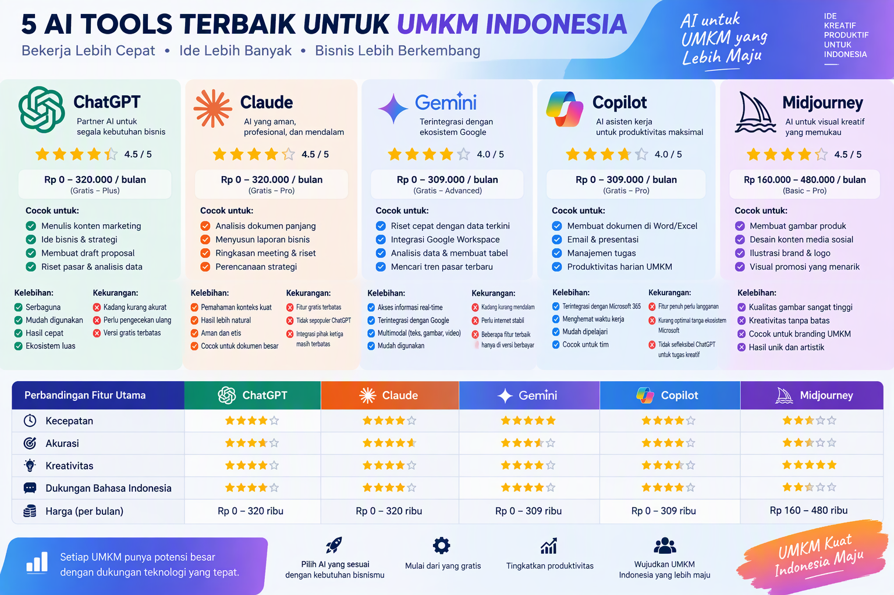
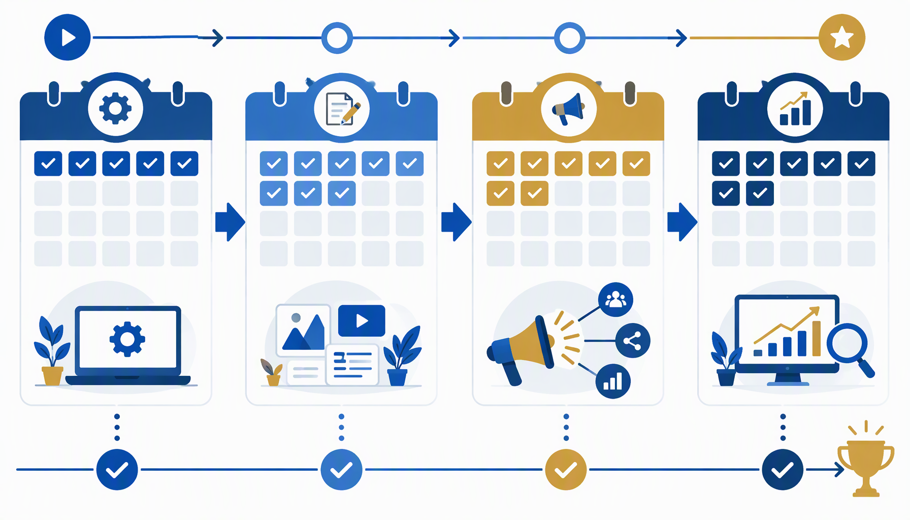
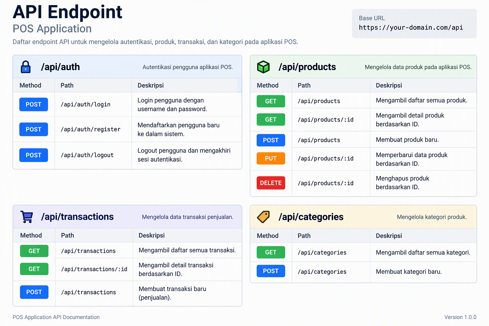

# Panduan Lengkap Strategic Management untuk UMKM Indonesia

## Tentang Panduan Ini

Anda memegang panduan yang dirancang khusus untuk pelaku UMKM di Indonesia. Bukan teori akademis yang rumit, melainkan kerangka kerja praktis yang sudah terbukti membantu ribuan bisnis kecil dan menengah tumbuh dari level lokal menjadi pemain yang diperhitungkan.

Strategic management bukan monopoli perusahaan besar. Justru di level UMKM, keputusan strategis yang tepat bisa mengubah trajectory bisnis secara dramatis dalam waktu singkat. Buku ini akan menunjukkan caranya.

Panduan ini terdiri dari tiga bagian. Bagian pertama membangun fondasi pemahaman tentang strategic management. Bagian kedua membawa Anda ke tahap implementasi dan eksekusi. Bagian ketiga membuka wawasan tentang strategi pertumbuhan lanjutan, dilengkapi studi kasus nyata, kalkulator ROI, dan roadmap 30 hari yang bisa langsung Anda terapkan.

Setiap bab berisi konsep, contoh konkret dari bisnis Indonesia, template yang bisa langsung digunakan, dan checklist praktis. Tidak ada teori yang mengambang. Semua terhubung dengan realitas operasional UMKM di Indonesia.

Mari kita mulai.

---

# BAGIAN 1: FONDASI STRATEGIC MANAGEMENT

---

## Bab 1: Apa itu Strategic Management dan Mengapa UMKM Membutuhkannya

### Definisi yang Sederhana

Strategic management adalah proses merencanakan, mengeksekusi, dan mengevaluasi keputusan-keputusan penting yang menentukan arah jangka panjang bisnis Anda. Dalam bahasa yang lebih sederhana, ini tentang menjawab tiga pertanyaan mendasar: Di mana posisi bisnis Anda sekarang? Ke mana Anda ingin membawa bisnis ini? Bagaimana cara mencapainya?

Banyak pelaku UMKM menjalankan bisnis berdasarkan insting. Insting memang berharga, tapi insting saja tidak cukup ketika bisnis mulai tumbuh dan kompleksitas meningkat. Strategic management memberikan kerangka kerja untuk mengubah insting menjadi keputusan yang terukur dan terarah.

### Mengapa UMKM Butuh Strategic Management

Ada anggapan bahwa strategic management hanya untuk perusahaan besar dengan tim eksekutif dan konsultan mahal. Anggapan ini salah besar. Justru UMKM yang menerapkan strategic management memiliki tingkat keberhasilan yang jauh lebih tinggi dibandingkan yang hanya mengandalkan kebiasaan sehari-hari.

Perhatikan data ini. UMKM di Indonesia menyumbang 61 persen dari total PDB nasional dan menyerap 97 persen tenaga kerja. Tapi tingkat kelangsungan hidup UMKM di tahun kelima hanya sekitar 40 persen. Artinya, 6 dari 10 UMKM tutup sebelum ulang tahun ke-5. Penyebab utamanya bukan kurang modal atau kurang kerja keras, melainkan tidak adanya arah strategis yang jelas.

### Perbedaan Bisnis Tanpa Strategi dan Dengan Strategi

Bayangkan dua warung kopi di kota yang sama. Warung A buka setiap hari dari jam 6 pagi sampai 9 malam. Pemiliknya bekerja keras, bangun pagi, pulang malam. Tapi setelah dua tahun, pendapatannya stagnan di angka yang sama. Warung B juga buka di jam yang sama, tapi pemiliknya punya rencana. Dia tahu target pasarnya siapa, dia tahu apa yang membedakan kopinya dari kompetitor, dia tahu kapan harus ekspansi dan kapan harus konsolidasi. Dalam dua tahun, Warung B sudah punya tiga cabang dan omzetnya lima kali lipat dari Warung A.

Perbedaannya bukan di kerja keras. Keduanya sama-sama kerja keras. Perbedaannya ada di strategic management. Warung B tahu ke mana dia mau pergi dan punya peta untuk sampai ke sana.

### Empat Komponen Strategic Management

Strategic management terdiri dari empat komponen yang saling terhubung.

Komponen pertama adalah analisis lingkungan. Anda perlu memahami posisi bisnis Anda di tengah persaingan, tren pasar, dan perubahan regulasi. Tanpa pemahaman ini, Anda seperti berjalan dalam gelap.

Komponen kedua adalah formulasi strategi. Setelah tahu di mana Anda berdiri, Anda merancang rencana untuk mencapai tujuan. Ini mencakup pemilihan target pasar, penentuan nilai unik yang Anda tawarkan, dan cara Anda bersaing.

Komponen ketiga adalah implementasi. Strategi yang bagus tidak ada gunanya jika tidak dieksekusi. Di tahap ini, Anda mengalokasikan sumber daya, membangun tim, dan menjalankan rencana secara disiplin.

Komponen keempat adalah evaluasi dan kontrol. Anda memantau apakah eksekusi berjalan sesuai rencana, mengukur hasilnya, dan melakukan penyesuaian ketika diperlukan. Bisnis tidak beroperasi di ruang hampa. Kondisi berubah, dan strategi Anda harus adaptif.

### Mitos-Mitos tentang Strategic Management

Mitos pertama: "Bisnis saya terlalu kecil untuk butuh strategi." Faktanya, semakin kecil bisnis Anda, semakin penting setiap keputusan yang Anda ambil. Satu kesalahan strategis bisa fatal bagi UMKM, sementara perusahaan besar punya buffer untuk menyerap kesalahan.

Mitos kedua: "Strategi itu hanya dokumen yang tidak pernah dipakai." Ini terjadi ketika strategi dibuat sebagai formalitas, bukan sebagai panduan operasional. Dalam panduan ini, Anda akan belajar cara membuat strategi yang hidup dan digunakan setiap hari.

Mitos ketiga: "Saya tidak punya waktu untuk berpikir strategis." Justru karena Anda sibuk, Anda butuh strategi. Tanpa strategi, Anda akan terus sibuk mengerjakan hal-hal yang tidak membawa bisnis Anda ke arah yang Anda inginkan. Strategi membantu Anda fokus pada apa yang benar-benar penting.

### Checklist Kesiapan Strategic Management

Sebelum melangkah ke bab berikutnya, evaluasi kesiapan bisnis Anda dengan checklist ini:

Apakah Anda bisa menjelaskan dalam satu kalimat apa yang membuat bisnis Anda berbeda dari kompetitor? Apakah Anda tahu siapa pelanggan ideal Anda dan apa yang mereka butuhkan? Apakah Anda punya target pendapatan yang spesifik untuk 12 bulan ke depan? Apakah Anda tahu tiga risiko terbesar yang mengancam bisnis Anda? Apakah Anda punya rencana cadangan jika pemasok utama Anda tidak bisa mengirim barang?

Jika Anda menjawab "tidak" untuk dua pertanyaan atau lebih, panduan ini akan sangat bermanfaat bagi Anda.

### Langkah Pertama yang Bisa Anda Lakukan Hari Ini

Ambil selembar kertas dan tuliskan jawaban untuk pertanyaan ini: Jika bisnis Anda berhasil besar tiga tahun dari sekarang, seperti apa bentuk keberhasilannya? Berapa omzetnya? Berapa cabang atau timnya? Siapa pelanggannya? Jawaban ini adalah benih visi strategis Anda. Simpan kertas itu. Kita akan mengembangkannya di bab-bab berikutnya.

---

## Bab 2: Analisis Lingkungan Bisnis: SWOT, PESTEL, Porter's Five Forces

### Mengapa Analisis Lingkungan Penting

Sebelum Anda merencanakan perjalanan, Anda perlu tahu di mana Anda berdiri. Analisis lingkungan bisnis memberikan peta posisi Anda saat ini. Tanpa peta ini, strategi yang Anda buat akan berdasarkan asumsi, bukan fakta. Dan asumsi yang salah bisa membawa bisnis Anda ke jurang.

Ada tiga alat analisis yang akan kita bahas secara mendalam: SWOT, PESTEL, dan Porter's Five Forces. Ketiganya saling melengkapi dan memberikan perspektif yang berbeda tentang lingkungan bisnis Anda.

### Analisis SWOT: Memetakan Kekuatan dan Kelemahan

SWOT adalah singkatan dari Strengths, Weaknesses, Opportunities, dan Threats. Alat ini sederhana tapi sangat kuat jika digunakan dengan benar.

Strengths adalah keunggulan internal bisnis Anda. Mungkin Anda punya resep turun-temurun yang tidak dimiliki kompetitor. Mungkin lokasi toko Anda strategis. Mungkin tim Anda sangat loyal dan berpengalaman. Tuliskan semua kekuatan yang Anda miliki.

Weaknesses adalah kelemahan internal. Mungkin modal Anda terbatas. Mungkin Anda belum punya sistem pembukuan yang rapi. Mungkin produk Anda belum memiliki sertifikasi halal atau BPOM. Jujur tentang kelemahan adalah langkah pertama untuk mengatasinya.

Opportunities adalah peluang eksternal yang bisa Anda manfaatkan. Mungkin ada tren baru yang sesuai dengan produk Anda. Mungkin pemerintah sedang mengeluarkan program bantuan untuk UMKM. Mungkin kompetitor besar di daerah Anda baru saja tutup.

Threats adalah ancaman eksternal. Mungkin ada pemain baru yang masuk dengan harga lebih murah. Mungkin regulasi baru yang mempersulit operasional Anda. Mungkin daya beli konsumen di daerah Anda menurun.

### Cara Menggunakan SWOT dengan Benar

Kesalahan umum dalam analisis SWOT adalah membuat daftar yang terlalu umum. "Kualitas produk bagus" bukan kekuatan yang spesifik. "Rating 4.8 di Google Maps dari 500 review dengan keluhan utama hanya soal waktu tunggu" adalah kekuatan yang bisa ditindaklanjuti.

Setelah membuat matriks SWOT, langkah selanjutnya adalah merumuskan strategi dari pertemuan antar kuadran. Pertemukan Strengths dengan Opportunities untuk mendapatkan strategi agresif. Pertemukan Weaknesses dengan Opportunities untuk strategi perbaikan. Pertemukan Strengths dengan Threats untuk strategi defensif. Pertemukan Weaknesses dengan Threats untuk strategi survival.

### Template SWOT untuk UMKM

Berikut template sederhana yang bisa langsung Anda gunakan:

Kuadran Strengths: Tuliskan minimal 5 kekuatan internal bisnis Anda. Untuk setiap kekuatan, beri skor 1 sampai 5 berdasarkan seberapa besar dampaknya terhadap bisnis.

Kuadran Weaknesses: Tuliskan minimal 5 kelemahan internal. Beri skor 1 sampai 5 berdasarkan seberapa mendesak untuk diperbaiki.

Kuadran Opportunities: Tuliskan minimal 5 peluang eksternal yang bisa dimanfaatkan. Beri skor 1 sampai 5 berdasarkan seberapa realistis untuk dicapai.

Kuadran Threats: Tuliskan minimal 5 ancaman eksternal. Beri skor 1 sampai 5 berdasarkan seberapa besar potensi dampaknya.

Setelah mengisi semua kuadran, fokuskan energi Anda pada item dengan skor tertinggi di setiap kuadran.

### Analisis PESTEL: Memahami Faktor Eksternal Makro

PESTEL menganalisis enam faktor eksternal yang mempengaruhi bisnis Anda.

Political mencakup kebijakan pemerintah yang relevan. Peraturan tentang izin usaha, standar produk, insentif pajak untuk UMKM, dan stabilitas politik di daerah Anda.

Economic meliputi kondisi ekonomi yang berdampak pada bisnis. Inflasi, nilai tukar jika Anda impor bahan baku, daya beli masyarakat di segmen pasar Anda, dan suku bunga kredit usaha.

Social adalah faktor sosial dan demografi. Tren gaya hidup konsumen, perubahan struktur usia penduduk di daerah Anda, preferensi konsumen terhadap produk lokal versus impor.

Technological menyangkut teknologi yang bisa mengubah cara Anda berbisnis. Platform e-commerce, alat digital marketing, sistem pembayaran digital, dan otomatisasi produksi.

Environmental berkaitan dengan isu lingkungan. Regulasi tentang kemasan ramah lingkungan, kesadaran konsumen terhadap sustainability, dan ketersediaan bahan baku yang terpengaruh perubahan iklim.

Legal mencakup aspek hukum. Perlindungan konsumen, hukum ketenagakerjaan, regulasi iklan, dan persyaratan sertifikasi produk.

### Porter's Five Forces untuk UMKM

Michael Porter mengembangkan kerangka kerja untuk memahami intensitas persaingan di industri Anda. Lima kekuatan ini menentukan seberapa menguntungkan industri tempat Anda berbisnis.

Kekuatan pertama adalah ancaman pendatang baru. Seberapa mudah kompetitor baru masuk ke pasar Anda? Jika modalnya kecil dan tidak ada barrier to entry, Anda harus terus berinovasi agar tidak tergeser.

Kekuatan kedua adalah daya tawar supplier. Jika Anda bergantung pada satu atau dua supplier saja, mereka punya kekuatan besar atas harga dan kualitas bahan baku Anda. Diversifikasi supplier adalah cara mengurangi risiko ini.

Kekuatan ketiga adalah daya tawar pembeli. Jika konsumen punya banyak pilihan dan biaya pindah ke kompetitor rendah, mereka punya kekuatan besar. Di sinilah loyalitas pelanggan dan diferensiasi produk menjadi penting.

Kekuatan keempat adalah ancaman produk pengganti. Konsumen mungkin tidak membeli dari kompetitor langsung Anda, tapi dari produk yang memenuhi kebutuhan serupa dengan cara berbeda. Gojek dan Grab, misalnya, menjadi pengganti ojek pangkalan dan bahkan angkutan umum.

Kekuatan kelima adalah intensitas persaingan. Berapa banyak kompetitor di pasar Anda? Apakah persaingan berbasis harga atau berbasis nilai? Semakin banyak kompetitor dengan produk serupa, semakin keras persaingan.

### Menggabungkan Ketiga Alat Analisis

SWOT memberikan gambaran internal dan eksternal secara ringkas. PESTEL memperdalam analisis faktor eksternal makro. Porter's Five Forces memberikan pemahaman tentang dinamika persaingan. Gunakan ketiganya secara berurutan untuk mendapatkan gambaran yang komprehensif.

Mulai dari PESTEL untuk memahami lanskap makro. Lanjutkan dengan Porter's Five Forces untuk memetakan persaingan. Tutup dengan SWOT untuk merumuskan posisi strategis Anda berdasarkan temuan dari dua analisis sebelumnya.

### Contoh Penerapan: Toko Kue di Semarang

Sebuah toko kue di Semarang melakukan analisis lingkungan. PESTEL mengungkap bahwa tren kesehatan membuat konsumen mengurangi gula. Porter's Five Forces menunjukkan ancaman pendatang baru tinggi karena banyak home baker bermunculan. SWOT menghasilkan strategi: fokus pada kue rendah gula dan bebas gluten sebagai diferensiasi, sambil membangun komunitas pelanggan setia melalui kelas membuat kue. Dalam enam bulan, toko ini meningkatkan omzet 40 persen dan memiliki waiting list untuk kelas-kelasnya.

### Checklist Analisis Lingkungan Bisnis

Lakukan evaluasi ini sebelum menyusun strategi:

Sudahkah Anda mengidentifikasi minimal 3 kekuatan utama bisnis Anda? Sudahkah Anda jujur tentang 3 kelemahan terbesar? Apakah Anda tahu tren apa yang sedang terjadi di pasar Anda? Apakah Anda memahami posisi kompetitif Anda terhadap 5 kompetitor terdekat? Apakah Anda punya data tentang perilaku konsumen target Anda?

Jika semua pertanyaan terjawab, Anda siap melangkah ke bab berikutnya: merumuskan visi, misi, dan tujuan strategis.

---

## Bab 3: Visi, Misi, dan Tujuan Strategis untuk UMKM

### Visi: Gambar Masa Depan Bisnis Anda

Visi adalah jawaban atas pertanyaan: Apa yang ingin dicapai bisnis Anda dalam 5 sampai 10 tahun ke depan? Visi bukan target pendapatan. Visi adalah gambaran tentang dampak dan posisi bisnis Anda di masa depan.

Visi yang baik memiliki tiga karakteristik. Pertama, inspiratif. Visi harus membuat Anda dan tim bersemangat setiap kali membacanya. Kedua, spesifik enough untuk memberikan arah, tapi broad enough untuk mengakomodasi pertumbuhan. Ketiga, realistis tapi ambisius.

### Contoh Visi dari UMKM Indonesia

Visi Warung Makan Bu Sari di Yogyakarta: "Menjadi destinasi kuliner Jawa yang dipercaya, dengan 10 cabang di kota-kota besar Indonesia pada tahun 2030, sambil melestarikan resep tradisional keluarga."

Visi Konveksi Maju Jaya di Bandung: "Mengangkat konveksi lokal Indonesia ke panggung fashion internasional, dikenal sebagai brand yang menggabungkan kearifan lokal dengan desain modern pada tahun 2028."

Visi Digital Agency Nusantara di Jakarta: "Menjadi agensi digital terdepan di Asia Tenggara yang memberdayakan talenta muda Indonesia, melayani 100 klien korporat dengan tim 50 orang pada tahun 2029."

Perhatikan bahwa ketiga visi ini spesifik, terukur, dan memiliki timeline. Mereka juga mencerminkan nilai-nilai yang dipegang oleh pendirinya.

### Cara Merumuskan Visi untuk UMKM Anda

Langkah pertama, bayangkan bisnis Anda lima tahun dari sekarang. Semua berjalan ideal. Apa yang Anda lihat? Berapa cabang yang sudah berdiri? Siapa pelanggan Anda? Apa kata orang tentang bisnis Anda?

Langkah kedua, tuliskan gambaran itu dalam satu paragraf. Maksimal tiga kalimat.

Langkah ketiga, uji visi Anda dengan pertanyaan ini. Apakah visi ini memotivasi saya? Apakah visi ini memberikan arah yang jelas? Apakah visi ini cukup spesifik untuk diukur? Apakah visi ini realistis untuk dicapai?

### Misi: Alasan Bisnis Anda Ada

Jika visi adalah tentang masa depan, misi adalah tentang hari ini. Misi menjawab pertanyaan: Mengapa bisnis Anda ada? Apa nilai yang Anda berikan setiap hari kepada pelanggan?

Misi yang baik menjelaskan siapa yang Anda layani, apa yang Anda berikan, dan bagaimana cara Anda memberikannya. Misi harus ringkas, jelas, dan bisa dipahami oleh siapa saja dalam tim Anda.

### Contoh Misi yang Efektif

Misi Warung Bu Sari: "Menyajikan masakan Jawa autentik dengan bahan segar pilihan, dalam suasana hangat seperti makan di rumah nenek, dengan harga yang terjangkau untuk semua kalangan."

Misi Konveksi Maju Jaya: "Memproduksi pakaian berkualitas tinggi dengan sentuhan desain Indonesia, memberikan penghasilan yang layak bagi penjahit lokal, dan menghadirkan kebanggaan berbusana bagi pelanggan kami."

Misi Digital Agency Nusantara: "Membantu bisnis Indonesia tumbuh melalui solusi digital yang kreatif dan terukur, sambil mengembangkan talenta digital muda Indonesia menjadi profesional kelas dunia."

Setiap misi ini mencerminkan nilai inti bisnis dan memberikan panduan untuk pengambilan keputusan sehari-hari. Ketika ada dilema antara keuntungan dan kualitas, misi Konveksi Maju Jaya dengan jelas mengarahkan pada pilihan kualitas.

### Tujuan Strategis: Tonggak Pencapaian Visi

Tujuan strategis adalah penjabaran visi menjadi target-target yang lebih spesifik dan terukur. Tujuan strategis menjembatani visi jangka panjang dengan rencana operasional harian.

### Kerangka SMART untuk Tujuan Strategis

Setiap tujuan strategis harus memenuhi kriteria SMART.

Specific: Tujuan harus jelas dan tidak ambigu. "Meningkatkan penjualan" bukan tujuan yang spesifik. "Meningkatkan penjualan produk kue kering dari Rp 50 juta menjadi Rp 150 juta per bulan" adalah tujuan yang spesifik.

Measurable: Tujuan harus bisa diukur. Anda harus tahu kapan tujuan itu tercapai. Angka, persentase, dan timeline adalah teman Anda.

Achievable: Tujuan harus menantang tapi bisa dicapai. Menetapkan target omzet Rp 100 miliar untuk UMKM yang saat ini omzetnya Rp 50 juta bukan ambisius, itu delusi. Target yang baik adalah yang membuat Anda stretch tapi tidak break.

Relevant: Tujuan harus selaras dengan visi dan misi. Jika visi Anda tentang kualitas, jangan tetapkan tujuan yang mengorbankan kualitas demi kuantitas.

Time-bound: Tujuan harus punya deadline. Tanpa timeline, tujuan hanya menjadi harapan.

### Template Penetapan Tujuan Strategis

Gunakan template ini untuk menetapkan tujuan strategis Anda:

Tujuan 1: [Tuliskan tujuan spesifik dan terukur]
Indikator Keberhasilan: [Bagaimana Anda tahu tujuan ini tercapai]
Timeline: [Kapan harus tercapai]
Strategi Utama: [Pendekatan utama untuk mencapainya]
Sumber Daya yang Dibutuhkan: [Modal, tim, teknologi, dll]
Risiko Utama: [Apa yang bisa menghambat]
Rencana Cadangan: [Apa yang dilakukan jika rencana utama gagal]

Ulangi template ini untuk 3 sampai 5 tujuan strategis utama.

### Menyelaraskan Visi, Misi, dan Tujuan

Ketiga elemen ini harus selaras seperti rantai yang saling terhubung. Visi memberikan arah jangka panjang. Misi mendefinisikan apa yang Anda lakukan setiap hari untuk bergerak ke arah visi. Tujuan strategis mengukur apakah Anda benar-benar bergerak ke arah yang benar.

Uji keselarasan dengan pertanyaan ini: Apakah tujuan-tujuan saya, jika tercapai, akan membawa bisnis saya mendekati visi? Apakah aktivitas operasional harian saya mencerminkan misi? Jika jawabannya ya untuk kedua pertanyaan, Anda punya fondasi strategis yang kokoh.

### Kesalahan Umum dalam Penetapan Visi dan Misi

Kesalahan pertama adalah membuat visi yang terlalu abstrak. "Menjadi yang terbaik di Indonesia" bukan visi. Terbaik dalam hal apa? Untuk siapa? Menurut ukuran apa?

Kesalahan kedua adalah membuat misi yang terlalu panjang. Jika misi Anda butuh satu halaman untuk dijelaskan, itu bukan misi, itu esai.

Kesalahan ketiga adalah menetapkan tujuan yang saling bertentangan. Jika satu tujuan adalah "menjadi yang termurah" dan tujuan lain adalah "menjadi yang paling premium", Anda akan bingung mengalokasikan sumber daya.

Kesalahan keempat adalah tidak mengkomunikasikan visi dan misi kepada tim. Visi dan misi bukan pajangan di dinding. Mereka harus hidup dalam setiap keputusan operasional.

### Latihan Praktis

Luangkan waktu 30 menit hari ini untuk merumuskan visi, misi, dan 3 tujuan strategis bisnis Anda. Tulis di kertas, bukan di pikiran. Tulisan bisa direvisi, dipresentasikan ke tim, dan dievaluasi. Pikiran yang tidak dituliskan mudah berubah dan sulit dievaluasi.

---

## Bab 4: Formulasi Strategi: Cost Leadership, Differentiation, Focus

### Tiga Strategi Generik Michael Porter

Michael Porter, profesor dari Harvard Business School, mengidentifikasi tiga strategi generik yang bisa dipilih bisnis untuk bersaing. Ketiga strategi ini sudah terbukti efektif di berbagai industri dan ukuran bisnis. Untuk UMKM, pemilihan strategi yang tepat bisa menjadi perbedaan antara tumbuh pesat dan stagnan.

### Cost Leadership: Menjadi yang Termurah dengan Kualitas Tetap Terjaga

Strategi cost leadership berarti Anda menawarkan produk atau jasa dengan harga lebih rendah dari kompetitor, sambil tetap mempertahankan kualitas yang acceptable. Ini bukan tentang menjual murah dan rugi. Ini tentang memiliki struktur biaya yang lebih efisien sehingga Anda bisa menawarkan harga lebih rendah dan tetap untung.

Bagaimana UMKM bisa menerapkan cost leadership? Kuncinya ada di efisiensi operasional. Belanja bahan baku langsung dari petani atau produsen untuk memotong rantai pasok. Gunakan teknologi untuk mengurangi biaya administrasi. Standarisasi proses untuk mengurangi pemborosan.

Contoh nyata: Sebuah warung nasi goreng di Surabaya menerapkan cost leadership dengan membeli beras langsung dari petani di Karawang, memotong tengkulak. Dia juga menstandarisasi porsi dan proses masak sehingga tidak ada bahan yang terbuang. Hasilnya, dia bisa menjual nasi goreng Rp 12.000 sementara kompetitor menjual Rp 18.000, dan margin keuntungannya justru lebih besar.

### Differentiation: Menjadi Berbeda dan Spesial

Strategi differentiation berarti Anda menawarkan sesuatu yang unik dan bernilai di mata pelanggan, sehingga mereka bersedia membayar lebih. Keunikan ini bisa berupa kualitas produk, desain, layanan, brand, atau pengalaman pelanggan.

Untuk UMKM, differentiation sering kali lebih mudah diterapkan daripada cost leadership. Anda tidak perlu skala besar untuk menjadi berbeda. Anda hanya perlu memahami pelanggan dengan mendalam dan memberikan nilai yang tidak diberikan kompetitor.

Contoh nyata: Konveksi Maju Jaya di Bandung tidak bersaing harga dengan pabrik garmen besar. Mereka memilih differentiation dengan menggunakan kain tenun lokal dan desain kontemporer. Setiap pieces memiliki cerita tentang pengrajin yang membuatnya. Pelanggan mereka bukan mencari baju murah. Mereka mencari baju yang unik, berkualitas, dan memiliki nilai budaya. Harga jual mereka tiga kali lipat dari baju konveksi biasa, dan pelanggan tetap antre.

### Focus Strategy: Menguasai Segmen Tertentu

Strategi focus berarti Anda memilih segmen pasar yang spesifik dan melayani segmen itu lebih baik dari siapa pun. Segmen ini bisa berdasarkan geografis, demografis, atau kebutuhan khusus.

Ada dua jenis focus strategy. Focus cost leadership berarti menjadi yang termurah di segmen tertentu. Focus differentiation berarti menjadi yang paling unik dan bernilai di segmen tertentu.

Contoh nyata: Sebuah toko perlengkapan bayi di Malang memilih focus strategy dengan hanya melayani segmen ibu hamil dan bayi usia 0 sampai 12 bulan. Toko ini tidak menjual perlengkapan anak usia 5 tahun atau remaja. Karena fokus, pemiliknya sangat memahami kebutuhan segmennya. Dia menyediakan konsultasi gratis, kelas persiapan melahirkan, dan layanan antar untuk ibu yang baru melahirkan. Toko ini menjadi rujukan utama ibu-ibu di Malang untuk kebutuhan bayi, mengalahkan toko perlengkapan anak yang lebih besar tapi tidak fokus.

### Cara Memilih Strategi yang Tepat

Tidak ada strategi yang secara inheren lebih baik dari yang lain. Pilihan strategi tergantung pada beberapa faktor.

Faktor pertama adalah sumber daya Anda. Jika modal terbatas dan Anda tidak bisa mencapai skala ekonomi, cost leadership mungkin bukan pilihan terbaik. Differentiation atau focus lebih cocok.

Faktor kedua adalah karakteristik pasar Anda. Jika pasar Anda sangat kompetitif dengan banyak pemain yang menawarkan produk serupa, differentiation adalah cara untuk keluar dari perang harga.

Faktor ketiga adalah keunggulan kompetitif Anda. Apa yang Anda lakukan lebih baik dari orang lain? Jika Anda punya akses ke bahan baku unik, differentiation mungkin jalan terbaik. Jika Anda punya jaringan distribusi yang efisien, cost leadership bisa jadi pilihan.

Faktor keempat adalah preferensi pelanggan Anda. Apakah pelanggan di pasar Anda sensitif terhadap harga? Atau mereka lebih mementingkan kualitas dan keunikan? Jawaban pertanyaan ini akan mengarahkan Anda ke strategi yang tepat.

### Matriks Pemilihan Strategi

Gunakan matriks ini untuk membantu keputusan:

Baris: Sumber Daya Anda (Terbatas / Cukup / Besar)
Kolom: Karakteristik Pasar (Sensitif Harga / Sensitif Nilai)

Jika sumber daya terbatas dan pasar sensitif harga, pilih Focus Cost Leadership. Jika sumber daya terbatas dan pasar sensitif nilai, pilih Focus Differentiation. Jika sumber daya cukup dan pasar luas sensitif harga, pilih Cost Leadership. Jika sumber daya cukup dan pasar luas sensitif nilai, pilih Differentiation.

### Menghindari Stuck in the Middle

Porter memperingatkan tentang bahaya stuck in the middle, yaitu tidak memilih strategi dengan jelas. Bisnis yang mencoba menjadi murah dan premium sekaligus sering kali gagal di keduanya. Pelanggan bingung memposisikan Anda, dan tim internal bingung mengalokasikan sumber daya.

Ini bukan berarti Anda tidak bisa mengubah strategi. Anda bisa berpindah dari cost leadership ke differentiation seiring bisnis tumbuh. Tapi pada satu waktu, Anda harus jelas dengan satu strategi utama.

### Template Perumusan Strategi

Isi template ini untuk merumuskan strategi bisnis Anda:

Strategi yang dipilih: [Cost Leadership / Differentiation / Focus]
Segmen pasar target: [Siapa pelanggan ideal Anda]
Nilai unik yang ditawarkan: [Mengapa pelanggan memilih Anda]
Keunggulan kompetitif utama: [Apa yang sulit ditiru kompetitor]
Aktivitas kunci yang mendukung strategi: [Apa yang harus Anda lakukan dengan sangat baik]
Indikator keberhasilan strategi: [Bagaimana mengukur apakah strategi bekerja]

### Studi Singkat: Warung Kopi yang Memilih Differentiation

Sebuah warung kopi di Jogja menghadapi persaingan ketat. Dalam radius 500 meter ada 8 kedai kopi lain. Pemiliknya memilih differentiation dengan fokus pada single origin coffee dari petani lokal Jawa Tengah. Setiap cangkir kopi datang dengan kartu yang menceritakan asal biji kopi, nama petani, dan proses pengolahannya. Warung ini juga mengadakan cupping session mingguan untuk edukasi pelanggan. Dalam setahun, warung kopi ini memiliki pelanggan setia yang rela datang dari luar kota dan omzetnya naik 200 persen.

---

## Bab 5: Business Model Canvas dan Value Proposition

### Apa itu Business Model Canvas

Business Model Canvas (BMC) adalah alat visual yang dikembangkan oleh Alexander Osterwalder untuk memetakan bagaimana bisnis Anda menciptakan, mengirimkan, dan menangkap nilai. BMC terdiri dari sembilan blok yang saling terhubung. Dalam satu halaman, Anda bisa melihat keseluruhan model bisnis Anda.

Untuk UMKM, BMC sangat berguna karena memaksa Anda berpikir secara holistik. Banyak pelaku UMKM fokus hanya pada produk dan penjualan, padahal aspek-aspek lain seperti saluran distribusi, hubungan pelanggan, dan struktur biaya sama pentingnya.

### Sembilan Blok Business Model Canvas

Blok pertama adalah Customer Segments. Siapa pelanggan Anda? Jangan jawab "semua orang". Bisnis yang mencoba melayani semua orang biasanya tidak melayani siapa pun dengan baik. Spesifikasikan segmen pelanggan Anda. Apakah ibu rumah tangga usia 25 sampai 40 tahun di kota besar? Apakah pemilik usaha kecil yang butuh solusi digital? Apakah mahasiswa yang mencari makanan terjangkau?

Blok kedua adalah Value Propositions. Nilai apa yang Anda berikan kepada segmen pelanggan tersebut? Value proposition bukan daftar fitur produk. Value proposition adalah jawaban atas pertanyaan: Masalah apa yang Anda selesaikan untuk pelanggan? Atau kebutuhan apa yang Anda penuhi?

Blok ketiga adalah Channels. Bagaimana cara Anda menyampaikan value proposition ke pelanggan? Ini mencakup saluran fisik seperti toko dan saluran digital seperti website, media sosial, marketplace, dan aplikasi pesan.

Blok keempat adalah Customer Relationships. Bagaimana cara Anda membangun dan mempertahankan hubungan dengan pelanggan? Apakah melalui layanan personal, komunitas, self-service, atau automated service?

Blok kelima adalah Revenue Streams. Dari mana uang masuk? Apakah dari penjualan produk, langganan, sewa, lisensi, atau komisi? Diversifikasi sumber pendapatan membuat bisnis lebih resilien.

Blok keenam adalah Key Resources. Aset apa yang Anda butuhkan untuk menjalankan model bisnis ini? Ini mencakup aset fisik, intelektual, manusia, dan finansial.

Blok ketujuh adalah Key Activities. Aktivitas apa yang harus Anda lakukan dengan sangat baik? Untuk bisnis manufaktur, ini adalah produksi. Untuk bisnis jasa, ini adalah delivery service. Untuk platform digital, ini adalah pengembangan teknologi.

Blok kedelapan adalah Key Partnerships. Siapa mitra yang Anda butuhkan? Supplier, distributor, agen pemasaran, konsultan, atau bahkan kompetitor untuk kolaborasi tertentu?

Blok kesembilan adalah Cost Structure. Apa saja biaya yang Anda keluarkan untuk menjalankan model bisnis ini? Bedakan antara biaya tetap dan biaya variabel.

### Value Proposition Canvas: Memperdalam Blok Nilai

Value Proposition Canvas adalah alat tambahan yang membantu Anda merancang value proposition yang benar-benar resonate dengan pelanggan. Canvas ini memiliki dua sisi.

Sisi pelanggan mencakup tiga elemen. Customer jobs adalah tugas yang ingin diselesaikan pelanggan. Ini bisa fungsional seperti "butuh makan siang cepat" atau emosional seperti "ingin merasa dihargai". Customer pains adalah masalah yang dihadapi pelanggan dalam menyelesaikan tugas tersebut. Customer gains adalah hasil dan manfaat yang diharapkan pelanggan.

Sisi value proposition juga memiliki tiga elemen. Products and services adalah apa yang Anda tawarkan. Pain relievers adalah cara produk Anda mengatasi masalah pelanggan. Gain creators adalah cara produk Anda memberikan manfaat tambahan.

### Contoh BMC: Warung Makan Bu Sari

Customer Segments: Keluarga muda usia 25 sampai 45 tahun di Yogyakarta yang rindu masakan Jawa autentik, pekerja kantoran yang butuh makan siang cepat dan bergizi, wisatawan yang ingin mencicipi kuliner lokal.

Value Propositions: Masakan Jawa dengan resep turun-temurun yang konsisten rasanya, suasana makan yang nyaman seperti di rumah, harga terjangkau untuk kualitas dan porsi yang diberikan, pelayanan cepat untuk makan siang.

Channels: Lokasi fisik di jalan utama, pemesanan via GoFood dan GrabFood, media sosial Instagram untuk promosi, WhatsApp untuk catering dan pesanan grup.

Customer Relationships: Program pelanggan setia dengan stamp card, interaksi personal di media sosial, layanan complaint yang responsif, memori preferensi pelanggan tetap.

Revenue Streams: Penjualan makan di tempat, catering untuk acara, penjualan bumbu dan sambal kemasan, kelas memasak tradisional.

Key Resources: Resep keluarga, koki yang terlatih dengan resep Bu Sari, lokasi strategis, supplier bahan baku terpercaya.

Key Activities: Memasak dengan standar resep yang konsisten, menjaga kualitas bahan baku, melatih staf, mengelola operasional harian.

Key Partnerships: Petani lokal untuk sayur dan bumbu, GoFood dan GrabFood untuk delivery, komunitas kuliner Yogyakarta untuk promosi silang.

Cost Structure: Bahan baku 40 persen, sewa tempat 15 persen, gaji karyawan 20 persen, utilitas 5 persen, pemasaran 5 persen, lainnya 15 persen.

### Cara Menggunakan BMC untuk UMKM Anda

Langkah pertama, cetak template BMC dalam ukuran besar. Tempel di dinding.

Langkah kedua, isi setiap blok dengan sticky notes. Satu sticky note untuk satu ide. Ini memudahkan Anda memindahkan, menambah, atau menghapus ide.

Langkah ketiga, mulai dari Customer Segments. Siapa pelanggan Anda? Tuliskan di sticky notes dan tempel di blok tersebut.

Langkah keempat, isi Value Propositions. Apa yang membuat pelanggan memilih Anda?

Langkah kelima, hubungkan Value Propositions dengan Customer Segments. Apakah nilai yang Anda tawarkan benar-benar menyelesaikan masalah pelanggan?

Langkah keenam, isi blok-blok lainnya. Channels, Customer Relationships, Revenue Streams, Key Resources, Key Activities, Key Partnerships, dan Cost Structure.

Langkah ketujuh, tinjau keseluruhan. Apakah semua blok saling terhubung secara logis? Apakah model bisnis ini sustainable?

### Template BMC Kosong untuk UMKM

Anda bisa membuat template BMC sendiri dengan kertas A3. Bagi menjadi 9 bagian sesuai blok-blok di atas. Atau gunakan template digital gratis yang tersedia di internet. Yang penting, isi dan review secara berkala.

### Menguji Business Model Anda

Setelah mengisi BMC, uji dengan pertanyaan kritis ini. Apakah customer segments saya cukup besar untuk menghasilkan revenue yang saya targetkan? Apakah value proposition saya benar-benar berbeda dari kompetitor? Apakah channels saya efektif menjangkau customer segments? Apakah revenue streams saya cukup untuk menutup cost structure? Apakah key partnerships saya bisa diandalkan?

Jika ada blok yang tidak terhubung dengan logis, Anda perlu merevisi model bisnis Anda.

### Iterasi BMC

BMC bukan dokumen statis. Bisnis berubah, pasar berubah, dan BMC Anda harus ikut berubah. Review BMC Anda setiap kuartal. Update berdasarkan data dan feedback pelanggan. BMC yang selalu di-update adalah tanda bisnis yang sehat dan adaptif.

---

# BAGIAN 2: IMPLEMENTASI DAN EKSEKUSI

---

## Bab 6: Menyusun Strategic Plan: Dari Visi ke Action Plan

### Mengapa Strategic Plan Sering Gagal

Banyak bisnis memiliki visi yang inspiratif dan strategi yang bagus di atas kertas. Tapi eksekusinya gagal. Kenapa? Karena ada jurang antara strategi dan action plan. Strategic plan yang baik menjembatani jurang ini dengan menerjemahkan strategi besar menjadi langkah-langkah kecil yang bisa dieksekusi setiap hari.

Kegagalan paling umum adalah rencana yang terlalu ambisius tanpa milestone yang realistis. Kegagalan kedua adalah tidak adanya alokasi sumber daya yang jelas. Kegagalan ketiga adalah tidak adanya mekanisme monitoring dan evaluasi.

### Kerangka Strategic Plan untuk UMKM

Strategic plan untuk UMKM tidak perlu rumit. Yang dibutuhkan adalah dokumen yang jelas, ringkas, dan actionable. Berikut kerangka yang direkomendasikan.

Bagian pertama: Ringkasan Eksekutif. Satu halaman yang merangkum keseluruhan rencana. Ini mencakup visi, misi, tujuan strategis utama, dan target finansial.

Bagian kedua: Analisis Situasi. Ringkasan hasil analisis SWOT, PESTEL, dan Porter's Five Forces yang sudah Anda lakukan di Bab 2.

Bagian ketiga: Strategi Utama. Penjelasan tentang strategi yang Anda pilih (cost leadership, differentiation, atau focus) dan bagaimana strategi ini akan memberikan keunggulan kompetitif.

Bagian keempat: Tujuan dan Target. Penjabaran tujuan strategis menjadi target-target yang terukur dengan timeline. Gunakan kerangka SMART.

Bagian kelima: Action Plan. Rincian langkah-langkah konkret untuk mencapai setiap target. Setiap langkah harus memiliki penanggung jawab, deadline, dan sumber daya yang dibutuhkan.

Bagian keenam: Anggaran. Alokasi sumber daya finansial untuk setiap inisiatif strategis.

Bagian ketujuh: Risk Management. Identifikasi risiko-risiko utama dan rencana mitigasinya.

Bagian kedelapan: Monitoring dan Evaluasi. KPI apa yang akan dipantau, seberapa sering, dan siapa yang bertanggung jawab.

### Template Action Plan

Untuk setiap tujuan strategis, buat action plan dengan format ini:

Tujuan: [Tuliskan tujuan spesifik]
Target: [Angka yang ingin dicapai]
Deadline: [Tanggal pencapaian]

Inisiatif 1: [Nama inisiatif]
Penanggung Jawab: [Nama orang]
Langkah-langkah: [Daftar langkah konkret]
Timeline: [Jadwal setiap langkah]
Sumber Daya: [Budget, tim, tools]
KPI: [Indikator keberhasilan]
Risiko: [Potensi hambatan]
Mitigasi: [Rencana cadangan]

Ulangi format ini untuk setiap inisiatif yang mendukung tujuan strategis tersebut.

### Contoh Action Plan: Warung Bu Sari Ekspansi

Tujuan: Membuka 2 cabang baru dalam 12 bulan.
Target: Cabang ke-3 buka di bulan ke-6, cabang ke-4 di bulan ke-12.

Inisiatif 1: Riset lokasi
Penanggung Jawab: Bu Sari sendiri
Langkah: Survei 10 lokasi potensial, analisis traffic per lokasi, wawancara calon pelanggan sekitar, hitung estimasi sewa dan renovasi.
Timeline: Bulan 1 sampai 2.
Sumber Daya: Rp 5 juta untuk riset.
KPI: Minimal 3 lokasi yang memenuhi kriteria.

Inisiatif 2: Rekrutmen dan pelatihan kepala koki
Penanggung Jawab: Bu Sari dan manajer operasional
Langlah: Posting lowongan, seleksi 10 kandidat, interview dan tes masak, pilih 2 orang, pelatihan intensif selama 1 bulan dengan standar resep Bu Sari.
Timeline: Bulan 2 sampai 4.
Sumber Daya: Rp 15 juta untuk rekrutmen dan pelatihan.
KPI: 2 kepala koki yang lulus uji standar rasa.

Inisiatif 3: Renovasi dan setup cabang
Penanggung Jawab: Tim operasional
Langkah: Negosiasi sewa, desain interior sesuai standar, renovasi, pengadaan peralatan, trial operasional 2 minggu.
Timeline: Bulan 3 sampai 5 untuk cabang pertama.
Sumber Daya: Rp 80 juta per cabang.
KPI: Cabang siap beroperasi sesuai standar.

### Prioritas dalam Strategic Plan

UMKM memiliki sumber daya terbatas. Anda tidak bisa mengerjakan semuanya sekaligus. Prioritas menjadi krusial.

Gunakan matriks Eisenhower untuk memprioritaskan inisiatif. Kuadran 1: Penting dan mendesak. Kerjakan segera. Kuadran 2: Penting tapi tidak mendesak. Jadwalkan dan alokasikan waktu. Kuadran 3: Tidak penting tapi mendesak. Delegasikan. Kuadran 4: Tidak penting dan tidak mendesak. Eliminasikan.

Dalam konteks strategic plan, fokuskan energi pada inisiatif di Kuadran 1 dan Kuadran 2. Inisiatif Kuadran 2 yang tidak dijadwalkan akan berubah menjadi krisis Kuadran 1.

### Menyusun Timeline yang Realistis

Kesalahan umum adalah menyusun timeline yang terlalu optimistis. Untuk menghindari ini, gunakan teknik buffer time. Tambahkan 20 sampai 30 persen waktu cadangan untuk setiap milestone. Jika Anda estimasi sebuah inisiatif butuh 3 bulan, alokasikan 4 bulan.

Selain itu, identifikasi critical path, yaitu rangkaian inisiatif yang harus selesai secara berurutan dan menentukan total waktu proyek. Inisiatif di critical path harus mendapat perhatian ekstra karena keterlambatan di sini berarti keterlambatan keseluruhan rencana.

### Mengkomunikasikan Strategic Plan

Strategic plan bukan dokumen rahasia yang hanya diketahui pemilik bisnis. Setiap anggota tim perlu memahami rencana ini dan peran mereka di dalamnya.

Adakan meeting untuk mempresentasikan strategic plan kepada seluruh tim. Jelaskan visi, tujuan, dan bagaimana kontribusi masing-masing orang. Buat setiap orang merasa bahwa mereka adalah bagian dari rencana besar ini.

Tempel ringkasan strategic plan di area yang terlihat oleh semua orang. Bukan seluruh dokumen, tapi satu halaman yang berisi tujuan utama dan progress terkini.

### Review dan Revisi Strategic Plan

Strategic plan perlu direvisi secara berkala. Lakukan review bulanan untuk memantau progress. Lakukan review kuartalan untuk mengevaluasi apakah strategi masih relevan. Lakukan review tahunan untuk memperbarui keseluruhan rencana.

Review bulanan fokus pada eksekusi: Apakah langkah-langkah berjalan sesuai timeline? Apakah ada hambatan yang perlu diatasi? Apakah KPI on track?

Review kuartalan fokus pada strategi: Apakah asumsi-asumsi awal masih valid? Apakah ada perubahan di pasar yang mempengaruhi strategi? Apakah perlu penyesuaian target?

Review tahunan fokus pada visi: Apakah visi masih relevan? Apakah ada peluang baru yang lebih menarik? Apakah arah bisnis perlu diubah secara fundamental?

### Checklist Strategic Plan

Sebelum finalisasi strategic plan, pastikan:

Visi dan misi sudah jelas dan dikomunikasikan ke seluruh tim. Tujuan strategis sudah memenuhi kriteria SMART. Setiap tujuan memiliki action plan yang detail dengan penanggung jawab. Alokasi anggaran sudah realistis. Timeline sudah diperhitungkan dengan buffer time. Risiko-risiko utama sudah diidentifikasi dan ada rencana mitigasi. KPI sudah ditetapkan untuk setiap inisiatif. Mekanisme review bulanan, kuartalan, dan tahunan sudah dijadwalkan.

---

## Bab 7: Implementasi Strategi: Mengubah Rencana Menjadi Aksi

### Dari Kertas ke Realitas

Strategic plan yang bagus di atas kertas tidak ada artinya tanpa eksekusi yang disiplin. Banyak UMKM gagal bukan karena strateginya salah, tapi karena implementasinya berantakan. Bab ini membahas cara mengubah rencana menjadi aksi nyata.

### Prinsip-Prinsip Implementasi Strategi

Prinsip pertama: Mulai dari yang kecil dan cepat. Jangan mencoba mengubah seluruh bisnis dalam semalam. Pilih satu area, terapkan strategi, ukur hasilnya, lalu scale up. Pendekatan ini mengurangi risiko dan membangun momentum.

Prinsip kedua: Komitmen dari puncak. Pemilik atau pemimpin bisnis harus menjadi contoh utama dalam implementasi. Jika Anda tidak serius dengan strategi baru, tim Anda juga tidak akan serius.

Prinsip ketiga: Komunikasi yang konsisten. Ulangi pesan strategis secara berkala. Orang perlu mendengar sesuatu 7 sampai 10 kali sebelum benar-benar menginternalisasi dan bertindak berdasarkan informasi tersebut.

Prinsip keempat: Akuntabilitas. Setiap inisiatif harus punya penanggung jawab yang jelas. Dan penanggung jawab ini harus melaporkan progress secara rutin.

Prinsip kelima: Fleksibilitas dalam eksekusi. Strategi boleh tetap, tapi taktik bisa berubah. Jika sebuah pendekatan tidak bekerja, ganti pendekatannya, bukan tujuannya.

### Membangun Sistem Eksekusi

Sistem eksekusi yang efektif untuk UMKM terdiri dari tiga elemen.

Elemen pertama adalah daily huddle. Meeting singkat 10 sampai 15 menit setiap pagi dengan tim inti. Agenda: Apa yang dicapai kemarin? Apa yang akan dikerjakan hari ini? Apa hambatannya? Meeting ini menjaga semua orang tetap fokus dan aligned.

Elemen kedua adalah weekly review. Meeting 30 sampai 60 menit setiap minggu untuk mengevaluasi progress mingguan terhadap KPI. Jika ada KPI yang merah, diskusikan akar masalah dan solusi. Weekly review bukan untuk mencari kambing hitam, tapi untuk menemukan dan menyelesaikan masalah secara kolaboratif.

Elemen ketiga adalah monthly strategic review. Meeting 2 sampai 3 jam setiap bulan untuk mengevaluasi progress terhadap tujuan strategis bulanan. Review apakah inisiatif-inisiatif utama berjalan sesuai rencana. Putuskan penyesuaian jika diperlukan.

### Mengalokasikan Sumber Daya

Implementasi strategi membutuhkan sumber daya: uang, orang, waktu, dan energi. Alokasi sumber daya harus mencerminkan prioritas strategis.

Jika prioritas Anda adalah ekspansi, alokasikan budget lebih besar untuk riset lokasi, rekrutmen, dan renovasi. Jika prioritas Anda adalah diferensiasi produk, alokasikan lebih banyak untuk R&D, pelatihan, dan quality control.

Kesalahan umum adalah mengalokasikan sumber daya secara merata ke semua area. Ini menghasilkan tidak ada area yang mendapat cukup sumber daya untuk berhasil. Fokuskan sumber daya pada 2 sampai 3 inisiatif prioritas.

### Mengelola Tim dalam Implementasi

Tim adalah ujung tombak implementasi. Tanpa tim yang kompeten dan termotivasi, strategi terbaik pun akan gagal.

Langkah pertama, pastikan setiap anggota tim memahami peran mereka dalam strategi besar. Orang yang merasa pekerjaannya bermakna akan lebih termotivasi.

Langkah kedua, berikan pelatihan yang dibutuhkan. Jika strategi baru membutuhkan skill yang belum dimiliki tim, investasikan waktu dan uang untuk pelatihan.

Langkah ketiga, tetapkan ekspektasi yang jelas. Setiap orang harus tahu apa yang diharapkan dari mereka, bagaimana kinerjanya diukur, dan apa konsekuensi dari kinerja yang baik atau buruk.

Langkah keempat, berikan feedback secara rutin. Jangan menunggu review tahunan. Feedback yang efektif diberikan segera setelah kejadian, spesifik, dan berfokus pada perilaku bukan personal.

### Mengatasi Hambatan Implementasi

Hambatan pasti muncul. Yang membedakan bisnis yang berhasil adalah cara mereka mengatasi hambatan.

Hambatan pertama: Resistensi terhadap perubahan. Orang nyaman dengan cara lama. Untuk mengatasi ini, libatkan mereka dalam perencanaan perubahan. Orang yang ikut merancang perubahan akan lebih mendukung implementasinya.

Hambatan kedua: Keterbatasan sumber daya. Jika budget terbatas, cari cara kreatif. Manfaatkan teknologi gratis, barter dengan mitra, atau mulai dengan pilot project kecil.

Hambatan ketiga: Masalah koordinasi. Ketika tim bertambah besar, koordinasi menjadi lebih sulit. Solusinya adalah sistem komunikasi yang jelas dan tools kolaborasi yang tepat.

Hambatan keempat: Distraksi operasional. Urusan sehari-hari sering mendesak dan mengalihkan perhatian dari inisiatif strategis. Solusinya adalah memblokir waktu khusus di kalender untuk pekerjaan strategis. Perlakukan waktu ini seakan meeting dengan klien penting. Tidak bisa dibatalkan.

### Contoh Implementasi: Konveksi Maju Jaya

Konveksi Maju Jaya di Bandung memutuskan beralih dari produksi biasa menjadi brand fashion dengan differentiation strategy. Implementasi dilakukan bertahap.

Bulan 1 sampai 2: Riset pasar dan pengembangan desain. Tim kecil 3 orang ditugaskan khusus untuk ini. Budget Rp 10 juta untuk riset dan sampling.

Bulan 3 sampai 4: Branding dan packaging. Hire desainer freelance untuk membuat logo, label, dan packaging yang mencerminkan brand positioning baru. Budget Rp 15 juta.

Bulan 5 sampai 6: Peluncuran produk baru di media sosial. Konten storytelling tentang pengrajin lokal dan proses pembuatan. Budget Rp 8 juta untuk konten dan iklan.

Bulan 7 sampai 8: Evaluasi hasil. Analisis penjualan, feedback pelanggan, dan engagement media sosial. Jika positif, scale up. Jika ada yang perlu diperbaiki, iterasi.

Dalam 8 bulan, Konveksi Maju Jaya berhasil meningkatkan harga jual rata-rata 200 persen dan mendapatkan pelanggan baru dari segmen premium.

### Tools untuk Implementasi Strategi

Beberapa tools yang bisa membantu implementasi strategi di UMKM.

Untuk project management: Trello (gratis), Asana (gratis untuk tim kecil), atau Notion (gratis untuk personal). Pilih satu yang cocok dengan gaya kerja tim Anda.

Untuk komunikasi: WhatsApp Group untuk komunikasi cepat, Slack untuk komunikasi terstruktur, Zoom atau Google Meet untuk meeting virtual.

Untuk tracking KPI: Google Sheets sudah cukup untuk UMKM. Buat dashboard sederhana yang di-update setiap minggu.

Untuk dokumentasi: Google Drive untuk menyimpan semua dokumen strategis. Pastikan semua tim punya akses.

### Checklist Implementasi

Sebelum memulai implementasi, pastikan:

Setiap inisiatif memiliki penanggung jawab yang jelas. Tim sudah memahami peran mereka dalam strategi. Daily huddle dan weekly review sudah dijadwalkan. Sumber daya sudah dialokasikan sesuai prioritas. Sistem pelaporan progress sudah berjalan. Hambatan potensial sudah diidentifikasi dan ada rencana mitigasi. Tools kolaborasi sudah dipilih dan tim sudah familiar.

---

## Bab 8: Manajemen Perubahan dan Resistance

### Mengapa Perubahan itu Sulit

Manusia secara biologis dirancang untuk resisten terhadap perubahan. Otak kita menganggap perubahan sebagai ancaman. Ini menjelaskan mengapa bahkan perubahan positif pun sering ditolak. Memahami mekanisme ini adalah langkah pertama untuk mengelola perubahan dengan efektif.

Di konteks UMKM, perubahan bisa berarti banyak hal. Mengadopsi teknologi baru, mengubah cara kerja, memasuki pasar baru, merebranding bisnis, atau mengubah struktur organisasi. Setiap perubahan ini memicu resistensi jika tidak dikelola dengan baik.

### Jenis-Jenis Resistensi terhadap Perubahan

Resistensi individual muncul karena ketakutan pribadi. Takut kehilangan kompetensi, takut tidak bisa beradaptasi, takut kehilangan status. Resistensi ini perlu ditangani dengan pendekatan personal: empati, pelatihan, dan dukungan.

Resistensi kelompok muncul karena dinamika tim. Budaya tim yang sudah mapan, norma kelompok yang tidak mendukung perubahan, atau kepemimpinan informal yang menolak perubahan. Resistensi ini perlu ditangani dengan pendekatan kelompok: melibatkan opinion leader, membangun koalisi pendukung perubahan, dan menciptakan norma baru.

Resistensi struktural muncul karena sistem dan proses yang sudah terbangun. SOP yang kaku, sistem reward yang tidak mendukung perubahan, atau struktur organisasi yang menghambat kolaborasi. Resistensi ini perlu ditangani dengan perubahan sistemik: merevisi SOP, menyesuaikan sistem reward, dan merestrukturisasi organisasi jika diperlukan.

### Model ADKAR untuk Manajemen Perubahan

Model ADKAR dikembangkan oleh Prosci dan terdiri dari lima tahap.

Awareness: Kesadaran tentang perlunya perubahan. Orang perlu tahu mengapa perubahan diperlukan dan apa risikonya jika tidak berubah. Komunikasi di tahap ini harus jujur dan transparan. Gunakan data konkret, bukan opini.

Desire: Keinginan untuk berpartisipasi dalam perubahan. Setelah sadar, orang perlu mau berubah. Ini melibatkan motivasi intrinsik. Hubungkan perubahan dengan nilai-nilai yang penting bagi mereka. Jika mereka menghargai keamanan finansial, tunjukkan bagaimana perubahan akan meningkatkan stabilitas bisnis.

Knowledge: Pengetahuan tentang cara berubah. Orang perlu tahu apa yang diharapkan dari mereka dan bagaimana melakukannya. Berikan pelatihan, dokumentasi, dan resources yang dibutuhkan.

Ability: Kemampuan untuk mengimplementasikan perubahan. Pengetahuan saja tidak cukup. Orang perlu bisa melakukan hal baru. Berikan kesempatan untuk berlatih, coaching, dan feedback.

Reinforcement: Penguatan untuk mempertahankan perubahan. Rayakan kemenangan kecil. Berikan recognition. Monitor dan pastikan perubahan menjadi kebiasaan baru.

### Strategi Mengatasi Resistance

Strategi pertama: Libatkan sejak awal. Orang yang ikut merancang perubahan tidak akan menolaknya. Adakan sesi brainstorming dengan tim untuk mengumpulkan ide dan masukan.

Strategi kedua: Komunikasi yang berlebihan. Dalam perubahan, Anda tidak bisa berkomunikasi terlalu sering. Ulangi pesan kunci melalui berbagai saluran: meeting, pesan tertulis, percakapan personal.

Strategi ketiga: Edukasi dan pelatihan. Banyak resistensi muncul dari ketakutan karena tidak mampu. Berikan pelatihan yang memadai sehingga tim merasa percaya diri menghadapi perubahan.

Strategi keempat: Negosiasi dan kesepakatan. Jika ada pihak yang terdampak negatif oleh perubahan, cari cara untuk mengkompensasi. Mungkin ada training untuk skill baru, atau penyesuaian peran yang lebih cocok.

Strategi kelima: Koersi sebagai pilihan terakhir. Jika semua cara gagal dan perubahan sangat kritis, Anda mungkin perlu membuat keputusan tegas. Tapi gunakan ini hanya sebagai upaya terakhir karena merusak kepercayaan.

### Contoh Mengelola Perubahan: Digital Agency Nusantara

Digital Agency Nusantara memutuskan beralih dari model freelancer ke model agency profesional. Perubahan ini besar dan memicu resistensi.

Para freelancer lama takut kehilangan fleksibilitas. Mereka terbiasa memilih project sendiri dan bekerja kapan saja. Model agency意味着 lebih banyak struktur dan akuntabilitas.

Pendekatan yang dilakukan:

Tahap Awareness: Pendiri mengumpulkan seluruh freelancer dan mempresentasikan data. Revenue stagnan di angka yang sama selama 2 tahun. Klien korporat tidak mau bekerja dengan freelancer individual karena tidak ada jaminan kontinuitas. Jika tidak berubah, bisnis akan perlahan mati.

Tahap Desire: Pendiri menunjukkan visi. Dalam model agency, setiap freelancer bisa mendapatkan proyek yang lebih besar dan lebih stabil. Income bisa naik 2 sampai 3 kali lipat. Ada career path yang jelas.

Tahap Knowledge: Pendiri mengadakan workshop tentang cara kerja agency. SOP baru, sistem pelaporan ke klien, standar kualitas. Semua dijelaskan secara detail.

Tahap Ability: Masa transisi 3 bulan di mana freelancer bekerja dalam tim kecil dengan mentor. Mereka belajar cara berkolaborasi, cara presentasi ke klien korporat, dan cara menggunakan tools project management.

Tahap Reinforcement: Setiap milestone dirayakan. Freelancer yang berhasil mendapatkan klien korporat pertama mendapat bonus dan recognition. Progress dipantau dan di-share secara transparan.

Hasilnya, dalam 6 bulan, resistensi berkurang drastis. Freelancer melihat bahwa model agency memang memberikan income yang lebih stabil dan kesempatan yang lebih besar. Dalam 12 bulan, agency memiliki 20 klien korporat dan tim yang solid.

### Template Rencana Manajemen Perubahan

Untuk setiap inisiatif perubahan besar, gunakan template ini:

Nama Perubahan: [Deskripsi singkat]
Dampak pada Tim: [Siapa yang terdampak dan bagaimana]
Timeline Perubahan: [Kapan dimulai dan kapan diharapkan selesai]

Tahap Awareness: [Bagaimana mengkomunikasikan perlunya perubahan]
Tahap Desire: [Bagaimana membangun motivasi untuk berubah]
Tahap Knowledge: [Pelatihan apa yang dibutuhkan]
Tahap Ability: [Bagaimana membangun kemampuan baru]
Tahap Reinforcement: [Bagaimana mempertahankan perubahan]

Risiko Resistensi: [Siapa yang mungkin resisten dan mengapa]
Strategi Mitigasi: [Bagaimana mengatasi resistensi]
Champion Perubahan: [Siapa yang menjadi pemimpin perubahan di level tim]

### Checklist Manajemen Perubahan

Sebelum mengimplementasikan perubahan besar:

Apakah alasan perubahan sudah dikomunikasikan dengan jelas? Apakah tim sudah dilibatkan dalam perencanaan? Apakah pelatihan yang dibutuhkan sudah disiapkan? Apakah ada champion perubahan di setiap tim? Apakah sistem reinforcement sudah dirancang? Apakah Anda siap untuk mendengarkan keluhan dan masukan? Apakah ada timeline yang realistis untuk masa transisi?

---

## Bab 9: Building Strategic Capabilities: Resources dan Competencies

### Apa itu Strategic Capabilities

Strategic capabilities adalah kombinasi sumber daya dan kompetensi yang memberikan keunggulan kompetitif bagi bisnis Anda. Sumber daya adalah apa yang Anda miliki. Kompetensi adalah apa yang Anda bisa lakukan dengan sangat baik. Ketika keduanya digabungkan secara unik, Anda mendapatkan capabilities yang sulit ditiru kompetitor.

Untuk UMKM, membangun strategic capabilities berarti fokus pada penguatan apa yang sudah menjadi kekuatan, bukan mencoba menjadi segalanya.

### Jenis-Jenis Sumber Daya

Sumber daya tangible adalah aset fisik dan finansial. Uang tunai, peralatan, inventori, lokasi, dan teknologi. Sumber daya ini mudah diidentifikasi dan diukur.

Sumber daya intangible adalah aset non-fisik. Brand reputation, hubungan pelanggan, pengetahuan tim, sistem operasional, dan budaya perusahaan. Sumber daya ini lebih sulit ditiru dan sering kali menjadi sumber keunggulan kompetitif yang paling sustainable.

Sumber daya manusia adalah orang-orang yang bekerja di bisnis Anda. Skill, pengalaman, kreativitas, dan dedikasi mereka. Untuk UMKM, sumber daya manusia sering kali menjadi aset paling berharga.

### Jenis-Jenis Kompetensi

Kompetensi operasional adalah kemampuan menjalankan aktivitas bisnis secara efisien dan konsisten. Ini mencakup produksi, layanan pelanggan, logistik, dan administrasi.

Kompetensi inovasi adalah kemampuan menciptakan produk, layanan, atau proses baru yang bernilai. Ini mencakup R&D, desain, dan pengembangan bisnis.

Kompetensi relasional adalah kemampuan membangun dan memelihara hubungan dengan pelanggan, supplier, mitra, dan komunitas. Ini mencakup networking, negosiasi, dan customer relationship management.

Kompetensi adaptif adalah kemampuan merespons perubahan lingkungan dengan cepat dan efektif. Ini mencakup pembelajaran cepat, pivoting, dan manajemen krisis.

### Mengidentifikasi Core Competencies

Tidak semua kompetensi adalah core competencies. Core competency harus memenuhi tiga kriteria.

Kriteria pertama: Memberikan akses ke berbagai pasar. Kompetensi ini bisa diterapkan di lebih dari satu produk atau pasar.

Kriteria kedua: Memberikan nilai signifikan bagi pelanggan. Pelanggan memilih Anda karena kompetensi ini.

Kriteria ketiga: Sulit ditiru kompetitor. Kompetitor butuh waktu dan investasi besar untuk mengembangkan kompetensi serupa.

Contoh: Keahlian Bu Sari dalam memasak resep Jawa tradisional adalah core competency. Ini memberikan akses ke berbagai produk (makanan di tempat, catering, bumbu kemasan, kelas memasak). Pelanggan datang karena rasa autentik yang tidak bisa ditemukan di tempat lain. Dan resep yang diwariskan turun-temurun plus teknik memasak yang dikuasai bertahun-tahun sulit ditiru.

### VRIO Framework untuk Evaluasi Capabilities

VRIO adalah alat untuk mengevaluasi apakah capabilities Anda memberikan keunggulan kompetitif yang sustainable.

Value: Apakah capability ini memungkinkan Anda mengeksploitasi peluang atau menetralkan ancaman? Jika tidak, ini adalah kelemahan.

Rarity: Apakah capability ini dimiliki oleh sedikit kompetitor? Jika semua orang punya, ini bukan keunggulan kompetitif. Ini adalah syarat minimum untuk bersaing.

Imitability: Apakah sulit bagi kompetitor untuk meniru capability ini? Jika mudah ditiru, keunggulan Anda hanya sementara.

Organization: Apakah organisasi Anda terstruktur untuk mengeksploitasi capability ini sepenuhnya? Capability yang valuable, rare, dan sulit ditiru tidak akan memberikan keunggulan jika organisasi tidak mendukung.

### Membangun Capabilities Baru

Membangun capabilities baru membutuhkan investasi waktu, uang, dan energi. Berikut pendekatan yang efektif.

Pendekatan belajar dari luar. Hire orang yang sudah memiliki kompetensi yang Anda butuhkan. Atau partner dengan pihak yang memiliki kompetensi tersebut. Ini cara tercepat tapi juga paling mahal.

Pendekatan belajar internal. Latih tim Anda untuk mengembangkan kompetensi baru. Ini lebih lambat tapi lebih sustainable. Pengetahuan yang dibangun dari dalam cenderung lebih melekat.

Pendekatan akuisisi. Beli bisnis atau tim yang sudah memiliki kompetensi yang Anda butuhkan. Ini cocok untuk UMKM yang sudah memiliki cash flow kuat dan ingin scale up cepat.

Pendekatan eksperimen. Alokasikan sebagian kecil sumber daya untuk mencoba hal baru. Jika berhasil, scale up. Jika gagal, loss-nya kecil. Pendekatan ini cocok untuk inovasi.

### Contoh Building Capabilities: Konveksi Maju Jaya

Konveksi Maju Jaya membangun capabilities secara bertahap.

Sumber daya tangible: Investasi di mesin jahit modern dan komputer untuk desain digital.

Sumber daya intangible: Brand yang dikenal sebagai fashion lokal premium. Hubungan dengan komunitas desainer Indonesia.

Sumber daya manusia: Penjahit terampil yang dilatih teknik haute couture. Desainer yang memahami tren global dan selera lokal.

Kompetensi operasional: Produksi batch kecil dengan kualitas konsisten. Quality control ketat di setiap tahap.

Kompetensi inovasi: Desain yang menggabungkan motif tradisional dengan gaya kontemporer. Proses produksi yang efisien untuk custom order.

Kompetensi relasional: Komunitas pelanggan setia di media sosial. Network dengan butik dan department store.

Kompetensi adaptif: Cepat merespons tren fashion. Fleksibel dalam menerima custom order.

Hasilnya, Konveksi Maju Jaya memiliki capabilities yang sulit ditiru oleh konveksi biasa. Mereka tidak hanya menjahit baju. Mereka menciptakan nilai yang unik.

### Template Audit Capabilities

Gunakan template ini untuk mengaudit capabilities bisnis Anda:

Sumber Daya Tangible: [Daftar dan evaluasi]
Sumber Daya Intangible: [Daftar dan evaluasi]
Sumber Daya Manusia: [Daftar dan evaluasi]

Kompetensi Operasional: [Daftar dan evaluasi]
Kompetensi Inovasi: [Daftar dan evaluasi]
Kompetensi Relasional: [Daftar dan evaluasi]
Kompetensi Adaptif: [Daftar dan evaluasi]

Core Competencies: [Identifikasi 3 sampai 5 yang paling kritis]
VRIO Analysis: [Evaluasi setiap core competency]
Gap Analysis: [Capabilities yang dibutuhkan tapi belum dimiliki]
Rencana Pengembangan: [Cara membangun capabilities yang belum ada]

### Checklist Strategic Capabilities

Apakah Anda sudah mengidentifikasi core competencies bisnis Anda? Apakah core competencies ini memenuhi kriteria VRIO? Apakah ada gap capabilities yang menghambat pertumbuhan? Apakah Anda punya rencana untuk membangun capabilities baru? Apakah organisasi Anda terstruktur untuk mengeksploitasi capabilities secara optimal?

---

## Bab 10: Strategic Leadership untuk Pemimpin UMKM

### Apa itu Strategic Leadership

Strategic leadership adalah kemampuan untuk mengantisipasi, membayangkan, mempertahankan fleksibilitas, berpikir sistematis, dan memberdayakan orang lain untuk menciptakan perubahan strategis. Bagi pemimpin UMKM, ini berarti tidak hanya mengurus operasional harian tapi juga mengarahkan bisnis ke masa depan.

Pemimpin UMKM sering kali terjebak di operasional. Mereka bangun pagi, urus produksi, layani pelanggan, handle komplain, bayar supplier, sampai tutup toko malam hari. Tidak ada waktu untuk berpikir strategis. Tapi tanpa pemikiran strategis, bisnis tidak akan tumbuh.

### Lima Kompetensi Strategic Leader

Kompetensi pertama: Antisipasi. Kemampuan melihat tren dan perubahan sebelum mereka terjadi. Leader yang antisipatif membaca pasar, mengamati kompetitor, dan mendengarkan pelanggan dengan teliti. Mereka tidak terkejut oleh perubahan karena mereka sudah mempersiapkannya.

Kompetensi kedua: Tantang status quo. Kemampuan mempertanyakan asumsi dan cara kerja yang sudah mapan. "Kita selalu begini" bukan alasan yang valid. Strategic leader terus mencari cara yang lebih baik.

Kompetensi ketiga: Interpretasi. Kemampuan mengumpulkan informasi dari berbagai sumber dan membentuk pemahaman yang akurat tentang situasi. Data tanpa interpretasi hanyalah angka. Strategic leader bisa membaca cerita di balik data.

Kompetensi keempat: Keputusan. Kemampuan membuat keputusan di tengah ketidakpastian. Tidak ada keputusan yang 100 persen aman. Strategic leader membuat keputusan terbaik dengan informasi yang tersedia, lalu mengevaluasi dan menyesuaikan.

Kompetensi kelima: Penyelarasan. Kemampuan menyelaraskan tim, sumber daya, dan proses menuju tujuan strategis. Strategic leader memastikan semua orang bergerak ke arah yang sama.

### Gaya Kepemimpinan untuk Situasi Berbeda

Tidak ada satu gaya kepemimpinan yang cocok untuk semua situasi. Pemimpin UMKM perlu fleksibel.

Gaya visioner cocok ketika bisnis butuh arah baru. Leader menggambarkan masa depan yang inspiratif dan mengajak tim bergerak ke sana. "Bayangkan warung kita ada di 10 kota dalam 3 tahun."

Gaya coaching cocok ketika tim perlu mengembangkan kompetensi. Leader membimbing, memberikan feedback, dan mendukung pertumbuhan individu. "Coba cara ini, saya akan bantu kalau ada kesulitan."

Gaya afiliasi cocok ketika tim perlu diperkuat ikatannya. Leader membangun hubungan, empati, dan rasa memiliki. "Kita ini keluarga. Sukses dan gagal kita tanggung bersama."

Gaya demokratis cocok ketika dibutuhkan masukan dari tim untuk keputusan penting. Leader mendengarkan sebelum memutuskan. "Menurut kalian, kita sebaiknya ekspansi ke mana?"

Gaya commanding cocok dalam situasi krisis yang butuh keputusan cepat. Leader memberi instruksi jelas dan mengharapkan eksekusi segera. "Kita harus pivot sekarang. Ini langkahnya."

### Membangun Tim Strategis

Strategic leader tidak bekerja sendiri. Mereka membangun tim yang bisa berpikir strategis.

Langkah pertama: Rekrut orang yang lebih pintar dari Anda di bidang tertentu. Jika Anda ahli produksi, rekrut orang yang ahli pemasaran. Tim yang homogen menghasilkan blind spot.

Langkah kedua: Berikan otonomi. Orang yang diberi kepercayaan untuk membuat keputusan akan berkembang menjadi pemikir strategis. Jangan micromanage.

Langkah ketiga: Ciptakan budaya belajar. Adakan sesi sharing mingguan. Dorong tim untuk membaca, mengikuti kursus, dan menghadiri event industri.

Langkah keempat: Delegasikan proyek strategis. Berikan tim proyek yang menantang dan biarkan mereka mencari solusi. Dampingi, jangan ambil alih.

### Komunikasi Strategis

Pemimpin UMKM perlu mengkomunikasikan strategi dengan efektif. Komunikasi strategis memiliki tiga dimensi.

Dimensi pertama: Ke mana kita pergi? Visi dan tujuan strategis harus dikomunikasikan secara repetitif. Bukan sekali lalu dilupakan. Setiap meeting, setiap kesempatan, ingatkan tim tentang arah besar.

Dimensi kedua: Mengapa kita ke sana? Alasan di balik strategi harus jelas. Tim yang memahami "mengapa" akan lebih committed daripada yang hanya mengikuti instruksi.

Dimensi ketiga: Apa peran saya? Setiap anggota tim harus tahu bagaimana kontribusi mereka terhadap strategi besar. Koki di warung tahu bahwa konsistensi rasa adalah kontribusi mereka terhadap visi ekspansi.

### Mengelola Waktu sebagai Strategic Leader

Tantangan terbesar pemimpin UMKM adalah waktu. Operasional harian selalu mendesak dan menguras energi. Berikut cara mengelola waktu agar tetap bisa berpikir strategis.

Aturan 80/20: 80 persen waktu untuk operasional, 20 persen untuk strategis. Blokir 20 persen ini di kalender. Jangan biarkan operasional menggerogoti waktu strategis.

Delegasi operasional: Identifikasi tugas-tugas operasional yang bisa didelegasikan. Latih tim untuk menangani tugas-tugas ini. Awalnya memang lebih lambat, tapi investasi ini akan membebaskan waktu Anda.

Batch processing: Kelompokkan tugas-tugas serupa dan kerjakan dalam satu batch. Balas email dua kali sehari, bukan setiap 5 menit. Handle komplain di jam tertentu, bukan setiap saat.

Strategic thinking time: Luangkan 1 sampai 2 jam setiap minggu khusus untuk berpikir. Tanpa gangguan. Tutup pintu, matikan notifikasi. Biarkan pikiran Anda menjelajah kemungkinan-kemungkinan.

### Template Pengembangan Kepemimpinan

Gunakan template ini untuk mengembangkan kemampuan kepemimpinan strategis Anda:

Kompetensi Saat Ini: [Nilai diri 1 sampai 5 untuk setiap kompetensi: Antisipasi, Tantang Status Quo, Interpretasi, Keputusan, Penyelarasan]
Kompetensi Prioritas untuk Dikembangkan: [Pilih 2 yang skornya terendah]
Rencana Pengembangan: [Langkah konkret untuk setiap kompetensi]
Mentor atau Role Model: [Siapa yang bisa Anda belajar dari]
Timeline Review: [Kapan evaluasi ulang kompetensi]

### Checklist Strategic Leadership

Apakah Anda meluangkan waktu untuk berpikir strategis setiap minggu? Apakah tim Anda memahami visi dan tujuan strategis bisnis? Apakah Anda mendelegasikan tugas operasional secara efektif? Apakah Anda terus belajar dan mengembangkan diri? Apakah Anda membangun tim yang beragam dan kompeten? Apakah komunikasi Anda tentang strategi konsisten dan jelas?

---

## Bab 11: Monitoring dan Evaluasi Kinerja Strategis

### Mengapa Monitoring dan Evaluasi Penting

Strategi tanpa monitoring seperti menyetir mobil dengan mata tertutup. Anda mungkin bergerak, tapi tidak tahu apakah ke arah yang benar. Monitoring dan evaluasi memastikan bahwa eksekusi berjalan sesuai rencana dan memberikan data untuk penyesuaian jika diperlukan.

Bagi UMKM, monitoring tidak perlu rumit. Yang dibutuhkan adalah beberapa KPI kunci yang dipantau secara rutin dan mekanisme review yang disiplin.

### Memilih KPI yang Tepat

KPI (Key Performance Indicator) adalah metrik yang menunjukkan apakah Anda bergerak ke arah tujuan strategis. Kesalahan umum adalah memilih terlalu banyak KPI. Ketika semuanya penting, tidak ada yang penting.

Prinsip memilih KPI: Pilih 5 sampai 7 KPI maksimal. Setiap KPI harus langsung terhubung dengan tujuan strategis. KPI harus terukur dan bisa di-track secara rutin. KPI harus actionable, artinya Anda bisa melakukan sesuatu berdasarkan datanya.

### Kategori KPI untuk UMKM

KPI Finansial: Revenue, gross profit margin, net profit margin, cash flow, revenue per customer, customer acquisition cost.

KPI Pelanggan: Jumlah pelanggan baru, customer retention rate, net promoter score, average transaction value, frekuensi pembelian.

KPI Operasional: Waktu produksi, tingkat cacat produk, waktu pengiriman, tingkat stok habis, produktivitas per karyawan.

KPI Pembelajaran dan Pertumbuhan: Jumlah training jam per karyawan, tingkat turnover karyawan, jumlah inovasi produk baru, kepuasan karyawan.

### Dashboard Strategis Sederhana

Dashboard strategis adalah alat visual yang menampilkan KPI-KPI kunci dalam satu tampilan. Untuk UMKM, dashboard sederhana di Google Sheets sudah lebih dari cukup.

Format dashboard yang direkomendasikan:

Baris pertama: KPI dan targetnya.
Baris kedua: Realisasi bulan ini.
Baris ketiga: Realisasi tahun berjalan.
Baris keempat: Status (hijau jika on track, kuning jika perlu perhatian, merah jika off track).

Review dashboard ini setiap minggu. Tidak perlu meeting formal. Cukup 15 menit melihat angka-angka ini dan bertanya: Apa yang bekerja? Apa yang tidak? Apa yang perlu diubah?

### Balanced Scorecard untuk UMKM

Balanced Scorecard adalah kerangka kerja yang dikembangkan oleh Kaplan dan Norton untuk mengevaluasi kinerja bisnis dari empat perspektif.

Perspektif finansial: Bagaimana kinerja kita di mata pemegang saham? KPI: Revenue growth, profit margin, ROI.

Perspektif pelanggan: Bagaimana pelanggan melihat kita? KPI: Customer satisfaction, retention rate, market share.

Perspektif proses internal: Di proses apa kita harus unggul? KPI: Efisiensi produksi, waktu delivery, quality rate.

Perspektif pembelajaran dan pertumbuhan: Bagaimana kita terus meningkat? KPI: Employee satisfaction, training hours, innovation rate.

Untuk UMKM, balanced scorecard tidak perlu formal. Cukup pastikan Anda memantau keempat perspektif ini secara berkala.

### Proses Evaluasi Strategis

Evaluasi strategis yang efektif mengikuti siklus tertentu.

Evaluasi mingguan: Review KPI operasional. Apakah produksi on track? Apakah penjualan sesuai target? Apakah ada masalah yang perlu diselesaikan segera? Durasi: 15 sampai 30 menit.

Evaluasi bulanan: Review KPI strategis. Apakah kita bergerak ke arah tujuan? Apakah strategi masih relevan? Apakah ada penyesuaian yang perlu dilakukan? Durasi: 1 sampai 2 jam.

Evaluasi kuartalan: Review menyeluruh terhadap strategic plan. Apakah target kuartalan tercapai? Apakah ada perubahan di lingkungan bisnis yang mempengaruhi strategi? Apakah perlu pivot? Durasi: setengah hari.

Evaluasi tahunan: Review visi dan misi. Apakah masih relevan? Apakah ada peluang atau ancaman baru yang signifikan? Apakah arah strategis perlu diubah? Durasi: 1 sampai 2 hari.

### Teknik Root Cause Analysis

Ketika KPI tidak on track, Anda perlu menemukan akar masalahnya. Teknik 5 Why adalah cara sederhana tapi efektif.

Contoh: Penjualan turun 20 persen bulan ini.
Why 1: Kenapa penjualan turun? Karena jumlah pelanggan yang datang berkurang.
Why 2: Kenapa pelanggan berkurang? Karena ada kompetitor baru di dekat lokasi.
Why 3: Kenapa kompetitor baru bisa menarik pelanggan kita? Karena harganya lebih murah 15 persen.
Why 4: Kenapa kita tidak bisa menurunkan harga? Karena biaya bahan baku kita lebih tinggi.
Why 5: Kenapa biaya bahan baku kita lebih tinggi? Karena kita belum negosiasi ulang dengan supplier.

Akar masalahnya: belum negosiasi ulang dengan supplier. Solusinya jelas: lakukan negosiasi atau cari supplier alternatif.

### Template Evaluasi Kinerja Strategis

Gunakan template ini untuk evaluasi bulanan:

Periode: [Bulan dan Tahun]

KPI 1: [Nama KPI]
Target: [Angka target]
Realisasi: [Angka aktual]
Status: [Hijau/Kuning/Merah]
Analisis: [Penyebab deviasi jika ada]
Action: [Langkah selanjutnya]

Ulangi untuk setiap KPI.

Kesimpulan Umum: [Apakah bisnis on track secara keseluruhan?]
Prioritas Bulan Depan: [3 hal terpenting yang harus dilakukan]

### Contoh Monitoring: Warung Bu Sari

Warung Bu Sari menggunakan 5 KPI utama:

KPI 1: Revenue harian. Target: Rp 5 juta per outlet. Realisasi: Rp 5,2 juta. Status: Hijau.
KPI 2: Jumlah pelanggan per hari. Target: 150 orang. Realisasi: 140 orang. Status: Kuning. Analisis: Ada 3 hari hujan deras yang menurunkan traffic.
KPI 3: Average transaction value. Target: Rp 35.000. Realisasi: Rp 37.000. Status: Hijau.
KPI 4: Customer retention (pelanggan yang datang lebih dari 3 kali per minggu). Target: 40 persen. Realisasi: 42 persen. Status: Hijau.
KPI 5: Food cost ratio. Target: maksimal 35 persen. Realisasi: 33 persen. Status: Hijau.

Kesimpulan: 4 dari 5 KPI hijau. KPI jumlah pelanggan perlu dipantau karena faktor cuaca. Action: Pertimbangkan program delivery untuk mengkompensasi hari-hari dengan traffic rendah.

### Checklist Monitoring dan Evaluasi

Apakah Anda punya 5 sampai 7 KPI yang jelas dan terukur? Apakah KPI-KPI ini langsung terhubung dengan tujuan strategis? Apakah Anda review KPI secara mingguan? Apakah Anda punya proses eskalasi untuk KPI yang merah? Apakah Anda melakukan root cause analysis ketika target tidak tercapai? Apakah Anda menyesuaikan strategi berdasarkan data evaluasi?

---

# BAGIAN 3: ADVANCED STRATEGIES DAN GROWTH

---

## Bab 12: Strategi Pertumbuhan: Market Penetration, Development, Diversification

### Ansoff Matrix: Peta Pertumbuhan

Ansoff Matrix adalah kerangka kerja yang membantu Anda memilih strategi pertumbuhan berdasarkan dua dimensi: produk (existing vs new) dan pasar (existing vs new).

Market Penetration: Menjual produk yang ada ke pasar yang ada. Strateginya adalah meningkatkan market share.

Market Development: Menjual produk yang ada ke pasar baru. Strateginya adalah ekspansi geografis atau segmen baru.

Product Development: Menjual produk baru ke pasar yang ada. Strateginya adalah inovasi produk.

Diversification: Menjual produk baru ke pasar baru. Strateginya adalah masuk ke bisnis yang benar-benar baru.

Semakin jauh dari core business, semakin tinggi risiko tapi juga potensi return.

### Market Penetration: Mendalami Pasar yang Ada

Market penetration adalah strategi pertumbuhan dengan risiko terendah. Anda sudah tahu produknya, Anda sudah tahu pasarnya. Yang perlu dilakukan adalah menjual lebih banyak.

Taktik market penetration:

Taktik pertama: Tingkatkan frekuensi pembelian pelanggan existing. Program loyalitas, promo bundling, dan reminder via WhatsApp bisa efektif.

Taktik kedua: Tingkatkan nilai transaksi per pelanggan. Upselling dan cross-selling. Jika pelanggan beli nasi goreng, tawarkan minum dan kerupuk dengan harga paket.

Taktik ketiga: Akuisisi pelanggan dari kompetitor. Bandingkan kelebihan Anda dan komunikasikan secara agresif. Promo peralihan bisa efektif.

Taktik keempat: Gunakan produk lebih sering. Edukasi pelanggan tentang cara-cara baru menggunakan produk Anda. Jika Anda jual bumbu masak, berikan resep-resep baru setiap minggu.

### Market Development: Menjangkau Pasar Baru

Market development berarti membawa produk Anda ke pasar yang belum Anda layani. Pasar baru ini bisa berupa wilayah geografis baru, segmen demografis baru, atau channel distribusi baru.

Contoh market development:

Warung Bu Sari yang awalnya hanya melayani pelanggan di Yogyakarta membuka cabang di Semarang dan Solo. Produknya sama, pasarnya berbeda secara geografis.

Konveksi Maju Jaya yang awalnya menjual ke individu mulai menjual ke korporat untuk seragam dan merchandise perusahaan. Produknya serupa, segmennya berbeda.

Digital Agency Nusantara yang awalnya melayani klien di Jakarta mulai menawarkan jasa ke klien di Surabaya, Medan, dan Makassar melalui layanan remote.

Tahapan market development:

Tahap 1: Riset pasar baru. Apakah ada demand? Siapa kompetitor di sana? Berapa besar market size?

Tahap 2: Adaptasi produk. Apakah produk Anda perlu disesuaikan untuk pasar baru? Rasa, kemasan, harga, atau positioning mungkin perlu penyesuaian.

Tahap 3: Pilot test. Mulai dari skala kecil untuk menguji respons pasar. Jangan langsung investasi besar.

Tahap 4: Evaluasi dan scale up. Jika pilot test berhasil, tingkatkan investasi secara bertahap.

### Product Development: Inovasi untuk Pelanggan Existing

Product development berarti menciptakan produk baru untuk pelanggan yang sudah Anda layani. Karena Anda sudah mengenal mereka, Anda tahu kebutuhan mereka.

Contoh product development:

Warung Bu Sari menambahkan lini bumbu dan sambal kemasan. Pelanggan yang suka masakan Bu Sari ingin bisa memasak di rumah dengan rasa yang sama. Produk baru ini memenuhi kebutuhan tersebut.

Konveksi Maju Jaya menambahkan lini aksesoris seperti tas dan topi dengan motif yang sama seperti koleksi pakaian. Pelanggan yang sudah membeli pakaian tertarik melengkapi dengan aksesoris.

Digital Agency Nusantara menambahkan layanan social media management di samping layanan web development yang sudah ada. Klien yang sudah puas dengan website mereka butuh orang yang mengelola media sosial.

Prinsip product development yang berhasil:

Produk baru harus menyelesaikan masalah nyata pelanggan. Jangan buat produk baru hanya karena bosan dengan yang lama.

Produk baru harus memiliki sinergi dengan produk existing. Bagikan sumber daya, channel distribusi, atau brand equity.

Produk baru harus melewati validasi pasar sebelum produksi massal. Buat prototype, test ke pelanggan terpilih, kumpulkan feedback, iterasi.

### Diversification: Pertumbuhan Berani

Diversification adalah strategi pertumbuhan dengan risiko tertinggi. Anda masuk ke produk baru dan pasar baru secara bersamaan. Tapi jika berhasil, return-nya bisa sangat besar.

Jenis diversifikasi:

Diversifikasi terkait: Masuk ke bisnis baru yang masih berhubungan dengan bisnis inti. Warung Bu Sari membuka katering untuk acara pernikahan. Masih di industri makanan, tapi segmen dan model bisnisnya berbeda.

Diversifikasi tidak terkait: Masuk ke bisnis yang sama sekali berbeda. Warung Bu Sari investasi di properti kos-kosan. Ini diversifikasi total.

Kapan diversifikasi masuk akal? Ketika pasar inti sudah jenuh dan pertumbuhan melambat. Ketika ada peluang di industri lain yang sangat menarik. Ketika Anda memiliki sumber daya berlebih yang bisa dialokasikan.

### Template Keputusan Strategi Pertumbuhan

Gunakan template ini untuk memilih strategi pertumbuhan:

Strategi: [Market Penetration / Market Development / Product Development / Diversification]
Deskripsi: [Apa yang akan dilakukan]
Pasar Target: [Siapa yang akan dilayani]
Produk/Layanan: [Apa yang akan dijual]
Investasi yang Dibutuhkan: [Berapa modal yang diperlukan]
Expected Return: [Kapan dan berapa return yang diharapkan]
Risiko Utama: [Apa yang bisa gagal]
Mitigasi Risiko: [Bagaimana mengurangi risiko]
Kesesuaian dengan Core Competency: [Seberapa dekat dengan kompetensi inti]
Skor Kelayakan: [1 sampai 10]

### Checklist Strategi Pertumbuhan

Apakah Anda sudah menguasai pasar inti sebelum ekspansi? Apakah strategi pertumbuhan selaras dengan core competencies? Apakah Anda punya sumber daya untuk menjalankan strategi? Apakah risiko sudah diidentifikasi dan dimiitgasi? Apakah ada timeline yang jelas untuk setiap tahap? Apakah Anda punya mekanisme exit jika strategi tidak berhasil?

---

## Bab 13: Strategic Partnership dan Kolaborasi Bisnis

### Mengapa Partnership Penting untuk UMKM

UMKM memiliki keterbatasan sumber daya. Modal terbatas, tim kecil, jaringan sempit. Strategic partnership memungkinkan Anda mengakses sumber daya yang tidak Anda miliki tanpa harus membangunnya dari nol.

Partnership yang tepat bisa membuka pasar baru, mengurangi biaya, meningkatkan kualitas produk, dan mempercepat pertumbuhan. Tapi partnership yang salah bisa menguras sumber daya dan merusak reputasi.

### Jenis-Jenis Strategic Partnership

Partnership supplier: Kerjasama erat dengan pemasok untuk mendapatkan harga lebih baik, kualitas lebih konsisten, atau akses eksklusif ke bahan baku. Contoh: Warung Bu Sari bermitra langsung dengan petani organik di Bantul untuk menjamin kesegaran dan kualitas bahan.

Partnership distribusi: Kerjasama dengan pihak yang membantu menyalurkan produk ke pelanggan. Contoh: Konveksi Maju Jaya bermitra dengan butik-butik premium di Bali untuk mendistribusikan koleksinya.

Partnership pemasaran: Kerjasama untuk promosi silang. Contoh: Digital Agency Nusantara bermitra dengan komunitas startup untuk saling merekomendasikan layanan.

Partnership teknologi: Kerjasama untuk mengakses teknologi yang tidak dimiliki. Contoh: UMKM kuliner bermitra dengan platform delivery untuk memperluas jangkauan.

Partnership pengetahuan: Kerjasama untuk saling belajar. Contoh: Beberapa UMKM di satu industri membentuk kelompok belajar untuk berbagi best practices.

Joint venture: Kerjasama membentuk entitas bisnis baru. Contoh: Dua UMKM di industri berbeda membuat produk kolaborasi.

### Cara Memilih Partner yang Tepat

Memilih partner seperti memilih pasangan bisnis. Harus compatible, saling melengkapi, dan punya visi yang selaras.

Kriteria pertama: Keselarasan nilai. Partner harus memiliki nilai-nilai yang sejalan dengan bisnis Anda. Jika Anda mengutamakan kualitas dan partner mengutamakan harga murah, konflik tidak terelakkan.

Kriteria kedua: Komplementaritas. Partner yang ideal melengkapi kelemahan Anda. Jika Anda kuat di produksi tapi lemah di pemasaran, cari partner yang kuat di pemasaran.

Kriteria ketiga: Reputasi. Cek track record calon partner. Bicara dengan partner mereka yang sebelumnya. Lihat review dan rating mereka.

Kriteria keempat: Stabilitas finansial. Partner yang sedang kesulitan finansial bisa menjadi beban. Pastikan mereka dalam kondisi sehat.

Kriteria kelima: Komitmen. Partner harus serius tentang kerjasama ini. Tanyakan apa yang mereka investasikan dalam partnership. Jika mereka tidak mau berinvestasi waktu dan sumber daya, mereka tidak serius.

### Struktur Kerjasama yang Efektif

Kerjasama tanpa struktur yang jelas akan berakhir dengan konflik. Berikut elemen-elemen yang harus ada.

Tujuan kerjasama yang spesifik dan terukur. Bukan "saling mendukung" tapi "meningkatkan penjualan produk X di wilayah Y sebesar 30 persen dalam 6 bulan."

Pembagian peran dan tanggung jawab yang jelas. Siapa melakukan apa? Siapa bertanggung jawab atas apa?

Pembagian keuntungan dan biaya yang adil. Bagaimana revenue dibagi? Bagaimana biaya dibagi?

Mekanisme komunikasi yang teratur. Meeting mingguan? Bulanan? Melalui channel apa?

Mekanisme penyelesaian konflik. Jika ada disagreement, bagaimana cara menyelesaikannya?

Durasi kerjasama dan kondisi terminasi. Berapa lama kerjasama berlangsung? Dalam kondisi apa bisa dihentikan?

### Template Perjanjian Kerjasama Sederhana

Untuk UMKM, perjanjian kerjasama tidak perlu rumit. Yang penting tertulis dan jelas.

Perjanjian Kerjasama antara [Nama Bisnis Anda] dan [Nama Partner]

Tujuan: [Deskripsi tujuan kerjasama]
Durasi: [Tanggal mulai sampai tanggal berakhir]

Peran Pihak A: [Daftar tanggung jawab Anda]
Peran Pihak B: [Daftar tanggung jawab partner]

Pembagian Revenue: [Persentase atau nominal untuk masing-masing pihak]
Pembagian Biaya: [Siapa menanggung apa]

Komunikasi: [Frekuensi dan channel komunikasi]
Pelaporan: [Apa yang dilaporkan dan kapan]

Penyelesaian Konflik: [Mekanisme jika ada disagreement]
Kondisi Terminasi: [Kapan dan bagaimana kerjasama bisa dihentikan]

Tanda Tangan: [Kedua belah pihak]

### Contoh Partnership Sukses: Digital Agency Nusantara

Digital Agency Nusantara membangun partnership strategis dengan beberapa pihak.

Partnership dengan komunitas startup: Agency memberikan workshop gratis tentang digital marketing untuk anggota komunitas. Sebagai imbalannya, komunitas merekomendasikan agency ke startup yang butuh jasa digital. Hasilnya, 40 persen klien baru agency datang dari referral komunitas ini.

Partnership dengan freelance desainer: Agency memiliki network 15 freelance desainer yang bisa di-onboard untuk proyek-proyek besar. Ini memungkinkan agency menerima proyek yang lebih besar tanpa harus merekrut full-time.

Partnership dengan platform advertising: Agency menjadi certified partner Google Ads dan Meta Business. Sertifikasi ini memberikan kredibilitas dan akses ke fitur-fitur eksklusif yang tidak tersedia untuk agency non-certified.

Partnership dengan universitas: Agency menerima mahasiswa magang yang berbakat. Beberapa magang kemudian direkrut sebagai karyawan full-time. Biaya rekrutmen turun dan kualitas talenta terjamin.

### Kesalahan Umum dalam Partnership

Kesalahan pertama: Tidak ada perjanjian tertulis. "Kita sudah saling percaya" bukan pengganti kontrak. Kepercayaan penting, tapi perjanjian tertulis melindungi kedua belah pihak ketika terjadi misunderstanding.

Kesalahan kedua: Ketimpangan investasi. Jika satu pihak berinvestasi jauh lebih besar dari yang lain, resentmen akan tumbuh. Pastikan investasi kedua pihak proporsional.

Kesalahan ketiga: Komunikasi yang buruk. Banyak partnership gagal bukan karena niat buruk tapi karena miskomunikasi. Tetapkan jadwal komunikasi yang rutin dan patuhi.

Kesalahan keempat: Tidak ada exit strategy. Jika partnership tidak berhasil, bagaimana cara mengakhirinya dengan baik? Diskusikan ini di awal, bukan di tengah konflik.

### Checklist Strategic Partnership

Apakah partner memiliki nilai yang selaras dengan bisnis Anda? Apakah partner melengkapi kelemahan Anda? Apakah tujuan kerjasama spesifik dan terukur? Apakah peran dan tanggung jawab sudah jelas? Apakah pembagian revenue dan biaya adil? Apakah ada mekanisme komunikasi yang teratur? Apakah perjanjian sudah dituangkan secara tertulis? Apakah ada exit strategy?

---

## Bab 14: Inovasi Strategis dan Disrupsi Digital

### Inovasi Bukan Hanya untuk Perusahaan Teknologi

Banyak pelaku UMKM berpikir bahwa inovasi hanya relevan untuk startup teknologi. Ini pemahaman yang keliru. Inovasi dalam konteks UMKM bisa berarti cara baru memasak, cara baru melayani pelanggan, cara baru mengemas produk, atau cara baru menjangkau pasar.

Inovasi strategis adalah inovasi yang memberikan keunggulan kompetitif yang sustainable. Bukan inovasi hanya untuk terlihat keren, tapi inovasi yang benar-benar menggerakkan jarum bisnis.

### Empat Jenis Inovasi untuk UMKM

Inovasi produk: Menciptakan produk baru atau memperbaiki produk existing. Warung Bu Sari menciptakan menu musiman yang berubah setiap 3 bulan untuk menjaga antusiasme pelanggan.

Inovasi proses: Mencari cara yang lebih efisien untuk menjalankan bisnis. Konveksi Maju Jaya mengadopsi sistem cutting digital yang mengurangi pemborosan kain 25 persen.

Inovasi pemasaran: Menemukan cara baru untuk menjangkau dan melayani pelanggan. Digital Agency Nusantara menggunakan webinar gratis sebagai lead generation tool, menghasilkan 5 qualified leads per webinar.

Inovasi model bisnis: Mengubah cara bisnis menghasilkan uang. Sebuah laundry di Surabaya menambahkan layanan langganan bulanan dengan harga flat, memberikan predictable revenue dan customer loyalty.

### Disrupsi Digital: Peluang dan Tantangan

Disrupsi digital mengubah cara bisnis beroperasi dan bersaing. Bagi UMKM, digitalisasi membuka peluang yang sebelumnya tidak terbayangkan. Tapi juga membawa ancaman dari kompetitor yang lebih cepat beradaptasi.

Peluang digitalisasi untuk UMKM:

Jangkauan pasar yang lebih luas. E-commerce dan media sosial memungkinkan UMKM menjangkau pelanggan di seluruh Indonesia, bahkan global, tanpa perlu toko fisik di setiap kota.

Efisiensi operasional. Tools digital untuk akuntansi, inventori, HR, dan CRM memungkinkan UMKM mengelola bisnis dengan lebih efisien dan akurat.

Data-driven decision making. Digital analytics memberikan data real-time tentang perilaku pelanggan, efektivitas pemasaran, dan kinerja operasional. Keputusan berdasarkan data lebih akurat daripada keputusan berdasarkan insting.

Customer experience yang lebih baik. Chatbot, WhatsApp Business, dan self-service portal memungkinkan UMKM melayani pelanggan 24/7 tanpa menambah staf.

### Tahapan Digitalisasi untuk UMKM

Tahap 1: Digital presence dasar. Buat akun media sosial bisnis. Daftarkan bisnis di Google Maps. Buat WhatsApp Business. Ini adalah fondasi digital yang wajib dimiliki setiap UMKM.

Tahap 2: Digital marketing. Mulai beriklan di media sosial. Gunakan Google Ads untuk menjangkau pelanggan yang aktif mencari produk seperti Anda. Buat konten yang konsisten.

Tahap 3: Digital sales. Jual produk melalui e-commerce marketplace. Terima pembayaran digital. Tawarkan opsi delivery dan pickup.

Tahap 4: Digital operations. Gunakan software untuk manajemen inventori, akuntansi, dan HR. Otomatisasi proses-proses yang repetitif.

Tahap 5: Digital intelligence. Manfaatkan data analytics untuk memahami pelanggan, mengoptimalkan kampanye, dan membuat keputusan strategis.

### Contoh Inovasi Digital: Warung Bu Sari

Warung Bu Sari menerapkan digitalisasi secara bertahap.

Tahap 1: Daftar di Google Maps dengan foto-foto menarik. Buat akun Instagram dan TikTok. Aktifkan WhatsApp Business dengan auto-reply dan katalog produk.

Tahap 2: Posting konten 3 kali seminggu di Instagram. Foto makanan yang menggugah, video proses masak, cerita di balik resep. Iklan Instagram dengan budget Rp 500.000 per bulan menargetkan orang dalam radius 5 km.

Tahap 3: Daftar di GoFood dan GrabFood. Tambahkan opsi pre-order via WhatsApp untuk catering. Terima pembayaran QRIS.

Tahap 4: Gunakan aplikasi kasir digital untuk mencatat setiap transaksi. Gunakan spreadsheet untuk manajemen inventori. Notifikasi otomatis ketika stok menipis.

Tahap 5: Analisis data penjualan dari aplikasi kasir. Menu apa yang paling laku di jam berapa? Pelanggan dari area mana yang paling banyak order delivery? Data ini digunakan untuk menentukan menu baru dan strategi pemasaran.

Hasil setelah 12 bulan digitalisasi: revenue naik 180 persen, pelanggan baru dari delivery mencapai 45 persen dari total, dan food waste turun 20 persen berkat manajemen inventori yang lebih baik.

### Framework Inovasi Strategis

Gunakan framework ini untuk menghasilkan ide inovasi:

Langkah 1: Identifikasi pain points pelanggan. Apa yang dikeluhkan pelanggan tentang produk atau layanan Anda? Apa yang membuat mereka frustrasi?

Langkah 2: Identifikasi pain points internal. Proses apa yang lambat, mahal, atau error-prone di bisnis Anda?

Langkah 3: Brainstorm solusi. Untuk setiap pain point, brainstorm minimal 5 solusi. Jangan filter di tahap ini. Kuantitas lebih penting dari kualitas.

Langkah 4: Evaluasi dan prioritaskan. Nilai setiap solusi berdasarkan dua kriteria: dampak terhadap bisnis dan kemudahan implementasi. Prioritaskan solusi dengan dampak tinggi dan kemudahan tinggi.

Langkah 5: Prototipe dan test. Buat versi sederhana dari solusi terpilih. Test ke sekelompok kecil pelanggan. Kumpulkan feedback. Iterasi.

Langkah 6: Scale up. Jika prototipe berhasil, implementasi secara penuh. Monitor hasilnya.

### Mengukur Keberhasilan Inovasi

Tidak semua inovasi akan berhasil. Yang penting adalah belajar dari setiap percobaan.

Metrik untuk mengukur keberhasilan inovasi:

Adoption rate: Berapa persen pelanggan yang mencoba inovasi Anda?

Revenue impact: Berapa tambahan revenue yang dihasilkan inovasi?

Cost saving: Berapa penghematan biaya dari inovasi proses?

Customer satisfaction: Apakah NPS atau rating pelanggan meningkat setelah inovasi?

Time to market: Berapa cepat inovasi bisa diluncurkan?

### Checklist Inovasi Strategis

Apakah Anda mengalokasikan waktu dan budget untuk inovasi? Apakah Anda secara rutin mengumpulkan feedback pelanggan? Apakah Anda memantau tren di industri Anda? Apakah tim Anda merasa aman untuk mengusulkan ide baru? Apakah Anda punya proses untuk menguji ide sebelum investasi besar? Apakah Anda merayakan kegagalan yang memberikan pelajaran?

---

## Bab 15: Sustainability dan Long-term Competitive Advantage

### Sustainability Bukan Sekadar Tren

Sustainability dalam bisnis berarti kemampuan untuk tetap kompetitif dan relevan dalam jangka panjang. Ini bukan hanya tentang ramah lingkungan, meskipun aspek lingkungan adalah bagian penting. Sustainability mencakup tiga pilar: ekonomi, sosial, dan lingkungan.

Bagi UMKM, sustainability adalah tentang membangun bisnis yang bisa bertahan dan berkembang melewati berbagai tantangan. Bisnis yang tidak sustainable akan bangkrut atau stagnan. Bisnis yang sustainable akan terus tumbuh.

### Pilar Ekonomi: Profitabilitas yang Berkelanjutan

Profitabilitas yang sustainable berarti bisnis menghasilkan profit yang cukup untuk reinvestasi dan pertumbuhan, tanpa mengorbankan masa depan.

Prinsip-prinsip profitabilitas sustainable:

Jangan mengejar revenue dengan mengorbankan margin. Omzet besar tidak berguna jika profit tipis atau rugi. Fokus pada profit margin yang sehat.

Diversifikasi sumber pendapatan. Bergantung pada satu produk atau satu klien besar adalah risiko. Bangun beberapa sumber pendapatan.

Kelola cash flow dengan ketat. Banyak bisnis profitable bangkrut karena cash flow macet. Pastikan piutang tertagih tepat waktu dan inventori tidak menumpuk.

Investasi dalam efisiensi. Setiap rupiah yang dihemat dari efisiensi operasional adalah rupiah yang langsung menambah profit.

Bangun pricing power. Bisnis yang bisa menaikkan harga tanpa kehilangan pelanggan adalah bisnis yang sustainable. Pricing power datang dari diferensiasi dan loyalitas pelanggan.

### Pilar Sosial: Manusia di Pusat Bisnis

Bisnis yang sustainable memperhatikan manusia di dalamnya: karyawan, pelanggan, supplier, dan komunitas.

Untuk karyawan: Berikan kompensasi yang adil, lingkungan kerja yang sehat, dan kesempatan berkembang. Karyawan yang puas lebih produktif dan loyal. Turnover yang tinggi mahal biayanya.

Untuk pelanggan: Berikan nilai yang nyata. Jangan overpromise dan underdeliver. Bangun hubungan jangka panjang berdasarkan kepercayaan.

Untuk supplier: Bayar tepat waktu. Komunikasikan ekspektasi dengan jelas. Perlakukan supplier sebagai partner, bukan bawahan.

Untuk komunitas: Berkontribusi positif pada komunitas sekitar bisnis Anda. Ini bukan hanya etika, tapi juga membangun goodwill dan brand reputation.

### Pilar Lingkungan: Bisnis yang Bertanggung Jawab

Bisnis yang sustainable memperhatikan dampak lingkungan dari operasinya.

Praktik-praktik ramah lingkungan yang bisa diterapkan UMKM:

Kurangi limbah. Audit proses produksi Anda dan identifikasi sumber limbah. Kurangi secara bertahap.

Gunakan bahan baku yang sustainable. Pilih supplier yang praktik pertaniannya atau produksinya ramah lingkungan.

Kurangi penggunaan plastik. Tawarkan kemasan yang bisa didaur ulang atau terurai secara alami.

Hemat energi. Gunakan peralatan yang efisien energi. Matikan peralatan yang tidak digunakan.

Kompensasi karbon. Jika memungkinkan, hitung jejak karbon bisnis Anda dan kompensasi melalui program penanaman pohon atau energi terbarukan.

### Competitive Advantage yang Sustainable

Competitive advantage adalah keunggulan yang membuat pelanggan memilih Anda dibanding kompetitor. Sustainable competitive advantage adalah keunggulan yang bisa dipertahankan dalam jangka panjang.

Sumber-sumber sustainable competitive advantage:

Brand yang kuat. Brand yang dipercaya dan dicintai pelanggan sulit ditiru. Membangun brand butuh waktu tapi hasilnya sangat valuable.

Kompetensi unik. Keahlian khusus yang tidak dimiliki kompetitor. Resep rahasia, teknik produksi unik, atau pengetahuan mendalam tentang segmen pasar tertentu.

Jaringan relasi. Network yang luas dan kuat sulit dibangun oleh pendatang baru.

Efisiensi operasional. Proses yang lebih efisien berarti biaya lebih rendah dan margin lebih tinggi. Kompetitor butuh waktu untuk menyamai efisiensi Anda.

Loyalitas pelanggan. Pelanggan yang loyal tidak mudah dibujuk oleh kompetitor. Cost of acquiring new customer jauh lebih tinggi dari retaining existing customer.

### Contoh Sustainability: Konveksi Maju Jaya

Konveksi Maju Jaya membangun sustainability ke dalam DNA bisnisnya.

Pilar ekonomi: Diversifikasi revenue dengan menjual pakaian retail, custom order korporat, dan lisensi desain. Margin dijaga dengan positioning premium. Cash flow dikelola dengan sistem deposit 50 persen di awal untuk custom order.

Pilar sosial: Penjahit mendapat gaji di atas UMR, asuransi kesehatan, dan bonus berdasarkan kualitas produksi. Setiap tahun, karyawan mendapat jatah 40 jam pelatihan. Supplier kain lokal dibayar dalam 7 hari, bukan 30 hari seperti praktik umum.

Pilar lingkungan: Menggunakan kain organik dan pewarna alami untuk koleksi premium. Limbah kain dipotong kecil dan didonasikan ke pengrajin patchwork. Kemasan dari kertas daur ulang. Toko menggunakan tas kain sebagai ganti kantong plastik.

Hasilnya, Konveksi Maju Jaya tidak hanya profitable tapi juga memiliki reputasi yang kuat. Pelanggan memilih mereka bukan hanya karena produk bagus, tapi karena nilai-nilai yang mereka perjuangkan.

### Template Sustainability Assessment

Gunakan template ini untuk mengevaluasi sustainability bisnis Anda:

Pilar Ekonomi:
Profit margin: [Persentase]
Diversifikasi revenue: [Jumlah sumber pendapatan]
Cash flow health: [Skala 1 sampai 5]
Pricing power: [Skala 1 sampai 5]

Pilar Sosial:
Kepuasan karyawan: [Skala 1 sampai 5]
Kepuasan pelanggan: [Skala 1 sampai 5]
Hubungan supplier: [Skala 1 sampai 5]
Kontribusi komunitas: [Deskripsi]

Pilar Lingkungan:
Limbah: [Jenis dan volume]
Energi: [Konsumsi dan efisiensi]
Kemasan: [Jenis dan dampak]
Praktik sustainable: [Deskripsi]

Overall Sustainability Score: [Rata-rata dari semua aspek]
Area Prioritas untuk Perbaikan: [Top 3]
Action Plan: [Langkah-langkah konkret]

### Checklist Sustainability

Apakah bisnis Anda profitable secara konsisten dalam 3 tahun terakhir? Apakah Anda memiliki lebih dari satu sumber pendapatan? Apakah karyawan Anda puas dan berkembang? Apakah pelanggan Anda loyal dan merekomendasikan bisnis Anda? Apakah supplier Anda menganggap Anda partner yang baik? Apakah bisnis Anda meminimalkan dampak negatif terhadap lingkungan? Apakah Anda punya rencana untuk mempertahankan keunggulan kompetitif dalam 5 tahun ke depan?

---

## Bab 16: Studi Kasus, ROI Calculator, dan 30-Day Roadmap

### Studi Kasus 1: Warung Makan Bu Sari, Yogyakarta

Latar Belakang: Bu Sari memulai warung makan kecil di Jalan Malioboro, Yogyakarta pada tahun 2018. Modal awal Rp 30 juta, 2 karyawan, dan 8 menu masakan Jawa. Omzet bulan pertama Rp 25 juta dengan profit margin 15 persen.

Tantangan: Setelah 2 tahun, omzet stagnan di Rp 40 juta per bulan. Kompetitor bermunculan. Bu Sari merasa kerja keras tapi tidak maju.

Penerapan Strategic Management:

Bulan 1: Bu Sari melakukan analisis SWOT. Kekuatan: resep autentik, lokasi strategis. Kelemahan: tidak ada sistem, semua tergantung Bu Sari. Peluang: tren kuliner tradisional, delivery online. Ancaman: kompetitor baru, kenaikan harga bahan baku.

Bulan 2: Perumusan visi: "Menjadi destinasi kuliner Jawa yang dipercaya di 5 kota besar Indonesia pada 2026." Misi: menyajikan masakan Jawa autentik dengan suasana hangat dan harga terjangkau.

Bulan 3: Strategi differentiation dipilih. Bukan perang harga, tapi menonjolkan keautentikan dan kualitas. Business model canvas diperbarui dengan menambahkan revenue stream baru: catering, bumbu kemasan, dan kelas memasak.

Bulan 4 sampai 6: Implementasi. Standarisasi resep dengan takaran gramasi. Pelatihan 2 koki baru. Peluncuran di GoFood dan GrabFood. Pembuatan konten Instagram 3 kali seminggu.

Bulan 7 sampai 12: Ekspansi. Cabang kedua dibuka di Solo. Cabang ketiga di Semarang. Sistem operasional didokumentasikan sehingga setiap cabang bisa berjalan dengan standar yang sama.

Hasil setelah 24 bulan:
Omzet bulanan rata-rata per cabang: Rp 65 juta
Total omzet 5 cabang: Rp 325 juta per bulan
Profit margin: 22 persen (naik dari 15 persen berkat efisiensi sistem)
Jumlah karyawan: 35 orang
Revenue dari bumbu kemasan: Rp 15 juta per bulan
Revenue dari kelas memasak: Rp 8 juta per bulan

### Studi Kasus 2: Konveksi Maju Jaya, Bandung

Latar Belakang: Maju Jaya adalah konveksi rumahan di Cigadung, Bandung yang didirikan oleh Pak Agus pada 2015. Awalnya menerima order jahit dari brand lain. Omzet Rp 35 juta per bulan dengan 8 penjahit.

Tantangan: Margin tipis karena hanya menerima order jahit. Kompetisi harga ketat dengan konveksi besar. Tidak ada brand sendiri. Karyawan datang dan pergi karena gaji tidak kompetitif.

Penerapan Strategic Management:

Bulan 1: Analisis lingkungan. Porter's Five Forces menunjukkan bahwa barrier to entry rendah dan persaingan harga sangat ketat. Solusinya bukan bersaing di harga, tapi keluar dari permainan harga.

Bulan 2: Strategi differentiation dipilih. Pak Agus memutuskan membangun brand fashion sendiri yang mengangkat kearifan lokal. Target market: profesional muda usia 25 sampai 40 tahun yang bangga memakai produk lokal.

Bulan 3: Riset pasar. Survei ke 200 calon pelanggan. Wawancara mendalam ke 20 orang. Temuan: mereka mau bayar lebih untuk pakaian yang unik, berkualitas, dan punya cerita.

Bulan 4 sampai 6: Pengembangan produk. Kolaborasi dengan desainer lokal untuk koleksi pertama. 12 desain dengan kain tenun dan batik modern. Branding: logo, packaging, lookbook. Harga: Rp 250.000 sampai Rp 500.000 per pieces, tiga kali lipat dari harga konveksi biasa.

Bulan 7 sampai 9: Peluncuran. Instagram sebagai channel utama. Konten storytelling tentang pengrajin, proses pembuatan, dan filosofi desain. Endorsement dari 5 micro-influencer fashion. Pop-up store di 3 event lokal.

Bulan 10 sampai 12: Scale up. Koleksi kedua diluncurkan. Kerjasama dengan 2 butik premium di Jakarta dan Bali. Mulai menerima custom order dari korporat.

Hasil setelah 18 bulan:
Omzet bulanan: Rp 180 juta (naik dari Rp 35 juta)
Jumlah penjahit: 20 orang dengan gaji rata-rata 30 persen di atas UMR
Koleksi: 48 desain aktif
Klien korporat: 8 perusahaan untuk seragam dan merchandise
Brand followers di Instagram: 45.000 orang
Repeat order rate: 65 persen

### Studi Kasus 3: Digital Agency Nusantara, Jakarta

Latar Belakang: Dimas dan Rina memulai sebagai freelancer web developer dan digital marketer pada 2019. Working from cafe, mengerjakan proyek satu per satu. Revenue rata-rata Rp 15 juta per bulan.

Tantangan: Revenue tidak konsisten. Bergantung pada proyek yang datang. Tidak ada sistem. Klien datang dan pergi tanpa pola yang jelas. Dimas dan Rina mengerjakan semuanya sendiri.

Penerapan Strategic Management:

Bulan 1: Analisis SWOT. Kekuatan: skill teknis yang solid, portofolio yang bagus. Kelemahan: tidak ada sistem, tidak ada tim, tidak ada brand. Peluang: banyak UMKM butuh digitalisasi. Ancaman: freelancer lain dengan harga lebih murah.

Bulan 2: Visi: "Menjadi agensi digital terdepan di Indonesia yang memberdayakan talenta muda, melayani 100 klien korporat dengan tim 50 orang pada 2028." Strategi focus: spesialisasi di jasa digital marketing untuk UMKM F&B.

Bulan 3 sampai 4: Transformasi dari freelancer ke agency. Pembuatan brand, website profesional, dan proposal template. Rekrutmen 3 orang tim pertama: 1 content creator, 1 ads specialist, 1 admin. Penyusunan SOP untuk setiap layanan.

Bulan 5 sampai 8: Akuisisi klien. Konten marketing di LinkedIn dan Instagram. Webinar gratis tentang digital marketing untuk UMKM. Partnership dengan komunitas startup. Target: 10 klien dalam 4 bulan.

Bulan 9 sampai 12: Standardisasi dan scaling. Paket layanan yang jelas: Starter (Rp 5 juta per bulan), Growth (Rp 10 juta per bulan), dan Scale (Rp 20 juta per bulan). Setiap paket memiliki deliverables yang terukur. Tim bertambah menjadi 10 orang.

Bulan 13 sampai 18: Ekspansi layanan. Menambahkan layanan social media management, SEO, dan email marketing. Partnership dengan Google dan Meta untuk menjadi certified partner. Tim tumbuh menjadi 15 orang.

Hasil setelah 18 bulan:
Jumlah klien aktif: 22 klien (15 UMKM, 7 korporat)
Revenue bulanan: Rp 280 juta
Tim: 18 orang full-time, 5 freelancer
Paket layanan: 4 tier dari Rp 3 juta sampai Rp 25 juta per bulan
Client retention rate: 85 persen
NPS: 72

### ROI Calculator

Berikut kalkulasi ROI penerapan strategic management untuk UMKM tipikal di Indonesia.

Asumsi dasar:
Usaha saat ini: Omzet Rp 200 juta per tahun, profit margin 15 persen, profit Rp 30 juta per tahun.

Investasi yang dibutuhkan:
Training strategic management: Rp 2.000.000
Konsultasi bisnis (10 sesi): Rp 2.000.000
Tools dan software (1 tahun): Rp 1.000.000
Total investasi: Rp 5.000.000

Proyeksi Year 1:
Revenue growth: 150 persen (dari Rp 200 juta ke Rp 500 juta)
Profit margin improvement: dari 15 persen ke 20 persen
Profit Year 1: Rp 100 juta
Incremental profit Year 1: Rp 70 juta
ROI Year 1: (Rp 70 juta - Rp 5 juta) / Rp 5 juta = 1.300 persen

Proyeksi Year 2:
Revenue growth: 250 persen dari base Year 1 (dari Rp 500 juta ke Rp 1,75 miliar)
Profit margin: tetap 20 persen
Profit Year 2: Rp 350 juta
Incremental profit Year 2: Rp 250 juta
ROI Year 2: (Rp 250 juta) / Rp 5 juta = 5.000 persen

Proyeksi Year 3:
Revenue growth: 100 persen dari base Year 2 (dari Rp 1,75 miliar ke Rp 3,5 miliar)
Profit margin: 22 persen (efisiensi meningkat)
Profit Year 3: Rp 770 juta
Incremental profit Year 3: Rp 420 juta

3-Year Cumulative ROI:
Total incremental profit: Rp 70 juta + Rp 250 juta + Rp 420 juta = Rp 740 juta
Total investasi: Rp 5 juta
3-Year ROI: (Rp 740 juta - Rp 5 juta) / Rp 5 juta = 14.700 persen

Payback Period: 4 bulan. Investasi Rp 5 juta kembali dalam 4 bulan pertama dari incremental profit Year 1.

Breakdown Penggunaan Investasi:

Training: Rp 2.000.000 untuk pelatihan pemilik dan 2 anggota tim inti. Materi: strategic planning, financial management, leadership.

Konsultasi: Rp 2.000.000 untuk 10 sesi konsultasi dengan business coach. Sesi 1 sampai 3: analisis situasi. Sesi 4 sampai 6: formulasi strategi. Sesi 7 sampai 10: implementasi dan monitoring.

Tools: Rp 1.000.000 untuk software selama 1 tahun. Aplikasi kasir digital, tools project management, dan software akuntansi.

Catatan penting: Angka-angka di atas adalah proyeksi berdasarkan rata-rata hasil UMKM yang menerapkan strategic management secara disiplin. Hasil aktual bervariasi tergantung industri, lokasi, eksekusi, dan kondisi pasar.

### 30-Day Implementation Roadmap

Roadmap ini dirancang untuk UMKM yang ingin mulai menerapkan strategic management dalam 30 hari. Setiap hari membutuhkan 1 sampai 2 jam. Total waktu: sekitar 40 sampai 60 jam selama 30 hari.

Minggu 1 (Hari 1 sampai 7): Analisis Situasi

Hari 1: Tuliskan visi pribadi Anda untuk bisnis ini. Apa yang ingin Anda capai dalam 3 tahun? Mengapa bisnis ini penting bagi Anda?

Hari 2: Rumuskan visi bisnis dalam satu paragraf. Maksimal 3 kalimat. Visi harus inspiratif, spesifik, dan terukur.

Hari 3: Rumuskan misi bisnis. Apa nilai yang Anda berikan? Siapa yang Anda layani? Bagaimana cara Anda memberikannya?

Hari 4: Lakukan analisis SWOT. Tuliskan minimal 5 item di setiap kuadran. Beri skor 1 sampai 5 untuk setiap item.

Hari 5: Lakukan analisis PESTEL singkat. Identifikasi 2 sampai 3 faktor di setiap kategori yang paling relevan untuk bisnis Anda.

Hari 6: Identifikasi 5 kompetitor utama. Analisis kekuatan dan kelemahan masing-masing. Tentukan posisi kompetitif Anda.

Hari 7: Review dan refleksi. Baca kembali semua yang Anda tulis minggu ini. Apakah ada pola yang muncul? Apakah visi dan misi Anda selaras dengan temuan analisis?

Minggu 2 (Hari 8 sampai 14): Formulasi Strategi

Hari 8: Tentukan strategi generik Anda. Cost leadership, differentiation, atau focus? Tulis alasannya.

Hari 9: Isi Business Model Canvas. Mulai dari Customer Segments dan Value Propositions. Lalu isi 7 blok lainnya.

Hari 10: Tetapkan 3 tujuan strategis untuk 12 bulan ke depan. Gunakan kerangka SMART.

Hari 11: Untuk setiap tujuan strategis, identifikasi 2 sampai 3 inisiatif kunci yang akan mencapainya.

Hari 12: Buat action plan detail untuk inisiatif pertama. Tentukan penanggung jawab, timeline, sumber daya, dan KPI.

Hari 13: Buat action plan untuk inisiatif kedua dan ketiga.

Hari 14: Susun anggaran untuk semua inisiatif. Pastikan total budget sesuai dengan kapasitas finansial Anda. Prioritaskan jika budget terbatas.

Minggu 3 (Hari 15 sampai 21): Penyusunan Action Plan dan Resource Allocation

Hari 15: Identifikasi tim yang dibutuhkan untuk eksekusi. Siapa yang sudah ada? Siapa yang perlu direkrut? Siapa yang perlu dilatih?

Hari 16: Tetapkan KPI untuk setiap inisiatif. Buat dashboard sederhana di Google Sheets.

Hari 17: Rencanakan sistem monitoring. Daily huddle, weekly review, monthly strategic review. Jadwalkan di kalender.

Hari 18: Identifikasi risiko utama untuk setiap inisiatif. Rumuskan rencana mitigasi.

Hari 19: Rencanakan komunikasi strategi ke seluruh tim. Siapkan presentasi singkat tentang visi, misi, tujuan, dan peran setiap orang.

Hari 20: Presentasikan strategi ke tim. Dengarkan masukan dan concerns. Incorporate feedback yang valid.

Hari 21: Finalisasi strategic plan. Dokumentasikan dalam format yang bisa diakses seluruh tim.

Minggu 4 (Hari 22 sampai 30): Implementasi Tahap 1 dan Monitoring Setup

Hari 22: Mulai eksekusi inisiatif pertama. Lakukan langkah pertama yang paling kecil dan paling cepat.

Hari 23: Mulai daily huddle 10 menit setiap pagi. Konsisten.

Hari 24: Setup tools yang dibutuhkan. Aplikasi kasir, project management tool, atau spreadsheet untuk tracking.

Hari 25: Mulai eksekusi inisiatif kedua.

Hari 26: Lakukan weekly review pertama. Evaluasi progress minggu ini. Apa yang berhasil? Apa yang perlu diperbaiki?

Hari 27: Mulai eksekusi inisiatif ketiga.

Hari 28: Update dashboard KPI dengan data pertama.

Hari 29: Identifikasi hambatan yang muncul selama minggu implementasi. Cari solusi.

Hari 30: Monthly review pertama. Evaluasi keseluruhan progress bulan pertama. Rayakan kemenangan kecil. Sesuaikan rencana jika perlu.

Setelah 30 hari, Anda memiliki:
Visi, misi, dan tujuan strategis yang jelas
Strategi yang terformulasi berdasarkan analisis
Action plan yang detail dengan penanggung jawab dan timeline
Tim yang aligned dan terkomunikasi
Sistem monitoring yang berjalan
Momentum eksekusi yang sudah dimulai

### Template dan Tools Tambahan

Template yang disediakan dalam panduan ini:
Template SWOT Analysis
Template PESTEL Analysis
Template Business Model Canvas
Template Value Proposition Canvas
Template Strategic Plan
Template Action Plan
Template KPI Dashboard
Template Monthly Review
Template Sustainability Assessment
Template Partnership Agreement
Template Innovation Framework
Template Change Management Plan (ADKAR)

Semua template bisa disesuaikan dengan kebutuhan spesifik bisnis Anda. Yang penting bukan kesempurnaan template, tapi konsistensi penggunaannya.

### Kata Penutup

Anda sekarang memegang peta lengkap untuk menerapkan strategic management di bisnis UMKM Anda. Dari fondasi pemahaman, melalui analisis dan formulasi, sampai implementasi dan evaluasi. Ditambah dengan tiga studi kasus nyata, kalkulator ROI, dan roadmap 30 hari.

Pengetahuan tanpa aksi tidak ada nilainya. Tutup buku ini dan mulai hari pertama roadmap Anda. Satu jam sehari selama 30 hari. Itu semua yang Anda butuhkan untuk memulai transformasi strategis bisnis Anda.

Ingat, bisnis Anda tidak harus sempurna hari ini. Yang penting lebih baik dari kemarin. Dan strategic management adalah alat untuk memastikan bahwa setiap hari, Anda selangkah lebih dekat ke visi yang Anda impikan.

Selamat membangun bisnis yang tidak hanya profitable, tapi juga sustainable dan berdampak.
