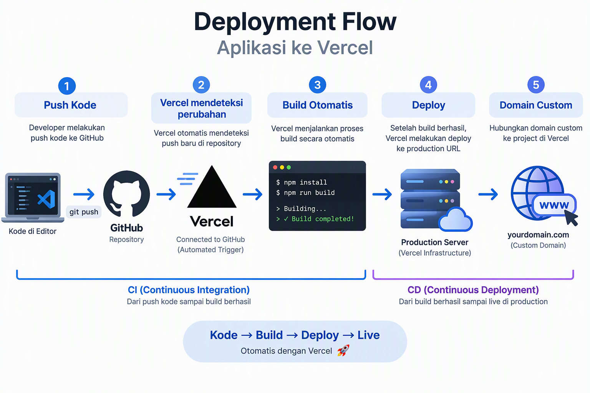

# Panduan Lengkap Supply Chain Management untuk UMKM Indonesia

**Product 54 | Content Production System**

---

## Daftar Isi

**BAGIAN 1: FONDASI SUPPLY CHAIN MANAGEMENT**
- Bab 1: Revolusi Supply Chain di Era Digital
- Bab 2: Memahami Ekosistem Supply Chain
- Bab 3: Strategi Supply Chain untuk UMKM
- Bab 4: Memilih Tools dan Software SCM
- Bab 5: Setup dan Konfigurasi Sistem SCM

**BAGIAN 2: IMPLEMENTASI SUPPLY CHAIN**
- Bab 6: Procurement dan Supplier Management
- Bab 7: Inventory dan Warehouse Management dalam SCM
- Bab 8: Logistics dan Distribusi
- Bab 9: Demand Forecasting dan Planning
- Bab 10: Quality Control dalam Supply Chain
- Bab 11: Supply Chain Finance dan Cost Management
- Bab 12: Analytics dan Performance Measurement

**BAGIAN 3: OPTIMASI DAN SCALE**
- Bab 13: Integrasi dan Teknologi Supply Chain
- Bab 14: Best Practices dan Risk Management
- Bab 15: Studi Kasus Nyata UMKM Indonesia
- Bab 16: Roadmap 30 Hari dan Next Steps

---

## BAGIAN 1: FONDASI SUPPLY CHAIN MANAGEMENT

---

## Bab 1: Revolusi Supply Chain di Era Digital

Bayangkan Anda punya usaha keripik pisang di Lampung. Setiap hari Anda produksi 500 kemasan. Bahan baku datang dari tiga petani berbeda di daerah setempat. Kemasan Anda beli dari supplier di Bandar Lampung. Lalu setiap pagi, Anda kirim ke 40 toko kelontong, dua minimarket lokal, dan puluhan pesanan online dari Shopee dan Tokopedia. Terdengar sederhana, tapi coba hitung berapa banyak hal yang bisa berantakan. Petani telat kirim pisang karena hujan. Supplier kemasan naik harga tanpa pemberitahuan. Kurir mogok kerja. Stok di toko A habis, toko B kelebihan. Pesanan online menumpuk tapi barang tidak ada di gudang.

Itu supply chain. Dan kalau Anda pikir supply chain management hanya urusan perusahaan besar seperti Unilever atau Toyota, Anda salah besar. Usaha sekecil apapun yang melibatkan aliran barang dari supplier ke pelanggan, itu sudah punya supply chain. Pertanyaannya bukan apakah Anda butuh mengelola supply chain, tapi apakah Anda mau mengelolanya dengan baik atau membiarkannya berantakan.

Buku ini ditulis untuk pemilik UMKM di Indonesia yang ingin mengambil kendali atas rantai pasok mereka. Bukan teori akademis yang jauh dari kenyataan, tapi panduan praktis yang bisa langsung Anda terapkan minggu ini juga. Kita akan bicara soal tools yang harganya mulai dari gratis sampai beberapa ratus ribu per bulan. Kita akan bahas strategi yang sudah dibuktikan oleh usaha-usaha sejenis Anda di Surabaya, Bandung, Malang, dan kota-kota lain di Indonesia.

### Mengapa SCM Penting untuk UMKM

Data dari Kementerian Koperasi dan UKM menunjukkan ada lebih dari 64 juta UMKM di Indonesia. Kontribusi mereka terhadap PDB nasional mencapai 61 persen. Tapi tahukah Anda bahwa salah satu penyebab utama UMKM gagal berkembang adalah masalah rantai pasok? Survei dari Asian Development Bank pada tahun 2023 menemukan bahwa 43 persen UMKM di Asia Tenggara mengalami kerugian karena manajemen supply chain yang buruk. Kerugiannya bukan cuma soal barang hilang atau rusak, tapi juga opportunity cost karena tidak bisa memenuhi permintaan pelanggan tepat waktu.

Supply chain management yang baik bisa menekan biaya operasional Anda 15 sampai 30 persen. Bayangkan jika biaya logistik Anda saat ini 20 persen dari revenue, dengan SCM yang tepat bisa turun jadi 14 persen. Untuk usaha dengan omzet 50 juta per bulan, penghematan 6 juta per bulan itu sangat berarti. Uang itu bisa dipakai untuk marketing, rekrutmen, atau ekspansi produk.

### Mitos Seputar SCM untuk UMKM

Mari kita luruskan beberapa kesalahpahaman yang sering saya dengar dari pemilik UMKM.

Mitos pertama, SCM itu mahal. Faktanya, banyak tools SCM dasar yang gratis atau sangat terjangkau. Jurnal.id misalnya, paket dasarnya mulai dari 170 ribu per bulan. Bahkan Google Sheets bisa Anda pakai untuk tracking inventory dan supplier jika usaha Anda masih sangat kecil. Yang mahal bukan toolsnya, tapi biaya dari ketidaktertiban supply chain yang tidak dikelola.

Mitos kedua, SCM hanya untuk usaha manufaktur. Salah. Kalau Anda punya toko online yang dropship pun, Anda punya supply chain. Supplier Anda, platform marketplace, jasa pengiriman, dan pelanggan Anda membentuk satu rantai pasok. Mengelola rantai itu dengan baik berarti pesanan lebih cepat sampai, komplain lebih sedikit, dan repeat order lebih tinggi.

Mitos ketiga, usaha saya masih kecil, belum butuh SCM. Ini yang paling berbahaya. Menunda pengelolaan supply chain sampai usaha besar itu seperti menunda servis mobil sampai mogok di jalan. Justru semakin dini Anda membangun fondasi SCM yang kuat, semakin cepat usaha Anda bisa scale up tanpa berantakan. Banyak UMKM yang stuck di omzet 50 sampai 100 juta per bulan bukan karena produknya jelek, tapi karena supply chainnya kacau. Mereka kehabisan stok saat demand tinggi, kelebihan stok saat demand rendah, dan biaya logistik membengkak karena tidak ada perencanaan.

### Transformasi Digital dalam Supply Chain

Era digital membawa perubahan besar dalam cara kita mengelola supply chain. Dulu, pesanan pembelian dicatat di buku tulis. Stok dicek manual dengan menghitung fisik barang di gudang. Komunikasi dengan supplier lewat telepon atau SMS. Sekarang, semua bisa otomatis. Sistem bisa memberi tahu Anda kapan stok menipis dan bahkan membuat purchase order otomatis ke supplier. Aplikasi mobile memungkinkan Anda memantau seluruh rantai pasok dari layar smartphone, di mana pun Anda berada.

Teknologi yang dulunya hanya tersedia untuk korporasi besar sekarang sudah bisa diakses UMKM dengan harga terjangkau. Cloud computing membuat Anda tidak perlu beli server mahal. Software as a Service (SaaS) memungkinkan Anda bayar langganan bulanan tanpa investasi besar di awal. Artificial Intelligence yang dulu terdengar seperti fiksi ilmiah, sekarang sudah bisa dipakai untuk memprediksi demand dengan akurasi tinggi, bahkan untuk usaha kecil.

Di Indonesia, adopsi teknologi supply chain masih rendah. Laporan dari McKinsey tahun 2024 menyebutkan hanya 12 persen UMKM Indonesia yang menggunakan sistem digital untuk mengelola rantai pasok mereka. Ini sebenarnya peluang besar. Jika Anda mulai sekarang, Anda sudah selangkah lebih depan dari 88 persen kompetitor Anda.

### Siapa yang Harus Membaca Buku Ini

Buku ini dirancang untuk pemilik dan pengelola UMKM di Indonesia, apapun sektornya. Apakah Anda bergerak di bidang makanan dan minuman, fashion, elektronik, kosmetik, kerajinan tangan, atau jasa, prinsip-prinsip SCM yang dibahas di sini relevan untuk Anda. Khususnya, buku ini cocok untuk Anda yang:

Pertama, sudah punya usaha berjalan dengan omzet minimal 10 juta per bulan dan merasa ada yang berantakan di operasional, terutama soal stok dan pengiriman. Kedua, sedang berencana scale up dan ingin membangun sistem yang bisa diandalkan sebelum usaha menjadi terlalu besar untuk dikelola secara manual. Ketiga, ingin mengadopsi teknologi tapi bingung mulai dari mana dan tools apa yang cocok untuk budget dan kebutuhan Anda.

### Apa yang Akan Anda Pelajari

Buku ini dibagi menjadi tiga bagian besar. Bagian pertama meletakkan fondasi pemahaman tentang supply chain management. Anda akan belajar apa itu ekosistem supply chain, jenis-jenis strategi SCM, cara memilih tools, dan bagaimana setup sistem dari nol. Bagian kedua masuk ke implementasi praktis. Kita akan bahas procurement, inventory management, logistik, demand forecasting, quality control, keuangan supply chain, dan cara mengukur performa. Bagian ketiga fokus pada optimasi dan scale up. Anda akan belajar tentang integrasi teknologi, manajemen risiko, studi kasus nyata dari UMKM Indonesia, dan roadmap 30 hari untuk mulai implementasi.

Setiap bab dirancang agar bisa langsung dipraktikkan. Tidak ada teori yang tidak bisa diterapkan. Setiap konsep dilengkapi contoh konkret, angka-angka realistis, dan rekomendasi tools yang bisa Anda gunakan hari ini juga. Jadi siapkan kopi Anda, buka laptop, dan mari kita mulai revolusi supply chain untuk UMKM Anda.

---

## Bab 2: Memahami Ekosistem Supply Chain

Supply chain bukan sekadar rantai linear dari supplier ke pelanggan. Ini adalah ekosistem kompleks yang melibatkan banyak pihak, banyak aliran, dan banyak keputusan yang saling berkaitan. Memahami ekosistem ini adalah langkah pertama yang krusial sebelum Anda bisa mengelola dan mengoptimalkannya.

Bayangkan ekosistem supply chain seperti tubuh manusia. Ada tulang punggung yang menopang semuanya, ada sistem peredaran darah yang mengalirkan nutrisi, dan ada sistem saraf yang mengirim sinyal ke seluruh bagian tubuh. Dalam supply chain, tulang punggungnya adalah aliran barang. Sistem peredaran darahnya adalah aliran uang. Dan sistem sarafnya adalah aliran informasi. Ketiganya harus berfungsi dengan baik dan terkoordinasi, kalau tidak, seluruh ekosistem akan sakit.

### Lima Pemain Utama dalam Supply Chain

Dalam ekosistem supply chain, ada lima pemain utama yang perlu Anda kenali dan pahami perannya.

Pertama, supplier atau pemasok. Ini adalah pihak yang menyediakan bahan baku atau barang untuk usaha Anda. Supplier bisa berupa petani, produsen, importir, atau distributor. Untuk UMKM di Indonesia, supplier seringkali berada di pasar tradisional, sentra industri, atau bahkan dari luar negeri melalui platform seperti Alibaba atau 1688. Hubungan Anda dengan supplier sangat menentukan kualitas input, kecepatan pengiriman, dan ultimately harga jual produk Anda.

Kedua, manufacturer atau produsen. Jika Anda tidak memproduksi sendiri, maka ada pihak yang memproduksi barang untuk Anda. Bisa berupa pabrik besar, home industry, atau bahkan tukang jahit di sekitar rumah Anda. Dalam konteks UMKM, banyak pemilik usaha yang sekaligus menjadi produsen. Anda membeli bahan baku, mengolahnya, dan menjual produk jadi. Dalam kasus ini, peran supplier dan manufacturer tetap terpisah secara konseptual meski secara fisik dilakukan oleh orang yang sama.

Ketiga, distributor. Ini adalah pihak yang menjembatani produsen dengan retailer atau end customer. Distributor biasanya punya gudang, armada pengiriman, dan jaringan yang luas. Di Indonesia, contoh distributor besar meliputi PT Indomarco (Indomaret), PT Sumber Alfaria (Alfamart), atau distributor-distributor regional yang lebih kecil. Untuk UMKM, Anda mungkin tidak bekerja dengan distributor besar, tapi bisa dengan agen, reseller, atau bahkan kurir lokal.

Keempat, retailer atau pengecer. Ini adalah titik penjualan langsung ke konsumen. Bisa berupa toko fisik, toko online, marketplace, atau kombinasi ketiganya. Jika Anda menjual langsung ke konsumen tanpa perantara, maka Andalah retailernya. Memahami posisi retailer dalam supply chain penting karena di sinilah interaksi langsung dengan konsumen terjadi, dan di sinilah data demand yang paling akurat bisa dikumpulkan.

Kelima, konsumen akhir. Tanpa konsumen, seluruh rantai pasok tidak ada gunanya. Konsumen bukan hanya pembeli, tapi juga sumber informasi berharga tentang preferensi, keluhan, dan tren. Dalam supply chain modern, konsumen bahkan bisa menjadi bagian dari proses produksi melalui custom order atau made-to-order model.

### Tiga Aliran dalam Supply Chain

Sekarang mari kita bedah tiga aliran yang menggerakkan ekosistem supply chain.

Aliran pertama adalah aliran barang atau material flow. Ini adalah pergerakan fisik barang dari supplier ke manufacturer, ke distributor, ke retailer, dan akhirnya ke konsumen. Dalam konteks UMKM, aliran ini bisa sesederhana Anda mengambil bahan dari pasar, mengolahnya di dapur, lalu mengirim ke pelanggan lewat ojek online. Atau bisa juga sekompleks mengimpor komponen dari China, merakit di workshop di Tangerang, lalu mendistribusikan ke 200 toko di seluruh Jawa. Yang penting dipahami, setiap titik perpindahan barang adalah potensi bottleneck, potensi kerusakan, dan potensi biaya tambahan.

Aliran kedua adalah aliran informasi atau information flow. Ini mencakup pesanan pembelian, konfirmasi stok, status pengiriman, invoice, dan semua komunikasi yang mengkoordinasikan aliran barang. Information flow yang buruk adalah akar dari sebagian besar masalah supply chain. Ketika supplier tidak tahu Anda butuh barang karena pesanan tidak jelas, ketika gudang tidak tahu stok sudah menipis karena tidak ada sistem tracking, ketika pelanggan tidak tahu kapan barang sampai karena tidak ada update status, semua itu adalah masalah information flow. Di era digital, information flow seharusnya bisa diotomatisasi dengan software yang tepat.

Aluran ketiga adalah aliran uang atau financial flow. Ini mencakup pembayaran ke supplier, penagihan ke pelanggan, biaya logistik, biaya penyimpanan, dan semua transaksi keuangan dalam rantai pasok. Mengelola cash flow dalam supply chain adalah seni menyeimbangkan kapan Anda harus bayar dan kapan Anda menerima pembayaran. Idealnya, Anda ingin menerima pembayaran dari pelanggan sebelum atau tepat saat Anda harus membayar supplier. Tapi kenyataannya tidak selalu semudah itu. Di sinilah manajemen payment terms dan working capital menjadi sangat penting.

### Jenis-jenis Supply Chain

Tidak semua supply chain diciptakan sama. Ada dua pendekatan utama yang perlu Anda pahami, yaitu efficient supply chain dan responsive supply chain.

Efficient supply chain fokus pada efisiensi biaya. Tujuannya adalah memproduksi dan mendistribusikan barang dengan biaya serendah mungkin. Pendekatan ini cocok untuk produk dengan demand yang stabil dan bisa diprediksi, margin keuntungan yang tipis, dan persaingan yang ketat berdasarkan harga. Contoh produk yang cocok dengan efficient supply chain adalah bahan pokok seperti beras, gula, atau minyak goreng. Kalau Anda jual komoditas seperti ini, efisiensi biaya adalah segalanya.

Responsive supply chain fokus pada kecepatan dan fleksibilitas. Tujuannya adalah bisa merespons perubahan demand dengan cepat, bahkan jika biayanya sedikit lebih tinggi. Pendekatan ini cocok untuk produk dengan demand yang fluktuatif, margin yang lebih tebal, dan persaingan berdasarkan diferensiasi. Contoh produk yang cocok dengan responsive supply chain adalah fashion, gadget, atau makanan kekinian. Kalau Anda jual baju trendy atau makanan viral, kecepatan merespons tren jauh lebih penting daripada menghemat beberapa rupiah per unit.

### Push vs Pull Strategy

Selain dua jenis di atas, ada juga perbedaan antara push strategy dan pull strategy dalam supply chain.

Push strategy berarti Anda memproduksi atau menyetok barang berdasarkan perkiraan demand. Anda "mendorong" barang ke pasar berdasarkan forecast. Kelebihannya, barang selalu tersedia saat pelanggan mau beli. Kekurangannya, kalau forecast meleset, Anda bisa kelebihan stok atau kehabisan stok. Push strategy cocok untuk produk dengan lead time panjang, seperti barang impor dari China yang butuh 30 sampai 45 hari pengiriman.

Pull strategy berarti Anda memproduksi atau mengirim barang hanya setelah ada pesanan nyata dari pelanggan. Anda "menarik" barang melalui rantai pasok berdasarkan demand aktual. Kelebihannya, minim risiko kelebihan stok. Kekurangannya, pelanggan harus menunggu lebih lama. Pull strategy cocok untuk produk custom atau made-to-order, seperti baju jahit custom atau furnitur pesanan khusus.

Dalam praktiknya, kebanyakan UMKM di Indonesia menggunakan kombinasi keduanya, yang sering disebut push-pull strategy. Anda push bahan baku yang lead timenya panjang, tapi pull untuk produksi dan pengiriman akhir berdasarkan pesanan nyata. Menemukan keseimbangan yang tepat antara push dan pull adalah salah satu kunci sukses supply chain management.

### Memetakan Supply Chain Anda

Langkah praktis pertama yang bisa Anda lakukan setelah memahami ekosistem ini adalah memetakan supply chain Anda sendiri. Ambil selembar kertas atau buka whiteboard, lalu gambar alur dari bahan baku sampai ke tangan pelanggan. Identifikasi setiap pemain, setiap titik perpindahan barang, setiap aliran informasi, dan setiap aliran uang.

Dalam pemetaan ini, Anda akan menemukan beberapa hal menarik. Mungkin ada titik yang selama ini tidak Anda sadari sebagai bottleneck. Mungkin ada aliran informasi yang selama ini manual dan rawan kesalahan. Mungkin ada aliran uang yang macet di satu titik dan mengganggu cash flow Anda. Pemetaan ini adalah fondasi untuk semua perbaikan yang akan Anda lakukan di bab-bab berikutnya.

Untuk UMKM yang baru memulai, saya sarankan mulai dengan pemetaan sederhana. Cukup identifikasi tiga sampai lima supplier utama, satu atau dua titik penyimpanan, dan saluran distribusi yang Anda gunakan. Seiring usaha berkembang, pemetaan ini bisa diperdetail dan diperluas. Yang penting, Anda punya gambaran jelas tentang siapa saja yang terlibat dan bagaimana barang, informasi, dan uang mengalir dalam usaha Anda.

---

## Bab 3: Strategi Supply Chain untuk UMKM

Setelah memahami ekosistem supply chain secara umum, saatnya kita masuk ke pertanyaan yang paling sering ditanyakan oleh pemilik UMKM. Strategi apa yang tepat untuk usaha saya? Jawabannya tidak hitam putih, karena setiap usaha punya karakteristik unik yang memerlukan pendekatan berbeda. Tapi tenang, di bab ini saya akan memberikan kerangka berpikir yang bisa Anda gunakan untuk menentukan strategi terbaik.

### Lean Supply Chain

Pendekatan lean supply chain berfokus pada eliminasi pemborosan di seluruh rantai pasok. Konsep ini diadaptasi dari Toyota Production System yang revolusioner. Dalam konteks UMKM, lean berarti Anda secara sistematis menghilangkan aktivitas yang tidak menambah nilai bagi pelanggan.

Ada tujuh jenis pemborosan dalam supply chain yang perlu Anda waspadai. Pertama, overproduction atau produksi berlebihan. Anda membuat stok terlalu banyak karena takut kehabisan, padahal demand sebenarnya tidak sebesar itu. Akibatnya, uang Anda tertanam di stok yang lambat bergerak, biaya penyimpanan membengkak, dan risiko barang kedaluwarsa atau rusak meningkat. Untuk UMKM makanan, ini bisa berarti kerugian besar karena produk Anda punya masa simpan terbatas.

Kedua, waiting time atau waktu tunggu. Barang mengangguk di gudang menunggu giliran diproses. Pesanan menumpuk menunggu konfirmasi dari supplier. Pelanggan menunggu update status pengiriman. Setiap menit waktu tunggu adalah biaya yang tidak terlihat.

Ketiga, unnecessary transportation atau transportasi yang tidak perlu. Barang dipindah dari satu gudang ke gudang lain tanpa alasan jelas. Pengiriman dilakukan dengan rute yang tidak efisien. Anda menggunakan ekspedisi mahal untuk barang yang sebenarnya bisa dikirim dengan opsi lebih murah.

Keempat, overprocessing atau pemrosesan berlebihan. Anda melakukan quality check tiga kali padahal satu kali sudah cukup. Anda membungkus produk dengan terlalu banyak lapisan padahal satu lapisan sudah aman. Anda meminta persetujuan berjenjang untuk pembelian kecil yang bisa langsung diputuskan.

Kelima, excess inventory atau stok berlebihan. Ini mirip dengan overproduction tapi lebih ke pembelian bahan baku atau barang dagangan yang melebihi kebutuhan aktual. Stok berlebihan mengikat modal kerja, memakan tempat di gudang, dan berisiko usang atau rusak.

Keenam, unnecessary motion atau gerakan yang tidak perlu. Tata letak gudang yang buruk membuat staf bolak-balik mengambil barang. Proses picking yang tidak terstruktur menghabiskan waktu. Alur kerja yang berantakan menurunkan produktivitas.

Ketujuh, defects atau cacat produk. Barang rusak, salah kirim, atau tidak sesuai spesifikasi memaksa Anda melakukan rework, replacement, atau refund. Semua ini biaya tambahan yang bisa dihindari.

Untuk menerapkan lean supply chain di UMKM, mulailah dengan mengidentifikasi pemborosan terbesar di operasi Anda. Biasanya, dua atau tiga sumber pemborosan menyumbang 80 persen dari total inefisiensi. Fokus perbaiki yang itu dulu, baru lanjut ke yang lain. Jangan coba sekaligus memperbaiki semua, karena itu akan membuat tim Anda kewalahan dan tidak ada perubahan yang benar-benar tuntas.

### Agile Supply Chain

Berbeda dengan lean yang fokus pada efisiensi, agile supply chain menekankan pada kecepatan respons terhadap perubahan. Jika pasar Anda sangat dinamis dengan tren yang cepat berubah, demand yang sulit diprediksi, atau persaingan yang ketat berdasarkan kecepatan, maka agile mungkin lebih cocok untuk Anda.

Prinsip utama agile supply chain ada empat. Pertama, visibility atau visibilitas. Anda harus bisa melihat apa yang terjadi di seluruh rantai pasok secara real-time. Berapa stok di gudang, di mana posisi pengiriman, berapa demand hari ini, apa kata pelanggan di media sosial. Semakin baik visibilitas, semakin cepat Anda bisa merespons perubahan.

Kedua, flexibility atau fleksibilitas. Kemampuan untuk mengubah rencana dengan cepat tanpa biaya besar. Ini berarti Anda butuh supplier yang bisa menyesuaikan volume pesanan, gudang yang bisa menampung fluktuasi stok, dan jasa pengiriman yang punya banyak opsi kecepatan.

Ketiga, speed atau kecepatan. Dari menerima pesanan sampai pengiriman ke pelanggan, semuanya harus secepat mungkin. Ini bukan berarti Anda harus mengirim dalam satu jam, tapi proses internal Anda harus lean enough untuk tidak ada waktu yang terbuang sia-sia.

Keempat, collaboration atau kolaborasi. Agile supply chain tidak bisa dijalankan sendirian. Anda perlu kerja erat dengan supplier, distributor, dan bahkan kompetitor dalam beberapa kasus. Berbagi informasi tentang demand forecast, inventory level, dan production schedule dengan mitra supply chain Anda akan membuat seluruh rantai lebih responsif.

Contoh UMKM yang cocok dengan strategi agile adalah bisnis fashion online di Jakarta yang harus mengikuti tren mingguan, atau bisnis makanan kekinian yang produknya viral di TikTok dan demandnya bisa melonjak 500 persen dalam semalam. Untuk usaha-usaha ini, kecepatan merespons jauh lebih penting daripada menghemat beberapa persen biaya.

### Hybrid Approach: Leagile

Dalam kenyataannya, kebanyakan UMKM di Indonesia tidak murni lean atau murni agile. Mereka menggunakan pendekatan hybrid yang sering disebut leagile, kombinasi lean dan agile. Ide dasarnya adalah menerapkan lean di bagian supply chain yang stabil dan bisa diprediksi, sementara menerapkan agile di bagian yang fluktuatif dan tidak pasti.

Ambil contoh usaha kopi susu kekinian. Bahan baku utama seperti biji kopi, susu UHT, dan gula bisa dikelola dengan strategi lean karena demand-nya relatif stabil dan bisa diprediksi. Anda bisa beli dalam jumlah besar, negosiasi harga dengan supplier, dan jaga stok aman yang efisien. Tapi untuk bahan promosi seperti cup edisi terbatas, topping musiman, atau merchandise kolaborasi, Anda perlu strategi agile karena demand-nya sulit diprediksi dan sangat tergantung tren.

Titik pemisah antara bagian lean dan agile dalam supply chain disebut decoupling point. Di titik ini, Anda beralih dari make-to-stock (produksi berdasarkan perkiraan) ke make-to-order (produksi berdasarkan pesanan nyata). Menentukan decoupling point yang tepat sangat penting untuk mengoptimalkan biaya dan service level secara bersamaan.

### Demand-Driven Strategy

Tren terbaru dalam supply chain management adalah pergeseran dari supply-driven ke demand-driven. Dalam pendekatan tradisional, produsen membuat barang lalu mencari cara menjualnya. Dalam pendekatan demand-driven, Anda memahami apa yang diinginkan pelanggan lalu memproduksi atau menyediakan barang sesuai keinginan itu.

Untuk UMKM, demand-driven strategy sangat relevan karena sumber daya Anda terbatas. Tidak ada gunanya memproduksi 1000 unit jika pasar hanya menyerap 300. Lebih baik produksi 300 unit, jual habis, dapat cash flow cepat, lalu produksi lagi. Pendekatan ini juga mengurangi risiko markdown atau diskon besar-besaran untuk menghabiskan stok yang menumpuk.

Implementasi demand-driven dimulai dari pengumpulan data pelanggan. Apa yang mereka beli, kapan mereka beli, berapa banyak, dan apakah ada pola musiman. Data ini bisa Anda kumpulkan dari sistem POS, marketplace analytics, atau bahkan dari percakapan langsung dengan pelanggan di WhatsApp. Semakin banyak data yang Anda kumpulkan, semakin akurat Anda bisa memprediksi demand dan menyesuaikan supply.

### Cost vs Service Tradeoff

Setiap strategi supply chain pada dasarnya adalah penyeimbangan antara biaya dan level layanan. Anda ingin biaya serendah mungkin tapi pelanggan puas? Sayangnya, kedua tujuan ini sering bertentangan. Stok yang banyak membuat pelanggan puas karena barang selalu tersedia, tapi biayanya tinggi. Stok yang minim menghemat biaya tapi berisiko kehabisan dan membuat pelanggan kecewa.

Tugas Anda sebagai pemilik UMKM adalah menemukan titik optimal di mana biaya yang Anda keluarkan sebanding dengan level layanan yang Anda berikan. Titik optimal ini berbeda untuk setiap bisnis. Untuk toko kelontong di pedesaan, pelanggan mungkin lebih menghargai ketersediaan barang daripada kecepatan pengiriman. Untuk toko online di kota besar, pelanggan mungkin lebih menghargai pengiriman same-day daripada harga yang sedikit lebih murah.

Untuk menemukan titik optimal ini, Anda perlu memahami dengan jelas siapa pelanggan Anda dan apa yang mereka prioritaskan. Lakukan survei sederhana, baca review pelanggan, atau ajak ngobrol langsung. Informasi kualitatif dari pelanggan seringkali lebih berharga daripada analisis kuantitatif yang rumit.

### Cara Memilih Strategi yang Tepat

Berikut kerangka praktis untuk menentukan strategi supply chain yang cocok untuk UMKM Anda.

Langkah pertama, klasifikasikan produk Anda. Apakah demand-nya stabil atau fluktuatif? Apakah lifecycle-nya panjang atau pendek? Apakah margin-nya tipis atau tebal? Jawaban atas pertanyaan ini akan mengarahkan Anda ke lean atau agile.

Langkah kedua, petakan supply chain Anda saat ini. Di mana letak bottleneck? Di mana pemborosan terbesar? Di mana risiko tertinggi? Ini akan membantu Anda menentukan area mana yang perlu diperbaiki duluan.

Langkah ketiga, tentukan prioritas bisnis Anda. Apakah Anda sedang fokus pada efisiensi biaya untuk memperbaiki margin? Atau fokus pada pertumbuhan dengan meningkatkan service level? Atau fokus pada diversifikasi produk yang butuh fleksibilitas tinggi?

Langkah keempat, sesuaikan strategi dengan sumber daya Anda. Jangan memaksakan agile supply chain jika Anda tidak punya teknologi untuk real-time visibility. Jangan memaksakan lean jika tim Anda belum terbiasa dengan disiplin proses. Mulailah dari yang sederhana, kuatkan fondasi, baru tingkatkan kompleksitas secara bertahap.

Langkah kelima, evaluasi dan iterasi. Strategi supply chain bukan keputusan sekali seumur hidup. Pasar berubah, pelanggan berubah, teknologi berubah. Setiap tiga sampai enam bulan, evaluasi apakah strategi Anda masih relevan dan buat penyesuaian jika perlu.

---

## Bab 4: Memilih Tools dan Software SCM

Salah satu keputusan paling praktis yang akan Anda hadapi dalam perjalanan memperbaiki supply chain adalah memilih tools dan software yang tepat. Di pasaran, ada puluhan bahkan ratusan pilihan, dari yang gratis sampai yang harganya puluhan juta per bulan. Bagaimana cara memilih yang cocok untuk UMKM Anda?

### Kriteria Memilih SCM Tools

Sebelum kita masuk ke perbandingan produk, ada lima kriteria utama yang harus Anda gunakan untuk mengevaluasi setiap tools SCM.

Kriteria pertama adalah kemudahan penggunaan. Tim Anda di UMKM mungkin tidak punya latar belakang IT yang kuat. Tools yang dipilih harus bisa dipelajari dalam hitungan hari, bukan minggu atau bulan. Antarmuka yang intuitif, dokumentasi dalam Bahasa Indonesia, dan dukungan customer service yang responsif adalah hal-hal yang sangat berharga.

Kriteria kedua adalah skalabilitas. Anda butuh tools yang bisa tumbuh bersama usaha Anda. Mulai dari fitur dasar yang cukup untuk kebutuhan sekarang, tapi punya opsi untuk menambah modul atau kapasitas seiring bisnis berkembang. Jangan pilih tools yang akan memaksa Anda migrasi ke platform lain dalam satu atau dua tahun karena sudah tidak mampu mengikuti pertumbuhan usaha.

Kriteria ketiga adalah integrasi. Tools SCM Anda tidak berdiri sendiri. Ia harus bisa terhubung dengan sistem lain yang sudah Anda pakai, seperti software akuntansi, platform marketplace, aplikasi kasir, atau sistem pengiriman. Semakin mulus integrasi antar sistem, semakin sedikit pekerjaan manual yang harus dilakukan tim Anda.

Kriteria keempat adalah harga. Sebagai UMKM, budget Anda pasti terbatas. Bandingkan harga bukan hanya dari biaya langganan bulanan, tapi juga dari biaya implementasi, biaya training, biaya maintenance, dan biaya tersembunyi lainnya. Hitung total cost of ownership untuk minimal dua tahun ke depan.

Kriteria kelima adalah dukungan lokal. Tools buatan Indonesia atau yang punya kantor perwakilan di Indonesia biasanya lebih responsif dalam hal customer support, lebih paham regulasi lokal seperti perpajakan dan pelaporan, dan lebih mengerti karakteristik pasar Indonesia.

### Perbandingan Tools SCM untuk UMKM

Mari kita bahas enam tools SCM yang paling relevan untuk UMKM di Indonesia.

**Jurnal.id** adalah platform software akuntansi dan bisnis yang sangat populer di kalangan UMKM Indonesia. Untuk supply chain, Jurnal menawarkan modul inventory management yang bisa tracking stok real-time, purchase order, sales order, dan multi-gudang. Kelebihannya adalah integrasi yang mulus dengan modul akuntansi, sehingga setiap pergerakan barang otomatis tercatat dalam pembukuan. Harga mulai dari 170 ribu per bulan untuk paket Basic. Cocok untuk UMKM yang ingin satu platform terintegrasi untuk akuntansi dan supply chain.

**Mekari** adalah ekosistem bisnis digital yang mencakup beberapa produk seperti Mekari Jurnal (akuntansi), Mekari Talenta (HR), dan Mekari Sign (tanda tangan digital). Untuk supply chain, Mekari Jurnal menyediakan fitur inventory yang cukup komprehensif, termasuk assembly dan bundling untuk usaha yang merakit produk dari beberapa komponen. Harga mulai dari 250 ribu per bulan. Keunggulan Mekari adalah ekosistemnya yang luas, jadi jika Anda butuh solusi HR dan akuntansi selain SCM, Mekari bisa menjadi one-stop solution.

**Kargo Technologies** adalah platform logistik digital yang fokus pada manajemen pengiriman dan supply chain untuk UMKM dan enterprise. Produk utamanya, Kargo.ai, menawarkan fitur freight forwarding, warehouse management, dan transportation management. Keunggulannya adalah jaringan logistik yang luas di seluruh Indonesia dan kemampuan untuk membandingkan tarif dari berbagai ekspedisi secara real-time. Cocok untuk UMKM yang volume pengirimannya tinggi dan butuh solusi logistik terintegrasi.

**Shipper** adalah agregator pengiriman yang memungkinkan Anda membandingkan dan memilih jasa pengiriman terbaik dari berbagai kurir dalam satu platform. Shipper menawarkan fitur tracking real-time, manajemen resi otomatis, dan dashboard analytics untuk performa pengiriman. Harga gratis untuk fitur dasar, dengan paket premium mulai dari 200 ribu per bulan. Shipper sangat cocok untuk UMKM e-commerce yang mengirim ke banyak destinasi dan ingin mengoptimalkan biaya dan kecepatan pengiriman.

**Obrax** adalah software POS dan inventory management yang dirancang khusus untuk UMKM retail. Fitur supply chain-nya mencakup stock management, purchase order, supplier management, dan laporan inventory yang detail. Keunggulan Obrax ada pada kemudahan penggunaan dan desain antarmuka yang sangat intuitif. Harga mulai dari 150 ribu per bulan. Cocok untuk UMKM retail yang butuh sistem kasir sekaligus manajemen inventory yang solid.

**Shipdog** adalah platform logistik yang fokus pada fulfillment untuk UMKM e-commerce. Mereka menawarkan layanan warehousing, picking dan packing, serta pengiriman terintegrasi dengan berbagai marketplace. Dengan Shipdog, Anda bisa menyimpan stok di gudang mereka dan mereka yang akan memproses pesanan dari semua channel penjualan Anda. Model harganya berbasis per pesanan yang diproses, sehingga sangat scalable untuk usaha yang sedang tumbuh.

### Cara Evaluasi dan Seleksi

Jangan langsung terjebak memilih tools berdasarkan review atau rekomendasi teman. Lakukan evaluasi sistematis dengan langkah-langkah berikut.

Pertama, buat daftar kebutuhan Anda. Tulis semua fitur yang Anda butuhkan, lalu prioritaskan menjadi must-have, nice-to-have, dan future-need. Must-have adalah fitur yang tanpa-nya Anda tidak bisa beroperasi. Nice-to-have adalah fitur yang membuat hidup lebih mudah tapi bukan deal-breaker. Future-need adalah fitur yang mungkin Anda butuhkan dalam satu sampai dua tahun ke depan.

Kedua, minta demo atau trial dari minimal tiga tools yang masuk daftar pendek Anda. Gunakan masa trial untuk menguji fitur must-have secara langsung. Libatkan tim yang akan menggunakan tools tersebut sehari-hari, bukan hanya manajemen. Feedback dari end-user sangat penting karena merekalah yang akan hidup dengan tools ini setiap hari.

Ketiga, hitung ROI dari setiap pilihan. Jangan hanya lihat harga langganan bulanan. Hitung juga waktu yang dihemat, kesalahan yang dikurangi, dan revenue tambahan yang mungkin didapat dari layanan yang lebih baik. Tools yang harganya 500 ribu per bulan tapi menghemat waktu Anda 3 jam sehari jelas lebih murah daripada tools yang 150 ribu per bulan tapi tidak mengubah cara kerja Anda sama sekali.

Keempat, cek reputasi dan track record vendor. Baca review di Google, tanya di komunitas UMKM, atau hubungi langsung pengguna yang sudah ada. Tanyakan tentang kualitas customer support, frekuensi downtime, dan kecepatan respons terhadap bug atau masalah.

### Tips Negosiasi dengan Referral Code

Banyak vendor software di Indonesia menawarkan diskon khusus melalui kode referral. Ini cara yang sah dan mudah untuk menghemat biaya langganan. Berikut beberapa kode referral yang bisa Anda gunakan.

Untuk Jurnal.id, gunakan kode referral SNISHOPJR untuk mendapatkan diskon khusus. Untuk Mekari, gunakan kode SNISHOPMK. Untuk Kargo Technologies, gunakan kode SNISHOPKG. Untuk Shipper, gunakan kode SNISHOPSHP. Untuk Obrax, gunakan kode SNISHOPBRX.

Selain diskon dari kode referral, Anda juga bisa negosiasi langsung dengan tim sales vendor. Tanyakan tentang diskon tahunan, paket bundle, atau penawaran khusus untuk UMKM. Banyak vendor yang fleksibel dalam hal harga, terutama jika Anda berkomitmen untuk langganan jangka panjang. Jangan malu untuk bertanya dan menawar. Worst case, mereka bilang tidak bisa, dan Anda tetap di harga normal.

---

## Bab 5: Setup dan Konfigurasi Sistem SCM

Memilih tools sudah, sekarang saatnya setup dan konfigurasi. Ini adalah tahap di mana banyak UMKM mengalami hambatan. Bukan karena toolsnya sulit, tapi karena proses setup membutuhkan disiplin dan ketelitian yang seringkali tidak disiapkan dengan baik. Bab ini akan memandu Anda langkah demi langkah.

### Langkah 1: Persiapan Data

Sebelum Anda membuka software SCM manapun, ada pekerjaan rumah yang harus diselesaikan, yaitu merapikan data. Data yang berantakan akan menghasilkan sistem yang berantakan, apapun software yang Anda pakai.

Data pertama yang harus disiapkan adalah master data produk. Buat daftar lengkap semua produk yang Anda jual, termasuk SKU atau kode produk, nama produk, kategori, satuan unit, berat dan dimensi untuk perhitungan pengiriman, harga pokok, dan harga jual. Jika Anda belum punya sistem SKU, ini saat yang tepat untuk membuatnya. Format sederhana yang bisa Anda pakai adalah KATEGORI-JENIS-NOMOR. Misalnya, BAJ-TS-001 untuk baju kaos nomor 1, atau MKN-KRG-001 untuk makanan keripik nomor 1.

Data kedua adalah master data supplier. Kumpulkan informasi lengkap setiap supplier, termasuk nama perusahaan, nama kontak, nomor telepon, email, alamat, produk yang disuplai, harga terbaru, minimum order quantity, lead time rata-rata, dan syarat pembayaran. Data ini akan menjadi fondasi untuk modul procurement di sistem SCM Anda.

Data ketiga adalah data inventory awal. Lakukan stock opname atau perhitungan fisik seluruh persediaan Anda. Catat jumlah stok setiap produk di setiap lokasi penyimpanan. Jika Anda punya barang di gudang utama, gudang cabang, dan toko, catat masing-masing secara terpisah. Data ini akan menjadi baseline untuk sistem inventory Anda.

### Langkah 2: Migrasi Data ke Sistem

Setelah data siap, langkah selanjutnya adalah memasukkan data ke dalam sistem. Kebanyakan software SCM modern menyediakan fitur import dari file Excel atau CSV. Manfaatkan fitur ini untuk menghemat waktu.

Urutan migrasi yang saya rekomendasikan adalah sebagai berikut. Pertama, import master data produk. Kedua, import master data supplier. Ketiga, import stok awal. Keempat, import data pelanggan jika ada. Kelima, setup parameter sistem seperti gudang, kategori, satuan, dan pajak.

Saat migrasi, lakukan validasi silang. Bandingkan jumlah record yang diimport dengan jumlah record di file sumber. Cek beberapa sampel secara acak untuk memastikan datanya masuk dengan benar. Jika ada error, perbaiki di file sumber lalu import ulang. Jangan pernah memaksakan data yang error masuk ke sistem, karena itu akan menimbulkan masalah di kemudian hari.

### Langkah 3: Konfigurasi Supplier Onboarding

Onboarding supplier ke dalam sistem bukan sekadar memasukkan data kontak. Ini adalah proses membangun hubungan kerja yang terstruktur dengan setiap supplier.

Mulailah dengan membuat vendor code atau kode supplier unik untuk setiap vendor. Ini penting untuk menghindari duplikasi dan memastikan setiap transaksi tercatat ke supplier yang benar. Selanjutnya, setup payment terms untuk setiap supplier. Ada supplier yang minta bayar di muka, ada yang kasih tempo 7 hari, 14 hari, atau 30 hari. Catat semua ini di sistem agar saat Anda membuat purchase order, sistem sudah otomatis menghitung tanggal jatuh tempo.

Konfigurasikan juga lead time untuk setiap supplier. Lead time adalah waktu yang dibutuhkan dari saat Anda mengirim pesanan sampai barang tiba di gudang Anda. Jika supplier A punya lead time 3 hari dan supplier B punya lead time 14 hari, sistem perlu tahu ini untuk menghitung kapan Anda harus pesan agar stok tidak kehabisan.

### Langkah 4: Konfigurasi Warehouse dan Inventory

Setup gudang di sistem perlu perhatian khusus, terutama jika Anda punya lebih dari satu lokasi penyimpanan.

Untuk setiap gudang, tentukan kapasitas maksimum, zona penyimpanan, dan aturan first-in-first-out (FIFO) atau first-expired-first-out (FEFO). FIFO berarti barang yang pertama masuk gudang harus pertama keluar, cocok untuk produk non-perishable. FEFO berarti barang yang pertama kedaluwarsa harus pertama keluar, wajib untuk produk makanan dan minuman.

Setup juga minimum stock level atau batas stok minimum untuk setiap produk. Ini adalah jumlah stok terendah yang harus ada di gudang sebelum Anda perlu melakukan reorder. Rumus sederhana untuk menghitung minimum stock adalah rata-rata penjualan harian dikali lead time supplier, ditambah safety stock. Misalnya, rata-rata penjualan 20 unit per hari, lead time supplier 5 hari, dan safety stock 30 unit, maka minimum stock adalah (20 x 5) + 30 = 130 unit. Saat stok menyentuh 130 unit, sistem harusnya memberikan alert untuk segera memesan lagi.

### Langkah 5: Training Tim

Sistem yang canggih tidak akan berguna jika tim Anda tidak bisa atau tidak mau menggunakannya. Training adalah investasi yang tidak boleh dilewatkan.

Mulailah dengan training untuk kunci pengguna atau power user, biasanya manajer operasional atau pemilik usaha sendiri. Power user ini harus paham seluruh fitur sistem, bukan hanya cara mengoperasikannya tapi juga cara mengonfigurasinya dan troubleshooting dasar. Dari power user, buat dokumentasi SOP penggunaan sistem yang sederhana dan mudah dipahami.

Selanjutnya, latih seluruh tim yang akan menggunakan sistem. Bagi training menjadi beberapa sesi sesuai peran. Tim gudang perlu tahu cara menerima barang, melakukan stock opname, dan mengelola picking dan packing. Tim pembelian perlu tahu cara membuat purchase order dan mengevaluasi supplier. Tim penjualan perlu tahu cara mengecek ketersediaan stok dan membuat sales order.

Berikan waktu adaptasi minimal dua minggu setelah training. Dalam masa ini, dampingi tim secara intensif. Jawab pertanyaan mereka, perbaiki kesalahan, dan berikan feedback konstruktif. Setelah dua minggu, lakukan evaluasi apakah semua orang sudah comfortable dengan sistem atau masih ada yang perlu bantuan tambahan.

### Checklist Konfigurasi Sistem

Sebelum go-live atau mulai menggunakan sistem secara penuh, pastikan semua hal berikut sudah dikonfigurasi dengan benar. Master data produk dan supplier sudah diimport dan divalidasi. Stok awal sudah sesuai dengan hasil stock opname. Minimum stock level sudah di-set untuk semua produk. Payment terms dan lead time supplier sudah dikonfigurasi. User access dan permission sudah diatur sesuai peran. Integrasi dengan sistem lain seperti akuntansi atau marketplace sudah diuji coba. Laporan-laporan dasar sudah bisa dihasilkan dengan benar. Dan yang paling penting, seluruh tim sudah dilatih dan siap menggunakan sistem.

Jika semua checklist ini sudah centang hijau, selamat, sistem SCM Anda siap beroperasi. Tapi ingat, setup hanyalah permulaan. Yang membuat sistem ini benar-benar berharga adalah konsistensi penggunaan dan perbaikan berkelanjutan di hari-hari, minggu-minggu, dan bulan-bulan berikutnya.

---

## BAGIAN 2: IMPLEMENTASI SUPPLY CHAIN

---

## Bab 6: Procurement dan Supplier Management

Procurement atau pengadaan barang adalah jantung dari supply chain. Jika procurement Anda berantakan, seluruh rantai pasok akan ikut berantakan. Di bab ini, kita akan membahas secara mendalam bagaimana mengelola procurement dan hubungan dengan supplier secara profesional, bahkan untuk skala UMKM.

### Sourcing Strategy: Single vs Multi Supplier

Keputusan pertama dalam procurement adalah menentukan strategi sourcing. Apakah Anda akan bergantung pada satu supplier untuk setiap jenis barang, atau menggunakan beberapa supplier sekaligus?

Single sourcing artinya Anda hanya punya satu supplier untuk produk tertentu. Kelebihannya, hubungan dengan supplier lebih erat, volume pesanan lebih besar sehingga Anda punya posisi tawar lebih kuat, dan konsistensi kualitas lebih terjamin. Kekurangannya, Anda sangat rentan jika supplier ini bermasalah. Bayangkan jika satu-satunya supplier kemasan Anda kebakaran dan tidak bisa kirim barang selama dua minggu. Seluruh operasi Anda berhenti.

Multi sourcing artinya Anda punya dua atau lebih supplier untuk produk yang sama. Kelebihannya, risiko gangguan supply lebih tersebar, Anda bisa membandingkan harga dan kualitas, dan punya alternatif jika satu supplier bermasalah. Kekurangannya, volume pesanan per supplier lebih kecil sehingga posisi tawar Anda lebih lemah, dan mengelola banyak supplier butuh effort lebih.

Untuk UMKM di Indonesia, saya umumnya merekomendasikan strategi 70-30. Artinya, 70 persen kebutuhan Anda beli dari supplier utama yang sudah terpercaya, dan 30 persen dari supplier cadangan. Supplier cadangan ini tidak harus dipakai setiap saat, tapi cukup aktif untuk menjaga hubungan dan memastikan mereka masih bisa diandalkan ketika Anda butuh.

### Kriteria Pemilihan Vendor

Dalam memilih supplier, jangan hanya tergiur harga termurah. Ada enam kriteria yang harus Anda evaluasi secara menyeluruh.

Kualitas adalah nomor satu. Seberapa konsisten kualitas barang yang diberikan supplier? Minta sampel dan test sebelum berkomitmen dalam jumlah besar. Cek apakah supplier punya sertifikasi kualitas seperti ISO atau SNI untuk produk-produk tertentu.

Keandalan pengiriman juga sangat penting. Seberapa sering supplier mengirim tepat waktu? Berapa lama lead time rata-ratanya? Apakah mereka punya kapasitas untuk memenuhi pesanan mendadak jika Anda butuh?

Harga tentu tidak bisa diabaikan. Tapi bandingkan harga secara apple-to-apple. Harga termurah bisa jadi lebih mahal jika kualitasnya rendah, pengirimannya telat, atau minimum order quantity-nya terlalu besar sehingga mengikat modal Anda.

Fleksibilitas adalah kriteria yang sering diabaikan. Apakah supplier mau menerima pesanan dalam jumlah kecil? Apakah mereka bisa menyesuaikan spesifikasi produk sesuai kebutuhan Anda? Apakah mereka responsif terhadap perubahan jadwal?

Stabilitas finansial supplier juga perlu diperhatikan. Supplier yang kondisi keuangannya goyah bisa tiba-tiba bangkrut atau berhenti beroperasi, meninggalkan Anda tanpa pasokan di saat yang paling tidak tepat.

Terakhir, reputasi dan referensi. Tanya sesama pelaku UMKM tentang pengalaman mereka dengan supplier tersebut. Cek review online jika ada. Hubungi referensi yang diberikan supplier dan tanya langsung tentang pengalaman mereka.

### Proses Purchase Order yang Efektif

Purchase order atau PO adalah dokumen resmi yang menerbitkan pesanan Anda ke supplier. Meskipun terdengar administratif, PO yang dikelola dengan baik adalah tulang punggung procurement yang efisien.

Alur PO yang baik dimulai dari kebutuhan. Saat sistem inventory Anda memberi sinyal bahwa stok sudah mencapai titik reorder, buat permintaan pembelian internal. Permintaan ini harus disetujui oleh orang yang berwenang, biasanya pemilik usaha atau manajer operasional untuk UMKM.

Setelah disetujui, buat PO formal yang mencantumkan nama dan alamat supplier, nomor PO unik, tanggal pesanan, daftar barang yang dipesan dengan kode produk dan jumlah, harga satuan dan total, tanggal pengiriman yang diharapkan, syarat pembayaran, dan instruksi pengiriman khusus jika ada.

Kirim PO ke supplier dan minta konfirmasi tertulis. Konfirmasi ini penting untuk memastikan supplier menerima pesanan dengan benar dan bisa memenuhi jadwal yang diminta. Simpan semua dokumentasi PO dan konfirmasi di sistem Anda untuk referensi di masa depan.

Saat barang tiba, lakukan pemeriksaan terhadap PO. Cek apakah jumlah barang sesuai, kualitasnya memenuhi standar, dan dokumentasi pengiriman lengkap. Jika ada selisih atau cacat, catat dan komunikasikan ke supplier segera.

### Supplier Evaluation Scorecard

Untuk menjaga kualitas hubungan dengan supplier, Anda perlu mengevaluasi performa mereka secara berkala. Buat supplier scorecard sederhana yang mengukur beberapa metrik kunci.

On-time delivery rate atau persentase pengiriman tepat waktu. Hitung berapa persen pesanan dari supplier ini tiba pada atau sebelum tanggal yang dijanjikan dalam satu bulan terakhir. Target yang baik adalah di atas 90 persen.

Quality acceptance rate atau persentase barang yang diterima tanpa cacat. Hitung berapa persen barang dari supplier ini yang lolos quality check tanpa perlu retur atau komplain. Target yang baik adalah di atas 95 persen.

Lead time accuracy atau ketepatan estimasi waktu pengiriman. Apakah lead time yang dijanjikan supplier sesuai dengan realita? Jika supplier bilang 5 hari tapi kenyataannya selalu 7 hari, itu masalah.

Responsiveness atau kecepatan respons supplier terhadap pertanyaan, komplain, atau permintaan perubahan. Supplier yang baik biasanya merespons dalam waktu kurang dari 24 jam kerja.

Price competitiveness atau daya saing harga supplier dibandingkan alternatif lain. Ini tidak berarti Anda harus selalu mencari yang termurah, tapi pastikan harga supplier masih masuk akal dan Anda tidak overpaying.

Lakukan evaluasi ini setiap kuartal dan diskusikan hasilnya dengan supplier. Jika ada metrik yang di bawah target, buat rencana perbaikan bersama. Jika performa tidak membaik setelah dua sampai tiga kuartal, pertimbangkan untuk mengganti supplier.

### Negosiasi dengan Supplier

Negosiasi adalah skill penting dalam procurement, terutama untuk UMKM yang volume pesanannya tidak sebesar perusahaan besar. Berikut beberapa taktik negosiasi yang bisa Anda terapkan.

Taktik pertama, volume commitment. Tawarkan komitmen pembelian jangka panjang sebagai ganti harga yang lebih baik. Misalnya, "Saya bisa komitmen beli 500 unit per bulan selama enam bulan ke depan kalau Bapak bisa kasih harga 10 persen lebih rendah."

Taktik kedua, early payment discount. Tawarkan pembayaran lebih cepat sebagai ganti diskon. "Kalau saya bayar dalam 7 hari instead of 30 hari, bisa dapat diskon 2 persen tidak?"

Taktik ketiga, konsolidasi pesanan. Gabungkan beberapa pesanan kecil menjadi satu pesanan besar untuk mendapat harga yang lebih baik. "Daripada saya pesan 100 unit setiap minggu, saya pesan 400 unit sebulan sekali, bisa dapat harga lebih murah?"

Taktik keempat, long-term relationship. Tekankan bahwa Anda mencari mitra jangka panjang, bukan transaksi sekali jalan. Supplier biasanya lebih bersedia memberi harga kompetitif kepada pembeli yang loyal dan bisa diandalkan.

### Membangun Hubungan Jangka Panjang

Supplier relationship management bukan hanya soal negosiasi harga. Ini tentang membangun kemitraan yang saling menguntungkan.

Komunikasikan rencana bisnis Anda kepada supplier utama. Jika Anda tahu akan ada lonjakan demand di musim tertentu, beri tahu supplier jauh-jauh hari agar mereka bisa menyiapkan kapasitas. Transparansi ini membangun kepercayaan dan membuat supplier lebih committed untuk melayani Anda.

Lakukan kunjungan rutin ke fasilitas supplier. Ini bukan hanya soal quality audit, tapi juga membangun hubungan personal. Mengenal pemilik supplier, melihat proses produksinya langsung, dan memahami tantangannya akan membuat kolaborasi lebih efektif.

Berikan feedback secara konstruktif. Jika ada masalah, bicarakan dengan sopan dan fokus pada solusi, bukan menyalahkan. Supplier yang merasa dihargai akan lebih mau berusaha ekstra untuk melayani Anda.

Bayar tepat waktu. Ini mungkin terdengar dasar, tapi banyak UMKM yang telat bayar supplier dan merusak hubungan bisnis. Jika Anda janji bayar tanggal 30, bayar tanggal 30. Jika ada kendala, komunikasikan lebih awal dan negosiasikan jadwal baru.

---

## Bab 7: Inventory dan Warehouse Management dalam SCM

Inventory management adalah salah satu aspek supply chain yang paling langsung berdampak pada bottom line UMKM Anda. Stok yang terlalu banyak berarti modal tertahan dan biaya penyimpanan membengkak. Stok yang terlalu sedikit berarti kehilangan penjualan dan pelanggan kecewa. Menemukan keseimbangan yang tepat adalah seni sekaligus ilmu.

### Peran Inventory dalam Supply Chain

Inventory berfungsi sebagai buffer atau penyangga antara supply dan demand. Dalam dunia ideal, barang diproduksi tepat saat dibutuhkan dan sampai ke pelanggan tepat saat mereka mau membeli. Tapi dunia tidak ideal. Supplier bisa telat kirim. Permintaan bisa melonjak tiba-tiba. Pengiriman bisa tertunda karena cuaca atau masalah teknis. Inventory yang dikelola dengan baik melindungi bisnis Anda dari ketidakpastian ini.

Ada beberapa jenis inventory yang perlu Anda pahami. Raw material atau bahan baku adalah material yang belum diproses. Work in progress atau barang setengah jadi adalah material yang sedang dalam proses produksi. Finished goods atau barang jadi adalah produk siap jual. MRO atau maintenance, repair, and operations adalah barang pendukung yang tidak langsung menjadi produk tapi diperlukan untuk operasional, seperti bahan kemasan, alat kebersihan, atau spare part mesin.

### Safety Stock dalam Konteks Supply Chain

Safety stock atau stok pengaman adalah jumlah tambahan yang Anda simpan di atas stok normal untuk mengantisipasi ketidakpastian. Ketidakpastian ini bisa datang dari dua sisi, yaitu sisi supply dan sisi demand.

Dari sisi supply, lead time supplier bisa bervariasi. Supplier bilang 5 hari, tapi kadang bisa 7 atau 10 hari karena berbagai alasan. Dari sisi demand, penjualan bisa melonjak di luar perkiraan, misalnya saat ada promo mendadak atau produk Anda viral di media sosial.

Rumus dasar untuk menghitung safety stock adalah sebagai berikut. Safety stock = (maximum daily demand x maximum lead time) - (average daily demand x average lead time). Misalnya, penjualan harian rata-rata Anda 50 unit dengan maksimum 80 unit. Lead time rata-rata dari supplier 5 hari dengan maksimum 8 hari. Maka safety stock = (80 x 8) - (50 x 5) = 640 - 250 = 390 unit.

Angka 390 unit ini mungkin terdengar besar, dan memang tidak selalu perlu disimpan semuanya. Anda bisa menyesuaikan safety stock berdasarkan toleransi risiko Anda. Jika Anda siap menerima risiko stockout 5 persen dari waktu, Anda bisa set safety stock lebih rendah. Yang penting, Anda punya dasar perhitungan yang jelas, bukan sekadar menebak.

### Warehouse Optimization

Gudang yang terorganisir adalah gudang yang efisien. Berikut prinsip-prinsip warehouse optimization yang bisa Anda terapkan bahkan di gudang kecil.

Pertama, zonasi. Bagi gudang Anda menjadi zona-zona berdasarkan kategori produk, kecepatan pergerakan, atau karakteristik khusus. Produk yang paling sering keluar-masuk harus diletakkan di zona yang paling mudah dijangkau, biasanya dekat pintu keluar atau di rak level mata. Produk yang jarang bergerak bisa diletakkan di zona yang lebih jauh atau di rak paling atas atau bawah.

Kedua, labeling. Setiap lokasi penyimpanan harus punya label yang jelas. Label ini bisa berupa kode alfanumerik seperti RAK-A-03-02 yang berarti rak A, baris 3, posisi 2. Dengan labeling yang konsisten, siapa pun di tim Anda bisa menemukan barang dalam hitungan detik tanpa perlu menghafal.

Ketiga, alur kerja. Desain alur kerja gudang Anda agar minim pergerakan yang tidak perlu. Barang masuk dari satu pintu, disimpan, lalu keluar dari pintu lain. Hindari alur bolak-balik yang membuang waktu dan energi. Jika gudang Anda hanya punya satu pintu masuk-keluar, buat aturan bahwa penerimaan barang dilakukan di pagi hari dan pengiriman di siang sampai sore hari.

Keempat, teknologi. Gunakan barcode scanner atau minimal QR code untuk mencatat setiap pergerakan barang. Ini jauh lebih akurat dan cepat daripada pencatatan manual. Banyak software inventory management yang sudah mendukung fitur ini dengan harga terjangkau.

### Cross-Docking Basics

Cross-docking adalah teknik logistik di mana barang yang datang dari supplier langsung dipindahkan ke area pengiriman tanpa disimpan di gudang terlebih dahulu. Konsepnya sederhana, barang masuk dari satu sisi gedung dan langsung keluar dari sisi lain dalam waktu kurang dari 24 jam.

Cross-docking bisa sangat menguntungkan untuk UMKM yang menjual produk fast-moving atau perishable. Anda menghemat biaya penyimpanan, mengurangi waktu handling, dan mempercepat pengiriman ke pelanggan. Tapi cross-docking butuh koordinasi yang sangat ketat antara supplier, gudang, dan jasa pengiriman. Jika salah satu pihak telat, seluruh jadwal berantakan.

Untuk memulai cross-docking, Anda tidak perlu langsung full scale. Mulailah dengan produk-produk tertentu yang paling cocok, misalnya produk yang sudah ada pesanan pasti dari pelanggan sebelum barangnya tiba dari supplier. Seiring waktu dan pengalaman, Anda bisa memperluas penerapan cross-docking ke lebih banyak produk.

### Multi-Echelon Inventory

Jika bisnis Anda punya lebih dari satu titik penyimpanan, misalnya gudang pusat dan beberapa gudang cabang atau toko, Anda perlu memikirkan multi-echelon inventory management.

Konsep dasarnya adalah menentukan di setiap titik dalam rantai pasok, stok berapa yang harus disimpan. Gudang pusat mungkin menyimpan stok lengkap semua produk dalam jumlah besar. Gudang cabang hanya menyimpan produk fast-moving dalam jumlah terbatas. Toko retail hanya menampilkan sampel dan stok kecil untuk penjualan langsung.

Keputusan alokasi stok ini harus didasarkan pada data penjualan di setiap lokasi, biaya penyimpanan di setiap titik, lead time replenishment dari gudang pusat ke cabang, dan service level yang ingin Anda capai di setiap lokasi.

Untuk UMKM yang baru mulai ekspansi ke multi-location, saran saya adalah mulai dengan sentralisasi. Kumpulkan semua stok di satu gudang pusat dan layani semua pesanan dari sana. Ini lebih sederhana dikelola dan memberikan visibilitas stok yang lebih baik. Setelah volume pesanan di area tertentu cukup besar untuk membenarkan gudang cabang, baru pertimbangkan desentralisasi.

### Stock Opname dan Akurasi Inventory

Tidak ada sistem inventory yang bisa diandalkan tanpa akurasi data yang tinggi. Dan satu-satunya cara memastikan akurasi adalah melalui stock opname atau perhitungan fisik secara berkala.

Ada tiga pendekatan stock opname. Full count atau perhitungan penuh dilakukan biasanya setahun sekali, melibatkan penghitungan fisik semua produk di semua lokasi. Ini akurat tapi memakan waktu dan biasanya mengharuskan operasional berhenti sementara. Cycle counting atau perhitungan siklikal adalah penghitungan sebagian produk secara bergilir setiap hari atau minggu. Misalnya, minggu pertama hitung kategori A, minggu kedua kategori B, dan seterusnya. Dalam setahun, semua produk sudah terhitung beberapa kali. Pendekatan ini kurang disruptif dan sebenarnya lebih efektif untuk menjaga akurasi jangka panjang. Spot check atau pemeriksaan acak dilakukan dadakan untuk produk-produk tertentu yang mencurigakan, misalnya jika ada selisih antara catatan sistem dan fisik saat picking.

Target akurasi inventory yang baik adalah di atas 98 persen. Artinya, dari 100 item yang dicatat di sistem, minimal 98 yang sesuai dengan fisik. Jika akurasi Anda di bawah 90 persen, ada masalah serius yang harus segera ditangani, entah itu pencurian, kerusakan yang tidak tercatat, kesalahan input, atau proses yang longgar.

---

## Bab 8: Logistics dan Distribusi

Logistik dan distribusi adalah urat nadi supply chain yang menghubungkan produk Anda dengan pelanggan. Di Indonesia, tantangan logistik sangat unik karena geografi kepulauan, infrastruktur yang tidak merata, dan regulasi yang berbeda-beda di setiap daerah. Memahami lanskap ini dan menemukan strategi yang tepat bisa menjadi keunggulan kompetitif yang signifikan bagi UMKM Anda.

### Moda Transportasi di Indonesia

Indonesia menawarkan berbagai moda transportasi untuk distribusi barang, masing-masing dengan kelebihan dan kekurangan.

Transportasi darat melalui truk adalah yang paling umum digunakan untuk distribusi antar kota dalam satu pulau. Untuk jarak dekat dalam satu kota, Anda bisa gunakan pickup, blind van, atau bahkan motor untuk paket kecil. Biaya transportasi darat relatif murah dan fleksibel dalam hal jadwal. Tapi sangat tergantung pada kondisi jalan dan lalu lintas. Di Jawa, jaringan jalan sudah cukup baik sehingga distribusi darat bisa diandalkan. Di luar Jawa, terutama di Indonesia Timur, kondisi jalan bisa menjadi tantangan serius.

Transportasi laut cocok untuk pengiriman antar pulau dalam volume besar. Kapal kontainer, kapal ferry, dan kapal perintis menghubungkan pulau-pulau di seluruh Indonesia. Biaya per unit lebih murah dibanding udara, tapi waktu transit lebih lama dan kurang pasti karena tergantung jadwal kapal dan cuaca. Untuk UMKM yang mendistribusikan produk ke luar Jawa, transportasi laut seringkali menjadi pilihan utama.

Transportasi udara adalah yang tercepat tapi juga termahal. Cocok untuk produk bernilai tinggi, perishable, atau pengiriman urgent. Beberapa kurir ekspres seperti JNE YES atau SiCepat HALO menawarkan layanan same-day atau next-day delivery antar kota besar di Jawa menggunakan transportasi udara. Untuk UMKM yang melayani pelanggan di seluruh Indonesia, opsi udara penting untuk menjaga service level di daerah yang jauh.

Transportasi kereta api tersedia di Jawa untuk rute tertentu. Kargo kereta api menawarkan biaya yang kompetitif untuk volume besar dengan waktu transit yang lebih cepat dari truk tapi lebih lambat dari udara. Sayangnya, jaringan kereta api untuk kargo masih terbatas di Indonesia.

### Tantangan Last-Mile Delivery

Last-mile delivery atau pengiriman tahap akhir dari gudang lokal ke tangan pelanggan adalah bagian paling mahal dan paling kompleks dalam rantai logistik. Di Indonesia, tantangan ini diperparah oleh alamat yang sering tidak jelas, jalan sempit di permukiman padat, dan penerima yang tidak selalu ada di tempat saat kurir datang.

Untuk mengatasi tantangan last-mile, beberapa strategi bisa Anda terapkan. Pertama, gunakan teknologi tracking real-time. Pelanggan ingin tahu di mana paket mereka dan kapan akan sampai. Dengan tracking, Anda mengurangi pertanyaan dari pelanggan dan meningkatkan kepuasan. Shipper dan Kargo Technologies sama-sama menawarkan fitur tracking yang bisa diintegrasikan ke sistem Anda.

Kedua, sediakan opsi pengiriman yang fleksibel. Tidak semua pelanggan bisa menerima barang di rumah. Tawarkan opsi pengiriman ke kantor, ke minimarket terdekat, atau ke locker pickup point. Semakin banyak opsi yang Anda berikan, semakin tinggi kemungkinan pengiriman berhasil pada percobaan pertama.

Ketiga, bangun hubungan dengan kurir lokal. Untuk pengiriman dalam kota, kurir yang mengenal area dengan baik jauh lebih efisien daripada kurir dari luar yang harus belajar rute setiap hari. GoSend dan GrabExpress adalah contoh layanan yang memanfaatkan jaringan driver lokal untuk pengiriman cepat dalam kota.

Keempat, kelola ekspektasi pelanggan. Komunikasikan estimasi waktu pengiriman dengan jujur. Lebih baik bilang 2 sampai 3 hari lalu mengirim dalam 2 hari, daripada janji 1 hari tapi kenyataannya 3 hari. Under-promise dan over-deliver adalah strategi yang selalu berhasil dalam logistik.

### Route Optimization

Jika Anda punya armada pengiriman sendiri, route optimization bisa menghemat bahan bakar dan waktu secara signifikan. Bahkan untuk UMKM dengan satu atau dua kendaraan, perencanaan rute yang baik membuat perbedaan besar.

Prinsip dasar route optimization adalah mengelompokkan pengiriman berdasarkan area geografis dan mengurutkan berhenti sehingga kendaraan menempuh jarak terpendek. Tools sederhana seperti Google Maps bisa membantu Anda merencanakan rute. Untuk skala yang lebih besar, software seperti Kargo.ai atau Lalamove menawarkan fitur route optimization otomatis yang mempertimbangkan banyak variabel sekaligus, termasuk waktu pengiriman yang dijanjikan, kapasitas kendaraan, dan kondisi lalu lintas.

### Cold Chain untuk Produk F&B

Jika Anda bergerak di bisnis makanan dan minuman, khususnya yang memerlukan suhu terjaga seperti produk beku, susu segar, atau kue tertentu, cold chain management adalah hal yang kritis.

Cold chain adalah rantai distribusi yang menjaga produk pada suhu tertentu dari produsen sampai ke konsumen. Putusnya cold chain di titik manapun bisa membuat produk rusak, menurunkan kualitas, atau bahkan membahayakan kesehatan konsumen.

Untuk mengelola cold chain, Anda butuh peralatan yang tepat. Cold storage atau gudang pendingin dengan suhu terkontrol. Insulated packaging atau kemasan isolasi untuk pengiriman. Temperature logger atau pencatat suhu untuk memantau kondisi selama perjalanan. Dan SOP yang jelas untuk setiap tahap penanganan produk.

Investasi dalam cold chain memang mahal, tapi untuk produk F&B, ini bukan pilihan. Satu insiden produk rusak karena cold chain yang putus bisa merusak reputasi Anda secara permanen dan berpotensi menimbulkan tuntutan hukum.

### Outsourcing vs In-House Logistics

Keputusan apakah mengelola logistik sendiri atau menyerahkannya ke pihak ketiga adalah salah satu keputusan strategis terpenting untuk UMKM.

In-house logistics berarti Anda punya gudang sendiri, kendaraan sendiri, dan tim logistik sendiri. Kelebihannya, kontrol penuh atas proses dan kualitas layanan. Kekurangannya, investasi besar di awal dan biaya tetap yang tinggi bahkan saat volume pengiriman rendah.

Outsourcing atau menggunakan jasa pihak ketiga berarti Anda menyerahkan logistik ke perusahaan spesialis. Kelebihannya, tidak perlu investasi besar, biaya variabel sesuai pemakaian, dan akses ke jaringan distribusi yang luas. Kekurangannya, kontrol lebih terbatas dan kualitas layanan tergantung pada provider.

Untuk kebanyakan UMKM di Indonesia, model hybrid adalah yang paling masuk akal. Kelola logistik inti secara in-house, misalnya penyimpanan dan packing di gudang Anda sendiri. Tapi outsourcing untuk transportasi dan last-mile delivery menggunakan jasa kurir seperti JNE, J&T, SiCepat, GoSend, atau GrabExpress. Dengan model ini, Anda tetap punya kontrol atas kualitas produk saat dikemas, tapi tidak perlu pusing mengurus armada pengiriman.

### Bekerja dengan Jasa Kurir

Mari kita bahas secara spesifik beberapa pemain utama di jasa kurir Indonesia dan kapan sebaiknya Anda menggunakan masing-masing.

JNE adalah pemain lama dengan jaringan terluas di Indonesia, menjangkau sampai ke pelosok. Layanan JNE REG untuk pengiriman reguler 2 sampai 3 hari, JNE YES untuk next day, dan JNE OKE untuk opsi ekonomis. Cocok jika Anda perlu menjangkau pelanggan di seluruh Indonesia, termasuk kota-kota kecil.

J&T Express tumbuh pesat dengan fokus pada e-commerce. Keunggulannya adalah kecepatan dan layanan jemput bola yang agresif. J&T sering menjadi pilihan utama untuk seller di Shopee, Tokopedia, dan TikTok Shop karena integrasi yang mulus dengan platform-platform ini.

SiCepat dikenal dengan layanan HALO (same day) dan BEST (next day). Mereka punya jaringan kuat di kota-kota besar dan kualitas layanan yang konsisten. SiCepat juga terintegrasi baik dengan marketplace dan cocok untuk UMKM e-commerce.

GoSend dan GrabExpress adalah solusi untuk pengiriman instan dalam kota. Dalam hitungan jam, paket Anda bisa sampai ke pelanggan di kota yang sama. Sangat cocok untuk bisnis makanan, bunga, atau produk yang perlu dikirim segera. Harganya lebih mahal dari kurir reguler, tapi kecepatannya tidak tertandingi untuk pengiriman lokal.

Pilihlah kombinasi kurir yang sesuai dengan kebutuhan pelanggan Anda. Tawarkan beberapa opsi pengiriman di toko online Anda, dari yang paling ekonomis sampai yang paling cepat, biarkan pelanggan yang memilih sesuai kebutuhan dan budget mereka.

---

## Bab 9: Demand Forecasting dan Planning

Demand forecasting atau peramalan permintaan adalah kemampuan untuk memprediksi berapa banyak produk yang akan dibeli pelanggan di masa depan. Terdengar seperti meramal masa depan, dan memang pada dasarnya itulah tujuannya. Tapi dengan data yang tepat dan metode yang sederhana, Anda bisa membuat prediksi yang cukup akurat untuk membantu perencanaan supply chain.

### Mengapa Forecasting Penting untuk UMKM

Tanpa forecasting, Anda beroperasi secara reaktif. Anda baru memesan barang setelah stok habis. Anda baru tahu demand naik setelah pelanggan komplain barang kosong. Anda baru sadar ada tren musiman setelah momen itu lewat. Reaktif berarti selalu terlambat, dan keterlambatan dalam supply chain berarti kehilangan penjualan atau kelebihan stok.

Dengan forecasting yang baik, Anda bisa memesan bahan baku sebelum dibutuhkan. Anda bisa menyiapkan kapasitas produksi untuk menghadapi lonjakan demand. Anda bisa merencanakan promosi di saat demand biasanya rendah untuk menjaga utilisasi produksi. Singkatnya, forecasting mengubah Anda dari penumpang pasif menjadi pengemudi aktif dalam supply chain Anda.

### Metode Forecasting untuk UMKM

Anda tidak perlu gelar statistik untuk melakukan forecasting yang berguna. Berikut beberapa metode sederhana yang bisa langsung diterapkan.

**Moving Average** adalah metode paling dasar. Anda menghitung rata-rata penjualan beberapa periode terakhir untuk memprediksi periode berikutnya. Misalnya, penjualan tiga bulan terakhir adalah 300, 350, dan 320 unit. Forecast bulan depan adalah (300 + 350 + 320) / 3 = 323 unit. Metode ini cocok untuk produk dengan demand yang relatif stabil tanpa tren atau pola musiman yang kuat. Kelemahannya, moving average selalu tertinggal dari perubahan karena hanya melihat ke belakang.

**Weighted Moving Average** memberikan bobot lebih besar pada data yang lebih baru karena data terbaru biasanya lebih relevan. Misalnya, Anda beri bobot 50 persen untuk bulan terakhir, 30 persen untuk dua bulan lalu, dan 20 persen untuk tiga bulan lalu. Dengan data yang sama, forecast = (320 x 0.5) + (350 x 0.3) + (300 x 0.2) = 160 + 105 + 60 = 325 unit. Metode ini lebih responsif terhadap perubahan dibanding simple moving average.

**Trend Analysis** cocok untuk produk yang penjualannya naik atau turun secara konsisten. Anda hitung rata-rata perubahan per periode dan memproyeksikannya ke depan. Misalnya, penjualan Anda naik rata-rata 20 unit per bulan selama enam bulan terakhir. Jika bulan ini penjualan 400 unit, forecast bulan depan 420 unit, lusa 440 unit, dan seterusnya. Metode ini sederhana tapi efektif untuk produk yang sedang dalam fase pertumbuhan atau penurunan yang stabil.

**Seasonal Adjustment** memperhitungkan pola musiman dalam data penjualan. Banyak produk di Indonesia punya pola musiman yang kuat. Sirup dan minuman dingin naik penjualannya di musim kemarau. Baju muslim melonjak menjelang Ramadan dan Lebaran. Alat sekolah ramai di bulan Juni-Juli. Untuk menerapkan seasonal adjustment, hitung rata-rata penjualan per bulan selama satu tahun, lalu bagi penjualan aktual setiap bulan dengan rata-rata tahunan untuk mendapatkan indeks musiman. Gunakan indeks ini untuk menyesuaikan forecast Anda.

### S&OP Process untuk UMKM

Sales and Operations Planning atau S&OP adalah proses menyelaraskan rencana penjualan dengan rencana operasional. Di perusahaan besar, S&OP bisa sangat formal dengan meeting bulanan yang melibatkan semua departemen. Untuk UMKM, proses ini bisa lebih sederhana tapi prinsipnya sama.

Langkah pertama dalam S&OP sederhana adalah mengumpulkan data penjualan bulan lalu. Lihat produk mana yang laku keras, mana yang lambat, dan mana yang stagnan. Identifikasi pola atau anomali yang perlu diperhatikan.

Langkah kedua, buat forecast untuk bulan depan berdasarkan data historis ditambah informasi yang Anda punya tentang rencana promosi, event musiman, atau perubahan pasar. Forecast ini tidak harus sempurna, yang penting lebih baik dari tidak ada forecast sama sekali.

Langkah ketiga, terjemahkan forecast menjadi rencana pembelian dan produksi. Berapa bahan baku yang perlu dipesan? Berapa unit yang perlu diproduksi? Kapan pesanan harus ditempatkan agar barang tiba tepat waktu?

Langkah keempat, review dan adjust setiap minggu. Bandingkan realisasi penjualan dengan forecast. Jika ada deviasi yang signifikan, cari tahu penyebabnya dan sesuaikan forecast untuk minggu-minggu berikutnya.

### Kolaborasi dengan Sales dan Marketing

Forecasting yang akurat tidak bisa dilakukan oleh tim supply chain sendirian. Anda perlu masukan dari tim sales dan marketing karena mereka yang paling dekat dengan pelanggan dan pasar.

Tim sales tahu kapan pelanggan besar akan memesan dalam jumlah besar. Mereka tahu ada pelanggan yang sedang ekspansi dan butuh stok lebih banyak. Mereka juga tahu jika ada pelanggan yang mulai beralih ke kompetitor dan demand akan turun.

Tim marketing tahu kapan ada kampanye promosi yang akan dijalankan. Promosi bisa meningkatkan demand 50 sampai 200 persen dalam waktu singkat. Tanpa koordinasi dengan marketing, tim supply chain bisa kecolongan dan kehabisan stok saat promo berlangsung.

Buat forum komunikasi reguler antara supply chain, sales, dan marketing. Untuk UMKM, ini bisa berupa meeting mingguan 30 menit atau grup WhatsApp yang aktif. Yang penting, informasi mengalir lancar antar fungsi.

### Tools untuk Demand Planning

Untuk UMKM yang baru memulai, Google Sheets atau Excel sudah cukup untuk melakukan forecasting. Buat spreadsheet dengan data penjualan historis, hitung moving average, dan plot grafik tren. Ini sederhana tapi efektif.

Jika usaha Anda sudah lebih besar dan butuh analisis yang lebih sophisticated, beberapa software bisa membantu. Jurnal.id punya modul reporting yang bisa menampilkan tren penjualan. Mekari Jurnal menawarkan fitur analytics yang lebih detail. Untuk solusi yang lebih khusus, tools seperti Inventory Planner atau Forecast Pro bisa diintegrasikan dengan sistem Anda.

Yang perlu diingat, tools hanya alat. Akurasi forecasting lebih tergantung pada kualitas data input dan pemahaman Anda tentang pasar daripada kecanggihan software yang digunakan. Data yang bersih, proses yang konsisten, dan intuisi bisnis yang terasah adalah kombinasi terbaik untuk UMKM.

### Kesalahan Umum dalam Forecasting

Ada beberapa jebakan yang sering jatuh ke dalamnya UMKM saat melakukan forecasting. Kesalahan pertama adalah mengabaikan outlier. Misalnya, bulan lalu penjualan Anda melonjak 300 persen karena ada satu pelanggan korporat yang memesan untuk event. Jika Anda memasukkan angka ini ke dalam forecast bulan depan tanpa penyesuaian, forecast Anda akan jauh meleset. Pelajari untuk mengidentifikasi dan menyesuaikan data yang tidak representatif.

Kesalahan kedua adalah terlalu bergantung pada satu metode. Tidak ada metode forecasting yang sempurna untuk semua situasi. Gabungkan beberapa metode dan bandingkan hasilnya. Jika moving average bilang 320 unit tapi trend analysis bilang 380 unit, cari tahu mengapa ada perbedaan dan ambil keputusan berdasarkan konteks.

Kesalahan ketiga adalah tidak memperbarui forecast secara berkala. Forecast bukan angka yang dibuat sekali lalu dilupakan. Setiap minggu atau setiap ada informasi baru, update forecast Anda. Semakin sering Anda update, semakin akurat prediksi Anda.

Kesalahan keempat adalah forecasting per kategori alih-alih per SKU. Rata-rata bisa menipu. Mungkin secara total kategori penjualan stabil, tapi di dalamnya ada SKU yang naik drastis dan SKU lain yang turun tajam. Forecast per SKU memberikan gambaran yang lebih akurat untuk perencanaan procurement dan produksi.

---

## Bab 10: Quality Control dalam Supply Chain

Quality control atau pengendalian kualitas bukan hanya tanggung jawab departemen produksi. Dalam konteks supply chain, kualitas harus dijaga di setiap titik, mulai dari bahan baku masuk dari supplier sampai produk sampai di tangan pelanggan. Satu cacat kualitas di titik manapun bisa merusak reputasi yang sudah dibangun bertahun-tahun.

### Incoming Quality Control

Incoming QC adalah pemeriksaan kualitas barang yang datang dari supplier sebelum barang tersebut diterima masuk ke gudang atau lini produksi. Ini adalah garis pertahanan pertama Anda terhadap masalah kualitas.

Proses incoming QC yang efektif dimulai dari standar yang jelas. Anda harus punya spesifikasi tertulis untuk setiap bahan baku atau komponen yang Anda beli dari supplier. Spesifikasi ini mencakup dimensi, warna, berat, kadar air, kekuatan material, atau parameter lain yang relevan dengan produk Anda. Tanpa standar tertulis, pemeriksaan kualitas menjadi subjektif dan tidak konsisten.

Saat barang tiba, ambil sampel secara acak dari setiap batch. Jumlah sampel tergantung pada ukuran batch dan tingkat risiko yang bisa Anda toleransi. Untuk batch kecil di bawah 50 unit, periksa 20 sampai 30 persen. Untuk batch besar di atas 500 unit, 5 sampai 10 persen biasanya sudah cukup. Catat hasil pemeriksaan dan bandingkan dengan spesifikasi. Jika ada yang tidak sesuai, tolak batch tersebut atau negotiate dengan supplier untuk sortasi dan diskon.

Untuk UMKM yang belum punya tim QC dedicated, pemilik usaha atau manajer operasional biasanya merangkap sebagai inspector. Ini tidak ideal untuk jangka panjang, tapi bisa bekerja di awal. Yang penting, biasakan memeriksa setiap incoming shipment dan catat hasilnya. Kebiasaan ini akan menjadi fondasi untuk sistem QC yang lebih formal saat usaha Anda berkembang.

### In-Process Quality Control

In-process QC adalah pemeriksaan kualitas selama proses produksi atau pemrosesan berlangsung. Tujuannya adalah mendeteksi masalah sedini mungkin, bukan setelah produk jadi. Menemukan cacat di tengah proses jauh lebih murah daripada menemukan cacat di produk jadi.

Untuk usaha makanan, in-process QC bisa mencakup pemeriksaan suhu saat memasak, konsistensi tekstur, rasa, dan kebersihan area produksi. Untuk usaha kerajinan, ini bisa mencakup pemeriksaan dimensi, kerapian jahitan atau anyaman, kesesuaian warna, dan kekuatan struktur.

Buat checklist QC untuk setiap tahap proses. Checklist ini tidak harus rumit, cukup 5 sampai 10 poin pemeriksaan kritis yang paling sering menyebabkan masalah. Minta operator atau pekerja Anda untuk mengisi checklist ini setiap batch produksi. Data dari checklist ini sangat berharga untuk mengidentifikasi pola masalah dan area perbaikan.

### Supplier Quality Management

Kualitas produk Anda sangat ditentukan oleh kualitas bahan baku dari supplier. Oleh karena itu, mengelola kualitas supplier adalah investasi, bukan beban.

Mulailah dengan audit supplier sederhana. Kunjungi fasilitas supplier Anda, lihat bagaimana mereka bekerja, dan evaluasi apakah mereka punya sistem QC yang memadai. Anda tidak perlu audit seformal yang dilakukan perusahaan multinasional, cukup observasi langsung dan tanya jawab.

Buat supplier quality agreement yang menyatakan standar kualitas yang harus dipenuhi, konsekuensi jika standar tidak terpenuhi, dan proses untuk menyelesaikan masalah kualitas. Agreement ini tidak harus berupa kontrak formal yang rumit, bisa berupa surat kesepakatan sederhana yang ditandatangani kedua belah pihak.

Lakukan evaluasi kualitas supplier secara berkala, misalnya setiap kuartal. Hitung persentase barang yang lolos QC dari setiap supplier. Bandingkan performa antar supplier. Diskusikan hasil evaluasi dengan supplier dan minta rencana perbaikan jika ada yang di bawah standar.

### ISO dan Standar Kualitas untuk UMKM

Banyak UMKM berpikir bahwa sertifikasi kualitas seperti ISO 9001 hanya untuk perusahaan besar. Padahal, ada banyak skema sertifikasi yang dirancang khusus untuk UMKM dengan biaya yang terjangkau.

ISO 9001 adalah standar sistem manajemen mutu yang paling dikenal di dunia. Untuk mendapatkannya, Anda harus mendokumentasikan proses-proses Anda, melakukan audit internal, dan diverifikasi oleh badan sertifikasi independen. Biayanya bervariasi tergantung ukuran usaha dan kompleksitas proses, tapi untuk UMKM kecil bisa dimulai dari sekitar 15 sampai 30 juta rupiah untuk sertifikasi awal, dengan biaya maintenance tahunan sekitar 10 sampai 15 juta.

Apakah ISO wajib untuk UMKM? Tidak. Tapi ada beberapa situasi di mana sertifikasi ISO bisa menjadi game changer. Pertama, jika Anda ingin masuk ke pasar korporat atau government procurement yang mensyaratkan ISO. Kedua, jika Anda ingin ekspor ke negara yang mensyaratkan standar kualitas tertentu. Ketiga, jika Anda ingin membedakan diri dari kompetitor dengan bukti kualitas yang terverifikasi.

Selain ISO, ada juga standar SNI untuk produk-produk tertentu di Indonesia. Beberapa produk wajib punya SNI sebelum bisa dijual secara legal, misalnya helm, mainan anak, atau bahan bangunan tertentu. Cek apakah produk Anda termasuk yang wajib SNI dan urus sertifikasinya jika perlu.

### Traceability dan Recall Management

Traceability atau ketertelusuran adalah kemampuan untuk melacak perjalanan produk dari bahan baku sampai ke tangan pelanggan. Ini penting bukan hanya untuk quality control tapi juga untuk keamanan konsumen dan manajemen recall.

Bayangkan skenario terburuk. Salah satu batch produk Anda ternyata terkontaminasi dan membahayakan konsumen. Anda perlu melakukan recall atau penarikan produk dari peredaran. Tanpa sistem traceability, Anda tidak tahu batch mana yang bermasalah, di mana saja batch itu didistribusikan, dan siapa saja pelanggan yang menerimanya. Akibatnya, Anda harus menarik SEMUA produk dari pasaran, yang biayanya jauh lebih besar daripada recall yang ditargetkan.

Untuk membangun traceability, mulailah dari sistem lot atau batch numbering. Setiap batch produksi harus punya nomor unik yang tercatat di semua dokumen, mulai dari penerimaan bahan baku, proses produksi, sampai pengiriman ke pelanggan. Jika ada masalah, Anda bisa melacak nomor batch untuk mengidentifikasi lingkup yang terdampak secara tepat.

Untuk UMKM makanan dan minuman, traceability bahkan lebih kritis karena menyangkut keselamatan konsumen. Catat asal-usul setiap bahan baku, tanggal produksi, tanggal kedaluwarsa, dan kondisi penyimpanan. Sistem traceability yang baik juga menjadi fondasi untuk mendapatkan sertifikasi halal, BPOM, atau standar keamanan pangan lainnya.

---

## Bab 11: Supply Chain Finance dan Cost Management

Supply chain bukan hanya soal fisik barang dan aliran informasi, tapi juga soal uang. Bagaimana Anda mengelola arus kas dalam rantai pasok bisa menentukan apakah usaha Anda tumbuh atau stagnan. Banyak UMKM yang sebenarnya punya produk bagus dan pasar yang menjanjikan, tapi terhambat oleh masalah cash flow yang berakar dari manajemen keuangan supply chain yang tidak optimal.

### Optimasi Payment Terms

Payment terms atau syarat pembayaran adalah salah satu leverage paling powerful dalam supply chain finance. Dengan menegosiasikan payment terms yang menguntungkan, Anda bisa memperbaiki cash flow tanpa harus menambah penjualan atau memotong biaya.

Prinsip dasarnya sederhana. Usahakan agar Anda menerima pembayaran dari pelanggan sebelum atau tepat saat Anda harus membayar supplier. Ini disebut negative cash conversion cycle, dan itu adalah posisi ideal.

Untuk mencapai ini, ada beberapa taktik yang bisa Anda gunakan. Pertama, negosiasikan payment terms yang lebih panjang dengan supplier. Jika saat ini Anda bayar di muka, coba minta tempo 14 hari. Jika sudah tempo 14 hari, minta 30 hari. Setiap hari tambahan yang Anda dapat dari supplier adalah hari tambahan di mana uang Anda bisa bekerja untuk hal lain.

Kedua, percepat penagihan ke pelanggan. Jika Anda jual kredit, buat proses invoicing secepat mungkin. Kirim invoice di hari yang sama saat barang dikirim. Tawarkan diskon untuk pembayaran cepat, misalnya diskon 2 persen jika bayar dalam 7 hari. Gunakan metode pembayaran digital yang instan seperti transfer bank atau e-wallet, bukan cek atau giro yang butuh waktu pencairan.

Ketiga, sesuaikan payment terms dengan karakteristik produk. Untuk produk custom atau made-to-order, minta uang muka 50 persen sebelum produksi dimulai. Untuk produk fast-moving, pertimbangkan model konsinyasi di mana Anda baru bayar supplier setelah barang terjual.

### Cash Flow dalam Supply Chain

Cash flow cycle dalam supply chain dimulai dari saat Anda mengeluarkan uang untuk membeli bahan baku, sampai saat Anda menerima pembayaran dari pelanggan atas produk yang dijual. Durasi siklus ini disebut cash-to-cash cycle time, dan semakin pendek semakin baik.

Rumusnya sederhana. Cash-to-cash cycle = Days Inventory Outstanding + Days Sales Outstanding - Days Payable Outstanding.

Days Inventory Outstanding (DIO) adalah berapa hari rata-rata barang tersimpan di gudang sebelum terjual. Semakin rendah semakin baik, karena berarti modal Anda tidak tertahan di stok terlalu lama.

Days Sales Outstanding (DSO) adalah berapa hari rata-rata pelanggan membayar setelah menerima barang. Semakin rendah semakin baik, karena berarti uang masuk lebih cepat.

Days Payable Outstanding (DPO) adalah berapa hari rata-rata Anda menunda pembayaran ke supplier. Semakin tinggi semakin baik, karena berarti Anda bisa menahan uang lebih lama.

Target Anda adalah membuat cash-to-cash cycle sependek mungkin, atau bahkan negatif. Perusahaan besar seperti Amazon dan Dell terkenal bisa mencapai negative cash-to-cash cycle, yang berarti mereka menerima pembayaran dari pelanggan sebelum harus membayar supplier.

### Total Cost of Ownership

Salah satu kesalahan paling umum dalam procurement UMKM adalah hanya melihat harga beli saat memilih supplier. Padahal, harga beli hanyalah salah satu komponen dari total biaya kepemilikan atau Total Cost of Ownership (TCO).

TCO mencakup semua biaya yang terkait dengan suatu pembelian sepanjang siklus hidupnya. Untuk supply chain, komponen TCO meliputi harga beli barang, biaya pengiriman dan logistik, biaya penyimpanan di gudang, biaya handling dan inspeksi, biaya akibat keterlambatan pengiriman, biaya akibat masalah kualitas, biaya administrasi pemesanan, dan biaya disposal atau pemusnahan jika barang rusak atau kedaluwarsa.

Contoh konkret. Supplier A menawarkan harga 10.000 per unit dengan ongkos kirim 500.000 per batch. Supplier B menawarkan harga 11.000 per unit tapi gratis ongkos kirim dan punya lead time lebih pendek sehingga Anda tidak perlu simpan stok banyak. Jika Anda hanya lihat harga per unit, Supplier A lebih murah. Tapi hitung TCO-nya, bisa jadi Supplier B lebih hemat secara keseluruhan karena biaya logistik dan penyimpanan yang lebih rendah.

### Strategi Pengurangan Biaya

Setelah memahami TCO, berikut beberapa strategi konkret untuk mengurangi biaya supply chain tanpa mengorbankan kualitas.

Konsolidasi pembelian. Gabungkan pesanan dari berbagai produk ke satu supplier untuk mendapat diskon volume. Atau gabungkan pesanan dari berbagai UMKM ke satu koopratif pembelian untuk mendapat harga grosir.

Standarisasi bahan baku. Gunakan bahan baku yang sama untuk beberapa produk berbeda. Ini mengurangi kompleksitas inventory dan meningkatkan volume pembelian per item, yang memberi Anda posisi tawar lebih kuat terhadap supplier.

Optimasi kemasan. Kemasan yang lebih efisien berarti lebih banyak barang bisa dimuat dalam satu pengiriman, yang berarti biaya logistik per unit lebih rendah. Tapi tentu saja, efisiensi kemasan tidak boleh mengorbankan perlindungan produk.

Negosiasi ulang secara berkala. Jangan terima harga supplier sebagai harga mati selamanya. Setiap enam sampai dua belas bulan, negosiasikan ulang kontrak Anda. Pasar berubah, biaya bahan baku berubah, dan harga yang Anda bayar seharusnya juga menyesuaikan.

Eliminasi aktivitas non-value-added. Identifikasi langkah-langkah dalam proses supply chain Anda yang tidak menambah nilai tapi menambah biaya. Misalnya, memindahkan barang dari satu gudang ke gudang lain dua kali sebelum dikirim ke pelanggan. Bisakah dipangkas menjadi satu kali?

### Opsi Pembiayaan untuk UMKM

Terkadang, pengurangan biaya saja tidak cukup. Anda butuh modal tambahan untuk membiayai operasi supply chain, terutama saat ada peluang besar yang harus dimanfaatkan dengan cepat.

KUR atau Kredit Usaha Rakyat dari pemerintah adalah opsi pembiayaan dengan bunga rendah yang bisa diakses UMKM. plafon KUR bisa mencapai 500 juta rupiah dengan bunga sekitar 6 persen per tahun. Dana ini bisa digunakan untuk modal kerja supply chain, termasuk pembelian bahan baku dalam jumlah besar untuk mendapat harga lebih baik.

Invoice factoring adalah opsi di mana Anda menjual tagihan yang belum jatuh tempo kepada perusahaan faktor untuk mendapatkan cash cepat. Misalnya, Anda punya invoice 50 juta yang baru bisa ditagih 30 hari lagi. Perusahaan faktor bisa memberikan Anda 45 juta sekarang (setelah potongan fee), dan mereka yang akan menagih 50 juta ke pelanggan Anda saat jatuh tempo. Ini cocok untuk UMKM yang punya banyak pelanggan korporat dengan payment terms panjang.

Supply chain financing dari bank atau fintech juga semakin populer di Indonesia. Platform seperti KoinWorks, Modalku, atau Investree menawarkan pinjaman khusus untuk modal kerja supply chain dengan proses yang lebih cepat dari bank konvensional.

---

## Bab 12: Analytics dan Performance Measurement

Apa yang tidak diukur, tidak bisa dikelola. Kalimat klise ini sangat relevan dalam supply chain management. Tanpa metrik yang jelas, Anda tidak tahu apakah supply chain Anda sehat atau sakit, efisien atau boros, cepat atau lambat. Di bab ini, kita akan membahas KPI-kPI penting dalam SCM dan cara membangun dashboard performance yang actionable.

### Key Performance Indicators untuk Supply Chain

**OTIF atau On-Time In-Full** adalah metrik emas dalam supply chain. OTIF mengukur persentase pesanan yang dikirim tepat waktu dan lengkap sesuai pesanan. Jika pelanggan pesan 100 unit dan janji kirim hari Senin, tapi yang sampai 90 unit hari Selasa, itu bukan OTIF. OTIF yang baik harus di atas 95 persen. Untuk menghitung OTIF, bagi jumlah pesanan yang dikirim sempurna dengan total pesanan, lalu kalikan 100 persen.

**Lead Time** adalah total waktu dari saat pesanan dibuat sampai barang diterima oleh pelanggan. Lead time mencakup waktu pemrosesan pesanan, waktu picking dan packing, waktu transit, dan waktu administrasi. Semakin pendek lead time, semakin baik service level Anda. Tapi lead time yang terlalu dipaksakan bisa meningkatkan biaya. Temukan keseimbangan yang tepat.

**Fill Rate** mengukur persentase permintaan pelanggan yang bisa dipenuhi langsung dari stok yang tersedia. Jika pelanggan pesan 10 item dan Anda bisa kirim semua 10 dari stok gudang, fill rate Anda 100 persen. Jika hanya bisa kirim 8 karena 2 item kehabisan stok, fill rate 80 persen. Fill rate yang baik untuk UMKM adalah di atas 90 persen.

**Perfect Order Rate** adalah metrik komprehensif yang mengukur persentase pesanan yang memenuhi semua kriteria sekaligus, yaitu tepat waktu, lengkap, tanpa cacat, dan dengan dokumentasi yang benar. Ini adalah metrik tersulit untuk dicapai tapi paling mencerminkan kualitas layanan supply chain secara keseluruhan. Target yang realistis untuk UMKM adalah 85 sampai 90 persen.

**Cash-to-Cash Cycle** sudah dibahas di bab sebelumnya, tapi penting untuk diulang di sini sebagai metrik finansial supply chain. Ini mengukur berapa hari uang Anda tertanam dalam siklus supply chain, dari saat bayar supplier sampai saat dibayar pelanggan. Semakin pendek siklusnya, semakin sehat cash flow Anda.

**Inventory Turnover** mengukur berapa kali stok Anda berputar dalam satu periode, biasanya satu tahun. Rumusnya adalah harga pokok penjualan dibagi rata-rata nilai inventory. Inventory turnover yang tinggi berarti barang cepat terjual dan modal tidak tertahan di stok. Untuk UMKM retail, turnover 6 sampai 12 kali per tahun dianggap baik. Untuk F&B, turnover bisa lebih tinggi, 12 sampai 24 kali per tahun karena produk perishable.

### Setup Dashboard Performance

Dashboard yang baik memberikan gambaran visual tentang kesehatan supply chain Anda dalam satu layar. Anda tidak perlu software mahal untuk membuat dashboard. Google Data Studio (sekarang Looker Studio) bisa terhubung ke Google Sheets atau database Anda dan menampilkan grafik real-time secara gratis.

Elemen-elemen yang harus ada di dashboard SCM Anda meliputi grafik OTIF mingguan atau bulanan, tren fill rate dari waktu ke waktu, status inventory per produk dengan highlight untuk item yang di bawah minimum stock, aging inventory atau umur stok untuk mengidentifikasi barang yang lambat bergerak, biaya logistik per channel pengiriman, dan cash-to-cash cycle trend.

Buat dashboard ini bisa diakses oleh semua orang yang terlibat dalam supply chain, dari pemilik usaha sampai staf gudang. Transparansi data mendorong akuntabilitas dan kolaborasi. Jika staf gudang bisa melihat bahwa fill rate mereka minggu ini hanya 82 persen, mereka akan lebih termotivasi untuk memperbaiki dibanding jika informasi itu hanya ada di kepala manajer.

Review dashboard ini secara reguler, minimal seminggu sekali. Jadikan review ini bagian dari rutinitas manajemen Anda. Diskusikan apa yang bagus, apa yang perlu diperbaiki, dan aksi konkret apa yang harus dilakukan minggu ini.

### Continuous Improvement Cycle

Pengukuran tanpa tindak lanjut adalah buang-buang waktu. Setelah Anda punya metrik dan dashboard, langkah selanjutnya adalah membangun budaya continuous improvement atau perbaikan berkelanjutan.

Gunakan siklus Plan-Do-Check-Act (PDCA) sebagai kerangka kerja. Plan atau rencanakan perbaikan berdasarkan data yang Anda lihat di dashboard. Do atau lakukan perbaikan sesuai rencana. Check atau evaluasi hasil perbaikan dengan membandingkan metrik sebelum dan sesudah. Act atau standarisasi perbaikan jika hasilnya bagus, atau ulangi siklus jika hasilnya belum memuaskan.

Untuk UMKM, continuous improvement tidak harus berupa proyek besar yang rumit. Perubahan kecil yang konsisten seringkali lebih berdampak daripada perubahan besar yang jarang. Misalnya, menata ulang gudang agar picking lebih cepat bisa menghemat 30 menit per hari. Kalikan 250 hari kerja, Anda hemat 125 jam per tahun. Itu setara dengan 15 hari kerja atau hampir 3 minggu produktivitas tambahan.

Rayakan keberhasilan kecil. Ketika metrik membaik, sekecil apapun, akui pencapaian tim Anda. Ini membangun momentum dan motivasi untuk terus memperbaiki. Supply chain excellence bukan tujuan akhir yang bisa dicapai sekali, tapi perjalanan yang tidak pernah selesai.

### Benchmarking dan Target yang Realistis

Setelah Anda punya data KPI, langkah selanjutnya adalah membandingkan performa Anda dengan standar industri atau benchmark. Ini penting karena tanpa pembanding, Anda tidak tahu apakah angka 85 persen fill rate itu bagus atau buruk.

Untuk UMKM di Indonesia, berikut beberapa benchmark yang bisa Anda gunakan sebagai referensi. OTIF di atas 95 persen dianggap excellent, 85 sampai 95 persen good, dan di bawah 85 persen perlu perbaikan serius. Fill rate di atas 92 persen excellent, 85 sampai 92 persen good. Inventory turnover di atas 8 kali per tahun excellent untuk retail, 4 sampai 8 kali good. Cash-to-cash cycle di bawah 30 hari excellent, 30 sampai 60 hari good, di atas 60 hari perlu perbaikan.

Benchmark ini bukan angka mutlak karena setiap industri punya karakteristik berbeda. Usaha makanan segar tentu punya inventory turnover yang lebih tinggi daripada usaha furnitur. Yang penting, Anda punya referensi untuk menilai apakah performa Anda sudah baik atau masih perlu ditingkatkan.

Gunakan data benchmark ini untuk menetapkan target yang realistis. Jangan langsung target 98 persen OTIF jika saat ini Anda di 70 persen. Target yang baik adalah peningkatan 5 sampai 10 poin persentase per kuartal. Dengan kecepatan ini, dalam enam sampai dua belas bulan Anda sudah bisa mencapai level yang sangat baik.

---

## BAGIAN 3: OPTIMASI DAN SCALE

---

## Bab 13: Integrasi dan Teknologi Supply Chain

Teknologi supply chain tidak berhenti di software dasar untuk tracking stok dan pesanan. Di era digital saat ini, ada banyak teknologi canggih yang bisa membawa manajemen rantai pasok UMKM Anda ke level berikutnya. Bab ini akan membahas berbagai teknologi yang relevan dan bagaimana mengadopsinya secara bertahap.

### Integrasi ERP

ERP atau Enterprise Resource Planning adalah sistem terintegrasi yang menghubungkan semua fungsi bisnis Anda, mulai dari procurement, inventory, produksi, penjualan, keuangan, sampai HR dalam satu platform. Untuk UMKM yang sudah menggunakan software seperti Jurnal atau Mekari, Anda sebenarnya sudah punya fondasi ERP dasar.

Tantangan integrasi ERP di UMKM biasanya bukan pada teknologinya, tapi pada kesiapan data dan prosesnya. Sebelum Anda menghubungkan semua sistem, pastikan data di setiap sistem sudah bersih dan konsisten. Pastikan proses bisnis Anda sudah terstandarisasi. Integrasi sistem yang berantakan hanya akan menghasilkan kekacauan yang lebih besar dan lebih cepat.

Untuk UMKM yang siap melangkah lebih jauh, pertimbangkan untuk mengintegrasikan sistem akuntansi Anda dengan platform marketplace. Integrasi ini memungkinkan pesanan dari Shopee, Tokopedia, atau TikTok Shop otomatis masuk ke sistem Anda, stok ter-update secara real-time, dan laporan keuangan tercatat tanpa input manual. Beberapa tools yang memfasilitasi integrasi ini termasuk Vincell, Orderku, dan Sirclo.

### IoT untuk Tracking

Internet of Things atau IoT membuka kemungkinan baru dalam visibilitas supply chain. Dengan sensor yang terhubung ke internet, Anda bisa memantau lokasi, suhu, kelembaban, guncangan, dan kondisi lainnya dari barang Anda secara real-time, di mana pun barang itu berada.

Untuk UMKM, aplikasi IoT yang paling praktis adalah GPS tracker untuk armada pengiriman. Dengan tracker ini, Anda bisa melihat posisi kendaraan Anda secara real-time di peta, memantau kecepatan, mengoptimalkan rute, dan memberikan estimasi waktu tiba yang akurat ke pelanggan. Harga GPS tracker mulai dari 500 ribu sampai 2 juta per unit, dengan biaya langganan platform tracking sekitar 50 sampai 100 ribu per bulan per unit.

Untuk UMKM F&B yang butuh cold chain monitoring, sensor suhu IoT bisa memberikan alert otomatis jika suhu cold storage atau kendaraan pendingin keluar dari range yang ditentukan. Ini mencegah kerugian besar akibat produk rusak yang tidak terdeteksi. Harga sensor suhu IoT mulai dari 300 ribu sampai 1 juta per unit.

### AI untuk Forecasting

Artificial Intelligence atau kecerdasan buatan bukan lagi teknologi masa depan. Saat ini, Anda sudah bisa memanfaatkan AI untuk meningkatkan akurasi demand forecasting. Beberapa software SCM modern sudah menyertakan fitur AI bawaan.

Cara kerja AI forecasting pada dasarnya adalah menganalisis data historis Anda, mengidentifikasi pola yang mungkin tidak terlihat oleh analisis manual, dan menghasilkan prediksi yang lebih akurat. AI bisa memperhitungkan faktor-faktor seperti tren musiman, hari libur, event khusus, bahkan cuaca dalam prediksinya.

Untuk UMKM yang belum siap menggunakan solusi AI berbayar, ada alternatif gratis atau murah. Google Trends bisa memberi Anda gambaran tentang tren pencarian produk Anda. Facebook dan Instagram Insights bisa menunjukkan pola engagement yang berkorelasi dengan demand. Bahkan data sederhana dari Google Sheets, jika dianalisis dengan fungsi statistik dasar, bisa memberikan insight yang berguna.

### Blockchain untuk Traceability

Blockchain atau rantai blok adalah teknologi pencatatan terdistribusi yang tidak bisa diubah setelah data dimasukkan. Dalam konteks supply chain, blockchain bisa digunakan untuk menciptakan catatan perjalanan produk yang transparan dan tidak bisa dipalsukan, dari bahan baku sampai ke konsumen.

Untuk UMKM, aplikasi blockchain yang paling relevan adalah traceability produk. Jika Anda jual kopi specialty dari Aceh, blockchain bisa mencatat setiap langkah perjalanan biji kopi dari petani, ke processor, ke exporter, ke roaster, sampai ke pelanggan akhir. Konsumen bisa scan QR code di kemasan dan melihat seluruh perjalanan produk mereka. Ini membangun kepercayaan dan menjadi diferensiasi yang kuat.

Beberapa platform blockchain yang bisa diakses UMKM termasuk IBM Food Trust, VeChain, dan berbagai startup lokal yang mengembangkan solusi traceability berbasis blockchain. Biaya implementasi bervariasi, tapi beberapa platform menawarkan model SaaS dengan biaya bulanan yang terjangkau untuk usaha kecil.

### Integrasi Marketplace

Bagi UMKM Indonesia yang menjual online, integrasi marketplace adalah keharusan. Pelanggan Anda belanja di berbagai platform, dan Anda harus bisa melayani mereka semua tanpa kewalahan.

Integrasi marketplace menghubungkan toko online Anda di berbagai platform dengan sistem inventory dan order management di belakang layar. Saat ada pesanan di Shopee, stok otomatis berkurang di sistem Anda dan di marketplace lain. Saat Anda terima barang dari supplier, stok otomatis bertambah di semua channel.

Tools seperti Vincell, Sirclo, dan Ginee menawarkan integrasi multi-marketplace untuk UMKM Indonesia. Harga mulai dari gratis untuk fitur dasar sampai beberapa ratus ribu per bulan untuk fitur lengkap. Investasi ini sangat worthwhile jika Anda jual di tiga marketplace atau lebih, karena menghemat waktu dan mengurangi kesalahan input manual secara drastis.

### API Connectivity

API atau Application Programming Interface adalah jembatan yang memungkinkan dua sistem software saling berkomunikasi. Dalam ekosistem supply chain modern, API connectivity adalah fondasi yang membuat semua integrasi bisa bekerja.

Sebagai pengguna, Anda tidak perlu paham detail teknis API. Yang perlu Anda tahu adalah saat memilih software SCM, pastikan mereka punya API terbuka atau setidaknya bisa diintegrasikan dengan sistem lain yang Anda pakai. Software yang tertutup dan tidak bisa diintegrasikan akan menjadi beban seiring usaha Anda berkembang.

Beberapa integrasi berbasis API yang berguna untuk UMKM termasuk integrasi antara software akuntansi dan platform marketplace, integrasi antara sistem inventory dan jasa pengiriman untuk auto-generate resi, integrasi antara sistem POS dan software akuntansi untuk pencatatan real-time, dan integrasi antara CRM dan email marketing untuk otomatisasi komunikasi pelanggan.

### Memilih Technology Stack yang Tepat

Tidak semua teknologi harus diadopsi sekaligus. Untuk UMKM, prioritas adopsi teknologi harus didasarkan pada dampak terhadap operasional dan kemudahan implementasi. Urutan yang saya rekomendasikan adalah sebagai berikut.

Prioritas pertama, software inventory dan procurement dasar. Ini adalah fondasi yang harus Anda punya sebelum memikirkan teknologi lain. Tools seperti Jurnal, Obrax, atau Mekari sudah cukup untuk memulai.

Prioritas kedua, integrasi marketplace. Jika Anda jual online di lebih dari satu platform, integrasi marketplace akan menghemat waktu dan mengurangi kesalahan secara drastis. Sirclo, Ginee, atau Vincell bisa menjadi pilihan.

Prioritas ketiga, software logistik dan pengiriman. Jika volume pengiriman Anda sudah di atas 50 paket per hari, aggregator seperti Shipper atau Kargo Technologies akan sangat membantu.

Prioritas keempat, tools analytics dan forecasting. Setelah data Anda terkumpul di sistem, barulah Anda bisa memanfaatkan analytics untuk pengambilan keputusan yang lebih baik.

Prioritas kelima, teknologi lanjutan seperti IoT, AI, atau blockchain. Ini baru relevan jika usaha Anda sudah cukup besar dan proses dasarnya sudah berjalan dengan baik.

Kunci sukses adopsi teknologi adalah jangan melompat ke teknologi canggih sebelum fondasi dasar Anda kuat. Banyak UMKM yang gagal implementasi ERP canggih karena data dasarnya saja belum beres. Mulailah dari yang sederhana, kuatkan fondasi, baru tingkatkan kompleksitas secara bertahap.

---

## Bab 14: Best Practices dan Risk Management

Setelah membangun fondasi, mengimplementasikan sistem, dan mengadopsi teknologi, langkah selanjutnya adalah memastikan supply chain Anda resilient atau tangguh terhadap gangguan dan terus berkembang ke arah yang lebih baik. Bab ini membahas manajemen risiko dan sepuluh best practices yang bisa langsung Anda terapkan.

### Identifikasi Risiko Supply Chain

Risiko dalam supply chain bisa datang dari berbagai arah. Mengidentifikasinya secara proaktif adalah langkah pertama untuk mitigasi.

Risiko supplier mencakup kebangkrutan supplier, masalah kualitas yang berulang, keterlambatan pengiriman kronis, atau kenaikan harga yang tidak terduga. Untuk memitigasi risiko ini, diversifikasi supplier Anda. Jangan bergantung pada satu sumber untuk bahan baku kritis. Punya minimal dua sampai tiga supplier yang terverifikasi untuk setiap item penting.

Risiko logistik mencakup gangguan transportasi karena cuaca, kerusakan barang dalam perjalanan, keterlambatan kurir, atau kenaikan tarif pengiriman. Mitigasinya adalah punya kontrak dengan beberapa penyedia jasa logistik dan selalu punya rencana cadangan untuk rute alternatif.

Risiko demand mencakup fluktuasi permintaan yang tidak terduga, baik naik maupun turun. Demand yang melonjak tiba-tiba bisa membuat Anda kehabisan stok dan kehilangan penjualan. Demand yang turun drastis bisa membuat Anda kelebihan stok dan rugi. Mitigasinya adalah menjaga safety stock yang memadai dan membangun fleksibilitas dalam operasi Anda.

Risiko regulasi mencakup perubahan kebijakan pemerintah terkait impor, perpajakan, standar produk, atau larangan tertentu. Di Indonesia, regulasi bisa berubah cukup cepat dan berdampak signifikan pada supply chain. Mitigasinya adalah tetap update dengan regulasi terbaru dan membangun hubungan baik dengan asosiasi industri yang bisa memberikan early warning tentang perubahan kebijakan.

Risiko teknologi mencakup kegagalan sistem, cyber attack, atau kehilangan data. Semakin Anda bergantung pada teknologi, semakin penting untuk punya backup dan disaster recovery plan. Minimal, backup data Anda secara rutin ke cloud dan punya prosedur manual cadangan jika sistem digital down.

### Business Continuity Planning

Business continuity plan atau rencana kesinambungan bisnis adalah dokumen yang menjelaskan bagaimana usaha Anda akan tetap beroperasi dalam situasi krisis. Ini bukan dokumen mewah yang hanya untuk korporasi besar. UMKM pun butuh BCP, terutama jika supply chain Anda adalah sumber pendapatan utama Anda.

BCP sederhana untuk UMKM bisa mencakup identifikasi risiko utama yang bisa menghentikan operasi Anda, rencana cadangan untuk setiap risiko, daftar kontak darurat termasuk supplier alternatif dan kurir cadangan, prosedur komunikasi ke pelanggan saat ada gangguan, dan rencana pemulihan setelah krisis berlalu.

Simpan BCP ini di tempat yang mudah diakses dan review secara berkala, minimal setahun sekali atau setiap ada perubahan signifikan dalam operasi Anda. Latih tim Anda tentang apa yang harus dilakukan jika skenario krisis benar-benar terjadi.

### Diversifikasi Supplier

Salah satu pelajaran paling berharga dari pandemi COVID-19 adalah pentingnya diversifikasi supply chain. Banyak UMKM yang lumpuh karena supplier tunggal mereka di satu daerah tidak bisa beroperasi selama PSBB. Mereka yang punya supplier cadangan di daerah lain bisa lebih cepat pulih.

Strategi diversifikasi yang praktis untuk UMKM adalah model China plus one. Jika supplier utama Anda berasal dari satu sumber atau satu daerah, cari minimal satu supplier alternatif dari sumber atau daerah yang berbeda. Ini tidak berarti Anda harus langsung split volume 50-50. Mulai dengan memesan 10 sampai 20 persen dari supplier alternatif untuk menjaga hubungan dan memastikan mereka bisa diandalkan. Saat Anda butuh, transisi ke supplier alternatif ini akan jauh lebih mulus.

Untuk supplier lokal, diversifikasi bahkan lebih mudah. Indonesia punya banyak sentra industri dan pertanian yang tersebar di berbagai daerah. Manfaatkan keragaman ini untuk membangun jaringan supplier yang resilien.

### Kesalahan Umum dalam SCM

Beberapa kesalahan yang sering dilakukan UMKM dalam mengelola supply chain, beserta cara menghindarinya.

Kesalahan pertama, terlalu bergantung pada satu supplier. Solusinya sudah dibahas di atas, diversifikasi.

Kesalahan kedua, menumpuk stok berlebihan karena takut kehabisan. Ini mengikat modal dan meningkatkan biaya penyimpanan. Solusinya, gunakan data demand forecasting untuk menentukan stok yang tepat, bukan fear.

Kesalahan ketiga, tidak punya visibility terhadap supply chain. Banyak UMKM yang tidak tahu apa yang terjadi di rantai pasok mereka sampai ada masalah. Solusinya, investasikan dalam sistem tracking dan monitoring yang memberikan visibilitas real-time.

Kesalahan keempat, mengabaikan data dan mengandalkan intuisi semata. Intuisi penting, tapi harus didukung data. Solusinya, mulai kumpulkan dan analisis data operasional Anda secara konsisten.

Kesalahan kelima, tidak punya rencana cadangan. Banyak UMKM yang operasinya jalan terus tanpa pernah memikirkan apa yang akan dilakukan jika supplier utama bangkrut atau gudang kebanjiran. Solusinya, buat business continuity plan sederhana dan update secara berkala.

### 10 Best Practices untuk SCM UMKM

Berikut ringkasan sepuluh praktik terbaik yang bisa langsung Anda terapkan.

Satu, petakan seluruh supply chain Anda secara visual. Dua, pilih strategi yang sesuai dengan karakteristik produk dan pasar Anda. Tiga, gunakan software SCM yang tepat untuk skala dan budget Anda. Empat, bangun hubungan jangka panjang dengan supplier berdasarkan saling percaya dan saling menguntungkan. Lima, terapkan sistem inventory yang akurat dan update secara real-time. Enam, ukur performa supply chain dengan KPI yang jelas dan review secara berkala. Tujuh, diversifikasi supplier dan jalur logistik untuk mengurangi risiko. Delapan, investasikan dalam teknologi secara bertahap sesuai kesiapan usaha Anda. Sembilan, bangun budaya continuous improvement di seluruh tim. Sepuluh, siapkan rencana cadangan untuk skenario terburuk.

### Membangun Budaya Supply Chain yang Tangguh

Best practices tidak akan bertahan lama jika tidak didukung oleh budaya organisasi yang tepat. Dalam konteks UMKM, budaya ini dimulai dari pemilik usaha sendiri. Jika Anda sebagai pemilik menunjukkan komitmen terhadap pengelolaan supply chain yang baik, tim Anda akan mengikuti.

Beberapa prinsip budaya yang perlu ditanamkan. Pertama, transparansi data. Semua orang di tim harus punya akses ke informasi yang mereka butuhkan untuk melakukan pekerjaannya dengan baik. Staf gudang harus tahu stok minimum setiap produk. Tim penjualan harus tahu status ketersediaan barang. Supplier harus tahu perkiraan kebutuhan Anda untuk bulan depan.

Kedua, akuntabilitas. Setiap orang harus tahu tanggung jawabnya dalam rantai pasok. Siapa yang bertanggung jawab mengecek stok setiap pagi? Siapa yang mengurus purchase order? Siapa yang menangani komplain pelanggan terkait pengiriman? Kejelasan tanggung jawab mencegah masalah jatuh di antara celah.

Ketiga, pembelajaran dari kesalahan. Setiap insiden supply chain, sekecil apapun, harus didokumentasikan dan dianalisis. Bukan untuk mencari kambing hitam, tapi untuk menemukan akar masalah dan mencegah terulangnya di masa depan. Buat log insiden sederhana yang mencatat apa yang terjadi, kapan, mengapa, dan apa tindakan perbaikannya.

Keempat, kolaborasi lintas fungsi. Supply chain bukan hanya tanggung jawab satu orang atau satu departemen. Penjualan, operasional, keuangan, dan logistik harus bekerja sama. Meeting mingguan singkat 30 menit yang melibatkan semua fungsi bisa membuat perbedaan besar dalam koordinasi dan kecepatan respons terhadap masalah.

---

## Bab 15: Studi Kasus Nyata UMKM Indonesia

Teori dan strategi memang penting, tapi tidak ada yang lebih meyakinkan daripada bukti nyata. Di bab ini, saya akan menyajikan tiga studi kasus mendalam dari UMKM Indonesia yang berhasil mentransformasi supply chain mereka. Setiap kasus dilengkapi latar belakang, tantangan, solusi, fase implementasi, hasil terukur, perhitungan ROI, dan pelajaran kunci yang bisa Anda terapkan di usaha Anda sendiri.

### Studi Kasus 1: Keripik Singkong Bu Sri, Malang

**Latar Belakang**

Bu Sri memulai usaha keripik singkong pada tahun 2015 dari dapur rumahnya di Kota Malang. Dengan modal awal 5 juta rupiah, ia memproduksi keripik singkong dalam tiga varian rasa, original, balado, dan keju. Produknya dijual ke toko-toko oleh-oleh di Malang dan sekitarnya. Dalam tiga tahun, usaha Bu Sri berkembang pesat. Pada tahun 2018, ia sudah menyuplai lebih dari 200 toko di Jawa Timur dan mulai masuk ke marketplace online. Omzet bulanan mencapai 150 juta rupiah dengan 12 karyawan.

**Tantangan**

Di tengah pertumbuhan yang pesat, Bu Sri menghadapi masalah supply chain yang serius. Biaya logistik mencapai 25 persen dari revenue, jauh di atas rata-rata industri makanan ringan yang sekitar 12 sampai 15 persen. Penyebabnya beragam. Pertama, pembelian bahan baku singkong tidak terencana. Bu Sri membeli dari pasar tradisional setiap minggu tanpa kontrak formal dengan petani, sehingga harga berfluktuasi dan pasokan tidak stabil. Kedua, distribusi ke 200 toko dilakukan secara manual tanpa rute yang teroptimasi. Satu mobil pick-up bolak-balik ke toko-toko yang sebenarnya bisa dilayani dalam satu rute yang efisien. Ketiga, inventory bahan baku dan produk jadi tidak ter-track dengan sistem. Sering terjadi kelebihan stok produk yang lambat terjual atau kehabisan bahan baku saat ada pesanan besar mendadak. Keempat, tidak ada standar kualitas yang konsisten karena setiap batch produksi menggunakan bahan dari sumber berbeda tanpa spesifikasi yang jelas.

**Solusi**

Bu Sri memutuskan untuk merombak total supply chain-nya dengan pendekatan bertahap selama 12 bulan.

Tahap pertama (bulan 1 sampai 3), Bu Sri mengimplementasikan software inventory dan procurement menggunakan Jurnal.id. Semua data produk, supplier, dan stok dimasukkan ke sistem. Minimum stock level di-set untuk setiap item. Purchase order dibuat secara formal melalui sistem. Bu Sri juga mulai membangun hubungan langsung dengan tiga kelompok tani singkong di sekitar Malang, mengontrak pasokan dengan harga tetap selama enam bulan.

Tahap kedua (bulan 4 sampai 6), Bu Sri mengoptimasi rute distribusi. Ia bekerja sama dengan Kargo Technologies untuk merencanakan rute pengiriman yang efisien. Dari yang sebelumnya satu mobil melakukan 40 sampai 50 stop dalam rute acak, sekarang dibagi menjadi tiga rute tetap yang masing-masing dilayani satu kali per minggu. Ini mengurangi jarak tempuh total 35 persen dan waktu pengiriman 25 persen.

Tahap ketiga (bulan 7 sampai 9), Bu Sri membangun sistem quality control sederhana. Spesifikasi kualitas singkong ditetapkan, termasuk kadar air maksimum 12 persen, ukuran minimum, dan tingkat kebusukan yang bisa ditoleransi. Setiap batch incoming dicek terhadap spesifikasi ini. Bu Sri juga membuat SOP produksi yang terstandar untuk memastikan konsistensi rasa dan tekstur.

Tahap keempat (bulan 10 sampai 12), Bu Sri mengintegrasikan penjualan marketplace dengan sistem inventory melalui Sirclo. Pesanan dari Shopee, Tokopedia, dan Lazada otomatis masuk ke sistem, stok ter-update real-time, dan resi pengiriman ter-generate otomatis. Ini menghilangkan kesalahan input manual dan mempercepat pemrosesan pesanan dari rata-rata 2 hari menjadi kurang dari 4 jam.

**Hasil**

| Metrik | Sebelum | Sesudah | Perubahan |
|---|---|---|---|
| Biaya logistik (% revenue) | 25% | 12% | Turun 13 poin |
| Lead time distribusi | 3-5 hari | 1-2 hari | Turun 50% |
| Fill rate | 72% | 94% | Naik 22 poin |
| Stok mati (> 60 hari) | 18% inventory | 5% inventory | Turun 13 poin |
| Omzet bulanan | 150 juta | 210 juta | Naik 40% |
| Margin bersih | 12% | 22% | Naik 10 poin |

**Perhitungan ROI**

Total investasi untuk transformasi supply chain ini adalah sekitar 45 juta rupiah, meliputi langganan software 12 bulan (15 juta), konsultasi rute logistik (10 juta), peralatan quality control (8 million), dan training tim (12 juta). Penghematan tahunan dari penurunan biaya logistik saja mencapai 234 juta rupiah (13 persen x 150 juta x 12 bulan). Ditambah dengan peningkatan revenue dari fill rate yang lebih baik, total benefit tahunan mencapai sekitar 350 juta rupiah. ROI = (350 - 45) / 45 x 100 persen = 678 persen. Bahkan jika kita konservatif dan hanya hitung penghematan biaya logistik, ROI tetap di atas 500 persen.

**Pelajaran Kunci**

Pertama, tidak perlu transformasi besar sekaligus. Pendekatan bertahap selama 12 bulan membuat tim Bu Sri bisa beradaptasi tanpa kewalahan. Kedua, hubungan langsung dengan petani bukan hanya soal harga, tapi juga kepastian pasokan dan kualitas. Ketiga, teknologi adalah enabler, bukan solusi. Teknologi hanya bekerja jika proses dan orangnya sudah siap.

### Studi Kasus 2: Brand Fashion E-commerce Jakarta

**Latar Belakang**

PT Mode Kita adalah perusahaan fashion e-commerce yang didirikan pada tahun 2019 di Jakarta. Mereka mendesain dan menjual pakaian wanita trendy melalui toko online mereka sendiri (website) dan marketplace Shopee, Tokopedia, serta TikTok Shop. Produk mereka di-produce di beberapa konveksi di Bandung dan Jakarta. Pada tahun 2023, mereka menangani lebih dari 3.000 SKU dengan 15 supplier konveksi dan mengirim rata-rata 500 pesanan per hari ke seluruh Indonesia. Omzet tahunan mencapai 8 miliar rupiah dengan tim 25 orang.

**Tantangan**

Mode Kita menghadapi masalah klasik fashion e-commerce. Pertama, OTIF mereka hanya 70 persen. Artinya, 3 dari 10 pesanan pelanggan tidak dikirim tepat waktu atau tidak lengkap. Ini menyebabkan rating toko turun di marketplace dan customer complaint meningkat. Kedua, mereka mengelola stok di tiga lokasi berbeda (gudang utama Jakarta, gudang Bandung, dan gudang kecil di Surabaya) tanpa sistem terpusat. Sering terjadi stok di satu lokasi habis sementara di lokasi lain menumpuk. Ketiga, lead time produksi dari konveksi sangat bervariasi, dari 7 sampai 21 hari, membuat perencanaan stok hampir mustahil. Keempat, return rate tinggi di 12 persen karena kesalahan pengiriman ukuran atau warna, yang membebani operasional dan menggerus margin.

**Solusi**

Mode Kita melakukan transformasi supply chain dalam empat fase selama 9 bulan.

Fase pertama (bulan 1 sampai 2), implementasi sistem inventory terpusat menggunakan Obrax yang terintegrasi dengan semua channel penjualan. Semua stok dari tiga gudang dimasukkan ke satu sistem. Setiap pesanan dari website, Shopee, Tokopedia, atau TikTok Shop otomatis ter-allocate ke gudang yang paling optimal berdasarkan lokasi pelanggan dan ketersediaan stok.

Fase kedua (bulan 3 sampai 4), restrukturisasi supplier. Mode Kita melakukan evaluasi terhadap 15 konveksi mereka dan memilih 8 supplier terbaik berdasarkan kualitas, ketepatan waktu, dan fleksibilitas. Supplier yang dipertahankan dikontrak dengan kesepakatan lead time maksimal 10 hari dan penalty untuk keterlambatan. Mode Kita juga memberikan akses ke sistem inventory mereka kepada supplier utama, sehingga konveeksi bisa melihat level stok dan rencana produksi Mode Kita.

Fase ketiga (bulan 5 sampai 6), optimasi logistik. Mode Kita bekerja sama dengan Shipper sebagai agregator pengiriman. Sistem Shipper otomatis memilih kurir terbaik berdasarkan destinasi, berat paket, dan SLA yang dijanjikan ke pelanggan. Untuk pengiriman same-day di Jabodetabek, mereka menggunakan GoSend. Untuk next-day ke kota-kota besar di Jawa, mereka menggunakan SiCepat BEST. Untuk pengiriman ke luar Jawa, mereka menggunakan JNE REG dengan opsi JNE YES untuk pelanggan yang mau bayar lebih.

Fase keempat (bulan 7 sampai 9), implementasi quality control di titik pengiriman. Setiap paket yang keluar dari gudang discan dan diverifikasi terhadap pesanan. Sistem memberi alert jika ada ketidaksesuaian antara isi paket dan order. Return rate langsung turun drastis karena kesalahan pengiriman bisa dicegah di sumber.

**Hasil**

| Metrik | Sebelum | Sesudah | Perubahan |
|---|---|---|---|
| OTIF rate | 70% | 97% | Naik 27 poin |
| Lead time produksi rata-rata | 14 hari | 8 hari | Turun 43% |
| Return rate | 12% | 3% | Turun 9 poin |
| Revenue bulanan rata-rata | 650 juta | 1,04 miliar | Naik 60% |
| Customer satisfaction score | 3.2/5 | 4.6/5 | Naik 1.4 poin |
| Inventory turnover | 4x/tahun | 8x/tahun | Naik 100% |

**Perhitungan ROI**

Total investasi sekitar 120 juta rupiah, meliputi sistem Obrax dan integrasi (35 juta), Shipper subscription (15 juta per tahun), peralatan scanning dan QC (25 juta), training (15 juta), dan konsultan (30 juta). Peningkatan revenue dari 650 juta ke 1,04 miliar per bulan memberikan tambahan revenue 390 juta per bulan atau 4,68 miliar per tahun. Bahkan jika hanya 20 persen dari peningkatan ini yang diatribusikan ke perbaikan supply chain (sisanya dari marketing dan faktor lain), benefit tahunannya 936 juta rupiah. ROI = (936 - 120) / 120 x 100 persen = 680 persen.

**Pelajaran Kunci**

Pertama, visibilitas stok real-time adalah game changer untuk multi-channel e-commerce. Tanpa ini, Anda selalu bermain tebak-tebakan. Kedua, kolaborasi erat dengan supplier bukan hanya soal negosiasi harga, tapi juga berbagi informasi untuk mempercepat lead time. Ketiga, investasi di quality control di hulu menghemat biaya return di hilir secara eksponensial.

### Studi Kasus 3: Distributor Elektronik Surabaya

**Latar Belakang**

PT Elektronik Nusantara adalah distributor produk elektronik yang berbasis di Surabaya. Didirikan pada tahun 2012, perusahaan ini mengimpor produk dari China (terutama Shenzhen dan Guangzhou), menyimpannya di gudang Surabaya seluas 500 meter persegi, dan mendistribusikan ke retailer elektronik di seluruh Indonesia. Pada tahun 2024, mereka menangani lebih dari 2.000 SKU dari 50 brand elektronik, melayani 300 retailer, dan memiliki omzet tahunan 25 miliar rupiah dengan 35 karyawan.

**Tantangan**

Tantangan utama PT Elektronik Nusantara adalah lead time impor yang sangat panjang dan tidak pasti. Sebelum transformasi, lead time dari pemesanan ke supplier China sampai barang tiba di gudang Surabaya rata-rata 45 hari. Tapi ini rata-rata, yang berarti realitanya bisa 30 hari bisa juga 60 hari, tergantung banyak faktor. Ketidakpastian ini membuat perencanaan stok sangat sulit. Mereka entah kehabisan stok untuk produk populer, atau kelebihan stok untuk produk yang lambat bergerak. Masalah kedua adalah manajemen gudang yang masih manual. Dengan 2.000 SKU di gudang 500 meter persegi, menemukan barang tertentu bisa memakan waktu 15 sampai 20 menit. Picking error rate mencapai 5 persen, yang berarti dari setiap 100 pesanan, 5 yang isinya salah. Masalah ketiga adalah cash flow. Barang impor dibayar di muka atau saat barang dikirim dari China, tapi retailer di Indonesia minta tempo 30 sampai 60 hari. Ada gap cash flow 60 sampai 90 hari yang harus dibiayai.

**Solusi**

Transformasi supply chain PT Elektronik Nusantara dilakukan dalam tiga fase besar selama 18 bulan.

Fase pertama (bulan 1 sampai 6), perombakan proses procurement dan impor. Mereka membangun hubungan dengan tiga freight forwarder berbeda untuk membandingkan tarif dan waktu transit. Mereka juga mulai menggunakan layanan konsolidasi kontainer untuk mengurangi biaya pengiriman per unit. Untuk mengatasi ketidakpastian lead time, mereka mengimplementasikan sistem safety stock dinamis yang memperhitungkan variabilitas lead time. Produk dengan lead time paling tidak pasti mendapat safety stock lebih tinggi. Mereka juga mulai memesan lebih awal untuk produk-produk yang permintaannya bisa diprediksi, dan menggunakan opsi air freight untuk pesanan urgent meskipun biayanya lebih mahal.

Fase kedua (bulan 7 sampai 12), modernisasi gudang. Mereka mengimplementasikan sistem warehouse management menggunakan Obrax dengan barcode scanning. Setiap lokasi di gudang dilabeli dengan kode unik. Setiap barang yang masuk dan keluar di-scan. Sistem memberikan rekomendasi lokasi penyimpanan optimal berdasarkan frekuensi pergerakan barang. Produk yang paling sering keluar disimpan di lokasi yang paling mudah dijangkau. Hasilnya, waktu picking turun dari 15-20 menit menjadi 3-5 menit per item. Picking error rate turun dari 5 persen menjadi 0,5 persen.

Fase ketiga (bulan 13 sampai 18), optimasi cash flow dan distribusi. Mereka memanfaatkan fasilitas KUR dari bank pemerintah untuk modal kerja impor dengan bunga rendah. Mereka juga mulai menggunakan invoice factoring dari Modalku untuk mempercepat penagihan ke retailer. Untuk distribusi, mereka membangun hub kecil di Jakarta dan Makassar untuk mempercepat pengiriman ke retailer di wilayah Indonesia Barat dan Timur.

**Hasil**

| Metrik | Sebelum | Sesudah | Perubahan |
|---|---|---|---|
| Lead time impor rata-rata | 45 hari | 18 hari | Turun 60% |
| Picking time per item | 15-20 menit | 3-5 menit | Turun 75% |
| Picking error rate | 5% | 0.5% | Turun 90% |
| Cash-to-cash cycle | 90 hari | 35 hari | Turun 55 hari |
| Revenue tahunan | 25 miliar | 34 miliar | Naik 36% |
| Operating margin | 8% | 15% | Naik 7 poin |

**Perhitungan ROI**

Total investasi sekitar 350 juta rupiah, meliputi sistem WMS dan hardware (80 juta), konsultasi logistik impor (40 juta), setup hub Jakarta dan Makassar (100 juta), modal kerja awal KUR dan factoring (50 juta sebagai biaya setup), dan training (30 juta), ditambah biaya operasional tambahan 50 juta. Peningkatan margin dari 8 persen ke 15 persen pada revenue 34 miliar berarti tambahan profit 2,38 miliar per tahun. ROI = (2.380 - 350) / 350 x 100 persen = 580 persen. Bahkan dengan asumsi konservatif bahwa hanya setengah dari peningkatan margin yang diatribusikan ke supply chain, ROI tetap di atas 240 persen.

**Pelajaran Kunci**

Pertama, untuk bisnis impor, lead time adalah segalanya. Mengurangi dan memprediksi lead time secara signifikan bisa mengubah competitive advantage Anda. Kedua, teknologi warehouse management memberikan ROI yang sangat cepat karena dampaknya langsung terukur dalam efisiensi operasional. Ketiga, optimasi cash flow sama pentingnya dengan optimasi fisik dalam supply chain. Uang yang tertahan di stok atau piutang adalah uang yang tidak bekerja untuk bisnis Anda.

---

## Bab 16: Roadmap 30 Hari dan Next Steps

Anda sudah membaca teori, strategi, tools, dan studi kasus. Sekarang saatnya action. Bab ini memberikan roadmap praktis 30 hari untuk mulai mentransformasi supply chain UMKM Anda. Bukan rencana abstrak yang butuh tim konsultan untuk eksekusi, tapi langkah-langkah konkret yang bisa Anda lakukan sendiri atau dengan bantuan satu atau dua orang anggota tim.

### Minggu 1: Assessment dan Foundation (Hari 1 sampai 7)

Hari 1, lakukan audit supply chain saat ini. Petakan seluruh rantai pasok Anda dari hulu ke hilir. Siapa saja supplier Anda? Di mana gudang Anda? Bagaimana barang sampai ke pelanggan? Berapa lama setiap tahap? Berapa biayanya? Tuliskan semua ini di kertas atau spreadsheet.

Hari 2, identifikasi tiga masalah terbesar dalam supply chain Anda. Bukan sepuluh, bukan dua puluh, tapi tiga yang paling mendesak dan paling berdampak pada bottom line. Biasanya, tiga masalah ini mencakup hal-hal seperti stok yang tidak akurat, pengiriman yang sering terlambat, atau biaya logistik yang terlalu tinggi.

Hari 3, hitung baseline KPI Anda. Berapa OTIF Anda saat ini? Berapa fill rate? Berapa inventory turnover? Berapa cash-to-cash cycle? Jika Anda tidak punya data, estimasi berdasarkan pengalaman. Yang penting, Anda punya angka awal untuk dibandingkan nanti.

Hari 4, riset dan pilih software SCM. Berdasarkan kriteria di Bab 4, shortlist dua sampai tiga tools dan minta demo. Jangan habiskan waktu berminggu-minggu untuk riset. Satu minggu cukup untuk memilih dan mulai.

Hari 5, daftar trial atau beli lisensi software yang Anda pilih. Mulai proses setup dasar, buat akun, dan invite anggota tim yang akan menggunakan.

Hari 6, mulai siapkan data untuk migrasi. Kumpulkan master data produk, data supplier, dan data stok awal dalam format spreadsheet sesuai template dari software yang Anda pilih.

Hari 7, review dan konsolidasi apa yang sudah dilakukan minggu ini. Pastikan Anda punya gambaran jelas tentang masalah utama, KPI baseline, dan tools yang akan digunakan.

### Minggu 2: Setup dan Migrasi (Hari 8 sampai 14)

Hari 8, import master data produk ke software SCM Anda. Pastikan semua SKU, nama, kategori, harga, dan informasi penting lainnya sudah masuk dengan benar.

Hari 9, import master data supplier. Masukkan semua informasi kontak, produk yang disuplai, harga, lead time, dan payment terms.

Hari 10, lakukan stock opname fisik dan import stok awal ke sistem. Ini mungkin memakan waktu satu hari penuh tergantung ukuran gudang Anda, tapi ini investasi yang sangat penting.

Hari 11, konfigurasi parameter sistem. Set minimum stock level, safety stock, lokasi gudang, dan aturan FIFO atau FEFO sesuai kebutuhan.

Hari 12, setup user access dan permission untuk anggota tim. Buat SOP sederhana untuk penggunaan sistem dalam operasional sehari-hari.

Hari 13, training tim. Luangkan waktu dua sampai tiga jam untuk melatih semua orang yang akan menggunakan sistem. Fokus pada tugas-tugas yang paling sering mereka lakukan, seperti menerima barang, mengecek stok, membuat purchase order, dan memproses pengiriman.

Hari 14, mulai gunakan sistem untuk operasional harian. Jangan kembali ke cara lama. Meskipun di awal terasa lebih lambat karena masih belajar, resistensi untuk kembali ke cara manual adalah kunci keberhasilan implementasi.

### Minggu 3: Optimasi Proses (Hari 15 sampai 21)

Hari 15, evaluasi penggunaan sistem setelah satu minggu. Identifikasi masalah atau kebingungan yang dihadapi tim. Perbaiki dan sesuaikan konfigurasi jika perlu.

Hari 16, mulai buat purchase order pertama melalui sistem. Kirim ke supplier dan track responsnya.

Hari 17, analisis data pertama dari sistem. Lihat laporan stok, identifikasi produk yang lambat bergerak, dan produk yang sering kehabisan stok.

Hari 18, hubungi supplier utama Anda. Informasikan tentang sistem baru Anda dan minta mereka untuk merespons PO melalui saluran yang sudah ditetapkan. Negosiasikan payment terms yang lebih baik jika memungkinkan.

Hari 19, optimasi tata letak gudang berdasarkan data dari sistem. Pindahkan produk fast-moving ke lokasi yang mudah dijangkau.

Hari 20, buat prosedur receiving dan shipping yang terstandar. Setiap barang masuk dan keluar harus di-scan atau dicatat di sistem.

Hari 21, review minggu ketiga. Bandingkan data sistem dengan realita fisik. Jika ada selisih, investigasi dan perbaiki.

### Minggu 4: Monitoring dan Improvement (Hari 22 sampai 30)

Hari 22, mulai track KPI secara konsisten. Catat OTIF, fill rate, dan lead time setiap hari.

Hari 23, identifikasi bottleneck atau masalah yang masih muncul. Buat rencana perbaikan spesifik.

Hari 24, evaluasi performa supplier berdasarkan data yang sudah terkumpul. Buat scorecard sederhana.

Hari 25, mulai pikirkan integrasi dengan sistem lain yang Anda gunakan, seperti software akuntansi atau platform marketplace.

Hari 26, lakukan forecasting sederhana untuk bulan depan berdasarkan data yang sudah ada di sistem.

Hari 27, bandingkan KPI saat ini dengan baseline di hari 3. Lihat perbaikan yang sudah terjadi.

Hari 28, buat rencana untuk bulan kedua. Apa yang akan diperbaiki selanjutnya? Target apa yang akan dikejar?

Hari 29, rayakan keberhasilan tim, sekecil apapun. Transformasi supply chain adalah perjalanan panjang, dan setiap langkah maju patut dihargai.

Hari 30, review menyeluruh 30 hari implementasi. Dokumentasikan pelajaran yang didapat dan rencana ke depan.

### Target KPI pada 30, 90, dan 180 Hari

Pada hari ke-30, target realistis adalah sistem SCM sudah berjalan dan digunakan secara konsisten oleh seluruh tim. Data inventory sudah akurat di atas 90 persen. Purchase order sudah dibuat melalui sistem. KPI dasar sudah di-track.

Pada hari ke-90, targetnya adalah OTIF naik minimal 10 poin persentase dari baseline. Fill rate di atas 85 persen. Inventory turnover meningkat minimal 20 persen dari baseline. Tim sudah mandiri menggunakan sistem tanpa banyak supervisi.

Pada hari ke-180, targetnya adalah OTIF di atas 90 persen. Fill rate di atas 92 persen. Cash-to-cash cycle turun minimal 15 hari dari baseline. Biaya logistik turun minimal 5 poin persentase dari revenue. Sistem sudah terintegrasi dengan minimal satu platform lain (akuntansi atau marketplace).

### Kalkulator ROI Sederhana

Untuk menghitung ROI transformasi supply chain Anda, gunakan formula sederhana ini.

Langkah 1, hitung biaya investasi total. Jumlahkan semua biaya yang Anda keluarkan untuk software, hardware, konsultan, training, dan waktu yang diinvestasikan oleh tim.

Langkah 2, hitung penghematan tahunan. Jumlahkan penghematan dari penurunan biaya logistik, pengurangan stok mati, penurunan return, dan efisiensi waktu kerja. Konversi waktu yang dihemat ke nilai rupiah berdasarkan Kalikan jam yang dihemat per hari dengan 250 hari kerja dan dengan biaya rate per jam staf Anda.

Langkah 3, hitung peningkatan revenue. Jika perbaikan supply chain meningkatkan fill rate dan OTIF, estimasi berapa tambahan revenue dari penjualan yang sebelumnya tidak bisa dilayani sebelumnya.

Langkah 4, hitung ROI. ROI = (Total benefit tahunan - Total investasi) / Total investasi x 100 persen.

Sebagai contoh, jika total investasi Anda 50 juta rupiah dan total benefit tahunan 200 juta rupiah, ROI Anda = (200 - 50) / 50 x 100 persen = 300 persen. Itu berarti setiap 1 rupiah yang Anda investasikan menghasilkan 4 rupiah kembali, 1 rupiah modal kembali plus 3 rupiah profit.

### Scaling Roadmap

Setelah 180 hari dan supply chain dasar Anda sudah berjalan dengan baik, saatnya berpikir tentang scale up.

Tahun kedua, fokus pada integrasi yang lebih dalam. Hubungkan sistem SCM Anda dengan software akuntansi untuk otomatisasi pencatatan keuangan. Integrasikan dengan marketplace untuk otomatisasi pemrosesan pesanan. Tambahkan fitur forecasting yang lebih sophisticated.

Tahun ketiga, ekspansi ke teknologi lanjutan. Pertimbangkan IoT untuk tracking pengiriman, AI untuk demand forecasting, atau otomatisasi gudang jika volume sudah membenarkan.

Tahun keempat dan seterusnya, pikirkan tentang supply chain sebagai competitive advantage. Bangun kemitraan strategis dengan supplier utama. Eksplorasi model bisnis baru seperti dropshipping, consignment, atau even supply chain as a service untuk UMKM lain di industri Anda.

Ingat, transformasi supply chain bukan proyek yang pernah benar-benar selesai. Selalu ada yang bisa diperbaiki, dioptimasi, dan diinovasi. Yang penting, Anda sudah memulai. Dan setelah 30 hari pertama, Anda akan punya fondasi yang kuat untuk terus berkembang.

---

## Tentang SNISHOP

SNISHOP adalah platform yang berkomitmen untuk memberdayakan UMKM Indonesia melalui konten edukasi dan tools digital yang praktis dan terjangkau. Kami percaya bahwa setiap pemilik usaha kecil di Indonesia berhak mendapatkan akses ke pengetahuan dan teknologi yang bisa membantu mereka bersaing dengan perusahaan besar.

Produk-produk SNISHOP dirancang berdasarkan pengalaman nyata dalam membantu ribuan UMKM di Indonesia bertransformasi secara digital. Setiap panduan, template, dan tools yang kami buat telah diuji coba pada usaha-usaha dengan berbagai skala dan industri.

Kunjungi snishop.com untuk menjelajahi koleksi lengkap produk dan layanan kami.

---

## Daftar Referral Codes

Berikut adalah kode referral eksklusif dari SNISHOP yang bisa Anda gunakan untuk mendapatkan diskon khusus pada berbagai platform dan tools yang direkomendasikan dalam buku ini.

| Platform | Kode Referral | Keterangan |
|---|---|---|
| Jurnal.id | SNISHOPJR | Diskon khusus untuk paket software akuntansi dan bisnis |
| Mekari | SNISHOPMK | Diskon khusus untuk ekosistem bisnis digital Mekari |
| Kargo Technologies | SNISHOPKG | Diskon khusus untuk platform logistik digital |
| Shipper | SNISHOPSHP | Diskon khusus untuk agregator pengiriman |
| Obrax | SNISHOPBRX | Diskon khusus untuk software POS dan inventory |

Gunakan kode referral ini saat mendaftar untuk mendapatkan manfaat diskon. Kode ini berlaku untuk pengguna baru dan bisa dikombinasikan dengan promo lain yang sedang berjalan.

---

**(c) 2026 SNISHOP.COM - Semua Hak Dilindungi**

Seluruh isi buku ini, termasuk teks, gambar, tabel, dan materi lainnya, dilindungi oleh undang-undang hak cipta. Dilarang menggandakan, mendistribusikan, atau menyebarluaskan sebagian atau seluruh isi buku ini tanpa izin tertulis dari SNISHOP.COM. Informasi yang terkandung dalam buku ini bersifat edukatif dan berdasarkan pengalaman praktis. Hasil yang dicapai oleh setiap usaha bisa berbeda-beda tergantung pada banyak faktor. SNISHOP.COM tidak menjamin hasil spesifik dari penerapan panduan dalam buku ini.
