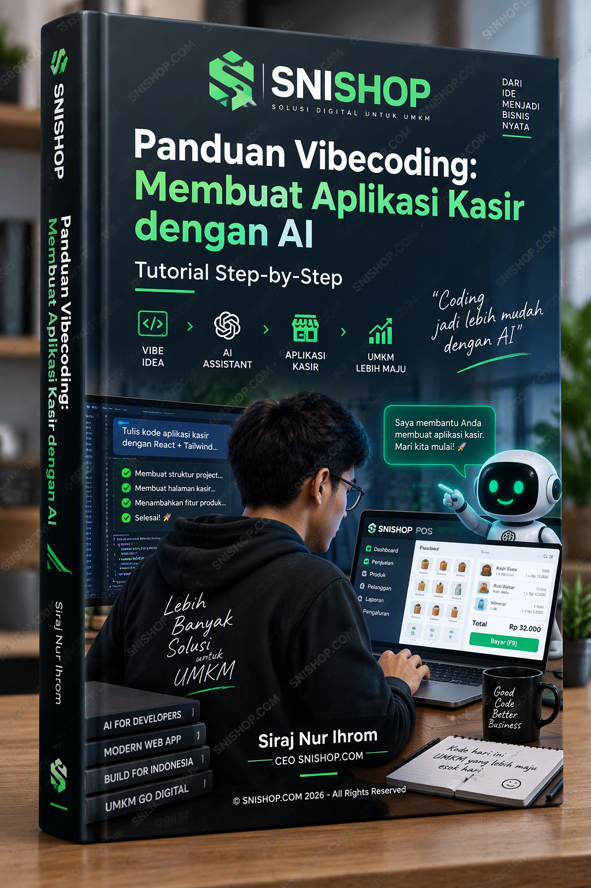

# Panduan Lengkap Time Management untuk UMKM Indonesia

**SNISHOP Publishing - Product 69**
**Versi 2.1 | Standar SNISHOP-PUBLISHING**

---

**Hak Cipta 2025 SNISHOP Indonesia**
Seluruh hak cipta dilindungi undang-undang. Dilarang memperbanyak, mendistribusikan, atau menerbitkan bagian manapun dari buku ini tanpa izin tertulis dari penerbit.

**Disusun oleh:** Tim Konten SNISHOP
**Editor:** Redaksi SNISHOP Publishing
**Cetakan Pertama:** Desember 2025

---

## Daftar Isi

**BAGIAN 1: FONDASI TIME MANAGEMENT**

- Bab 1: Mengenal Time Management dan Urgensinya bagi UMKM
- Bab 2: Prinsip Dasar Time Management
- Bab 3: Audit Waktu - Mengetahui Ke Mana Waktu Anda Pergi
- Bab 4: Menetapkan Tujuan SMART dan Skala Prioritas
- Bab 5: Matriks Eisenhower - Memilah yang Urgent dan Important

**BAGIAN 2: TEKNIK DAN TOOLS TIME MANAGEMENT**

- Bab 6: Teknik Pomodoro dan Variasi untuk UMKM
- Bab 7: Time Blocking dan Time Boxing
- Bab 8: Seni Delegasi dan Outsourcing
- Bab 9: Mengatasi Prokrastinasi dan Distraksi
- Bab 10: Meeting Management yang Efektif
- Bab 11: Digital Tools untuk Time Management

**BAGIAN 3: IMPLEMENTASI DAN CONTINUOUS IMPROVEMENT**

- Bab 12: Work-Life Balance untuk Pemilik UMKM
- Bab 13: Time Management untuk Tim
- Bab 14: KPI dan Monitoring Produktivitas
- Bab 15: Studi Kasus Implementasi
- Bab 16: ROI Calculator dan Continuous Improvement

---

# BAGIAN 1: FONDASI TIME MANAGEMENT

---

## Bab 1: Mengenal Time Management dan Urgensinya bagi UMKM

### Mengapa Waktu Adalah Aset Paling Berharga bagi UMKM

Pemilik usaha mikro, kecil, dan menengah di Indonesia menghadapi realitas yang unik. Berbeda dengan perusahaan besar yang memiliki puluhan hingga ratusan karyawan, pelaku UMKM sering kali merangkap beberapa peran sekaligus: CEO, manajer pemasaran, staf penjualan, bagian keuangan, hingga petugas kebersihan. Dalam satu hari, seorang pemilik warung makan bisa saja harus memasak, melayani pelanggan, mencatat keuangan, membeli bahan baku, sekaligus mengurus pemasaran di media sosial.

Keterbatasan sumber daya manusia membuat waktu menjadi aset paling berharga yang dimiliki pelaku UMKM. Setiap menit yang terbuang berarti peluang yang hilang, pesanan yang tidak terlayani, atau keputusan bisnis yang tertunda. Data dari Kementerian Koperasi dan UKM menunjukkan bahwa lebih dari 64 juta UMKM beroperasi di Indonesia, dan mayoritas dari mereka menghadapi masalah yang sama: terlalu banyak pekerjaan, terlalu sedikit waktu, dan tidak ada sistem yang mengatur bagaimana waktu dialokasikan.

Time management bukan sekadar mengatur jadwal. Time management adalah kemampuan untuk membuat keputusan sadar tentang bagaimana menggunakan waktu terbatas yang tersedia agar menghasilkan output maksimal bagi bisnis. Bagi UMKM, ini bukan kemewahan - ini adalah kebutuhan untuk bertahan hidup dan berkembang.

### Masalah Khas yang Dihadapi UMKM Indonesia

Pelaku UMKM di Indonesia menghadapi serangkaian tantangan spesifik yang membuat manajemen waktu menjadi sangat kritis.

**Pertama, fenomena "serba dikerjakan sendiri".** Banyak pemilik UMKM yang kesulitan mendelegasikan tugas karena merasa tidak ada orang lain yang bisa melakukannya dengan standar yang sama. Akibatnya, mereka terjebak dalam siklus kerja 12-16 jam per hari tanpa henti. Seorang pemilik konveksi di Bandung menceritakan bahwa ia bekerja dari pukul 5 pagi hingga 11 malam selama bertahun-tahun, dan bisnisnya tidak juga berkembang karena ia sendiri yang menjadi bottleneck.

**Kedua, gangguan dari media sosial dan pesan instan.** WhatsApp menjadi alat komunikasi bisnis utama di Indonesia, namun juga menjadi sumber distraksi terbesar. Notifikasi grup keluarga, teman sekolah, komunitas hobi, dan pelanggan bercampur menjadi satu aliran gangguan yang tidak pernah berhenti. Rata-rata pelaku UMKM menghabiskan 2-3 jam per hari untuk merespons pesan yang tidak produktif.

**Ketiga, tidak adanya batas antara waktu kerja dan waktu pribadi.** Ketika kantor dan rumah berada di lokasi yang sama - atau ketika ponsel selalu dalam jangkauan - batas antara waktu kerja dan waktu istirahat menjadi kabur. Pelaku UMKM sering bekerja 7 hari seminggu tanpa jeda yang memadai, yang pada akhirnya menurunkan produktivitas dan kualitas keputusan.

**Keempat, perencanaan yang reaktif, bukan proaktif.** Sebagian besar pelaku UMKM menjalani hari mereka secara reaktif: merespons masalah yang muncul, melayani pelanggan yang datang, dan menangani krisis kecil yang terjadi sepanjang hari. Tidak ada waktu yang dialokasikan untuk perencanaan strategis, pengembangan produk, atau ekspansi pasar.

### Dampak Buruknya Manajemen Waktu yang Buruk

Ketika waktu tidak dikelola dengan baik, dampaknya bersifat kaskade - satu masalah memicu masalah lainnya.

Dampak pertama adalah burnout. Pemilik UMKM yang bekerja tanpa henti selama berbulan-bulan akan mengalami kelelahan fisik dan mental. Burnout bukan hanya masalah kesehatan pribadi; ia juga menurunkan kualitas layanan, kreativitas dalam berinovasi, dan kemampuan mengambil keputusan strategis.

Dampak kedua adalah hilangnya peluang bisnis. Ketika seluruh waktu tersita untuk operasional harian, pelaku UMKM tidak memiliki bandwidth untuk melihat peluang baru, membangun relasi, atau mengikuti pelatihan yang bisa meningkatkan kompetensi bisnis.

Dampak ketiga adalah stagnasi pertumbuhan. Bisnis yang tidak memiliki waktu untuk perencanaan strategis akan tetap berada di titik yang sama selama bertahun-tahun. Omzet tidak meningkat, jumlah karyawan tidak bertambah, dan margin keuntungan tergerus inflasi.

Dampak keempat adalah kualitas hidup yang menurun. Hubungan dengan keluarga terabaikan, kesehatan fisik memburuk, dan kepuasan hidup secara keseluruhan menurun. Ironisnya, banyak pelaku UMKM yang membangun bisnis untuk memberikan kehidupan yang lebih baik bagi keluarga, namun justru mengorbankan waktu bersama keluarga demi bisnis.

### Apa yang Bisa Anda Harapkan dari Buku Ini

Buku ini disusun sebagai panduan praktis yang dirancang khusus untuk konteks UMKM Indonesia. Setiap bab menyajikan konsep yang langsung bisa diterapkan, dilengkapi contoh nyata dari pelaku UMKM di berbagai sektor. Anda tidak perlu latar belakang manajemen atau pendidikan tinggi untuk menerapkan prinsip-prinsip yang dibahas di sini.

Yang Anda butuhkan hanyalah komitmen untuk meluangkan waktu - ironisnya - untuk mempelajari cara mengelola waktu. Luangkan 30-60 menit per hari selama dua minggu ke depan untuk membaca dan menerapkan isi buku ini secara bertahap. Hasilnya akan terlihat dalam bentuk penghematan waktu 2-4 jam per hari, penurunan tingkat stres, dan peningkatan produktivitas yang terukur.

### Mitos-Mitos Time Management yang Perlu Dihindari

Sebelum melangkah lebih jauh, ada beberapa mitos tentang manajemen waktu yang perlu diluruskan karena sering menyesatkan pelaku UMKM.

**Mitos pertama: "Orang sukses bangun jam 4 pagi."** Banyak artikel motivasi yang mengklaim bahwa bangun pagi adalah kunci kesuksesan. Faktanya, yang penting bukan jam berapa Anda bangun, melainkan bagaimana Anda menggunakan waktu sadar Anda. Jika Anda lebih produktif di malam hari, tidak ada yang salah dengan itu. Yang salah adalah begadang hingga pukul 2 pagi untuk mengerjakan tugas yang sebenarnya bisa diselesaikan di siang hari.

**Mitos kedua: "Multitasking membuat lebih produktif."** Penelitian neurosains secara konsisten menunjukkan bahwa otak manusia tidak bisa melakukan dua tugas kognitif secara bersamaan. Yang terjadi saat multitasking adalah rapid task-switching - otak berpindah bolak-balik antar tugas. Setiap perpindahan membutuhkan waktu "reloading" yang menurunkan kualitas kerja dan meningkatkan kemungkinan kesalahan. Untuk UMKM yang sumber dayanya terbatas, kesalahan berarti biaya tambahan yang bisa dihindari.

**Mitos ketiga: "Time management berarti bekerja lebih banyak."** Tujuan time management bukan menambah jam kerja, melainkan meningkatkan output per jam kerja. Pelaku UMKM yang berhasil mengelola waktu dengan baik justru bekerja lebih sedikit jam namun menghasilkan lebih banyak. Efisiensi, bukan ekstensi, adalah inti dari manajemen waktu yang efektif.

**Mitos keempat: "Saya terlalu sibuk untuk belajar time management."** Ini adalah paradoks klasik. Orang yang paling membutuhkan manajemen waktu justru yang merasa tidak punya waktu untuk mempelajarinya. Investasi waktu 30 menit per hari selama dua minggu untuk mempelajari dan menerapkan prinsip-prinsip dalam buku ini akan menghemat 2-4 jam per hari untuk selanjutnya. Ini adalah investasi dengan ROI tertinggi yang bisa Anda lakukan.

### Poin Kunci Bab 1

- Waktu adalah aset paling berharga bagi pelaku UMKM yang memiliki sumber daya terbatas
- Empat masalah utama: mengerjakan semuanya sendiri, distraksi digital, tidak ada batas waktu kerja-pribadi, dan perencanaan reaktif
- Manajemen waktu yang buruk menyebabkan burnout, hilangnya peluang, stagnasi, dan penurunan kualitas hidup
- Buku ini adalah panduan praktis yang dirancang untuk konteks UMKM Indonesia
- Mitos multitasking, bangun pagi, dan kesibukan sebagai prestasi perlu diluruskan

---

## Bab 2: Prinsip Dasar Time Management

### Hukum Pareto 80/20

Prinsip Pareto, atau aturan 80/20, menyatakan bahwa 80 persen hasil berasal dari 20 persen usaha. Dalam konteks UMKM, ini berarti 80 persen pendapatan Anda kemungkinan besar berasal dari 20 persen pelanggan, produk, atau aktivitas bisnis Anda.

Contoh nyata: seorang pemilik toko online di Surabaya memiliki 50 produk yang dijual. Setelah menganalisis data penjualan selama tiga bulan, ia menemukan bahwa hanya 10 produk (20 persen) yang menghasilkan 75 persen total omzet. Sisa 40 produk hanya menyumbang 25 persen omzet namun memakan 60 persen waktu operasional untuk pengadaan, penyimpanan, pemasaran, dan layanan pelanggan.

Cara menerapkan prinsip Pareto untuk UMKM Anda:

1. Catat semua aktivitas bisnis Anda selama satu minggu penuh
2. Identifikasi mana yang menghasilkan revenue atau pertumbuhan langsung
3. Tandai 20 persen aktivitas yang memberikan 80 persen hasil
4. Alokasikan waktu dan energi terbaik Anda untuk aktivitas 20 persen tersebut
5. Kurangi, delegasikan, atau eliminasi aktivitas yang sisanya

Penerapan Pareto bukan berarti mengabaikan 80 persen aktivitas lainnya. Ini berarti Anda harus lebih efisien dalam menangani aktivitas yang kurang produktif, atau mencari cara untuk mengotomatisasi dan mendelegasikannya.

### Hukum Parkinson

Hukum Parkinson menyatakan bahwa pekerjaan akan mengembang mengisi waktu yang tersedia untuk menyelesaikannya. Jika Anda memberikan waktu satu minggu untuk menyelesaikan proposal yang sebenarnya bisa diselesaikan dalam dua hari, maka proposal tersebut akan memakan waktu satu minggu penuh.

Bagi pelaku UMKM, Hukum Parkinson menjelaskan mengapa banyak yang merasa selalu sibuk namun tidak produktif. Ketika tidak ada tenggat waktu yang jelas, pekerjaan sederhana bisa memakan waktu berhari-hari. Membuat quotation untuk klien yang seharusnya selesai dalam 30 menit bisa menjadi pekerjaan seharian jika tidak ada batasan waktu yang ditetapkan.

Cara melawan Hukum Parkinson:

- Tetapkan deadline yang agresif namun realistis untuk setiap tugas
- Gunakan timer saat mengerjakan tugas tertentu
- Pecah proyek besar menjadi tugas-tugas kecil dengan tenggat waktu masing-masing
- Evaluasi apakah waktu yang Anda berikan untuk suatu tugas memang diperlukan atau hanya kebiasaan

### Time Blocking

Time blocking adalah teknik mengalokasikan blok waktu spesifik untuk aktivitas tertentu. Berbeda dengan to-do list yang hanya mendaftar apa yang harus dilakukan, time blocking menentukan kapan setiap tugas akan dikerjakan.

Contoh penerapan time blocking untuk pemilik UMKM:

| Waktu | Aktivitas |
|-------|-----------|
| 06.00-07.00 | Perencanaan hari dan review target |
| 07.00-09.00 | Pengerjaan tugas prioritas tertinggi |
| 09.00-10.00 | Memproses email dan pesan WhatsApp |
| 10.00-12.00 | Operasional bisnis dan layanan pelanggan |
| 12.00-13.00 | Istirahat dan ibadah |
| 13.00-15.00 | Pemasaran dan pengembangan bisnis |
| 15.00-16.00 | Administrasi dan pencatatan keuangan |
| 16.00-17.00 | Review harian dan perencanaan besok |

Kunci keberhasilan time blocking adalah disiplin dalam mematuhi blok waktu yang telah ditetapkan. Ketika blok waktu untuk "pemasaran" telah berakhir, berhentilah mengerjakan pemasaran dan beralih ke blok waktu berikutnya, meskipun Anda merasa belum selesai.

### Prinsip MIT - Most Important Tasks

Setiap hari, tentukan tiga tugas paling penting (Most Important Tasks) yang harus diselesaikan. Tiga tugas ini harus memberikan dampak terbesar bagi bisnis Anda. Selesaikan MIT sebelum mengerjakan hal lain.

Kriteria untuk menentukan MIT:
- Apakah tugas ini memberikan dampak langsung pada pendapatan?
- Apakah tugas ini membawa bisnis selangkah lebih dekat ke tujuan jangka panjang?
- Apakah tugas ini memiliki konsekuensi serius jika tidak diselesaikan hari ini?

Jika Anda hanya bisa menyelesaikan tiga hal hari ini, tiga hal itu haruslah MIT Anda. Sisanya adalah bonus.

### Prinsip "Eat That Frog"

Mark Twain pernah berkata bahwa jika hal pertama yang Anda lakukan di pagi hari adalah memakan katak hidup, Anda bisa melewati sisa hari dengan perasaan bahwa hal terburuk sudah berlalu. Dalam konteks produktivitas, "katak" adalah tugas paling sulit atau paling tidak ingin Anda kerjakan - namun juga yang paling penting.

Lakukan tugas tersulit pertama kali di pagi hari ketika energi dan tekad masih penuh. Setelah "katak" selesai, sisa hari akan terasa lebih ringan dan produktif. Banyak pemilik UMKM yang menunda tugas sulit seperti negosiasi dengan supplier, penanganan komplain pelanggan, atau penyusunan laporan keuangan. Penundaan ini memakan energi mental sepanjang hari dan mengurangi kapasitas untuk tugas-tugas lainnya.

### Poin Kunci Bab 2

- Prinsip Pareto: fokus pada 20 persen aktivitas yang menghasilkan 80 persen hasil
- Hukum Parkinson: tetapkan deadline ketat agar pekerjaan tidak mengembang
- Time blocking: alokasikan blok waktu spesifik untuk setiap kategori aktivitas
- MIT: tentukan tiga tugas terpenting setiap hari dan selesaikan terlebih dahulu
- Eat That Frog: kerjakan tugas tersulit pertama kali di pagi hari

---

## Bab 3: Audit Waktu - Mengetahui Ke Mana Waktu Anda Pergi

### Mengapa Audit Waktu Penting

Sebelum Anda bisa mengelola waktu dengan lebih baik, Anda perlu tahu terlebih dahulu bagaimana waktu Anda digunakan saat ini. Audit waktu adalah proses mencatat dan menganalisis penggunaan waktu selama periode tertentu - biasanya satu hingga dua minggu. Hasilnya sering kali mengejutkan. Pelaku UMKM yang merasa bekerja 14 jam per hari sering kali menemukan bahwa hanya 4-5 jam yang benar-benar produktif, sementara sisanya terbuang untuk aktivitas yang tidak bernilai tambah.

Audit waktu bukan tentang menghakimi diri sendiri. Ini adalah alat diagnostik yang memberikan data objektif untuk pengambilan keputusan. Sama seperti pembukuan keuangan yang mencatat ke mana uang pergi, audit waktu mencatat ke mana waktu pergi.

### Metode Time Log Manual

Cara paling sederhana untuk melakukan audit waktu adalah menggunakan time log manual. Siapkan buku catatan atau spreadsheet dengan kolom berikut:

| No | Tanggal | Waktu Mulai | Waktu Selesai | Durasi (menit) | Aktivitas | Kategori | Produktif/Tidak |
|----|---------|-------------|---------------|----------------|-----------|----------|-----------------|
| 1 | 01/12 | 07.00 | 07.30 | 30 | Balas WhatsApp grup keluarga | Personal | Tidak |
| 2 | 01/12 | 07.30 | 08.00 | 30 | Persiapan buka toko | Operasional | Ya |
| 3 | 01/12 | 08.00 | 09.15 | 75 | Melayani pelanggan | Revenue | Ya |

Lakukan pencatatan ini setiap 30 menit selama minimal 5 hari kerja berturut-turut. Catat semua aktivitas tanpa terkecuali, termasuk waktu yang dihabiskan untuk scrolling media sosial, mengobrol dengan tetangga, atau melamun.

### Metode Time Tracking Digital

Bagi UMKM yang sudah melek teknologi, tersedia berbagai aplikasi time tracking yang bisa mengotomatisasi proses pencatatan. Beberapa pilihan yang cocok untuk UMKM Indonesia:

**Toggl Track (gratis untuk tim hingga 5 orang):** Aplikasi ini memungkinkan Anda memulai dan menghentikan timer untuk setiap tugas. Di akhir hari, Anda bisa melihat ringkasan visual tentang bagaimana waktu dihabiskan. Toggl Track tersedia di web, Android, dan iOS.

**Clockify (gratis tanpa batas pengguna):** Alternatif gratis yang menawarkan fitur serupa dengan Toggl, namun tanpa batasan jumlah pengguna. Cocok untuk UMKM yang ingin melibatkan tim dalam audit waktu.

**Google Sheets dengan template time log:** Jika Anda lebih suka pendekatan sederhana, buat spreadsheet dengan kolom waktu mulai, waktu selesai, aktivitas, dan kategori. Gunakan rumus sederhana untuk menghitung total waktu per kategori.

### Kategori Waktu untuk Analisis

Setelah data terkumpul, kelompokkan aktivitas ke dalam kategori berikut:

**Aktivitas revenue-generating:** Melayani pelanggan, memproses pesanan, negosiasi penjualan, closing deal.

**Aktivitas operasional:** Pembelian bahan baku, pengelolaan inventori, pengemasan produk, pengiriman.

**Aktivitas administratif:** Pencatatan keuangan, pembayaran tagihan, urusan perizinan, correspondence.

**Aktivitas pemasaran:** Membuat konten media sosial, membalas komentar dan DM, menjalankan iklan, networking.

**Aktivitas pengembangan:** Riset produk baru, pelatihan, membaca materi bisnis, konsultasi.

**Waktu tidak produktif:** Scroll media sosial tanpa tujuan, obrolan non-bisnis berlebihan, menunda pekerjaan, meeting tanpa agenda jelas.

### Cara Menganalisis Hasil Audit

Setelah satu minggu mencatat, hitung persentase waktu untuk setiap kategori. Bandingkan dengan idealnya alokasi waktu untuk UMKM:

| Kategori | Idealnya | Contoh Hasil Audit |
|----------|----------|-------------------|
| Revenue-generating | 40-50% | 25% |
| Operasional | 20-25% | 30% |
| Administratif | 10-15% | 20% |
| Pemasaran | 10-15% | 5% |
| Pengembangan | 5-10% | 0% |
| Tidak produktif | <10% | 20% |

Jika hasil audit menunjukkan penyimpangan signifikan dari alokasi ideal, itulah area yang perlu diperbaiki. Contoh: jika 20 persen waktu habis untuk aktivitas tidak produktif, maka ada potensi penghematan 20 persen waktu yang bisa dialihkan untuk pemasaran atau pengembangan bisnis.

### Template Audit Waktu 7 Hari

Gunakan template berikut untuk memulai audit waktu Anda:

**Hari 1-2: Observasi penuh.** Catat semua aktivitas tanpa mencoba mengubah apapun. Biarkan hari berjalan normal agar data yang didapat representatif.

**Hari 3-4: Identifikasi pola.** Mulai melihat pola: kapan waktu paling produktif, kapan energi menurun, kapan gangguan paling sering terjadi.

**Hari 5-6: Eksperimen ringan.** Coba kurangi waktu untuk aktivitas tidak produktif dan alokasikan untuk tugas yang lebih bernilai.

**Hari 7: Review dan rencana.** Analisis data selama 6 hari dan buat rencana perbaikan untuk minggu berikutnya.

### Poin Kunci Bab 3

- Audit waktu memberikan data objektif tentang penggunaan waktu saat ini
- Time log manual dengan interval 30 menit selama minimal 5 hari kerja
- Kelompokkan aktivitas ke dalam 6 kategori untuk analisis
- Bandingkan hasil audit dengan alokasi ideal untuk mengidentifikasi area perbaikan
- Template 7 hari: observasi, identifikasi pola, eksperimen, dan review

---

## Bab 4: Menetapkan Tujuan SMART dan Skala Prioritas

### Mengapa Tujuan yang Jelas Adalah Fondasi Manajemen Waktu

Manajemen waktu tanpa tujuan yang jelas seperti mengemudi tanpa destinasi. Anda bisa menjadi sangat efisien dalam menjalankan aktivitas, namun jika aktivitas tersebut tidak mengarah ke tujuan yang tepat, maka efisiensi itu sia-sia. Langkah pertama dalam mengelola waktu adalah menetapkan dengan jelas apa yang ingin Anda capai.

Bagi pelaku UMKM, tujuan sering kali bersifat abstrak: "ingin omzet naik", "ingin bisnis lebih maju", "ingin punya lebih banyak waktu luang". Tujuan seperti ini terlalu kabur untuk bisa diterjemahkan ke dalam tindakan harian. Diperlukan framework yang lebih spesifik untuk mengubah tujuan abstrak menjadi target yang terukur dan actionable.

### Framework SMART

SMART adalah akronim dari Specific, Measurable, Achievable, Relevant, dan Time-bound. Framework ini membantu Anda mengubah tujuan abstrak menjadi target yang jelas dan bisa dieksekusi.

**Specific (Spesifik):** Tujuan harus jelas dan terdefinisi dengan baik. Bukan "meningkatkan penjualan", melainkan "menambah 50 pelanggan baru untuk produk keripik singkong varian pedas".

**Measurable (Terukur):** Tujuan harus memiliki metrik yang bisa diukur. "Meningkatkan engagement di Instagram" menjadi "meningkatkan rata-rata likes per posting dari 50 menjadi 150".

**Achievable (Bisa Dicapai):** Tujuan harus realistis dengan sumber daya yang tersedia. Menargetkan omzet Rp1 miliar per bulan untuk UMKM yang saat ini omzetnya Rp50 juta mungkin tidak realistis dalam jangka pendek. Namun, target Rp75 juta dalam 6 bulan bisa jadi achievable.

**Relevant (Relevan):** Tujuan harus selaras dengan visi jangka panjang bisnis. Jika visi Anda adalah menjadi supplier utama untuk retail modern, maka tujuan yang relevan adalah meningkatkan kapasitas produksi dan mendapatkan sertifikasi halal dan BPOM, bukan membuka cabang retail.

**Time-bound (Berbatas Waktu):** Tujuan harus memiliki tenggat waktu yang jelas. "Suatu hari nanti ingin ekspor" menjadi "mengirim sampel produk ke buyer di Singapura paling lambat Maret 2026".

### Contoh Penerapan SMART untuk UMKM

**UMKM Kuliner:**
- Tujuan abstrak: "Ingin lebih laris"
- Tujuan SMART: "Meningkatkan penjualan paket katering kantor dari 30 porsi per hari menjadi 60 porsi per hari dalam 3 bulan, dengan menambahkan 5 kantor baru sebagai klien tetap dan meluncurkan 3 menu paket baru"

**UMKM Fashion:**
- Tujuan abstrak: "Ingin online lebih ramai"
- Tujuan SMART: "Mencapai 10.000 followers Instagram dan rata-rata 50 pesanan per minggu melalui channel online dalam 4 bulan, dengan memposting 1 konten feed dan 3 story setiap hari, serta menjalankan iklan Instagram dengan budget Rp500.000 per minggu"

**UMKM Kerajinan:**
- Tujuan abstrak: "Ingin bisa ekspor"
- Tujuan SMART: "Menyelesaikan proses sertifikasi ekspor dan mendapatkan minimal 3 buyer internasional dari platform Alibaba dalam 6 bulan, dengan mengikuti 1 pameran dagang virtual per bulan dan menghubungi 20 calon buyer potensial per minggu"

### Skala Prioritas: Menentukan Apa yang Harus Dikerjakan Lebih Dulu

Setelah tujuan ditetapkan, tantangan berikutnya adalah menentukan urutan pengerjaan. Tidak semua tugas memiliki bobot yang sama. Beberapa tugas memiliki dampak besar namun sering ditunda karena terasa sulit atau tidak mendesak.

**Prioritas 1 - Critical:** Tugas yang jika tidak diselesaikan hari ini akan menyebabkan kerugian finansial langsung atau hilangnya pelanggan. Contoh: memproses pesanan yang sudah dibayar, menangani komplain pelanggan besar, membayar supplier yang jatuh tempo hari ini.

**Prioritas 2 - High:** Tugas yang memberikan dampak signifikan pada pertumbuhan bisnis dalam minggu ini. Contoh: follow up leads hangat, membuat konten pemasaran untuk kampanye mendatang, merekrut karyawan baru untuk posisi kritis.

**Prioritas 3 - Medium:** Tugas yang penting untuk operasional namun bisa dijadwalkan. Contoh: update inventori, rapat tim mingguan, pembukuan mingguan.

**Prioritas 4 - Low:** Tugas yang nice-to-have namun tidak mendesak. Contoh: redesign logo, renovasi tampilan toko, mengikuti webinar bisnis.

### Teknik Prioritas ABCDE

Metode ABCDE dari Brian Tracy menawarkan pendekatan sederhana untuk menentukan prioritas harian:

**A - Must do:** Tugas yang harus dilakukan. Konsekuensi serius jika tidak dilakukan.
**B - Should do:** Tugas yang sebaiknya dilakukan. Konsekuensi ringan jika tidak dilakukan.
**C - Nice to do:** Tugas yang menyenangkan untuk dilakukan namun tidak ada konsekuensi jika dilewati.
**D - Delegate:** Tugas yang bisa didelegasikan kepada orang lain.
**E - Eliminate:** Tugas yang sebaiknya dieliminasi karena tidak lagi relevan atau bernilai.

Aturan penting: jangan pernah mengerjakan tugas B ketika masih ada tugas A yang belum selesai.

### Menyelaraskan Tujuan Pribadi dan Tujuan Bisnis

Salah satu kesalahan paling umum yang dilakukan pelaku UMKM adalah menetapkan tujuan bisnis tanpa mempertimbangkan tujuan hidup pribadi. Bisnis adalah alat untuk mencapai kehidupan yang diinginkan, bukan tujuan itu sendiri. Ketika tujuan bisnis dan tujuan pribadi tidak selaras, Anda akan mengalami konflik internal yang menggerus motivasi dan membuat manajemen waktu menjadi tidak efektif.

Langkah pertama adalah menuliskan tujuan hidup pribadi Anda dalam 3 tahun ke depan. Apakah Anda ingin anak bisa sekolah di tempat yang lebih baik? Apakah Anda ingin memiliki rumah sendiri? Apakah Anda ingin bisa menunaikan ibadah haji? Apakah Anda ingin memiliki lebih banyak waktu untuk hobi?

Langkah kedua, hubungkan setiap tujuan bisnis dengan tujuan pribadi tersebut. Jika tujuan pribadi Anda adalah menunaikan haji dalam 3 tahun, maka tujuan bisnisnya bisa berupa "meningkatkan omzet 40 persen dalam 24 bulan untuk mengumpulkan dana haji tanpa mengganggu cashflow operasional."

Langkah ketiga, gunakan tujuan pribadi sebagai filter untuk setiap keputusan alokasi waktu. Ketika Anda dihadapkan pada dua pilihan - menghadiri acara networking yang tidak jelas manfaatnya atau makan malam bersama keluarga - tujuan pribadi yang jelas membantu Anda membuat keputusan dengan cepat dan tanpa penyesalan.

### Poin Kunci Bab 4

- Tujuan yang jelas adalah fondasi manajemen waktu yang efektif
- Gunakan framework SMART untuk mengubah tujuan abstrak menjadi target spesifik
- Tentukan skala prioritas: Critical, High, Medium, Low
- Metode ABCDE membantu menentukan urutan pengerjaan harian
- Jangan kerjakan tugas prioritas rendah sebelum tugas prioritas tinggi selesai

---

## Bab 5: Matriks Eisenhower - Memilah yang Urgent dan Important

### Konsep Dasar Matriks Eisenhower

Matriks Eisenhower adalah alat bantu pengambilan keputusan yang membagi tugas ke dalam empat kuadran berdasarkan dua dimensi: tingkat kepentingan (important) dan tingkat kegentingan (urgent). Alat ini dinamai dari Dwight D. Eisenhower, Presiden Amerika Serikat ke-34, yang dikenal karena kemampuannya mengelola waktu secara efektif meskipun memegang banyak tanggung jawab.

Bagi pelaku UMKM, matriks ini sangat relevan karena membantu membedakan antara tugas yang benar-benar penting dengan tugas yang hanya terasa mendesak. Banyak pelaku UMKM menghabiskan sebagian besar waktu mereka di kuadran yang salah, merespons hal-hal yang terasa mendesak namun sebenarnya tidak penting bagi pertumbuhan bisnis.

### Empat Kuadran Matriks Eisenhower

**Kuadran 1: Urgent dan Important (Kerjakan Sekarang)**

Ini adalah tugas-tugas yang memiliki tenggat waktu ketat dan dampak langsung pada bisnis. Contoh: mesin produksi rusak dan harus segera diperbaiki agar tidak menghentikan operasional, pelanggan VIP yang komplain dan perlu penanganan segera, pembayaran pajak yang jatuh tempo hari ini.

Tugas di kuadran 1 harus segera dikerjakan. Namun, tujuan jangka panjang Anda adalah mengurangi jumlah tugas di kuadran 1 ini. Jika terlalu banyak tugas di kuadran 1, Anda akan terus-menerus berada dalam mode krisis dan tidak punya waktu untuk hal-hal yang bersifat strategis.

**Kuadran 2: Not Urgent tapi Important (Jadwalkan)**

Ini adalah kuadran paling penting untuk pertumbuhan bisnis. Tugas-tugas di sini tidak memiliki tenggat waktu yang mendesak, namun memberikan dampak jangka panjang yang besar. Contoh: perencanaan bisnis tahunan, pengembangan produk baru, pelatihan karyawan, membangun relasi dengan calon partner strategis, olahraga dan menjaga kesehatan.

Pelaku UMKM yang sukses mengalokasikan setidaknya 25-30 persen waktu mereka untuk aktivitas kuadran 2. Inilah yang membedakan bisnis yang tumbuh dengan bisnis yang stagnan.

**Kuadran 3: Urgent tapi Not Important (Delegasikan)**

Tugas-tugas ini terasa mendesak namun sebenarnya tidak memberikan dampak signifikan pada tujuan bisnis Anda. Contoh: telepon dari sales supplier, notifikasi email promosi, permintaan informasi yang sebenarnya bisa dijawab oleh karyawan, rapat yang tidak memerlukan kehadiran Anda.

Tugas di kuadran 3 sebaiknya didelegasikan. Jika tidak ada yang bisa mendelegasikan, batasi waktu yang dihabiskan untuk kuadran ini seminimal mungkin.

**Kuadran 4: Not Urgent dan Not Important (Eliminasi)**

Ini adalah aktivitas yang tidak mendesak dan tidak penting. Contoh: scrolling media sosial tanpa tujuan, menonton video hiburan berlebihan, menghadiri acara yang tidak relevan dengan bisnis, mengobrol terlalu lama dengan rekan yang tidak produktif.

Aktivitas di kuadran 4 harus dieliminasi atau dikurangi secara drastis.

### Cara Menggunakan Matriks Eisenhower Setiap Hari

Langkah 1: Setiap pagi, tuliskan semua tugas yang harus dilakukan hari ini.

Langkah 2: Untuk setiap tugas, tanyakan dua pertanyaan:
- Apakah tugas ini penting untuk tujuan bisnis saya?
- Apakah tugas ini harus diselesaikan hari ini?

Langkah 3: Tempatkan setiap tugas ke kuadran yang sesuai.

Langkah 4: Kerjakan tugas kuadran 1 terlebih dahulu, lalu alokasikan waktu untuk kuadran 2, delegasikan kuadran 3, dan eliminasi kuadran 4.

### Contoh Penerapan untuk Pemilik UMKM

Seorang pemilik toko bangunan kecil di Yogyakarta menyusun matriks Eisenhower hariannya:

| Kuadran 1 (Kerjakan Sekarang) | Kuadran 2 (Jadwalkan) |
|-------------------------------|----------------------|
| Bayar supplier yang jatuh tempo | Rencanakan promosi akhir tahun |
| Handle komplain pelanggan soal barang rusak | Evaluasi dan riset produk baru |
| Stok semen habis, harus order darurat | Training karyawan baru |

| Kuadran 3 (Delegasikan) | Kuadran 4 (Eliminasi) |
|--------------------------|----------------------|
| Balas chat supplier yang tidak urgent | Scroll TikTok tanpa tujuan |
| Terima kunjungan sales obat | Mengobrol di warung terlalu lama |
| Sortir barang datang | Menata ulang etalase yang sudah rapi |

### Kesalahan Umum dalam Penerapan Matriks Eisenhower

**Kesalahan pertama:** Memasukkan terlalu banyak tugas ke kuadran 1. Banyak orang menganggap semua tugas mereka urgent dan important. Jika semua tugas masuk kuadran 1, berarti Anda belum melakukan analisis yang cukup ketat. Batas tugas kuadran 1 seharusnya maksimal 3-4 per hari.

**Kesalahan kedua:** Mengabaikan kuadran 2. Karena tidak ada tekanan tenggat waktu, tugas kuadran 2 sering kali terus ditunda. Jadwalkan waktu khusus setiap hari - minimal 1 jam - untuk aktivitas kuadran 2.

**Kesalahan ketiga:** Tidak mendelegasikan kuadran 3. Banyak pemilik UMKM yang merasa "lebih cepat dikerjakan sendiri". Memang dalam jangka pendek mendelegasikan membutuhkan waktu untuk menjelaskan dan mengawasi. Namun dalam jangka panjang, delegasi membebaskan waktu Anda untuk aktivitas yang lebih bernilai.

### Strategi Transisi Antar Kuadran

Tujuan jangka panjang Anda adalah menggeser proporsi waktu dari kuadran 1 dan 3 menuju kuadran 2. Berikut strategi untuk melakukannya secara bertahap.

**Dari kuadran 1 ke kuadran 2:** Banyak tugas yang terasa mendesak sebenarnya bisa diprediksi dan diantisipasi. Jika Anda rutin kehabisan stok bahan baku (kuadran 1), buatlah sistem reorder otomatis berdasarkan data penggunaan (kuadran 2). Jika pelanggan sering komplain tentang keterlambatan pengiriman (kuadran 1), evaluasi dan perbaiki alur logistik Anda (kuadran 2). Setiap krisis yang berhasil Anda cegah adalah kemenangan bagi kuadran 2.

**Dari kuadran 3 ke delegasi:** Untuk setiap tugas di kuadran 3, tanyakan: "Siapa yang bisa mengerjakan ini lebih baik atau lebih efisien daripada saya?" Jika jawabannya adalah karyawan, delegasikan. Jika jawabannya adalah freelancer atau vendor, outsource. Jika tidak ada yang bisa mendelegasikan, batasi waktu untuk tugas tersebut dengan time boxing.

**Mengeliminasi kuadran 4:** Lakukan audit mingguan. Setiap Jumat sore, lihat kembali bagaimana waktu Anda dihabiskan minggu ini. Identifikasi aktivitas kuadran 4 yang muncul dan buat rencana konkret untuk menguranginya minggu depan. Bisa berupa memasang app blocker untuk media sosial, menetapkan jam cek pesan, atau menolak undangan meeting yang tidak relevan.

### Poin Kunci Bab 5

- Matriks Eisenhower membagi tugas berdasarkan urgensi dan kepentingan
- Kuadran 2 (penting tapi tidak mendesak) adalah kunci pertumbuhan bisnis
- Batasi tugas kuadran 1 maksimal 3-4 per hari
- Delegasikan tugas kuadran 3 dan eliminasi tugas kuadran 4
- Alokasikan minimal 1 jam per hari untuk aktivitas kuadran 2

---

# BAGIAN 2: TEKNIK DAN TOOLS TIME MANAGEMENT

---

## Bab 6: Teknik Pomodoro dan Variasi untuk UMKM

### Teknik Pomodoro Dasar

Teknik Pomodoro dikembangkan oleh Francesco Cirillo pada tahun 1980-an dan dinamai dari timer berbentuk tomat (pomodoro dalam bahasa Italia). Teknik ini sederhana namun sangat efektif: bekerja selama 25 menit tanpa gangguan, diikuti istirahat 5 menit. Setiap siklus 25 menit ini disebut satu "pomodoro". Setelah menyelesaikan empat pomodoro, ambil istirahat panjang selama 15-30 menit.

Alur dasar:
1. Pilih satu tugas yang akan dikerjakan
2. Set timer 25 menit
3. Kerjakan tugas tersebut dengan fokus penuh sampai timer berbunyi
4. Catat satu centang sebagai tanda satu pomodoro selesai
5. Istirahat 5 menit
6. Setiap 4 pomodoro, istirahat 15-30 menit

### Mengapa Pomodoro Efektif untuk UMKM

Pertama, pomodoro menciptakan urgensi buatan. Dengan timer yang berjalan, Anda terdorong untuk menyelesaikan sebanyak mungkin dalam 25 menit. Ini melawan Hukum Parkinson yang membuat pekerjaan mengembang mengisi waktu yang tersedia.

Kedua, pomodoro mengelola energi, bukan hanya waktu. Otak manusia tidak bisa mempertahankan fokus penuh selama berjam-jam. Dengan memberikan jeda setiap 25 menit, Anda menjaga kualitas kerja tetap tinggi sepanjang hari.

Ketiga, pomodoro membantu mengatasi rasa kewalahan. Melihat daftar tugas yang panjang bisa membuat Anda merasa overwhelmed. Namun, memikirkan "saya hanya perlu fokus selama 25 menit" jauh lebih manageable.

### Variasi Pomodoro untuk Konteks UMKM

**Variasi 1: Pomodoro 50/10 untuk tugas kreatif.**
Beberapa tugas UMKM membutuhkan konsentrasi yang lebih dalam, seperti mendesain produk, menulis copy iklan, atau menyusun proposal bisnis. Untuk tugas-tugas ini, gunakan siklus 50 menit kerja dan 10 menit istirahat.

**Variasi 2: Pomodoro fleksibel untuk lingkungan toko.**
Pemilik toko retail tidak bisa selalu menutup toko untuk istirahat. Dalam konteks ini, gunakan pomodoro secara fleksibel: kerjakan tugas administratif selama 25 menit di saat sepi pelanggan, lalu berhentilah saat pelanggan datang. Tidak perlu memaksakan siklus yang kaku.

**Variasi 3: Pomodoro tim untuk UMKM dengan karyawan.**
Jika Anda memiliki tim kecil, lakukan pomodoro bersama. Tetapkan "jam fokus" di mana seluruh tim mengerjakan tugas prioritas mereka tanpa gangguan selama 50 menit, diikuti istirahat bersama 10 menit. Ini membangun budaya fokus dan produktivitas.

**Variasi 4: Pomodoro untuk tugas repetitif.**
Untuk tugas yang bersifat repetitif seperti mengemas produk, membalas pesan template, atau input data, gunakan pomodoro sebagai alat ukur produktivitas. Berapa banyak pesanan yang bisa dikemas dalam satu pomodoro? Gunakan data ini untuk menetapkan target harian.

### Alat Bantu Pomodoro

Anda tidak perlu aplikasi mahal untuk menerapkan pomodoro. Timer dapur sudah cukup. Namun jika Anda ingin fitur tambahan, beberapa opsi gratis yang bisa digunakan:

- Timer bawaan di ponsel (set 25 menit)
- Pomofocus.io (aplikasi web gratis)
- Forest app (gamifikasi pomodoro, tersedia di Android dan iOS)
- Focus To-Do (kombinasi pomodoro dan task management, gratis)

### Membangun Kebiasaan Fokus Jangka Panjang

Pomodoro bukan hanya teknik manajemen waktu - ini adalah latihan untuk membangun otot fokus Anda. Seperti otot fisik, kemampuan untuk berkonsentrasi perlu dilatih secara bertahap. Jangan berharap bisa langsung fokus penuh selama 25 menit jika saat ini Anda terbiasa terdistraksi setiap 5 menit.

Mulailah dengan durasi yang realistis. Jika 25 menit terasa terlalu lama, mulai dari 15 menit kerja dan 3 menit istirahat. Setelah satu minggu, naikkan menjadi 20 menit kerja dan 5 menit istirahat. Lanjutkan hingga Anda mencapai 25 menit penuh. Proses gradual ini lebih sustainable daripada memaksakan durasi ideal sejak hari pertama.

Lacak jumlah pomodoro yang berhasil Anda selesaikan setiap hari. Target realistis untuk pemula adalah 8-10 pomodoro per hari (4-5 jam kerja fokus). Pelaku UMKM yang sudah terlatih bisa mencapai 12-16 pomodoro per hari. Jangan mengejar jumlah - kualitas fokus jauh lebih penting daripada kuantitas siklus yang selesai.

Satu hal penting: lindungi waktu pomodoro Anda dari gangguan eksternal. Beri tahu keluarga atau karyawan bahwa ketika timer berjalan, Anda tidak bisa diganggu kecuali dalam situasi darurat. Konsistensi dalam melindungi waktu fokus ini akan mengajarkan orang-orang di sekitar Anda untuk menghormati batas tersebut.

### Poin Kunci Bab 6

- Teknik Pomodoro: 25 menit fokus penuh, 5 menit istirahat
- Efektif karena menciptakan urgensi, mengelola energi, dan mengurangi rasa kewalahan
- Variasi 50/10 untuk tugas kreatif, fleksibel untuk lingkungan toko
- Pomodoro tim membangun budaya fokus dan produktivitas
- Timer dapur sudah cukup, tidak perlu alat mahal

---

## Bab 7: Time Blocking dan Time Boxing

### Perbedaan Time Blocking dan Time Boxing

Meskipun sering digunakan secara bergantian, time blocking dan time boxing adalah dua teknik yang berbeda.

**Time blocking** adalah mengalokasikan blok waktu tertentu untuk kategori aktivitas. Contoh: "Pukul 09.00-11.00 dialokasikan untuk pengerjaan konten pemasaran." Anda tahu apa yang akan dilakukan dalam blok tersebut, namun durasi pastinya fleksibel.

**Time boxing** adalah memberikan batas waktu yang ketat untuk satu tugas spesifik. Contoh: "Saya akan menyelesaikan desain poster promo dalam 90 menit, mulai pukul 09.00." Ketika waktu habis, Anda berhenti, terlepas dari apakah tugas sudah selesai atau belum.

Keduanya saling melengkapi. Gunakan time blocking untuk mengalokasikan waktu bagi kategori aktivitas, dan time boxing untuk memastikan setiap tugas dalam blok tersebut diselesaikan secara efisien.

### Membuat Jadwal Time Blocking Harian

Berikut contoh jadwal time blocking untuk pemilik UMKM kuliner:

**Sesi Pagi (05.00-12.00):**
- 05.00-06.00: Persiapan bahan dan mise en place
- 06.00-08.00: Proses memasak menu utama
- 08.00-08.30: Istirahat dan sarapan
- 08.30-10.00: Pengemasan dan pengiriman pesanan katering
- 10.00-11.00: Pemesanan bahan baku untuk besok
- 11.00-12.00: Melayani pelanggan makan siang (shift awal)

**Sesi Siang (12.00-17.00):**
- 12.00-13.00: Istirahat dan ibadah
- 13.00-14.00: Pencatatan keuangan dan administrasi
- 14.00-15.30: Membuat konten media sosial
- 15.30-16.00: Membalas pesan dan follow up pelanggan
- 16.00-17.00: Persiapan untuk operasional sore

**Sesi Malam (17.00-21.00):**
- 17.00-19.00: Operasional makan malam
- 19.00-20.00: Bersih-bersih dan tutup
- 20.00-21.00: Evaluasi harian dan perencanaan besok

### Aturan Time Blocking yang Efektif

**Aturan 1: Kelompokkan tugas serupa.** Jangan mencampur tugas kreatif dengan tugas administratif dalam satu blok. Otak membutuhkan waktu untuk beralih dari satu jenis pemikiran ke jenis lainnya (disebut switching cost). Dengan mengelompokkan tugas serupa, Anda mengurangi switching cost dan meningkatkan efisiensi.

**Aturan 2: Lindungi blok waktu prioritas.** Blok waktu untuk tugas terpenting Anda harus dianggap sebagai appointment yang tidak bisa dibatalkan. Jika Anda menjadwalkan 2 jam untuk pengembangan produk baru, perlakukan itu seperti meeting dengan klien penting - jangan mudah membatalkannya.

**Aturan 3: Sertakan buffer time.** Jangan menjadwalkan 100 persen waktu Anda. Sisakan 20-30 persen sebagai buffer untuk hal-hal tak terduga. Jika hari Anda penuh dari pukul 8 pagi hingga 5 sore tanpa jeda, satu gangguan saja akan mengacaukan seluruh jadwal.

**Aturan 4: Review dan sesuaikan setiap minggu.** Jadwal time blocking Anda akan membutuhkan penyesuaian di minggu-minggu awal. Evaluasi setiap akhir pekan: blok mana yang realistis, blok mana yang terlalu optimis, dan blok mana yang perlu digeser.

### Time Boxing untuk Tugas yang Cenderung Molor

Beberapa tugas memiliki kecenderungan untuk memakan waktu lebih lama dari yang seharusnya. Time boxing memberikan batasan tegas untuk tugas-tugas ini.

Contoh time boxing untuk tugas-tugas UMKM yang sering molor:

| Tugas | Time Box yang Disarankan |
|-------|-------------------------|
| Membalas semua WhatsApp | 30 menit |
| Membuat 1 posting Instagram | 45 menit |
| Menyusun laporan keuangan bulanan | 3 jam |
| Meeting dengan supplier | 45 menit |
| Riset harga kompetitor | 1 jam |
| Mengemas produk untuk dikirim | 90 menit |

Ketika time box berakhir, berhentilah. Jika tugas belum selesai, catat apa yang belum selesai dan jadwalkan untuk mengerjakannya di waktu lain. Disiplin ini melatih Anda untuk bekerja lebih efisien dan menghindari kesempurnaan yang berlebihan.

### Time Blocking Mingguan: Tema per Hari

Selain time blocking harian, Anda bisa menerapkan time blocking mingguan dengan memberikan tema berbeda untuk setiap hari. Pendekatan ini sangat efektif untuk pelaku UMKM yang ingin memastikan semua aspek bisnis mendapat perhatian yang proporsional.

**Senin - Perencanaan dan Strategi:** Hari ini dialokasikan untuk review minggu sebelumnya, perencanaan minggu ini, meeting tim, dan aktivitas strategis. Hindari tugas operasional rutin di hari Senin agar Anda bisa memulai minggu dengan perspektif yang jelas.

**Selasa dan Rabu - Eksekusi dan Produksi:** Dua hari ini adalah hari-hari inti untuk tugas-tugas yang menghasilkan output langsung: produksi, layanan pelanggan, pemenuhan pesanan. Fokus penuh pada eksekusi tanpa gangguan meeting atau aktivitas administratif.

**Kamis - Pemasaran dan Pengembangan:** Dedikasikan hari ini untuk aktivitas yang membangun bisnis untuk masa depan: membuat konten marketing, riset pasar, pengembangan produk baru, membangun relasi dengan calon partner.

**Jumat - Administrasi dan Evaluasi:** Tutup minggu dengan tugas-tugas administratif: pembukuan, pembayaran, evaluasi KPI, dan perencanaan minggu depan. Sisa sore hari Jumat bisa digunakan untuk refleksi dan istirahat.

Penerapan tema harian ini tidak harus kaku. Namun dengan memiliki kerangka awal, Anda menghindari kecenderungan untuk menghabiskan seluruh minggu hanya untuk tugas operasional dan mengabaikan aktivitas strategis.

### Poin Kunci Bab 7

- Time blocking mengalokasikan blok waktu untuk kategori aktivitas
- Time boxing memberikan batas waktu ketat untuk tugas spesifik
- Kelompokkan tugas serupa dalam satu blok untuk mengurangi switching cost
- Lindungi blok waktu prioritas seperti appointment yang tidak bisa dibatalkan
- Sertakan buffer time 20-30 persen untuk hal tak terduga

---

## Bab 8: Seni Delegasi dan Outsourcing

### Mengapa Delegasi Sangat Sulit bagi Pemilik UMKM

Delegasi adalah salah satu tantangan terbesar bagi pemilik UMKM. Ada beberapa alasan psikologis dan praktis mengapa delegasi terasa sulit.

**Mentalitas "lebih cepat dikerjakan sendiri".** Banyak pemilik UMKM yang merasa bahwa menjelaskan tugas kepada orang lain memakan waktu lebih lama daripada mengerjakannya sendiri. Ini mungkin benar untuk satu atau dua tugas. Namun dalam jangka panjang, mentalitas ini membuat Anda menjadi bottleneck yang membatasi pertumbuhan bisnis.

**Takut kualitas menurun.** Ketika Anda terbiasa mengerjakan sesuatu dengan standar tertentu, mendelegasikannya kepada orang lain terasa berisiko. Solusinya bukan menghindari delegasi, melainkan membangun sistem dan SOP yang memastikan kualitas tetap terjaga.

**Merasa bersalah membebankan orang lain.** Beberapa pemilik UMKM merasa tidak enak meminta bantuan orang lain untuk mengerjakan tugas. Padahal, delegasi bukan tentang membebankan - ini tentang memberdayakan orang lain untuk berkontribusi dan berkembang.

**Tidak tahu cara mendelegasikan.** Delegasi adalah skill yang perlu dipelajari. Banyak pemilik UMKM yang tidak memiliki framework untuk menentukan apa yang harus didelegasikan, kepada siapa, dan bagaimana cara mengawasinya.

### Framework Delegasi 4D

Gunakan framework 4D untuk menentukan apa yang harus dilakukan dengan setiap tugas:

**Do (Kerjakan sendiri):** Tugas yang hanya Anda yang bisa melakukannya, memiliki dampak strategis tinggi, atau membutuhkan keahlian khusus yang tidak dimiliki orang lain. Contoh: negosiasi partnership besar, pengambilan keputusan strategis, penanganan krisis utama.

**Delegate (Delegasikan):** Tugas yang bisa dilakukan oleh orang lain dengan sedikit pelatihan. Contoh: layanan pelanggan standar, pengemasan produk, input data, pengiriman barang.

**Defer (Tunda):** Tugas yang tidak perlu dilakukan sekarang. Contoh: reorganisasi gudang, redesign kartu nama, update profil media sosial.

**Delete (Hapus):** Tugas yang tidak lagi memberikan nilai. Contoh: membuat laporan yang tidak pernah dibaca siapa pun, menghadiri meeting rutin yang tidak produktif.

### Apa yang Bisa Didelegasikan

Daftar tugas yang umumnya bisa didelegasikan oleh pelaku UMKM:

**Operasional harian:** Pengemasan, pengiriman, pengelolaan stok, kebersihan.

**Layanan pelanggan:** Menjawab pertanyaan umum, memproses retur, menangani komplain tingkat pertama.

**Administrasi:** Input data, filing dokumen, penjadwalan appointment, pembuatan invoice.

**Pemasaran digital:** Membuat posting media sosial, membalas komentar dan DM, menjalankan iklan berbayar, pembuatan konten sederhana.

**Keuangan dasar:** Pencatatan transaksi harian, rekonsiliasi bank, pembuatan laporan kas sederhana.

### Cara Mendelegasikan dengan Efektif

**Langkah 1: Dokumentasikan prosesnya.** Sebelum mendelegasikan, tuliskan langkah-langkah pengerjaan tugas secara detail. Buat checklist atau SOP sederhana. Ini mengurangi waktu training dan memastikan konsistensi kualitas.

**Langkah 2: Jelaskan "mengapa", bukan hanya "apa".** Jangan hanya menyuruh karyawan melakukan sesuatu. Jelaskan mengapa tugas itu penting dan bagaimana kontribusinya terhadap tujuan bisnis. Pemahaman ini meningkatkan engagement dan inisiatif.

**Langkah 3: Berikan wewenang, bukan hanya tugas.** Ketika Anda mendelegasikan suatu tugas, berikan juga wewenang untuk mengambil keputusan dalam batas tertentu. Contoh: "Kamu berwenang memberikan diskon hingga 10 persen untuk pelanggan yang komplain, tanpa perlu minta persetujuan saya."

**Langkah 4: Tetapkan checkpoint.** Jangan micromanage, namun tetapkan titik-titik pemeriksaan untuk memastikan tugas berjalan sesuai rencana. Contoh: "Tolong kabari saya ketika stok tinggal 20 persen dan sebelum placing order ke supplier."

**Langkah 5: Berikan feedback konstruktif.** Ketika hasil delegasi belum sesuai harapan, berikan feedback yang spesifik dan konstruktif. Fokus pada perilaku dan hasil, bukan pada pribadi orangnya.

### Outsourcing untuk UMKM

Tidak semua tugas perlu ditangani oleh karyawan tetap. Outsourcing memungkinkan Anda mengakses keahlian profesional tanpa biaya gaji bulanan penuh.

**Jasa yang umum di-outsource oleh UMKM Indonesia:**

- Akuntansi dan pembukuan: Rp500.000-Rp2.000.000 per bulan
- Desain grafis: Rp100.000-Rp500.000 per desain
- Pengelolaan media sosial: Rp1.000.000-Rp3.000.000 per bulan
- Pembuatan website: Rp2.000.000-Rp10.000.000 (biaya sekali)
- Fotografi produk: Rp500.000-Rp2.000.000 per sesi
- Copywriting: Rp50.000-Rp200.000 per artikel

Platform untuk menemukan freelancer: Fastwork, Sribulancer, Projects.co.id, Fiverr, dan Upwork.

### Kesalahan Umum dalam Delegasi yang Perlu Dihindari

Banyak pemilik UMKM yang sudah mencoba mendelegasikan tugas namun gagal karena melakukan kesalahan-kesalahan yang sebenarnya bisa dihindari.

**Kesalahan pertama: Delegasi tanpa instruksi yang jelas.** Menyuruh karyawan "urus pengiriman hari ini" tanpa menjelaskan standar kualitas, tenggat waktu spesifik, atau prosedur yang harus diikuti hanya akan menghasilkan kebingungan dan pekerjaan yang harus diulang. Selalu berikan instruksi yang spesifik: apa yang harus dilakukan, bagaimana standar hasilnya, kapan harus selesai, dan kepada siapa harus melapor jika ada masalah.

**Kesalahan kedua: Micromanage setelah mendelegasikan.** Setelah Anda mendelegasikan suatu tugas, biarkan orang yang bersangkutan mengerjakannya dengan cara mereka. Mengoreksi setiap langkah kecil tidak hanya membuang waktu Anda, tetapi juga menurunkan motivasi dan kepercayaan diri karyawan. Fokus pada hasil akhir, bukan pada proses detailnya.

**Kesalahan ketiga: Mendelegasikan hanya tugas yang tidak disukai.** Delegasi yang efektif bukan tentang membuang tugas yang tidak Anda sukai kepada orang lain. Ini tentang mengalokasikan tugas kepada orang yang paling kompeten untuk mengerjakannya. Terkadang, tugas yang paling Anda sukai justru perlu didelegasikan agar Anda bisa fokus pada hal yang lebih strategis.

**Kesalahan keempat: Tidak memberikan feedback.** Setelah tugas selesai, berikan feedback yang konstruktif. Apresiasi apa yang sudah dilakukan dengan baik, dan jelaskan secara spesifik apa yang perlu diperbaiki untuk berikutnya. Tanpa feedback, karyawan tidak bisa berkembang dan kualitas delegasi akan stagnan.

### Poin Kunci Bab 8

- Delegasi sulit karena mentalitas, ketakutan, dan kurangnya skill
- Framework 4D: Do, Delegate, Defer, Delete
- Dokumentasikan proses sebelum mendelegasikan
- Berikan wewenang dan checkpoint, bukan micromanage
- Outsourcing memberikan akses keahlian profesional tanpa biaya tetap

---

## Bab 9: Mengatasi Prokrastinasi dan Distraksi

### Memahami Akar Prokrastinasi

Prokrastinasi bukan masalah kemalasan. Ini adalah mekanisme psikologis yang terjadi ketika otak memilih kepuasan instan di atas manfaat jangka panjang. Bagi pelaku UMKM, prokrastinasi bisa sangat merugikan karena tidak ada atasan yang mengawasi dan tidak ada deadline eksternal yang memaksa.

Ada beberapa jenis prokrastinasi yang umum terjadi pada pelaku UMKM:

**Prokrastinasi karena kesempurnaan.** Menunda memulai sesuatu karena merasa belum siap atau belum sempurna. "Saya belum bisa jualan online karena website belum sempurna." "Saya belum bisa buat konten karena kamera belum bagus." Kesempurnaan adalah musuh kemajuan.

**Prokrastinasi karena kewalahan.** Ketika tugas terasa terlalu besar, otak memilih untuk tidak memulai sama sekali. "Mau bikin rencana bisnis, tapi rasanya terlalu banyak yang harus dipikirkan." Solusinya adalah memecah tugas besar menjadi langkah-langkah kecil yang bisa diselesaikan dalam 15-30 menit.

**Prokrastinasi karena ketidakjelasan.** Ketika Anda tidak tahu persis apa yang harus dilakukan selanjutnya, mudah untuk menunda. "Harus marketing, tapi mulai dari mana?" Kejelasan menghilangkan prokrastinasi.

### Strategi Mengatasi Prokrastinasi

**Strategi 1: Aturan 2 menit.** Jika suatu tugas bisa diselesaikan dalam 2 menit atau kurang, kerjakan sekarang juga. Jangan menunda, jangan mencatatnya di to-do list. Balas email singkat, simpan file, buat catatan kecil - semuanya bisa diselesaikan dalam 2 menit.

**Strategi 2: Aturan 5 menit untuk memulai.** Katakan pada diri sendiri: "Saya akan mengerjakan tugas ini selama 5 menit saja. Setelah itu, saya boleh berhenti." Kebanyakan orang akan melanjutkan setelah 5 menit karena hambatan terbesar prokrastinasi adalah memulai.

**Strategi 3: Pecah tugas besar menjadi micro-tasks.** "Membuat rencana bisnis" terdengar menakutkan. Namun "menuliskan 3 target pelanggan utama" bisa diselesaikan dalam 10 menit. Pecah setiap proyek besar menjadi langkah-langkah yang cukup kecil sehingga terasa mudah untuk dimulai.

**Strategi 4: Ciptakan konsekuensi.** Komitmen publik meningkatkan probabilitas eksekusi. Ceritakan target Anda kepada rekan bisnis atau mentor. Atau tetapkan konsekuensi pribadi: "Jika saya tidak menyelesaikan proposal ini hari ini, saya tidak boleh menonton serial favorit malam ini."

### Mengelola Distraksi Digital

Distraksi digital adalah tantangan terbesar bagi pelaku UMKM modern. Notifikasi WhatsApp, Instagram, TikTok, email, dan berbagai aplikasi lainnya terus-menerus menarik perhatian Anda.

**Langkah 1: Audit notifikasi.** Buka pengaturan ponsel Anda dan lihat berapa banyak notifikasi yang Anda terima per hari. Matikan notifikasi untuk semua aplikasi yang tidak benar-benar penting untuk bisnis. Hanya biarkan notifikasi dari kanal komunikasi bisnis utama.

**Langkah 2: Tetapkan "jam cek pesan".** Alih-alih merespons setiap pesan yang masuk secara real-time, tetapkan 3-4 waktu khusus per hari untuk mengecek dan membalas pesan. Contoh: pukul 09.00, 12.00, 15.00, dan 17.00. Di luar jam tersebut, fokus pada tugas utama tanpa gangguan pesan.

**Langkah 3: Pisahkan ponsel bisnis dan pribadi.** Jika memungkinkan, gunakan dua perangkat terpisah. Ponsel bisnis untuk WhatsApp pelanggan, email kerja, dan aplikasi bisnis. Ponsel pribadi untuk komunikasi personal dan hiburan. Saat jam kerja, simpan ponsel pribadi di tempat yang tidak terlihat.

**Langkah 4: Gunakan mode fokus.** Sebagian besar ponsel modern memiliki fitur "Do Not Disturb" atau "Focus Mode". Aktifkan fitur ini saat Anda mengerjakan tugas yang membutuhkan konsentrasi penuh.

### Mengelola Distraksi Fisik

Selain distraksi digital, pelaku UMKM juga menghadapi distraksi fisik: tetangga yang mampir, keluarga yang meminta perhatian, atau godaan untuk melakukan aktivitas non-produktif.

**Solusi untuk UMKM yang beroperasi dari rumah:** Tetapkan area kerja khusus yang jelas. Ketika Anda berada di area tersebut, keluarga dan tetangga tahu bahwa Anda sedang bekerja dan tidak boleh diganggu kecuali darurat. Sediakan area terpisah untuk menerima tamu non-bisnis.

**Solusi untuk UMKM dengan toko fisik:** Tetapkan "jam kantor" di belakang toko untuk mengerjakan tugas administratif. Pasang tanda "Kembali 30 menit" ketika Anda sedang fokus mengerjakan tugas. Karyawan atau anggota keluarga bisa ditugaskan untuk menjaga toko selama jam kantor tersebut.

### Membangun Lingkungan yang Mendukung Fokus

Mengatasi prokrastinasi dan distraksi bukan hanya soal disiplin pribadi. Lingkungan fisik dan sosial Anda memainkan peran yang sangat besar dalam menentukan seberapa mudah Anda bisa tetap fokus.

**Modifikasi lingkungan fisik:** Jauhkan ponsel dari jangkauan tangan saat mengerjakan tugas yang membutuhkan konsentrasi. Letakkan di laci, di ruangan lain, atau dalam mode silent di dalam tas. Penelitian menunjukkan bahwa sekadar keberadaan ponsel di meja - meskipun dalam keadaan mati - mengurangi kapasitas kognitif karena otak secara tidak sadar mengalokasikan sebagian perhatian untuk "menjaga" ponsel tersebut.

**Modifikasi lingkungan digital:** Hapus aplikasi media sosial dari home screen ponsel Anda. Buatlah agar akses ke aplikasi pengganggu membutuhkan beberapa langkah tambahan. Setiap hambatan kecil yang Anda tambahkan mengurangi kemungkinan impulsif untuk membuka aplikasi tersebut.

**Modifikasi lingkungan sosial:** Komunikasikan kepada orang-orang terdekat tentang jadwal fokus Anda. "Mulai pukul 8 sampai 10 pagi, saya tidak bisa diganggu kecuali darurat." Ketika orang-orang di sekitar Anda memahami dan menghormati batas ini, gangguan akan berkurang secara drastis.

**Modifikasi rutinitas:** Bangun rutinitas pagi yang konsisten. Mulai hari dengan aktivitas yang mempersiapkan mental Anda untuk fokus - bisa berupa ibadah, meditasi, olahraga ringan, atau membaca. Hindari membuka media sosial atau pesan bisnis dalam 30 menit pertama setelah bangun. Biarkan otak Anda memasuki hari dengan keadaan yang tenang dan terarah, bukan reaktif terhadap stimulus eksternal.

### Poin Kunci Bab 9

- Prokrastinasi berasal dari mekanisme psikologis, bukan kemalasan
- Aturan 2 menit untuk tugas kecil, aturan 5 menit untuk memulai tugas besar
- Pecah tugas besar menjadi micro-tasks yang mudah dimulai
- Audit dan matikan notifikasi yang tidak penting
- Tetapkan jam khusus untuk mengecek pesan
- Pisahkan area kerja dan area pribadi

---

## Bab 10: Meeting Management yang Efektif

### Masalah Meeting di UMKM

Meeting yang tidak efektif adalah salah satu pembuang waktu terbesar di dunia bisnis, termasuk di UMKM. Banyak pemilik UMKM yang menghabiskan waktu berjam-jam untuk meeting dengan supplier, partner, karyawan, atau bahkan meeting dengan diri sendiri (duduk di depan laptop tanpa agenda yang jelas).

Data dari berbagai survei menunjukkan bahwa profesional rata-rata menghabiskan 23 jam per minggu untuk meeting, dan setengah dari waktu tersebut dianggap tidak produktif. Untuk UMKM yang setiap jamnya berharga, meeting yang tidak efektif bisa menghabiskan 10-15 persen waktu produktif mingguan.

### Kapan Meeting Diperlukan dan Kapan Tidak

**Meeting diperlukan ketika:**
- Ada keputusan kompleks yang membutuhkan input dari beberapa pihak
- Perlu brainstorming atau pemecahan masalah kreatif
- Ada konflik atau misalignment yang perlu diselesaikan secara langsung
- Informasi sensitif atau kompleks yang tidak bisa dikomunikasikan secara tertulis

**Meeting tidak diperlukan ketika:**
- Informasi bisa disampaikan via pesan atau email
- Tidak ada keputusan yang perlu diambil
- Peserta tidak memiliki peran dalam topik yang dibahas
- Meeting hanya bersifat "update status" yang bisa dilakukan via laporan tertulis

### Framework Meeting Efektif 30 Menit

Terapkan batasan 30 menit untuk setiap meeting internal. Framework berikut memastikan meeting tetap fokus dan produktif:

**Menit 1-3: Pembukaan dan tujuan.** Tegaskan tujuan meeting dan hasil yang diharapkan di akhir sesi. Setiap peserta harus tahu mengapa mereka hadir dan apa yang diharapkan dari mereka.

**Menit 4-20: Diskusi inti.** Fokus pada satu atau dua topik utama. Hindari pembahasan yang melebar ke topik lain. Jika ada topik baru yang muncul, catat di "parking lot" untuk dibahas di waktu terpisah.

**Menit 21-27: Keputusan dan action items.** Rumuskan keputusan yang diambil dan tentukan siapa melakukan apa, dengan tenggat waktu yang jelas.

**Menit 28-30: Wrap-up.** Ringkas hasil meeting dan konfirmasi action items. Kirim notulensi singkat kepada semua peserta dalam waktu 1 jam setelah meeting selesai.

### Aturan Meeting untuk UMKM

**Aturan 1: Tidak ada agenda, tidak ada meeting.** Setiap meeting harus memiliki agenda tertulis yang dikirimkan minimal 1 jam sebelumnya. Jika pengundang tidak bisa menyediakan agenda, peserta berhak menolak hadir.

**Aturan 2: Undang hanya orang yang diperlukan.** Setiap peserta tambahan menambah kompleksitas dan durasi meeting. Tanyakan: "Apakah orang ini benar-benar diperlukan untuk mencapai tujuan meeting?" Jika tidak, cukup kirimkan notulensi setelah meeting.

**Aturan 3: Mulai dan akhiri tepat waktu.** Hormati waktu semua peserta. Mulai meeting tepat waktu, terlepas dari siapa yang terlambat. Akhiri tepat waktu sesuai jadwal, bahkan jika pembahasan belum selesai. Topik yang belum tuntas bisa dijadwalkan di meeting terpisah.

**Aturan 4: Berdiri untuk meeting singkat.** Meeting yang membutuhkan waktu kurang dari 15 menit sebaiknya dilakukan sambil berdiri (stand-up meeting). Ini menjaga meeting tetap singkat dan fokus.

**Aturan 5: Matikan ponsel selama meeting.** Kecuali jika ponsel digunakan untuk mencatat atau menampilkan materi meeting, semua peserta harus menyimpan ponsel mereka. Notifikasi yang muncul di tengah meeting memecah konsentrasi dan memperlambat diskusi.

### Template Notulensi Meeting Sederhana

| Elemen | Isi |
|--------|-----|
| Tanggal | |
| Peserta | |
| Tujuan Meeting | |
| Pembahasan | |
| Keputusan | |
| Action Items (Siapa, Apa, Kapan) | |
| Meeting Berikutnya | |

### Alternatif Meeting yang Lebih Efisien

Sebelum menjadwalkan meeting, pertimbangkan apakah informasi tersebut bisa disampaikan melalui cara yang lebih efisien. Meeting seharusnya menjadi pilihan terakhir, bukan default.

**Update status via pesan tertulis:** Jika tujuan meeting hanya untuk menyampaikan update, kirimkan ringkasan tertulis melalui WhatsApp grup atau email. Minta setiap orang mengonfirmasi bahwa mereka sudah membaca. Ini menghemat waktu semua orang.

**Dokumentasi keputusan via notulensi singkat:** Setelah mengambil keputusan (bahkan jika keputusan itu diambil dalam percakapan informal), tuliskan dalam format: apa keputusannya, siapa yang bertanggung jawab, dan kapan deadline-nya. Bagikan kepada semua pihak yang terkait.

**Asynchronous discussion:** Untuk topik yang membutuhkan input dari beberapa orang namun tidak memerlukan diskusi real-time, gunakan fitur komentar di Trello atau Google Docs. Setiap orang bisa memberikan pendapatnya di waktu yang paling nyaman bagi mereka, dan diskusi tetap terdokumentasi dengan rapi.

**One-on-one walk:** Jika ada topik yang perlu dibahas dengan satu orang, ajak mereka berjalan kaki sambil berbicara. Meeting berjalan seringkali lebih produktif daripada meeting duduk karena gerakan fisik merangsang kreativitas dan percakapan cenderung lebih fokus tanpa distraksi gadget.

### Poin Kunci Bab 10

- Meeting yang tidak efektif menghabiskan 10-15 persen waktu produktif
- Meeting hanya diperlukan untuk keputusan kompleks, brainstorming, dan resolusi konflik
- Terapkan framework 30 menit: pembukaan, diskusi, keputusan, wrap-up
- Tidak ada agenda berarti tidak ada meeting
- Mulai dan akhiri tepat waktu, matikan ponsel selama meeting

---

## Bab 11: Digital Tools untuk Time Management

### Memilih Tools yang Tepat untuk UMKM Anda

Banyak pelaku UMKM yang terjebak dalam "tool hopping" - terus-menerus berganti aplikasi produktivitas tanpa pernah benar-benar menguasai satu pun. Prinsip yang perlu diingat: tools adalah alat bantu, bukan solusi. Sistem dan kebiasaan yang Anda bangun jauh lebih penting daripada aplikasi yang Anda gunakan.

Mulailah dari kebutuhan, bukan dari fitur. Identifikasi masalah spesifik yang Anda hadapi, lalu cari tools yang menyelesaikan masalah tersebut. Jangan mengadopsi tools hanya karena sedang tren atau direkomendasikan orang lain.

### Google Calendar - Manajemen Jadwal

Google Calendar adalah tools paling fundamental untuk time management. Gratis, mudah digunakan, dan terintegrasi dengan layanan Google lainnya.

**Cara optimal menggunakan Google Calendar untuk UMKM:**

- Buat kalender terpisah untuk kategori berbeda: bisnis, personal, marketing, keuangan
- Gunakan color coding untuk membedakan jenis aktivitas
- Set reminder 15 menit sebelum setiap appointment
- Blokir waktu untuk tugas prioritas (treat it like appointments)
- Share kalender dengan tim atau partner bisnis yang relevan
- Review kalender setiap malam untuk mempersiapkan hari berikutnya

### Trello - Manajemen Tugas Visual

Trello menggunakan sistem kanban board yang sangat intuitif. Anda membuat board untuk setiap proyek, lalu memindahkan kartu tugas antar kolom status (To Do, In Progress, Done).

**Setup Trello untuk UMKM:**

Board 1 - Operasional Harian:
- Kolom: Backlog, Hari Ini, Dalam Pengerjaan, Selesai
- Kartu: tugas-tugas operasional rutin

Board 2 - Pipeline Penjualan:
- Kolom: Lead Baru, Kontak Pertama, Negosiasi, Closing, Selesai
- Kartu: satu kartu per calon pelanggan

Board 3 - Konten Marketing:
- Kolom: Ide, Sedang Dibuat, Review, Siap Posting, Sudah Posting
- Kartu: satu kartu per konten yang akan dibuat

### Notion - All-in-One Workspace

Notion menggabungkan catatan, database, task management, dan wiki dalam satu platform. Fleksibilitasnya tinggi, namun membutuhkan waktu untuk setup awal.

**Penggunaan Notion untuk UMKM:**

- Database produk dan inventori
- Wiki SOP dan panduan karyawan
- Tracker proyek dan deadline
- Catatan meeting dan keputusan
- Kalender editorial untuk konten marketing
- Journal harian untuk refleksi bisnis

### Asana - Manajemen Proyek Tim

Asana cocok untuk UMKM yang sudah memiliki tim dan perlu mengelola proyek dengan banyak tugas dan tenggat waktu.

**Fitur Asana yang berguna untuk UMKM:**
- Task assignment dengan deadline dan prioritas
- Timeline view untuk melihat overview proyek
- Template untuk proyek yang berulang
- Integrasi dengan Google Calendar dan Slack
- Laporan produktivitas tim

### Perbandingan Tools

| Fitur | Google Calendar | Trello | Notion | Asana |
|-------|----------------|--------|--------|-------|
| Harga | Gratis | Gratis/Pro | Gratis/Plus | Gratis/Standard |
| Kesulitan | Mudah | Mudah | Sedang | Mudah |
| Manajemen jadwal | Sangat baik | Terbatas | Baik | Baik |
| Manajemen tugas | Terbatas | Sangat baik | Sangat baik | Sangat baik |
| Kolaborasi tim | Baik | Baik | Sangat baik | Sangat baik |
| Cocok untuk | Semua UMKM | UMKM produk/retail | UMKM kreatif/jasa | UMKM dengan tim 5+ |

### Rekomendasi Stack Tools Berdasarkan Jenis UMKM

**UMKM Kuliner:** Google Calendar (jadwal operasional) + Trello (manajemen resep dan menu) + WhatsApp Business (komunikasi pelanggan).

**UMKM Fashion/Retail:** Google Calendar (jadwal stok dan pengiriman) + Trello (pipeline penjualan) + Instagram Creator Studio (konten marketing).

**UMKM Jasa/Konsultan:** Google Calendar (jadwal klien) + Notion (database klien dan proyek) + Zoom (meeting virtual).

**UMKM Kerajinan:** Google Calendar (jadwal produksi) + Trello (manajemen pesanan custom) + Tokopedia/Shopee (penjualan online).

### Tips Implementasi Tools Digital untuk Pemula

Bagi pelaku UMKM yang baru pertama kali menggunakan tools digital untuk produktivitas, ada beberapa prinsip yang perlu diperhatikan agar adopsi berjalan mulus.

**Mulai dari satu tools terlebih dahulu.** Jangan mencoba mengadopsi semua tools sekaligus. Pilih satu tools yang menyelesaikan masalah paling mendesak Anda, kuasai selama 2-4 minggu, baru kemudian pertimbangkan untuk menambahkan tools lain. Google Calendar adalah titik awal yang paling mudah karena penggunaannya sederhana dan dampaknya langsung terasa.

**Manfaatkan tutorial gratis.** YouTube, blog, dan komunitas online menyediakan ribuan tutorial gratis untuk setiap tools yang dibahas. Luangkan 1-2 jam di akhir pekan untuk menonton tutorial dan mencoba fitur-fitur dasar. Investasi waktu ini akan menghemat puluhan jam di masa depan.

**Libatkan tim dalam proses adopsi.** Jika Anda memiliki karyawan, libatkan mereka dalam memilih dan menguji tools. Ketika tim merasa memiliki peran dalam keputusan, mereka akan lebih termotivasi untuk mempelajari dan menggunakan tools tersebut. Adakan sesi training internal 30 menit di mana anggota tim yang lebih melek teknologi mengajari yang lain.

**Evaluasi secara berkala.** Setelah 3 bulan menggunakan suatu tools, evaluasi apakah tools tersebut benar-benar membantu atau justru menambah kompleksitas. Jika setelah 3 bulan Anda masih merasa kesulitan dan tidak melihat manfaat, pertimbangkan untuk beralih ke alternatif yang lebih sederhana. Ingat, tools harus melayani Anda, bukan sebaliknya.

### Poin Kunci Bab 11

- Pilih tools berdasarkan kebutuhan, bukan berdasarkan tren
- Google Calendar untuk manajemen jadwal dasar
- Trello untuk manajemen tugas visual yang sederhana
- Notion untuk all-in-one workspace yang fleksibel
- Asana untuk manajemen proyek tim yang lebih kompleks
- Sesuaikan stack tools dengan jenis UMKM Anda

---

# BAGIAN 3: IMPLEMENTASI DAN CONTINUOUS IMPROVEMENT

---

## Bab 12: Work-Life Balance untuk Pemilik UMKM

### Realitas Work-Life Balance di UMKM

Istilah work-life balance sering kali terasa seperti lelucon bagi pelaku UMKM. Ketika bisnis Anda adalah bayi yang Anda lahirkan dan besarkan, sulit untuk "mematikan" mode bisnis dan beralih ke mode pribadi. Pikiran tentang bisnis terus berjalan bahkan saat sedang makan malam bersama keluarga, berlibur, atau mencoba tidur di malam hari.

Namun, work-life balance bukan kemewahan. Ini adalah kebutuhan untuk keberlanjutan bisnis dan kesehatan pribadi. Penelitian dari Stanford University menunjukkan bahwa produktivitas menurun drastis setelah 50 jam kerja per minggu, dan setelah 55 jam, produktivitas tambahan menjadi hampir nol. Bekerja 70-80 jam per minggu tidak membuat Anda lebih produktif - ini hanya membuat Anda lebih lelah dan lebih rentan terhadap kesalahan.

### Mendefinisikan Ulang Work-Life Balance

Alih-alih mengejar keseimbangan sempurna 50-50 antara kerja dan kehidupan pribadi, terimalah bahwa keseimbangan ini bersifat dinamis. Ada minggu-minggu di mana bisnis membutuhkan lebih banyak perhatian, dan ada periode di mana kehidupan pribadi membutuhkan prioritas.

Work-life balance yang realistis untuk pelaku UMKM berarti:
- Memiliki setidaknya satu hari libur penuh per minggu
- Menetapkan jam kerja yang jelas, meskipun fleksibel
- Meluangkan waktu berkualitas dengan keluarga setiap hari
- Memiliki waktu untuk aktivitas fisik dan spiritual
- Bisa menikmati hobi atau minat di luar bisnis

### Strategi Praktis untuk Mencapai Balance

**Strategi 1: Tetapkan "jam tutup" yang tegas.** Pilih jam tertentu di malam hari ketika Anda berhenti bekerja. Tidak ada email, tidak ada WhatsApp bisnis, tidak ada pengecekan laporan penjualan. Untuk kebanyakan UMKM, pukul 20.00 atau 21.00 adalah jam tutup yang realistis.

**Strategi 2: Tetapkan satu hari libur penuh.** Pilih satu hari per minggu di mana Anda tidak bekerja sama sekali. Tutup toko atau tunjuk orang yang bertanggung jawab di hari tersebut. Gunakan hari ini untuk beristirahat, beribadah, dan menghabiskan waktu dengan keluarga. Banyak pelaku UMKM di Indonesia yang memilih hari Jumat atau Minggu sebagai hari libur.

**Strategi 3: Buat ritual transisi.** Buat rutinitase yang menandai peralihan dari mode kerja ke mode pribadi. Ini bisa berupa mandi setelah bekerja, shalat maghib berjamaah di masjid, berjalan kaki sore, atau memasak bersama keluarga. Ritual ini memberi sinyal pada otak bahwa waktu kerja telah berakhir.

**Strategi 4: Libatkan keluarga dalam bisnis.** Ketika keluarga memahami dan mendukung bisnis Anda, mereka menjadi partner bukan pengganggu. Jelaskan kepada pasangan dan anak-anak tentang bisnis Anda, libatkan mereka dalam keputusan tertentu, dan hargai kesabaran mereka saat periode sibuk.

**Strategi 5: Jadwalkan waktu untuk diri sendiri.** Blokir waktu di kalender untuk aktivitas pribadi: olahraga, hobi, meetup dengan teman, atau sekadar waktu menyendiri. Perlakukan appointment ini sama pentingnya dengan meeting dengan klien.

### Tanda-Tanda Anda Membutuhkan Break

Kenali tanda-tanda bahwa Anda sudah terlalu lama bekerja tanpa istirahat yang memadai:

- Merasa lelah sepanjang waktu meskipun sudah tidur
- Kehilangan motivasi dan semangat untuk mengerjakan bisnis
- Mudah marah atau frustrasi terhadap hal-hal kecil
- Sulit berkonsentrasi atau membuat keputusan
- Mengalami gejala fisik: sakit kepala, gangguan pencernaan, insomnia
- Menarik diri dari hubungan sosial dan keluarga
- Merasa bisnis menjadi beban, bukan lagi sumber kebanggaan

Jika Anda mengenali tiga atau lebih tanda-tanda ini, saatnya untuk mengambil langkah konkret. Kurangi jam kerja, ambil cuti 2-3 hari, dan evaluasi apakah ada tugas yang bisa didelegasikan.

### Komunikasi Efektif dengan Keluarga tentang Bisnis

Salah satu sumber konflik terbesar bagi pelaku UMKM adalah ketidakpahaman keluarga tentang tuntutan bisnis. Pasangan yang merasa diabaikan, anak-anak yang merasa orang tua selalu sibuk dengan ponsel, atau orang tua yang merasa anaknya tidak pernah punya waktu untuk mereka - semua ini bisa dicegah dengan komunikasi yang terbuka dan konsisten.

**Adakan "family meeting" mingguan.** Luangkan 30 menit setiap minggu - bisa di hari Minggu pagi - untuk berbicara dengan keluarga tentang rencana minggu depan. Sampaikan kapan Anda akan sibuk, kapan ada deadline penting, dan kapan Anda bisa meluangkan waktu untuk kegiatan keluarga. Transparansi ini mengurangi kekecewaan dan membangun pengertian.

**Buat kesepakatan yang jelas.** Tetapkan aturan yang disepakati bersama: tidak ada ponsel di meja makan, hari Minggu adalah hari keluarga tanpa bisnis, atau pukul 19.00-20.00 adalah waktu khusus untuk bermain dengan anak. Kesepakatan tertulis yang dipatuhi bersama lebih efektif daripada niat yang tidak pernah diimplementasikan.

**Jelaskan "mengapa" di balik kesibukan Anda.** Anak-anak yang memahami bahwa ayah atau ibu bekerja keras untuk membangun masa depan yang lebih baik akan lebih sabar menghadapi kesibukan tersebut. Pasangan yang memahami tekanan dan tantangan bisnis akan lebih suportif. Jangan asumsikan keluarga Anda otomatis mengerti - jelaskan dengan bahasa yang sederhana dan jujur.

**Rayakan pencapaian bersama.** Ketika bisnis mencapai milestone tertentu - target omzet tercapai, kontrak besar ditandatangani, atau anniversary bisnis - rayakan bersama keluarga. Ini membantu mereka merasa menjadi bagian dari perjalanan bisnis dan memperkuat ikatan antara tujuan bisnis dan kebahagiaan keluarga.

### Poin Kunci Bab 12

- Work-life balance adalah kebutuhan, bukan kemewahan
- Produktivitas menurun drastis setelah 50 jam kerja per minggu
- Tetapkan jam tutup harian dan satu hari libur mingguan
- Buat ritual transisi dari mode kerja ke mode pribadi
- Kenali tanda-tanda burnout dan ambil tindakan sebelum terlambat

---

## Bab 13: Time Management untuk Tim

### Tantangan Mengelola Waktu Tim di UMKM

Ketika UMKM mulai berkembang dan merekrut karyawan pertama, tantangan manajemen waktu meningkat secara eksponensial. Anda tidak hanya mengelola waktu sendiri, tetapi juga harus memastikan seluruh tim bekerja secara produktif dan terkoordinasi.

Tantangan khas yang dihadapi UMKM dalam mengelola waktu tim:

**Karyawan dengan skill time management yang beragam.** Beberapa karyawan mungkin sudah terbiasa mengelola waktu dengan baik, sementara yang lainnya membutuhkan bimbingan intensif. Anda tidak bisa menerapkan satu pendekatan untuk semua orang.

**Komunikasi yang tidak efisien.** Banyak UMKM yang mengandalkan WhatsApp grup untuk semua komunikasi. Akibatnya, informasi penting tenggelam dalam percakapan yang tidak relevan, dan karyawan menghabiskan waktu berjam-jam untuk membaca dan merespons pesan.

**Kurangnya sistem dan SOP.** Tanpa prosedur yang terdokumentasi, setiap tugas membutuhkan instruksi baru dari pemilik. Ini membuang waktu pemilik dan membuat karyawan bergantung pada instruksi terus-menerus.

### Membangun Budaya Produktivitas

**Langkah 1: Tetapkan ekspektasi yang jelas.** Setiap karyawan harus tahu apa yang diharapkan dari mereka: jam kerja, target harian, standar kualitas, dan cara pelaporan. Ekspektasi yang jelas mengurangi kebingungan dan pertanyaan yang tidak perlu.

**Langkah 2: Berikan tools yang tepat.** Pastikan tim memiliki tools yang dibutuhkan untuk bekerja secara efisien. Ini bisa berupa aplikasi task management, sistem pencatatan waktu, atau channel komunikasi yang terorganisir.

**Langkah 3: Adakan stand-up meeting harian.** Meeting singkat 10-15 menit setiap pagi di mana setiap anggota tim menjawab tiga pertanyaan: apa yang saya kerjakan kemarin, apa yang akan saya kerjakan hari ini, dan apakah ada hambatan yang perlu bantuan.

**Langkah 4: Review mingguan.** Setiap akhir minggu, lakukan review 30 menit bersama tim. Evaluasi pencapaian minggu ini, identifikasi hambatan, dan rencanakan prioritas minggu depan.

### Sistem Komunikasi Efisien untuk Tim

Kurangi gangguan komunikasi dengan menerapkan sistem berjenjang:

**Level 1 - Urgent (respons dalam 15 menit):** Telepon atau WhatsApp langsung. Hanya untuk situasi darurat: mesin rusak, pelanggan komplain besar, kecelakaan kerja.

**Level 2 - Penting (respons dalam 2 jam):** WhatsApp grup bisnis atau email. Untuk pertanyaan operasional, approval, dan koordinasi yang membutuhkan respons cukup cepat.

**Level 3 - Tidak urgent (respons dalam 24 jam):** Task management tool atau papan pengumuman. Untuk informasi yang bisa menunggu: update kebijakan, pengumuman event, reminder jadwal.

**Level 4 - Reference (baca kapan saja):** Dokumen bersama atau wiki tim. Untuk SOP, panduan, template, dan informasi yang perlu diakses kapan saja namun tidak membutuhkan respons.

### Template Jadwal Mingguan Tim

| Hari | Fokus Utama | Meeting | Deadline |
|------|-------------|---------|----------|
| Senin | Perencanaan dan kickoff | Stand-up + Planning 30 menit | - |
| Selasa | Eksekusi tugas prioritas | Stand-up 10 menit | - |
| Rabu | Eksekusi + review tengah minggu | Stand-up 10 menit | Laporan mid-week |
| Kamis | Eksekusi tugas prioritas | Stand-up 10 menit | - |
| Jumat | Finalisasi + review mingguan | Stand-up + Review 30 menit | Laporan mingguan |
| Sabtu | Operasional ringan + cleanup | Opsional | - |

### Menangani Resistensi terhadap Perubahan Sistem Waktu

Ketika Anda mulai menerapkan sistem manajemen waktu baru di tim, tidak semua karyawan akan langsung menerima. Ada yang merasa diawasi, ada yang terganggu dengan rutinitas baru, dan ada yang skeptis apakah sistem ini benar-benar bermanfaat. Resistensi ini wajar dan perlu ditangani dengan pendekatan yang tepat.

**Libatkan tim dalam perancangan sistem.** Jangan memaksakan sistem yang Anda buat sendiri. Ajak tim berdiskusi tentang bagaimana mereka ingin mengelola waktu lebih efektif. Ketika karyawan merasa dilibatkan dalam pembuatan sistem, mereka akan lebih berkomitmen untuk menjalankannya.

**Jelaskan manfaatnya bagi mereka, bukan hanya bagi bisnis.** Karyawan tidak akan tergerak oleh argumen "perusahaan akan lebih untung." Mereka akan tergerak oleh "kamu bisa pulang tepat waktu karena pekerjaanmu lebih terstruktur" atau "kamu tidak akan kewalahan di akhir bulan karena kita membagi beban kerja secara merata."

**Mulai dari diri sendiri.** Terapkan sistem pada diri Anda sendiri terlebih dahulu sebelum mengharapkannya dari tim. Ketika karyawan melihat bahwa Anda sendiri disiplin dengan time blocking, menggunakan Pomodoro, dan membatasi meeting sesuai aturan, mereka akan lebih termotivasi untuk mengikuti.

**Beri waktu adaptasi.** Jangan mengharapkan perubahan instan. Berikan waktu 2-4 minggu bagi tim untuk beradaptasi dengan sistem baru. Selama periode ini, fokus pada konsistensi penerapan, bukan pada kesempurnaan hasil.

### Poin Kunci Bab 13

- Mengelola waktu tim lebih kompleks daripada mengelola waktu sendiri
- Tetapkan ekspektasi yang jelas untuk setiap anggota tim
- Stand-up meeting harian 10-15 menit untuk koordinasi
- Sistem komunikasi berjenjang mengurangi gangguan
- Review mingguan untuk evaluasi dan perencanaan

---

## Bab 14: KPI dan Monitoring Produktivitas

### Mengapa Monitoring Produktivitas Penting

Anda tidak bisa memperbaiki apa yang tidak Anda ukur. Monitoring produktivitas memberikan data objektif tentang seberapa efektif waktu Anda dan tim Anda digunakan. Tanpa data, Anda hanya mengandalkan perasaan - dan perasaan sering kali menipu.

Bagi UMKM, monitoring produktivitas tidak perlu rumit. Dashboard sederhana dengan 5-7 metrik kunci sudah cukup untuk memberikan gambaran yang actionable. Yang penting adalah konsistensi dalam mengukur dan keberanian untuk bertindak berdasarkan data.

### KPI Produktivitas untuk UMKM

**KPI Individual:**

| Metrik | Cara Mengukur | Target Umum |
|--------|--------------|-------------|
| Jam produktif per hari | Time tracking | 6-7 jam dari 8 jam kerja |
| Tugas selesai per hari | Task management tool | 80% dari rencana harian |
| Waktu respons pelanggan | Log chat/email | < 30 menit (jam kerja) |
| Tingkat absensi | Catatan kehadiran | > 95% |
| Error rate | Catatan kesalahan | < 2% dari total output |

**KPI Bisnis yang Terkait Time Management:**

| Metrik | Cara Mengukur | Target Umum |
|--------|--------------|-------------|
| Revenue per jam kerja | Omzet / total jam kerja | Tren meningkat bulanan |
| Order fulfillment time | Waktu dari order sampai kirim | < 24 jam |
| Customer satisfaction | Survei atau rating | > 4.0 dari 5.0 |
| Employee productivity | Output / jumlah karyawan | Tren meningkat bulanan |
| Biaya operasional per unit | Total biaya / unit diproduksi | Tren menurun bulanan |

### Cara Membangun Sistem Monitoring Sederhana

**Tahap 1: Mulai dari spreadsheet.** Buat Google Sheet dengan kolom untuk setiap KPI. Update setiap hari atau setiap minggu. Tidak perlu tools mahal untuk memulai.

**Tahap 2: Visualisasikan data.** Buat chart sederhana dari data yang terkumpul. Line chart untuk melihat tren, bar chart untuk perbandingan. Visualisasi membantu mengidentifikasi pola dan anomali.

**Tahap 3: Review rutin.** Jadwalkan review KPI setiap minggu (15 menit) dan setiap bulan (1 jam). Bandingkan dengan target dan identifikasi area yang perlu perbaikan.

**Tahap 4: Tindak lanjuti.** Data tanpa tindakan tidak berguna. Jika KPI tertentu di bawah target, identifikasi penyebabnya dan buat rencana perbaikan spesifik.

### Evaluasi Bulanan: Template Sederhana

Gunakan template ini untuk evaluasi produktivitas bulanan:

**Ringkasan Bulan:**
- Total jam kerja: ___
- Total tugas selesai: ___
- Revenue yang dihasilkan: ___
- Revenue per jam kerja: ___

**Pencapaian:**
- Target yang tercapai: ___
- Target yang tidak tercapai: ___
- Penyebab tidak tercapai: ___

**Rencana Perbaikan Bulan Depan:**
- Area yang perlu ditingkatkan: ___
- Tindakan spesifik: ___
- Target bulan depan: ___

### Kesalahan Umum dalam Monitoring KPI

Banyak pelaku UMKM yang sudah mencoba mengukur KPI namun berhenti di tengah jalan karena merasa prosesnya terlalu rumit atau hasilnya tidak actionable. Beberapa kesalahan yang perlu dihindari:

**Mengukur terlalu banyak metrik sekaligus.** Ketika Anda mencoba melacak 20 metrik berbeda, fokus Anda tersebar dan tidak ada metrik yang mendapat perhatian yang cukup. Mulailah dengan 5 metrik paling kritikal untuk bisnis Anda. Setelah sistem berjalan stabil selama 2-3 bulan, Anda bisa menambahkan metrik baru secara bertahap.

**Mengukur aktivitas, bukan hasil.** "Jumlah posting media sosial per hari" adalah metrik aktivitas. "Jumlah leads yang dihasilkan dari media sosial per bulan" adalah metrik hasil. Fokuslah pada metrik hasil karena itulah yang benar-benar mencerminkan efektivitas waktu yang Anda investasikan.

**Tidak menindaklanjuti data.** Mengumpulkan data tanpa mengambil tindakan adalah pembuangan waktu. Setiap kali review KPI menunjukkan angka di bawah target, langsung identifikasi penyebabnya dan buat rencana perbaikan spesifik. Data tanpa aksi hanya menjadi angka di atas kertas.

**Membandingkan dengan bisnis lain.** KPI Anda harus relevan dengan konteks bisnis Anda sendiri. Membandingkan revenue per jam Anda dengan bisnis yang berbeda ukuran, industri, atau tahap pertumbuhan tidak memberikan insight yang berguna. Bandingkan dengan performa Anda sendiri di bulan-bulan sebelumnya.

### Poin Kunci Bab 14

- Monitoring produktivitas membutuhkan data, bukan perasaan
- Mulai dari 5-7 KPI kunci, tidak perlu rumit
- KPI individual: jam produktif, tugas selesai, waktu respons
- KPI bisnis: revenue per jam, fulfillment time, satisfaction
- Review rutin dan tindak lanjuti data dengan rencana perbaikan

---

## Bab 15: Studi Kasus Implementasi

### Studi Kasus 1: CV Mitra Furniture Jepara - Manufaktur/Produksi

**Latar Belakang:**
CV Mitra Furniture adalah UMKM manufaktur furnitur kayu jati yang berlokasi di Jepara, Jawa Tengah. Didirikan oleh Budi Santoso pada tahun 2015, perusahaan ini mempekerjakan 12 orang termasuk 8 pengrajin, 2 staf administrasi, 1 orang pemasaran, dan Budi sendiri sebagai owner-operator. Omzet bulanan rata-rata Rp180 juta dengan margin bersih sekitar 18 persen.

**Tantangan Time Management:**
Sebelum implementasi, Budi bekerja 14-16 jam per hari, 7 hari seminggu. Ia merangkap sebagai manajer produksi, quality control, negosiator dengan supplier kayu, dan handle pelanggan besar. Akibatnya, order yang seharusnya bisa diselesaikan dalam 2 minggu molor menjadi 3-4 minggu. Pelanggan mulai komplain tentang keterlambatan, dan beberapa pesanan besar batal karena Budi tidak bisa memberikan estimasi waktu yang akurat.

Audit waktu yang dilakukan selama dua minggu menunjukkan hasil mengejutkan: Budi menghabiskan 35 persen waktunya untuk quality control yang sebenarnya bisa dilakukan oleh pengrajin senior, 25 persen untuk administrasi yang bisa ditangani staf, dan hanya 15 persen untuk aktivitas strategis seperti pengembangan desain baru dan ekspansi pasar.

**Implementasi:**
Budi menerapkan beberapa perubahan sistematis. Pertama, ia membuat SOP quality control yang detail dengan checklist 15 poin, lalu melatih dua pengrajin senior untuk melakukan QC independen. Kedua, ia mengadopsi Trello untuk melacak status setiap pesanan dari tahap desain hingga pengiriman. Ketiga, ia menerapkan time blocking: pagi untuk produksi dan QC, siang untuk meeting supplier dan pelanggan, sore untuk administrasi dan perencanaan.

Keempat, Budi mendelegasikan pencatatan keuangan ke jasa akuntansi freelance dengan biaya Rp1,5 juta per bulan. Kelima, ia menetapkan aturan bahwa ia tidak akan mengerjakan tugas operasional yang sudah memiliki SOP dan bisa dilakukan oleh timnya.

**Hasil Terukur (Setelah 6 Bulan):**
- Jam kerja Budi turun dari 70 jam/minggu menjadi 48 jam/minggu
- Waktu produksi rata-rata turun dari 28 hari menjadi 19 hari per pesanan
- Tingkat ketepatan waktu pengiriman meningkat dari 55 persen menjadi 88 persen
- Omzet meningkat 32 persen menjadi Rp237 juta per bulan
- Customer complaint turun 60 persen
- Budi bisa mengambil 2 hari libur per minggu tanpa mengganggu operasional

### Studi Kasus 2: Toko Busana Nayla - Service/Retail

**Latar Belakang:**
Toko Busana Nayla adalah butik pakaian wanita di Palembang yang dijalankan oleh Nayla Rahmawati. Beroperasi sejak 2018, toko ini memiliki 4 karyawan (2 pramuniaga, 1 kasir, 1 admin online). Nayla menjual melalui toko fisik dan channel online (Shopee, Tokopedia, Instagram). Omzet bulanan rata-rata Rp85 juta dengan margin bersih 22 persen.

**Tantangan Time Management:**
Nayla mengalami kesulitan membagi waktu antara toko fisik dan operasional online. Ia menghabiskan 10 jam per hari di toko fisik, lalu mengerjakan pesanan online dan membuat konten di malam hari hingga pukul 11-12 malam. Konten media sosial tidak konsisten - kadang posting 3 kali sehari, kadang tidak posting selama seminggu. Inventory antara toko fisik dan online tidak sinkron karena dikelola secara terpisah.

Audit waktu menunjukkan bahwa Nayla menghabiskan 40 persen waktunya untuk melayani pelanggan di toko (yang sebenarnya bisa dilakukan pramuniaga), 30 persen untuk packing dan kirim pesanan online, dan hanya 10 persen untuk aktivitas yang benar-benar membutuhkan keahlian Nayla: memilih koleksi baru, membangun brand, dan mengembangkan strategi bisnis.

**Implementasi:**
Nayla melakukan restrukturisasi peran. Dua pramuniaga toko fisik diberi wewenang penuh untuk melayani pelanggan, mengelola display, dan menangani transaksi. Nayla hanya turun tangan untuk pelanggan VIP dan komplain yang membutuhkan keputusan khusus.

Untuk operasional online, Nayla merekrut satu freelancer paruh waktu khusus untuk packing dan pengiriman dengan biaya Rp1,8 juta per bulan. Ia juga mengadopsi sistem inventory terpadu menggunakan Jubelio yang menghubungkan stok toko fisik dan semua channel online.

Nayla menerapkan time blocking yang ketat: pukul 08.00-10.00 untuk strategi dan pemilihan produk, 10.00-12.00 untuk pembuatan konten dan foto produk, 13.00-16.00 untuk hadir di toko (bukan untuk melayani, tapi untuk coaching tim dan quality check), 16.00-17.00 untuk review data penjualan dan perencanaan.

**Hasil Terukur (Setelah 4 Bulan):**
- Konten media sosial menjadi konsisten: 1 feed post dan 3 story per hari
- Followers Instagram tumbuh dari 8.000 menjadi 15.000
- Penjualan online meningkat 45 persen
- Jam kerja Nayla turun dari 65 jam/minggu menjadi 42 jam/minggu
- Inventory discrepancy turun dari 12 persen menjadi 2 persen
- Nayla berhasil mengambil cuti 5 hari untuk liburan keluarga tanpa mengganggu operasional

### Studi Kasus 3: Warung Kopi Senja - Food and Beverage

**Latar Belakang:**
Warung Kopi Senja adalah coffee shop kecil di Yogyakarta yang didirikan oleh Dimas Prasetyo pada tahun 2020. Beroperasi dari ruko kecil dengan 6 karyawan (3 barista, 1 kasir, 1 kitchen helper, 1 cleaner). Dimas menangani hampir semua aspek bisnis: resep dan menu, pembelian bahan, keuangan, pemasaran, dan manajemen karyawan. Omzet bulanan rata-rata Rp65 juta dengan margin bersih 15 persen.

**Tantangan Time Management:**
Dimas mengalami prokrastinasi parah terhadap tugas-tugas administratif dan perencanaan. Ia lebih suka berada di balik bar membuat kopi (yang memang ia nikmati) daripada mengerjakan pembukuan, analisis biaya, atau perencanaan menu baru. Akibatnya, pembukuan selalu tertunda hingga akhir bulan dan sering kali tidak akurat. Menu tidak pernah diupdate selama 8 bulan, dan pelanggan mulai bosan.

Audit waktu mengungkapkan pola yang jelas: Dimas menghabiskan 50 persen waktunya untuk membuat kopi (yang sebenarnya bisa dilakukan barista), 20 persen untuk mengobrol dengan pelanggan (yang menyenangkan tapi tidak produktif), 15 persen untuk scrolling media sosial, dan hanya 5 persen untuk tugas-tugas strategis.

**Implementasi:**
Langkah pertama adalah mengakui masalah prokrastinasi dan membuat komitmen tertulis. Dimas menuliskan di papan putih dapur: "Setiap hari, 2 jam pertama setelah warung buka adalah waktu untuk tugas strategis - bukan membuat kopi."

Langkah kedua, Dimas menerapkan teknik Pomodoro 50/10 untuk tugas administratif. Setiap pagi pukul 07.00-09.00, ia mengerjakan tugas strategis dengan timer: 50 menit fokus, 10 menit istirahat. Setelah pukul 09.00, ia bebas bergabung dengan barista di balik bar jika ingin.

Langkah ketiga, Dimas mendelegasikan pembuatan kopi signature kepada barista kepala dengan pelatihan intensif selama 2 minggu. Ia membuat resep card dengan takaran dan teknik yang detail agar kualitas konsisten.

Langkah keempat, Dimas menggunakan Google Calendar untuk memblokir waktu: Senin untuk perencanaan menu dan resep, Selasa untuk pemasaran dan konten, Rabu untuk keuangan, Kamis untuk evaluasi dan meeting tim, Jumat untuk pengembangan dan riset.

**Hasil Terukur (Setelah 5 Bulan):**
- Menu baru diluncurkan setiap bulan (sebelumnya 0 menu baru dalam 8 bulan)
- Pembukuan selesai tepat waktu setiap bulan dengan akurasi 98 persen
- Omzet meningkat 28 persen menjadi Rp83 juta per bulan
- Engagement media sosial meningkat 70 persen
- Dimas berhasil mengurangi jam kerja dari 60 jam/minggu menjadi 45 jam/minggu
- Barista kepala merasa lebih dihargai dan termotivasi setelah diberi tanggung jawab baru
- Warung berhasil mendapatkan rating 4.7 di Google Maps (naik dari 4.2)

### Ringkasan Perbandingan Ketiga Studi Kasus

| Aspek | CV Mitra Furniture | Toko Busana Nayla | Warung Kopi Senja |
|-------|-------------------|-------------------|-------------------|
| Sektor | Manufaktur | Retail/Service | F&B |
| Lokasi | Jepara, Jawa Tengah | Palembang | Yogyakarta |
| Jumlah Karyawan | 12 | 5 + 1 freelancer | 7 |
| Masalah Utama | Owner sebagai bottleneck | Waktu terpecah fisik-online | Prokrastinasi administratif |
| Teknik Utama | Delegasi + Trello | Restrukturisasi + tools terpadu | Pomodoro + time blocking |
| Pengurangan Jam Kerja | 70 ke 48 jam/minggu | 65 ke 42 jam/minggu | 60 ke 45 jam/minggu |
| Peningkatan Omzet | 32% | 45% (online) | 28% |
| Durasi Implementasi | 6 bulan | 4 bulan | 5 bulan |

### Pelajaran Universal dari Ketiga Kasus

Meskipun ketiga UMKM ini beroperasi di sektor yang berbeda dengan tantangan yang berbeda pula, ada pola kesamaan yang bisa dijadikan pelajaran.

**Pertama, semua bermula dari audit waktu.** Ketiga pemilik bisnis baru menyadari seberapa besar waktu mereka terbuang setelah melakukan audit waktu secara sistematis. Data objektif ini menjadi katalis untuk perubahan.

**Kedua, delegasi adalah kunci pembebasan waktu.** Ketiganya berhasil mengurangi jam kerja secara signifikan hanya dengan mendelegasikan tugas yang selama ini mereka kerjakan sendiri. Kuncinya adalah keberanian untuk melepaskan kendali dan membangun sistem yang memastikan kualitas.

**Ketiga, perubahan bertahap lebih sustainable.** Tidak ada yang mencoba mengubah semuanya sekaligus. Masing-masing memulai dari satu atau dua perubahan, membangun momentum, dan secara bertahap memperluas implementasi ke area lain.

**Keempat, hasil finansial mengikuti hasil operasional.** Peningkatan omzet bukan datang dari upaya langsung untuk menjual lebih banyak, melainkan dari efisiensi operasional yang membebaskan waktu untuk aktivitas revenue-generating.

### Poin Kunci Bab 15

- CV Mitra Furniture: delegasi QC dan administrasi, waktu produksi turun 32 persen, omzet naik 32 persen
- Toko Busana Nayla: restrukturisasi peran dan adopsi tools terpadu, penjualan online naik 45 persen
- Warung Kopi Senja: atasi prokrastinasi dengan Pomodoro dan time blocking, omzet naik 28 persen
- Ketiga kasus menunjukkan bahwa time management yang sistematis menghasilkan perbaikan terukur
- Implementasi bertahap lebih efektif daripada perubahan drastis sekaligus

---

## Bab 16: ROI Calculator dan Continuous Improvement

### Menghitung ROI dari Time Management

Investasi waktu dan energi dalam memperbaiki manajemen waktu perlu diukur return-nya, sama seperti investasi finansial lainnya. ROI (Return on Investment) dari time management bisa dihitung dengan membandingkan nilai tambahan yang dihasilkan dengan waktu dan biaya yang diinvestasikan.

### Formula ROI Time Management

**ROI = ((Nilai Tambahan - Biaya Investasi) / Biaya Investasi) x 100 persen**

**Nilai Tambahan terdiri dari:**
- Peningkatan revenue dari waktu yang dialihkan ke aktivitas revenue-generating
- Penghematan biaya dari efisiensi operasional
- Penghematan biaya outsourcing yang sebelumnya dikerjakan sendiri dengan tarif per jam Anda
- Nilai dari peluang baru yang bisa dikejar berkat waktu yang tersedia

**Biaya Investasi terdiri dari:**
- Waktu yang dihabiskan untuk mempelajari dan mengimplementasikan time management
- Biaya tools dan aplikasi yang digunakan
- Biaya training atau konsultasi
- Biaya outsourcing untuk tugas yang didelegasikan

### Contoh Perhitungan ROI

Mari kita gunakan contoh nyata dari pemilik UMKM kerajinan kulit di Bandung.

**Kondisi Sebelum Implementasi:**
- Omzet bulanan: Rp120 juta
- Jam kerja pemilik: 65 jam/minggu (280 jam/bulan)
- Revenue per jam: Rp428.571
- Tugas tidak produktif: 30 persen dari total waktu (84 jam/bulan)

**Setelah Implementasi (6 bulan kemudian):**
- Jam kerja pemilik: 48 jam/minggu (208 jam/bulan)
- Tugas tidak produktif: 10 persen dari total waktu (20 jam/bulan)
- Waktu yang dibebankan: 64 jam/bulan
- 50 persen dari waktu yang dibebankan dialihkan ke aktivitas revenue-generating (32 jam/bulan)
- Revenue per jam meningkat menjadi Rp500.000 karena fokus pada tugas bernilai tinggi

**Perhitungan Nilai Tambahan Bulanan:**
- Tambahan revenue dari 32 jam x Rp500.000 = Rp16.000.000
- Penghematan dari outsourcing tugas administratif (sebelumnya dikerjakan sendiri): Rp2.000.000
- Total nilai tambahan per bulan: Rp18.000.000
- Total nilai tambahan per tahun: Rp216.000.000

**Perhitungan Biaya Investasi:**
- Waktu belajar dan implementasi: 2 jam/hari x 30 hari = 60 jam di bulan pertama
- Nilai waktu belajar: 60 jam x Rp428.571 = Rp25.714.260
- Biaya tools (Trello, Toggl, Google Workspace): Rp300.000/bulan x 12 = Rp3.600.000/tahun
- Biaya outsourcing akuntansi: Rp1.500.000/bulan x 12 = Rp18.000.000/tahun
- Total biaya investasi tahun pertama: Rp47.314.260

**Perhitungan ROI:**
- ROI = ((Rp216.000.000 - Rp47.314.260) / Rp47.314.260) x 100 persen
- ROI = (Rp168.685.740 / Rp47.314.260) x 100 persen
- ROI = 356 persen dalam tahun pertama

### Expected ROI Range

Berdasarkan implementasi di berbagai jenis UMKM, berikut adalah range ROI yang bisa diharapkan:

| Periode | ROI Range | Keterangan |
|---------|-----------|------------|
| 3 bulan pertama | 50-150% | Periode adaptasi, hasil mulai terlihat |
| 6 bulan | 200-400% | Sistem mulai berjalan, efisiensi meningkat |
| 12 bulan | 350-600% | Habit terbentuk, produktivitas stabil |
| 24 bulan | 500-800% | Compounding effect, pertumbuhan eksponensial |

ROI ini bersifat konservatif. Banyak UMKM yang melaporkan hasil jauh lebih tinggi setelah berhasil mengimplementasikan time management secara konsisten, terutama ketika waktu yang dibebankan digunakan untuk ekspansi pasar atau pengembangan produk baru.

### Menghitung Nilai Waktu Pribadi Anda

Sebelum menghitung ROI secara detail, ada baiknya Anda mengetahui nilai waktu pribadi Anda per jam. Caranya sederhana: bagi omzet bulanan Anda dengan total jam kerja bulanan. Jika omzet Anda Rp120 juta dan Anda bekerja 280 jam per bulan, maka nilai waktu Anda adalah Rp428.571 per jam. Angka ini menjadi baseline untuk mengevaluasi setiap keputusan alokasi waktu. Setiap kali Anda menghabiskan 1 jam untuk aktivitas yang tidak menghasilkan nilai setara atau lebih tinggi dari angka tersebut, Anda secara efektif "rugi" dari perspektif peluang.

### 30-Day Implementation Roadmap

Roadmap berikut memberikan panduan langkah demi langkah untuk mengimplementasikan seluruh prinsip time management yang dibahas dalam buku ini selama 30 hari.

**MINGGU 1: FONDASI (Hari 1-7)**

| Hari | Aksi | Output |
|------|------|--------|
| 1 | Lakukan audit waktu: catat semua aktivitas selama hari ini dalam interval 30 menit | Data hari 1 tercatat |
| 2 | Lanjutkan audit waktu hari kedua | Data hari 2 tercatat |
| 3 | Lanjutkan audit waktu hari ketiga | Data hari 3 tercatat |
| 4 | Lanjutkan audit waktu hari keempat | Data hari 4 tercatat |
| 5 | Lanjutkan audit waktu hari kelima | Data hari 5 tercatat |
| 6 | Analisis data audit: hitung persentase per kategori | Laporan audit waktu selesai |
| 7 | Tetapkan 3 tujuan SMART untuk bulan depan | 3 tujuan SMART tertulis |

**Milestone Minggu 1:** Anda memiliki data objektif tentang penggunaan waktu dan 3 tujuan SMART yang jelas.

**MINGGU 2: SISTEM (Hari 8-14)**

| Hari | Aksi | Output |
|------|------|--------|
| 8 | Buat matriks Eisenhower untuk tugas hari ini | 4 kuadran terisi |
| 9 | Setup Google Calendar dengan time blocking untuk minggu ini | Kalender terblok |
| 10 | Identifikasi 3 tugas yang bisa didelegasikan, cari orangnya | Daftar delegasi |
| 11 | Terapkan Pomodoro untuk tugas prioritas hari ini | Minimal 4 pomodoro selesai |
| 12 | Audit notifikasi ponsel: matikan yang tidak penting | Notifikasi berkurang 70% |
| 13 | Tetapkan jam tutup harian dan 1 hari libur mingguan | Komitmen tertulis |
| 14 | Review minggu 2: evaluasi kepatuhan terhadap sistem baru | Catatan review |

**Milestone Minggu 2:** Sistem dasar (time blocking, Pomodoro, matriks Eisenhower) sudah berjalan.

**MINGGU 3: OPTIMASI (Hari 15-21)**

| Hari | Aksi | Output |
|------|------|--------|
| 15 | Delegasikan tugas pertama yang sudah diidentifikasi | Tugas pertama didelegasikan |
| 16 | Terapkan aturan 30 menit untuk meeting | Meeting lebih singkat dan fokus |
| 17 | Setup Trello atau tools task management pilihan | Board Trello aktif |
| 18 | Tetapkan jam cek WhatsApp: 3x sehari | Distraksi berkurang signifikan |
| 19 | Delegasikan tugas kedua | Tugas kedua didelegasikan |
| 20 | Buat SOP sederhana untuk 1 tugas yang didelegasikan | SOP tertulis |
| 21 | Review minggu 3: hitung jam produktif vs minggu 1 | Data perbandingan |

**Milestone Minggu 3:** Delegasi berjalan, tools produktivitas aktif, jam cek pesan diterapkan.

**MINGGU 4: KONSOLIDASI (Hari 22-30)**

| Hari | Aksi | Output |
|------|------|--------|
| 22 | Delegasikan tugas ketiga | Semua 3 tugas didelegasikan |
| 23 | Hitung KPI produktivitas pertama Anda | Baseline KPI tercatat |
| 24 | Buat template evaluasi bulanan | Template siap digunakan |
| 25 | Review seluruh sistem: apa yang berhasil, apa yang perlu disesuaikan | Catatan evaluasi |
| 26 | Sesuaikan time blocking berdasarkan 3 minggu data | Jadwal optimal |
| 27 | Hitung ROI awal dari implementasi time management | Perhitungan ROI |
| 28 | Tetapkan rencana continuous improvement untuk bulan depan | Rencana tertulis |
| 29 | Bagikan learnings dengan tim atau partner bisnis | Knowledge sharing |
| 30 | Rayakan pencapaian dan komitmen untuk terus memperbaiki | Momentum terjaga |

**Milestone Minggu 4:** Seluruh sistem terintegrasi, KPI terukur, ROI terhitung, rencana continuous improvement tersedia.

### Continuous Improvement: Siklus Perbaikan Berkelanjutan

Time management bukan proyek satu kali. Ini adalah praktik berkelanjutan yang perlu terus disempurnakan. Gunakan siklus PDCA (Plan-Do-Check-Act) untuk perbaikan berkelanjutan:

**Plan (Rencana):** Setiap bulan, tetapkan target produktivitas berdasarkan data bulan sebelumnya. Identifikasi area yang perlu diperbaiki.

**Do (Lakukan):** Implementasikan perubahan yang direncanakan. Bisa berupa penyesuaian jadwal, delegasi tugas baru, atau adopsi tools baru.

**Check (Evaluasi):** Di akhir bulan, evaluasi apakah perubahan memberikan hasil yang diharapkan. Bandingkan KPI dengan target.

**Act (Tindak Lanjut):** Jika perubahan berhasil, jadikan standar baru. Jika tidak, analisis penyebabnya dan rencanakan pendekatan berbeda untuk bulan berikutnya.

### Checklist Evaluasi Bulanan

Gunakan checklist ini setiap akhir bulan:

- Apakah jam kerja total menurun atau tetap manageable?
- Apakah revenue per jam kerja meningkat?
- Apakah tingkat stres menurun?
- Apakah delegasi berjalan efektif?
- Apakah time blocking dipatuhi dengan konsisten?
- Apakah ada distraksi baru yang perlu ditangani?
- Apakah tujuan SMART bergerak ke arah yang benar?
- Apakah work-life balance terjaga?
- Apakah tim bekerja secara produktif?
- Apakah ada tools atau proses baru yang perlu diadopsi?

### Membangun Sistem yang Bertahan Jangka Panjang

Tantangan terbesar dalam manajemen waktu bukanlah implementasi awal, melainkan konsistensi jangka panjang. Banyak pelaku UMKM yang bersemangat di minggu pertama, mulai melonggarkan disiplin di minggu ketiga, dan kembali ke kebiasaan lama di bulan kedua. Untuk mencegah hal ini, Anda perlu membangun sistem yang self-sustaining.

**Jadikan time management sebagai bagian dari identitas bisnis.** Ketika manajemen waktu menjadi "cara kami bekerja" dan bukan "sesuatu yang harus dilakukan", konsistensi akan datang secara natural. Ini membutuhkan waktu 2-3 bulan untuk habit baru benar-benar tertanam, namun setelah itu, bekerja tanpa sistem akan terasa aneh dan tidak nyaman.

**Lakukan audit sistem setiap kuartal.** Setiap 3 bulan, evaluasi apakah sistem time management Anda masih relevan dengan kondisi bisnis saat ini. Bisnis yang berkembang membutuhkan sistem yang berbeda. Apa yang efektif untuk UMKM dengan 3 karyawan mungkin tidak cocok untuk UMKM dengan 15 karyawan. Sesuaikan sistem seiring pertumbuhan bisnis.

**Bangun jaringan akuntabilitas.** Bergabunglah dengan komunitas pelaku UMKM yang sama-sama berkomitmen untuk meningkatkan produktivitas. Meeting bulanan dengan 3-4 rekan bisnis untuk saling berbagi progress, tantangan, dan solusi bisa menjadi sumber motivasi dan akuntabilitas yang kuat.

**Reward diri sendiri atas pencapaian.** Ketika Anda berhasil mempertahankan sistem time management selama satu bulan penuh, berikan reward kepada diri sendiri. Bisa berupa makan di restoran favorit, membeli gadget yang diinginkan, atau mengambil cuti sehari penuh. Reward ini memperkuat habit loop dan membuat proses perbaikan diri terasa menyenangkan, bukan membebani.

### Scaling Time Management Saat Bisnis Bertumbuh

Seiring bisnis Anda berkembang, tantangan manajemen waktu akan berubah. Berikut antisipasi untuk setiap tahap pertumbuhan:

**Dari solopreneur ke tim 3-5 orang:** Fokus utama adalah delegasi dan dokumentasi. Setiap proses yang sebelumnya Anda kerjakan sendiri harus didokumentasikan dalam SOP sebelum didelegasikan. Investasikan waktu di awal untuk training tim - ini akan menghemat waktu berlipat ganda di masa depan.

**Dari tim kecil ke tim 10-20 orang:** Fokus utama bergeser ke sistem dan komunikasi. Anda membutuhkan tools kolaborasi yang lebih robust, meeting structure yang jelas, dan KPI yang terukur untuk setiap posisi. Peran Anda sebagai pemilik mulai bergeser dari operator ke manajer.

**Dari tim menengah ke bisnis yang mature:** Fokus utama adalah leadership dan strategi. Pada tahap ini, Anda seharusnya sudah tidak mengerjakan tugas operasional lagi. Waktu Anda sepenuhnya dialokasikan untuk perencanaan strategis, pengembangan bisnis, dan membangun kepemimpinan di dalam tim.

### Penutup

Time management adalah investasi tertinggi yang bisa dilakukan oleh pelaku UMKM. Tidak ada modal besar yang dibutuhkan, tidak perlu gelar manajemen, dan tidak perlu tim yang besar. Yang dibutuhkan hanyalah kesadaran bahwa waktu adalah aset yang tidak bisa diperbarui, dan komitmen untuk menggunakan setiap menit dengan cara yang membawa bisnis dan kehidupan Anda ke arah yang lebih baik.

Mulailah dari satu perubahan kecil hari ini. Audit waktu Anda. Tetapkan satu tujuan SMART. Blokir waktu untuk tugas terpenting besok pagi. Setiap langkah kecil yang konsisten akan menghasilkan perubahan besar dalam hitungan minggu, bukan tahun.

Para pelaku UMKM di seluruh Indonesia yang telah menerapkan prinsip-prinsip dalam buku ini membuktikan bahwa manajemen waktu yang baik bukan hanya meningkatkan profitabilitas bisnis, tetapi juga memperbaiki kualitas hidup secara keseluruhan. Anda juga bisa.

---

**SNISHOP Publishing - Product 69**
**Panduan Lengkap Time Management untuk UMKM Indonesia**
**Versi 2.1 | Desember 2025**

---

Seluruh konten dalam buku ini disusun berdasarkan penelitian, pengalaman praktis, dan best practices yang telah diuji oleh pelaku UMKM di Indonesia. Informasi yang disajikan bersifat edukatif dan ditujukan untuk membantu pengembangan kompetensi bisnis pembaca.
