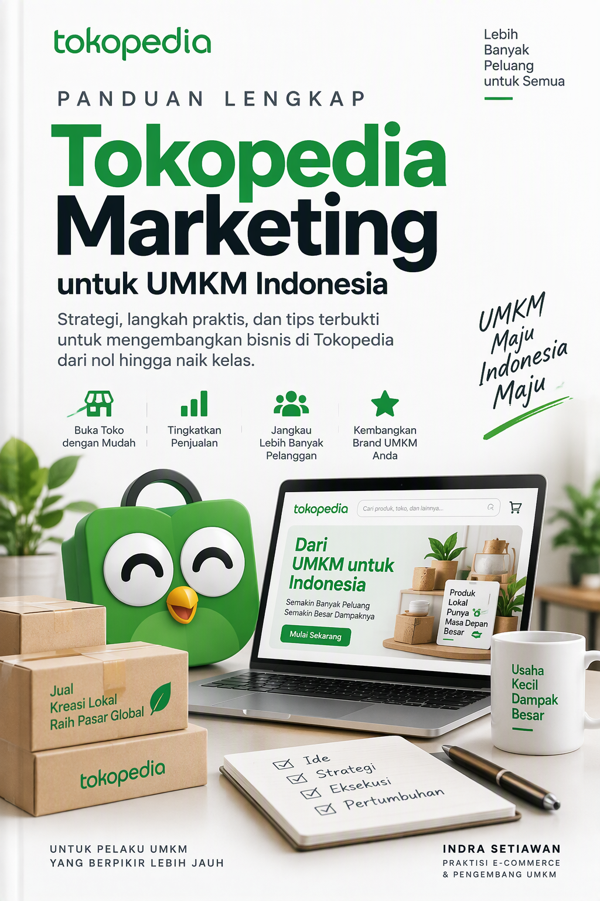
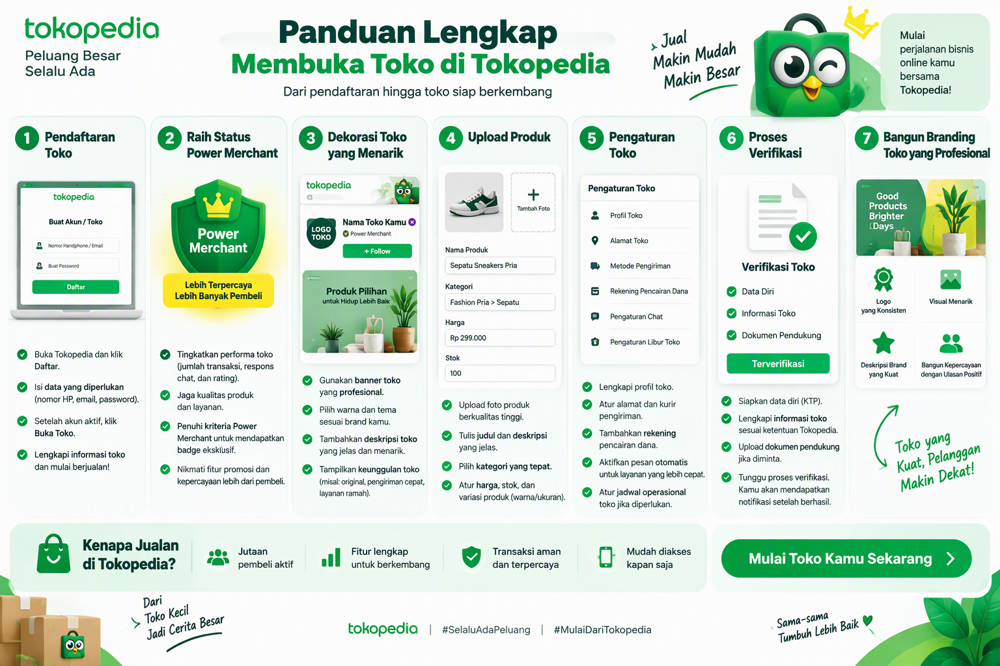
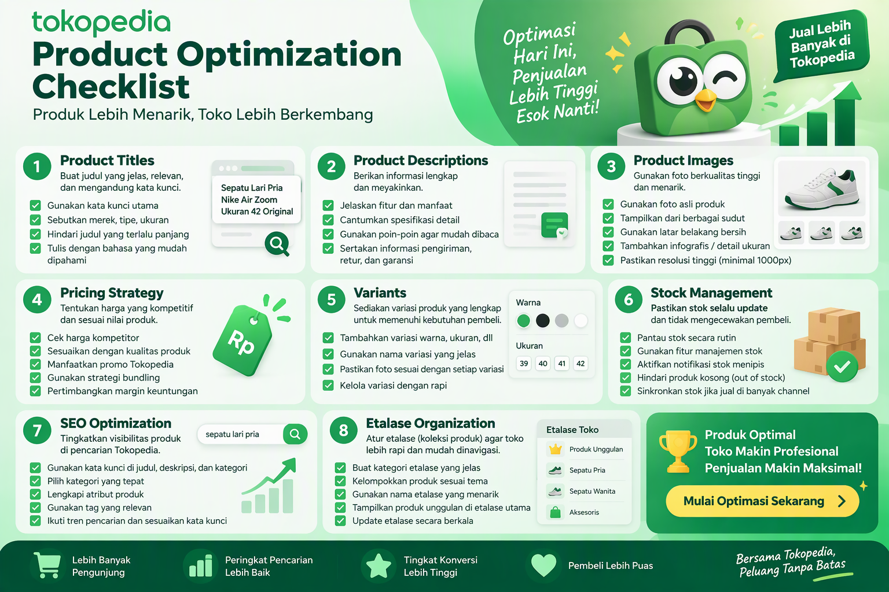
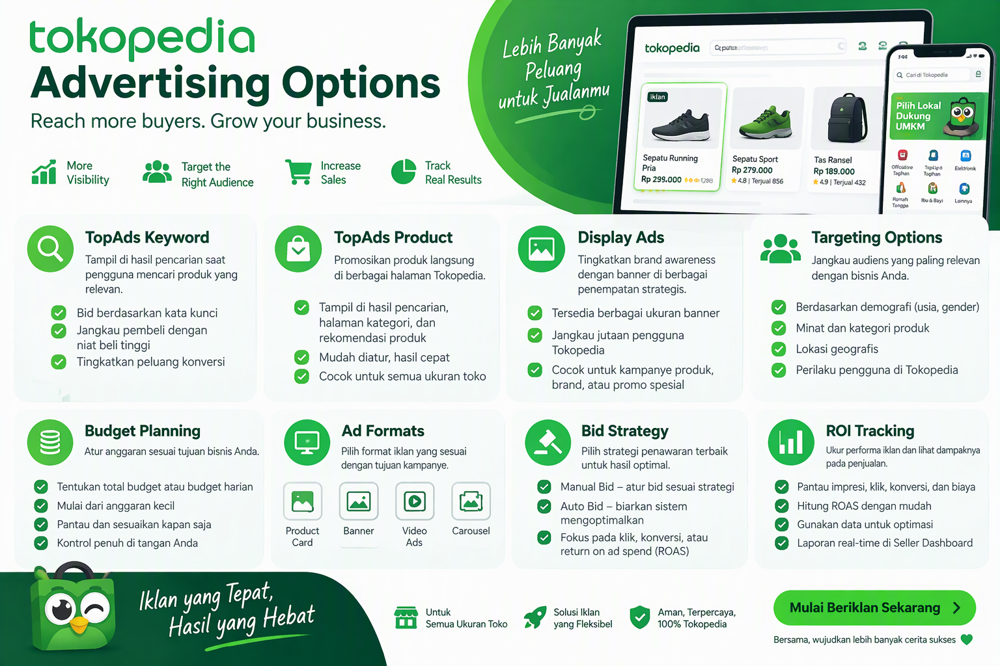
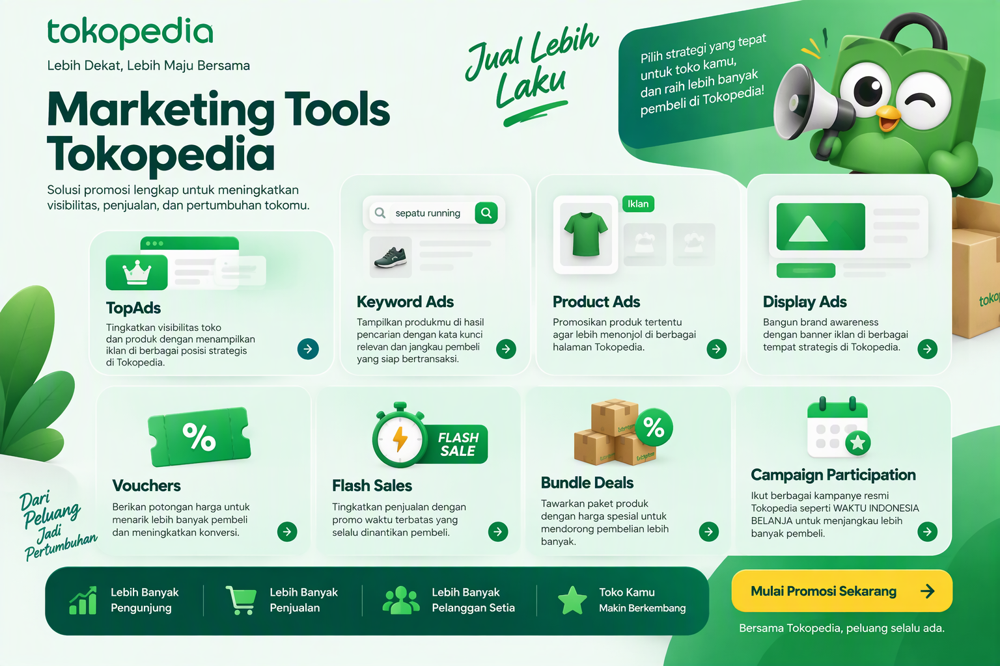
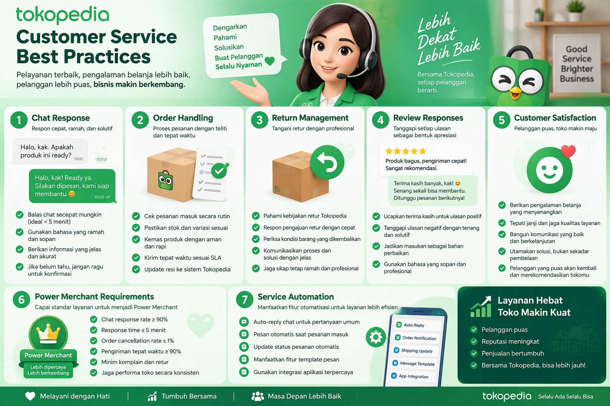
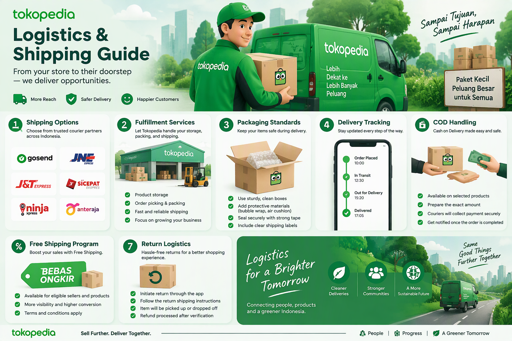
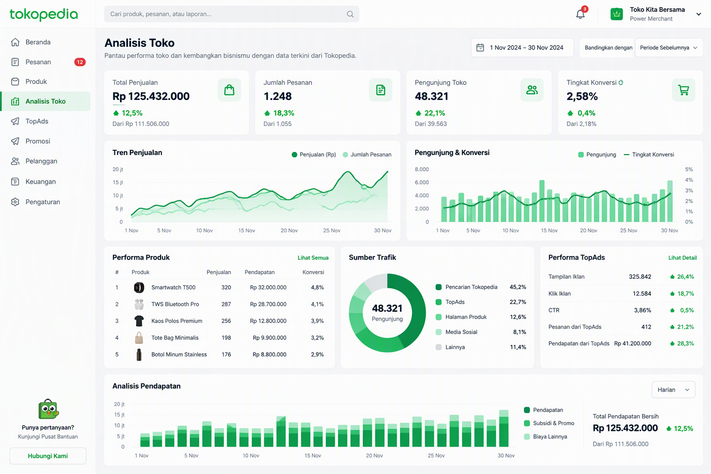
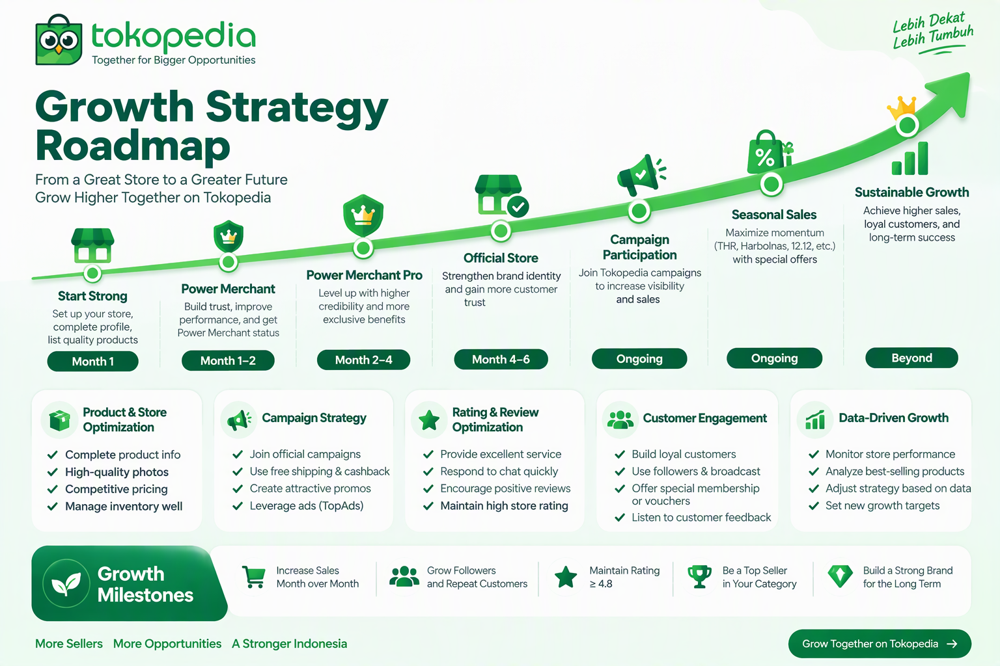
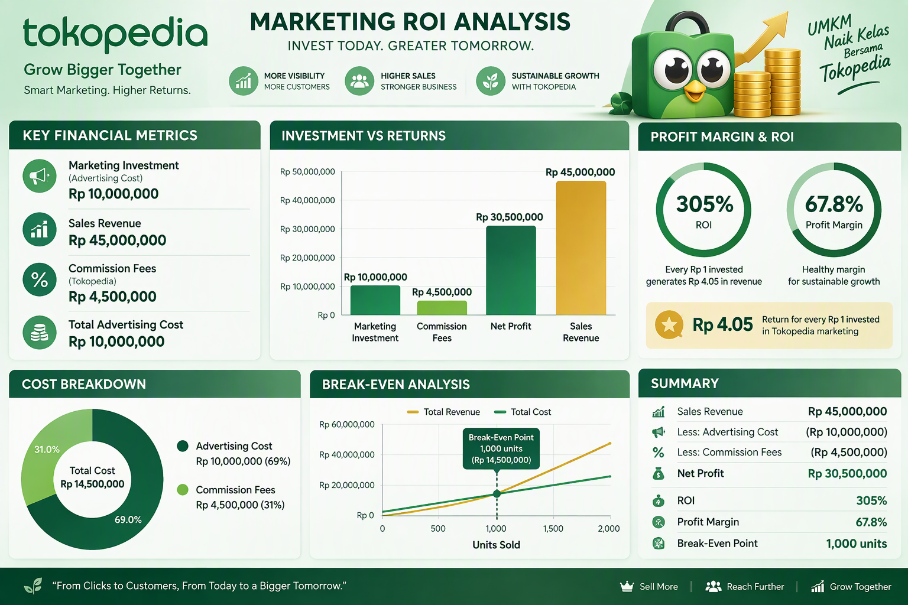

# Panduan Lengkap Tokopedia Marketing untuk UMKM Indonesia

**Strategi, Taktik, dan Template Siap Pakai untuk Meningkatkan Penjualan dan Brand Awareness di Tokopedia**

Disusun oleh: Siraj Nur Ihrom, Founder & Lead Developer SNISHOP
Versi: 1.0
Tanggal: Oktober 2026
Format: Panduan komprehensif dengan strategi, template, dan studi kasus
Standar: SNISHOP-PUBLISHING v2.0

---

## Tentang Buku Ini

Tokopedia telah menjadi salah satu marketplace terbesar di Indonesia dengan lebih dari 100 juta pengguna aktif bulanan dan jutaan penjual yang bergabung di platform ini. Bagi UMKM, Tokopedia bukan sekadar tempat berjualan, melainkan ekosistem bisnis lengkap yang menyediakan tools marketing, logistik, pembayaran, dan analytics dalam satu platform terintegrasi.

Buku ini adalah panduan komprehensif Tokopedia marketing yang dirancang khusus untuk UMKM Indonesia. Anda akan mempelajari strategi proven, implementasi praktis, dan studi kasus real dari seller yang berhasil membangun bisnis jutaan rupiah di Tokopedia.

Yang Anda dapatkan dari buku ini:
- Panduan lengkap setup toko dan Power Merchant status
- Strategi optimasi product listing yang menjual
- Panduan TopAds dan advertising strategy
- Panduan marketing tools: voucher, flash sale, campaign
- Strategi customer service dan chat response
- Panduan logistik dan program gratis ongkir
- Analytics dan pengukuran performance
- Growth strategy menuju Power Merchant Pro dan Official Store
- Kalkulator ROI Tokopedia marketing
- Studi kasus 3 bisnis dengan hasil konkret
- Rencana implementasi 30 hari
- Template dan checklist siap pakai



## Cara Menggunakan Buku Ini

Buku ini dibagi menjadi 10 bab yang terstruktur dalam 3 bagian:

**PART 1: FUNDAMENTAL TOKOPEDIA SELLING (Bab 1-3)**
- Memahami ekosistem Tokopedia dan peluang UMKM
- Setup toko dan Power Merchant status
- Optimasi product listing dan etalase

**PART 2: MARKETING TOOLS DAN STRATEGI (Bab 4-7)**
- TopAds dan advertising strategy
- Marketing tools: voucher, flash sale, campaign
- Customer service dan chat response
- Logistik dan program gratis ongkir

**PART 3: ANALISIS, GROWTH, DAN SKALING (Bab 8-10)**
- Analytics dan pengukuran performance
- Growth strategy: Power Merchant Pro, Official Store
- Studi kasus dan rencana implementasi

Setiap bab berisi:
- Teori dan konsep dasar
- Langkah-langkah praktis
- Template siap pakai
- Contoh real dari bisnis Indonesia
- Tips dan best practices

## Standar Kualitas Konten

Semua strategi dan template dalam buku ini mengikuti standar SNISHOP-PUBLISHING v2.0:
- Bahasa Indonesia yang natural dan profesional
- Strategi berbasis data dan hasil real
- Contoh konkret dengan angka dan metrik
- Tanpa frasa pengisi yang tidak berarti
- Tanpa emoji berlebihan atau simbol tidak profesional
- Struktur yang mudah diikuti dan diimplementasi

---

# PART 1: FUNDAMENTAL TOKOPEDIA SELLING

---

## Bab 1: Memahami Ekosistem Tokopedia dan Peluang UMKM

### 1.1 Landscape E-commerce Indonesia

E-commerce Indonesia mengalami pertumbuhan luar biasa dalam satu dekade terakhir. Berdasarkan data dari e-Conomy SEA Report 2025, nilai Gross Merchandise Value (GMV) e-commerce Indonesia mencapai USD 53 miliar, menjadikannya yang terbesar di Asia Tenggara. Kontribusi UMKM terhadap angka ini sangat signifikan, dengan lebih dari 64 juta UMKM yang mulai beralih ke platform digital.

Faktor-faktor pendorong pertumbuhan:
- Penetrasi internet yang mencapai 78% dari populasi
- Pengguna smartphone aktif lebih dari 340 juta
- Adopsi pembayaran digital yang meningkat pesat
- Infrastruktur logistik yang terus membaik
- Perilaku konsumen yang semakin digital-first

### 1.2 Mengapa Tokopedia untuk UMKM

Tokopedia memiliki beberapa keunggulan kompetitif yang menjadikannya pilihan utama bagi UMKM Indonesia:

**Jangkauan pasar yang luas:**
- 100 juta+ pengguna aktif bulanan
- Tersedia di 500+ kota di Indonesia
- Dukungan untuk pengiriman ke seluruh wilayah
- Trafik organik tinggi dari mesin pencari

**Biaya masuk yang rendah:**
- Pendaftaran gratis tanpa biaya awal
- Komisi kompetitif mulai dari 0% hingga 7.1%
- Tidak ada biaya listing produk
- Tools marketing tersedia untuk semua level seller

**Ekosistem terintegrasi:**
- Tokopedia Payments untuk pembayaran
- Tokopedia Shipping untuk logistik
- TopAds untuk advertising
- Tokopedia Play untuk konten video
- Tokopedia Affiliate untuk program referral

### 1.3 Memahami Algoritma Tokopedia

Algoritma Tokopedia menentukan produk mana yang muncul di halaman pencarian dan rekomendasi. Memahami cara kerjanya adalah kunci untuk meningkatkan visibility.

**Faktor ranking utama:**

| Faktor | Bobot | Keterangan |
|--------|-------|------------|
| Relevansi kata kunci | Tinggi | Kesesuaian judul dan deskripsi dengan pencarian |
| Performance toko | Tinggi | Rating, chat response rate, pengiriman tepat waktu |
| Penjualan | Sedang-Tinggi | Volume penjualan dan growth rate |
| Engagement | Sedang | Click-through rate, waktu kunjungan, wishlist |
| Harga kompetitif | Sedang | Perbandingan harga dengan produk serupa |
| Gratis ongkir | Sedang | Ketersediaan program free shipping |

**Cara algoritma Tokopedia menampilkan produk:**

1. Pembeli melakukan pencarian dengan kata kunci tertentu
2. Tokopedia memfilter produk berdasarkan relevansi kata kunci
3. Produk di-ranking berdasarkan kombinasi performance dan relevansi
4. Produk dengan rating tinggi dan penjualan bagus mendapat boost
5. Produk yang aktif mengikuti program Tokopedia mendapat prioritas tambahan

### 1.4 Segmentasi Pasar dan Niche Selection

Memilih niche yang tepat adalah fondasi keberhasilan di Tokopedia. Berikut framework untuk memilih niche:

**Framework RICE untuk Niche Selection:**

- **Reach (Jangkauan):** Seberapa besar pasar yang bisa dijangkau?
- **Impact (Dampak):** Seberapa besar margin keuntungan yang bisa didapat?
- **Confidence (Keyakinan):** Seberapa yakin Anda bisa bersaing di niche ini?
- **Effort (Usaha):** Seberapa besar effort yang dibutuhkan untuk memulai?

**Contoh evaluasi niche:**

| Niche | Reach (1-10) | Impact (1-10) | Confidence (1-10) | Effort (1-10) | Skor RICE |
|-------|--------------|---------------|-------------------|---------------|-----------|
| Fashion Wanita | 9 | 7 | 6 | 5 | 7.2 |
| Elektronik | 8 | 8 | 5 | 8 | 6.5 |
| Skincare | 8 | 9 | 7 | 6 | 8.0 |
| Makanan | 7 | 6 | 8 | 4 | 7.3 |
| Rumah Tangga | 7 | 7 | 7 | 5 | 7.0 |

**Tips memilih niche:**
- Pilih niche yang Anda pahami dengan baik
- Riset kompetitor sebelum memutuskan
- Mulai dengan 1-2 kategori, jangan terlalu luas
- Evaluasi performa setiap bulan
- Siap pivot jika niche tidak menghasilkan

### 1.5 Tokopedia vs Marketplace Lain: Keunggulan Kompetitif

Memahami posisi Tokopedia dibandingkan marketplace lain membantu Anda menentukan strategi yang tepat.

**Perbandingan platform marketplace:**

| Aspek | Tokopedia | Shopee | Lazada |
|-------|-----------|--------|--------|
| Pengguna bulanan | 100 juta+ | 50 juta+ | 30 juta+ |
| Fokus kategori | Elektronik, fashion, rumah tangga | Semua kategori | Elektronik, fashion |
| Komisi seller | 0-7.1% | 1-6% | 1-5% |
| Advertising | TopAds | Shopee Ads | Lazada Sponsored |
| Logistik | Tokopedia Shipping | SPX Express | Lazada Logistics |
| Pembayaran | Tokopedia Cash | ShopeePay | Lazada Wallet |
| Live streaming | Tokopedia Play | Shopee Live | Lazada Live |
| SEO Google | Sangat kuat | Sedang | Kuat |

**Keunggulan unik Tokopedia:**

1. **SEO Google yang kuat:**
   - Produk Tokopedia sering muncul di halaman pertama Google
   - Traffic organik dari Google sangat tinggi
   - Judul produk yang dioptimasi bisa mendapat traffic gratis dari Google

2. **Demografi pengguna yang premium:**
   - Mayoritas pengguna berada di kota-kota besar
   - Daya beli relatif lebih tinggi
   - Preferensi terhadap produk berkualitas dan original

3. **Program mitra yang matang:**
   - Tokopedia Affiliate program
   - Tokopedia Partner untuk reseller
   - Program referral yang aktif

### 1.6 Memahami Tipe-Tipe Seller di Tokopedia

Tokopedia memiliki beberapa tipe seller dengan benefit dan persyaratan berbeda:

| Tipe Seller | Persyaratan | Keuntungan |
|-------------|-------------|------------|
| Regular Seller | Semua orang | Bisa berjualan |
| Power Merchant | Verifikasi identitas + performa | Badge khusus, prioritas pencarian |
| Power Merchant Pro | Performa tinggi + omzet tertentu | Fitur premium, boost traffic |
| Official Store | Brand terdaftar + PT/CV | Trust tertinggi, fitur eksklusif |

### 1.7 Tips dan Best Practices

- Riset pasar sebelum menentukan produk yang akan dijual
- Mulai dari niche yang Anda kuasai
- Fokus pada kualitas produk dan pelayanan
- Manfaatkan semua tools gratis yang disediakan Tokopedia
- Belajar dari seller sukses di kategori yang sama
- Ikuti komunitas seller Tokopedia untuk update terbaru
- Evaluasi strategi setiap bulan dan sesuaikan dengan data
- Jangan mencoba semua strategi sekaligus, fokus pada 2-3 yang paling relevan
- Catat setiap pembelajaran dan hasil untuk referensi di masa depan
- Networking dengan seller lain bisa membuka peluang kolaborasi yang sangat menguntungkan
- Selalu update dengan perubahan kebijakan dan fitur baru dari Tokopedia

---

## Bab 2: Setup Toko dan Power Merchant Status

### 2.1 Proses Pendaftaran Tokopedia



**Langkah-langkah pendaftaran:**

1. **Buat akun Tokopedia:**
   - Kunjungi tokopedia.com atau download aplikasi
   - Klik "Daftar" dan masukkan email/nomor telepon
   - Verifikasi akun melalui email atau SMS
   - Lengkapi profil dasar

2. **Buka toko:**
   - Masuk ke dashboard seller
   - Klik "Buka Toko"
   - Isi informasi toko: nama, deskripsi, lokasi
   - Upload logo dan banner toko
   - Pilih kategori utama toko

3. **Verifikasi identitas:**
   - Upload KTP atau SIM
   - Foto selfie dengan dokumen
   - Tunggu proses verifikasi (1-3 hari kerja)
   - Status toko akan di-upgrade setelah verifikasi

### 2.2 Mengupgrade ke Power Merchant

Power Merchant adalah status yang memberikan kredibilitas lebih tinggi dan akses ke fitur-fitur tambahan.

**Persyaratan Power Merchant:**

| Kriteria | Minimum |
|----------|---------|
| Verifikasi identitas | Sudah terverifikasi |
| Jumlah produk | Minimal 10 produk aktif |
| Performa toko | Dalam kondisi baik |
| Pelanggaran | Tidak ada pelanggaran berat |

**Keuntungan Power Merchant:**
- Badge "Power Merchant" yang meningkatkan kepercayaan
- Prioritas di hasil pencarian
- Akses ke fitur marketing tambahan
- Statistik toko yang lebih detail
- Dukungan seller yang lebih prioritas

**Langkah upgrade ke Power Merchant:**
1. Pastikan semua persyaratan sudah terpenuhi
2. Masuk ke halaman "Toko Saya"
3. Klik "Upgrade ke Power Merchant"
4. Isi formulir pendaftaran
5. Tunggu proses review dari Tokopedia (3-7 hari kerja)
6. Jika disetujui, status toko akan otomatis di-upgrade

### 2.3 Optimasi Profil Toko

Profil toko yang profesional meningkatkan kepercayaan pembeli dan conversion rate.

**Elemen profil yang harus dioptimasi:**

1. **Nama toko:**
   - Singkat, mudah diingat, dan relevan
   - Mengandung kata kunci jika memungkinkan
   - Contoh: "Fashion Wanita Murah Jakarta" bukan "Toko Berkah Jaya"

2. **Deskripsi toko:**
   - Jelaskan apa yang Anda jual
   - Sertakan unique selling proposition
   - Tambahkan informasi pengiriman dan garansi
   - Panjang ideal: 150-300 karakter

3. **Logo dan banner:**
   - Logo: 200 x 200 pixel, format PNG atau JPG
   - Banner: 750 x 250 pixel, format PNG atau JPG
   - Gunakan desain profesional dan konsisten dengan branding

4. **Informasi kontak:**
   - Cantumkan nomor WhatsApp untuk konsultasi
   - Sertakan jam operasional toko
   - Tambahkan media sosial toko

**Template deskripsi toko:**

```
[Nama Toko] adalah toko spesialis [kategori produk] yang menyediakan [jenis produk] berkualitas dengan harga terjangkau.

Keunggulan kami:
- Produk 100% original dan bergaransi
- Pengiriman cepat dari [lokasi]
- Customer service responsif (Senin-Jumat, 08.00-17.00)
- Menerima retur hingga 7 hari setelah barang diterima

Follow toko kami untuk update produk baru dan promo spesial!
```

### 2.4 Setup Metode Pembayaran dan Pengiriman

**Aktivasi metode pembayaran:**
- Tokopedia Cash (saldo Tokopedia)
- Transfer bank (BCA, Mandiri, BNI, BRI)
- Kartu kredit (Visa, Mastercard)
- Cicilan 0%
- COD (Cash on Delivery)

**Setup metode pengiriman:**
- Kurir reguler: JNE, J&T, SiCepat, Anteraja
- Kurir instan: GoSend, GrabExpress
- Kurir hemat: Tokopedia Shipping
- Free shipping program (akan dibahas di Bab 7)

**Tips setup pengiriman:**
- Aktifkan minimal 3-4 kurir untuk memberikan pilihan
- Setting berat produk dengan akurat
- Gunakan kemasan yang aman dan profesional
- Tawarkan opsi pengiriman instan untuk area lokal

### 2.5 Checklist Setup Toko

**Checklist sebelum mulai berjualan:**

- [ ] Akun Tokopedia terverifikasi
- [ ] Profil toko lengkap (nama, deskripsi, logo, banner)
- [ ] Power Merchant status aktif
- [ ] Minimal 10 produk sudah di-upload
- [ ] Metode pembayaran diaktifkan
- [ ] Metode pengiriman di-setting
- [ ] Jam operasional toko ditentukan
- [ ] Kontak customer service dicantumkan
- [ ] Kebijakan retur dan garansi jelas
- [ ] Social media toko terhubung

### 2.6 Tips dan Best Practices

- Gunakan nama toko yang mudah diingat dan diketik
- Investasikan waktu untuk membuat logo dan banner profesional
- Lengkapi semua informasi toko sebelum mulai marketing
- Respon cepat setiap pertanyaan dari calon pembeli
- Jaga performa toko sejak hari pertama
- Dokumentasikan semua setting untuk referensi di masa depan

---

## Bab 3: Optimasi Product Listing dan Etalase

### 3.1 Anatomi Product Listing yang Menjual



Product listing adalah etalase digital Anda. Listing yang optimal akan meningkatkan click-through rate dan conversion rate secara signifikan.

**Elemen product listing:**

1. **Judul produk (maksimal 70 karakter):**
   - Mengandung kata kunci utama
   - Menjelaskan produk dengan jelas
   - Menambahkan diferensiator (warna, ukuran, varian)
   - Contoh: "Kemeja Flanel Pria Lengan Panjang - Kotak-Kotak Red Navy"

2. **Foto produk (minimal 5 foto):**
   - Foto utama: produk dengan background putih
   - Foto detail: close-up tekstur, bahan, fitur
   - Foto lifestyle: produk dalam penggunaan nyata
   - Foto ukuran: produk dengan penggaris atau perbandingan
   - Foto varian: semua pilihan warna/model

3. **Deskripsi produk:**
   - Paragraf pembuka: hook yang menarik
   - Spesifikasi lengkap: bahan, ukuran, berat, warna
   - Fitur dan benefit: apa yang didapat pembeli
   - Cara penggunaan atau perawatan
   - Kebijakan garansi dan retur

4. **Harga dan stok:**
   - Harga kompetitif berdasarkan riset pasar
   - Stok selalu di-update
   - Variant pricing jika ada pilihan

### 3.2 Riset Kata Kunci untuk Tokopedia

Kata kunci yang tepat menentukan apakah produk Anda ditemukan oleh calon pembeli.

**Metode riset kata kunci:**

1. **Tokopedia Search Suggestion:**
   - Ketik kata kunci di kolom pencarian Tokopedia
   - Lihat saran yang muncul (autocomplete)
   - Catat semua variasi kata kunci

2. **Analisis kompetitor:**
   - Cari produk serupa di Tokopedia
   - Perhatikan judul dan deskripsi seller top
   - Identifikasi kata kunci yang mereka gunakan

3. **Tools eksternal:**
   - Google Keyword Planner (gratis)
   - Ubersuggest (freemium)
   - Ahrefs Keyword Generator (gratis terbatas)

**Template judul produk:**

```
[Kata Kunci Utama] + [Spesifikasi] + [Varian] + [Diferensiator]

Contoh:
- Sepatu Running Pria - Sneakers Olahraga Ringan - Hitam Putih
- Tas Selempang Wanita - Sling Bag Kulit Sintetis Premium - Brown
- Headset Bluetooth - Earphone Wireless TWS Noise Cancelling - Bass
```

### 3.3 Strategi Foto Produk

Foto produk adalah faktor paling penting dalam conversion rate. Pembeli tidak bisa menyentuh produk, sehingga foto menjadi representasi visual utama.

**Standar foto produk Tokopedia:**

| Aspek | Standar | Keterangan |
|-------|---------|------------|
| Resolusi | Minimal 700 x 700 px | Semakin tinggi semakin baik |
| Format | JPG atau PNG | Background putih untuk foto utama |
| Jumlah | 5-9 foto | Cover semua angle dan detail |
| Lighting | Terang dan merata | Hindari bayangan keras |
| Komposisi | Produk di tengah | Sisakan ruang minimal 10% |

**Jenis-jenis foto yang harus ada:**
1. Foto utama: produk dengan background putih bersih
2. Foto angle: produk dari berbagai sudut pandang
3. Foto detail: close-up tekstur, bahan, jahitan
4. Foto ukuran: produk dengan penggaris atau perbandingan objek
5. Foto lifestyle: produk dalam konteks penggunaan
6. Foto varian: semua pilihan warna atau model
7. Foto packaging: kemasan produk untuk trust
8. Foto sertifikat: jika ada (BPOM, SNI, halal)
9. Foto perbandingan: dengan produk kompetitor (opsional)

### 3.4 Optimasi Etalase (Showcase)

Etalase adalah cara Anda mengelompokkan produk di toko untuk memudahkan pembeli menemukan apa yang mereka cari.

**Strategi etalase:**

1. **Berdasarkan kategori:**
   - Etalase "Koleksi Terbaru"
   - Etalase "Best Seller"
   - Etalase "Promo Spesial"
   - Etalase per kategori produk

2. **Berdasarkan harga:**
   - Etalase "Under Rp 100.000"
   - Etalase "Rp 100.000 - Rp 500.000"
   - Etalase "Premium Collection"

3. **Berdasarkan musim/event:**
   - Etalase "Koleksi Lebaran"
   - Etalase "Back to School"
   - Etalase "Harbolnas 12.12"

**Template nama etalase:**
```
[Kategori] + [Karakteristik]

Contoh:
- Kemeja Pria - Lengan Pendek
- Dress Wanita - Casual & Party
- Aksesoris HP - Case & Charger
- Skincare - Paket Lengkap
```

### 3.5 Copywriting untuk Deskripsi Produk

Deskripsi produk yang baik tidak hanya informatif tetapi juga persuasif.

**Framework AIDA untuk deskripsi:**

1. **Attention (Perhatian):**
   - Hook di kalimat pertama
   - Sebutkan masalah yang dihadapi pembeli
   - Contoh: "Mencari kemeja yang nyaman dipakai seharian?"

2. **Interest (Minat):**
   - Jelaskan fitur utama produk
   - Gunakan bahasa yang mudah dipahami
   - Contoh: "Kemeja flanel premium kami terbuat dari bahan katun 100% yang lembut dan breathable."

3. **Desire (Keinginan):**
   - Sampaikan benefit dan value
   - Gunakan social proof jika ada
   - Contoh: "Sudah dipakai oleh 5.000+ pelanggan dengan rating 4.9/5."

4. **Action (Tindakan):**
   - Call to action yang jelas
   - Tambahkan urgency jika memungkinkan
   - Contoh: "Order sekarang sebelum kehabisan stok!"

**Template deskripsi produk:**

```
[HOOK - 1 kalimat yang menarik perhatian]

[PARAGRAF 1 - Penjelasan produk dan benefit utama]

SPESIFIKASI PRODUK:
- Bahan: [jenis bahan]
- Ukuran: [S/M/L/XL atau dimensi]
- Berat: [gram]
- Warna: [pilihan warna]
- [Spesifikasi lainnya]

KEUNGGULAN PRODUK:
- [Keunggulan 1]
- [Keunggulan 2]
- [Keunggulan 3]

GARANSI DAN KEBIJAKAN:
- Garansi [jenis garansi]
- Menerima retur hingga [x] hari
- Pengiriman dari [lokasi]

[CALL TO ACTION]
Order sekarang! Stok terbatas.
```

### 3.6 SEO Tokopedia: Optimasi untuk Pencarian Internal dan Google

SEO di Tokopedia bekerja di dua level: pencarian internal Tokopedia dan pencarian Google.

**SEO internal Tokopedia:**

1. **Optimasi judul produk:**
   - Letakkan kata kunci utama di awal judul
   - Gunakan variasi kata kunci yang sering dicari
   - Maksimal 70 karakter untuk judul
   - Contoh: "Sepatu Running Pria Original Nike Air Zoom - Hitam Putih Size 40-45"

2. **Optimasi deskripsi:**
   - Masukkan kata kunci secara natural di paragraf pertama
   - Gunakan bullet points untuk spesifikasi
   - Panjang ideal: 300-500 kata
   - Hindari keyword stuffing

3. **Optimasi kategori:**
   - Pilih kategori yang paling relevan
   - Jangan salah kategori (bisa kena penalty)
   - Sub-kategori yang tepat meningkatkan visibility

**SEO Google untuk produk Tokopedia:**

Produk Tokopedia sering muncul di halaman pertama Google karena domain authority yang tinggi. Strategi untuk memanfaatkan ini:

1. **Judul produk yang searchable:**
   - Gunakan kata kunci yang orang cari di Google
   - Contoh: "Jual iPhone 13 Pro Max 256GB Original Garansi Resmi"
   - Hindari judul yang terlalu kreatif tapi tidak searchable

2. **Deskripsi yang informatif:**
   - Google mengindeks deskripsi produk
   - Tulis deskripsi yang lengkap dan relevan
   - Sertakan spesifikasi teknis yang detail

3. **Review dan rating:**
   - Produk dengan banyak review ranking lebih tinggi
   - Rating 4.5+ mendapat boost di Google
   - Respond ke semua review untuk engagement

**Template riset kata kunci:**

```
WORKSHEET RISET KATA KUNCI TOKOPEDIA
=====================================

Produk: [nama produk]
Kategori: [kategori produk]

Kata Kunci Utama (search volume tinggi):
1. [kata kunci 1] - estimasi volume: [jumlah]/bulan
2. [kata kunci 2] - estimasi volume: [jumlah]/bulan
3. [kata kunci 3] - estimasi volume: [jumlah]/bulan

Kata Kunci Long-tail (kompetisi rendah):
1. [kata kunci 1] + [spesifikasi]
2. [kata kunci 2] + [lokasi]
3. [kata kunci 3] + [harga]

Kata Kunci Kompetitor:
- Cek judul produk top 10 di pencarian Tokopedia
- Catat kata kunci yang mereka gunakan
- Identifikasi gap yang bisa dimanfaatkan

Judul Produk Final:
[Kata Kunci Utama] + [Spesifikasi] + [Diferensiator]
```

### 3.7 Tips dan Best Practices

- Gunakan minimal 5 foto berkualitas tinggi untuk setiap produk
- Riset kata kunci sebelum menulis judul produk
- Tulis deskripsi yang informatif dan persuasif
- Update stok secara real-time untuk menghindari pembatalan
- Kelompokkan produk dalam etalase yang logis
- Monitor performa setiap produk dan optimasi yang underperform
- A/B testing judul dan foto untuk menemukan kombinasi terbaik
- Jawab pertanyaan pembeli dengan cepat dan lengkap
- Manfaatkan SEO Tokopedia untuk traffic organik dari Google
- Review dan update listing secara berkala (minimal sebulan sekali)

---

# PART 2: MARKETING TOOLS DAN STRATEGI

---

## Bab 4: TopAds dan Advertising Strategy

### 4.1 Mengenal TopAds Tokopedia



TopAds adalah platform advertising resmi Tokopedia yang memungkinkan seller untuk mempromosikan produk mereka di berbagai posisi strategis dalam platform.

**Jenis-jenis TopAds:**

1. **Product Ads (Iklan Produk):**
   - Produk muncul di halaman pencarian
   - Posisi: baris paling atas dan sela-sela hasil organik
   - Model bayar: Cost Per Click (CPC)
   - Budget minimum: Rp 50.000/hari

2. **Display Ads (Iklan Display):**
   - Banner iklan di halaman utama Tokopedia
   - Muncul di kategori tertentu
   - Model bayar: Cost Per Impression (CPM) atau flat rate
   - Budget minimum: Rp 500.000/kampanye

3. **Brand Ads (Iklan Brand):**
   - Iklan khusus untuk brand awareness
   - Posisi premium di halaman utama
   - Model bayar: flat rate
   - Budget minimum: Rp 5.000.000/kampanye

### 4.2 Setup Product Ads

Product Ads adalah jenis iklan yang paling umum digunakan oleh seller Tokopedia karena model CPC yang transparan dan ROI yang mudah diukur.

**Langkah setup Product Ads:**

1. Masuk ke Seller Centre Tokopedia
2. Pilih menu "TopAds" di sidebar
3. Klik "Buat Kampanye Baru"
4. Pilih "Product Ads"
5. Setting kampanye:
   - Nama kampanye
   - Tanggal mulai dan berakhir
   - Budget harian (minimal Rp 50.000)
   - Target kata kunci
6. Pilih produk yang akan diiklankan
7. Set bid (harga per klik) untuk setiap kata kunci
8. Review dan aktifkan kampanye

**Strategi bidding:**

| Strategi | Bid Price | Kapan Digunakan |
|----------|-----------|-----------------|
| Conservative | Rp 100-300 | Produk dengan margin tipis |
| Moderate | Rp 300-700 | Produk dengan margin sedang |
| Aggressive | Rp 700-1.500 | Produk best seller atau high margin |
| Premium | Rp 1.500+ | Kampanye khusus atau event besar |

### 4.3 Optimasi Kampanye Iklan

Setelah kampanye berjalan, optimasi adalah kunci untuk memaksimalkan ROI.

**Metrik yang harus dimonitor:**

| Metrik | Formula | Target |
|--------|---------|--------|
| CTR (Click-Through Rate) | Klik / Tayangan x 100% | > 2% |
| CPC (Cost Per Click) | Total biaya / Total klik | < Rp 500 |
| CR (Conversion Rate) | Order / Klik x 100% | > 3% |
| ROAS (Return on Ad Spend) | Revenue dari iklan / Biaya iklan | > 5x |
| ACOS (Advertising Cost of Sales) | Biaya iklan / Revenue x 100% | < 20% |

**Strategi optimasi:**

1. **Minggu 1-2: Data collection**
   - Biarkan iklan berjalan tanpa perubahan
   - Kumpulkan data performance
   - Identifikasi kata kunci yang perform

2. **Minggu 3-4: Initial optimization**
   - Naikkan bid untuk kata kunci dengan ROAS tinggi
   - Turunkan bid atau pause kata kunci dengan ROAS rendah
   - Tambah kata kunci baru berdasarkan search term report

3. **Bulan 2+: Continuous optimization**
   - A/B testing bid price
   - Expand ke kata kunci long-tail
   - Adjust budget berdasarkan performa
   - Monitor kompetisi dan adjust strategi

### 4.4 Kampanye Musiman dan Event

Tokopedia sering mengadakan event besar seperti Harbolnas, 12.12, dan Tahun Baru. Event ini adalah momentum untuk meningkatkan penjualan secara signifikan.

**Kalender event Tokopedia 2026:**

| Event | Tanggal | Strategi |
|-------|---------|----------|
| Tahun Baru | 1 Januari | Promo awal tahun, resolusi |
| Imlek | Januari-Februari | Produk bernuansa merah, angpao |
| Harbolnas 3.3 | 3 Maret | Diskon besar, flash sale |
| Ramadan | Maret-April | Produk Lebaran, hampers |
| Harbolnas 6.6 | 6 Juni | Mid-year sale |
| Kemerdekaan | 17 Agustus | Promo merah putih |
| Harbolnas 9.9 | 9 September | Pre-harbolnas |
| Harbolnas 10.10 | 10 Oktober | Singles day预热 |
| Harbolnas 11.11 | 11 November | Singles day |
| Harbolnas 12.12 | 12 Desember | Year-end sale |

**Strategi iklan saat event:**
- Naikkan budget 2-3x dari normal
- Siapkan kampanye khusus H-7 event
- Gunakan kata kunci terkait event
- Buat landing page atau banner khusus
- Monitor performance setiap jam saat peak day

### 4.5 Menghitung ROI Iklan

**Formula ROI TopAds:**

```
ROI = (Revenue dari iklan - Biaya iklan) / Biaya iklan x 100%

Contoh:
- Biaya iklan: Rp 3.000.000/bulan
- Revenue dari iklan: Rp 18.000.000/bulan
- ROI = (18.000.000 - 3.000.000) / 3.000.000 x 100%
- ROI = 500%

ROAS = Revenue dari iklan / Biaya iklan
ROAS = 18.000.000 / 3.000.000 = 6x
```

**Break-even analysis:**

```
Break-even ROAS = 1 / Margin produk

Contoh:
- Harga jual: Rp 200.000
- HPP: Rp 120.000
- Margin: (200.000 - 120.000) / 200.000 = 40%
- Break-even ROAS = 1 / 0.4 = 2.5x

Artinya: ROAS harus minimal 2.5x untuk break-even
```

### 4.6 Tips dan Best Practices

- Mulai dengan budget kecil (Rp 50.000-100.000/hari) untuk testing
- Fokus pada 5-10 kata kunci utama di awal
- Monitor ROAS, bukan hanya clicks
- Pause kata kunci yang tidak perform setelah 7 hari
- Scale up budget untuk kata kunci dengan ROAS tinggi
- Manfaatkan event besar untuk boost penjualan
- A/B testing foto produk untuk meningkatkan CTR
- Dokumentasikan semua learning untuk kampanye berikutnya

---

## Bab 5: Marketing Tools: Voucher, Flash Sale, Campaign

### 5.1 Voucher Toko



Voucher toko adalah alat marketing yang sangat efektif untuk meningkatkan conversion rate dan average order value.

**Jenis-jenis voucher:**

1. **Voucher Diskon Persentase:**
   - Contoh: Diskon 10% untuk semua produk
   - Cocok untuk meningkatkan volume penjualan
   - Break-even: jika margin > 10%

2. **Voucher Diskon Nominal:**
   - Contoh: Potongan Rp 20.000 untuk pembelian minimal Rp 100.000
   - Cocok untuk meningkatkan average order value
   - Break-even: jika AOV > nominal voucher

3. **Voucher Gratis Ongkir:**
   - Contoh: Gratis ongkir untuk semua pesanan
   - Cocok untuk menarik pembeli baru
   - Break-even: jika margin cukup untuk cover ongkir

**Setting voucher di Tokopedia:**

1. Masuk ke Seller Centre
2. Pilih menu "Promosi" > "Voucher Toko"
3. Klik "Buat Voucher Baru"
4. Pilih jenis voucher (persentase/nominal/gratis ongkir)
5. Setting parameter:
   - Nilai diskon
   - Minimum pembelian
   - Periode berlaku
   - Kuota penggunaan
   - Batas penggunaan per pembeli
6. Review dan aktifkan voucher

**Template strategi voucher:**

```
Voucher Pembeli Baru:
- Diskon 15% untuk pembelian pertama
- Minimum pembelian: Rp 50.000
- Kuota: 100 penggunaan
- Periode: 30 hari

Voucher Repeat Order:
- Diskon 10% untuk pembelian kedua
- Minimum pembelian: Rp 100.000
- Kuota: unlimited
- Periode: 60 hari setelah pembelian pertama

Voucher Event:
- Diskon 20% untuk Harbolnas
- Minimum pembelian: Rp 150.000
- Kuota: 50 penggunaan
- Periode: 3 hari (H-1, H, H+1 event)
```

### 5.2 Flash Sale Toko

Flash Sale adalah fitur yang memungkinkan Anda menawarkan diskon besar dalam waktu terbatas.

**Strategi Flash Sale:**

1. **Timing:**
   - Durasi ideal: 2-4 jam
   - Waktu terbaik: 12.00-14.00 (jam makan siang) atau 19.00-21.00 (malam)
   - Frekuensi: 1-2x per minggu

2. **Produk yang di-flash sale:**
   - Best seller (untuk boost volume)
   - Produk dengan margin tinggi (untuk profitability)
   - Produk baru (untuk awareness)
   - Stok lama (untuk clearance)

3. **Diskon yang menarik:**
   - Minimum 20% untuk menciptakan urgency
   - Ideal 30-50% untuk produk yang ingin di-clear
   - Jangan terlalu sering diskon > 50% (merusak brand)

**Template Flash Sale:**

```
Flash Sale Weekend:
- Waktu: Sabtu, 12.00-16.00
- Produk: 5 best seller
- Diskon: 25-35%
- Kuota: 20 pcs per produk
- Promosi: Share di social media H-1

Flash Sale Payday:
- Waktu: Tanggal 25-28, 19.00-21.00
- Produk: 10 produk campur
- Diskon: 20-40%
- Kuota: 10-30 pcs per produk
- Promosi: Email blast + push notification
```

### 5.3 Campaign Tokopedia

Tokopedia menyediakan berbagai campaign resmi yang bisa diikuti oleh seller.

**Jenis campaign:**

1. **Campaign Harbolnas (Hari Belanja Online Nasional):**
   - Event terbesar: 11.11 dan 12.12
   - Persiapan: H-30 sudah harus siap
   - Benefit: traffic boost hingga 5x
   - Persyaratan: diskon minimum 20%

2. **Campaign Kategori:**
   - Fashion Week, Gadget Festival, Beauty Days
   - Fokus pada kategori tertentu
   - Persyaratan lebih ringan dari Harbolnas
   - Traffic boost 2-3x

3. **Campaign Gratis Ongkir:**
   - Subsidi ongkir dari Tokopedia
   - Seller hanya perlu aktifkan program
   - Meningkatkan conversion rate signifikan
   - Bergabung dengan banner gratis ongkir

4. **Campaign Tokopedia Play:**
   - Live streaming commerce
   - Interaksi langsung dengan pembeli
   - Bisa kombinasikan dengan voucher
   - Engagement rate sangat tinggi

**Strategi mengikuti campaign:**

1. **Persiapan (H-30):**
   - Cek kalender campaign Tokopedia
   - Siapkan stok produk yang akan di-promote
   - Hitung margin dan setting diskon
   - Buat materi promosi (banner, deskripsi)

2. **Eksekusi (H-7 sampai H-Day):**
   - Aktifkan semua voucher dan flash sale
   - Naikkan budget iklan 2-3x
   - Monitor stok secara real-time
   - Siapkan tim customer service tambahan

3. **Evaluasi (H+1 sampai H+7):**
   - Analisis penjualan selama campaign
   - Hitung ROI dan ROAS
   - Catat learning untuk campaign berikutnya
   - Follow up pelanggan yang sudah membeli

### 5.4 Tokopedia Play dan Live Streaming Commerce

Live streaming commerce adalah tren yang berkembang pesat di Tokopedia. Tokopedia Play memungkinkan seller untuk berinteraksi langsung dengan pembeli secara real-time.

**Manfaat Tokopedia Play:**
- Engagement rate 5-10x lebih tinggi dari produk statis
- Conversion rate 3-5x lebih tinggi saat live
- Brand awareness yang lebih kuat
- Feedback langsung dari pembeli

**Strategi live streaming efektif:**

1. **Persiapan sebelum live:**
   - Tentukan tema dan produk yang akan ditampilkan
   - Siapkan script atau talking points
   - Test koneksi internet dan lighting
   - Promosikan live di social media H-1
   - Siapkan voucher eksklusif untuk penonton live

2. **Saat live:**
   - Durasi ideal: 30-60 menit
   - Tampilkan produk secara detail (close-up)
   - Jawab pertanyaan penonton secara real-time
   - Berikan promo eksklusif selama live
   - Gunakan bahasa yang energik dan engaging

3. **Setelah live:**
   - Rekap penjualan dari live
   - Analisis viewer metrics (peak viewers, average watch time)
   - Follow up pembeli yang sudah order
   - Dokumentasikan learning untuk live berikutnya

**Template jadwal live streaming:**

```
JADWAL LIVE STREAMING MINGGUAN
===============================

Senin: OFF (persiapan konten)
Selasa: 19.00-20.00 (flash sale produk baru)
Rabu: OFF
Kamis: 19.00-20.00 (demo produk + Q&A)
Jumat: 12.00-13.00 (lunch deal spesial)
Sabtu: 15.00-16.30 (weekend sale besar)
Minggu: 19.00-20.00 (preview produk minggu depan)

Target per sesi:
- Viewers: 100-500
- Engagement rate: > 10%
- Conversion rate: > 5%
- Revenue per sesi: Rp 2-5 juta
```

### 5.5 Bundle Deals dan Cross-Selling

Bundle deals adalah strategi untuk meningkatkan average order value dengan menawarkan kombinasi produk.

**Jenis bundle:**

1. **Buy More Save More:**
   - Beli 2 diskon 10%, beli 3 diskon 15%
   - Cocok untuk produk dengan repeat purchase tinggi
   - Contoh: skincare, makanan, aksesoris

2. **Product Bundle:**
   - Kombinasi produk terkait dengan harga spesial
   - Contoh: kemeja + dasi + sabuk = Rp 350.000 (normal Rp 450.000)
   - Meningkatkan AOV secara signifikan

3. **Gift with Purchase:**
   - Gratis produk tertentu untuk pembelian minimum
   - Contoh: gratis tote bag untuk pembelian di atas Rp 200.000
   - Meningkatkan perceived value

### 5.5 Tips dan Best Practices

- Gunakan voucher untuk menarik pembeli baru dan retain pembeli lama
- Flash Sale efektif untuk boost volume dalam waktu singkat
- Ikuti campaign resmi Tokopedia untuk akses traffic premium
- Bundle deals meningkatkan AOV dan customer satisfaction
- Monitor redemption rate voucher untuk evaluasi strategi
- Jangan terlalu sering memberikan diskon besar (merusak brand image)
- Kombinasikan berbagai tools marketing untuk hasil maksimal
- Dokumentasikan setiap campaign untuk referensi di masa depan

---

## Bab 6: Customer Service dan Chat Response

### 6.1 Pentingnya Customer Service di Tokopedia



Customer service adalah diferensiator utama di marketplace. Dengan persaingan yang ketat, pelayanan yang baik bisa menjadi competitive advantage yang signifikan.

**Dampak customer service terhadap performa toko:**

| Metrik | CS Bagus | CS Buruk |
|--------|----------|----------|
| Chat Response Rate | > 95% | < 70% |
| Chat Response Time | < 5 menit | > 30 menit |
| Rating Toko | 4.8-5.0 | 4.0-4.5 |
| Conversion Rate | 4-6% | 1-2% |
| Repeat Order Rate | 35-50% | 10-20% |
| Komplain Rate | < 2% | > 10% |

### 6.2 Setting Chat Response

Tokopedia mengukur performa chat Anda melalui dua metrik utama:

1. **Chat Response Rate:**
   - Persentase chat yang dibalas
   - Target: > 90%
   - Dihitung dari chat yang masuk selama jam operasional

2. **Chat Response Time:**
   - Rata-rata waktu untuk membalas chat
   - Target: < 10 menit
   - Dihitung dari chat pertama kali masuk sampai dibalas

**Setting jam operasional:**

1. Masuk ke Seller Centre
2. Pilih menu "Pengaturan Toko"
3. Setting jam operasional (contoh: Senin-Sabtu, 08.00-20.00)
4. Aktifkan auto-reply untuk di luar jam operasional

**Template auto-reply:**

```
Auto-reply jam operasional:
"Halo! Terima kasih sudah menghubungi [Nama Toko]. 
Kami akan membalas chat Anda dalam beberapa menit. 
Sementara itu, silakan cek produk kami di etalase toko."

Auto-reply di luar jam operasional:
"Halo! Terima kasih sudah menghubungi [Nama Toko]. 
Jam operasional kami: Senin-Sabtu, 08.00-20.00. 
Kami akan membalas chat Anda segera di jam operasional berikutnya. 
Untuk pertanyaan umum, silakan cek deskripsi produk atau FAQ toko."
```

### 6.3 Menangani Pertanyaan Pembeli

**Jenis pertanyaan umum dan template jawaban:**

1. **Pertanyaan tentang produk:**
   ```
   Q: "Apakah barang ini original?"
   A: "Halo Kak! Produk kami 100% original dan bergaransi resmi. 
   Kami adalah reseller resmi dari [brand]. Jika ada keraguan, 
   Kakak bisa cek kode keaslian di kemasan. Terima kasih!"
   ```

2. **Pertanyaan tentang stok:**
   ```
   Q: "Masih ada ukuran L?"
   A: "Halo Kak! Untuk ukuran L masih tersedia dalam warna 
   [sebutkan warna]. Silakan langsung order ya Kak, stok terbatas. 
   Terima kasih!"
   ```

3. **Pertanyaan tentang pengiriman:**
   ```
   Q: "Berapa lama sampai ke Jakarta?"
   A: "Halo Kak! Untuk pengiriman ke Jakarta estimasi 2-3 hari 
   kerja dengan kurir [sebutkan kurir]. Kami kirim dari [kota asal]. 
   Order sebelum jam 15.00 akan kami proses hari itu juga!"
   ```

4. **Pertanyaan tentang diskon:**
   ```
   Q: "Bisa kurang harganya?"
   A: "Halo Kak! Harga kami sudah sangat kompetitif untuk kualitas 
   produk ini. Namun, kami punya voucher diskon 10% untuk pembelian 
   pertama. Silakan klaim voucher di halaman toko kami ya Kak!"
   ```

### 6.4 Menangani Komplain

Komplain adalah bagian normal dari bisnis online. Yang penting adalah bagaimana Anda menanganinya.

**Framework penanganan komplain (HEART):**

1. **Hear (Dengarkan):**
   - Biarkan pembeli menjelaskan masalahnya
   - Jangan memotong atau membela diri
   - Tunjukkan empati

2. **Empathize (Empati):**
   - "Saya mengerti kekecewaan Kakak"
   - "Kami mohon maaf atas ketidaknyamanan ini"

3. **Apologize (Minta maaf):**
   - Minta maaf atas masalah yang terjadi
   - Jangan menyalahkan pihak lain

4. **Resolve (Selesaikan):**
   - Tawarkan solusi konkret
   - Berikan opsi: retur, refund, atau replacement
   - Proses secepat mungkin

5. **Thank (Terima kasih):**
   - Terima kasih atas feedback-nya
   - Gunakan sebagai learning untuk perbaikan

**Template penanganan komplain:**

```
Komplain produk rusak:
"Halo Kak [nama], kami mohon maaf atas produk yang Kakak terima. 
Kami akan segera kirim produk pengganti hari ini juga via J&T. 
Nomor resi akan kami update di pesanan. Untuk produk yang rusak, 
tidak perlu dikembalikan. Sekali lagi kami mohon maaf, Kak."

Komplain pengiriman lambat:
"Halo Kak [nama], kami mohon maaf atas keterlambatan ini. 
Kami sudah follow up ke kurir dan estimasi sampai besok. 
Sebagai kompensasi, kami akan berikan voucher diskon 15% 
untuk pembelian berikutnya. Terima kasih atas kesabarannya, Kak."

Komplain produk tidak sesuai:
"Halo Kak [nama], kami mohon maaf atas ketidaksesuaian ini. 
Kami akan proses retur dan kirim produk yang sesuai hari ini. 
Biaya retur ditanggung kami sepenuhnya. Kami juga akan berikan 
voucher diskon 20% untuk pembelian berikutnya. Terima kasih, Kak."
```

### 6.5 Membangun Loyalitas Pelanggan

**Strategi customer retention:**

1. **Follow-up setelah pembelian:**
   - Kirim pesan terima kasih setelah barang diterima
   - Tanyakan kepuasan dan minta review
   - Tawarkan voucher untuk pembelian berikutnya

2. **Program loyalitas:**
   - Berikan diskon khusus untuk repeat customer
   - Early access ke produk baru
   - Priority customer service

3. **Personalisasi:**
   - Catat preferensi pelanggan
   - Rekomendasikan produk yang sesuai
   - Ucapkan selamat di momen spesial (ulang tahun, dll)

**Template follow-up:**

```
Pesan terima kasih:
"Halo Kak [nama]! Terima kasih sudah berbelanja di [Nama Toko]. 
Kami harap Kakak puas dengan produknya. Jika ada pertanyaan, 
jangan ragu untuk chat kami ya. Ditunggu order berikutnya!"

Minta review:
"Halo Kak [nama]! Semoga produknya bermanfaat ya. 
Jika Kakak puas, boleh minta tolong untuk berikan review 
bintang 5 di halaman pesanan? Review Kakak sangat membantu 
kami untuk terus meningkatkan kualitas. Terima kasih!"
```

### 6.6 Manajemen Review dan Rating Toko

Review dan rating adalah social proof paling kuat di marketplace. Toko dengan rating tinggi mendapat boost signifikan di algoritma pencarian.

**Strategi mendapatkan review positif:**

1. **Proaktif meminta review:**
   - Kirim pesan setelah barang diterima
   - Berikan insentif kecil (voucher diskon 5% untuk review)
   - Timing terbaik: 2-3 hari setelah barang diterima
   - Jangan spam, cukup 1x permintaan

2. **Handling review negatif:**
   - Respon cepat (dalam 24 jam)
   - Tetap profesional dan sopan
   - Tawarkan solusi konkret
   - Jangan berdebat di kolom review
   - Gunakan sebagai learning untuk perbaikan

3. **Monitoring review:**
   - Cek review baru setiap hari
   - Catat pola komplain untuk perbaikan
   - Track rating trend mingguan
   - Target: rating > 4.8

**Template respon review:**

```
Respon review positif (bintang 5):
"Terima kasih banyak atas review-nya, Kak [nama]! 
Kami senang Kakak puas dengan produknya. Ditunggu order 
selanjutnya ya Kak!"

Respon review netral (bintang 3-4):
"Terima kasih atas feedback-nya, Kak [nama]. Kami akan 
terus meningkatkan kualitas produk dan layanan. Jika ada 
saran khusus, silakan chat kami ya Kak!"

Respon review negatif (bintang 1-2):
"Kami mohon maaf atas pengalaman Kak [nama]. Kami ingin 
menyelesaikan masalah ini. Silakan chat kami di Tokopedia 
agar bisa kami bantu solusi terbaik. Terima kasih."
```

**Target review dan rating:**

| Jumlah Review | Rating Target | Impact |
|---------------|---------------|--------|
| 0-50 | 4.5+ | Basic trust |
| 50-200 | 4.7+ | Good visibility |
| 200-500 | 4.8+ | High conversion |
| 500-1000 | 4.8+ | Premium trust |
| 1000+ | 4.9+ | Market leader |

### 6.7 Tips dan Best Practices

- Balas chat secepat mungkin, idealnya di bawah 5 menit
- Gunakan bahasa yang sopan dan profesional
- Jangan pernah berdebat dengan pembeli di chat
- Dokumentasikan semua komplain dan solusinya
- Buat template jawaban untuk pertanyaan yang sering muncul
- Training tim CS secara berkala
- Monitor metrik chat response setiap hari
- Gunakan feedback pelanggan untuk perbaikan produk dan layanan

---

## Bab 7: Logistik dan Free Shipping Program

### 7.1 Ekosistem Logistik Tokopedia



Logistik adalah tulang punggung e-commerce. Pengalaman pengiriman yang baik akan meningkatkan kepuasan pelanggan dan repeat order.

**Mitra kurir Tokopedia:**

| Kurir | Jenis Layanan | Estimasi | Coverage |
|-------|---------------|----------|----------|
| JNE | REG, YES, OKE | 1-5 hari | Nasional |
| J&T | EZ, Express | 1-4 hari | Nasional |
| SiCepat | REG, BEST, HALU | 1-4 hari | Nasional |
| Anteraja | REG, DROPSHIP | 1-5 hari | Nasional |
| GoSend | Instant, Same Day | 1-3 jam | Kota besar |
| GrabExpress | Instant, Same Day | 1-3 jam | Kota besar |
| Tokopedia Shipping | Hemat, Reguler | 2-7 hari | Nasional |

### 7.2 Setup Pengiriman di Toko

**Langkah setup:**

1. Masuk ke Seller Centre
2. Pilih menu "Pengaturan Pengiriman"
3. Aktifkan kurir yang diinginkan
4. Setting berat produk (gram)
5. Setting dimensi produk (cm)
6. Pilih lokasi pengiriman (origin)
7. Simpan pengaturan

**Tips setup pengiriman:**
- Aktifkan minimal 4-5 kurir untuk memberikan pilihan
- Timbang produk dengan akurat (termasuk kemasan)
- Gunakan kemasan yang aman dan profesional
- Foto proses packing untuk dokumentasi
- Update resi secepatnya setelah kirim

### 7.3 Program Gratis Ongkir Tokopedia

Program gratis ongkir adalah salah satu fitur paling efektif untuk meningkatkan conversion rate.

**Jenis program gratis ongkir:**

1. **Gratis Ongkir Seller (Subsidi Seller):**
   - Seller menanggung biaya subsidi ongkir
   - Potongan: Rp 8.000 - Rp 15.000
   - Minimum pembelian: Rp 50.000 - Rp 100.000
   - Benefit: badge gratis ongkir di produk

2. **Gratis Ongkir Tokopedia (Subsidi Platform):**
   - Tokopedia menanggung sebagian biaya
   - Seller hanya perlu aktifkan program
   - Benefit: banner gratis ongkir di halaman utama

3. **Gratis Ongkir Bersama (Co-Subsidy):**
   - Biaya ditanggung bersama seller dan Tokopedia
   - Potongan lebih besar: Rp 15.000 - Rp 25.000
   - Benefit: visibility lebih tinggi

**Aktivasi program gratis ongkir:**

1. Masuk ke Seller Centre
2. Pilih menu "Promosi" > "Gratis Ongkir"
3. Pilih jenis program yang diinginkan
4. Setting parameter:
   - Nilai subsidi
   - Minimum pembelian
   - Kurir yang diikutkan
   - Periode program
5. Review dan aktifkan

### 7.4 Strategi Pengiriman Efisien

**Optimasi biaya pengiriman:**

1. **Negosiasi dengan kurir:**
   - Volume tinggi = tarif lebih rendah
   - Kontrak bulanan untuk stabilitas harga
   - Bandingkan tarif antar kurir

2. **Packing efisien:**
   - Gunakan kemasan sekecil mungkin
   - Timbang dengan akurat
   - Hindari dimensional weight yang besar

3. **Multi-warehouse:**
   - Simpan stok di beberapa lokasi
   - Kurangi jarak pengiriman
   - Percepat estimasi sampai

**Template SOP pengiriman:**

```
SOP Pengiriman Harian:

1. Pagi (08.00-10.00):
   - Cek pesanan masuk semalam
   - Verifikasi alamat dan variant
   - Print label pengiriman

2. Siang (10.00-14.00):
   - Picking produk dari gudang
   - Quality check sebelum packing
   - Packing sesuai standar
   - Serahkan ke kurir yang datang

3. Sore (14.00-17.00):
   - Update resi di sistem Tokopedia
   - Kirim notifikasi ke pembeli
   - Cek pesanan yang perlu follow up

4. Malam (17.00-19.00):
   - Rekap pengiriman hari ini
   - Cek komplain terkait pengiriman
   - Persiapan untuk besok
```

### 7.5 Menangani Masalah Pengiriman

**Masalah umum dan solusi:**

1. **Pengiriman terlambat:**
   - Cek status di sistem kurir
   - Hubungi kurir untuk follow up
   - Informasikan ke pembeli dengan proaktif
   - Berikan kompensasi jika sangat terlambat

2. **Produk rusak saat pengiriman:**
   - Minta foto dari pembeli
   - Ajukan klaim ke kurir
   - Kirim produk pengganti
   - Evaluasi kualitas packaging

3. **Alamat salah:**
   - Hubungi pembeli untuk konfirmasi
   - Jika belum kirim, update alamat
   - Jika sudah kirim, hubungi kurir untuk redirect
   - Dokumentasikan untuk pencegahan

4. **Paket hilang:**
   - Lapor ke kurir untuk investigasi
   - Ajukan klaim asuransi jika ada
   - Kirim pengganti atau refund
   - Evaluasi kurir yang bermasalah

### 7.6 Tips dan Best Practices

- Aktifkan program gratis ongkir untuk meningkatkan conversion
- Gunakan minimal 4 kurir untuk fleksibilitas
- Packing dengan aman dan profesional
- Update resi secepatnya (maksimal 24 jam)
- Monitor performa kurir setiap bulan
- Negosiasi tarif dengan kurir jika volume tinggi
- Dokumentasikan semua masalah pengiriman untuk evaluasi
- Pertimbangkan multi-warehouse jika bisnis sudah scale
- Foto setiap proses packing untuk dokumentasi dan klaim asuransi
- Buat SOP tertulis untuk tim gudang agar konsisten dalam kualitas packing
- Evaluasi biaya pengiriman secara berkala dan bandingkan dengan kurir alternatif

---

# PART 3: ANALISIS, GROWTH, DAN SKALING

---

## Bab 8: Analytics dan Pengukuran Performance

### 8.1 Dashboard Analytics Tokopedia



Data adalah fondasi dari setiap keputusan bisnis. Tokopedia menyediakan dashboard analytics yang komprehensif untuk membantu seller memahami performa toko mereka.

**Metrik utama di dashboard:**

1. **Traffic Metrics:**
   - Visitor: jumlah pengunjung unik
   - Page view: total halaman yang dilihat
   - Bounce rate: persentase yang langsung keluar
   - Average session duration: rata-rata waktu kunjungan

2. **Sales Metrics:**
   - Gross Merchandise Value (GMV): total nilai penjualan
   - Order count: jumlah pesanan
   - Average Order Value (AOV): rata-rata nilai per pesanan
   - Conversion rate: persentase visitor yang membeli

3. **Product Metrics:**
   - Top products: produk terlaris
   - Product views: tampilan per produk
   - Add to cart rate: persentase yang menambahkan ke keranjang
   - Stock turnover: perputaran stok

4. **Customer Metrics:**
   - New vs returning customers
   - Customer lifetime value (CLV)
   - Repeat order rate
   - Customer satisfaction score

### 8.2 Analisis Penjualan

**Laporan penjualan yang harus dimonitor:**

| Laporan | Frekuensi | Insight |
|---------|-----------|---------|
| Penjualan harian | Harian | Trend harian, hari terbaik |
| Penjualan mingguan | Mingguan | Week-over-week growth |
| Penjualan bulanan | Bulanan | Month-over-month growth |
| Penjualan per produk | Mingguan | Best seller dan underperformer |
| Penjualan per kategori | Bulanan | Kategori yang paling profitable |

**Formula penting:**

```
Growth Rate = (Penjualan periode ini - Penjualan periode lalu) / 
              Penjualan periode lalu x 100%

Contoh:
- Penjualan bulan ini: Rp 50.000.000
- Penjualan bulan lalu: Rp 40.000.000
- Growth Rate = (50.000.000 - 40.000.000) / 40.000.000 x 100%
- Growth Rate = 25%

Average Order Value (AOV) = Total Revenue / Jumlah Order

Contoh:
- Total Revenue: Rp 50.000.000
- Jumlah Order: 350
- AOV = 50.000.000 / 350 = Rp 142.857
```

### 8.3 Analisis Performa Produk

**Matriks analisis produk:**

| Kategori | Penjualan | Margin | Action |
|----------|-----------|--------|--------|
| Star Product | Tinggi | Tinggi | Scale up, promote lebih agresif |
| Cash Cow | Tinggi | Sedang | Maintain, optimasi margin |
| Question Mark | Sedang | Tinggi | Test marketing, evaluate |
| Dog | Rendah | Rendah | Clearance, discontinue |

**Template analisis produk bulanan:**

```
Laporan Performa Produk - [Bulan Tahun]

1. Top 10 Produk:
   - [Nama produk 1]: [jumlah terjual] pcs, [revenue], [margin %]
   - [Nama produk 2]: [jumlah terjual] pcs, [revenue], [margin %]
   - dst.

2. Underperforming Products:
   - [Nama produk A]: [jumlah terjual] pcs, [revenue], [margin %]
   - [Nama produk B]: [jumlah terjual] pcs, [revenue], [margin %]
   - Action plan: [discontinue/reprice/relist]

3. Insight:
   - Produk terlaris: [nama] dengan [jumlah] pcs
   - Kategori terbaik: [nama] dengan [revenue]
   - Trend: [naik/turun/stabil]

4. Action Plan Bulan Depan:
   - [Action 1]
   - [Action 2]
   - [Action 3]
```

### 8.4 Analisis Iklan Lanjutan

**Cohort analysis untuk iklan:**

Lakukan analisis cohort untuk memahami perilaku pelanggan yang datang dari iklan versus organik.

| Cohort | Sumber | AOV | Repeat Rate | LTV |
|--------|--------|-----|-------------|-----|
| Bulan 1 | Iklan | Rp 180.000 | 25% | Rp 450.000 |
| Bulan 1 | Organik | Rp 150.000 | 35% | Rp 525.000 |
| Bulan 2 | Iklan | Rp 195.000 | 30% | Rp 585.000 |
| Bulan 2 | Organik | Rp 160.000 | 40% | Rp 640.000 |

**Insight dari cohort analysis:**
- Pelanggan organik memiliki repeat rate lebih tinggi
- Pelanggan dari iklan memiliki AOV lebih tinggi
- LTV pelanggan organik 20-30% lebih tinggi dari iklan
- Gunakan insight ini untuk menyeimbangkan strategi akuisisi

**Attribution modeling:**

Tokopedia menggunakan model last-click attribution, artinya penjualan dikreditkan ke klik terakhir sebelum konversi. Untuk memahami full funnel, pertimbangkan:

- First-click: Kata kunci apa yang pertama kali ditemukan pembeli?
- Multi-touch: Berapa kali pembeli berinteraksi sebelum membeli?
- Time decay: Seberapa cepat pembeli mengkonversi setelah klik pertama?

### 8.5 Customer Lifetime Value (CLV) Analysis

Customer Lifetime Value adalah total nilai yang dihasilkan seorang pelanggan selama mereka bertransaksi di toko Anda. Metrik ini membantu Anda memahami berapa yang seharusnya diinvestasikan untuk mengakuisisi dan mempertahankan pelanggan.

**Formula CLV:**

```
CLV = AOV x Purchase Frequency x Customer Lifespan

Dimana:
- AOV = Average Order Value
- Purchase Frequency = Rata-rata jumlah pembelian per tahun
- Customer Lifespan = Rata-rata lama pelanggan aktif (tahun)

Contoh:
- AOV: Rp 150.000
- Purchase Frequency: 4x/tahun
- Customer Lifespan: 2 tahun
- CLV = 150.000 x 4 x 2 = Rp 1.200.000

Artinya: Setiap pelanggan bernilai Rp 1.200.000 selama hubungan bisnis
```

**Segmentasi pelanggan berdasarkan CLV:**

| Segment | CLV | Persentase | Strategi |
|---------|-----|------------|----------|
| VIP | > Rp 2 juta | 5-10% | Exclusive perks, personal service |
| Loyal | Rp 500rb - 2 juta | 15-25% | Reward program, early access |
| Regular | Rp 100rb - 500rb | 30-40% | Retention voucher, follow-up |
| One-time | < Rp 100rb | 30-40% | Re-engagement campaign |

**Strategi meningkatkan CLV:**

1. **Tingkatkan AOV:**
   - Bundle deals dan cross-selling
   - Minimum purchase untuk free shipping
   - Upsell produk premium

2. **Tingkatkan purchase frequency:**
   - Voucher repeat order
   - Email reminder untuk pembelian berikutnya
   - New product announcement

3. **Perpanjang customer lifespan:**
   - Excellent customer service
   - Loyalty program
   - Personalized recommendations

### 8.6 Benchmark dan Target Industri

Untuk mengetahui apakah performa toko Anda sudah baik, bandingkan dengan benchmark industri.

**Benchmark berdasarkan kategori produk:**

| Kategori | AOV Rata-rata | Conversion Rate | Repeat Rate | Rating Rata-rata |
|----------|--------------|----------------|-------------|-----------------|
| Fashion | Rp 120.000-250.000 | 2-4% | 20-30% | 4.7 |
| Elektronik | Rp 200.000-500.000 | 1.5-3% | 15-25% | 4.6 |
| Skincare | Rp 80.000-200.000 | 3-5% | 35-50% | 4.8 |
| Makanan | Rp 50.000-150.000 | 3-6% | 40-60% | 4.7 |
| Rumah Tangga | Rp 100.000-300.000 | 2-4% | 25-35% | 4.7 |

**Cara menggunakan benchmark:**
- Jika metrik Anda di bawah benchmark: fokus pada area yang perlu perbaikan
- Jika metrik Anda setara benchmark: pertahankan dan optimasi secara incremental
- Jika metrik Anda di atas benchmark: Anda sudah perform sangat baik, fokus pada scaling

### 8.6 Tips dan Best Practices

- Cek analytics setiap hari untuk orders, setiap minggu untuk performa iklan
- Bandingkan performa week-over-week dan month-over-month
- Identifikasi tren musiman dan siapkan stok lebih awal
- Gunakan data untuk membuat keputusan, bukan intuisi
- Buat dashboard sederhana di spreadsheet untuk tracking harian
- Lakukan cohort analysis setiap bulan untuk memahami perilaku pelanggan
- Bandingkan performa Anda dengan benchmark industri
- Dokumentasikan setiap insight dan action plan yang dihasilkan dari data

---

## Bab 9: Growth Strategy: Power Merchant Pro, Official Store

### 9.1 Roadmap Pertumbuhan Seller Tokopedia



**Level seller Tokopedia dan persyaratannya:**

| Level | Badge | Persyaratan | Keuntungan |
|-------|-------|------------|------------|
| Regular | Tidak ada | Semua seller baru | Bisa berjualan |
| Power Merchant | Badge PM | Verifikasi + performa | Prioritas pencarian, fitur tambahan |
| Power Merchant Pro | Badge PMP | Omzet + KPI tinggi | Boost traffic, fitur premium |
| Official Store | Label OS | Brand + PT/CV | Trust tertinggi, fitur eksklusif |

### 9.2 Menuju Power Merchant Pro

Power Merchant Pro adalah level di atas Power Merchant dengan benefit yang lebih signifikan.

**Kriteria Power Merchant Pro:**

| KPI | Minimum | Target Aman |
|-----|---------|-------------|
| Omzet bulanan | > Rp 50 juta | > Rp 100 juta |
| Order Completion Rate | > 90% | > 95% |
| On-time Shipping Rate | > 90% | > 95% |
| Chat Response Rate | > 80% | > 90% |
| Rating Toko | > 4.7 | > 4.8 |
| Jumlah produk terjual | > 500/bulan | > 1.000/bulan |
| Pelanggaran | 0 | 0 |

**Strategi mencapai Power Merchant Pro:**

1. **Bulan 1-2: Foundation**
   - Setup toko secara profesional
   - Upload 50-100 produk berkualitas
   - Aktifkan semua marketing tools
   - Target: 10-20 orders/hari

2. **Bulan 3-4: Growth**
   - Scale up produk yang perform
   - Mulai TopAds dengan budget terukur
   - Ikuti campaign Tokopedia
   - Target: 30-50 orders/hari

3. **Bulan 5-6: Optimization**
   - Capai omzet Rp 50 juta/bulan
   - Pertahankan KPI di atas minimum
   - Tambah variasi produk
   - Target: 50-100 orders/hari

4. **Bulan 7+: Power Merchant Pro**
   - Apply upgrade ke Power Merchant Pro
   - Manfaatkan fitur premium
   - Focus pada scaling dan efisiensi
   - Target: 100+ orders/hari

### 9.3 Upgrade ke Official Store

Official Store adalah level tertinggi untuk seller di Tokopedia, memberikan kepercayaan maksimal dan akses ke fitur premium.

**Persyaratan Official Store:**

- Terdaftar sebagai PT atau CV
- Memiliki NPWP atas nama perusahaan
- Brand terdaftar di DJKI (Direktorat Jenderal Kekayaan Intelektual)
- Atau menjadi authorized reseller/distributor resmi
- Rating toko minimal 4.8
- Order completion rate minimal 95%
- Chat response rate minimal 90%
- On-time shipping rate minimal 95%
- Tidak ada pelanggaran berat dalam 6 bulan terakhir

**Keuntungan Official Store:**
- Label "Official Store" yang meningkatkan kepercayaan
- Prioritas tertinggi di hasil pencarian
- Akses ke kampanye eksklusif Official Store
- Fitur display ads premium
- Dukungan account manager dedicated
- Boost traffic hingga 5x dibandingkan seller regular
- Trust badge yang meningkatkan conversion rate

**Proses aplikasi Official Store:**

1. Siapkan dokumen: NPWP, SIUP, surat merek/authorized dealer
2. Ajukan melalui Seller Centre atau hubungi account manager
3. Tim Tokopedia akan review dokumen dan performa toko
4. Proses review memakan waktu 2-4 minggu
5. Jika disetujui, toko akan di-upgrade ke Official Store

### 9.4 Diversifikasi Produk dan Ekspansi

**Strategi ekspansi produk:**

1. **Vertical expansion:** Tambah varian dalam kategori yang sama
   - Contoh: Dari serum wajah, tambah toner, moisturizer, sunscreen

2. **Horizontal expansion:** Masuk ke kategori yang berkaitan
   - Contoh: Dari fashion pria, tambah aksesoris dan sepatu

3. **Premium line:** Luncurkan produk dengan kualitas dan harga lebih tinggi
   - Contoh: Dari produk mass market, tambah lini premium

4. **Private label:** Buat merek sendiri untuk diferensiasi
   - Contoh: Dari reseller, develop produk dengan brand sendiri

**Framework keputusan ekspansi:**

```
Pertanyaan evaluasi:
1. Apakah ada demand dari pelanggan existing? (Cek chat logs dan review)
2. Apakah kita punya supply chain yang reliable? (Cek supplier)
3. Apakah margin cukup untuk cover biaya tambahan? (Hitung HPP)
4. Apakah kita punya kapasitas operasional? (Cek tim dan warehouse)
5. Apakah ini selaras dengan brand positioning? (Cek brand identity)

Jika semua jawaban YA, lanjutkan ekspansi.
```

### 9.5 Membangun Tim

**Struktur tim berdasarkan skala bisnis:**

**Skala kecil (revenue < Rp 20 juta/bulan):**
- Owner/manager: 1 orang (merangkap semua fungsi)
- Admin/gudang: 1 orang

**Skala menengah (revenue Rp 20-100 juta/bulan):**
- Manager: 1 orang
- Admin marketplace: 1-2 orang
- Customer service: 1 orang
- Gudang/packing: 1-2 orang
- Content creator: 1 orang

**Skala besar (revenue > Rp 100 juta/bulan):**
- Manager: 1 orang
- Marketing specialist: 1-2 orang
- Admin marketplace: 2-3 orang
- Customer service: 2-3 orang
- Gudang/packing: 3-5 orang
- Content creator: 1-2 orang
- Photographer/videographer: 1 orang

### 9.6 Membangun SOP (Standard Operating Procedure)

SOP adalah fondasi untuk scaling bisnis. Tanpa SOP, kualitas akan menurun seiring pertumbuhan.

**SOP yang harus dimiliki seller Tokopedia:**

1. **SOP Upload Produk:**
   - Riset kata kunci
   - Fotografi produk
   - Penulisan judul dan deskripsi
   - Setting harga dan stok
   - Quality check sebelum publish

2. **SOP Pemrosesan Order:**
   - Cek pesanan masuk (pagi dan sore)
   - Verifikasi alamat dan variant
   - Picking produk dari gudang
   - Quality check sebelum packing
   - Packing sesuai standar
   - Input resi dan update status

3. **SOP Customer Service:**
   - Template balasan untuk pertanyaan umum
   - Eskalasi komplain ke manager
   - Prosedur retur dan refund
   - Follow-up setelah penjualan

4. **SOP Iklan:**
   - Monitoring harian (5 menit)
   - Optimasi mingguan (30 menit)
   - Evaluasi bulanan (2 jam)
   - Budget adjustment berdasarkan performa

**Template SOP sederhana:**

```
SOP: [Nama SOP]
Tujuan: [Apa yang ingin dicapai]
Penanggung jawab: [Role/posisi]
Frekuensi: [Harian/Mingguan/Per event]

Langkah-langkah:
1. [Langkah 1] - [Detail] - [Estimasi waktu]
2. [Langkah 2] - [Detail] - [Estimasi waktu]
3. [Langkah 3] - [Detail] - [Estimasi waktu]

Quality check:
- [ ] [Check 1]
- [ ] [Check 2]
- [ ] [Check 3]

Eskalasi: Jika [kondisi], hubungi [person/role]
```

### 9.7 Tips dan Best Practices

- Fokus mencapai Power Merchant Pro sebelum memikirkan Official Store
- Bangun SOP untuk setiap fungsi bisnis
- Delegasikan tugas operasional agar bisa fokus pada strategi
- Investasikan dalam training tim secara berkala
- Evaluasi struktur tim setiap 3 bulan sesuai growth
- Dokumentasikan semua proses bisnis dalam SOP tertulis
- Gunakan tools project management untuk koordinasi tim

---

## Bab 10: Studi Kasus dan Rencana Implementasi

### 10.1 Studi Kasus 1: Gadget Seller - Dari 0 ke Rp 95 Juta/Bulan

**Profil bisnis:**
- Nama: TechZone Indonesia (nama disamarkan)
- Kategori: Aksesoris gadget dan elektronik
- Lokasi: Jakarta Selatan
- Dimulai: Maret 2025
- Tim awal: 2 orang (owner + 1 admin)

**Tantangan awal:**
- Belum pernah berjualan online
- Modal terbatas: Rp 15 juta
- Persaingan ketat di kategori elektronik
- Belum punya brand awareness

**Strategi yang diterapkan:**

**Bulan 1: Foundation**
- Setup toko profesional dengan branding yang kuat
- Upload 60 SKU produk aksesoris gadget
- Foto produk profesional dengan lighting yang baik
- Harga kompetitif: Rp 50.000 - Rp 500.000
- Aktifkan semua kurir dan metode pembayaran

**Bulan 2: Marketing Activation**
- Setup voucher toko: diskon 10% untuk pembelian pertama
- Mulai TopAds Product Ads dengan budget Rp 150.000/hari
- Ikuti kampanye Tokopedia Tech Festival
- Target: 5-10 orders/hari

**Bulan 3: Optimization**
- Analisis data penjualan, fokus pada 15 produk terlaris
- Optimasi listing berdasarkan kata kunci yang perform
- Tambah 30 SKU baru berdasarkan demand
- Scale up budget iklan ke Rp 250.000/hari

**Bulan 4: Scaling**
- Capai badge Power Merchant
- ROAS iklan stabil di 6.8x
- Mulai Tokopedia Play live streaming 2x seminggu
- Tambah 1 anggota tim untuk handling orders

**Bulan 5: Acceleration**
- Ikuti campaign Harbolnas dengan diskon agresif
- Revenue menembus Rp 95 juta/bulan
- Conversion rate stabil di 5.2%
- Rating toko 4.9/5 dari 1.200+ review

**Hasil konkret:**

| Metrik | Bulan 1 | Bulan 2 | Bulan 3 | Bulan 4 | Bulan 5 |
|--------|---------|---------|---------|---------|---------|
| Orders | 52 | 210 | 485 | 720 | 1.050 |
| Revenue | Rp 9jt | Rp 28jt | Rp 52jt | Rp 72jt | Rp 95jt |
| AOV | Rp 173rb | Rp 133rb | Rp 107rb | Rp 100rb | Rp 90rb |
| Conversion Rate | 1.5% | 3.1% | 4.2% | 4.8% | 5.2% |
| ROAS | - |  4.2x | 5.5x | 6.8x | 7.2x |
| Ad Spend | - | Rp 4.5jt | Rp 7.5jt | Rp 10jt | Rp 13jt |

**Key success factors:**
- Fokus pada 15 produk terlaris dan optimasi listing-nya
- Budget iklan yang terukur dan di-scale berdasarkan ROAS
- Customer service responsif (chat response time < 5 menit)
- Live streaming 2x seminggu untuk engagement
- Ikuti semua campaign Tokopedia untuk visibility boost

### 10.2 Studi Kasus 2: Fashion Store - ROAS 9.2x dari TopAds

**Profil bisnis:**
- Nama: StyleHub Fashion (nama disamarkan)
- Kategori: Fashion wanita (dress, blouse, skirt)
- Lokasi: Bandung
- Dimulai: Januari 2025
- Tim: 4 orang (owner, 2 admin, 1 content creator)

**Tantangan awal:**
- Sudah berjualan offline selama 3 tahun
- Baru expand ke online
- Kompetisi sangat ketat di fashion wanita
- Butuh strategi untuk stand out

**Strategi yang diterapkan:**

**Bulan 1-2: Branding & Setup**
- Setup Official Store dengan branding premium
- Foto produk profesional dengan model (200+ foto)
- Upload 80 SKU produk fashion wanita
- Harga: Rp 150.000 - Rp 450.000 (mid-range)
- Buat konten video untuk setiap produk

**Bulan 3: Advertising Launch**
- Setup TopAds dengan strategi multi-layer:
  - Product Ads: budget Rp 300.000/hari
  - Display Ads: budget Rp 500.000/minggu
  - Brand Ads: Rp 3.000.000 untuk campaign bulanan
- Target kata kunci: "dress wanita", "blouse murah", "fashion Bandung"
- A/B testing 5 variasi foto produk untuk iklan

**Bulan 4: Optimization**
- Analisis data iklan mingguan
- Pause kata kunci dengan CPC > Rp 800 dan CR < 1%
- Scale up budget untuk kata kunci dengan ROAS > 8x
- Tambah 20 SKU baru berdasarkan search term report
- Implementasi voucher toko: diskon 15% untuk pembelian pertama

**Bulan 5-6: Scaling**
- ROAS stabil di 9.2x untuk Product Ads
- Monthly revenue mencapai Rp 150 juta
- Repeat order rate 32%
- Rating toko 4.9/5 dari 2.500+ review

**Hasil konkret:**

| Metrik | Bulan 3 | Bulan 4 | Bulan 5 | Bulan 6 |
|--------|---------|---------|---------|---------|
| Ad Spend | Rp 12jt | Rp 15jt | Rp 16jt | Rp 16.3jt |
| Ad Revenue | Rp 62jt | Rp 95jt | Rp 130jt | Rp 150jt |
| ROAS | 5.2x | 6.3x | 8.1x | 9.2x |
| Total Revenue | Rp 78jt | Rp 110jt | Rp 138jt | Rp 150jt |
| Conversion Rate | 2.8% | 3.5% | 4.2% | 4.8% |
| Repeat Order Rate | 18% | 22% | 28% | 32% |

**Key success factors:**
- Multi-layer advertising strategy (Product + Display + Brand)
- A/B testing foto produk secara konsisten
- Fokus pada kata kunci dengan ROAS tinggi
- Content marketing melalui video produk
- Voucher strategy untuk akuisisi pelanggan baru
- Customer service yang membangun loyalitas

### 10.3 Studi Kasus 3: Home Living - 600+ Orders/Hari

**Profil bisnis:**
- Nama: RumahNyaman (nama disamarkan)
- Kategori: Perlengkapan rumah dan dekorasi
- Lokasi: Surabaya
- Dimulai: Juni 2024
- Tim: 8 orang (owner, manager, 3 admin, 2 CS, 2 gudang)

**Tantangan awal:**
- Sudah berjualan di Tokopedia selama 6 bulan
- Orders stagnan di 100-150/hari
- Rating turun ke 4.6 karena komplain pengiriman
- Butuh strategi untuk scale ke level berikutnya

**Strategi yang diterapkan:**

**Bulan 1: Foundation Fix**
- Audit semua aspek bisnis: produk, CS, pengiriman
- Ganti packaging ke yang lebih aman dan profesional
- Training CS untuk response time < 5 menit
- Setup SOP pengiriman yang ketat
- Tambah 3 kurir baru untuk opsi pengiriman

**Bulan 2: Product & Marketing**
- Relist 50 produk terlaris dengan foto dan deskripsi baru
- Setup etalase berdasarkan kategori dan harga
- Aktifkan program gratis ongkir (subsidi seller)
- Mulai TopAds dengan budget Rp 500.000/hari
- Buat campaign flash sale mingguan

**Bulan 3: Scale Up**
- Tambah 100 SKU baru berdasarkan riset pasar
- Implementasi bundle deals untuk AOV boost
- Ikuti semua campaign Tokopedia
- Live streaming 3x seminggu
- Setup voucher repeat order: diskon 12%

**Bulan 4-5: Optimization**
- Analisis data harian untuk optimasi real-time
- Scale up budget iklan ke Rp 800.000/hari
- Fokus pada produk dengan margin > 30%
- Tambah 1 anggota CS untuk handle volume
- Implementasi sistem tracking pengiriman otomatis

**Bulan 6: Achievement**
- Orders mencapai 600+/hari
- Customer satisfaction 4.9/5
- Repeat order rate 35%
- Monthly revenue Rp 280 juta
- Status Power Merchant Pro

**Hasil konkret:**

| Metrik | Bulan 1 | Bulan 2 | Bulan 3 | Bulan 4 | Bulan 5 | Bulan 6 |
|--------|---------|---------|---------|---------|---------|---------|
| Orders/hari | 120 | 180 | 280 | 380 | 480 | 620 |
| Revenue | Rp 45jt | Rp 68jt | Rp 105jt | Rp 145jt | Rp 195jt | Rp 280jt |
| AOV | Rp 125rb | Rp 126rb | Rp 125rb | Rp 127rb | Rp 135rb | Rp 150rb |
| Rating | 4.6 | 4.7 | 4.8 | 4.8 | 4.9 | 4.9 |
| CS Response | 25 mnt | 12 mnt | 8 mnt | 5 mnt | 4 mnt | 3 mnt |
| Repeat Rate | 15% | 18% | 22% | 26% | 30% | 35% |

**Key success factors:**
- Fix foundation dulu sebelum scale (packaging, CS, SOP)
- Program gratis ongkir meningkatkan conversion rate signifikan
- Flash sale mingguan menciptakan urgency dan repeat visits
- Live streaming 3x seminggu untuk engagement
- Bundle deals meningkatkan AOV dari Rp 125rb ke Rp 150rb
- Data-driven decision making setiap hari

### 10.4 Kalkulator ROI Tokopedia Marketing

**Investasi yang perlu diperhitungkan:**

1. **Biaya produk (HPP):**
   - Harga beli dari supplier
   - Biaya produksi (jika make own product)
   - Biaya packaging
   - Biaya quality control

2. **Biaya marketing:**
   - TopAds budget
   - Voucher dan diskon
   - Biaya campaign (flash sale, dll)
   - Biaya konten (foto, video)

3. **Biaya operasional:**
   - Komisi Tokopedia (0-7.1%)
   - Biaya admin payment (1-2%)
   - Biaya pengiriman (jika subsidi)
   - Biaya retur dan klaim

4. **Biaya SDM:**
   - Gaji tim
   - Training
   - Tools dan software

**Formula ROI:**

```
ROI = (Revenue - Total Cost) / Total Cost x 100%

Dimana:
- Revenue = Jumlah order x AOV
- Total Cost = HPP + Marketing + Operasional + SDM

Break-even point:
- Break-even ROAS = 1 / Margin %
- Break-even orders = Fixed Cost / (AOV - Variable Cost per order)
```

**Contoh perhitungan ROI:**

```
Kasus: Toko aksesoris gadget dengan data bulanan:

Revenue:
- Orders: 500/bulan
- AOV: Rp 150.000
- Total Revenue: Rp 75.000.000

Cost:
- HPP (40%): Rp 30.000.000
- TopAds: Rp 5.000.000
- Voucher (5%): Rp 3.750.000
- Komisi Tokopedia (3%): Rp 2.250.000
- Operasional: Rp 8.000.000
- SDM (2 orang): Rp 6.000.000
- Total Cost: Rp 55.000.000

Profit:
- Net Profit: Rp 75.000.000 - Rp 55.000.000 = Rp 20.000.000
- Margin: 26.7%
- ROI: (75.000.000 - 55.000.000) / 55.000.000 x 100% = 36.4%

ROAS Iklan:
- Revenue dari iklan: Rp 35.000.000 (47% dari total)
- ROAS: Rp 35.000.000 / Rp 5.000.000 = 7x
```



**Template kalkulator ROI:**

```
KALKULATOR ROI TOKOPEDIA
========================

INPUT:
- Jumlah order/bulan: ___
- Average Order Value (AOV): Rp ___
- HPP per order: Rp ___
- Budget TopAds/bulan: Rp ___
- Budget voucher/bulan: Rp ___
- Komisi Tokopedia (%): ___%
- Biaya operasional/bulan: Rp ___
- Biaya SDM/bulan: Rp ___

PERHITUNGAN:
- Total Revenue: Rp ___
- Total HPP: Rp ___
- Total Marketing: Rp ___
- Total Komisi: Rp ___
- Total Operasional: Rp ___
- Total Cost: Rp ___
- Net Profit: Rp ___
- Margin: ___%
- ROI: ___%
- ROAS: ___x
- Break-even orders: ___
```

### 10.5 Rencana Implementasi 30 Hari

**Minggu 1: Foundation (Hari 1-7)**

| Hari | Task | Output |
|------|------|--------|
| 1 | Riset pasar dan niche selection | Daftar 3-5 niche potensial |
| 2 | Setup akun Tokopedia dan verifikasi | Akun terverifikasi |
| 3 | Setup profil toko (logo, banner, deskripsi) | Profil toko lengkap |
| 4 | Setup metode pembayaran dan pengiriman | Semua metode aktif |
| 5 | Riset supplier dan sourcing produk | Daftar 5-10 supplier |
| 6 | Foto produk batch 1 (20 produk) | 100+ foto produk |
| 7 | Upload 20 produk pertama | 20 produk aktif |

**Minggu 2: Optimization (Hari 8-14)**

| Hari | Task | Output |
|------|------|--------|
| 8 | Optimasi judul dan deskripsi 20 produk | Listing optimized |
| 9 | Setup etalase toko (3-5 etalase) | Etalase terorganisir |
| 10 | Upload 20 produk kedua | 40 produk aktif |
| 11 | Setup voucher toko (diskon 10%) | Voucher aktif |
| 12 | Setup TopAds Product Ads (budget Rp 100rb/hari) | Iklan berjalan |
| 13 | Monitoring harian dan adjust bid | Data performance |
| 14 | Evaluasi minggu 2 dan planning minggu 3 | Action plan |

**Minggu 3: Marketing Activation (Hari 15-21)**

| Hari | Task | Output |
|------|------|--------|
| 15 | Upload 20 produk ketiga | 60 produk aktif |
| 16 | Setup flash sale pertama | Flash sale aktif |
| 17 | Ikuti campaign Tokopedia yang tersedia | Campaign terdaftar |
| 18 | Aktifkan program gratis ongkir | Badge gratis ongkir |
| 19 | Scale up TopAds berdasarkan data minggu 2 | Budget optimized |
| 20 | Mulai Tokopedia Play live streaming | Live pertama |
| 21 | Evaluasi minggu 3 dan planning minggu 4 | Action plan |

**Minggu 4: Scaling (Hari 22-30)**

| Hari | Task | Output |
|------|------|--------|
| 22 | Analisis data 3 minggu, identifikasi top products | Laporan performa |
| 23 | Optimasi listing top 10 products | Listing top optimized |
| 24 | Tambah 20 produk baru berdasarkan demand | 80 produk aktif |
| 25 | Setup bundle deals untuk AOV boost | Bundle aktif |
| 26 | Scale up TopAds ke budget optimal | ROAS maximized |
| 27 | Live streaming kedua dan ketiga | Engagement boost |
| 28 | Setup voucher repeat order | Retention program |
| 29 | Dokumentasi SOP dan proses bisnis | SOP tertulis |
| 30 | Evaluasi bulan 1 dan planning bulan 2 | Growth plan |

**Target setelah 30 hari:**
- 60-80 produk aktif
- 10-20 orders/hari
- Revenue: Rp 15-30 juta/bulan
- Rating toko: > 4.7
- Chat response time: < 10 menit
- ROAS iklan: > 4x

### 10.6 Checklist Implementasi

**Checklist 30 hari:**

- [ ] Riset pasar dan niche selection selesai
- [ ] Akun Tokopedia terverifikasi
- [ ] Profil toko lengkap dan profesional
- [ ] Minimal 60 produk aktif
- [ ] Etalase terorganisir dengan baik
- [ ] Voucher toko aktif
- [ ] TopAds berjalan dan teroptimasi
- [ ] Flash sale minimal 2x
- [ ] Campaign Tokopedia diikuti
- [ ] Program gratis ongkir aktif
- [ ] Live streaming minimal 2x
- [ ] SOP dokumentasi selesai
- [ ] Rating toko > 4.7
- [ ] Chat response time < 10 menit
- [ ] Revenue target tercapai

### 10.7 Tips dan Best Practices

- Mulai dengan fondasi yang kuat sebelum scale
- Data-driven decision making, bukan intuisi
- Fokus pada 20% produk yang menghasilkan 80% revenue
- Konsisten dalam implementasi, hasilnya tidak instan
- Evaluasi dan optimasi setiap minggu
- Manfaatkan semua tools dan fitur yang disediakan Tokopedia
- Belajar dari seller sukses dan komunitas
- Jangan ragu untuk pivot jika strategi tidak bekerja

---

## Kesimpulan

Buku ini telah membahas secara komprehensif strategi dan taktik marketing di Tokopedia untuk UMKM Indonesia. Dari fundamental selling, marketing tools, hingga growth strategy dan scaling, semua disajikan dengan contoh konkret dan langkah praktis.

**Ringkasan per bagian:**

**PART 1 - Fundamental:**
- Memahami ekosistem Tokopedia dan peluang UMKM
- Setup toko dan Power Merchant status
- Optimasi product listing yang menjual

**PART 2 - Marketing Tools:**
- TopAds dan advertising strategy
- Voucher, flash sale, dan campaign
- Customer service yang membangun loyalitas
- Logistik dan program gratis ongkir

**PART 3 - Growth:**
- Analytics dan pengukuran performance
- Roadmap menuju Power Merchant Pro dan Official Store
- Studi kasus real dengan hasil konkret
- Kalkulator ROI dan rencana implementasi 30 hari

Langkah selanjutnya:
1. Mulai dengan setup toko jika Anda belum berjualan di Tokopedia
2. Implementasi optimasi listing untuk produk-produk Anda
3. Aktifkan marketing tools secara bertahap
4. Monitor data dan optimasi berdasarkan performa
5. Scale up strategi yang terbukti berhasil

Kesuksesan di Tokopedia membutuhkan konsistensi, adaptasi, dan orientasi pada data. Gunakan panduan ini sebagai peta jalan, tapi jangan ragu untuk menyesuaikan dengan kondisi bisnis Anda sendiri.

Setiap bisnis memiliki starting point dan tantangan yang berbeda. Yang paling penting adalah memulai dengan langkah pertama, mengukur hasilnya, dan terus beriterasi. Seller sukses di Tokopedia bukanlah mereka yang langsung mendapat hasil besar, melainkan mereka yang konsisten belajar dan beradaptasi dengan perubahan pasar.

Mulailah dari yang kecil, ukur setiap langkah, dan scale up apa yang berhasil. Dalam 6-12 bulan ke depan, Anda akan melihat pertumbuhan yang signifikan jika mengikuti panduan ini dengan disiplin dan konsisten.

### Ringkasan Angka Kunci

Untuk memudahkan referensi, berikut ringkasan angka-angka kunci yang disebutkan dalam buku ini:

| Metrik | Target | Keterangan |
|--------|--------|------------|
| Chat Response Rate | > 90% | Untuk menjaga rating dan visibility |
| Chat Response Time | < 10 menit | Untuk meningkatkan conversion |
| Conversion Rate | > 3% | Indikator listing yang optimal |
| ROAS Iklan | > 5x | Minimum untuk profitability |
| Rating Toko | > 4.8 | Untuk trust dan ranking |
| Repeat Order Rate | > 30% | Indikator customer satisfaction |
| On-time Shipping | > 95% | Untuk kesehatan akun |
| Product Photos | 5-9 foto | Untuk conversion optimal |
| Budget Iklan Harian | Rp 50.000+ | Minimum untuk data yang meaningful |
| Break-even ROAS | Hitung sendiri | Tergantung margin produk |

### Sumber Daya Tambahan

Untuk mendukung implementasi panduan ini, tersedia sumber daya berikut:

- **SNISHOP.COM:** Platform ERP untuk mengelola operasional Tokopedia Anda secara terintegrasi
- **Seller Centre Tokopedia:** Dashboard utama untuk mengelola toko, produk, pesanan, dan marketing
- **Tokopedia Seller University:** Pusat edukasi resmi dari Tokopedia dengan video tutorial dan webinar
- **Komunitas Seller Tokopedia:** Grup Facebook dan Telegram untuk diskusi dan sharing dengan seller lain
- **Kalkulator ROI SNISHOP:** Tools untuk menghitung ROI dan break-even point bisnis Tokopedia Anda

---

## Tentang Penulis

**Siraj Nur Ihrom** adalah Founder & Lead Developer SNISHOP.COM, seorang entrepreneur dan teknologi yang berdedikasi dalam membantu UMKM Indonesia berkembang melalui digitalisasi dan e-commerce.

Dengan pengalaman lebih dari 5 tahun di bidang e-commerce dan digital marketing, Siraj telah membantu ratusan UMKM untuk membangun kehadiran online mereka dan meningkatkan penjualan melalui berbagai platform marketplace.

Melalui SNISHOP.COM, Siraj dan timnya menyediakan solusi ERP terintegrasi yang membantu UMKM mengelola inventori, pemasaran, penjualan, dan operasional bisnis mereka secara lebih efisien.

Visi Siraj sederhana: membuat teknologi accessible bagi setiap pelaku UMKM Indonesia, sehingga mereka bisa bersaing di era digital dan mencapai potensi pertumbuhan yang maksimal.

Kontak:
- Website: SNISHOP.COM
- Email: info@snishop.com

Siraj percaya bahwa setiap pelaku UMKM Indonesia memiliki potensi untuk bersaing di era digital. Melalui buku ini, ia berharap dapat memberikan panduan praktis yang dapat langsung diimplementasikan untuk membangun bisnis Tokopedia yang profitable dan sustainable.

---

## Copyright

Panduan Lengkap Tokopedia Marketing untuk UMKM Indonesia

Copyright 2026 SNISHOP.COM. All rights reserved.

Disusun oleh: Siraj Nur Ihrom, CEO SNISHOP.COM

Dilarang menggandakan, mendistribusikan, atau reproduksi sebagian maupun seluruh isi buku ini tanpa izin tertulis dari penerbit. Informasi dalam buku ini disediakan untuk tujuan edukasi dan informasi. Hasil yang dicapai setiap bisnis dapat bervariasi tergantung pada implementasi, pasar, dan faktor lainnya.

Versi: 1.0
Tanggal terbit: Oktober 2026
Format: Digital (PDF)
Standar: SNISHOP-PUBLISHING v2.0
