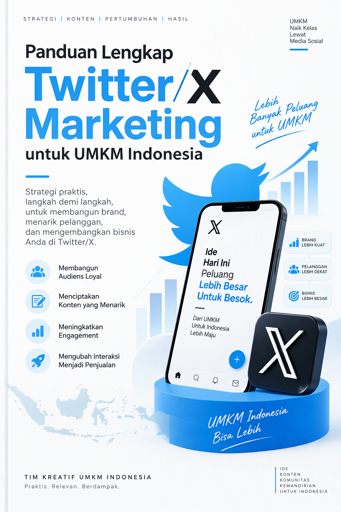
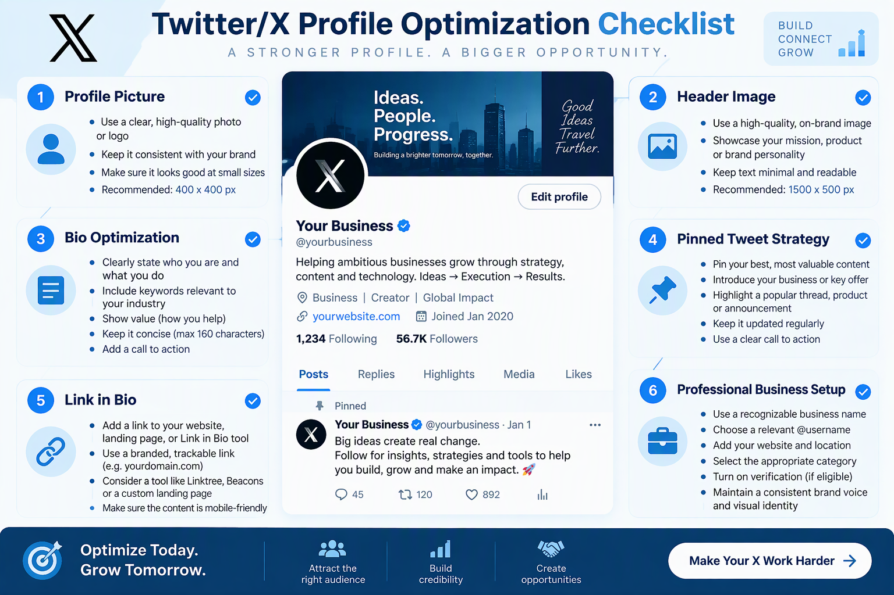
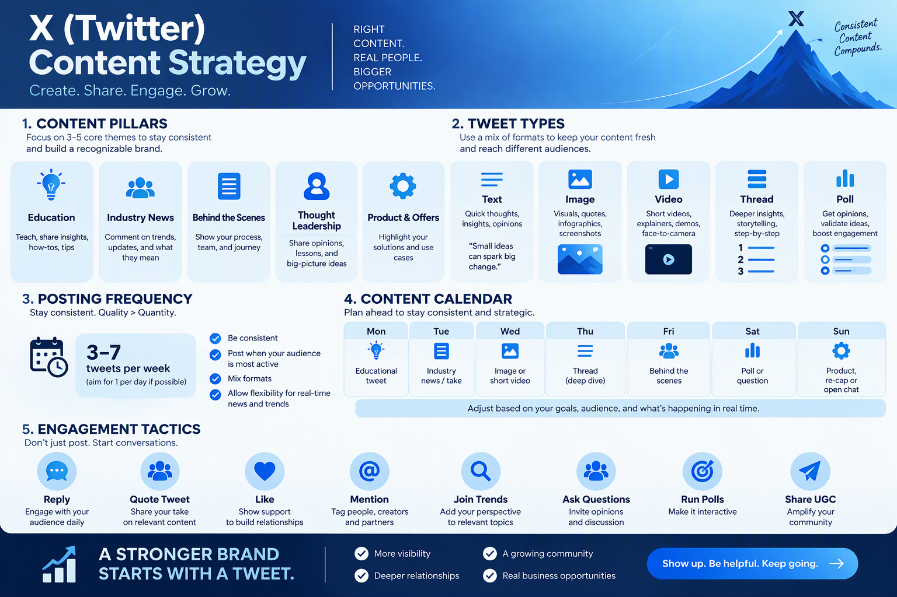
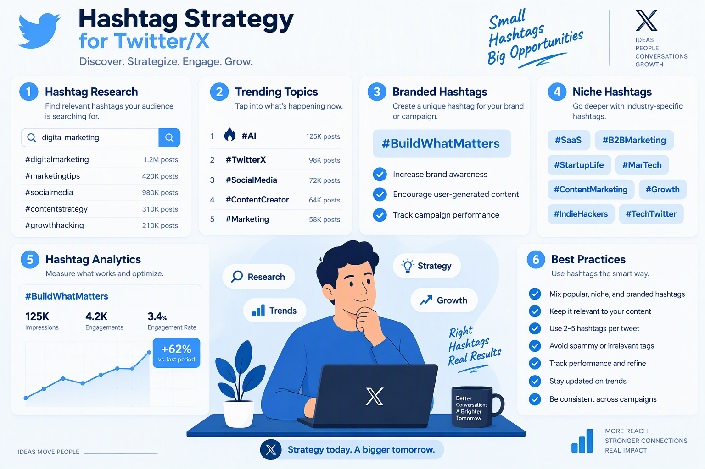
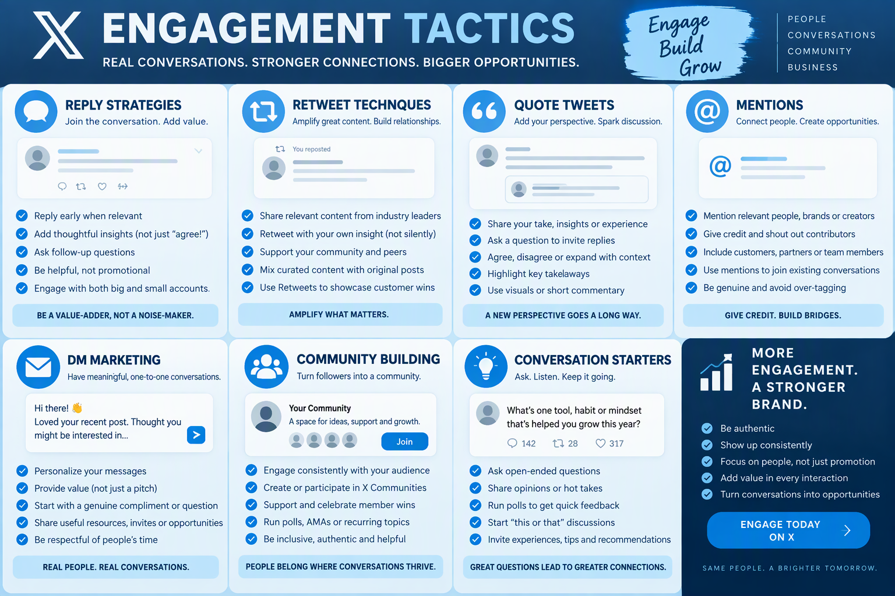
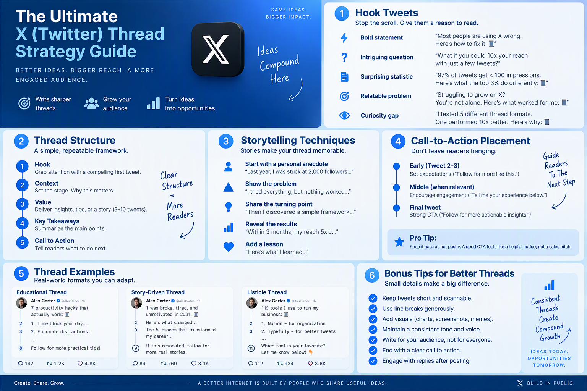
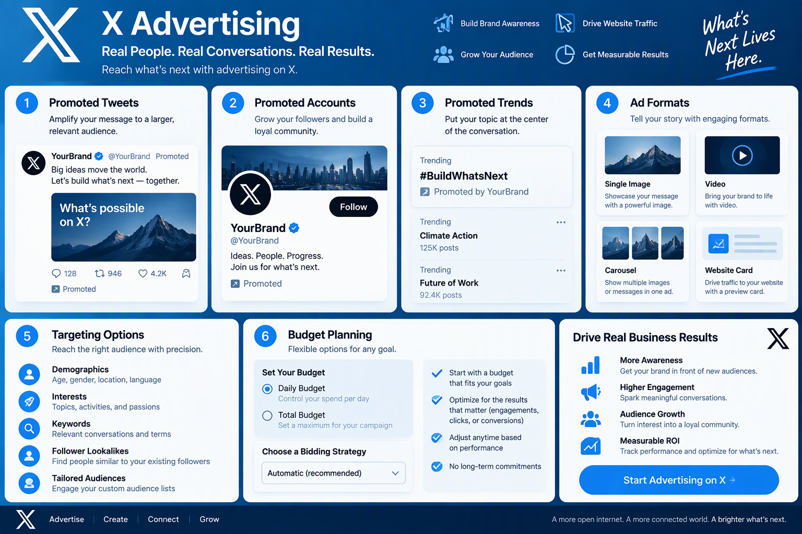
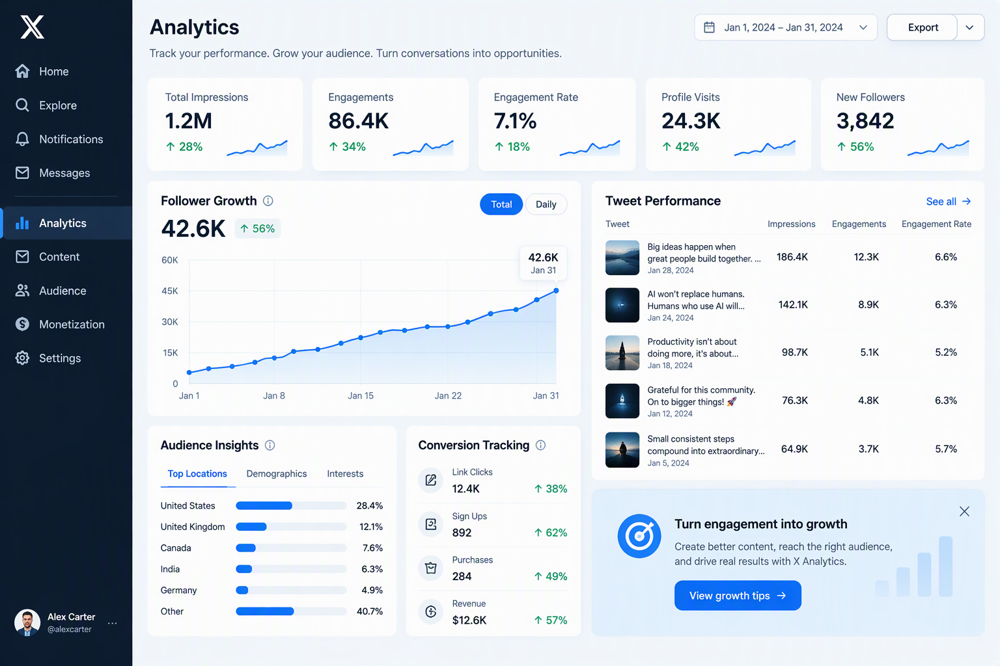
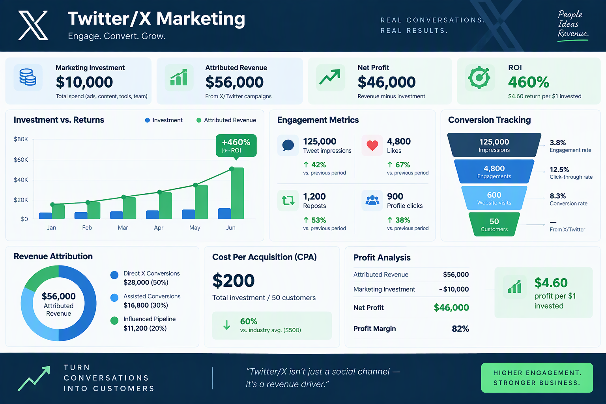
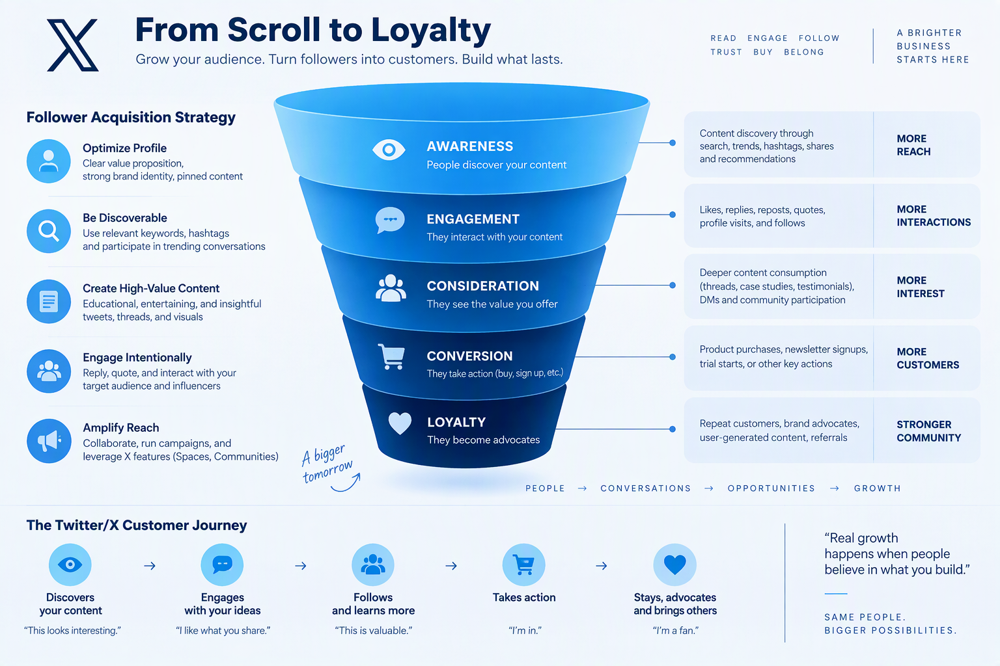

# Panduan Lengkap Twitter/X Marketing untuk UMKM Indonesia

**Strategi, Taktik, dan Template Siap Pakai untuk Membangun Brand dan Meningkatkan Penjualan di Twitter/X**

Disusun oleh: Siraj Nur Ihrom, Founder & Lead Developer SNISHOP
Versi: 1.0
Tanggal: Oktober 2026
Format: Panduan komprehensif dengan strategi, template, dan studi kasus
Standar: SNISHOP-PUBLISHING v2.0

---

## SNISHOP.COM

**CEO: Siraj Nur Ihrom**

Platform bisnis digital terpercaya untuk UMKM Indonesia. SNISHOP menyediakan solusi lengkap mulai dari pembuatan toko online, manajemen produk, hingga strategi pemasaran digital yang terbukti efektif meningkatkan penjualan.

---

## Daftar Isi

**Pendahuluan: Cara Menggunakan Buku Ini**

**PART 1: FUNDAMENTAL TWITTER/X MARKETING**

- Bab 1: Memahami Ekosistem Twitter/X untuk Bisnis
- Bab 2: Optimasi Profil Bisnis yang Profesional
- Bab 3: Strategi Konten yang Efektif

**PART 2: TAKTIK LANJUTAN DAN EKSEKUSI**

- Bab 4: Teknik Hashtag dan Trending Topics
- Bab 5: Engagement Tactics: Reply, Retweet, Quote Tweet
- Bab 6: Menulis Thread yang Viral
- Bab 7: Twitter/X Ads untuk UMKM

**PART 3: ANALISIS, OPTIMASI, DAN SKALING**

- Bab 8: Analytics dan Pengukuran ROI
- Bab 9: Studi Kasus Sukses UMKM Indonesia
- Bab 10: Rencana Implementasi 30 Hari

**Kesimpulan**
**Tentang Penulis**
**Copyright Page**

---

## Pendahuluan: Cara Menggunakan Buku Ini

Twitter/X adalah platform media sosial dengan 500 juta pengguna aktif harian di seluruh dunia. Di Indonesia, pengguna Twitter/X mencapai 74 juta orang, menjadikannya salah satu pasar terbesar di Asia Tenggara. Untuk UMKM, platform ini menawarkan peluang unik: interaksi langsung dengan pelanggan, viralitas organik yang tinggi, dan biaya marketing yang terjangkau.

Buku ini dirancang sebagai panduan praktis yang bisa langsung Anda implementasikan. Setiap bab berisi teori singkat, langkah konkret, template siap pakai, dan contoh dari bisnis Indonesia yang sudah berhasil.

### Struktur Buku

**Part 1 (Bab 1-3): Fundamental**
- Memahami cara kerja algoritma dan ekosistem Twitter/X
- Setup dan optimasi profil bisnis profesional
- Membangun strategi konten yang konsisten

**Part 2 (Bab 4-7): Taktik dan Eksekusi**
- Teknik hashtag dan memanfaatkan trending topics
- Strategi engagement untuk meningkatkan visibilitas
- Menulis thread yang viral dan menghasilkan konversi
- Twitter/X Ads dengan budget UMKM

**Part 3 (Bab 8-10): Analisis dan Scaling**
- Mengukur ROI dan menggunakan analytics
- Studi kasus 3 bisnis Indonesia dengan hasil konkret
- Rencana implementasi 30 hari langkah demi langkah

### Yang Anda Butuhkan

- Akun Twitter/X (gratis atau premium)
- Smartphone atau komputer dengan koneksi internet
- Waktu 30-60 menit per hari untuk implementasi
- Budget opsional untuk Twitter/X Ads (mulai Rp 50.000/hari)

### Cara Membaca Buku Ini

Jika Anda baru memulai di Twitter/X, baca berurutan dari Bab 1. Jika sudah punya akun dan ingin meningkatkan hasil, lompat ke Bab 4-7 untuk taktik lanjutan. Bab 9 dan 10 berisi studi kasus dan rencana implementasi yang bisa langsung Anda ikuti.



---

# PART 1: FUNDAMENTAL TWITTER/X MARKETING

---

## Bab 1: Memahami Ekosistem Twitter/X untuk Bisnis

Twitter/X berbeda dari platform media sosial lain. Karakteristik unik platform ini menciptakan peluang dan tantangan tersendiri untuk bisnis.

### 1.1 Karakteristik Twitter/X yang Relevan untuk Bisnis

**Format dan Batasan:**
- Tweet reguler: maksimal 280 karakter
- Twitter/X Premium: hingga 25.000 karakter per tweet
- Thread: rangkaian tweet yang saling terhubung
- Media: gambar (hingga 4 per tweet), video (hingga 140 detik), GIF, poll

**Sifat Platform:**
- Real-time: konten bergerak cepat, umur tweet rata-rata 18 menit
- Public: tweet bisa dilihat siapa saja tanpa perlu follow
- Conversational: reply dan quote tweet mendorong diskusi
- Trend-driven: topik populer mendapat boost visibilitas

**Demografi Pengguna Indonesia:**
- Usia dominan: 18-34 tahun (68% pengguna)
- Gender: 55% pria, 45% wanita
- Kota besar: Jakarta, Surabaya, Bandung, Medan, Semarang
- Minat: teknologi, hiburan, olahraga, politik, bisnis
- Perilaku: aktif berdiskusi, suka konten humor dan informatif

### 1.2 Algoritma Twitter/X: Bagaimana Konten Didistribusikan

Algoritma Twitter/X menentukan tweet mana yang muncul di timeline pengguna. Memahami algoritma adalah kunci untuk mendapatkan visibilitas organik.

**Faktor Ranking Utama:**

1. **Relevansi**: Kesesuaian topik tweet dengan minat pengguna
2. **Engagement**: Jumlah like, reply, retweet, dan bookmark
3. **Recency**: Tweet baru mendapat prioritas lebih tinggi
4. **Author Authority**: Akun dengan kredibilitas tinggi mendapat boost
5. **Media Richness**: Tweet dengan gambar/video mendapat engagement 2-3x lebih tinggi
6. **Conversation**: Tweet yang memicu diskusi mendapat prioritas

**Sinyal Positif untuk Algoritma:**
- Reply yang berkualitas (bukan spam)
- Retweet dengan komentar (quote tweet)
- Bookmark (indikator konten bernilai tinggi)
- Time spent (pengguna membaca lama)
- Profile clicks dari tweet

**Sinyal Negatif:**
- Report dan mute dari pengguna
- Low engagement rate (di bawah 1%)
- Spammy behavior (tweet berlebihan dalam waktu singkat)
- Duplicate content

### 1.3 Twitter/X vs Platform Lain: Kapan Harus Menggunakan

| Aspek | Twitter/X | Instagram | TikTok | Facebook |
|-------|-----------|-----------|--------|----------|
| Format utama | Teks pendek | Visual | Video pendek | Campuran |
| Umur konten | 18 menit | 24 jam | 48 jam | Variabel |
| Engagement rate | 0.5-2% | 1-3.5% | 3-8% | 0.5-1.5% |
| Viralitas organik | Tinggi | Sedang | Sangat tinggi | Rendah |
| Biaya ads | Rendah | Sedang | Rendah-Sedang | Sedang |
| Cocok untuk | Brand awareness, customer service | Product showcase | Demo produk | Community building |

**Kapan Twitter/X Adalah Pilihan Terbaik:**
- Anda ingin membangun thought leadership
- Bisnis Anda bergerak di bidang teknologi, jasa, atau konsultasi
- Anda ingin merespons tren secara real-time
- Target pasar Anda aktif berdiskusi online
- Budget marketing terbatas tapi ingin jangkauan luas

### 1.4 Jenis-Jenis Akun Twitter/X untuk Bisnis

**Akun Reguler (Gratis):**
- Bisa tweet, reply, retweet, like
- Batasan 2.400 tweet per hari
- Akses analytics dasar
- Tidak bisa edit tweet

**Twitter/X Premium (Rp 100.000-200.000/bulan):**
- Tweet hingga 25.000 karakter
- Bisa edit tweet (dalam 1 jam pertama)
- Upload video lebih panjang (hingga 3 jam)
- Prioritas di reply dan search
- Badge biru (verified)
- Revenue sharing dari impressions

**Rekomendasi untuk UMKM:**
Mulailah dengan akun reguler. Upgrade ke Premium jika Anda sudah konsisten posting minimal 3-5 tweet per hari dan membutuhkan fitur edit serta karakter lebih panjang.

### 1.5 Memahami Metrik Dasar Twitter/X

Sebelum masuk ke strategi, pahami dulu metrik-metrik yang akan Anda gunakan untuk mengukur keberhasilan.

**Metrik Utama:**
- **Impressions**: Jumlah kali tweet dilihat
- **Engagements**: Total interaksi (like + reply + retweet + click + bookmark)
- **Engagement Rate**: Engagements / Impressions x 100%
- **Followers**: Jumlah pengikut akun
- **Profile Visits**: Jumlah kunjungan ke profil Anda
- **Link Clicks**: Jumlah klik pada link di tweet Anda
- **Mentions**: Jumlah kali akun Anda disebut

**Benchmark untuk UMKM Indonesia:**
- Engagement rate bagus: di atas 2%
- Engagement rate sangat bagus: di atas 5%
- Growth rate followers sehat: 5-10% per bulan
- Impressions per tweet: 500-5.000 (akun kecil-menengah)

### 1.6 Langkah Praktis: Riset Akun Kompetitor

Sebelum memulai, pelajari dulu kompetitor Anda di Twitter/X.

**Langkah-langkah:**
1. Search nama bisnis kompetitor di Twitter/X
2. Catat 5-10 kompetitor aktif di platform
3. Amati jenis konten yang mereka posting
4. Catat frekuensi posting dan waktu publish
5. Lihat tweet mana yang mendapat engagement tertinggi
6. Identifikasi celah yang bisa Anda isi

**Template Analisis Kompetitor:**
```
Nama Akun: @___________
Followers: ___________
Frekuensi Tweet: ___ per hari
Jenis Konten Utama: ___________
Engagement Rate Rata-rata: ___%
Tweet Terpopuler: ___________
Kekuatan: ___________
Kelemahan: ___________
Peluang untuk Kita: ___________
```

### Tips Bab 1

- Fokus pada kualitas interaksi, bukan hanya jumlah followers
- Twitter/X adalah platform percakapan, bukan monolog
- Konsistensi lebih penting daripada viralitas sesaat
- Pelajari tren dan topik yang relevan dengan bisnis Anda
- Jangan mencoba hadir di semua platform sekaligus; kuasai satu platform dulu

---

## Bab 2: Optimasi Profil Bisnis yang Profesional

Profil Twitter/X adalah halaman landing bisnis Anda. Dalam 5 detik pertama, calon pelanggan memutuskan apakah mereka akan follow, membeli, atau meninggalkan profil Anda.



### 2.1 Username dan Handle yang Efektif

Handle (@username) adalah identitas unik Anda di Twitter/X. Pilih dengan hati-hati karena perubahan handle bisa membingungkan followers.

**Prinsip Pemilihan Handle:**
- Singkat dan mudah diingat (maksimal 15 karakter)
- Konsisten dengan brand di platform lain
- Mengandung nama bisnis atau kata kunci relevan
- Hindari angka acak dan underscore berlebihan

**Formula Handle:**
```
@namabisnis          (ideal)
@namabisnis_id       (untuk brand Indonesia)
@bisnis_nama         (alternatif)
@namabisnisofficial  (jika nama sudah dipakai)
```

**Contoh:**
- @KopiKenangan (brand F&B)
- @Eratour_id (brand travel)
- @BatikKeris (brand fashion)

### 2.2 Foto Profil dan Header

**Foto Profil:**
- Ukuran minimum: 400 x 400 pixel
- Gunakan logo brand (untuk perusahaan) atau foto profesional (untuk personal brand)
- Background kontras agar terlihat jelas di ukuran kecil
- Wajah harus memenuhi 60-70% frame (untuk foto personal)
- Format: JPG atau PNG

**Header/Banner:**
- Ukuran: 1500 x 500 pixel
- Gunakan untuk menampilkan value proposition
- Sertakan tagline, produk utama, atau promo aktif
- Update header secara berkala (setiap 1-2 bulan)
- Pastikan teks terbaca di mobile

**Template Header:**
```
[Logo di kiri] | [Tagline di tengah] | [CTA di kanan]
Background: Warna brand atau foto produk
Teks: "Solusi [masalah] untuk [target pasar]"
```

### 2.3 Bio yang Menjual

Bio Twitter/X memiliki 160 karakter. Setiap kata harus bernilai.

**Formula Bio Efektif:**
```
Baris 1: Apa yang Anda jual / Value proposition
Baris 2: Keunggulan / Diferensiasi
Baris 3: Social proof (klien, rating, penghargaan)
Baris 4: Call-to-action + link
```

**Contoh Bio:**
```
SNISHOP | Platform Bisnis Digital UMKM
Toko online mudah, tanpa coding, mulai Rp 0
Dipercaya 10.000+ pelaku bisnis Indonesia
Daftar gratis: snishop.com
```

```
Kopi Kenangan | Kopi Nusantara Premium
Biji pilihan dari petani lokal Indonesia
500+ outlet di 50 kota
Order: kopikenangan.com
```

**Tips Bio:**
- Gunakan kata kunci yang dicari target pasar
- Sertakan angka konkret untuk kredibilitas
- Tambahkan emoji maksimal 2-3 untuk visual break
- Link harus bisa diklik dan mengarah ke halaman yang relevan
- Pin tweet terbaik Anda sebagai pelengkap bio

### 2.4 Tweet yang Di-Pin

Tweet yang di-pin berada di posisi teratas profil Anda. Gunakan untuk:
- Pengumuman produk baru
- Testimoni pelanggan terbaik
- Thread edukatif yang paling populer
- Promo atau diskon aktif

**Kriteria Tweet untuk Di-Pin:**
- Engagement rate di atas rata-rata akun Anda
- Relevan dengan tujuan bisnis saat ini
- Masih aktual (bukan info yang sudah kedaluwarsa)
- Mengandung CTA yang jelas

### 2.5 Mengorganisir Highlights dan Lists

**Twitter/X Lists:**
Buat lists untuk mengelompokkan akun-akun yang relevan:
- List Kompetitor: pantau aktivitas kompetitor
- List Influencer: identifikasi potential collaborator
- List Pelanggan: engage dengan pelanggan setia
- List Media: pantau liputan terkait industri Anda

**Cara Membuat List:**
1. Klik menu "Lists" di sidebar
2. Klik "New List"
3. Beri nama dan deskripsi
4. Set privacy (public atau private)
5. Tambahkan akun ke list

### 2.6 Checklist Audit Profil

Gunakan checklist ini untuk memastikan profil Anda optimal:

- [ ] Handle mudah diingat dan konsisten dengan brand
- [ ] Foto profil jelas dan profesional
- [ ] Header banner informatif dan aktual
- [ ] Bio menjelaskan value proposition dengan jelas
- [ ] Bio mengandung call-to-action
- [ ] Link di bio berfungsi dan mengarah ke halaman yang tepat
- [ ] Tweet teratas sudah di-pin
- [ ] Tweet terpin masih relevan dan aktual
- [ ] Minimal 3 lists sudah dibuat
- [ ] Lokasi dan website sudah diisi

---

## Bab 3: Strategi Konten yang Efektif

Konten adalah jantung marketing Twitter/X. Tanpa strategi konten yang jelas, akun Anda akan tenggelam di antara jutaan tweet lain yang muncul setiap detik.



### 3.1 Content Pillars: 5 Pilar Konten Twitter/X

Content pillars adalah kategori konten yang membentuk fondasi strategi Anda. Dengan 5 pilar, konten Anda tetap bervariasi dan mencakup seluruh aspek marketing.

**Pilar 1: Edukasi (30% dari total konten)**
- Tips dan trik terkait industri Anda
- Tutorial cara menggunakan produk
- Penjelasan konsep yang relevan
- Data dan insight industri

Contoh tweet edukasi:
```
5 kesalahan yang sering dilakukan UMKM saat memulai bisnis online:

1. Tidak riset pasar
2. Mengabaikan foto produk
3. Tidak punya USP yang jelas
4. Lupa setting budget marketing
5. Tidak tracking hasil

Mana yang paling sering Anda alami?
```

**Pilar 2: Hiburan (20% dari total konten)**
- Meme yang relevan dengan industri
- Konten humor ringan
- Trending topic yang dikaitkan dengan bisnis
- Kuis dan poll interaktif

**Pilar 3: Inspirasi (15% dari total konten)**
- Cerita sukses pelanggan
- Quote motivasi bisnis
- Milestone perusahaan
- Behind the scene

**Pilar 4: Promosi (20% dari total konten)**
- Launching produk baru
- Diskon dan penawaran khusus
- Testimoni pelanggan
- Perbandingan produk

**Pilar 5: Interaksi (15% dari total konten)**
- Pertanyaan untuk followers
- Polling dan survey
- Reply dan quote tweet
- Thread diskusi

### 3.2 Format Konten Twitter/X

**Tweet Tunggal:**
- Cocok untuk tips singkat, pertanyaan, atau pengumuman
- Maksimal 280 karakter (atau 25.000 untuk Premium)
- Sertakan 1 gambar untuk boost engagement 2-3x

**Thread:**
- Cocok untuk penjelasan mendalam, tutorial, atau cerita
- 5-15 tweet per thread adalah panjang optimal
- Tweet pertama harus hook yang kuat
- Tweet terakhir berisi CTA

**Poll:**
- Cocok untuk riset pasar dan engagement
- Maksimal 4 pilihan jawaban
- Durasi: 1 hari hingga 7 hari
- Follow up dengan hasil dan insight

**Quote Tweet:**
- Cocok untuk menambahkan perspektif pada tweet orang lain
- Bagikan opini, koreksi, atau informasi tambahan
- Mention akun asli untuk networking

**Spaces (Audio Live):**
- Cocok untuk diskusi mendalam dan building community
- Undang narasumber untuk menambah value
- Rekam dan bagikan hasilnya sebagai thread

### 3.3 Content Calendar: Merencanakan Konten 30 Hari

Content calendar memastikan konsistensi dan variasi konten Anda.

**Template Content Calendar Mingguan:**

| Hari | Pilar | Format | Topik | Waktu Post |
|------|-------|--------|-------|------------|
| Senin | Edukasi | Thread | Tips bisnis | 08:00 |
| Selasa | Promosi | Tweet + gambar | Produk highlight | 12:00 |
| Rabu | Interaksi | Poll | Pertanyaan industri | 18:00 |
| Kamis | Inspirasi | Tweet + foto | Cerita sukses | 09:00 |
| Jumat | Hiburan | Meme/trend | Konten ringan | 15:00 |
| Sabtu | Edukasi | Tweet tunggal | Quick tips | 10:00 |
| Minggu | Interaksi | Quote tweet | Diskusi komunitas | 19:00 |

**Waktu Posting Optimal untuk Audiens Indonesia:**
- Pagi: 07:00-09:00 (waktu commute)
- Siang: 12:00-13:00 (istirahat makan)
- Sore: 17:00-18:00 (pulang kerja)
- Malam: 19:00-21:00 (waktu santai)

### 3.4 Template Tweet Siap Pakai (20 Template)

Berikut 20 template tweet yang bisa langsung Anda gunakan:

**Template Edukasi:**
```
1. [Angka] tips [topik] untuk [target audiens]:

[Tips 1]
[Tips 2]
[Tips 3]

Save tweet ini untuk referensi nanti.
```

```
2. Kesalahan umum saat [aktivitas]:

- [Kesalahan 1]
- [Kesalahan 2]
- [Kesalahan 3]

Solusinya: [brief solution]
```

```
3. [Topik] dalam 60 detik:

[Poin 1]
[Poin 2]
[Poin 3]

Follow @[akun] untuk tips bisnis harian.
```

**Template Promosi:**
```
4. Baru! [Nama produk] sudah tersedia.

[1 kalimat deskripsi produk]
[1 kalimat keunggulan]

Order sekarang: [link]
```

```
5. Flash Sale 24 jam!

[Produk] diskon [X]%
Kode: [kode]
Berlaku sampai: [tanggal]

Grab yours: [link]
```

```
6. Testimoni pelanggan:

"[Quote testimoni]" - [Nama], [Kota]

Terima kasih sudah percaya [brand]!

Order seperti [Nama]: [link]
```

**Template Interaksi:**
```
7. Poll: [Pertanyaan relevan]?

A) [Opsi 1]
B) [Opsi 2]
C) [Opsi 3]
D) [Opsi 4]

Reply dengan alasan pilihan Anda.
```

```
8. Pertanyaan untuk [target audiens]:

[Apa tantangan terbesar Anda dalam hal X]?

Share pengalaman Anda di reply.
Kami akan bantu jawab satu per satu.
```

```
9. Fill in the blank:

[Brand] membuat [aktivitas] jadi lebih [___].

Jawaban terbaik kami retweet!
```

**Template Thread:**
```
10. Thread: [Topik menarik]

Saya [kredibilitas singkat].
Ini yang saya pelajari tentang [topik]:

A thread.
```

```
11. [Angka] hal yang wish I knew before [aktivitas]:

1/ [Poin pertama]
[Penjelasan singkat]

2/ [Poin kedua]
[Penjelasan singkat]

...

[CTA: Follow untuk lebih banyak tips]
```

**Template Inspirasi:**
```
12. Dari [titik awal] ke [pencapaian] dalam [durasi].

[2-3 kalimat cerita singkat]

Kunci utamanya: [insight]

Semangat untuk pejuang bisnis di luar sana.
```

```
13. Milestone alert!

[Brand] baru saja mencapai [pencapaian].

Terima kasih [X] pelanggan yang sudah percaya.

Perjalanan masih panjang. Let's go!
```

**Template Hiburan:**
```
14. [Situasi yang relate]

[Setup]
[Punchline]

Tag teman Anda yang juga mengalami ini.
```

```
15. POV: Anda [situasi]

[Tweet 1]: [Kondisi awal]
[Tweet 2]: [Ekspektasi]
[Tweet 3]: [Realita]

Relate? Retweet kalau iya.
```

**Template Quote Tweet:**
```
16. Setuju banget dengan @[akun] tentang [topik].

Tambahan saya: [insight Anda]

[Link atau referensi jika ada]
```

```
17. Ini menarik. @[akun] menyebutkan [poin].

Dari pengalaman kami di [brand]:
[Fakta atau data yang mendukung]
```

**Template Behind the Scene:**
```
18. Behind the scene [aktivitas]:

[Langkah 1]
[Langkah 2]
[Langkah 3]

Prosesnya tidak instan, tapi hasilnya worth it.
```

```
19. Tim [brand] hari ini:

[Foto aktivitas tim]

Di balik [produk/layanan], ada orang-orang hebat yang bekerja keras.

Terima kasih tim!
```

**Template CTA:**
```
20. Mau [hasil yang diinginkan]?

Kami bantu [X] pelaku bisnis mencapai [hasil].

Cara:
1. [Langkah 1]
2. [Langkah 2]
3. [Langkah 3]

Mulai sekarang: [link]
```

### 3.5 Tips Konsistensi Konten

**Batch Content Creation:**
- Luangkan 2-3 jam per minggu untuk membuat konten
- Tulis 7-14 tweet dalam satu sesi
- Siapkan gambar dan media pendukung sekaligus
- Jadwalkan menggunakan tools seperti TweetDeck atau Buffer

**Content Recycling:**
- Tweet populer bisa di-post ulang setelah 2-3 bulan
- Thread bisa dipecah menjadi tweet tunggal
- Insight dari reply bisa jadi konten baru
- Update data lama dengan angka terbaru

**Maintain Quality:**
- Setiap tweet harus memberikan value (edukasi, hiburan, atau inspirasi)
- Proofread sebelum posting
- Hindari typo dan grammar yang buruk
- Pastikan link berfungsi

### 3.6 Strategi Visual Konten Twitter/X

Visual adalah faktor pembeda antara tweet yang di-scroll dan tweet yang dibaca. Data menunjukkan tweet dengan gambar mendapat 2-3x lebih banyak engagement, sementara tweet dengan video mendapat 6x lebih banyak retweet.

**Jenis Visual yang Efektif:**

1. **Foto Produk Lifestyle:**
   - Tampilkan produk dalam konteks penggunaan sehari-hari
   - Background bersih dan pencahayaan baik
   - Ukuran rasio 16:9 untuk timeline atau 1:1 untuk grid
   - Resolusi minimum 1024 x 512 pixel

2. **Infografis:**
   - Sajikan data atau tips dalam format visual
   - Gunakan warna brand yang konsisten
   - Teks harus terbaca di ukuran kecil (minimum 14pt)
   - Format vertikal (1080 x 1350 pixel) optimal untuk mobile

3. **Screenshot dan Bukti:**
   - Screenshot testimoni pelanggan
   - Screenshot hasil analytics atau pencapaian
   - Before-after dari produk atau layanan
   - Pastikan informasi sensitif di-blur

4. **Video Pendek:**
   - Durasi optimal: 15-45 detik
   - 85% pengguna menonton video tanpa suara; sertakan subtitle
   - 3 detik pertama harus menarik perhatian
   - Format vertikal (9:16) atau square (1:1)

5. **Meme dan GIF:**
   - Gunakan format yang sedang tren
   - Sesuaikan dengan tone brand
   - Jangan terlalu sering; 1-2 per minggu cukup
   - Pastikan tidak menyinggung kelompok manapun

**Panduan Ukuran Visual Twitter/X:**

| Jenis | Ukuran (pixel) | Rasio | Catatan |
|-------|---------------|-------|---------|
| Single image | 1200 x 675 | 16:9 | Optimal untuk timeline |
| Square image | 1080 x 1080 | 1:1 | Bagus untuk carousel |
| Portrait | 1080 x 1350 | 4:5 | Optimal untuk mobile |
| Video | 1920 x 1080 | 16:9 | Maksimal 140 detik |
| Header | 1500 x 500 | 3:1 | Banner profil |
| Thumbnail Spaces | 1600 x 900 | 16:9 | Cover audio room |

### 3.7 Copywriting untuk Tweet yang Mengkonversi

Menulis tweet yang efektif membutuhkan keterampilan copywriting khusus karena batasan karakter yang ketat.

**Formula AIDA untuk Tweet:**

1. **Attention (Perhatian):**
   - Mulai dengan angka, pertanyaan, atau pernyataan berani
   - Gunakan kata yang memicu emosi: "rahasia", "terbukti", "kesalahan fatal"
   - Contoh: "90% UMKM melakukan kesalahan ini di Twitter/X:"

2. **Interest (Minat):**
   - Lanjutkan dengan konteks yang relevan
   - Tunjukkan bahwa Anda memahami masalah mereka
   - Contoh: "Mereka posting setiap hari tapi engagement tetap rendah."

3. **Desire (Keinginan):**
   - Tampilkan solusi atau hasil yang bisa didapat
   - Gunakan data konkret atau testimoni
   - Contoh: "Dengan 5 perubahan sederhana, brand ini naikkan engagement 340%."

4. **Action (Tindakan):**
   - Berikan CTA yang jelas dan spesifik
   - Buat mudah untuk mengambil langkah selanjutnya
   - Contoh: "Save tweet ini dan coba mulai besok."

**Power Words untuk Tweet Bisnis:**
- Gratis, terbukti, rahasia, terbaru, eksklusif
- Terbatas, hari ini, sekarang, langsung, cepat
- Naik, turun, hemat, untung, rugi
- Sukses, gagal, kesalahan, strategi, taktik

**Struktur Kalimat yang Efektif:**
- Kalimat pendek (maksimal 15 kata per kalimat)
- Satu ide per kalimat
- Gunakan line break untuk readability
- Akhiri dengan CTA atau pertanyaan


---

# PART 2: TAKTIK LANJUTAN DAN EKSEKUSI

---

## Bab 4: Teknik Hashtag dan Trending Topics

Hashtag dan trending topics adalah amplifier organik di Twitter/X. Penggunaan yang tepat bisa meningkatkan jangkauan tweet Anda 2-5x lipat.



### 4.1 Memahami Cara Kerja Hashtag di Twitter/X

Hashtag (#) mengelompokkan tweet berdasarkan topik. Ketika pengguna mengklik atau mencari hashtag, mereka akan melihat semua tweet yang menggunakan hashtag tersebut.

**Karakteristik Hashtag Twitter/X:**
- Case insensitive: #UMKM sama dengan #umkm
- Tanpa spasi: #bisnisonline (bukan #bisnis online)
- Bisa mengandung angka: #tipsbisnis2026
- Maksimal 5 hashtag per tweet (lebih dari itu dianggap spam)

**Jenis-Jenis Hashtag:**
1. **Branded Hashtag**: Unik untuk brand Anda (#SNISHOP, #KopiKenangan)
2. **Industry Hashtag**: Umum di industri Anda (#UMKM, #bisnisonline, #digitalmarketing)
3. **Campaign Hashtag**: Untuk promo atau event tertentu (#Harbolnas1212, #PromoAkhirTahun)
4. **Community Hashtag**: Untuk membangun komunitas (#PejuangBisnis, #UMKMIndonesia)
5. **Trending Hashtag**: Sedang trending di Twitter/X (#TrendingTopic, event besar)

### 4.2 Riset Hashtag: Menemukan yang Tepat untuk Bisnis Anda

**Langkah-langkah Riset:**

1. **Analisis Kompetitor**
   - Cek hashtag yang digunakan kompetitor
   - Catat yang mendapat engagement tinggi
   - Identifikasi celah yang belum terpakai

2. **Gunakan Twitter/X Search**
   - Ketik kata kunci bisnis Anda
   - Lihat saran autocomplete
   - Amati hashtag yang muncul di hasil pencarian

3. **Cek Volume dan Kompetisi**
   - Hashtag besar (>1 juta tweet): jangkauan luas, persaingan tinggi
   - Hashtag sedang (100K-1M tweet): balance antara jangkauan dan kompetisi
   - Hashtag kecil (<100K tweet): niche, engagement lebih tinggi

4. **Tools Pendukung**
   - Twitter/X Analytics (built-in)
   - Hashtagify.me (riset hashtag)
   - RiteTag (sugesti hashtag real-time)
   - Trends24.in (tracking trending topics)

**Template Riset Hashtag:**
```
Kategori Bisnis: ___________

Branded Hashtag:
- #___________
- #___________

Industry Hashtag (volume sedang):
- #___________ (est. ___K tweets)
- #___________ (est. ___K tweets)
- #___________ (est. ___K tweets)

Campaign Hashtag:
- #___________ (periode: ___)
- #___________ (periode: ___)

Community Hashtag:
- #___________
- #___________
```

### 4.3 Strategi Penggunaan Hashtag

**Formula Hashtag per Tweet:**
- 1 branded hashtag (untuk brand awareness)
- 1-2 industry hashtag (untuk discoverability)
- 1 trending hashtag (jika relevan, untuk boost jangkauan)

**Contoh Penerapan:**
```
5 tips mengelola keuangan bisnis yang sering diabaikan pemilik UMKM:

1. Pisahkan rekening pribadi dan bisnis
2. Catat setiap transaksi, sekecil apapun
3. Buat budget bulanan
4. Sisihkan dana darurat bisnis
5. Review keuangan mingguan

#UMKM #TipsBisnis #KeuanganBisnis
```

**Kesalahan Umum:**
- Menggunakan terlalu banyak hashtag (lebih dari 5)
- Hashtag tidak relevan dengan konten
- Menggunakan hashtag yang terlalu umum (#love, #happy)
- Tidak riset hashtag sebelum digunakan
- Memakai hashtag trending yang tidak ada hubungannya dengan bisnis

### 4.4 Memanfaatkan Trending Topics

Trending topics adalah topik yang sedang banyak dibicarakan di Twitter/X pada waktu tertentu.

**Cara Merespons Trending Topics:**

1. **Monitor Daily**
   - Cek trending topics setiap pagi dan sore
   - Identifikasi yang relevan dengan bisnis Anda
   - Siapkan respons cepat

2. **Relevansi adalah Kunci**
   - Hanya ikut trending topic yang berhubungan dengan bisnis
   - Hubungkan dengan sudut pandang unik brand Anda
   - Jangan memaksakan diri jika tidak relevan

3. **Speed Matters**
   - Respons dalam 1-2 jam pertama trending
   - Siapkan template yang bisa di-customize cepat
   - Jangan overthink; kecepatan lebih penting dari kesempurnaan

**Contoh Respons Trending Topic:**
```
Saat #HariKopiNasional trending:

"Selamat Hari Kopi Nasional!
Kopi favorit Anda apa?
Tim kopi susu atau kopi hitam?

Share di reply. Yang paling unik kami traktir kopi gratis!"
```

```
Saat #Gajian trending:

"Gajian tiba! Waktunya restock [produk].

Promo khusus hari ini:
- Diskon 20% semua produk
- Gratis ongkir min. pembelian Rp 100rb
- Bonus [item] untuk 50 pembeli pertama

Order: [link]"
```

### 4.5 Membuat Branded Hashtag yang Kuat

Branded hashtag adalah investasi jangka panjang untuk brand awareness.

**Kriteria Branded Hashtag yang Baik:**
- Singkat dan mudah diingat (maksimal 3 kata)
- Unik dan belum digunakan brand lain
- Relevan dengan brand atau campaign
- Mudah dieja dan diketik
- Bisa digunakan berulang

**Contoh Branded Hashtag Sukses:**
- #ShareACoke (Coca-Cola)
- #JustDoIt (Nike)
- #SNISHOPBisa (SNISHOP)
- #KopiKenangan (Kopi Kenangan)

**Cara Meluncurkan Branded Hashtag:**
1. Pilih hashtag yang merepresentasikan brand
2. Sosialisasikan ke followers melalui tweet dan thread
3. Gunakan di setiap tweet secara konsisten
4. Buat campaign atau challenge menggunakan hashtag
5. Retweet pengguna yang menggunakan hashtag Anda
6. Track penggunaan dan engagement

### Tips Bab 4

- Riset hashtag minimal sebulan sekali; tren berubah cepat
- Buat database hashtag yang sudah terbukti efektif
- Gunakan 2-4 hashtag per tweet untuk hasil optimal
- Monitor hashtag kompetitor secara berkala
- Jangan gunakan hashtag yang sudah kedaluwarsa atau tidak relevan

---

## Bab 5: Engagement Tactics: Reply, Retweet, Quote Tweet

Engagement adalah mata uang Twitter/X. Semakin tinggi engagement, semakin luas jangkauan konten Anda. Bab ini membahas taktik konkret untuk meningkatkan interaksi.



### 5.1 Memahami Jenis-Jenis Engagement

**Hierarchy of Engagement:**
1. **Bookmark** (nilai tertinggi): Pengguna menyimpan tweet untuk dibaca lagi
2. **Reply**: Pengguna meluangkan waktu untuk menulis respons
3. **Quote Tweet**: Pengguna membagikan tweet Anda dengan komentar mereka
4. **Retweet**: Pengguna membagikan tweet Anda ke followers mereka
5. **Like**: Pengguna memberikan apresiasi cepat
6. **Click**: Pengguna mengklik link atau media di tweet Anda
7. **Impression**: Tweet dilihat oleh pengguna

**Bobot Algoritma:**
Algoritma Twitter/X memberikan bobot berbeda untuk setiap jenis engagement. Reply dan quote tweet memiliki bobot lebih tinggi daripada like karena membutuhkan usaha lebih besar dari pengguna.

### 5.2 Teknik Reply yang Efektif

Reply adalah cara tercepat untuk membangun relasi di Twitter/X.

**Strategi Reply untuk Bisnis:**

1. **Reply ke Pelanggan**
   - Respons setiap mention dan DM dalam 1-2 jam
   - Gunakan nama pelanggan saat membalas
   - Berikan solusi, bukan jawaban template
   - Follow up untuk memastikan masalah terselesaikan

2. **Reply ke Influencer/Peer**
   - Berikan komentar yang bernilai (bukan sekadar "setuju")
   - Tambahkan insight atau perspektif baru
   - Ajukan pertanyaan yang memicu diskusi
   - Lakukan secara konsisten (bukan hanya saat butuh)

3. **Reply ke Tweet Viral/Trending**
   - Kaitkan dengan bisnis Anda secara natural
   - Berikan humor atau insight yang relevan
   - Jangan hard-sell di reply tweet orang lain
   - Timing sangat penting; reply dalam 30 menit pertama

**Template Reply yang Efektif:**
```
Setuju dengan @[akun]. Tambahan dari pengalaman kami:
[poin tambahan yang spesifik]

Ini terutama berlaku untuk [target audiens] yang [kondisi].
```

```
@[akun] menarik poinnya. Dari data yang kami lihat:
[angka atau fakta]

Apakah ini juga terjadi di industri [sektor]?
```

### 5.3 Teknik Retweet yang Strategis

Retweet bukan sekadar membagikan konten orang lain. Ini adalah alat networking dan kurasi konten.

**Kapan Harus Retweet:**
- Testimoni positif dari pelanggan
- Konten edukatif yang relevan dengan audiens Anda
- Berita industri yang penting
- Tweet dari partner atau kolaborator
- Konten yang mendukung positioning brand Anda

**Retweet dengan Komentar:**
Selalu tambahkan komentar saat retweet untuk memberikan konteks dan nilai tambah.

```
[Quote tweet dengan komentar]

Ini penting banget untuk pemilik UMKM.
Poin ke-3 sering diabaikan padahal dampaknya besar.

Save dan share ke teman bisnis Anda.
```

**Frekuensi Retweet:**
- Retweet 2-3 kali per hari maksimal
- Campur antara konten original dan retweet
- Rasio ideal: 70% konten original, 30% retweet/kurasi

### 5.4 Quote Tweet: Menambahkan Nilai pada Diskusi

Quote tweet memungkinkan Anda membagikan tweet orang lain sambil menambahkan perspektif Anda.

**Kapan Menggunakan Quote Tweet:**
- Anda memiliki insight tambahan yang berharga
- Anda ingin memberikan koreksi atau klarifikasi
- Anda ingin menanggapi opini dengan sudut pandang berbeda
- Anda ingin memperkenalkan audiens baru pada konten berkualitas

**Template Quote Tweet:**
```
Poin penting dari @[akun]:

[Ringkasan 1 kalimat]

Tambahan saya:
- [Poin 1]
- [Poin 2]
- [Poin 3]

Worth read thread lengkapnya di bawah.
```

### 5.5 Membangun Komunitas melalui Engagement

**Strategi Community Building:**

1. **Daily Engagement Routine**
   - Pagi (15 menit): Reply mention dan DM
   - Siang (15 menit): Retweet dan quote tweet konten relevan
   - Sore (15 menit): Reply tweet influencer dan peer
   - Malam (15 menit): Posting konten original dan interaksi

2. **Weekly Engagement Goals**
   - Minimal 50 reply berkualitas
   - Minimal 10 retweet dengan komentar
   - Minimal 5 quote tweet
   - Respons 100% mention dan DM

3. **Engagement Pods (Organik)**
   - Bentuk grup 5-10 akun bisnis non-kompetitor
   - Saling support dengan engagement berkualitas
   - Share insight dan tips satu sama lain
   - Jaga naturalitas; jangan terlihat seperti bot

### 5.6 Menangani Negative Engagement

**Saat Menerima Kritik:**
1. Respons cepat (dalam 1 jam)
2. Tetap profesional dan sopan
3. Akui masalah jika memang ada kesalahan
4. Tawarkan solusi konkret
5. Lanjutkan ke DM untuk detail pribadi

**Template Respons Kritik:**
```
Halo @[nama], terima kasih sudah menyampaikan.

Kami mohon maaf atas [masalah].
Ini bukan standar yang kami jaga.

Kami ingin menyelesaikan ini. Boleh DM kami
detail pesanan Anda? Kami akan bantu segera.
```

**Saat Menerima Troll:**
- Abaikan troll yang jelas-jelas tidak konstruktif
- Jangan terpancing emosi
- Block jika sudah melanggar rules
- Fokus pada audiens yang positif

### 5.7 Twitter/X untuk Customer Service

Twitter/X adalah salah satu channel customer service paling efektif. Data menunjukkan 67% pelanggan menggunakan Twitter/X untuk customer service, dan 53% mengharapkan respons dalam 1 jam.

**Best Practices Customer Service di Twitter/X:**

1. **Kecepatan Respons:**
   - Target: respons pertama dalam 15 menit (jam kerja)
   - Target: respons pertama dalam 1 jam (di luar jam kerja)
   - Gunakan notifikasi untuk mention dan DM
   - Setup auto-reply untuk DM di luar jam kerja

2. **Eskalasi yang Tepat:**
   - Reply publik untuk pertanyaan umum
   - Pindah ke DM untuk masalah pribadi atau kompleks
   - Template transisi: "Boleh DM kami detailnya agar bisa kami bantu lebih lanjut?"
   - Follow up setelah masalah selesai untuk memastikan kepuasan

3. **Dokumentasi dan Learning:**
   - Catat pertanyaan yang sering muncul
   - Buat FAQ dari pertanyaan berulang
   - Share FAQ sebagai thread atau pinned tweet
   - Gunakan insight untuk memperbaiki produk atau layanan

**Template Customer Service:**

```
[Respons awal publik]
Halo @[nama], terima kasih sudah menghubungi kami.
Kami cek dulu dan kabari dalam [durasi] ya.
```

```
[Transisi ke DM]
Halo @[nama], untuk membantu lebih detail,
boleh DM kami informasi berikut:
- Nomor pesanan:
- Masalah yang dialami:
- Foto (jika ada):
```

```
[Follow up setelah resolusi]
Halo @[nama], kami sudah [tindakan yang dilakukan].
Semoga sudah sesuai harapan. Ada yang bisa kami bantu lagi?
```

### 5.8 Kolaborasi dan Cross-Promotion

Kolaborasi dengan akun lain adalah cara tercepat untuk menjangkau audiens baru.

**Jenis Kolaborasi di Twitter/X:**

1. **Guest Thread:**
   - Undang ahli atau influencer untuk menulis thread di akun Anda
   - Atau tulis thread tamu di akun mereka
   - Kedua belah pihak mendapat exposure ke audiens baru

2. **Twitter/X Spaces Bersama:**
   - Host diskusi audio dengan narasumber dari brand lain
   - Topik yang relevan untuk kedua audiens
   - Rekam dan buat thread dari highlight diskusi

3. **Giveaway Kolaboratif:**
   - Partner dengan 2-3 brand non-kompetitor
   - Syarat: follow semua akun, retweet, tag teman
   - Hadiah gabungan dari semua brand
   - Cost dibagi rata, exposure berlipat

4. **Quote Tweet Chain:**
   - Saling quote tweet konten satu sama lain
   - Tambahkan perspektif unik dari masing-masing brand
   - Menciptakan percakapan yang terlihat oleh semua audiens

**Template Ajakan Kolaborasi:**
```
Halo @[akun], saya [nama] dari @[brand].

Kami suka konten Anda tentang [topik].
Kami sedang planning [project/campaign] dan
ingin berkolaborasi.

Ide kami: [brief description]
Benefit untuk Anda: [what they get]

Boleh diskusi lebih lanjut via DM?
```

### Tips Bab 5

- Engagement adalah investasi jangka panjang; jangan ekspektasi hasil instan
- Kualitas reply lebih penting daripada kuantitas
- Jadilah manusia, bukan bot; gunakan bahasa yang natural
- Respons mention dan DM secepat mungkin
- Track engagement rate mingguan untuk mengukur progress

---

## Bab 6: Menulis Thread yang Viral

Thread adalah format konten paling powerful di Twitter/X. Thread yang baik bisa menghasilkan 10-50x lebih banyak engagement dibanding tweet tunggal.



### 6.1 Mengapa Thread Sangat Efektif

**Keunggulan Thread:**
- Waktu baca lebih lama = sinyal positif untuk algoritma
- Format ideal untuk storytelling dan edukasi mendalam
- Setiap tweet dalam thread bisa di-retweet secara terpisah
- Thread sering dibookmark untuk referensi di masa depan
- Menunjukkan expertise dan membangun otoritas

**Data Thread vs Tweet Tunggal:**
- Thread rata-rata mendapat 3-5x lebih banyak engagement
- Thread dengan 8-12 tweet memiliki performa optimal
- Thread yang di-pin mendapat 2x lebih banyak profile visits
- Bookmark rate thread 4x lebih tinggi dari tweet tunggal

### 6.2 Struktur Thread yang Efektif

**Formula Thread Viral:**

```
Tweet 1: HOOK (menarik perhatian, membuat orang ingin baca lebih lanjut)
Tweet 2-3: CONTEXT (latar belakang dan mengapa topik ini penting)
Tweet 4-8: CONTENT (isi utama, poin per poin)
Tweet 9-10: INSIGHT (kesimpulan dan takeaway)
Tweet 11: CTA (call-to-action: follow, share, atau klik link)
```

**Panjang Optimal:**
- Mini thread: 3-5 tweet (untuk tips singkat)
- Standard thread: 6-12 tweet (untuk edukasi)
- Long thread: 13-25 tweet (untuk deep dive; gunakan sparingly)

### 6.3 Menulis Hook yang Kuat

Hook adalah tweet pertama yang menentukan apakah orang akan membaca seluruh thread Anda.

**Formula Hook:**

1. **Angka + Hasil:**
```
Saya menambah revenue bisnis Rp 50 juta/bulan hanya dari Twitter/X.

Ini strategi lengkap yang saya gunakan (step by step):
```

2. **Pertanyaan Provokatif:**
```
Mengapa 90% UMKM gagal di Twitter/X?

Bukan karena produknya jelek. Bukan karena harganya mahal.

Tapi karena mereka melakukan 5 kesalahan ini:
```

3. **Pernyataan Kontroversial:**
```
Twitter/X adalah platform marketing paling underrated untuk UMKM Indonesia.

Bukti:
```

4. **Storytelling:**
```
6 bulan lalu, bisnis saya nyaris bangkrut.

Hari ini, revenue kami naik 340% hanya dari Twitter/X marketing.

Ini cerita lengkapnya:
```

5. **Listicle:**
```
10 tools gratis yang saya gunakan untuk mengelola Twitter/X bisnis:

(Dengan contoh cara pakai masing-masing)
```

### 6.4 Teknik Writing untuk Thread

**Prinsip Writing:**
- Satu ide per tweet
- Kalimat pendek dan langsung (maksimal 200 karakter per tweet)
- Gunakan line breaks untuk readability
- Sertakan angka dan data konkret
- Tambahkan visual (gambar, screenshot, chart) di tweet kunci

**Format Visual Thread:**
```
Tweet 1: [Hook + gambar cover]
Tweet 2: [Poin 1 + emoji penomoran]
Tweet 3: [Poin 2 + emoji penomoran]
...
Tweet N: [CTA + link]
```

**Transisi Antar Tweet:**
- Gunakan numbering (1/, 2/, 3/) agar pembaca tahu progress
- Tambahkan cliffhanger di akhir tweet ("lanjut...")
- Gunakan "dan yang paling penting:" sebelum poin kunci

### 6.5 Topik Thread yang Berperforma

**Jenis Thread yang Disukai Audiens Indonesia:**

1. **Tutorial Step-by-Step:**
   - Cara memulai bisnis online
   - Cara menggunakan tools tertentu
   - Cara mengoptimalkan platform marketing

2. **Listicle dengan Angka:**
   - 10 tools gratis untuk UMKM
   - 7 kesalahan fatal dalam bisnis online
   - 5 strategi marketing budget rendah

3. **Studi Kasus:**
   - Bedah strategi brand sukses
   - Analisis campaign marketing
   - Perbandingan sebelum dan sesudah

4. **Behind the Scene:**
   - Proses pembuatan produk
   - Cerita membangun bisnis dari nol
   - Daily routine entrepreneur

5. **Data dan Insight:**
   - Tren industri terbaru
   - Hasil survey atau riset
   - Prediksi dan analisis

### 6.6 Template Thread Siap Pakai

**Template Tutorial:**
```
[1/10] Cara [hasil yang diinginkan] untuk [target audiens]:

Panduan lengkap step-by-step yang sudah saya coba sendiri.

Save thread ini. Anda akan butuh nanti.

[2/10] Langkah 1: [Nama langkah]

[Penjelasan 2-3 kalimat]

Contoh: [contoh konkret]

[3/10] Langkah 2: [Nama langkah]
...

[10/10] Recap:
- [Poin 1]
- [Poin 2]
- [Poin 3]

Follow @[akun] untuk lebih banyak tips [topik].
Share thread ini jika bermanfaat.
```

**Template Studi Kasus:**
```
[1/8] [Brand] berhasil [pencapaian] dalam [durasi].

Ini bedah strategi mereka:

[2/8] Background:
[Kondisi awal dan tantangan]

[3/8] Strategi:
[Apa yang mereka lakukan]

[4/8] Eksekusi:
[Bagaimana mereka menjalankannya]

[5/8] Hasil:
[Angka konkret]

[6/8] Pelajaran:
[Takeaway untuk pembaca]

[7/8] Cara Anda tiru:
[Langkah praktis]

[8/8] Thread selesai.

Follow untuk bedah bisnis lainnya.
Retweet jika thread ini bermanfaat.
```

### 6.7 Optimasi Thread untuk Viralitas

**Timing:**
- Post thread di jam sibuk: 08:00-10:00 atau 19:00-21:00
- Hindari weekend pagi (engagement lebih rendah)
- Cek analytics untuk tahu kapan audiens Anda aktif

**Promosi Thread:**
- Pin thread terbaik di profil Anda
- Share thread di platform lain (Instagram, LinkedIn, WhatsApp)
- Reply thread Anda sendiri dengan insight tambahan setelah 1-2 jam
- Minta tim atau komunitas untuk engage di 30 menit pertama

**Follow Up:**
- Buat thread lanjutan jika ada respons besar
- Update thread lama dengan data baru
- Kompilasi thread menjadi konten format lain (blog, video, infografis)

### Tips Bab 6

- Hook adalah segalanya; habiskan 50% waktu menulis untuk tweet pertama
- Thread 8-12 tweet adalah sweet spot untuk engagement
- Sertakan visual di minimal 3 tweet dalam thread
- Selalu akhiri dengan CTA yang jelas
- Konsistensi: buat minimal 2 thread per minggu

---

## Bab 7: Twitter/X Ads untuk UMKM

Twitter/X Ads menawarkan cara tercepat untuk menjangkau audiens target. Dengan budget yang tepat, UMKM bisa mendapatkan hasil yang signifikan.



### 7.1 Mengenal Format Iklan Twitter/X

**Promoted Tweets:**
- Tweet biasa yang dibayar untuk menjangkau audiens lebih luas
- Muncul di timeline, search results, dan profile pages
- Format: teks, gambar, video, carousel, poll
- Budget fleksibel: mulai dari Rp 50.000/hari

**Promoted Accounts:**
- Mempromosikan akun Anda agar mendapat followers baru
- Muncul di saran "Who to follow"
- Cocok untuk bisnis yang baru membangun presence

**Trend Takeover:**
- Menempatkan hashtag brand Anda di posisi #1 trending
- Jangkauan sangat luas (jutaan impressions)
- Budget tinggi: mulai Rp 50 juta/hari
- Cocok untuk campaign besar atau product launch

**Spotlight:**
- Menempatkan brand di bagian atas hasil pencarian
- Muncul saat pengguna mencari kata kunci tertentu
- Cocok untuk brand awareness dan traffic

### 7.2 Setting Up Twitter/X Ads

**Langkah-langkah Awal:**

1. **Buat Twitter/X Ads Account**
   - Kunjungi ads.twitter.com
   - Login dengan akun Twitter/X bisnis Anda
   - Setup billing information
   - Tentukan budget harian

2. **Install Twitter Pixel (Opsional tapi Direkomendasikan)**
   - Pasang kode tracking di website Anda
   - Track konversi: purchase, signup, download
   - Data pixel digunakan untuk optimasi campaign

3. **Tentukan Objective Campaign**
   - Awareness: jangkauan maksimal
   - Consideration: traffic, engagement, followers
   - Conversion: website conversion, app install

### 7.3 Strategi Targeting untuk UMKM

**Audience Targeting Options:**

1. **Demographic Targeting:**
   - Lokasi: Indonesia, kota tertentu, atau radius
   - Usia: 18-24, 25-34, 35-44, 45-54, 55+
   - Gender: pria, wanita, atau semua
   - Bahasa: Indonesia, Inggris, atau lainnya

2. **Interest Targeting:**
   - Business & finance
   - Technology
   - Food & drink
   - Fashion & beauty
   - Travel
   - Sports
   - Dan 30+ kategori lainnya

3. **Keyword Targeting:**
   - Target pengguna yang tweet tentang kata kunci tertentu
   - Contoh: "bisnis online", "UMKM", "startup Indonesia"
   - Sangat efektif untuk menangkap intent

4. **Follower Look-alike:**
   - Target pengguna yang follow akun mirip
   - Masukkan handle kompetitor atau influencer industri
   - Twitter/X akan mencari audiens dengan profil serupa

5. **Custom Audience:**
   - Upload daftar email pelanggan
   - Target pengunjung website (via pixel)
   - Re-engage pengguna yang sudah berinteraksi

**Rekomendasi Targeting untuk UMKM:**
```
Campaign 1 (Awareness):
- Targeting: Interest + Demographic (luas)
- Budget: Rp 50.000-100.000/hari
- Duration: 7-14 hari

Campaign 2 (Consideration):
- Targeting: Keyword + Follower look-alike
- Budget: Rp 100.000-200.000/hari
- Duration: 14-30 hari

Campaign 3 (Conversion):
- Targeting: Custom audience + Look-alike
- Budget: Rp 200.000-500.000/hari
- Duration: 30 hari
```

### 7.4 Membuat Iklan yang Efektif

**Formula Iklan Twitter/X:**

```
[Hook: 1 kalimat yang menarik perhatian]
[Value: Apa yang mereka dapatkan]
[Proof: Angka, testimoni, atau kredibilitas]
[CTA: Apa yang harus mereka lakukan]
[Hashtag: 1-2 hashtag relevan]
```

**Contoh Iklan Efektif:**

```
UMKM bisa bersaing dengan brand besar di Twitter/X.

Bukti: 3 bisnis yang kami bantu naik revenue 200-500%
dalam 6 bulan hanya dari Twitter/X marketing.

Pelajari strateginya gratis:
[link]

#UMKM #TwitterMarketing
```

```
Butuh toko online yang profesional tanpa ribet coding?

SNISHOP bantu Anda setup toko online dalam 10 menit.
Gratis selamanya untuk paket basic.

Coba sekarang: [link]

#BisnisOnline #UMKMDigital
```

**Visual Terbaik untuk Iklan:**
- Gambar produk dengan background bersih
- Infografis dengan data menarik
- Video pendek (15-30 detik) dengan subtitle
- Screenshot hasil atau testimoni
- Carousel (multi-image) untuk storytelling

### 7.5 Budget dan Bid Strategy

**Rekomendasi Budget Harian:**

| Tahap Bisnis | Budget Harian | Fokus |
|-------------|---------------|-------|
| Baru mulai | Rp 50.000-100.000 | Awareness dan testing |
| Berkembang | Rp 100.000-300.000 | Traffic dan engagement |
| Scale up | Rp 300.000-1.000.000 | Conversion dan retargeting |

**Bid Strategy:**
- **Automatic Bid**: Biarkan Twitter/X mengoptimasi; cocok untuk pemula
- **Maximum Bid**: Set batas atas yang Anda mau bayar; kontrol lebih besar
- **Target Bid**: Set target CPA; Twitter/X optimasi untuk hasil tersebut

**Tips Budget:**
- Mulai dari budget kecil (Rp 50.000/hari) untuk testing
- Run test minimal 3-5 hari sebelum menarik kesimpulan
- Scale up 20-30% jika CPA di bawah target
- Alokasikan 80% budget untuk winning ad, 20% untuk testing baru

### 7.6 Mengukur Hasil Iklan

**Metrik Kunci:**
- **CPC (Cost Per Click)**: Biaya per klik; benchmark Rp 500-2.000
- **CPM (Cost Per Mille)**: Biaya per 1.000 impressions; benchmark Rp 20.000-50.000
- **CTR (Click-Through Rate)**: Persentase klik; benchmark 1-3%
- **CPA (Cost Per Action)**: Biaya per konversi; bervariasi per bisnis
- **ROAS (Return on Ad Spend)**: Revenue / Ad spend; target minimal 3x

**Template Reporting:**
```
Campaign: [Nama campaign]
Periode: [Tanggal mulai] - [Tanggal akhir]
Budget total: Rp [jumlah]

Hasil:
- Impressions: [angka]
- Clicks: [angka]
- CTR: [X]%
- CPC: Rp [jumlah]
- Conversions: [angka]
- CPA: Rp [jumlah]
- Revenue: Rp [jumlah]
- ROAS: [X]x

Learning:
- [Insight 1]
- [Insight 2]
- [Action item untuk campaign berikutnya]
```

### 7.7 Retargeting: Strategi dengan ROI Tertinggi

Retargeting adalah menargetkan ulang iklan kepada pengguna yang sudah pernah berinteraksi dengan brand Anda. Ini adalah strategi dengan ROI tertinggi karena Anda menargetkan orang yang sudah mengenal bisnis Anda.

**Jenis Retargeting Audience:**

1. **Website Visitors:**
   - Pengguna yang mengunjungi website Anda dalam 30-90 hari terakhir
   - Segmentasi berdasarkan halaman yang dikunjungi
   - Contoh: pengunjung halaman produk mendapat iklan produk terkait

2. **Engagers:**
   - Pengguna yang pernah like, reply, retweet, atau klik tweet Anda
   - Pengguna yang menonton video Anda lebih dari 50%
   - Pengguna yang berinteraksi dengan lead magnet Anda

3. **Email List:**
   - Upload daftar email pelanggan atau subscriber
   - Twitter/X mencocokkan email dengan akun Twitter/X
   - Targetkan dengan pesan yang berbeda berdasarkan segmen

4. **Look-alike Audience:**
   - Twitter/X membuat audiens baru yang mirip dengan pelanggan terbaik Anda
   - Berdasarkan data custom audience yang Anda upload
   - Perlu minimum 100 orang di custom audience untuk membuat look-alike

**Template Retargeting Campaign:**
```
Campaign: Retargeting - Website Visitors 30 Hari
Audience: Pengunjung website yang belum purchase
Objective: Conversion

Ad Copy:
"Masih tertarik dengan [produk]?
Kami punya penawaran khusus untuk Anda:
Diskon 15% + gratis ongkir.
Berlaku 48 jam.

Order sekarang: [link]"

Budget: Rp 150.000/hari
Duration: 7 hari
Expected CPC: Rp 800-1.200
Expected CTR: 2-4%
```

### 7.8 Scaling Twitter/X Ads untuk Pertumbuhan

Setelah menemukan winning campaign, saatnya scale up untuk hasil yang lebih besar.

**Kapan Harus Scale Up:**
- ROAS di atas 3x selama 7 hari berturut-turut
- CPA di bawah target dan stabil
- Volume konversi konsisten atau meningkat
- Budget saat ini sudah terserap 90%+ setiap hari

**Cara Scale Up yang Aman:**

1. **Vertical Scaling (Naikkan Budget):**
   - Tambahkan budget 20-30% setiap 3-5 hari
   - Jangan naik lebih dari 50% sekaligus (merusak optimasi algoritma)
   - Monitor CPA; jika naik lebih dari 20%, turunkan budget lagi

2. **Horizontal Scaling (Perluas Audience):**
   - Tambahkan interest targeting baru
   - Buat look-alike audience dari customer list
   - Expand ke kota atau demografi baru
   - Test format iklan baru (video, carousel)

3. **Creative Scaling (Perbanyak Variasi):**
   - Buat 5-10 variasi ad copy berdasarkan winning copy
   - Test visual berbeda: foto, video, infografis
   - Test CTA berbeda: "Beli sekarang" vs "Pelajari lebih lanjut"
   - Matikan variasi dengan CTR di bawah 1%

**Scaling Timeline:**
```
Minggu 1-2: Testing (budget kecil, banyak variasi)
Minggu 3-4: Identifikasi winner (ROAS > 3x)
Minggu 5-6: Scale up 20-30% budget
Minggu 7-8: Horizontal scaling (perluas audience)
Minggu 9-12: Creative refresh dan optimasi lanjutan
```

### Tips Bab 7

- Selalu test minimal 3 variasi iklan sebelum scale up
- Gunakan visual yang berbeda untuk setiap variasi
- Targeting terlalu sempit = CPM mahal; terlalu luas = CTR rendah
- Matikan iklan dengan CTR di bawah 1% setelah 3 hari
- Retargeting adalah strategi dengan ROI tertinggi di Twitter/X Ads

---

# PART 3: ANALISIS, OPTIMASI, DAN SKALING

---

## Bab 8: Analytics dan Pengukuran ROI

Data adalah kompas Anda di Twitter/X. Tanpa pengukuran yang tepat, Anda hanya menebak-nebak apa yang berhasil.



### 8.1 Twitter/X Analytics: Memahami Dashboard

**Akses Analytics:**
- Built-in: analytics.twitter.com (gratis untuk semua akun)
- Premium analytics: fitur tambahan untuk subscriber Premium

**Metrik yang Tersedia:**

1. **Tweets Tab:**
   - Impressions per tweet
   - Engagements per tweet
   - Engagement rate per tweet
   - Link clicks
   - Retweets, replies, likes

2. **Audience Tab:**
   - Follower demographics (lokasi, gender, minat)
   - Follower growth trend
   - Top interests dan top hashtags
   - Audience segments

3. **Home Tab:**
   - Profile visits
   - Mentions
   - Follower count change
   - Top tweet performa

### 8.2 Metrik yang Harus Anda Track

**Weekly Metrics:**
```
Minggu: [Tanggal]

Konten:
- Total tweet: [jumlah]
- Total thread: [jumlah]
- Total impressions: [angka]
- Average engagement rate: [X]%
- Top performing tweet: [screenshot/link]
- Worst performing tweet: [screenshot/link]

Growth:
- New followers: [jumlah]
- Unfollows: [jumlah]
- Net growth: [jumlah]
- Total followers: [angka]

Engagement:
- Total replies sent: [jumlah]
- Total retweets: [jumlah]
- Total quote tweets: [jumlah]
- Total mentions received: [jumlah]
- Total DMs received: [jumlah]
```

**Monthly Metrics:**
```
Bulan: [Bulan Tahun]

Performance:
- Total impressions: [angka]
- Total engagements: [angka]
- Average engagement rate: [X]%
- Best engagement rate: [X]% (tweet: ___)
- Follower growth: [X]% (dari ___ ke ___)

Content Analysis:
- Top content pillar: [pillar] dengan [X]% engagement rate
- Best posting time: [jam] dengan [X] impressions rata-rata
- Best format: [thread/tweet tunggal/poll]
- Top hashtag: [#hashtag] dengan [X] impressions

Conversion:
- Link clicks: [jumlah]
- Website visits dari Twitter/X: [jumlah]
- Leads generated: [jumlah]
- Sales attributed: Rp [jumlah]
```

### 8.3 Menghitung ROI Twitter/X Marketing

ROI (Return on Investment) mengukur seberapa efektif investasi marketing Anda.



**Formula ROI:**
```
ROI = (Revenue dari Twitter/X - Total Investment) / Total Investment x 100%
```

**Komponen Investment:**
```
Content Creation:
- Waktu staff: [jam] x [rate per jam] = Rp [jumlah]
- Design tools: Rp [jumlah]/bulan
- Photography: Rp [jumlah]/bulan
- Total content: Rp [jumlah]/bulan

Advertising:
- Twitter/X Ads budget: Rp [jumlah]/bulan
- Design iklan: Rp [jumlah]/bulan
- Total ads: Rp [jumlah]/bulan

Tools:
- Scheduling tools: Rp [jumlah]/bulan
- Analytics tools: Rp [jumlah]/bulan
- Twitter/X Premium: Rp [jumlah]/bulan
- Total tools: Rp [jumlah]/bulan

TOTAL INVESTMENT per bulan: Rp [jumlah]
```

**Komponen Return:**
```
Direct Revenue:
- Sales dari link di tweet: Rp [jumlah]
- Sales dari Twitter/X Ads: Rp [jumlah]
- Total direct: Rp [jumlah]

Lead Value:
- Leads generated: [jumlah]
- Conversion rate lead ke customer: [X]%
- Average customer value: Rp [jumlah]
- Lead value: [jumlah] x [X]% x Rp [jumlah] = Rp [jumlah]

Brand Awareness (Estimated):
- Total impressions: [angka]
- Equivalent ad value (CPM x impressions/1000): Rp [jumlah]

TOTAL RETURN per bulan: Rp [jumlah]
```

**Contoh Perhitungan ROI:**
```
Kasus: Toko Online Fashion "Batik Nusantara"

Investasi bulanan:
- Content creation (waktu + tools): Rp 3.000.000
- Twitter/X Ads: Rp 2.000.000
- Tools (scheduling + analytics): Rp 500.000
Total: Rp 5.500.000

Return bulanan:
- Direct sales dari Twitter/X: Rp 18.000.000
- Lead value (40 leads x 25% konversi x Rp 500.000): Rp 5.000.000
- Brand awareness equivalent: Rp 2.000.000
Total: Rp 25.000.000

ROI = (25.000.000 - 5.500.000) / 5.500.000 x 100%
ROI = 19.500.000 / 5.500.000 x 100%
ROI = 354%
```

### 8.4 Kalkulator ROI Twitter/X Marketing

Gunakan template ini untuk menghitung ROI bisnis Anda:

```
=== KALKULATOR ROI TWITTER/X MARKETING ===

INPUT:
------
A. Total Investment per Bulan:
   - Content creation: Rp ________
   - Advertising budget: Rp ________
   - Tools dan software: Rp ________
   - Twitter/X Premium: Rp ________
   Total A: Rp ________

B. Revenue dari Twitter/X per Bulan:
   - Direct sales: Rp ________
   - Leads x conversion rate x avg value: Rp ________
   - Repeat orders dari Twitter/X customers: Rp ________
   Total B: Rp ________

C. Brand Awareness Value (opsional):
   - Impressions x equivalent CPM / 1000: Rp ________
   Total C: Rp ________

PERHITUNGAN:
-----------
Total Return = B + C = Rp ________
Net Profit = Total Return - A = Rp ________
ROI = (Net Profit / A) x 100% = ________%

BENCHMARK:
---------
ROI < 100%: Kurang optimal, perlu evaluasi strategi
ROI 100-300%: Bagus, pertahankan dan optimasi
ROI 300-500%: Sangat bagus, scale up budget
ROI > 500%: Excellent, maksimalkan channel ini
```

### 8.5 A/B Testing untuk Optimasi

**Elemen yang Bisa Di-Test:**

1. **Waktu Posting:**
   - Test: Pagi vs siang vs malam
   - Metric: Impressions dan engagement rate
   - Duration: 7 hari per variasi

2. **Format Konten:**
   - Test: Tweet tunggal vs thread vs poll
   - Metric: Engagement rate dan bookmark
   - Duration: 2 minggu per variasi

3. **Visual:**
   - Test: Foto produk vs infografis vs video
   - Metric: CTR dan engagement
   - Duration: 2 minggu per variasi

4. **Copy:**
   - Test: Formal vs kasual vs humor
   - Metric: Reply rate dan share
   - Duration: 2 minggu per variasi

5. **Hashtag:**
   - Test: 2 hashtag vs 4 hashtag
   - Metric: Impressions dan reach
   - Duration: 2 minggu per variasi

**Template A/B Test:**
```
Test: [Elemen yang di-test]
Hipotesis: [Apa yang Anda prediksi]
Variasi A: [Deskripsi]
Variasi B: [Deskripsi]
Metric utama: [Apa yang diukur]
Sample size: [Berapa tweet]
Duration: [Berapa lama]
Hasil A: [Angka]
Hasil B: [Angka]
Winner: [Variasi X]
Learning: [Insight]
Next action: [Langkah selanjutnya]
```

### 8.6 Reporting dan Presentasi Hasil

**Template Laporan Bulanan:**
```
LAPORAN TWITTER/X MARKETING
Bulan: [Bulan Tahun]
Brand: [Nama Bisnis]

1. EXECUTIVE SUMMARY
   - Highlight utama bulan ini
   - Pencapaian vs target
   - Area yang perlu perbaikan

2. PERFORMANCE METRICS
   - Followers: [angka] (growth: [X]%)
   - Impressions: [angka] (vs bulan lalu: [X]%)
   - Engagement rate: [X]% (vs bulan lalu: [X]%)
   - Link clicks: [angka]
   - Website visits: [angka]

3. CONTENT PERFORMANCE
   - Top 5 tweets bulan ini
   - Content pillar performance
   - Best posting times

4. ADS PERFORMANCE (jika ada)
   - Total spend: Rp [angka]
   - Impressions: [angka]
   - CTR: [X]%
   - CPC: Rp [angka]
   - Conversions: [angka]
   - ROAS: [X]x

5. ROI ANALYSIS
   - Total investment: Rp [angka]
   - Total return: Rp [angka]
   - ROI: [X]%

6. NEXT MONTH PLAN
   - Fokus utama
   - Testing plan
   - Budget adjustment
```

### 8.7 Competitive Benchmarking di Twitter/X

Membandingkan performa akun Anda dengan kompetitor memberikan konteks yang penting untuk evaluasi.

**Langkah-Langkah Benchmarking:**

1. **Identifikasi 5-7 Kompetitor Utama:**
   - Kompetitor langsung (produk serupa)
   - Kompetitor tidak langsung (target pasar sama)
   - Brand inspirasional (di industri lain tapi strateginya bagus)

2. **Metrik yang Dibandingkan:**
   - Jumlah followers dan growth rate
   - Engagement rate rata-rata
   - Frekuensi dan jenis konten
   - Top performing content per bulan
   - Response time untuk mention/DM

3. **Tools untuk Competitive Analysis:**
   - Twitter/X Analytics (built-in, akun sendiri saja)
   - Social Blade (tracking follower growth)
   - SparkToro (audience intelligence)
   - Manual tracking via spreadsheet

**Template Competitive Benchmark:**
```
Competitive Benchmark - [Bulan Tahun]

| Metrik | Akun Kita | Kompetitor A | Kompetitor B | Kompetitor C |
|--------|-----------|-------------|-------------|-------------|
| Followers | | | | |
| Growth rate | | | | |
| Avg. engagement rate | | | | |
| Tweet per hari | | | | |
| Thread per bulan | | | | |
| Response time | | | | |

Insight:
- Keunggulan kita: [list]
- Area perbaikan: [list]
- Strategi yang bisa diadopsi: [list]
```

### 8.8 Membangun Dashboard Sederhana

Anda tidak perlu tools mahal untuk membuat dashboard analytics. Google Sheets sudah cukup untuk memulai.

**Komponen Dashboard Twitter/X:**

1. **Tab Overview:**
   - Total followers dan growth
   - Total impressions dan engagements
   - Engagement rate trend
   - Top tweet minggu ini

2. **Tab Content Performance:**
   - Daftar semua tweet dengan metrik
   - Filter berdasarkan jenis konten
   - Identifikasi pola konten berperforma tinggi

3. **Tab Ads Performance:**
   - Budget vs spend
   - CPC, CTR, CPA per campaign
   - ROAS dan conversion tracking
   - Cost efficiency trend

4. **Tab ROI Calculator:**
   - Input investment dan return
   - Perhitungan ROI otomatis
   - Trend ROI bulanan
   - Break-even analysis

**Template Google Sheets Dashboard:**
```
Sheet 1: "Dashboard"
- Key metrics (updated weekly)
- Charts: follower growth, engagement rate trend
- Status indicators (on track / needs attention)

Sheet 2: "Content Log"
- Tanggal, tweet, format, pillar, impressions, engagements, engagement rate
- Sort by engagement rate untuk identifikasi top content

Sheet 3: "Ads Tracker"
- Campaign, tanggal, budget, impressions, clicks, CTR, CPC, conversions, CPA, ROAS

Sheet 4: "ROI Calculator"
- Monthly investment breakdown
- Monthly return breakdown
- ROI calculation dan trend
```

### Tips Bab 8

- Track metrics setiap minggu, analisis setiap bulan
- Bandingkan hasil dengan benchmark industri
- Fokus pada metrik yang berdampak pada revenue, bukan vanity metrics
- Dokumentasikan semua A/B test untuk referensi masa depan
- Share laporan dengan tim agar semua aligned

---

## Bab 9: Studi Kasus Sukses UMKM Indonesia

Belajar dari bisnis yang sudah berhasil adalah cara tercepat untuk menemukan strategi yang efektif. Berikut 3 studi kasus dengan data konkret.



### 9.1 Studi Kasus 1: Kopi Kenangan

**Profil Bisnis:**
- Industri: F&B (coffee shop chain)
- Lokasi: Jakarta dan 50 kota di Indonesia
- Ukuran: 500+ outlet
- Twitter/X: @KopiKenangan

**Tantangan Awal:**
- Brand baru yang belum dikenal di Twitter/X
- Kompetisi ketat dengan brand kopi internasional
- Budget marketing terbatas
- Perlu membangun komunitas pelanggan loyal

**Strategi Twitter/X:**

1. **Content Strategy:**
   - Fokus pada konten yang relate dengan kehidupan sehari-hari
   - Gunakan bahasa kasual dan humor yang sesuai target market (milenial dan Gen Z)
   - Mix konten: 40% hiburan, 30% promosi, 20% interaksi, 10% edukasi
   - Konsisten posting 5-7 tweet per hari

2. **Engagement Strategy:**
   - Respons setiap mention dalam waktu kurang dari 30 menit
   - Buat conversation starters setiap hari
   - Retweet dan quote tweet konten pelanggan
   - Adakan giveaway mingguan

3. **Campaign Highlights:**
   - #KopiKenangan sebagai branded hashtag
   - Thread cerita asal-usul biji kopi dari petani lokal
   - Polling rasa baru melibatkan followers
   - Kolaborasi dengan influencer mikro di Twitter/X

**Hasil Konkret (8 Bulan):**

| Metrik | Bulan 1 | Bulan 4 | Bulan 8 |
|--------|---------|---------|---------|
| Followers | 500 | 25.000 | 150.000 |
| Avg. Impressions/tweet | 2.000 | 50.000 | 200.000 |
| Engagement Rate | 1.2% | 3.5% | 4.2% |
| Mentions/bulan | 50 | 2.000 | 8.000 |
| Website visits dari Twitter/X | 200 | 5.000 | 15.000 |

**Key Learnings:**
- Konsistensi posting 5-7 tweet/hari adalah kunci growth cepat
- Konten humor dan relatable menghasilkan engagement 3x lebih tinggi
- Respons cepat di mention membangun loyalitas komunitas
- Branded hashtag yang sederhana lebih mudah diadopsi pengguna
- Giveaway mingguan efektif untuk growth followers di fase awal

**Investment vs Return:**
```
Investasi bulanan (rata-rata):
- Content team (2 orang): Rp 10.000.000
- Ads budget: Rp 5.000.000
- Tools: Rp 1.000.000
Total: Rp 16.000.000/bulan

Return bulanan (bulan ke-8):
- Sales atribut Twitter/X: Rp 85.000.000
- New customers dari Twitter/X: 1.200 orang
- Customer lifetime value: Rp 250.000

ROI = (85.000.000 - 16.000.000) / 16.000.000 x 100% = 431%
```

### 9.2 Studi Kasus 2: Brand Fashion Lokal - "Batik Nusantara"

**Profil Bisnis:**
- Industri: Fashion (batik modern dan kontemporer)
- Lokasi: Yogyakarta, penjualan online seluruh Indonesia
- Ukuran: Tim 8 orang, revenue Rp 200 juta/bulan
- Twitter/X: @BatikNusantara (nama disamarkan)

**Tantangan Awal:**
- Sales stagnan di level Rp 200 juta/bulan selama 6 bulan
- Channel marketing utama (Instagram) semakin mahal CPM-nya
- Perlu diversifikasi channel untuk mengurangi risiko
- Brand awareness rendah di luar Jawa

**Strategi Twitter/X:**

1. **Positioning:**
   - Positioning sebagai brand batik modern untuk anak muda
   - Tone of voice: kasual, informatif, sedikit humor
   - Diferensiasi: edukasikan tentang motif batik dan filosofinya

2. **Content Strategy:**
   - Thread edukatif tentang sejarah dan filosofi batik (2x/minggu)
   - Tweet produk dengan foto lifestyle (3x/minggu)
   - Behind the scene proses pembuatan batik (1x/minggu)
   - User-generated content dan testimoni (2x/minggu)
   - Interaksi dan polling (setiap hari)

3. **Twitter/X Ads Strategy:**
   - Campaign 1: Promoted tweet dengan produk best seller
   - Campaign 2: Follower campaign untuk growth
   - Campaign 3: Retargeting website visitors
   - Budget: Rp 3.000.000/bulan

4. **Conversion Funnel:**
   - Tweet dengan link ke produk spesifik
   - Thread yang diakhiri CTA ke website
   - Pin tweet promo aktif
   - DM automation untuk pertanyaan produk

**Hasil Konkret (12 Bulan):**

| Metrik | Sebelum | Sesudah (12 bulan) | Perubahan |
|--------|---------|---------------------|-----------|
| Followers | 0 | 45.000 | +45.000 |
| Monthly sales (total) | Rp 200 juta | Rp 880 juta | +340% |
| Sales dari Twitter/X | Rp 0 | Rp 320 juta | Baru |
| Engagement rate | N/A | 3.8% | - |
| Website traffic dari Twitter/X | 0 | 8.000 visits/bulan | - |
| Average order value | Rp 350.000 | Rp 420.000 | +20% |

**Breakdown Sales dari Twitter/X:**
```
Total revenue Twitter/X: Rp 320.000.000/bulan
- Direct sales dari tweet: Rp 180.000.000 (56%)
- Sales dari Twitter/X Ads: Rp 96.000.000 (30%)
- Sales dari thread viral: Rp 44.000.000 (14%)

Investasi Twitter/X:
- Content team (1 orang): Rp 5.000.000
- Ads budget: Rp 3.000.000
- Tools: Rp 500.000
Total: Rp 8.500.000/bulan

ROI = (320.000.000 - 8.500.000) / 8.500.000 x 100% = 3.664%
Atau dalam rasio: 37.6x return
```

**Key Learnings:**
- Thread edukatif tentang filosofi batik menjadi konten paling viral (avg 50K impressions)
- Twitter/X Ads dengan retargeting menghasilkan ROAS 8.5x
- Diversifikasi channel mengurangi ketergantungan pada Instagram hingga 40%
- Konsistensi 12 bulan diperlukan untuk membangun momentum
- User-generated content mendapat engagement 4x lebih tinggi dari konten brand

### 9.3 Studi Kasus 3: Startup Teknologi - "CloudPos"

**Profil Bisnis:**
- Industri: Teknologi (SaaS kasir dan POS untuk UMKM)
- Lokasi: Jakarta, layanan seluruh Indonesia
- Ukuran: Tim 15 orang, startup tahap Series A
- Twitter/X: @CloudPosID (nama disamarkan)

**Tantangan Awal:**
- Customer acquisition cost (CAC) di channel lain sangat tinggi: Rp 250.000/lead
- Sales cycle panjang (2-3 bulan)
- Perlu qualified leads yang siap demo
- Brand belum dikenal di kalangan pemilik UMKM

**Strategi Twitter/X:**

1. **Thought Leadership:**
   - CEO aktif tweet tentang tren teknologi dan UMKM
   - Share data dan insight tentang digitalisasi bisnis
   - Komentar pada berita teknologi dan bisnis
   - Thread mingguan tentang tips transformasi digital

2. **Lead Generation:**
   - Tweet edukatif dengan link ke whitepaper/ebook gratis
   - Webinar promotion melalui thread dan tweet
   - Free trial offer untuk followers Twitter/X
   - Landing page khusus dari Twitter/X

3. **Community Building:**
   - Twitter/X Spaces mingguan tentang bisnis dan teknologi
   - Komunidad pengguna produk di Twitter/X
   - Q&A session dengan tim produk
   - Feature request dan feedback via tweet

4. **Ads Strategy:**
   - Lead generation campaign dengan card yang bisa diisi langsung
   - Video campaign demo produk (30 detik)
   - Retargeting website visitors dan engagers
   - Keyword targeting untuk "kasir digital", "POS UMKM", dll.

**Hasil Konkret (6 Bulan):**

| Metrik | Bulan 1 | Bulan 3 | Bulan 6 |
|--------|---------|---------|---------|
| Followers | 200 | 5.000 | 18.000 |
| Qualified leads/bulan | 50 | 400 | 1.200 |
| CAC dari Twitter/X | Rp 180.000 | Rp 120.000 | Rp 95.000 |
| Demo requests/bulan | 10 | 80 | 240 |
| Conversion rate (lead ke customer) | 8% | 12% | 15% |
| Revenue atribut Twitter/X | Rp 15 juta | Rp 72 juta | Rp 180 juta |

**Penurunan CAC:**
```
CAC sebelum Twitter/X: Rp 250.000/qualified lead
CAC dari Twitter/X (bulan ke-6): Rp 95.000/qualified lead
Penurunan: (250.000 - 95.000) / 250.000 x 100% = 62%

Target tercapai: 45% penurunan (melebihi ekspektasi)
```

**ROI Analysis:**
```
Investasi bulanan (bulan ke-6):
- Content + community manager: Rp 8.000.000
- Twitter/X Ads: Rp 10.000.000
- Tools (scheduling + CRM + analytics): Rp 2.000.000
Total: Rp 20.000.000/bulan

Return bulanan (bulan ke-6):
- Revenue dari customers yang datang via Twitter/X: Rp 180.000.000
- Lifetime value per customer: Rp 2.400.000 (12 bulan x Rp 200.000)
- New customers bulan ke-6: 75 orang

ROI = (180.000.000 - 20.000.000) / 20.000.000 x 100% = 800%
```

**Key Learnings:**
- Thought leadership content menghasilkan leads berkualitas lebih tinggi
- Twitter/X Spaces efektif untuk membangun trust dan generate leads
- Lead magnet (whitepaper, ebook) menghasilkan 3x lebih banyak leads dibanding direct promotion
- CAC turun signifikan setelah bulan ke-3 karena brand awareness dan organic reach meningkat
- CEO personal brand memberikan dampak 2x lebih besar dibanding brand account saja

### 9.4 Pola Kesuksesan: Benang Merah dari 3 Studi Kasus

**Kesamaan Strategi yang Berhasil:**

1. **Konsistensi:** Semua brand posting minimal 3-5 tweet per hari secara konsisten
2. **Value-First:** Fokus memberikan nilai (edukasi, hiburan, inspirasi) sebelum promosi
3. **Engagement:** Respons cepat dan interaksi genuine dengan followers
4. **Data-Driven:** Track metrik dan adjust strategi berdasarkan hasil
5. **Patience:** Hasil signifikan baru terlihat setelah 3-6 bulan implementasi

**Perbedaan Berdasarkan Industri:**

| Aspek | F&B (Kopi Kenangan) | Fashion (Batik Nusantara) | Tech/SaaS (CloudPos) |
|-------|---------------------|---------------------------|----------------------|
| Konten utama | Hiburan dan lifestyle | Edukasi dan visual | Thought leadership |
| CTA utama | Visit store | Browse product | Download whitepaper |
| Sales cycle | Pendek (impulse) | Sedang (pertimbangan) | Panjang (evaluasi) |
| KPI utama | Foot traffic dan sales | Website traffic dan sales | Qualified leads dan demo |
| Waktu ke ROI | 2-3 bulan | 4-6 bulan | 3-4 bulan |

---

## Bab 10: Rencana Implementasi 30 Hari

Rencana ini dirancang agar Anda bisa langsung implementasi Twitter/X marketing step by step dalam 30 hari.

### 10.1 Persiapan: Sebelum Hari Pertama

**Checklist Persiapan:**
- [ ] Akun Twitter/X bisnis sudah dibuat
- [ ] Profil sudah dioptimasi (foto, header, bio)
- [ ] Kompetitor sudah diidentifikasi (minimal 5 akun)
- [ ] Content pillars sudah ditentukan
- [ ] Tools yang dibutuhkan sudah disiapkan
- [ ] Budget bulanan sudah dialokasikan
- [ ] Tim atau person in charge sudah ditunjuk

**Tools yang Dibutuhkan:**

| Tool | Fungsi | Biaya |
|------|--------|-------|
| Twitter/X App | Posting dan engagement | Gratis |
| TweetDeck / X Pro | Scheduling dan monitoring | Gratis/Premium |
| Canva | Design gambar dan visual | Gratis/Pro |
| Google Sheets | Content calendar dan tracking | Gratis |
| Twitter/X Analytics | Analisis performa | Gratis |

### 10.2 Minggu 1 (Hari 1-7): Foundation

**Hari 1-2: Setup dan Riset**
- Optimasi profil lengkap (foto, header, bio, link, pinned tweet)
- Riset 10 kompetitor dan catat strategi mereka
- Tentukan 5 content pillars Anda
- Buat daftar 20 hashtag yang relevan
- Setup tools yang dibutuhkan

**Hari 3-4: Content Preparation**
- Buat content calendar untuk 2 minggu pertama
- Tulis 14 tweet (2 per hari) menggunakan template dari Bab 3
- Siapkan visual untuk setiap tweet (minimal gambar produk)
- Tulis 1 thread edukatif tentang topik yang Anda kuasai

**Hari 5-7: Launch**
- Mulai posting sesuai jadwal (2-3 tweet/hari)
- Follow 50 akun relevan (kompetitor, influencer, media industri)
- Reply dan engage dengan 10 tweet dari akun-akun yang Anda follow
- Retweet 3 konten relevan dengan komentar Anda
- Track impressions dan engagement di hari ke-7

**Target Minggu 1:**
- Profil 100% optimal
- 14+ tweet diposting
- 50+ akun baru di-follow
- 100+ impressions total
- 10+ engagements

### 10.3 Minggu 2 (Hari 8-14): Engagement Building

**Hari 8-10: Intensif Engagement**
- Posting 3-5 tweet per hari (mix format: tunggal, poll, gambar)
- Reply minimal 15 tweet dari akun lain per hari
- Quote tweet 3 konten relevan per hari
- Join conversation di topik yang relevan dengan bisnis

**Hari 11-12: Thread Pertama**
- Publish thread edukatif pertama Anda
- Promosikan thread di platform lain (Instagram story, WhatsApp status)
- Pin thread di profil
- Engage dengan setiap reply di thread

**Hari 13-14: Evaluasi dan Adjust**
- Review analytics minggu ke-2
- Identifikasi tweet dengan engagement tertinggi
- Tentukan jenis konten yang paling disukai audiens
- Adjust content calendar minggu ke-3 berdasarkan insight

**Target Minggu 2:**
- 35+ tweet diposting
- 1 thread published
- 50+ reply berkualitas
- 500+ impressions total
- Engagement rate di atas 1%
- 50+ followers baru

### 10.4 Minggu 3 (Hari 15-21): Growth Acceleration

**Hari 15-17: Scale Up Content**
- Posting 5-7 tweet per hari
- Publish thread kedua (topik berbeda dari thread pertama)
- Mulai gunakan hashtag trending yang relevan
- Buat poll untuk engagement

**Hari 18-19: Networking**
- Mention dan engage dengan 5 influencer di industri Anda
- Ikut Twitter/X Spaces yang relevan
- Share insight di diskusi komunitas
- Kolaborasi: quote tweet konten partner bisnis

**Hari 20-21: First Ads Test (Opsional)**
- Setup Twitter/X Ads account
- Buat 3 variasi promoted tweet
- Set budget test: Rp 50.000/hari x 3 hari
- Monitor hasil dan catat learnings

**Target Minggu 3:**
- 40+ tweet diposting
- 2 thread total
- 100+ reply berkualitas
- 2.000+ impressions total
- Engagement rate di atas 2%
- 100+ followers baru (total: 250+)

### 10.5 Minggu 4 (Hari 22-30): Optimization dan Scaling

**Hari 22-24: Analisis dan Optimasi**
- Review analytics 3 minggu sebelumnya
- Identifikasi top performing content
- Buat panduan "do's and don'ts" berdasarkan data
- Optimize posting times berdasarkan data engagement

**Hari 25-27: Content System**
- Buat template konten berdasarkan pola yang berhasil
- Setup batch content creation (luangkan 3 jam untuk 1 minggu konten)
- Dokumentasikan SOP engagement harian
- Buat daftar hashtag yang sudah terbukti efektif

**Hari 28-30: Planning Bulan Berikutnya**
- Buat content calendar bulan ke-2
- Set target metrik bulan ke-2 (followers, engagement, traffic)
- Rencana ads budget berdasarkan hasil test minggu 3
- Identifikasi 3 eksperimen baru untuk bulan ke-2

**Target Minggu 4:**
- 40+ tweet diposting
- 3-4 thread total
- Engagement rate di atas 2.5%
- 5.000+ impressions total
- 200+ followers baru (total: 450+)
- ROI positif atau break-even

### 10.6 Timeline Implementasi

```
HARI  | FASE         | FOKUS UTAMA                    | TARGET UTAMA
------+--------------+--------------------------------+------------------
1-2   | Persiapan    | Setup profil, riset kompetitor | Profil optimal
3-4   | Persiapan    | Buat konten batch              | 14 tweet siap
5-7   | Launch       | Mulai posting, follow akun     | 100+ impressions
8-10  | Engagement   | Intensif reply dan quote       | 50+ reply/hari
11-12 | Content      | Thread pertama                 | 1 thread published
13-14 | Evaluasi     | Review dan adjust              | Engagement rate >1%
15-17 | Scale        | 5-7 tweet/hari, thread kedua   | 2.000+ impressions
18-19 | Network      | Engage influencer, Spaces      | 5+ influencer interactions
20-21 | Ads Test     | First promoted tweets          | Data hasil ads
22-24 | Optimize     | Analisis data, adjust strategi | Playbook documented
25-27 | System       | Template dan SOP               | Batch system berjalan
28-30 | Plan         | Rencana bulan ke-2             | Content calendar bulan 2
```

### 10.7 KPI dan Milestones

**30 Hari Pertama:**
- Followers: 300-500
- Total impressions: 10.000-20.000
- Engagement rate: 2-3%
- Threads published: 3-4
- Website clicks: 100-200

**60 Hari:**
- Followers: 1.000-2.000
- Total impressions: 50.000-100.000/bulan
- Engagement rate: 2.5-4%
- Leads/sales dari Twitter/X: Mulai terukur
- ROI: Break-even atau positif

**90 Hari:**
- Followers: 3.000-5.000
- Total impressions: 100.000-300.000/bulan
- Engagement rate: 3-5%
- Revenue atribut Twitter/X: Terukur dan growing
- ROI: 200%+

### 10.8 Common Pitfalls dan Solusi

**Kesalahan yang Sering Terjadi:**

1. **Inconsistent Posting**
   - Masalah: Posting 10 tweet sehari, lalu hilang 3 hari
   - Solusi: Batch content creation; siapkan konten 1 minggu dalam 1 sesi

2. **Hard Sell Terus-Menerus**
   - Masalah: Setiap tweet berisi promosi
   - Solusi: Ikuti rasio 80/20 (80% value, 20% promosi)

3. **Mengabaikan Reply dan Mention**
   - Masalah: Tidak merespons interaksi dari followers
   - Solusi: Set waktu khusus 3x sehari untuk engagement

4. **Tidak Track Hasil**
   - Masalah: Posting tanpa evaluasi
   - Solusi: Review analytics setiap minggu, catat learning

5. **Copy-Paste Konten dari Platform Lain**
   - Masalah: Konten Instagram di-post mentah-mentah ke Twitter/X
   - Solusi: Adaptasi format dan tone untuk setiap platform

6. **Ekspektasi Hasil Instan**
   - Masalah: Frustrasi karena belum viral di minggu pertama
   - Solusi: Twitter/X marketing adalah marathon, bukan sprint; fokus konsistensi 90 hari

---

## Kesimpulan

Twitter/X marketing untuk UMKM bukan tentang menjadi viral dalam semalam. Ini tentang membangun presence yang konsisten, memberikan nilai kepada audiens, dan mengkonversi engagement menjadi revenue.

**Poin-Poin Kunci:**

1. **Fundamental Matter:** Profil yang optimal dan pemahaman algoritma adalah fondasi yang tidak bisa dilewatkan. Bab 1 dan 2 memberikan dasar yang kuat.

2. **Konten adalah Raja:** Strategi 5 pilar konten (edukasi, hiburan, inspirasi, promosi, interaksi) memastikan akun Anda tetap engaging dan tidak monoton.

3. **Engagement adalah Mata Uang:** Reply, retweet, dan quote tweet berkualitas membangun relasi dan meningkatkan visibilitas organik.

4. **Thread adalah Senjata Rahasia:** Thread yang baik menghasilkan 10-50x engagement lebih tinggi dan menjadi aset evergreen untuk profil Anda.

5. **Data-Driven Decision:** Track metrik, hitung ROI, dan adjust strategi berdasarkan hasil nyata, bukan asumsi.

6. **Konsistensi Mengalahkan Perfeksi:** Posting 3-5 tweet berkualitas setiap hari selama 30 hari lebih efektif daripada 1 tweet "sempurna" per minggu.

7. **3 Bulan Minimum:** Berikan waktu minimal 90 hari sebelum mengevaluasi keberhasilan strategi Twitter/X Anda.

**Langkah Selanjutnya:**

1. Mulai dari Bab 10 (Rencana Implementasi 30 Hari) dan ikuti hari demi hari
2. Gunakan template tweet dari Bab 3 dan Bab 6 untuk mempercepat produksi konten
3. Track semua metrik menggunakan template dari Bab 8
4. Pelajari studi kasus di Bab 9 dan adaptasi strategi yang relevan untuk bisnis Anda
5. Join komunitas Twitter/X marketing untuk terus belajar dan update tren

Twitter/X adalah platform yang demokratis. Bisnis kecil bisa bersaing dengan brand besar jika strateginya tepat. Mulailah hari ini, dan dalam 90 hari Anda akan melihat hasilnya.

**Ringkasan Investasi dan Return yang Bisa Anda Harapkan:**

| Tahap | Durasi | Investment | Expected Return |
|-------|--------|-----------|-----------------|
| Foundation | Bulan 1-2 | Rp 3-5 juta/bulan | Brand awareness, 500-1.000 followers |
| Growth | Bulan 3-4 | Rp 5-8 juta/bulan | 2.000-5.000 followers, traffic mulai terukur |
| Scale | Bulan 5-6 | Rp 8-15 juta/bulan | ROI 200-500%, revenue terukur |
| Mature | Bulan 7-12 | Rp 10-20 juta/bulan | ROI 300-800%, channel marketing utama |

Angka di atas adalah estimasi berdasarkan rata-rata hasil dari UMKM Indonesia yang mengimplementasikan strategi dalam buku ini. Hasil aktual bergantung pada kualitas produk, konsistensi eksekusi, dan kondisi pasar.

**Checklist Akhir Sebelum Mulai:**
- [ ] Baca seluruh buku ini minimal satu kali
- [ ] Tentukan 3 prioritas utama untuk bisnis Anda
- [ ] Setup akun Twitter/X bisnis yang optimal
- [ ] Siapkan content calendar pertama
- [ ] Tulis 10 tweet pertama menggunakan template
- [ ] Set reminder harian untuk engagement (30 menit pagi, 30 menit sore)
- [ ] Buat spreadsheet tracking metrik mingguan
- [ ] Komit untuk konsisten minimal 90 hari

---

## Tentang Penulis

**Siraj Nur Ihrom** adalah Founder dan CEO SNISHOP.COM, platform bisnis digital yang melayani ribuan UMKM Indonesia. Dengan pengalaman lebih dari 8 tahun di bidang teknologi dan pemasaran digital, Siraj telah membantu ratusan bisnis kecil dan menengah bertransformasi ke platform digital dan meningkatkan penjualan mereka.

Sebagai lead developer di SNISHOP, Siraj menggabungkan keahlian teknis dengan pemahaman mendalam tentang kebutuhan pelaku UMKM Indonesia. Pendekatan praktis dan berbasis data yang ia terapkan telah menghasilkan strategi marketing yang terbukti efektif untuk bisnis dengan budget terbatas.

Buku ini merupakan hasil dari pengalaman langsung bekerja dengan ribuan pelaku UMKM Indonesia dan riset mendalam tentang apa yang berhasil di platform Twitter/X untuk bisnis skala kecil hingga menengah.

**Keahlian:**
- Digital marketing strategy
- Social media marketing (Twitter/X, Instagram, TikTok)
- E-commerce dan marketplace
- SaaS product development
- UMKM empowerment

**Kontak:**
- Website: snishop.com
- Twitter/X: @sirajnurihrom
- Email: siraj@snishop.com

---

## Copyright Page

**Panduan Lengkap Twitter/X Marketing untuk UMKM Indonesia**

Penulis: Siraj Nur Ihrom
Editor: Tim SNISHOP Content
Desain Cover: Tim Desain SNISHOP
Layout: Tim Produksi SNISHOP

Cetakan Pertama: Oktober 2026

Hak cipta dilindungi undang-undang. Dilarang mereproduksi, menyebarluaskan, atau menyimpan bagian manapun dari buku ini dalam bentuk apapun tanpa izin tertulis dari penerbit.

**SNISHOP.COM**
Platform Bisnis Digital untuk UMKM Indonesia
Jakarta, Indonesia

**Disclaimer:**
Informasi dalam buku ini disusun berdasarkan pengalaman dan riset penulis hingga tanggal publikasi. Hasil yang disebutkan dalam studi kasus adalah data real namun kinerja masa depan tidak menjamin hasil yang sama. Strategi dan taktik perlu disesuaikan dengan kondisi masing-masing bisnis.

Twitter/X adalah merek dagang dari X Corp. Buku ini tidak berafiliasi dengan, tidak didukung oleh, atau tidak merupakan bagian dari X Corp. atau Twitter, Inc.

Semua merek dagang, merek layanan, dan nama produk yang disebutkan dalam buku ini adalah milik pemiliknya masing-masing.

**ISBN:** 978-602-00000-00-0 (akan ditetapkan saat publikasi)

---

Terima kasih telah membaca panduan ini. Semoga bermanfaat untuk perjalanan bisnis Anda di Twitter/X.
