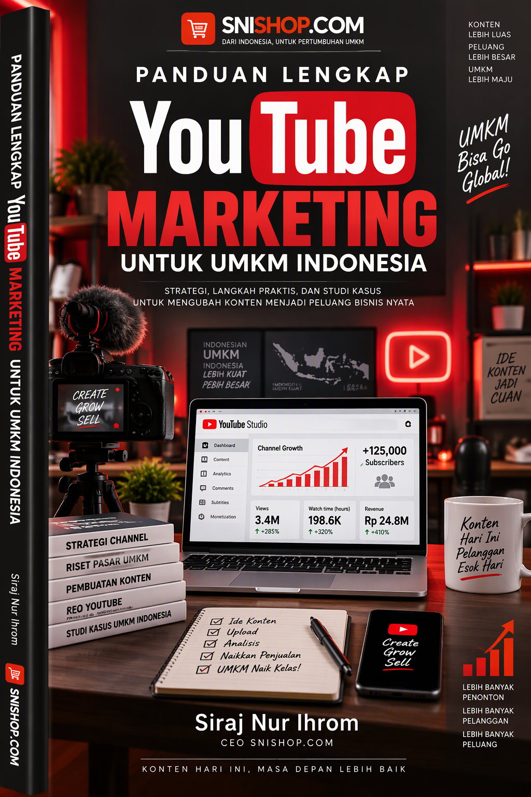
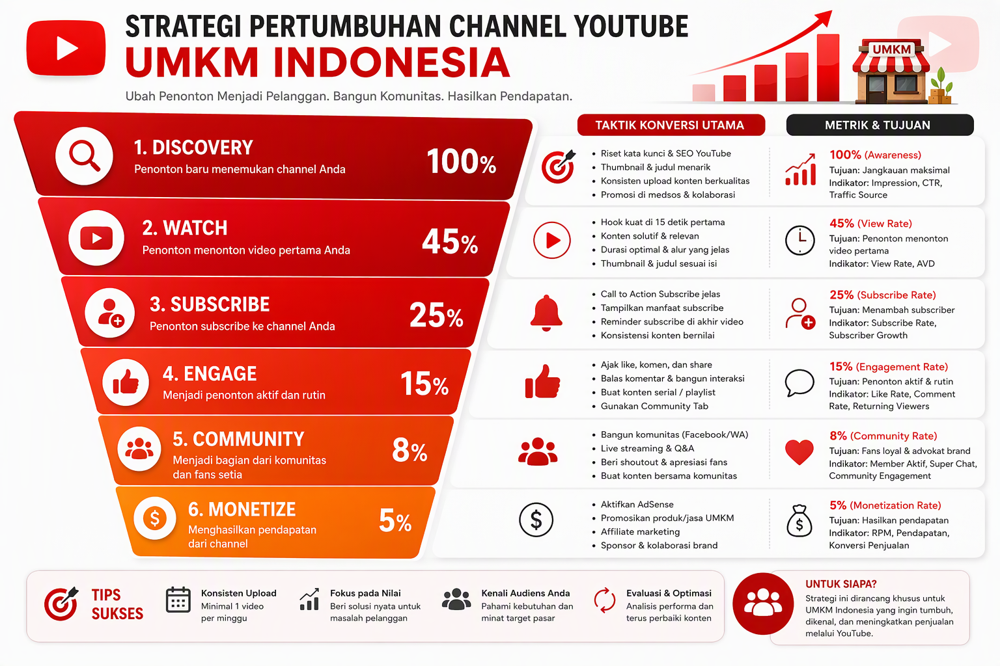
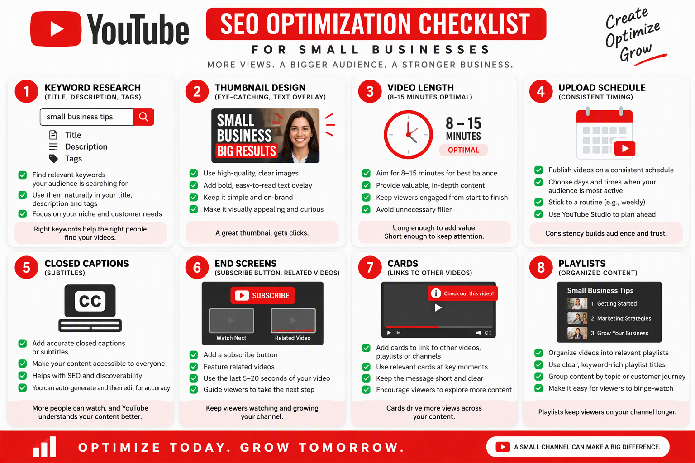
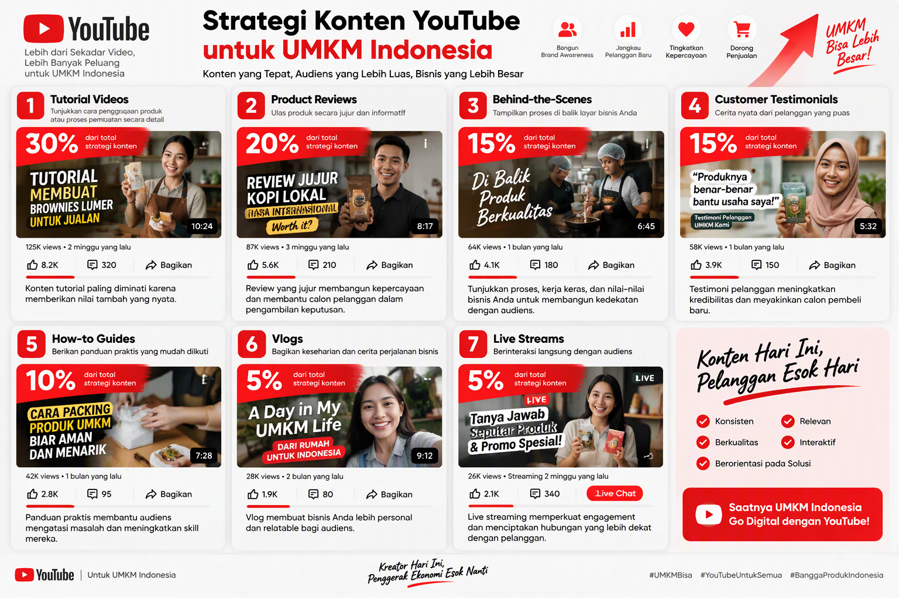
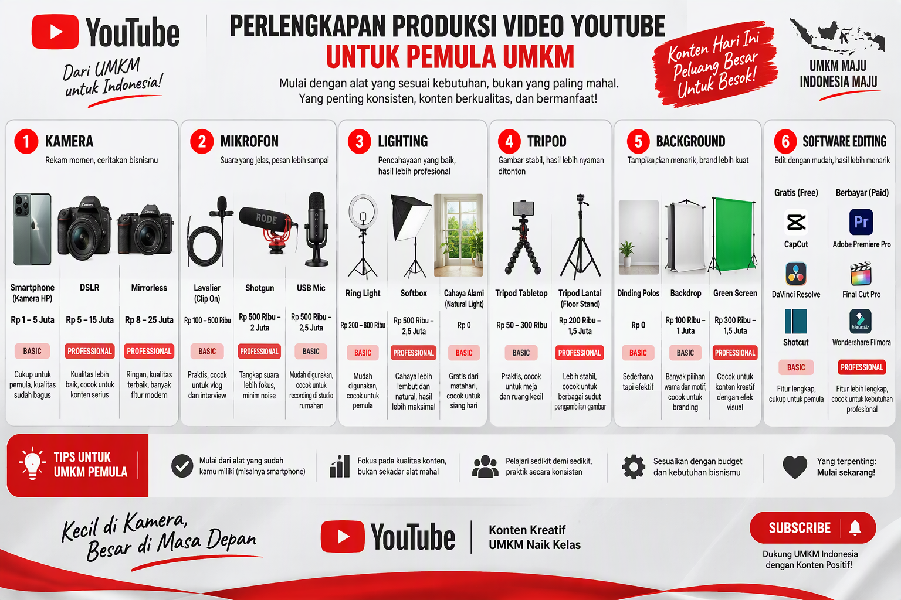
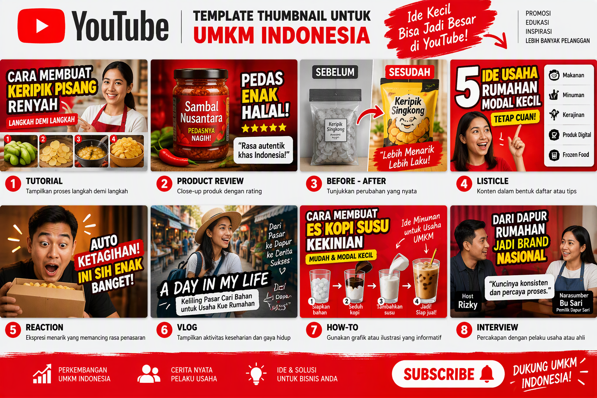
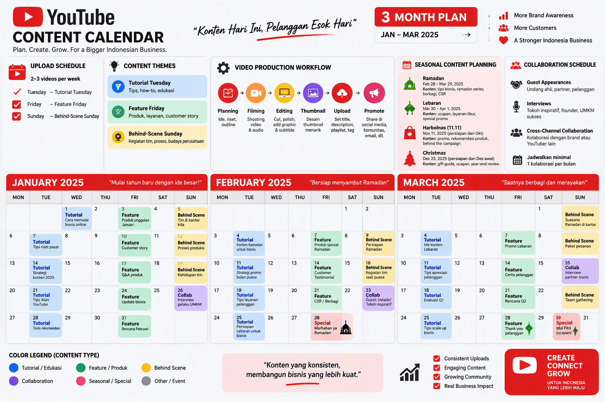
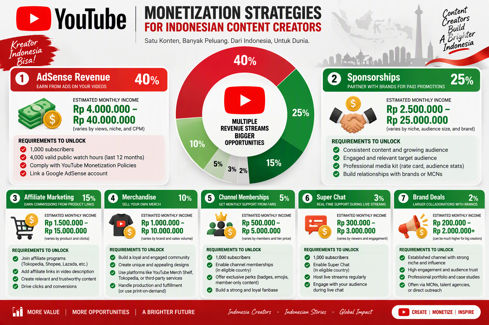
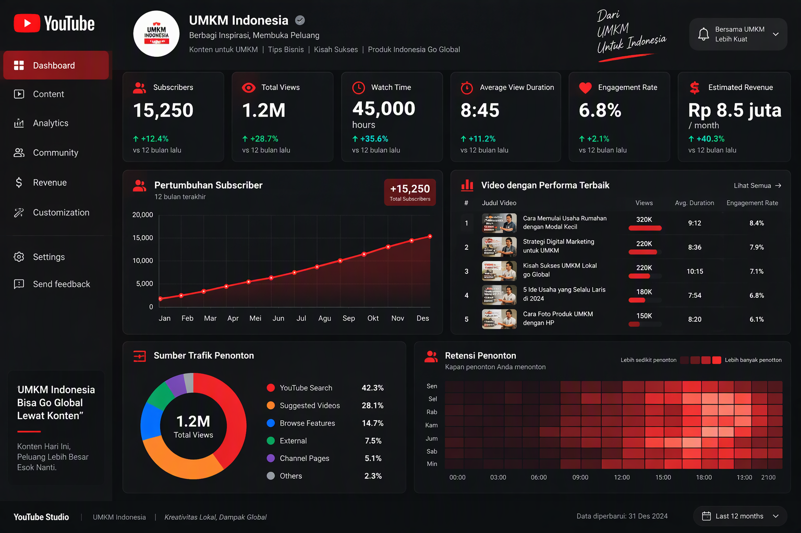
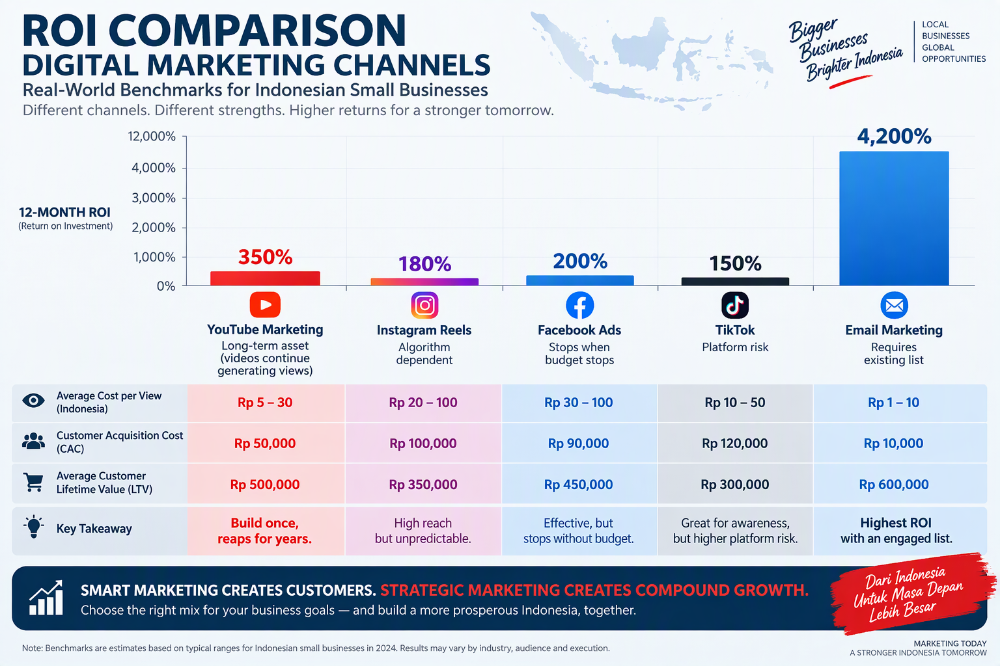

# Panduan Lengkap YouTube Marketing untuk UMKM Indonesia

**Produk 12 - SNISHOP Digital Product Series**

---

**Penulis:** Siraj Nur Ihrom, CEO SNISHOP.COM

**Penerbit:** SNISHOP.COM

**Edisi:** Desember 2025

**Hak Cipta:** (c) 2025 Siraj Nur Ihrom / SNISHOP.COM. Seluruh hak cipta dilindungi undang-undang.

---

## Daftar Isi

### BAGIAN I: FOUNDATION

**Bab 1: Mengapa YouTube Marketing Penting untuk UMKM Indonesia**
- 1.1 Landscape Digital Indonesia Saat Ini
- 1.2 YouTube vs Platform Lainnya
- 1.3 YouTube sebagai Aset Jangka Panjang
- 1.4 Metrik Keberhasilan dan Benchmark
- 1.5 Growth Funnel YouTube Marketing

**Bab 2: Memahami Algoritma YouTube**
- 2.1 Cara YouTube Merekomendasikan Video
- 2.2 Faktor-Faktor Ranking Utama
- 2.3 Sistem Rekomendasi: Homepage, Suggested, dan Search
- 2.4 Strategi untuk Channel Baru

**Bab 3: Riset dan Perencanaan Konten**
- 3.1 Menemukan Niche yang Tepat
- 3.2 Analisis Kompetitor
- 3.3 Riset Kata Kunci untuk YouTube
- 3.4 Strategi Content Pillars

### BAGIAN II: EXECUTION

**Bab 4: Setup Channel yang Profesional**
- 4.1 Nama Channel dan Branding
- 4.2 Deskripsi Channel dan Kata Kunci
- 4.3 Organisasi Playlist
- 4.4 Custom URL dan Verifikasi
- 4.5 Optimasi Pengaturan Channel

**Bab 5: Produksi Video yang Berkualitas**
- 5.1 Pre-Production: Scripting dan Storyboarding
- 5.2 Panduan Peralatan
- 5.3 Tips Produksi
- 5.4 Post-Production dan Export Settings

**Bab 6: Desain Thumbnail yang Menarik**
- 6.1 Mengapa Thumbnail Sangat Penting
- 6.2 Prinsip Desain Thumbnail
- 6.3 Text Overlay dan Color Psychology
- 6.4 A/B Testing Thumbnail

**Bab 7: YouTube SEO dan Optimasi**
- 7.1 Optimasi Judul Video
- 7.2 Best Practices Deskripsi
- 7.3 Strategi Tags
- 7.4 Closed Captions dan Subtitles
- 7.5 End Screens, Cards, dan Playlists

### BAGIAN III: ADVANCED

**Bab 8: Membangun Komunitas dan Engagement**
- 8.1 Strategi Mengelola Komentar
- 8.2 Memanfaatkan Community Tab
- 8.3 Live Streaming
- 8.4 Kolaborasi dengan Kreator Lain
- 8.5 Content Calendar

**Bab 9: Monetisasi Channel YouTube**
- 9.1 YouTube Partner Program
- 9.2 Revenue dari AdSense
- 9.3 Sponsorship dan Brand Deals
- 9.4 Affiliate Marketing
- 9.5 Channel Memberships dan Super Features
- 9.6 Merchandise

**Bab 10: Analytics, ROI, dan Growth Strategy**
- 10.1 Metrik Kunci yang Harus Dipantau
- 10.2 Deep Dive YouTube Analytics
- 10.3 Kalkulasi ROI
- 10.4 Scaling dan Long-Term Growth

### BAGIAN TAMBAHAN

- Studi Kasus
- ROI Calculator
- Implementation Plan
- Penutup
- Tentang Penulis

---

## BAGIAN I: FOUNDATION

---

## Bab 1: Mengapa YouTube Marketing Penting untuk UMKM Indonesia

### 1.1 Landscape Digital Indonesia Saat Ini

Indonesia merupakan salah satu pasar digital terbesar di dunia. Dengan populasi lebih dari 275 juta jiwa, negara ini memiliki basis pengguna internet yang terus bertumbuh setiap tahunnya. Data dari Asosiasi Penyelenggara Jasa Internet Indonesia (APJII) mencatat bahwa penetrasi internet di Indonesia telah melebihi 77 persen dari total populasi, dan angka ini terus meningkat seiring dengan semakin terjangkaunya perangkat mobile dan paket data.

YouTube menempati posisi istimewa dalam lanskap digital Indonesia. Platform ini bukan sekadar tempat menonton video hiburan, melainkan telah menjadi mesin pencari kedua terbesar di dunia setelah Google. Bagi pelaku UMKM, ini berarti YouTube menyediakan peluang emas untuk menjangkau audiens yang sangat luas dengan biaya yang relatif terjangkau dibandingkan media pemasaran tradisional.

Berikut adalah data kunci YouTube di Indonesia per tahun 2025:

| Metrik | Data |
|---|---|
| Total pengguna YouTube Indonesia | 200 juta+ |
| Rata-rata waktu tonton per hari | 45-60 menit per pengguna |
| Persentase akses via mobile | 94 persen |
| Persentase pengguna usia 18-44 | 68 persen |
| Pertumbuhan pengguna tahunan | 8-10 persen |
| Video yang ditonton per hari | 1 miliar+ jam globally |

Data ini menunjukkan bahwa YouTube bukan hanya platform besar, tetapi juga platform yang sangat relevan dengan demografi target mayoritas UMKM Indonesia, yaitu konsumen muda yang melek teknologi dan aktif berbelanja secara online.

### 1.2 YouTube vs Platform Lainnya

Banyak pelaku UMKM bertanya-tanya, mengapa harus menggunakan YouTube padahal sudah ada Instagram, TikTok, dan Facebook? Jawabannya terletak pada beberapa keunggulan unik yang dimiliki YouTube:

**Konten Evergreen.** Video yang Anda upload di YouTube hari ini bisa terus menghasilkan views selama bertahun-tahun ke depan. Berbeda dengan konten Instagram atau TikTok yang hanya tampil di feed selama 24-48 jam, video YouTube terus ditemukan melalui pencarian dan rekomendasi algoritma. Ini berarti satu video berkualitas bisa menjadi "salesman" yang bekerja 24 jam sehari, 7 hari seminggu, tanpa henti.

**Search Engine Optimization.** YouTube dimiliki oleh Google, sehingga video Anda bisa muncul di hasil pencarian Google. Ketika seseorang mencari "cara merawat kulit wajah" atau "resep nasi goreng enak", video Anda bisa muncul di halaman pertama Google, memberikan eksposur yang luar biasa bagi brand Anda.

**Trust dan Kredibilitas.** Video berdurasi lebih panjang memungkinkan Anda membangun kepercayaan dengan audiens. Ketika viewers melihat wajah Anda, mendengar penjelasan Anda, dan melihat produk Anda secara langsung, tingkat kepercayaan mereka terhadap brand Anda meningkat signifikan.

**Monetisasi Beragam.** YouTube menawarkan berbagai jalur monetisasi, mulai dari AdSense, sponsorship, affiliate marketing, hingga penjualan produk langsung. Platform lain mungkin menawarkan satu atau dua jalur, tetapi YouTube menyediakan ekosistem monetisasi yang paling lengkap.

Perbandingan singkat dengan platform lain:

| Fitur | YouTube | Instagram | TikTok | Facebook |
|---|---|---|---|---|
| Umur konten | Tahunan | 24-48 jam | 1-7 hari | 1-3 hari |
| Potensi pencarian | Sangat tinggi | Sedang | Rendah | Rendah |
| Monetisasi langsung | Ya | Terbatas | Terbatas | Terbatas |
| Video panjang | Hingga 12 jam | Hingga 90 detik | Hingga 10 menit | Hingga 240 menit |
| Trust building | Sangat tinggi | Sedang | Sedang | Rendah |
| Biaya produksi | Fleksibel | Fleksibel | Fleksibel | Fleksibel |

### 1.3 YouTube sebagai Aset Jangka Panjang

Salah satu konsep terpenting dalam YouTube marketing adalah bahwa setiap video yang Anda buat merupakan aset digital. Aset ini memiliki nilai yang bisa bertumbuh seiring waktu. Mari kita ilustrasikan dengan contoh konkret.

Sebuah UMKM kopi lokal bernama "Kopi Nusantara" mengupload video berjudul "Cara Seduh Kopi Manual Brew untuk Pemula" pada Januari 2024. Video berdurasi 12 menit ini mendapatkan 5.000 views di bulan pertama. Namun, karena konten ini evergreen dan terus muncul di pencarian YouTube, video ini rata-rata mendapatkan 800-1.200 views setiap bulannya. Setelah 12 bulan, total views video ini mencapai lebih dari 15.000. Dan yang terpenting, video ini terus menghasilkan views di tahun-tahun berikutnya tanpa perlu upaya tambahan.

Bayangkan jika "Kopi Nusantara" mengupload 4 video seperti ini setiap bulan. Dalam satu tahun, mereka memiliki 48 video yang masing-masing menghasilkan ratusan hingga ribuan views setiap bulannya. Total views kumulatif bisa mencapai ratusan ribu, dan setiap view merupakan potensi pelanggan yang mengenal brand mereka.

Inilah kekuatan YouTube sebagai aset jangka panjang. Anda tidak perlu terus-menerus membuat konten viral. Yang Anda butuhkan adalah konten yang konsisten, berkualitas, dan menjawab kebutuhan audiens Anda.

### 1.4 Metrik Keberhasilan dan Benchmark

Untuk mengukur keberhasilan YouTube marketing Anda, berikut adalah metrik-metrik kunci beserta benchmark untuk channel UMKM di Indonesia:

**Subscriber Growth Rate.** Channel baru yang konsisten mengupload 2-4 video per minggu biasanya mendapatkan 100-500 subscriber per bulan di 6 bulan pertama. Target realistis adalah mencapai 1.000 subscriber dalam 6-12 bulan pertama.

**View Count.** Video pertama biasanya mendapatkan 50-200 views. Setelah channel mulai dikenal, rata-rata views per video bisa mencapai 500-2.000 untuk channel dengan 1.000-5.000 subscriber. Rasio views terhadap subscriber yang sehat adalah 30-50 persen.

**Click-Through Rate (CTR).** CTR adalah persentase orang yang mengklik video Anda setelah melihat thumbnail. CTR rata-rata YouTube adalah 2-10 persen. Target yang baik untuk UMKM adalah 5-8 persen.

**Average View Duration.** Ini menunjukkan berapa lama penonton menonton video Anda. Target yang baik adalah 40-60 persen dari total durasi video. Untuk video 10 menit, ini berarti rata-rata penonton menonton selama 4-6 menit.

**Engagement Rate.** Termasuk likes, comments, shares, dan subscribes yang dihasilkan. Engagement rate yang baik adalah 3-5 persen dari total views.

| Tahap Channel | Subscriber | Views/Bulan | Revenue Potensial |
|---|---|---|---|
| Awal (0-6 bulan) | 0-1.000 | 1.000-5.000 | Belum monetisasi |
| Pertumbuhan (6-12 bulan) | 1.000-10.000 | 5.000-50.000 | Rp 500 ribu-5 juta |
| Menengah (1-2 tahun) | 10.000-50.000 | 50.000-200.000 | Rp 5-25 juta |
| Mapan (2+ tahun) | 50.000+ | 200.000+ | Rp 25 juta+ |

### 1.5 Growth Funnel YouTube Marketing

Growth funnel YouTube marketing menggambarkan perjalanan audiens dari tahap awareness hingga menjadi pelanggan setia. Memahami funnel ini penting agar Anda bisa merancang konten yang tepat untuk setiap tahap.

**Tahap 1: Discovery (Penemuan).** Audiens menemukan channel Anda melalui pencarian YouTube, rekomendasi algoritma, atau share di media sosial. Pada tahap ini, yang penting adalah thumbnail dan judul yang menarik perhatian.

**Tahap 2: Engagement (Keterlibatan).** Setelah menonton video pertama, audiens yang tertarik akan melanjutkan menonton video-video Anda yang lain. Mereka mulai meninggalkan like, komentar, dan subscribe ke channel Anda.

**Tahap 3: Trust Building (Pembangunan Kepercayaan).** Setelah menonton beberapa video, audiens mulai mengenal dan mempercayai Anda sebagai otoritas di niche Anda. Mereka menganggap rekomendasi Anda sebagai referensi yang bisa diandalkan.

**Tahap 4: Conversion (Konversi).** Pada tahap ini, audiens yang sudah percaya mulai mengambil tindakan yang Anda inginkan, seperti mengunjungi website Anda, membeli produk Anda, atau menghubungi tim Anda.

**Tahap 5: Advocacy (Advokasi).** Pelanggan yang puas menjadi advocate bagi brand Anda. Mereka merekomendasikan channel dan produk Anda kepada orang lain, sehingga funnel dimulai kembali dengan audiens baru.

Kunci keberhasilan funnel ini adalah konsistensi. Anda harus terus menghasilkan konten berkualitas yang membawa audiens dari satu tahap ke tahap berikutnya. Jangan berharap audiens langsung membeli produk Anda dari video pertama. Bangun hubungan terlebih dahulu, dan penjualan akan mengikuti secara natural.

---

## Bab 2: Memahami Algoritma YouTube

### 2.1 Cara YouTube Merekomendasikan Video

Algoritma YouTube adalah sistem kompleks yang menentukan video mana yang ditampilkan kepada setiap pengguna. Memahami cara kerja algoritma ini adalah kunci untuk mendapatkan views secara organik.

Secara sederhana, algoritma YouTube memiliki satu tujuan utama: membuat pengguna terus menonton YouTube selama mungkin. Setiap keputusan algoritma didasarkan pada tujuan ini. Jika video Anda bisa membuat pengguna terus menonton, algoritma akan merekomendasikan video Anda kepada lebih banyak orang.

Sistem rekomendasi YouTube bekerja melalui beberapa sinyal utama:

**Riwayat Penonton.** Algoritma menganalisis video apa yang sudah ditonton pengguna, berapa lama, dan video apa yang mereka skip. Ini membantu algoritma memahami preferensi setiap individu.

**Performa Video.** Algoritma mengukur seberapa baik video Anda berdasarkan CTR (berapa banyak orang yang mengklik setelah melihat thumbnail), watch time (berapa lama orang menonton), dan engagement (likes, comments, shares).

**Relevansi Topik.** Algoritma mencocokkan topik video Anda dengan minat pengguna berdasarkan judul, deskripsi, tags, dan konten video itu sendiri.

**Freshness.** Video baru biasanya mendapatkan boost awal dari algoritma untuk menguji performanya. Namun, video lama yang terus berperforma baik juga akan terus direkomendasikan.

**Session Time.** Ini adalah metrik yang sering diabaikan. Algoritma tidak hanya mengukur berapa lama orang menonton video Anda, tetapi juga apakah setelah menonton video Anda, mereka terus menonton YouTube atau menutup aplikasi. Jika video Anda membuat orang meninggalkan YouTube, algoritma akan mengurangi rekomendasi.

### 2.2 Faktor-Faktor Ranking Utama

Berikut adalah faktor-faktor ranking utama yang perlu Anda pahami dan optimasi:

**Click-Through Rate (CTR).** CTR adalah persentase orang yang mengklik video Anda setelah melihatnya di hasil pencarian atau rekomendasi. CTR dipengaruhi oleh thumbnail, judul, dan relevansi topik. CTR yang tinggi menandakan bahwa video Anda menarik perhatian audiens.

Rumus CTR: (Jumlah Klik / Jumlah Tayangan) x 100 persen

Contoh: Jika video Anda ditampilkan 1.000 kali dan diklik 50 kali, maka CTR-nya adalah 5 persen.

**Watch Time dan Average View Duration.** Watch time adalah total waktu yang dihabiskan penonton untuk menonton video Anda. Average view duration adalah rata-rata waktu tonton per penonton. YouTube sangat memperhatikan metrik ini karena langsung berkaitan dengan tujuan platform: membuat orang menonton selama mungkin.

**Engagement Signals.** Likes, comments, shares, dan subscribes yang dihasilkan dari video Anda merupakan sinyal positif bagi algoritma. Video yang memicu interaksi tinggi dianggap sebagai video berkualitas dan layak direkomendasikan lebih luas.

**Video Velocity.** Ini adalah kecepatan video Anda mendapatkan views dan engagement dalam 24-48 jam pertama setelah upload. Video yang mendapatkan traction cepat cenderung mendapatkan boost dari algoritma.

**Channel Authority.** Channel dengan riwayat performa yang baik secara keseluruhan akan mendapatkan keuntungan saat mengupload video baru. Ini mengapa konsistensi upload sangat penting.

**Keyword Relevance.** Kesesuaian antara kata kunci di judul, deskripsi, tags, dan konten video dengan query pencarian pengguna. Ini adalah dasar dari YouTube SEO yang akan dibahas lebih lanjut di Bab 7.

### 2.3 Sistem Rekomendasi: Homepage, Suggested, dan Search

YouTube memiliki tiga sumber traffic utama, dan masing-masing memiliki karakteristik yang berbeda:

**Homepage Recommendations.** Ini adalah halaman utama YouTube ketika pengguna membuka aplikasi. Video yang ditampilkan di sini dipilih berdasarkan riwayat menonton dan minat pengguna. Untuk masuk ke homepage, video Anda perlu memiliki CTR tinggi dan watch time yang baik. Homepage adalah sumber traffic terbesar untuk channel yang sudah memiliki basis subscriber yang solid.

**Suggested Videos (Up Next).** Ini adalah daftar video yang muncul di sebelah kanan video yang sedang ditonton (di desktop) atau di bawah video (di mobile). Video yang masuk ke suggested biasanya memiliki topik yang mirip dengan video yang sedang ditonton. Untuk masuk ke suggested, video Anda perlu memiliki relevansi topik yang kuat dengan video-video populer di niche Anda.

**Search Results.** Ini adalah hasil pencarian YouTube. Video yang muncul di sini dipilih berdasarkan relevansi dengan query pencarian, CTR, watch time, dan faktor SEO lainnya. Search adalah sumber traffic terbaik untuk channel baru karena tidak memerlukan basis subscriber yang besar.

| Sumber Traffic | Cocok Untuk | Kunci Keberhasilan |
|---|---|---|
| Search | Channel baru | SEO, kata kunci, relevansi |
| Suggested | Channel berkembang | Relevansi topik, watch time |
| Homepage | Channel mapan | CTR tinggi, engagement, loyalitas |

### 2.4 Strategi untuk Channel Baru

Jika Anda baru memulai channel YouTube, jangan langsung berfokus pada homepage recommendations. Fokuslah pada pencarian (search) terlebih dahulu. Berikut strateginya:

**Langkah 1: Riset Kata Kunci.** Gunakan YouTube search bar untuk menemukan kata kunci yang sering dicari audiens target Anda. Ketik topik umum dan lihat auto-suggestions yang muncul. Ini adalah kata kunci nyata yang dicari orang.

**Langkah 2: Buat Konten yang Menjawab Pertanyaan Spesifik.** Video dengan judul seperti "Cara Membuat [X] untuk Pemula" atau "Tips [X] untuk [Y]" biasanya memiliki volume pencarian yang baik dan persaingan yang lebih rendah.

**Langkah 3: Optimasi SEO.** Pastikan judul, deskripsi, dan tags video Anda mengandung kata kunci target. Buat thumbnail yang jelas dan menarik. Tulis deskripsi yang informatif minimal 200 kata.

**Langkah 4: Bangun Konsistensi.** Upload minimal 1-2 video per minggu secara konsisten. Algoritma menghargai channel yang aktif dan konsisten.

**Langkah 5: Promosi Silang.** Share video Anda di media sosial lain, website, dan komunitas online yang relevan. Ini membantu meningkatkan views awal dan engagement, yang menjadi sinyal positif bagi algoritma.

---

## Bab 3: Riset dan Perencanaan Konten

### 3.1 Menemukan Niche yang Tepat

Niche adalah fondasi dari seluruh strategi YouTube Anda. Niche yang tepat adalah titik temu antara tiga hal: passion dan keahlian Anda, kebutuhan audiens, dan potensi monetisasi.

**Langkah-langkah menemukan niche:**

Pertama, buat daftar topik yang Anda kuasai dan minati. Sebagai pelaku UMKM, Anda pasti memiliki keahlian di bidang bisnis Anda. Misalnya, jika Anda menjalankan bisnis kuliner, topik-topik seperti resep, teknik memasak, behind the scene dapur, dan tips bisnis kuliner adalah niche yang natural untuk Anda.

Kedua, validasi permintaan pasar. Gunakan YouTube search untuk mengecek apakah ada orang yang mencari konten di niche tersebut. Ketik kata kunci terkait dan lihat apakah ada video-video dengan views yang signifikan. Jika ada, berarti permintaannya ada.

Ketiga, analisis kompetisi. Lihat channel-channel yang sudah ada di niche tersebut. Apakah mereka besar? Berapa subscriber mereka? Jika ada channel dengan 10.000-100.000 subscriber yang aktif, ini adalah tanda bahwa niche tersebut sehat. Terlalu banyak channel dengan subscriber jutaan bisa menandakan persaingan yang sangat ketat.

Keempat, evaluasi potensi monetisasi. Apakah niche Anda memiliki produk atau jasa yang bisa dijual? Apakah ada brand yang mungkin tertarik untuk sponsorship? Apakah ada program affiliate yang relevan? Niche yang baik memiliki jalur monetisasi yang jelas.

Contoh niche yang potensial untuk UMKM Indonesia:

| Kategori | Contoh Niche | Potensi Monetisasi |
|---|---|---|
| Kuliner | Resep tradisional, review makanan, tips catering | Produk makanan, sponsorship, affiliate |
| Fashion | OOTD hijab, tips mix and match, DIY clothing | Produk fashion, endorsement, affiliate |
| Kecantikan | Skincare routine, makeup tutorial, review produk | Produk kecantikan, sponsorship |
| Teknologi | Review gadget, tips smartphone, tutorial aplikasi | Affiliate gadget, sponsorship |
| Bisnis | Tips UMKM, akuntansi sederhana, digital marketing | Kursus online, konsultasi, affiliate tools |
| Properti | Tour rumah, tips renovasi, investasi properti | Affiliate properti, sponsorship developer |

### 3.2 Analisis Kompetitor

Analisis kompetitor membantu Anda memahami apa yang sudah berhasil dilakukan orang lain dan menemukan celah yang bisa Anda manfaatkan.

**Identifikasi 5-10 kompetitor utama.** Cari channel-channel yang berada di niche yang sama dengan Anda. Fokus pada channel dengan ukuran serupa atau sedikit lebih besar dari channel Anda. Channel yang terlalu besar (jutaan subscriber) mungkin tidak relevan sebagai benchmark langsung.

**Analisis konten mereka.** Perhatikan hal-hal berikut dari setiap kompetitor:

- Jenis video apa yang paling populer (views tertinggi)?
- Berapa frekuensi upload mereka?
- Bagaimana kualitas produksi video mereka?
- Apa gaya thumbnail yang mereka gunakan?
- Bagaimana cara mereka berinteraksi dengan audiens di kolom komentar?
- Apakah mereka menggunakan format tertentu (tutorial, vlog, review)?

**Temukan content gap.** Content gap adalah topik atau angle yang belum banyak dibahas oleh kompetitor Anda. Misalnya, jika semua kompetitor Anda membuat video tentang "tips bisnis online", mungkin ada celah untuk membuat video tentang "kesalahan fatal bisnis online yang jarang dibahas" atau "studi kasus nyata bisnis online dari nol".

**Buat matriks analisis:**

| Kompetitor | Subscriber | Upload/Minggu | Video Terpopuler | Kelemahan |
|---|---|---|---|---|
| Channel A | 50.000 | 3 | Tutorial dasar | Audio kurang jelas |
| Channel B | 30.000 | 2 | Review produk | Thumbnail kurang menarik |
| Channel C | 80.000 | 4 | Tips bisnis | Konten terlalu umum |

### 3.3 Riset Kata Kunci untuk YouTube

Riset kata kunci adalah proses menemukan istilah-istilah yang dicari audiens target Anda di YouTube. Ini adalah fondasi dari strategi SEO YouTube Anda.

**Metode 1: YouTube Auto-Suggest.** Ketik kata kunci utama di search bar YouTube dan perhatikan saran yang muncul. YouTube secara otomatis menampilkan kata kunci yang sering dicari orang. Catat semua saran yang relevan.

**Metode 2: People Also Ask.** Ketika Anda mencari suatu topik di YouTube, perhatikan bagian "People also ask" yang muncul di hasil pencarian. Ini adalah pertanyaan-pertanyaan terkait yang juga dicari orang.

**Metode 3: Kompetitor Analysis.** Lihat judul-judul video populer dari kompetitor Anda. Kata kunci apa yang mereka gunakan di judul? Tools seperti TubeBuddy atau VidIQ bisa membantu Anda melihat tags yang digunakan kompetitor.

**Metode 4: Google Trends.** Gunakan Google Trends untuk membandingkan popularitas beberapa kata kunci dari waktu ke waktu. Ini membantu Anda memilih kata kunci yang sedang trending atau memiliki permintaan stabil.

**Metode 5: Keyword Research Tools.** Tools seperti VidIQ, TubeBuddy, dan Google Keyword Planner bisa memberikan data kuantitatif tentang volume pencarian dan tingkat kompetisi untuk setiap kata kunci.

**Membangun database kata kunci:**

Buat spreadsheet dengan kolom-kolom berikut untuk mengelola kata kunci Anda:

| Kata Kunci | Volume Pencarian | Kompetisi | Prioritas | Status |
|---|---|---|---|---|
| cara membuat kue | Tinggi | Tinggi | Sedang | Belum |
| resep kue kering lebaran | Sedang | Rendah | Tinggi | Sudah |
| tips bisnis kue dari rumah | Rendah | Rendah | Tinggi | Belum |

Prioritaskan kata kunci dengan volume pencarian sedang hingga tinggi dan kompetisi rendah hingga sedang. Kata kunci dengan kompetisi sangat tinggi bisa Anda targetkan nanti setelah channel Anda lebih besar.

### 3.4 Strategi Content Pillars

Content pillars adalah kategori-kategori konten utama yang menjadi fondasi channel Anda. Memiliki content pillars membantu Anda menjaga konsistensi topik dan memastikan channel Anda memiliki fokus yang jelas di mata audiens dan algoritma.

**Cara membangun content pillars:**

Tentukan 3-5 kategori utama yang relevan dengan niche dan bisnis Anda. Setiap kategori harus bisa menghasilkan minimal 10-20 ide video. Berikut contoh content pillars untuk beberapa jenis UMKM:

**UMKM Fashion Hijab:**
- Pillar 1: Tutorial styling hijab (30 persen konten)
- Pillar 2: Review produk dan haul (25 persen konten)
- Pillar 3: Tips fashion dan mix and match (25 persen konten)
- Pillar 4: Behind the scene bisnis (10 persen konten)
- Pillar 5: Q&A dan interaksi dengan audiens (10 persen konten)

**UMKM Kuliner:**
- Pillar 1: Resep dan tutorial memasak (35 persen konten)
- Pillar 2: Review alat dan bahan masak (20 persen konten)
- Pillar 3: Tips bisnis kuliner (20 persen konten)
- Pillar 4: Behind the scene dapur (15 persen konten)
- Pillar 5: Vlog dan daily life (10 persen konten)

**Distribusi konten ideal:**

Setiap pillar harus memiliki proporsi yang seimbang. Pillar utama (yang paling diminati audiens) mendapatkan porsi terbesar, sementara pillar pendukung mendapatkan porsi yang lebih kecil. Pastikan setiap video yang Anda buat masuk ke salah satu pillar yang sudah ditentukan. Ini membantu algoritma YouTube memahami topik channel Anda dan merekomendasikan video Anda kepada audiens yang tepat.

---

## BAGIAN II: EXECUTION

---

## Bab 4: Setup Channel yang Profesional

### 4.1 Nama Channel dan Branding

Nama channel adalah kesan pertama yang dimiliki audiens terhadap brand Anda. Pilih nama yang mudah diingat, mudah dieja, dan mencerminkan identitas bisnis Anda.

**Prinsip memilih nama channel:**

Pertama, gunakan nama yang singkat dan mudah diucapkan. Idealnya 2-3 kata. Hindari nama yang panjang, rumit, atau menggunakan singkatan yang tidak umum. Contoh bagus: "Kopi Nusantara", "Dapur Bu Sari", "Fashion by Rina".

Kedua, pastikan nama belum digunakan channel lain. Cari di YouTube dan Google untuk memastikan tidak ada channel besar yang menggunakan nama serupa. Ini menghindari kebingungan di audiens dan potensi masalah trademark.

Ketiga, pertimbangkan menggunakan nama brand Anda langsung. Jika bisnis Anda sudah memiliki nama yang dikenal, gunakan nama tersebut sebagai nama channel. Ini memperkuat brand consistency.

Keempat, tambahkan descriptor jika diperlukan. Jika nama brand Anda terlalu umum, tambahkan kata yang menjelaskan topik channel. Contoh: "SNISHOP - Tips Bisnis Digital" atau "Kopi Nusantara - Tutorial Ngopi".

**Branding visual channel:**

Banner channel adalah elemen visual pertama yang dilihat pengunjung. Banner harus mencerminkan identitas brand Anda dan memberikan informasi jelas tentang apa yang bisa audiens harapkan dari channel Anda.

Spesifikasi banner YouTube:
- Ukuran ideal: 2560 x 1440 piksel
- Area aman (terlihat di semua perangkat): 1546 x 423 piksel (tengah)
- Ukuran file maksimal: 6 MB

Elemen yang harus ada di banner:
- Nama channel atau brand
- Tagline atau value proposition singkat
- Jadwal upload (opsional, misalnya "Video Baru Setiap Selasa dan Jumat")
- Warna dan font yang konsisten dengan brand identity

**Profil picture:**
- Gunakan logo brand Anda atau foto wajah (untuk personal branding)
- Ukuran: 800 x 800 piksel
- Pastikan terlihat jelas meski dalam ukuran kecil

### 4.2 Deskripsi Channel dan Kata Kunci

Deskripsi channel (About section) adalah tempat untuk menjelaskan siapa Anda, apa yang Anda tawarkan, dan mengapa orang harus subscribe. Deskripsi ini juga bisa di-index oleh mesin pencari YouTube dan Google, jadi optimalkan dengan kata kunci yang relevan.

**Template deskripsi channel:**

Paragraf pertama (yang paling penting, muncul di hasil pencarian): Jelaskan secara singkat siapa Anda dan apa value yang akan didapatkan subscriber. Sertakan kata kunci utama.

Contoh: "Selamat datang di Dapur Bu Sari! Channel ini adalah tempatnya belajar resep-resep masakan Indonesia tradisional dan modern dengan panduan langkah demi langkah yang mudah diikuti. Setiap minggu, kami mengupload video resep baru yang bisa Anda praktikkan di rumah."

Paragraf kedua: Jelaskan jadwal upload dan jenis konten yang bisa diharapkan.

Contoh: "Video baru setiap hari Selasa dan Jumat pukul 18.00 WIB. Konten kami mencakup tutorial memasak, tips dapur, review alat masak, dan behind the scene bisnis kuliner kami."

Paragraf ketiga: Call-to-action dan informasi kontak.

Contoh: "Subscribe sekarang dan nyalakan lonceng notifikasi agar tidak ketinggalan video terbaru! Untuk kerjasama bisnis, hubungi: email@dapurbusari.com"

**Kata kunci channel:**
Di bagian settings channel, tambahkan kata kunci yang relevan dengan niche Anda. Kata kunci ini membantu YouTube memahami topik channel Anda. Tambahkan 10-15 kata kunci yang mencakup topik utama dan variasi dari niche Anda.

### 4.3 Organisasi Playlist

Playlist adalah salah satu fitur YouTube yang paling sering diabaikan, padahal sangat powerful untuk SEO dan viewer experience.

**Manfaat playlist:**

Pertama, playlist meningkatkan watch time. Ketika seseorang menonton satu video dalam playlist, YouTube secara otomatis memutar video berikutnya. Ini meningkatkan total watch time channel Anda.

Kedua, playlist membantu SEO. Setiap playlist bisa dioptimasi dengan judul dan deskripsi yang mengandung kata kunci. Playlist yang teroptimasi bisa muncul di hasil pencarian YouTube.

Ketiga, playlist meningkatkan user experience. Audiens bisa dengan mudah menemukan konten yang mereka minati tanpa harus scrolling melalui seluruh video Anda.

**Strategi membuat playlist:**

Buat playlist berdasarkan content pillars yang sudah Anda tentukan di Bab 3. Setiap pillar bisa menjadi satu playlist. Selain itu, buat juga playlist berdasarkan level (pemula, menengah, advanced) atau berdasarkan seri topik tertentu.

Praktik terbaik playlist:
- Beri judul playlist yang mengandung kata kunci
- Tulis deskripsi playlist minimal 100 kata
- Urutan video dalam playlist harus logis (dari dasar ke advanced)
- Update playlist secara berkala dengan video baru
- Buat playlist yang menarik untuk ditonton dari awal sampai akhir

### 4.4 Custom URL dan Verifikasi

Custom URL membuat channel Anda lebih mudah ditemukan dan terlihat lebih profesional. Untuk mendapatkan custom URL, channel Anda harus memenuhi syarat tertentu.

**Syarat custom URL (saat ini):**
- Memiliki minimal 100 subscriber
- Memiliki profil picture yang terupload
- Memiliki banner channel
- Berusia minimal 30 hari

Setelah memenuhi syarat, Anda bisa mengklaim custom URL melalui YouTube Studio di bagian Customization > Basic info.

**Verifikasi channel:**
Verifikasi channel memberikan akses ke fitur-fitur tambahan seperti custom thumbnail, live streaming, dan video berdurasi lebih dari 15 menit. Verifikasi dilakukan melalui nomor telepon.

Langkah verifikasi:
1. Buka YouTube Studio
2. Klik Settings > Channel > Feature eligibility
3. Klik "Intermediate features" dan ikuti proses verifikasi
4. Masukkan nomor telepon dan kode verifikasi

### 4.5 Optimasi Pengaturan Channel

Ada beberapa pengaturan channel yang perlu Anda optimasi sejak awal:

**Upload defaults.** Atur default setting untuk upload video agar Anda tidak perlu mengulang pengaturan yang sama setiap kali upload. Anda bisa mengatur default deskripsi, visibility, dan kategori.

**Branding watermarks.** Tambahkan watermark brand Anda yang muncul di pojok kanan bawah video. Watermark ini bisa diklik dan berfungsi sebagai subscribe button. Gunakan gambar PNG transparan berukuran 150 x 150 piksel.

**Keyword tags channel.** Di bagian Settings > Channel > Keywords, tambahkan 10-15 kata kunci yang menggambarkan channel Anda. Gunakan kombinasi kata kunci umum dan spesifik.

**Advanced settings.** Di bagian Settings > Channel > Advanced settings, atur country of residence ke Indonesia dan tentukan language channel ke Bahasa Indonesia. Ini membantu YouTube menargetkan audiens yang tepat.

---

## Bab 5: Produksi Video yang Berkualitas

### 5.1 Pre-Production: Scripting dan Storyboarding

Produksi video yang berkualitas dimulai dari perencanaan yang matang. Jangan pernah merekam video tanpa persiapan, kecuali Anda sudah sangat berpengalaman.

**Scripting (Penulisan Naskah):**

Ada tiga jenis naskah yang bisa Anda gunakan, tergantung gaya konten Anda:

Naskah lengkap (word-for-word): Tulis setiap kata yang akan Anda ucapkan. Cocok untuk video tutorial yang membutuhkan presisi tinggi atau video yang membutuhkan data dan angka akurat. Kelemahannya, pembacaan bisa terasa kaku jika tidak dilatih dengan baik.

Outline naskah: Tulis poin-poin utama yang akan dibahas, lalu kembangkan secara spontan saat merekam. Ini memberikan keseimbangan antara struktur dan naturalitas. Cocok untuk sebagian besar konten UMKM.

Bullet points: Tulis hanya garis besar topik. Cocok untuk konten yang Anda kuasai dengan sangat baik dan bisa berbicara secara improvisasi. Namun, risiko melebar dari topik cukup tinggi.

**Template naskah video UMKM:**

Berikut template naskah yang bisa Anda adaptasi:

Hook (0-15 detik pertama): Kalimat pembuka yang menarik perhatian. Ini adalah bagian paling kritis karena menentukan apakah penonton akan terus menonton atau skip. Contoh: "Dalam video ini, saya akan menunjukkan cara [hasil yang diinginkan] dalam [waktu/langkah] tanpa [hal yang dihindari audiens]."

Intro (15-30 detik): Perkenalan singkat dan jelaskan apa yang akan dipelajari penonton. Sebutkan kredibilitas Anda di topik ini.

Konten utama: Sampaikan poin-poin utama secara terstruktur. Gunakan transisi yang jelas antara satu poin dengan poin lainnya. Untuk video tutorial, tunjukkan setiap langkah secara visual.

Call-to-action: Akhiri dengan ajakan yang jelas. Minta penonton untuk like, comment, subscribe, atau mengunjungi link di deskripsi.

**Storyboarding:**

Storyboard adalah representasi visual dari setiap scene dalam video Anda. Tidak perlu rumit, cukup sketsa sederhana yang menunjukkan:
- Apa yang terlihat di layar (visual)
- Apa yang Anda katakan (audio)
- Grafis atau teks yang ditampilkan
- Durasi setiap scene

### 5.2 Panduan Peralatan

Anda tidak perlu peralatan mahal untuk memulai. Yang penting adalah kualitas audio yang baik dan pencahayaan yang cukup. Berikut panduan peralatan berdasarkan budget:

**Budget Pemula (di bawah Rp 2 juta):**

| Peralatan | Rekomendasi | Estimasi Harga |
|---|---|---|
| Kamera | Smartphone (yang sudah ada) | Rp 0 |
| Tripod | Tripod smartphone fleksibel | Rp 100.000-200.000 |
| Microphone | Clip-on mic lavalier | Rp 100.000-300.000 |
| Lighting | Ring light 10 inch | Rp 150.000-300.000 |
| Background | Kain polos atau dinding bersih | Rp 0-100.000 |
| **Total** | | **Rp 350.000-900.000** |

**Budget Menengah (Rp 2-10 juta):**

| Peralatan | Rekomendasi | Estimasi Harga |
|---|---|---|
| Kamera | Smartphone flagship atau mirrorless entry | Rp 3.000.000-7.000.000 |
| Tripod | Tripod aluminium dengan ball head | Rp 300.000-500.000 |
| Microphone | Wireless mic (Boya, Rode Wireless Go) | Rp 500.000-2.000.000 |
| Lighting | Softbox kit 2 titik | Rp 500.000-1.500.000 |
| Background | Backdrop stand + kain/kertas | Rp 300.000-500.000 |
| **Total** | | **Rp 4.600.000-11.500.000** |

**Budget Profesional (di atas Rp 10 juta):**

| Peralatan | Rekomendasi | Estimasi Harga |
|---|---|---|
| Kamera | Mirrorless (Sony, Fuji, Canon) | Rp 8.000.000-15.000.000 |
| Lensa | Kit lensa atau prime 35mm/50mm | Rp 2.000.000-5.000.000 |
| Tripod | Tripod karbon fiber | Rp 1.000.000-3.000.000 |
| Microphone | Shotgun mic + wireless lavalier | Rp 2.000.000-5.000.000 |
| Lighting | LED panel + softbox | Rp 2.000.000-5.000.000 |
| **Total** | | **Rp 15.000.000-33.000.000** |

### 5.3 Tips Produksi

**Pencahayaan (Lighting):**

Pencahayaan adalah faktor tunggal yang paling berpengaruh terhadap kualitas visual video Anda. Bahkan kamera mahal akan menghasilkan video yang buruk jika pencahayaannya buruk. Sebaliknya, smartphone dengan pencahayaan yang baik bisa menghasilkan video yang sangat bagus.

Setup pencahayaan dasar menggunakan prinsip three-point lighting:

Key light (cahaya utama): Sumber cahaya utama yang menghadap ke wajah Anda, sedikit di atas level mata dan 45 derajat dari samping. Ini adalah cahaya terkuat.

Fill light (cahaya pengisi): Sumber cahaya kedua yang ditempatkan di sisi berlawanan key light, dengan intensitas lebih rendah (sekitar 50 persen dari key light). Fungsinya mengurangi bayangan keras yang dihasilkan key light.

Back light (cahaya belakang): Sumber cahaya yang ditempatkan di belakang Anda, menghadap ke belakang kepala. Fungsinya memisahkan Anda dari background dan memberikan dimensi pada gambar.

Jika budget terbatas, mulailah dengan satu sumber cahaya (key light) dan manfaatkan cahaya alami dari jendela. Pastikan cahaya alami menghadap ke wajah Anda, bukan dari belakang.

**Audio:**

Audio yang buruk bisa membuat penonton langsung meninggalkan video Anda, meskipun visualnya bagus. Prioritaskan investasi pada microphone yang baik.

Tips audio:
- Selalu gunakan external microphone, jangan mengandalkan mic bawaahan kamera atau smartphone
- Rekam di ruangan yang tenang, hindari ruangan dengan banyak gema
- Lakukan test recording sebelum memulai rekaman sesungguhnya
- Monitor audio menggunakan headphone saat merekam
- Jaga jarak mulut ke microphone sekitar 15-20 cm

**Framing dan Komposisi:**

- Gunakan rule of thirds: posisikan mata Anda di sepertiga atas frame
- Pastikan headroom cukup (jarak antara kepala dan batas atas frame)
- Background harus bersih dan tidak mengganggu
- Pastikan pencahayaan merata di wajah, tidak ada sisi yang terlalu gelap
- Untuk video tutorial yang menampilkan objek, gunakan overhead shot atau close-up

### 5.4 Post-Production dan Export Settings

Post-production adalah proses mengedit rekaman mentah menjadi video yang siap diupload.

**Software editing yang direkomendasikan:**

| Software | Harga | Platform | Level |
|---|---|---|---|
| CapCut Desktop | Gratis | Windows, Mac | Pemula-Menengah |
| DaVinci Resolve | Gratis (ada versi berbayar) | Windows, Mac, Linux | Menengah-Profesional |
| Adobe Premiere Pro | Berlangganan | Windows, Mac | Profesional |
| Filmora | Berbayar (sekali beli) | Windows, Mac | Pemula-Menengah |

**Alur editing dasar:**

1. Import semua footage ke software editing
2. Susun footage sesuai naskah/outline
3. Potong bagian yang tidak perlu (salah bicara, jeda panjang, kesalahan)
4. Tambahkan B-roll (footage pendukung) untuk mengisi bagian yang membosankan
5. Tambahkan musik latar (gunakan musik bebas royalti dari YouTube Audio Library)
6. Tambahkan teks, grafis, dan transisi jika diperlukan
7. Color correction dan color grading dasar
8. Audio mixing: pastikan suara jelas dan musik latar tidak terlalu keras
9. Export dengan setting yang tepat

**Export settings yang direkomendasikan:**

| Setting | Nilai |
|---|---|
| Resolusi | 1920x1080 (Full HD) atau 3840x2160 (4K) |
| Frame rate | 24fps (cinematic) atau 30fps (standard) |
| Bitrate video | 8-12 Mbps (1080p), 20-30 Mbps (4K) |
| Format | MP4 (H.264) atau MOV |
| Audio | AAC, 48kHz, 192kbps atau lebih |

---

## Bab 6: Desain Thumbnail yang Menarik

### 6.1 Mengapa Thumbnail Sangat Penting

Thumbnail adalah faktor penentu utama apakah seseorang akan mengklik video Anda atau tidak. Anda bisa membuat video terbaik di dunia, tetapi jika thumbnail-nya tidak menarik, tidak ada yang akan mengkliknya.

Think of thumbnail sebagai etalase toko Anda. Etalase yang menarik membuat orang ingin masuk. Etalase yang membosankan membuat orang lewat begitu saja.

Data menunjukkan bahwa thumbnail dan judul bersama-sama bertanggung jawab atas 80-90 persen keputusan seseorang untuk mengklik video atau tidak. Ini berarti thumbnail adalah investasi waktu dan effort yang sangat layak.

CTR benchmark berdasarkan kualitas thumbnail:
- Thumbnail buruk: 1-2 persen CTR
- Thumbnail rata-rata: 3-4 persen CTR
- Thumbnail baik: 5-7 persen CTR
- Thumbnail sangat baik: 8-10+ persen CTR

Perbedaan antara CTR 2 persen dan 8 persen sangat signifikan. Jika video Anda ditampilkan 10.000 kali, CTR 2 persen berarti 200 klik, sementara CTR 8 persen berarti 800 klik. Itu 4x lipat lebih banyak penonton dari video yang sama, hanya karena thumbnail yang berbeda.

### 6.2 Prinsip Desain Thumbnail

**Ukuran dan spesifikasi:**
- Ukuran: 1280 x 720 piksel (rasio 16:9)
- Format: JPG, PNG, atau GIF (non-animasi)
- Ukuran file: di bawah 2 MB

**Prinsip-prinsip desain thumbnail yang efektif:**

**Kesederhanaan.** Thumbnail akan dilihat dalam ukuran kecil di layar smartphone. Hindari elemen yang terlalu banyak atau detail yang rumit. Fokus pada satu subjek utama dan maksimal 3-5 kata teks.

**Kontras tinggi.** Gunakan warna-warna yang kontras agar thumbnail menonjol di antara video-video lain. Background yang kontras dengan subjek membuat subjek lebih menonjol.

**Wajah manusia.** Thumbnail yang menampilkan wajah dengan ekspresi yang jelas (terkejut, senang, penasaran) cenderung mendapatkan CTR lebih tinggi. Mata harus terlihat jelas dan ekspresi harus sesuai dengan konten video.

**Konsistensi brand.** Gunakan style, warna, dan font yang konsisten di seluruh thumbnail Anda. Ini membantu audiens mengenali video Anda dengan sekilas pandang. Buat template thumbnail yang bisa digunakan berulang.

**Hierarki visual.** Elemen paling penting harus paling menonjol. Urutan pentingnya: (1) subjek utama atau wajah, (2) teks singkat, (3) elemen pendukung.

### 6.3 Text Overlay dan Color Psychology

**Text overlay best practices:**

Teks di thumbnail harus singkat, besar, dan mudah dibaca. Jangan ulangi judul video di thumbnail. Gunakan teks untuk melengkapi atau memberikan konteks tambahan.

Contoh:
- Judul video: "Cara Membuat Website Toko Online dalam 30 Menit"
- Teks thumbnail: "TANPA CODING!" atau "MUDAH BANGET!"

Prinsip teks thumbnail:
- Maksimal 3-5 kata
- Font besar dan tebal (bold)
- Warna teks kontras dengan background
- Letakkan teks di area yang tidak tertutup oleh timestamp duration (pojok kanan bawah)
- Gunakan stroke atau shadow pada teks untuk meningkatkan keterbacaan

**Color psychology dalam thumbnail:**

Warna memiliki pengaruh psikologis terhadap keputusan klik:

| Warna | Asosiasi | Penggunaan |
|---|---|---|
| Merah | Urgensi, semangat, perhatian | CTA, highlight, peringatan |
| Kuning | Optimisme, energi, ceria | Background, aksen, highlight |
| Biru | Kepercayaan, profesional, tenang | Background, branding |
| Hijau | Pertumbuhan, uang, alam | Konten finansial, kesehatan |
| Orange | Kreativitas, ramah, hangat | CTA, aksen |
| Hitam | Elegan, kuat, misterius | Background, teks |
| Putih | Bersih, sederhana, luas | Background, ruang negatif |

Kombinasi warna yang efektif untuk thumbnail:
- Kuning dan hitam (kontras tinggi, sangat eye-catching)
- Biru dan putih (profesional, terpercaya)
- Merah dan putih (bold, menarik perhatian)
- Hijau dan kuning (fresh, energik)

### 6.4 A/B Testing Thumbnail

A/B testing adalah proses membandingkan dua versi thumbnail untuk menentukan mana yang lebih efektif. YouTube sekarang menyediakan fitur A/B testing thumbnail bawaan melalui fitur "Test & Compare".

**Cara melakukan A/B testing:**

1. Buat 2-3 variasi thumbnail untuk setiap video
2. Upload melalui YouTube Studio > Content > pilih video > Thumbnail > Test & Compare
3. YouTube akan menampilkan variasi thumbnail secara bergantian
4. Tunggu minimal 24-48 jam untuk mendapatkan data yang cukup
5. Pilih thumbnail dengan CTR tertinggi

**Tips variasi thumbnail untuk A/B testing:**

- Variasi ekspresi wajah (senyum vs serius vs terkejut)
- Variasi warna background (terang vs gelap)
- Variasi teks (dengan teks vs tanpa teks, atau teks berbeda)
- Variasi komposisi (subjek di kiri vs di kanan)

**Kesalahan umum dalam mendesain thumbnail:**

- Terlalu banyak teks (lebih dari 5 kata)
- Teks terlalu kecil untuk dibaca di layar smartphone
- Gambar buram atau pixelated
- Tidak ada focal point yang jelas
- Warna thumbnail terlalu mirip dengan video lain di niche yang sama
- Clickbait yang tidak sesuai dengan konten (ini merusak trust dan menurunkan watch time)

---

## Bab 7: YouTube SEO dan Optimasi

### 7.1 Optimasi Judul Video

Judul video adalah elemen SEO paling penting setelah thumbnail. Judul yang baik harus memenuhi dua tujuan: menarik klik dari audiens (CTR) dan mengandung kata kunci yang relevan (searchability).

**Prinsip judul yang efektif:**

Pertama, letakkan kata kunci utama di awal judul. YouTube dan Google memberikan bobot lebih pada kata-kata di awal judul. Contoh: "Resep Nasi Goreng Spesial - Cara Mudah Masak di Rumah" lebih baik daripada "Cara Mudah Masak di Rumah - Resep Nasi Goreng Spesial".

Kedua, buat judul yang memicu rasa ingin tahu atau menjanjikan value. Gunakan angka, kata sifat kuat, atau pertanyaan. Contoh: "7 Kesalahan Fatal Pemula dalam Bisnis Online" atau "Rahasia Kulit Glowing yang Jarang Orang Tahu".

Ketiga, jaga panjang judul idealnya 50-70 karakter. Judul yang terlalu panjang akan terpotong di hasil pencarian dan rekomendasi.

Keempat, hindari clickbait yang menyesatkan. Judul harus sesuai dengan konten video. Clickbait yang tidak sesuai akan menurunkan watch time dan merusak kepercayaan audiens.

**Formula judul yang terbukti efektif:**

- "Cara [Melakukan Sesuatu] dalam [Waktu/Jumlah Langkah]"
- "[Angka] Tips [Topik] untuk [Audiens]"
- "[Topik] untuk Pemula: Panduan Lengkap [Tahun]"
- "Review Jujur [Produk]: Apakah Worth It?"
- "[Masalah]? Ini Solusinya! [Topik]"

### 7.2 Best Practices Deskripsi

Deskripsi video memiliki dua fungsi: membantu SEO dan memberikan informasi kepada penonton.

**Struktur deskripsi yang optimal:**

Paragraf pertama (1-2 kalimat, 150 karakter pertama): Ini yang muncul di hasil pencarian sebelum "Show more". Harus mengandung kata kunci utama dan memberikan ringkasan yang menarik.

Contoh: "Dalam video ini, saya akan menunjukkan cara membuat nasi goreng spesial ala restoran yang mudah dipraktikkan di rumah. Resep nasi goreng ini sudah diuji coba dan rasanya dijamin enak!"

Paragraf kedua (2-4 kalimat): Elaborasi tentang isi video. Sertakan kata kunci sekunder dan variasi dari kata kunci utama.

Timestamps (chapters): Daftarkan timestamp untuk setiap bagian utama video. Ini membantu penonton navigasi dan juga bisa muncul di hasil pencarian Google.

Contoh:
00:00 Intro
01:15 Bahan-bahan yang dibutuhkan
03:30 Langkah 1: Persiapan bumbu
06:00 Langkah 2: Proses memasak
10:30 Tips penyajian
12:00 Outro

Links dan CTA: Tambahkan link ke produk, website, media sosial, atau video terkait. Letakkan di bagian bawah deskripsi.

Hashtags: Tambahkan 3-5 hashtag di akhir deskripsi. Hashtag pertama akan muncul di atas judul video. Gunakan hashtag yang relevan dan spesifik.

**Panjang deskripsi:** Idealnya 250-500 kata. Deskripsi yang terlalu pendek tidak memberikan cukup konteks untuk SEO. Deskripsi yang terlalu panjang bisa membuat penonton kehilangan informasi penting.

### 7.3 Strategi Tags

Tags membantu YouTube memahami topik video Anda dan mengaitkannya dengan video yang relevan. Meskipun YouTube menyatakan bahwa tags memiliki pengaruh kecil dibandingkan judul dan deskripsi, tags tetap layak dioptimalkan.

**Strategi tags:**

Gunakan 8-15 tags per video. Jangan terlalu sedikit, tapi juga jangan berlebihan (spamming tags bisa berdampak negatif).

Urutan tags dari paling spesifik ke paling umum:
1. Kata kunci utama (exact match): "resep nasi goreng spesial"
2. Variasi kata kunci: "cara membuat nasi goreng", "nasi goreng enak"
3. Kata kunci terkait: "resep masakan indonesia", "masakan rumahan"
4. Kategori umum: "resep", "masakan", "tutorial memasak"

**Kesalahan tags yang harus dihindari:**
- Menggunakan tags yang tidak relevan dengan konten video
- Menggunakan tags milik channel lain (misalnya nama brand besar)
- Menggunakan terlalu banyak tags (lebih dari 30)
- Mengulang kata kunci yang sama dengan variasi yang tidak bermakna

### 7.4 Closed Captions dan Subtitles

Closed captions (CC) atau subtitle memiliki beberapa manfaat penting:

Pertama, meningkatkan aksesibilitas. Penonton yang tuli atau kesulitan mendengar bisa menikmati konten Anda.

Kedua, meningkatkan SEO. YouTube bisa membaca teks dalam closed captions, sehingga memberikan lebih banyak konteks tentang isi video Anda.

Ketiga, menjangkau audiens internasional. Subtitle dalam bahasa Inggris atau bahasa lain bisa membuka pasar baru.

Keempat, meningkatkan watch time. Penonton yang menonton di tempat ramai atau tanpa headphone bisa tetap mengikuti isi video melalui subtitle.

**Cara menambahkan subtitle:**

Opsi 1: Upload file subtitle (.srt) yang sudah dibuat. Anda bisa membuat file subtitle menggunakan software editing video atau tools online.

Opsi 2: Biarkan YouTube membuat subtitle otomatis, lalu edit untuk memperbaiki akurasi. YouTube menyediakan auto-generated captions untuk video berbahasa Indonesia, meskipun akurasinya tidak selalu sempurna.

Opsi 3: Ketik subtitle secara manual melalui YouTube Studio. Buka video > Subtitles > Add language > Type manually.

**Best practices subtitle:**
- Pastikan akurasi, terutama untuk istilah teknis dan nama produk
- Gunakan bahasa yang mudah dipahami
- Sinkronkan timing dengan baik
- Pertimbangkan menambahkan subtitle bahasa Inggris untuk menjangkau audiens yang lebih luas

### 7.5 End Screens, Cards, dan Playlists

**End screens** adalah elemen yang muncul di 5-20 detik terakhir video Anda. End screens bisa berisi:
- Subscribe button
- Link ke video lain
- Link ke playlist
- Link ke channel lain (untuk kolaborasi)

Best practices end screens:
- Selalu tambahkan end screen di setiap video
- Arahkan ke video yang paling relevan dengan video yang sedang ditonton
- Gunakan template end screen yang konsisten
- Sebutkan secara verbal bahwa ada video rekomendasi di akhir

**Cards** adalah notifikasi interaktif yang muncul selama video berlangsung. Cards bisa berisi:
- Link ke video lain
- Link ke playlist
- Polling
- Link ke channel

Best practices cards:
- Tambahkan 2-3 cards per video
- Letakkan cards di momen yang relevan (ketika Anda menyebutkan topik terkait)
- Hindari meletakkan cards terlalu dekat dengan awal atau akhir video
- Jangan letakkan cards di momen kritis konten

**Playlists untuk SEO:**
Seperti dibahas di Bab 4, playlists adalah alat SEO yang powerful. Setiap playlist adalah halaman terpisah yang bisa dioptimasi dengan judul, deskripsi, dan kata kunci. Playlist juga meningkatkan watch time karena video diputar secara berurutan.

---

## BAGIAN III: ADVANCED

---

## Bab 8: Membangun Komunitas dan Engagement

### 8.1 Strategi Mengelola Komentar

Komentar adalah salah satu sinyal engagement terpenting bagi algoritma YouTube. Video dengan banyak komentar dianggap sebagai video yang memicu diskusi dan layak direkomendasikan lebih luas.

**Strategi meningkatkan komentar:**

Ajukan pertanyaan di akhir video. Jangan hanya bilang "terima kasih sudah menonton", tetapi ajukan pertanyaan spesifik yang memicu respons. Contoh: "Menurut kalian, tips mana yang paling berguna untuk bisnis kalian? Tulis di kolom komentar ya!"

Pin komentar terbaik. Pilih komentar yang insightful atau lucu dan pin di posisi teratas. Ini mendorong orang lain untuk berkomentar dengan harapan komentarnya juga di-pin.

Balas komentar, terutama di 24 jam pertama. Membalas komentar menunjukkan bahwa Anda menghargai audiens. Selain itu, setiap balasan komentar menciptakan interaksi tambahan yang dihitung oleh algoritma.

Buat "komentar pancingan" di video. Sebutkan sesuatu yang kontroversial (dalam batas wajar) atau buat prediksi yang memicu diskusi. Contoh: "Menurut saya, bisnis offline akan kalah dalam 5 tahun ke depan. Setuju atau tidak? Komentar di bawah!"

**Manajemen komentar negatif:**
Tidak semua komentar akan positif. Anda akan menghadapi kritik, komentar negatif, bahkan hate comments. Berikut cara menanganinya:

Kritik yang membangun: Terima dengan baik dan gunakan sebagai masukan. Balas dengan sopan dan jelaskan jika ada kesalahpahaman.

Komentar negatif yang tidak membangun: Abikan atau hapus. Jangan terjebak dalam perdebatan yang tidak produktif.

Hate comments: Hapus dan blokir jika mengandung ujaran kebencian. Jangan merespons karena ini hanya memberi perhatian yang tidak layak.

### 8.2 Memanfaatkan Community Tab

Community Tab adalah fitur YouTube yang memungkinkan Anda membuat postingan teks, gambar, polling, dan GIF di channel Anda. Fitur ini sangat powerful untuk menjaga engagement di antara upload video.

**Jenis konten Community Tab:**

Polling: Buat polling tentang topik yang relevan dengan niche Anda. Polling sangat efektif untuk meningkatkan engagement karena mudah diikuti (hanya perlu klik). Contoh: "Video selanjutnya mau bahas apa? A) Tips bisnis online B) Review produk terbaru C) Tutorial marketing D) Studi kasus"

Update dan pengumuman: Informasikan tentang video baru, perubahan jadwal upload, atau berita terkait bisnis Anda.

Behind the scenes: Share foto atau update singkat tentang aktivitas di balik layar.

Pertanyaan ke audiens: Minta masukan tentang topik video, preferensi produk, atau hal lainnya.

Meme dan konten ringan: Share konten yang menghibur dan relevan dengan niche Anda.

**Frekuensi posting:** Posting di Community Tab 2-3 kali seminggu di antara jadwal upload video. Ini menjaga channel Anda tetap aktif di feed subscriber.

### 8.3 Live Streaming

Live streaming adalah cara yang sangat efektif untuk membangun hubungan yang lebih dalam dengan audiens. Video live memungkinkan interaksi real-time dan memberikan kesan autentik yang sulit dicapai melalui video yang sudah diedit.

**Jenis live streaming untuk UMKM:**

Q&A session: Jawab pertanyaan dari audiens secara langsung. Ini membangun kedekatan dan menunjukkan keahlian Anda.

Product launch: Perkenalkan produk baru secara live. Tunjukkan produk secara detail dan jawab pertanyaan calon pembeli.

Tutorial live: Ajarkan sesuatu secara step-by-step secara real-time. Audiens bisa langsung bertanya jika ada yang kurang jelas.

Behind the scenes: Tunjukkan proses produksi, packing order, atau aktivitas harian bisnis Anda.

Live shopping: Tampilkan produk Anda dan berikan penawaran khusus untuk penonton live.

**Tips live streaming yang sukses:**

Promosikan live stream minimal 24 jam sebelumnya melalui Community Tab, media sosial, dan email.

Tentukan topik yang jelas dan siapkan outline agar live tidak melebar.

Interaksi dengan penonton. Sapa penonton yang baru bergabung, baca dan jawab komentar secara berkala.

Durasi ideal live stream adalah 30-60 menit. Terlalu singkat kurang substansial, terlalu panjang bisa membuat penonton lelah.

Setelah live selesai, biarkan rekaman live tetap tersedia sebagai video biasa di channel Anda. Ini memberikan value tambahan bagi yang tidak bisa menonton live.

### 8.4 Kolaborasi dengan Kreator Lain

Kolaborasi dengan kreator lain adalah salah satu cara tercepat untuk menjangkau audiens baru. Ketika Anda berkolaborasi dengan kreator lain, Anda mendapatkan eksposur ke subscriber mereka, dan sebaliknya.

**Jenis kolaborasi:**

Guest appearance: Muncul di video kreator lain sebagai narasumber, atau mengundang kreator lain ke video Anda.

Joint video: Membuat video bersama di mana kedua belah pihak sama-sama berkontribusi.

Shoutout: Saling merekomendasikan channel satu sama lain.

Challenge atau trend bersama: Ikut serta dalam challenge atau trend yang relevan dengan niche Anda bersama kreator lain.

Podcast atau interview: Mengundang kreator lain untuk interview di channel Anda, atau menjadi tamu di channel mereka.

**Cara mendekati kreator untuk kolaborasi:**

Pilih kreator yang niche-nya beririsan tapi tidak bersaing langsung. Misalnya, jika Anda menjual peralatan masak, berkolaborasi dengan kreator resep masakan.

Pastikan ukuran channel tidak terlalu jauh berbeda (idealnya dalam range yang sama).

Tawarkan value yang jelas. Jelaskan apa yang akan didapatkan kreator tersebut dari kolaborasi ini.

Hubungi melalui email atau DM di media sosial. Sampaikan ide kolaborasi yang spesifik dan profesional.

### 8.5 Content Calendar

Content calendar adalah jadwal terstruktur yang memastikan Anda konsisten dalam memproduksi dan mengupload konten. Tanpa content calendar, Anda akan kehabisan ide dan kehilangan momentum.

**Membangun content calendar:**

Langkah 1: Tentukan frekuensi upload. Untuk UMKM, 1-2 video per minggu adalah target yang realistis. Konsistensi lebih penting daripada kuantitas.

Langkah 2: Tetapkan hari upload. Pilih hari yang sama setiap minggu agar audiens tahu kapan harus kembali. Selasa dan Jumat adalah hari yang populer untuk upload video di Indonesia.

Langkah 3: Rencanakan topik per minggu berdasarkan content pillars. Pastikan ada variasi agar channel tidak membosankan.

Langkah 4: Batch production. Rekam 2-4 video dalam satu sesi produksi, lalu edit dan jadwalkan upload secara bertahap. Ini lebih efisien daripada merekam satu per satu.

**Contoh content calendar bulanan untuk UMKM Fashion:**

| Minggu | Selasa (Tutorial) | Jumat (Review/Tips) |
|---|---|---|
| 1 | Tutorial Hijab Pesta Elegan | Review Kain Batik Premium |
| 2 | 5 Gaya Hijab ke Kantor | Tips Memilih Gamis Sesuai Bentuk Tubuh |
| 3 | Tutorial Mix and Match Outer | Haul Fashion Ramadhan |
| 4 | DIY Aksesoris Hijab | Q&A Fashion + Giveaway |

---

## Bab 9: Monetisasi Channel YouTube

### 9.1 YouTube Partner Program

YouTube Partner Program (YPP) adalah program resmi YouTube yang memungkinkan Anda menghasilkan uang dari konten yang Anda buat.

**Syarat bergabung YPP (2025):**

Untuk mendapatkan akses penuh ke monetisasi iklan:
- 1.000 subscriber
- 4.000 jam tayang (watch time) dalam 12 bulan terakhir, ATAU 10 juta views Shorts dalam 90 hari terakhir
- Mematuhi semua kebijakan dan pedoman komunitas YouTube
- Memiliki akun AdSense yang terhubung
- Berusia minimal 18 tahun

Untuk akses monetisasi yang lebih rendah (fan funding), syaratnya lebih ringan:
- 500 subscriber
- 3 upload video dalam 90 hari terakhir
- 3.000 jam tayang dalam 12 bulan terakhir, ATAU 3 juta views Shorts dalam 90 hari terakhir

**Proses pendaftaran:**
1. Buka YouTube Studio > Earn
2. Cek apakah Anda memenuhi syarat
3. Terima ketentuan YouTube Partner Program
4. Buat atau hubungkan akun AdSense
5. Tunggu review (biasanya 1-2 minggu)

### 9.2 Revenue dari AdSense

AdSense adalah sumber pendapatan utama bagi kebanyakan YouTuber. Anda mendapatkan uang dari iklan yang ditampilkan di video Anda.

**Cara menghitung pendapatan AdSense:**

Pendapatan AdSense dihitung berdasarkan RPM (Revenue Per Mille), yaitu pendapatan per 1.000 views. RPM di Indonesia bervariasi tergantung niche, durasi video, dan musim.

Rata-rata RPM YouTube di Indonesia:
- Niche hiburan: Rp 5.000-15.000 per 1.000 views
- Niche edukasi: Rp 10.000-25.000 per 1.000 views
- Niche bisnis/finansial: Rp 20.000-50.000 per 1.000 views
- Niche teknologi: Rp 15.000-35.000 per 1.000 views

**Estimasi pendapatan bulanan:**

| Views/Bulan | RPM (Niche Bisnis) | Pendapatan/Bulan |
|---|---|---|
| 10.000 | Rp 25.000 | Rp 250.000 |
| 50.000 | Rp 25.000 | Rp 1.250.000 |
| 100.000 | Rp 25.000 | Rp 2.500.000 |
| 500.000 | Rp 25.000 | Rp 12.500.000 |
| 1.000.000 | Rp 25.000 | Rp 25.000.000 |

**Faktor yang mempengaruhi RPM:**
- Niche/topik video (niche bisnis dan finansial memiliki RPM tertinggi)
- Durasi video (video di atas 8 menit bisa menampilkan mid-roll ads)
- Lokasi penonton (penonton dari negara maju memiliki RPM lebih tinggi)
- Musim (RPM cenderung lebih tinggi di Q4 karena musim liburan)
- Jenis konten (konten yang aman untuk advertiser memiliki RPM lebih baik)

### 9.3 Sponsorship dan Brand Deals

Sponsorship seringkali menghasilkan pendapatan yang jauh lebih besar daripada AdSense. Brand membayar Anda untuk menyebutkan atau mereview produk mereka di video.

**Cara menentukan tarif sponsorship:**

Tidak ada tarif baku, tetapi berikut adalah range umum di Indonesia berdasarkan jumlah subscriber:

| Subscriber | Range Tarif per Video |
|---|---|
| 5.000-10.000 | Rp 500.000-2.000.000 |
| 10.000-50.000 | Rp 2.000.000-10.000.000 |
| 50.000-100.000 | Rp 10.000.000-25.000.000 |
| 100.000-500.000 | Rp 25.000.000-75.000.000 |
| 500.000+ | Rp 75.000.000+ |

**Tips mendapatkan sponsorship:**

Buat media kit yang profesional. Media kit berisi statistik channel (subscriber, views, demografi audiens), contoh konten, dan paket sponsorship yang Anda tawarkan.

Mulai dari brand lokal. Brand lokal seringkali lebih terbuka untuk bekerja sama dengan micro-influencer. Tawarkan value yang jelas: berapa eksposur yang akan mereka dapatkan.

Integrasikan sponsorship secara natural. Penonton tidak suka iklan yang terlalu hard-sell. Buat konten sponsor yang tetap memberikan value dan sesuai dengan niche Anda.

Daftar di platform influencer marketing seperti Partipost, SociaBuzz, atau PlatformBesar untuk menemukan brand yang mencari kolaborasi.

### 9.4 Affiliate Marketing

Affiliate marketing adalah cara menghasilkan uang dengan merekomendasikan produk orang lain. Anda mendapatkan komisi dari setiap penjualan yang terjadi melalui link affiliate Anda.

**Program affiliate yang relevan untuk YouTuber Indonesia:**

- Shopee Affiliate: Komisi 1-10 persen per penjualan
- Tokopedia Affiliate: Komisi hingga 10 persen
- TikTok Shop Affiliate: Komisi 5-15 persen
- Amazon Associates (untuk produk internasional): Komisi 1-10 persen
- Program affiliate spesifik brand: Banyak brand memiliki program affiliate sendiri

**Strategi affiliate marketing di YouTube:**

Buat video review yang jujur dan detail. Penonton menghargai review yang tidak hanya menonjolkan kelebihan tetapi juga membahas kekurangan produk.

Letakkan link affiliate di baris pertama deskripsi dan di komentar yang di-pin.

Gunakan call-to-action yang natural: "Kalau kalian tertarik, link produknya ada di deskripsi ya."

Buat video perbandingan (comparison) antara beberapa produk. Video seperti "X vs Y: Mana yang Lebih Baik?" memiliki konversi yang tinggi.

### 9.5 Channel Memberships dan Super Features

**Channel Memberships** memungkinkan subscriber membayar biaya bulanan untuk mendapatkan keuntungan eksklusif seperti badge khusus, emoji, konten eksklusif, dan akses early.

Syarat: 1.000 subscriber (atau berada di YPP tier fan funding).

**Super Chat** memungkinkan penonton membayar untuk menyorot komentar mereka selama live stream. Ini sangat efektif jika Anda rutin melakukan live streaming.

**Super Thanks** memungkinkan penonton memberikan tip satu kali untuk video tertentu sebagai bentuk apresiasi.

**Estimasi pendapatan dari fan funding:**

| Fitur | Estimasi Pendapatan/Bulan |
|---|---|
| Super Chat (live 2x/minggu) | Rp 500.000-5.000.000 |
| Super Thanks | Rp 200.000-2.000.000 |
| Channel Memberships (100 member) | Rp 2.000.000-10.000.000 |

### 9.6 Merchandise

Menjual merchandise adalah cara untuk memonetisasi audiens loyal Anda sekaligus memperkuat brand. Merchandise bisa berupa kaos, topi, mug, tote bag, atau produk lain yang relevan dengan brand Anda.

**Platform merchandise on-demand (tanpa modal stok):**
- Teespring (Spring)
- Redbubble
- Customink
- Printful (terintegrasi dengan Shopify)

**Tips merchandise yang sukses:**
- Desain yang unik dan mencerminkan identitas channel
- Kualitas produk yang baik (penonton akan kecewa jika kualitas buruk)
- Promosikan merchandise secara natural di video
- Berikan insentif, seperti diskon khusus untuk subscriber
- Mulai dari 2-3 produk saja, jangan terlalu banyak di awal

---

## Bab 10: Analytics, ROI, dan Growth Strategy

### 10.1 Metrik Kunci yang Harus Dipantau

YouTube Analytics menyediakan data yang sangat kaya. Namun, tidak semua metrik sama pentingnya. Berikut metrik-metrik kunci yang harus Anda pantau secara rutin:

**Metrik Pertumbuhan:**
- Subscriber count dan growth rate
- Total views dan views per video
- Reach (berapa banyak orang yang melihat thumbnail Anda)

**Metrik Engagement:**
- Average view duration (AVD)
- Average percentage viewed (APV)
- Likes, comments, shares per video
- Subscriber gain/loss per video

**Metrik Traffic:**
- Traffic source (search, suggested, homepage, external)
- Click-through rate (CTR) per video
- Impressions dan impressions CTR

**Metrik Monetisasi:**
- Estimated revenue
- RPM dan CPM
- Revenue per subscriber

### 10.2 Deep Dive YouTube Analytics

**Dashboard utama YouTube Analytics:**

YouTube Studio menyediakan beberapa tab analytics yang masing-masing memberikan insight berbeda:

Tab Overview: Ringkasan performa channel dalam 28 hari terakhir. Metrik utama: views, watch time, subscriber change, dan revenue (jika sudah monetisasi).

Tab Content: Detail performa setiap video. Anda bisa melihat views, watch time, dan engagement per video. Gunakan ini untuk mengidentifikasi video mana yang paling berhasil dan mengapa.

Tab Analytics > Advanced Mode: Tampilan data yang lebih detail dan bisa dikustomisasi. Anda bisa membandingkan metrik antar video, melihat trend dari waktu ke waktu, dan mengexport data.

**Analisis Audience:**

Tab Audience memberikan insight tentang siapa penonton Anda:
- Top geografi: Dari kota/negara mana penonton Anda berasal
- Age groups: Distribusi usia penonton
- Gender: Distribusi gender
- Other channels: Channel lain yang juga ditonton audiens Anda
- When your viewers are on YouTube: Jam dan hari kapan penonton paling aktif

Gunakan data ini untuk mengoptimalkan jadwal upload dan konten Anda. Jika mayoritas penonton Anda aktif pada hari Selasa pukul 19.00 WIB, uploadlah video pada waktu tersebut.

**Analisis Reach:**

Tab Reach menunjukkan bagaimana video Anda ditemukan:
- Impressions: Berapa kali thumbnail Anda ditampilkan
- CTR: Berapa persen orang yang mengklik setelah melihat thumbnail
- Traffic sources: Dari mana penonton menemukan video Anda
- Suggested videos: Video apa yang mengarahkan penonton ke video Anda

**Analisis Engagement:**

Tab Engagement menunjukkan bagaimana penonton berinteraksi dengan konten Anda:
- Average view duration: Rata-rata durasi tonton
- Audience retention curve: Grafik yang menunjukkan di menit keberapa penonton meninggalkan video
- End screen click rate: Berapa persen orang yang mengklik end screen
- Cards click rate: Berapa persen orang yang mengklik cards

### 10.3 Kalkulasi ROI

Menghitung ROI (Return on Investment) dari YouTube marketing sangat penting untuk memastikan bahwa usaha dan biaya yang Anda keluarkan sebanding dengan hasil yang didapatkan.

**Formula ROI YouTube Marketing:**

ROI = ((Total Revenue dari YouTube - Total Biaya YouTube Marketing) / Total Biaya YouTube Marketing) x 100 persen

**Komponen biaya:**

| Komponen | Estimasi Biaya/Bulan |
|---|---|
| Peralatan (penyusutan) | Rp 200.000-500.000 |
| Software editing | Rp 0-300.000 |
| Waktu produksi (nilai waktu) | Rp 2.000.000-5.000.000 |
| Lighting dan aksesoris | Rp 100.000-200.000 |
| Thumbnail design (jika outsource) | Rp 200.000-500.000 |
| Promosi berbayar (opsional) | Rp 500.000-2.000.000 |
| **Total** | **Rp 3.000.000-8.500.000** |

**Komponen revenue:**

| Sumber Revenue | Estimasi/Bulan (Channel 50K Sub) |
|---|---|
| AdSense | Rp 2.500.000-7.500.000 |
| Sponsorship (1-2 deal) | Rp 5.000.000-20.000.000 |
| Affiliate marketing | Rp 1.000.000-5.000.000 |
| Penjualan produk sendiri | Rp 5.000.000-50.000.000 |
| Jasa/konsultasi | Rp 2.000.000-10.000.000 |
| **Total** | **Rp 15.500.000-92.500.000** |

**Contoh kalkulasi ROI konkret:**

Sebuah UMKM skincare menghabiskan Rp 5.000.000 per bulan untuk YouTube marketing (termasuk waktu, peralatan, dan promosi). Channel mereka memiliki 30.000 subscriber dan menghasilkan:
- AdSense: Rp 3.000.000
- Sponsorship: Rp 8.000.000
- Affiliate: Rp 2.000.000
- Penjualan produk dari YouTube: Rp 15.000.000

Total revenue: Rp 28.000.000
ROI = ((28.000.000 - 5.000.000) / 5.000.000) x 100 persen = 460 persen

Ini berarti setiap Rp 1 yang diinvestasikan ke YouTube marketing menghasilkan Rp 5,60. ROI sebesar ini sangat sulit dicapai melalui channel pemasaran lainnya.

### 10.4 Scaling dan Long-Term Growth

Setelah channel Anda mencapai titik tertentu, saatnya memikirkan scaling. Scaling berarti meningkatkan output dan revenue tanpa meningkatkan biaya secara proporsional.

**Strategi scaling:**

Delegasi produksi. Seiring channel bertumbuh, waktu Anda menjadi semakin berharga. Pertimbangkan untuk merekrut editor video, desainer thumbnail, atau content writer. Ini membebaskan waktu Anda untuk fokus pada strategi dan konten inti.

Batch production. Rekam beberapa video dalam satu sesi produksi. Ini mengurangi setup time dan meningkatkan efisiensi. Banyak kreator besar merekam 4-8 video dalam satu hari.

Repurpose konten. Potong video panjang menjadi Shorts, buat carousel dari poin-poin utama untuk Instagram, transkrip untuk blog post. Satu video bisa menjadi 5-10 konten di platform berbeda.

Bangun tim. Untuk channel yang serius, pertimbangkan membangun tim kecil: editor, admin media sosial, dan manajer komunitas.

Diversifikasi revenue. Jangan bergantung pada satu sumber revenue saja. Kombinasikan AdSense, sponsorship, affiliate, produk sendiri, dan jasa.

**Long-term growth strategy:**

Tahun 1: Fokus pada konsistensi upload dan membangun fondasi channel. Target 1.000-5.000 subscriber.

Tahun 2: Optimasi SEO dan mulai monetisasi. Target 5.000-20.000 subscriber dan revenue pertama.

Tahun 3: Scale production dan diversifikasi revenue. Target 20.000-100.000 subscriber dan revenue yang konsisten.

Tahun 4-5: Bangun brand dan ekspansi. Pertimbangkan produk digital, kursus online, atau franchise model bisnis.

---

## Studi Kasus

### Studi Kasus 1: UMKM Fashion - "HijabCantik by Aisyah"

**Latar Belakang:**
Aisyah, seorang ibu rumah tangga di Bandung, memulai bisnis hijab custom pada tahun 2023 dengan modal Rp 5 juta. Awalnya mengandalkan Instagram dan WhatsApp, penjualan stagnan di Rp 8-10 juta per bulan.

**Strategi YouTube:**
Aisyah memulai channel "HijabCantik by Aisyah" pada Januari 2024 dengan fokus pada tiga content pillars: tutorial hijab (40 persen), tips fashion muslimah (30 persen), dan behind the scene bisnis (30 persen).

**Implementasi:**
- Upload 2 video per minggu (Selasa dan Jumat)
- Fokus pada SEO dengan target kata kunci "tutorial hijab", "gaya hijab modern", dan "tips fashion muslimah"
- Thumbnail konsisten dengan warna pink dan putih sebagai brand identity
- Aktif membalas komentar dan membangun komunitas

**Hasil setelah 12 bulan:**

| Metrik | Bulan 1 | Bulan 6 | Bulan 12 |
|---|---|---|---|
| Subscriber | 45 | 8.500 | 52.000 |
| Views/Bulan | 320 | 25.000 | 180.000 |
| Revenue/Bulan | Rp 0 | Rp 2.000.000 | Rp 15.000.000 |
| Penjualan Produk | Rp 8.000.000 | Rp 18.000.000 | Rp 45.000.000 |

**Breakdown revenue bulan ke-12:**
- AdSense: Rp 3.500.000
- Sponsorship (2 deal): Rp 6.000.000
- Affiliate: Rp 1.500.000
- Penjualan produk dari YouTube: Rp 4.000.000 (incremental, di luar penjualan reguler)

**Kunci keberhasilan:** Konsistensi upload, fokus pada SEO di 6 bulan pertama, thumbnail yang eye-catching, dan interaksi aktif dengan komunitas.

### Studi Kasus 2: Restoran Chain - "Warung Makan Bu Tini"

**Latar Belakang:**
Warung Makan Bu Tini adalah jaringan restoran Padang dengan 5 cabang di Surabaya. Sebelum YouTube, marketing mereka bergantung pada word of mouth dan promosi lokal.

**Strategi YouTube:**
Channel "Warung Makan Bu Tini Official" diluncurkan pada Maret 2024 dengan strategi konten yang berfokus pada proses memasak, cerita di balik resep, dan budaya kuliner Padang.

**Implementasi:**
- Upload 3 video per minggu
- Konten utama: resep masakan Padang (40 persen), behind the scene dapur (25 persen), story telling tentang budaya kuliner (20 persen), dan review dari pelanggan (15 persen)
- Kolaborasi dengan food vlogger lokal
- Optimasi Google My Business terintegrasi dengan YouTube

**Hasil setelah 18 bulan:**

| Metrik | Bulan 3 | Bulan 9 | Bulan 18 |
|---|---|---|---|
| Subscriber | 2.100 | 45.000 | 205.000 |
| Views/Bulan | 8.000 | 150.000 | 500.000 |
| Kunjungan Baru dari YouTube | 50/bulan | 400/bulan | 1.200/bulan |
| Revenue Tambahan/Bulan | Rp 5.000.000 | Rp 30.000.000 | Rp 75.000.000 |

**Dampak bisnis:**
- 30 persen pelanggan baru menyebutkan menemukan Warung Makan Bu Tini dari YouTube
- Rata-rata pengeluaran pelanggan dari YouTube 20 persen lebih tinggi
- Brand awareness meningkat signifikan di area Surabaya dan sekitarnya
- Permintaan franchise meningkat 3x lipat

**Kunci keberhasilan:** Konten yang autentik dan emosional (cerita budaya), konsistensi tinggi, kolaborasi strategis, dan integrasi dengan strategi marketing offline.

### Studi Kasus 3: Jasa Digital Marketing - "DigiGrow Academy"

**Latar Belakang:**
Reza, seorang digital marketer berpengalaman, mendirikan DigiGrow Academy untuk menyediakan jasa digital marketing dan pelatihan untuk UMKM. Sebelum YouTube, ia mengandalkan referral dan cold outreach yang hasilnya tidak konsisten.

**Strategi YouTube:**
Channel "DigiGrow Academy" diluncurkan pada Juni 2023 dengan positioning sebagai channel edukasi digital marketing paling praktis untuk UMKM Indonesia.

**Implementasi:**
- Upload 2 video per minggu (tutorial dan studi kasus)
- Fokus pada konten evergreen yang menjawab pertanyaan spesifik UMKM
- Setiap video memiliki CTA yang jelas menuju konsultasi atau kursus
- Membangun email list melalui lead magnet yang dipromosikan di YouTube

**Hasil setelah 24 bulan:**

| Metrik | Bulan 6 | Bulan 12 | Bulan 24 |
|---|---|---|---|
| Subscriber | 3.200 | 22.000 | 82.000 |
| Views/Bulan | 12.000 | 80.000 | 350.000 |
| Leads/Bulan | 15 | 80 | 250 |
| Revenue/Bulan | Rp 5.000.000 | Rp 20.000.000 | Rp 50.000.000 |

**Breakdown revenue bulan ke-24:**
- Jasa konsultasi (dari leads YouTube): Rp 25.000.000
- Kursus online: Rp 15.000.000
- AdSense: Rp 5.000.000
- Sponsorship: Rp 5.000.000

**ROI YouTube Marketing:**
- Total investasi YouTube: Rp 8.000.000/bulan (termasuk waktu dan tools)
- Total revenue dari YouTube: Rp 50.000.000/bulan
- ROI: 525 persen

**Kunci keberhasilan:** Positioning yang jelas sebagai edukator, konten yang memberikan value nyata sebelum menjual, CTA yang konsisten, dan integrasi YouTube dengan funnel penjualan secara keseluruhan.

---

## ROI Calculator

Untuk membantu Anda menghitung potensi ROI dari YouTube marketing, berikut adalah kalkulator sederhana yang bisa Anda gunakan.

**Langkah 1: Hitung total biaya bulanan**

| Komponen Biaya | Biaya/Bulan |
|---|---|
| Peralatan (penyusutan bulanan) | Rp ___________ |
| Software dan tools | Rp ___________ |
| Waktu produksi (jam x tarif/jam) | Rp ___________ |
| Thumbnail design | Rp ___________ |
| Promosi berbayar | Rp ___________ |
| Biaya lainnya | Rp ___________ |
| **Total Biaya** | **Rp ___________** |

**Langkah 2: Estimasi revenue bulanan**

| Sumber Revenue | Estimasi/Bulan |
|---|---|
| AdSense (views x RPM / 1000) | Rp ___________ |
| Sponsorship | Rp ___________ |
| Affiliate marketing | Rp ___________ |
| Penjualan produk/jasa dari YouTube | Rp ___________ |
| Sumber lainnya | Rp ___________ |
| **Total Revenue** | **Rp ___________** |

**Langkah 3: Hitung ROI**

ROI = ((Total Revenue - Total Biaya) / Total Biaya) x 100 persen

**Contoh penghitungan:**

Seorang YouTuber UMKM di niche bisnis digital dengan 40.000 subscriber:

Biaya bulanan:
- Peralatan: Rp 300.000
- Software: Rp 200.000
- Waktu (20 jam x Rp 100.000): Rp 2.000.000
- Thumbnail: Rp 400.000
- Promosi: Rp 1.000.000
- Total Biaya: Rp 3.900.000

Revenue bulanan:
- AdSense (150.000 views x Rp 20.000 / 1000): Rp 3.000.000
- Sponsorship (1 deal): Rp 10.000.000
- Affiliate: Rp 3.000.000
- Kursus online dari YouTube leads: Rp 15.000.000
- Total Revenue: Rp 31.000.000

ROI = ((31.000.000 - 3.900.000) / 3.900.000) x 100 persen = 695 persen

Artinya, setiap Rp 1 yang diinvestasikan menghasilkan Rp 7,95. Ini adalah ROI yang luar biasa dan menunjukkan mengapa YouTube marketing layak menjadi prioritas dalam strategi pemasaran UMKM Anda.

---

## Implementation Plan

Berikut adalah rencana implementasi YouTube marketing yang bisa Anda ikuti, disusun dalam milestone mingguan dan bulanan.

### Bulan 1: Foundation

**Minggu 1: Riset dan Perencanaan**
- Tentukan niche dan content pillars
- Riset 10 kompetitor utama
- Buat database 30 kata kunci target
- Buat content calendar untuk bulan pertama
- Setup channel (nama, branding, banner, deskripsi)

**Minggu 2: Setup dan Persiapan**
- Verifikasi channel
- Siapkan peralatan dasar (kamera, mic, lighting)
- Install software editing
- Buat template thumbnail
- Tulis naskah untuk 4 video pertama

**Minggu 3: Produksi Batch Pertama**
- Rekam 4 video pertama
- Edit video pertama dan kedua
- Buat thumbnail untuk video pertama dan kedua
- Upload video pertama

**Minggu 4: Launching**
- Upload video kedua
- Promosikan video di media sosial
- Mulai balas semua komentar
- Rekam 2 video berikutnya
- Evaluasi performa 2 video pertama

**Target Bulan 1:** 4 video terupload, 50-200 subscriber, setup channel selesai.

### Bulan 2-3: Konsistensi

**Target mingguan:**
- Upload 1-2 video per minggu
- Balas semua komentar dalam 24 jam
- Post 2-3 kali di Community Tab
- Riset dan tulis naskah untuk video berikutnya

**Target bulanan:**
- 8 video terupload per bulan
- Rata-rata 200-500 views per video
- Subscriber bertumbuh ke 200-500
- Mulai memahami metrik analytics dasar

### Bulan 4-6: Optimasi

**Fokus utama:**
- Analisis video mana yang paling berhasil dan mengapa
- Optimasi thumbnail berdasarkan data CTR
- Tingkatkan kualitas produksi secara bertahap
- Mulai membangun playlist
- Eksperimen dengan format konten berbeda

**Target:** 1.000-2.000 subscriber, rata-rata 500-1.500 views per video.

### Bulan 7-12: Pertumbuhan

**Fokus utama:**
- Daftar YouTube Partner Program (jika sudah memenuhi syarat)
- Mulai outreach untuk sponsorship
- Tingkatkan frekuensi upload jika memungkinkan
- Kolaborasi dengan kreator lain
- Bangun email list dari penonton YouTube

**Target:** 5.000-10.000 subscriber, revenue pertama dari YouTube, rata-rata 2.000-5.000 views per video.

### Tahun 2: Scaling

**Fokus utama:**
- Delegasi editing dan thumbnail design
- Diversifikasi sumber revenue
- Ekspansi ke YouTube Shorts
- Bangun tim kecil
- Luncurkan produk atau jasa premium

**Target:** 20.000-50.000 subscriber, revenue konsisten Rp 10-25 juta per bulan.

---

## Penutup

YouTube marketing bukan sekadar tren, melainkan strategi jangka panjang yang bisa mengubah trajectory bisnis UMKM Anda. Dalam panduan ini, Anda telah mempelajari seluruh aspek YouTube marketing, mulai dari memahami algoritma, merencanakan konten, memproduksi video, mengoptimasi SEO, membangun komunitas, hingga memonetisasi channel dan menghitung ROI.

**Key Takeaways:**

**Pertama, YouTube adalah aset jangka panjang.** Berbeda dengan platform media sosial lain di mana konten menghilang dalam hitungan hari, video YouTube terus menghasilkan views dan revenue selama bertahun-tahun. Setiap video yang Anda buat adalah investasi yang nilainya bertumbuh seiring waktu.

**Kedua, konsistensi mengalahkan kesempurnaan.** Anda tidak perlu memproduksi video dengan kualitas Hollywood. Yang Anda butuhkan adalah konsistensi dalam upload dan keberanian untuk terus memperbaiki kualitas dari waktu ke waktu. Video ke-10 Anda pasti akan jauh lebih baik dari video pertama.

**Ketiga, fokus pada value untuk audiens.** Setiap video yang Anda buat harus memberikan value, baik dalam bentuk edukasi, hiburan, atau inspirasi. Jika Anda konsisten memberikan value, subscriber, views, dan revenue akan mengikuti dengan sendirinya.

**Keempat, gunakan data untuk mengambil keputusan.** YouTube Analytics adalah tambang emas data yang bisa membantu Anda memahami apa yang berhasil dan apa yang tidak. Jangan membuat keputusan berdasarkan asumsi. Biarkan data yang memandu strategi Anda.

**Kelima, YouTube marketing adalah maraton, bukan sprint.** Hasil tidak akan datang dalam semalam. Butuh waktu 6-12 bulan untuk melihat traction yang signifikan. Namun, begitu channel Anda mencapai momentum, hasilnya bisa luar biasa dan berkelanjutan.

Sebagai penutup, ingatlah bahwa setiap channel besar dimulai dari nol. Channel dengan jutaan subscriber pun pernah memiliki 0 subscriber. Yang membedakan mereka yang berhasil dan yang tidak adalah konsistensi, kesabaran, dan kemauan untuk terus belajar dan beradaptasi.

Mulailah hari ini. Buat channel Anda, upload video pertama Anda, dan mulai perjalanan YouTube marketing Anda. Masa depan bisnis Anda akan berterima kasih atas langkah yang Anda ambil sekarang.

---

## Tentang Penulis

**Siraj Nur Ihrom** adalah CEO dan founder SNISHOP.COM, platform teknologi yang berdedikasi untuk memberdayakan UMKM Indonesia melalui solusi digital yang inovatif dan terjangkau. Dengan pengalaman lebih dari satu dekade di bidang teknologi dan bisnis digital, Siraj telah membantu ribuan pelaku UMKM di Indonesia untuk bertransformasi digital dan mengembangkan bisnis mereka.

Sebagai seorang entrepreneur, pembicara, dan praktisi digital marketing, Siraj memahami secara mendalam tantangan yang dihadapi UMKM Indonesia dalam bersaing di era digital. Panduan ini merupakan hasil dari pengalaman langsung dalam membantu berbagai UMKM memanfaatkan YouTube sebagai saluran marketing yang efektif dan menghasilkan revenue yang nyata.

SNISHOP.COM menyediakan berbagai tools dan produk digital yang dirancang khusus untuk kebutuhan UMKM Indonesia, mulai dari sistem ERP, solusi e-commerce, hingga panduan dan pelatihan digital marketing. Melalui produk-produk ini, Siraj dan tim SNISHOP.COM berkomitmen untuk terus mendukung pertumbuhan dan kesuksesan UMKM Indonesia di panggung digital.

---

## Hak Cipta dan Legalitas

(c) 2025 Siraj Nur Ihrom / SNISHOP.COM. Seluruh hak cipta dilindungi undang-undang.

Dilarang keras mereproduksi, mendistribusikan, atau menyimpan sebagian atau seluruh isi publikasi ini tanpa izin tertulis dari penerbit. Penggunaan konten untuk tujuan komersial tanpa izin merupakan pelanggaran hak cipta yang dapat ditindak sesuai ketentuan hukum yang berlaku.

**Disclaimer:** Informasi yang disajikan dalam buku ini bersifat edukatif dan berdasarkan pengalaman penulis. Hasil yang dicapai setiap individu bisa berbeda tergantung pada berbagai faktor termasuk effort, konsistensi, kondisi pasar, dan timing. Penulis dan penerbit tidak menjamin hasil tertentu dari implementasi strategi yang dijelaskan dalam buku ini.

**Edisi:** Desember 2025
**Penerbit:** SNISHOP.COM
**Kontak:** info@snishop.com

---

Panduan Lengkap YouTube Marketing untuk UMKM Indonesia
Produk 12 - SNISHOP Digital Product Series
Penulis: Siraj Nur Ihrom, CEO SNISHOP.COM
