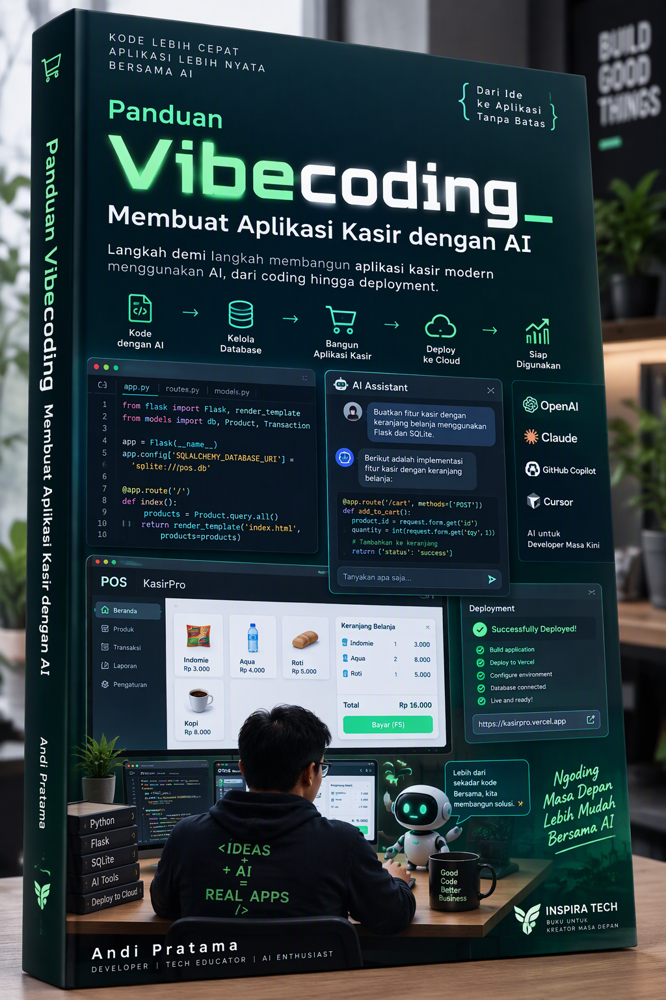
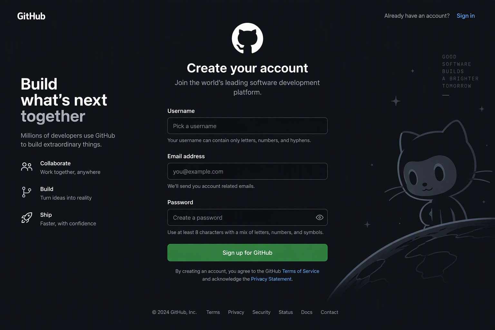
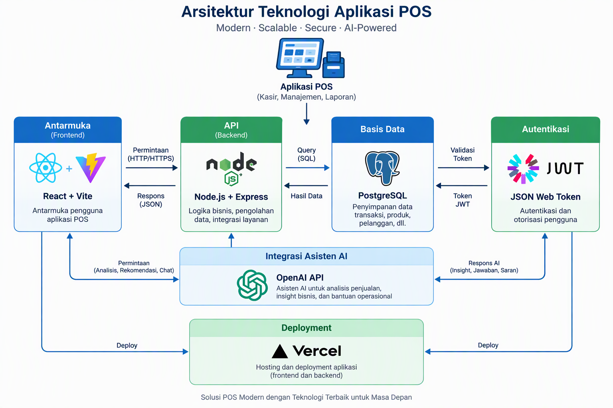

# Panduan Vibecoding: Membuat Aplikasi Kasir dari Nol

**Tutorial Step-by-Step dengan Contoh Nyata**

Disusun oleh: Siraj Nur Ihrom, Founder & Lead Developer SNISHOP  
Versi: 1.0  
Tanggal: Oktober 2026  
Format: Tutorial lengkap dengan kode, screenshot, dan panduan deployment  
Standar: SNISHOP-PUBLISHING v2.0  
Profil: Tutorial Step-by-Step

## Tentang Buku Ini

Buku ini adalah panduan praktis untuk membuat aplikasi kasir (Point of Sale) dari nol menggunakan pendekatan vibecoding. Anda tidak perlu pengalaman pemrograman sebelumnya. Kami akan membangun aplikasi kasir yang bisa langsung dipakai untuk bisnis Anda.

Yang akan Anda bangun:
- Aplikasi kasir berbasis web yang bisa diakses dari browser
- Fitur produk, transaksi, laporan penjualan, dan manajemen stok
- Database untuk menyimpan data produk dan transaksi
- Antarmuka yang mudah dipakai oleh kasir
- Deployment ke server agar bisa diakses dari mana saja

## Prasyarat

Sebelum memulai, pastikan Anda memiliki:
- Laptop atau komputer dengan koneksi internet
- Browser modern (Chrome, Firefox, atau Edge)
- Akun GitHub (gratis) untuk menyimpan kode
- Akun Vercel (gratis) untuk deployment
- Text editor (kami akan pakai Visual Studio Code)

## Apa Itu Vibecoding?

Vibecoding adalah pendekatan pemrograman yang mengandalkan AI untuk membantu menulis kode. Anda menjelaskan apa yang ingin Anda bangun dalam bahasa manusia, dan AI akan menghasilkan kode untuk Anda. Tugas Anda adalah memahami, memodifikasi, dan menguji kode tersebut.

Vibecoding bukan tentang mengganti programmer. Vibecoding adalah tentang mempercepat pengembangan untuk orang yang punya ide bisnis tapi tidak punya latar belakang teknis.

### Kelebihan Vibecoding

1. **Cepat**: Aplikasi yang biasanya butuh berminggu-minggu bisa selesai dalam hitungan jam
2. **Murah**: Tidak perlu menyewa programmer mahal untuk MVP
3. **Fleksibel**: Anda bisa mengubah fitur kapan saja tanpa menunggu developer
4. **Edukatif**: Anda belajar pemrograman sambil membangun produk nyata

### Keterbatasan Vibecoding

1. **Kualitas kode**: Kode yang dihasilkan AI tidak selalu optimal atau aman
2. **Debugging**: Ketika ada bug, Anda perlu pemahaman dasar untuk memperbaikinya
3. **Skalabilitas**: Aplikasi vibecoding cocok untuk MVP, tapi mungkin perlu refactor untuk skala besar
4. **Keamanan**: Anda perlu memeriksa aspek keamanan sendiri atau konsultasi dengan ahli

## Arsitektur Aplikasi

Aplikasi kasir yang akan kita bangun menggunakan stack berikut:

| Komponen | Teknologi | Fungsi |
|---|---|---|
| Frontend | React + Tailwind CSS | Antarmuka pengguna |
| Backend | Node.js + Express | API dan logika bisnis |
| Database | PostgreSQL | Penyimpanan data |
| Authentication | JWT | Login dan keamanan |
| Deployment | Vercel | Hosting aplikasi |

## Bab 1: Menyiapkan Lingkungan Pengembangan

### 1.1 Instal Visual Studio Code

Visual Studio Code (VS Code) adalah text editor gratis yang populer di kalangan developer.

**Langkah 1**: Unduh VS Code dari https://code.visualstudio.com

**Langkah 2**: Jalankan installer dan ikuti petunjuknya

**Langkah 3**: Buka VS Code setelah instalasi selesai

### 1.2 Instal Extension yang Dibutuhkan

VS Code membutuhkan extension untuk mendukung pengembangan web.

**Langkah 1**: Buka menu Extensions (Ctrl+Shift+X atau Cmd+Shift+X)

**Langkah 2**: Cari dan instal extension berikut:
- ESLint
- Prettier - Code formatter
- ES7+ React/Redux/React-Native snippets
- Tailwind CSS IntelliSense
- PostgreSQL (oleh Chris Kolk)

